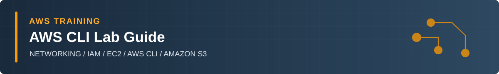
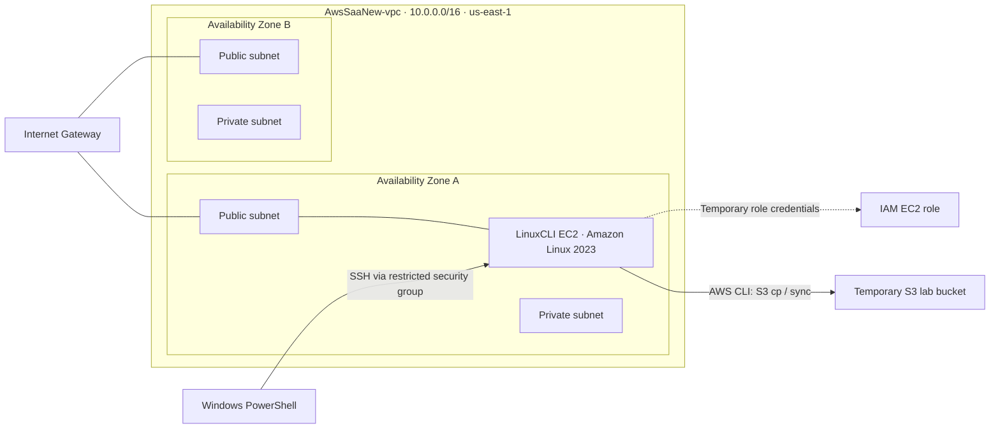

# AWS CLI Lab Guide

**NETWORKING / IAM / EC2 / AWS CLI / AMAZON S3**

A practical, evidence-based learning workbook built from my own AWS Console and terminal exercises.

> [!NOTE]
> **HOW THIS WORKBOOK IS WRITTEN**
>
> My actual actions are narrated in the first person (I selected, I ran, I verified). Technical explanations use a teaching voice (we should understand, this service does, this setting matters). Each original screenshot appears next to the section it documents.

## How to Use This Study Guide

This is a standalone teaching and revision document. It follows the order in which I built and tested the lab, but it explains the reason behind each important setting rather than simply listing completed actions.

| Component / concept | What we should understand |
| --- | --- |
| Purpose and Objectives | The outcome a lab section is designed to demonstrate. |
| Concepts and configuration | What the AWS service does and why the selected settings matter. |
| My implementation | The selections and terminal commands I used in the actual session. |
| Original screenshots | Evidence of what I saw in the Console or terminal; Screenshot 01–63 numbers follow the lab chronology. |
| Verification | What the response or AWS Console demonstrated, including limitations. |
| Exam essentials / questions | Architectural rules and practice questions relevant to SAA-C03. |
| Production considerations | How a real workload would demand stronger security, change control, cost and resilience design. |

### Chapter map

- [01 Building the AWS Networking Environment](#01-building-the-aws-networking-environment)

- [02 Setting Up an IAM Administrator for the Lab](#02-setting-up-an-iam-administrator-for-the-lab)

- [03 Launching a Secure EC2 CLI Workstation](#03-launching-a-secure-ec2-cli-workstation)

- [04 Connecting to Linux and Learning AWS CLI](#04-connecting-to-linux-and-learning-aws-cli)

- [05 Creating IAM Groups, Users and Policies with CLI](#05-creating-iam-groups-users-and-policies-with-cli)

- [06 Working with Amazon S3 from CLI](#06-working-with-amazon-s3-from-aws-cli)

- [07 Cleaning Up Resources and Verifying Costs](#07-cleaning-up-resources-and-verifying-the-result)

- [08 Exam Review, Corrections and Production Lessons](#08-exam-review-corrections-and-production-lessons)

> [!WARNING]
> **IMPORTANT**
>
> The exam notes are explanatory study material derived from the concepts demonstrated in the lab using AWS Documentation.

## Architecture Highlight

The following shows the **environment used during the lab**, not a claim that every resource is still deployed. The VPC was retained; the temporary EC2 workstation, dedicated role, lab IAM resources, S3 test bucket, and Elastic IP allocations were subsequently removed.



---

## 01 Building the AWS Networking Environment

### 1.1 Purpose and Objectives

The purpose of this section is to create a Virtual Private Cloud (VPC) to host my temporary EC2 workstation and provide a reusable networking foundation for future labs. The environment includes public and private subnets across two Availability Zones, route tables, and an internet gateway.

By completing this setup, we should understand the relationship between VPCs, CIDR ranges, subnets, Availability Zones, routing, and network access. A successful resource creation is only the first checkpoint: we also need to verify the resulting architecture.

### 1.2 Understanding Amazon VPC

Amazon VPC provides a logically isolated network in an AWS Region. A VPC contains subnets with non-overlapping address ranges. Each subnet exists in one Availability Zone, while the VPC can contain subnets across several zones.

| Component / concept | What we should understand |
| --- | --- |
| VPC | The Regional network boundary for AWS resources. |
| CIDR block | The IP address range allocated to the VPC or a subnet. |
| Public subnet | A subnet whose associated route table has a route to an internet gateway; public IP and security settings are needed for direct IPv4 internet communication. |
| Private subnet | A subnet without a direct route to an internet gateway. |
| Internet gateway (IGW) | The VPC component that supports direct internet routing for appropriately configured resources. |
| Route table | A set of destinations and targets that direct network traffic. |
| Availability Zone | An isolated location within one Region, used to distribute workloads for resilience. |

### 1.3 Creating the VPC

I opened the AWS Console, navigated to VPC \> Create VPC, and selected the “VPC and more” workflow. This created the VPC together with the requested subnets and related networking components.

| Setting | My lab configuration |
| --- | --- |
| VPC name | AwsSaaNew-vpc |
| VPC ID | vpc-08c6d3188add840d1 |
| Region | us-east-1 (N. Virginia) |
| IPv4 CIDR | 10.0.0.0/16 |
| Availability Zones | 2 |
| Public subnets | 2 |
| Private subnets | 2 |
| NAT gateways | None |
| VPC endpoints | None |
| DNS resolution | Enabled |
| DNS hostnames | Enabled after verification |

The /16 VPC CIDR represents 65,536 IPv4 addresses before subnet allocations. AWS reserves five IPv4 addresses in each subnet. The public and private subnets make the design useful for learning network separation, and two Availability Zones provide a starting point for discussing availability.

I deliberately omitted NAT gateways and VPC endpoints. The workstation would run in a public subnet, so this exercise did not require private-subnet outbound access. Leaving out NAT avoided paying for a resource that the lab did not use.

<table><tr><td align="center"><a href="images/screenshot-01.png"></a></td></tr></table>

<p><sub><strong>Screenshot 01:</strong> VPC wizard showing the name prefix and 10.0.0.0/16 IPv4 CIDR.</sub></p>

<table><tr><td align="center"><a href="images/screenshot-02.png"></a></td></tr></table>

<p><sub><strong>Screenshot 02:</strong> VPC and more preview showing two Availability Zones, four subnets, and route tables.</sub></p>

<table><tr><td align="center"><a href="images/screenshot-03.png"></a></td></tr></table>

<p><sub><strong>Screenshot 03:</strong> VPC creation workflow showing successful completion of the networking resources.</sub></p>

### 1.4 Verifying the VPC Configuration

After AWS completed creation, I opened the VPC details and Resource Map. The map allowed me to check the actual topology instead of assuming the wizard had created exactly what I intended. I confirmed four subnets across two zones and an attached internet gateway.

During the DNS review, I found that DNS hostnames were not enabled initially. I returned to **VPC \> Your VPCs \> AwsSaaNew-vpc \> Actions \> Edit VPC settings**, enabled DNS hostnames, and kept DNS resolution enabled.

<table><tr><td align="center"><a href="images/screenshot-04.png"></a></td></tr></table>

<p><sub><strong>Screenshot 04:</strong> Created VPC showing four subnets, its resource map, and enabled DNS settings.</sub></p>

> [!IMPORTANT]
> **SAA-C03 EXAM CONNECTION**
>
> A VPC spans one AWS Region; each subnet spans one Availability Zone. A subnet is public because its route table points to an IGW, not because the subnet name contains “public”. An EC2 instance also needs suitable public addressing and security permissions to communicate directly over IPv4.

### 1.5 Knowledge Check

> [!TIP]
> 1.  Does creating two Availability Zones automatically make my application highly available?
>
> **Answer: No.** The network has the potential to host resources in multiple zones, but application components, load balancing, replication, and failure recovery must also be designed.
>
> 2.  Is the public IPv4 address by itself enough for internet access?
>
> **Answer: No.** The route to the internet gateway and the security rules must also permit traffic.
>
> 3.  Do private subnets require NAT gateways just to exist?
>
> **Answer: No.** A NAT gateway is useful when particular private IPv4 workloads need outbound internet access; not every private subnet has that requirement.

> [!NOTE]
> **KEY TAKEAWAY**
>
> I kept AwsSaaNew-vpc for future labs. Its subnets and routes are part of a reusable practice network, not temporary resources to delete after every exercise.

## 02 Setting Up an IAM Administrator for the Lab

### 2.1 Purpose and Objectives

Before creating and managing resources in the AWS Console, I prepared an IAM identity to use for hands-on administration. This section records how I created awsMaster, placed it in Admins, and gave that group AdministratorAccess.

### 2.2 IAM Users, Groups and Policies

Identity and Access Management (IAM) controls who can authenticate and what actions their identity is allowed to perform. We should distinguish identity creation, group membership, and permissions: they are separate operations.

| Component / concept | What we should understand |
| --- | --- |
| IAM user | A long-lived identity used by a person or a legacy application; may have console sign-in or programmatic credentials. |
| IAM group | A collection of IAM users used to assign permissions consistently. |
| IAM policy | A JSON policy document that describes allowed or denied actions on resources under defined conditions. |
| AdministratorAccess | An AWS-managed policy providing broad administrative allow permissions; not appropriate for most workload identities. |
| MFA | A second factor for authentication, strongly recommended and especially important for privileged identities. |
| IAM role | A principal assumed temporarily; we use one later for EC2 instead of storing permanent AWS keys. |

### 2.3 Creating awsMaster and the Admins Group

I opened IAM \> Users \> Create user, entered awsMaster, and enabled console sign-in. During permissions setup I created a group named Admins and selected AdministratorAccess. I then selected Admins as the user’s permission group and reviewed the final creation screen.

| Resource | Configuration / observed result |
| --- | --- |
| IAM user | awsMaster |
| Console access | Enabled for the lab |
| IAM group | Admins |
| Attached group policy | AdministratorAccess (AWS-managed) |
| MFA | Not configured by my lab-only decision |
| End-of-lab decision | Retained for future hands-on exercises |

<table><tr><td align="center"><a href="images/screenshot-05.png"></a></td></tr></table>

<p><sub><strong>Screenshot 05:</strong> IAM user setup for awsMaster with AWS Management Console access.</sub></p>

<table><tr><td align="center"><a href="images/screenshot-06.png"></a></td></tr></table>

<p><sub><strong>Screenshot 06:</strong> Creating the Admins IAM group with the AdministratorAccess policy selected.</sub></p>

<table><tr><td align="center"><a href="images/screenshot-07.png"></a></td></tr></table>

<p><sub><strong>Screenshot 07:</strong> Admins group created and selected as the permission source for awsMaster.</sub></p>

<table><tr><td align="center"><a href="images/screenshot-08.png"></a></td></tr></table>

<p><sub><strong>Screenshot 08:</strong> Final IAM user review showing awsMaster and the selected Admins group.</sub></p>

<table><tr><td align="center"><a href="images/screenshot-09.png"></a></td></tr></table>

<p><sub><strong>Screenshot 09:</strong> Confirmation that the awsMaster IAM user was created successfully.</sub></p>

### 2.4 Understanding the Security Exception

I chose not to configure MFA on awsMaster during this exercise, and I later decided to keep the user for future labs. This is an explicit learning-environment exception, not a pattern to reuse in production. A compromised privileged user could create, modify, or delete resources and incur significant cost.

> [!CAUTION]
> **SECURITY ACTION FOR THE RETAINED USER**
>
> Enable MFA on awsMaster before using the account for anything outside a controlled training context. Use a unique password, do not generate unnecessary permanent access keys, and review the membership of Admins and the effective permissions periodically.

> [!IMPORTANT]
> **SAA-C03 EXAM CONNECTION**
>
> Groups do not authenticate or assume roles by themselves; users are added to groups. A policy attached to Admins is relevant to awsMaster because that user belongs to the group. Permissions from multiple applicable policies are evaluated together, and an explicit deny overrides an allow.

### 2.5 Knowledge Check

> [!TIP]
> 1.  Does creating a new IAM group automatically grant permissions?
>
> **Answer: No.** The group needs applicable policies; the users must be members to benefit from group permissions.
>
> 2.  Is AdministratorAccess suitable for the EC2 lab workstation?
>
> **Answer: No, not by default.** A workload should receive only the permissions it needs, preferably through an instance profile and role.
>
> 3.  Does an administrator account without MFA represent a good production baseline?
>
> **Answer: No.** Privileged identities should be protected with strong authentication and minimal necessary access.

> [!NOTE]
> **KEY TAKEAWAY**
>
> The administration identity and the EC2 workload identity have different purposes. Later, I created a dedicated EC2 role so terminal commands would not depend on awsMaster access keys.

## 03 Launching a Secure EC2 CLI Workstation

### 3.1 Purpose and Objectives

The goal of this part of the lab is to launch a temporary Linux EC2 instance that can run AWS CLI commands. I needed a supported Linux image, public-subnet network connectivity for SSH, a private key for login, and an IAM role for temporary AWS credentials.

### 3.2 Choosing the AMI, Instance and Network

I selected Amazon Linux 2023 with an x86_64 architecture and a t3.micro instance type. I named the instance LinuxCLI and placed it in a public subnet of AwsSaaNew-vpc. I used a small 8 Gb root EBS volume and the npoweraws key pair.

| Setting | My observed selection |
| --- | --- |
| Instance name | LinuxCLI |
| Instance ID | i-0abe609b1d6a25320 |
| Amazon Machine Image | Amazon Linux 2023, x86_64 |
| Instance type | t3.micro |
| VPC | AwsSaaNew-vpc |
| Subnet | AwsSaaNew-subnet-public1-us-east-1a |
| Public IPv4 | Automatically assigned at launch |
| Key pair | npoweraws (.pem private key kept locally) |
| Security group | LinuxCLI-SG |
| Inbound SSH | TCP 22 from My IP only |
| Root storage | 8 GiB EBS |
| Result | Running; 3/3 checks passed |

A **public subnet** makes it possible to build a direct SSH learning environment, but it also places security responsibility on the instance configuration.

**Restricting SSH to My IP (/32)** was safer than permitting 0.0.0.0/0.

**Security groups are stateful**; response traffic for allowed connections is automatically permitted.

The automatically assigned public IPv4 address used for SSH was not an Elastic IP allocation.

<table><tr><td align="center"><a href="images/screenshot-10.png"></a></td></tr></table>

<p><sub><strong>Screenshot 10:</strong> Amazon Linux 2023 AMI selected for the EC2 workstation.</sub></p>

<table><tr><td align="center"><a href="images/screenshot-11.png"></a></td></tr></table>

<p><sub><strong>Screenshot 11:</strong> EC2 launch settings showing LinuxCLI, Amazon Linux 2023, and t3.micro.</sub></p>

<table><tr><td align="center"><a href="images/screenshot-12.png"></a></td></tr></table>

<p><sub><strong>Screenshot 12:</strong> EC2 network settings showing the VPC, public subnet, and SSH access restricted to My IP.</sub></p>

### 3.3 Creating a Dedicated IAM Role for EC2

I created **AwsSaaNew-CLI-EC2-Role** for this lab. I selected EC2 as the trusted AWS service and created a custom inline policy designed around the operations I expected to perform.

This separates the two questions that IAM roles must answer: “Who is allowed to assume the role?” and “What is the role allowed to do after it is assumed?” The trust policy allows EC2 to assume the role; the permissions policy allows defined API actions. The instance profile makes the role available to the EC2 instance.

| Component / concept | What we should understand |
| --- | --- |
| Role component | What I configured |
| Trust policy | Specifies which principal, here the EC2 service, may assume the role. |
| Permissions policy | Describes actions and resources that role sessions may access. |
| Inline policy | A policy embedded directly in one IAM identity; removal of that identity removes the attachment. |
| Instance profile | The IAM container used to associate an IAM role with an EC2 instance. |
| Temporary role credentials | Credentials supplied to the workload and rotated by AWS, avoiding hard-coded IAM user secret keys. |
| Role name | AwsSaaNew-CLI-EC2-Role |
| Trusted entity | AWS service: EC2 |
| Inline policy | AwsSaaNew-CLI-Lab-Policy |
| Permission intent | EC2 operations; limited lab IAM operations for CLIGroup / Student; S3 operations for awssaanew-cli- bucket prefix |
| Instance association | Selected the new instance profile under EC2 Advanced details |

A role may have permission to perform broad actions if a policy is too permissive. The important principle is to restrict actions and resources to the required training operations. The screenshot sequence documents the custom policy setup, but this guide does not invent the exact JSON text where the capture does not show every character.

<table><tr><td align="center"><a href="images/screenshot-13.png"></a></td></tr></table>

<p><sub><strong>Screenshot 13:</strong> Existing IAM instance profile displayed before creating a dedicated lab role.</sub></p>

<table><tr><td align="center"><a href="images/screenshot-14.png"></a></td></tr></table>

<p><sub><strong>Screenshot 14:</strong> Creating the EC2 IAM role with the EC2 service selected as the trusted entity.</sub></p>

<table><tr><td align="center"><a href="images/screenshot-15.png"></a></td></tr></table>

<p><sub><strong>Screenshot 15:</strong> IAM role permissions step during creation of the EC2 workstation role.</sub></p>

<table><tr><td align="center"><a href="images/screenshot-16.png"></a></td></tr></table>

<p><sub><strong>Screenshot 16:</strong> JSON policy editor used to define the EC2 role permissions.</sub></p>

<table><tr><td align="center"><a href="images/screenshot-17.png"></a></td></tr></table>

<p><sub><strong>Screenshot 17:</strong> Role creation review displaying the role name and EC2 trust policy.</sub></p>

<table><tr><td align="center"><a href="images/screenshot-18.png"></a></td></tr></table>

<p><sub><strong>Screenshot 18:</strong> Inline role policy summary showing the EC2, IAM, and S3 permissions.</sub></p>

<table><tr><td align="center"><a href="images/screenshot-19.png"></a></td></tr></table>

<p><sub><strong>Screenshot 19:</strong> Success message confirming creation of AwsSaaNew-CLI-EC2-Role.</sub></p>

<table><tr><td align="center"><a href="images/screenshot-20.png"></a></td></tr></table>

<p><sub><strong>Screenshot 20:</strong> EC2 Advanced details showing the new IAM instance profile selected.</sub></p>

### 3.4 Completing the Launch and Checking Health

With the instance profile attached, I reviewed the launch summary and started LinuxCLI. I waited for the EC2 Console to show Running and 3/3 status checks. These checks established that the instance was ready for the next test: connecting over SSH.

<table><tr><td align="center"><a href="images/screenshot-21.png"></a></td></tr></table>

<p><sub><strong>Screenshot 21:</strong> EC2 launch summary showing a t3.micro instance and 8 GiB EBS volume.</sub></p>

<table><tr><td align="center"><a href="images/screenshot-22.png"></a></td></tr></table>

<p><sub><strong>Screenshot 22:</strong> LinuxCLI instance running with all three EC2 status checks passed.</sub></p>

> [!IMPORTANT]
> **SAA-C03 EXAM CONNECTION**
>
> SAA-C03 questions often distinguish an EC2 instance role from IAM user access keys. For applications running on EC2, attach an IAM role using an instance profile so the SDK or CLI can use temporary credentials. Use security groups to control network traffic; use IAM to control AWS API permissions. These mechanisms solve different problems.

### 3.5 Knowledge Check

> [!TIP]
> 1.  Which AWS component supplies temporary API credentials to EC2?
>
> **Answer: An IAM role attached through an instance profile.** The EC2 metadata credential provider supplies role credentials to compatible tools automatically.
>
> 2.  Does a security group rule granting SSH give permission to create S3 buckets?
>
> **Answer: No.** Security groups control traffic; IAM evaluates AWS API authorization.
>
> 3.  Why use My IP instead of 0.0.0.0/0 for SSH?
>
> **Answer: To reduce the exposure of TCP port 22.** Restricting source addresses reduces the accessible attack surface, though additional hardening is still needed in production.

> [!NOTE]
> **KEY TAKEAWAY**
>
> The EC2 instance was only a workstation. The larger architectural lesson was to give the workstation a dedicated identity and narrowly scoped permissions rather than copying long-term administrator keys into Linux.

## 04 Connecting to Linux and Learning AWS CLI

### 4.1 Purpose and Objectives

In this chapter I connect from Windows PowerShell to LinuxCLI, verify the command-line tools and role identity, configure the default AWS Region and output format, and compare JSON, text and table responses. This establishes a repeatable process for checking the AWS CLI environment.

### 4.2 Establishing an SSH Session

I used PowerShell on Windows, the private key npoweraws.pem, and the ec2-user login for Amazon Linux. You need to replace the IPv4 with your EC2s IP address.

```bash
ssh -i "npoweraws.pem" ec2-user@[EC2-PublicIPaddress]
```

| Component / concept | What we should understand |
| --- | --- |
| ssh | Starts an encrypted remote shell connection. |
| -i "npoweraws.pem" | Specifies the SSH private key file on the local Windows computer. |
| ec2-user | The default login user for the selected Amazon Linux image. |
| 100.55.43.111 | The public IPv4 address used in this lab; a temporary address, not a reusable endpoint. |

<table><tr><td align="center"><a href="images/screenshot-23.png"></a></td></tr></table>

<p><sub><strong>Screenshot 23:</strong> Windows PowerShell SSH session successfully connected to the Amazon Linux EC2 instance.</sub></p>

### 4.3 Updating Packages and Checking AWS CLI

After signing in, I tested the Linux package-update commands. Amazon Linux 2023 uses **dnf**. The **yum-compatible** invocation also worked in this session, but for reproducible modern instructions, I prefer dnf. Both reported that no packages needed updating.

```bash
sudo su
yum update -y
exit
sudo dnf upgrade -y
aws --version
```

sudo runs commands with elevated operating-system privileges. This is not the same as AWS IAM authorization. The -y flag accepts a package manager’s confirmation prompts; it does not bypass AWS permissions.

The installed version reported aws-cli/2.38.0 with Python 3.9.25. Version checks are useful because syntax, behavior, and installed packages can change between Amazon Linux releases.

<table><tr><td align="center"><a href="images/screenshot-24.png"></a></td></tr></table>

<p><sub><strong>Screenshot 24:</strong> Linux package update commands completed with no pending updates.</sub></p>

<table><tr><td align="center"><a href="images/screenshot-25.png"></a></td></tr></table>

<p><sub><strong>Screenshot 25:</strong> aws --version output confirming AWS CLI 2.38.0 on Amazon Linux 2023.</sub></p>

### 4.4 Verifying the Instance Role Identity

The most important authentication checkpoint was the STS caller identity query. I ran it before making IAM or S3 changes. The returned ARN identified an assumed role session for AwsSaaNew-CLI-EC2-Role, rather than a long-term IAM user credential.

```bash
aws sts get-caller-identity
```

| Component / concept | What we should understand |
| --- | --- |
| aws | Invokes the AWS CLI executable. |
| sts | Selects AWS Security Token Service. |
| get-caller-identity | Returns the identity associated with the credentials currently used by the request. |
| Assumed-role ARN | Shows the named IAM role supplying temporary credentials to the EC2 session. |

<table><tr><td align="center"><a href="images/screenshot-26.png"></a></td></tr></table>

<p><sub><strong>Screenshot 26:</strong> *aws sts get-caller-identity* output identifying the assumed EC2 IAM role.</sub></p>

> [!NOTE]
> **WHY THIS MATTERS**
>
> I did not enter an awsMaster access key and secret key into aws configure on the instance. The attached EC2 role was the credential source. This reduces long-term credential exposure and is the preferred pattern for AWS workloads.

### 4.5 Configuring the Default Region and Output

I configured the CLI to use us-east-1 and JSON as its default output. I then read those settings back rather than assuming they were saved.

```bash
aws configure set region us-east-1
aws configure get region
aws configure set output json
aws configure get output
```

These commands set client-side defaults in the AWS CLI configuration. They do not create an AWS resource, and they do not grant IAM permissions. A later command can override the output format explicitly.

<table><tr><td align="center"><a href="images/screenshot-27.png"></a></td></tr></table>

<p><sub><strong>Screenshot 27:</strong> AWS CLI Region configured and verified as us-east-1.</sub></p>

<table><tr><td align="center"><a href="images/screenshot-28.png"></a></td></tr></table>

<p><sub><strong>Screenshot 28:</strong> AWS CLI JSON output setting and the describe-regions response.</sub></p>

### 4.6 Exploring AWS Region Data in Three Formats

I used the EC2 describe-regions API to compare how the same information appears in different output formats. JSON is structured and usually useful for automation. Text is compact and script-friendly. Table format is easier to scan in a terminal.

```bash
aws ec2 describe-regions
aws ec2 describe-regions --output text
aws ec2 describe-regions --output table
```

| Component / concept | What we should understand |
| --- | --- |
| ec2 | Selects the EC2 API command group. |
| describe-regions | Asks the EC2 API for Region information. |
| --output text | Overrides the default format for this invocation only. |
| --output table | Overrides the format with a terminal-style table for this invocation only. |

A command I encountered in the older learning instructions misspelled describe-regions. I corrected the spelling. The AWS CLI parses command names exactly, so small typos are meaningful.

<table><tr><td align="center"><a href="images/screenshot-29.png"></a></td></tr></table>

<p><sub><strong>Screenshot 29:</strong> Additional JSON results returned by aws ec2 describe-regions.</sub></p>

<table><tr><td align="center"><a href="images/screenshot-30.png"></a></td></tr></table>

<p><sub><strong>Screenshot 30:</strong> aws ec2 describe-regions results displayed using text output.</sub></p>

<table><tr><td align="center"><a href="images/screenshot-31.png"></a></td></tr></table>

<p><sub><strong>Screenshot 31:</strong> aws ec2 describe-regions results displayed in table format.</sub></p>

> [!IMPORTANT]
> **SAA-C03 EXAM CONNECTION**
>
> A successful aws sts get-caller-identity response is a strong credential-source checkpoint. Output formatting flags do not alter permissions or the underlying API operation. For workload authentication, use temporary role credentials rather than an IAM user’s long-lived secret key.

### 4.7 Knowledge Check

> [!TIP]
> 1.  Does aws configure set region us-east-1 grant API permissions?
>
> **Answer: No.** It changes a CLI default, not the IAM policy decision.
>
> 2.  What proves the instance was using an EC2 role?
>
> **Answer: The assumed-role ARN returned by STS.** The caller identity establishes which principal signed the request.
>
> 3.  Does --output table permanently replace the configured JSON output?
>
> **Answer: No.** It applies only to that invocation.

> [!NOTE]
> **KEY TAKEAWAY**
>
> Before troubleshooting a failed AWS CLI command, I should identify the current credentials and Region. The identity, Region, and command syntax are separate layers of a successful API request.

## 05 Creating IAM Groups, Users and Policies with CLI

### 5.1 Purpose and Objectives

This chapter records my first hands-on IAM resource creation with AWS CLI. I created an empty group, created a user, added the user to the group, prepared an inline policy in a JSON file, and verified the result in both the terminal and AWS Console.

### 5.2 Creating the CLIGroup IAM Group

```bash
aws iam create-group --group-name CLIGroup
```

Here, **iam** identifies the service, **create-group** is the API operation, and **--group-name** supplies the requested group name. The JSON response contained the newly created group metadata.

At this point the group had no members and no permissions policy.

<table><tr><td align="center"><a href="images/screenshot-32.png"></a></td></tr></table>

<p><sub><strong>Screenshot 32:</strong> *aws iam create-group* command and JSON response confirming CLIGroup creation.</sub></p>

### 5.3 Creating the Student IAM User

```bash
aws iam create-user --user-name Student
```

The new Student identity appeared in the JSON response and then in the IAM Console. Creating a user through this command does not automatically create a console password or an access key, and it does not automatically grant permissions.

<table><tr><td align="center"><a href="images/screenshot-33.png"></a></td></tr></table>

<p><sub><strong>Screenshot 33:</strong> aws iam create-user command and JSON response confirming Student creation.</sub></p>

<table><tr><td align="center"><a href="images/screenshot-34.png"></a></td></tr></table>

<p><sub><strong>Screenshot 34:</strong> IAM Users page showing Student after creation.</sub></p>

<table><tr><td align="center"><a href="images/screenshot-35.png"></a></td></tr></table>

<p><sub><strong>Screenshot 35:</strong> IAM User groups page showing CLIGroup before adding its member.</sub></p>

### 5.4 Adding Student to CLIGroup

```bash
aws iam add-user-to-group --user-name Student --group-name CLIGroup
aws iam get-group --group-name CLIGroup --query 'Users[].UserName' --output table
```

| Component / concept | What we should understand |
| --- | --- |
| add-user-to-group | Changes the membership relationship between a user and a group. |
| --user-name Student | Identifies the user being added. |
| --group-name CLIGroup | Identifies the target IAM group. |
| get-group | Retrieves metadata and membership for the specified group. |
| --query 'Users\[\].UserName' | JMESPath expression selecting user names from the returned Users array. |
| --output table | Makes this selected membership result easy to read. |

I checked the Console and saw Student listed under CLIGroup. The verification mattered because the group membership, not merely the existence of the two resources, is what allows an attached group policy to become relevant to Student.

<table><tr><td align="center"><a href="images/screenshot-36.png"></a></td></tr></table>

<p><sub><strong>Screenshot 36:</strong> CLIGroup page listing Student as a group member.</sub></p>

<table><tr><td align="center"><a href="images/screenshot-37.png"></a></td></tr></table>

<p><sub><strong>Screenshot 37:</strong> CLI commands adding Student to CLIGroup and verifying group membership.</sub></p>

### 5.5 Preparing a JSON Permissions Policy

For policy practice, I opened AWS-managed **PowerUserAccess** in the IAM Console and used its then-current JSON structure as a learning reference. On the EC2 instance, I created a local file using the Nano editor named **mypolicy.json.**

```bash
nano mypolicy.json
python3 -m json.tool mypolicy.json > /dev/null && echo "JSON valid"
```

The policy structure included Allow statements and a NotAction-based permission pattern. This is not a least-privilege policy suitable for most real workloads; it demonstrates how broad IAM policy language can be expressed and reused. The exact policy version can change, so we should not assume an old screenshot is permanently authoritative.

| Component / concept | What we should understand |
| --- | --- |
| Effect | Allow or Deny decision expressed by a policy statement. |
| Action / NotAction | Identifies included or excluded action sets in the statement; context depends on Effect. |
| Resource | The AWS resources to which the statement applies. |
| Condition | Optional constraints for when the statement applies. |
| python3 -m json.tool | Checks that the file contains syntactically valid JSON; it does not prove the IAM permissions are safe or correct. |
| file://mypolicy.json | Instructs the CLI to read local file contents for a policy-document argument. |

<table><tr><td align="center"><a href="images/screenshot-38.png"></a></td></tr></table>

<p><sub><strong>Screenshot 38:</strong> IAM Console displaying the AWS-managed PowerUserAccess policy used as a reference.</sub></p>

<table><tr><td align="center"><a href="images/screenshot-39.png"></a></td></tr></table>

<p><sub><strong>Screenshot 39:</strong> Editing the local mypolicy.json permissions file in the Nano editor.</sub></p>

<table><tr><td align="center"><a href="images/screenshot-40.png"></a></td></tr></table>

<p><sub><strong>Screenshot 40:</strong> Terminal confirming mypolicy.json passed JSON syntax validation and was saved.</sub></p>

### 5.6 Attaching and Verifying the Inline Group Policy

```bash
aws iam put-group-policy --group-name CLIGroup --policy-name MyPowerUser --policy-document file://mypolicy.json
aws iam get-group-policy --group-name CLIGroup --policy-name MyPowerUser --query PolicyName --output text
```

**Put-group-policy** stores an inline policy on one group. I used the name **MyPowerUser** and then retrieved the policy name for confirmation. The Console showed the policy associated with CLIGroup

<table><tr><td align="center"><a href="images/screenshot-41.png"></a></td></tr></table>

<p><sub><strong>Screenshot 41:</strong> CLI commands attaching MyPowerUser to CLIGroup and checking the inline policy.</sub></p>

<table><tr><td align="center"><a href="images/screenshot-42.png"></a></td></tr></table>

<p><sub><strong>Screenshot 42:</strong> CLIGroup permissions page displaying the attached MyPowerUser inline policy.</sub></p>

> [!IMPORTANT]
> **IAM PERMISSION EVALUATION**
>
> Student can potentially gain applicable allows from the policy attached to CLIGroup because Student is a group member. However, access is not unconditional: explicit denies, permissions boundaries, service control policies and other relevant policies or controls may restrict what is possible. A group policy does not grant permissions to users who are not members.
> [!IMPORTANT]
> **SAA-C03 EXAM CONNECTION**
>
> On SAA-C03, remember: explicit Deny overrides Allow; an IAM group is a permissions-management structure, not a principal that signs requests; managed and inline policies differ in reusability; role sessions are preferable to stored secret keys for AWS workloads.

### 5.7 Knowledge Check

> [!TIP]
> 1.  Does MyPowerUser automatically grant permissions to every IAM user in the account?
>
> **Answer: No.** The policy is attached to CLIGroup and affects its relevant members, subject to other applicable controls.
>
> 2.  Can an explicit Deny be overridden by an AdministratorAccess?
>
> **Answer: No.** An explicit deny in an applicable policy takes precedence over an allow, with policy evaluation context .
>
> 3.  What does json.tool prove?
>
> **Answer: That the file parses as JSON.** It does not prove the IAM statement is appropriately scoped or that its actions exist.

> [!NOTE]
> **KEY TAKEAWAY**
>
> I verified IAM changes through both API responses and the IAM Console. This helped distinguish creation, membership, and authorization instead of treating them as one operation.

## 06 Working with Amazon S3 from AWS CLI

### 6.1 Purpose and Objectives

In this section, I created a temporary private S3 bucket, copied local files to object storage, synchronized selected files, deleted local copies, recovered files from S3, and confirmed object persistence. I also deliberately left an unrelated pre-existing CloudFormation bucket untouched.

### 6.2 Listing Buckets Before Creating Anything

```bash
aws s3 ls
```

The first list included an existing bucket associated with a different AWS workflow. I treated it as unrelated account infrastructure and preserved it. Listing before creation is a useful habit because it reveals what already exists before we run cleanup commands later.

<table><tr><td align="center"><a href="images/screenshot-43.png"></a></td></tr></table>

<p><sub><strong>Screenshot 43:</strong> Initial aws s3 ls output showing the pre-existing CloudFormation bucket.</sub></p>

### 6.3 Creating the Temporary Lab Bucket

```bash
aws s3 mb s3://awssaanew-cli-ACCOUNT_ID --region us-east-1
aws s3 ls
aws s3 ls s3://awssaanew-cli-ACCOUNT_ID/
aws s3api head-bucket --bucket awssaanew-cli-ACCOUNT_ID
```

| Component / concept | What we should understand |
| --- | --- |
| s3 | Higher-level AWS CLI commands for common S3 file operations. |
| mb | Make bucket: create the named bucket. |
| s3://bucket-name | An S3 bucket URI, not a local filesystem path. |
| s3api | Lower-level S3 API command group. |
| head-bucket | Checks whether the bucket can be accessed; a successful result may have no visible body. |
| --region us-east-1 | Specifies the target Region for the creation command. |

The bucket name was unique for this session. Anyone recreating the lab should select their own globally unique name and consistently use it throughout the examples. A bucket has a Region, but S3 bucket names share a global namespace within the AWS commercial partition.

<table><tr><td align="center"><a href="images/screenshot-44.png"></a></td></tr></table>

<p><sub><strong>Screenshot 44:</strong> aws s3 mb command confirming creation of the temporary S3 lab bucket.</sub></p>

<table><tr><td align="center"><a href="images/screenshot-45.png"></a></td></tr></table>

<p><sub><strong>Screenshot 45:</strong> S3 bucket listing and head-bucket checks confirming access to the new bucket.</sub></p>

### 6.4 Creating Local Files and Uploading One Object

```bash
touch file1.txt file2.py
ls -l file1.txt file2.py
aws s3 cp file1.txt s3://awssaanew-cli-ACCOUNT_ID/
```

touch created two empty local test files. The S3 cp command uploaded file1.txt as an object. An S3 object is stored under a key within a bucket; it is not the same thing as a mounted Linux file system file.

<table><tr><td align="center"><a href="images/screenshot-46.png"></a></td></tr></table>

<p><sub><strong>Screenshot 46:</strong> Local file creation and aws s3 cp upload of file1.txt to S3.</sub></p>

### 6.5 Synchronizing a Selected File Set

```bash
aws s3 sync . s3://awssaanew-cli-ACCOUNT_ID/ --exclude "*" --include "file1.txt" --include "file2.py"
aws s3 ls s3://awssaanew-cli-ACCOUNT_ID/
```

The period (.) represents the current local directory. **sync** compares source and destination and transfers files according to differences and filters. I used **--exclude "\*"** followed by two **--include** rules so only the two lab test files would be eligible for upload. This protected unrelated local files, including **mypolicy.json**, from being transferred accidentally.

Without **--delete**, S3 sync does not generally remove destination objects simply because they are absent from the source. That distinction became one of the final quiz topics.

<table><tr><td align="center"><a href="images/screenshot-47.png"></a></td></tr></table>

<p><sub><strong>Screenshot 47:</strong> Filtered aws s3 sync output showing both test objects in the S3 bucket.</sub></p>

### 6.6 Removing Local Copies and Recovering from S3

```bash
rm file1.txt file2.py
aws s3 ls s3://awssaanew-cli-ACCOUNT_ID/
aws s3 cp s3://awssaanew-cli-ACCOUNT_ID/file1.txt /home/ec2-user/
aws s3 sync s3://awssaanew-cli-ACCOUNT_ID/ /home/ec2-user/
ls -l file1.txt file2.py
```

I deleted the two files locally and then listed the S3 bucket. The objects still existed in S3 because local **rm** does not delete remote objects. Next, I downloaded **file1.txt** directly using **cp**, and I **synchronized** the bucket into the home directory to restore **file2.py**.

The final file listing confirmed both local names existed again.

<table><tr><td align="center"><a href="images/screenshot-48.png"></a></td></tr></table>

<p><sub><strong>Screenshot 48:</strong> Local test files removed while both objects remain stored in S3.</sub></p>

<table><tr><td align="center"><a href="images/screenshot-49.png"></a></td></tr></table>

<p><sub><strong>Screenshot 49:</strong> aws s3 cp and aws s3 sync commands restoring the test files from S3.</sub></p>

### 6.7 Comparing cp, sync, rm and mb

| Command | What it does | Main caution |
| --- | --- | --- |
| aws s3 mb | Creates a bucket | Bucket names must be available and Region should be correct. |
| aws s3 cp | Copies file or object data | Check source/destination direction. |
| aws s3 sync | Reconciles selected source files with destination | Filters and --delete change what may be transferred or removed. |
| aws s3 rm | Deletes selected S3 objects | --recursive can remove many objects. |
| aws s3 rb | Removes a bucket | Empty the bucket first; double-check the target name. |

> [!IMPORTANT]
> **SAA-C03 EXAM CONNECTION**
>
> S3 is object storage, not an EC2 filesystem. A bucket is regional, an object has a key, and permissions may apply at bucket and object scope. Pay attention to sync direction, --delete semantics, and filters when interpreting automation questions.

### 6.8 Knowledge Check

> [!TIP]
> 1.  Does rm file1.txt delete the object file1.txt in S3?
>
> **Answer: No.** It deletes only the local filesystem entry.
>
> 2.  Will sync without --delete always remove a destination object missing from the source?
>
> **Answer: No.** Removal of such destination-only objects requires explicit delete behavior.
>
> 3.  Why exclude everything before including two file names?
>
> **Answer: To limit uploads to the intended test files.** This prevents transferring unrelated files from the current directory.

> [!NOTE]
> **KEY TAKEAWAY**
>
> Amazon S3 preserved the objects after I deleted the local files. Restoring them demonstrated why object storage is distinct from the working directory on EC2.

## 07 Cleaning Up Resources and Verifying the Result

### 7.1 Purpose and Objectives

A **successful** **AWS lab includes responsible teardown**. I removed temporary resources that had been created solely for the CLI exercises and preserved the reusable VPC and administrative IAM setup for future study. The final state was verified through the Console and terminal where screenshots were available.

> [!WARNING]
> **BEFORE DELETION**
>
> Cleanup commands are destructive. A different account, Region, bucket name, or resource ID can change what gets removed. The commands below document actions I performed during this specific session; they are not meant to be pasted into another environment without verification.

### 7.2 Removing the IAM Group Policy, User and Group

I deleted the temporary group inline policy before deleting the IAM group. I then removed Student from CLIGroup and deleted Student. My first check showed that CLIGroup still existed, so I performed the remaining group deletion and verified that the filtered CLIGroup lookup returned an empty list. The retained Admins group was not part of this deletion.

```bash
aws iam delete-group-policy --group-name CLIGroup --policy-name MyPowerUser
aws iam list-group-policies --group-name CLIGroup --query 'PolicyNames' --output json
aws iam remove-user-from-group --user-name Student --group-name CLIGroup
aws iam delete-user --user-name Student
aws iam list-users --query "Users[?UserName=='Student'].UserName" --output json
aws iam delete-group --group-name CLIGroup
aws iam list-groups --query "Groups[?GroupName=='CLIGroup'].GroupName" --output json
```

**This sequence is a useful troubleshooting example**: deleting a user does not also delete the group. Verification caught the incomplete teardown and allowed me to correct it.

<table><tr><td align="center"><a href="images/screenshot-50.png"></a></td></tr></table>

<p><sub><strong>Screenshot 50:</strong> CLI command deleting the MyPowerUser inline group policy.</sub></p>

<table><tr><td align="center"><a href="images/screenshot-51.png"></a></td></tr></table>

<p><sub><strong>Screenshot 51:</strong> CLIGroup permissions page showing no attached inline policies.</sub></p>

<table><tr><td align="center"><a href="images/screenshot-52.png"></a></td></tr></table>

<p><sub><strong>Screenshot 52:</strong> CLI verification showing Student removed while CLIGroup still exists.</sub></p>

<table><tr><td align="center"><a href="images/screenshot-53.png"></a></td></tr></table>

<p><sub><strong>Screenshot 53:</strong> CLI commands deleting CLIGroup and verifying that it no longer exists.</sub></p>

### 7.3 Deleting S3 Test Objects and the Bucket

I removed the two lab objects and then deleted the now-empty bucket. I ran the S3 list again and confirmed that the unrelated pre-existing CloudFormation bucket remained.

```bash
aws s3 rm s3://awssaanew-cli-ACCOUNT_ID/ --recursive
aws s3 rb s3://awssaanew-cli-ACCOUNT_ID/
aws s3 ls
```

<table><tr><td align="center"><a href="images/screenshot-54.png"></a></td></tr></table>

<p><sub><strong>Screenshot 54:</strong> S3 CLI commands removing both test objects and deleting the temporary bucket.</sub></p>

### 7.4 Terminating EC2 and Removing Associated Resources

I selected LinuxCLI in the EC2 Console and terminated it. I intentionally used the Skip OS shutdown option because the instance was disposable and no application data needed a graceful shutdown.

The instance later showed Terminated. I deleted LinuxCLI-SG, removed the inline policy from AwsSaaNew-CLI-EC2-Role, and deleted the role. The EC2 Console’s Volumes page showed no remaining volumes in the selected Region.

<table><tr><td align="center"><a href="images/screenshot-55.png"></a></td></tr></table>

<p><sub><strong>Screenshot 55:</strong> EC2 termination confirmation with Skip OS shutdown selected for the disposable instance.</sub></p>

<table><tr><td align="center"><a href="images/screenshot-56.png"></a></td></tr></table>

<p><sub><strong>Screenshot 56:</strong> EC2 Instances page confirming LinuxCLI is terminated.</sub></p>

<table><tr><td align="center"><a href="images/screenshot-57.png"></a></td></tr></table>

<p><sub><strong>Screenshot 57:</strong> Success message confirming deletion of the LinuxCLI-SG security group.</sub></p>

<table><tr><td align="center"><a href="images/screenshot-58.png"></a></td></tr></table>

<p><sub><strong>Screenshot 58:</strong> IAM dialog for removing the custom inline policy from the EC2 role.</sub></p>

<table><tr><td align="center"><a href="images/screenshot-59.png"></a></td></tr></table>

<p><sub><strong>Screenshot 59:</strong> IAM role deletion confirmation after its inline policy was removed.</sub></p>

<table><tr><td align="center"><a href="images/screenshot-60.png"></a></td></tr></table>

<p><sub><strong>Screenshot 60:</strong> Success message confirming that AwsSaaNew-CLI-EC2-Role was deleted.</sub></p>

<table><tr><td align="center"><a href="images/screenshot-61.png"></a></td></tr></table>

<p><sub><strong>Screenshot 61:</strong> EBS Volumes page showing no volumes remaining in the selected Region.</sub></p>

### 7.5 Releasing Two Elastic IP Allocations

The final network cleanup surfaced two Elastic IP addresses. I confirmed that they were no longer needed and completed the Release Elastic IP addresses operation. The green confirmation and empty table established that neither allocation remained in the selected Region.

| Elastic IP | End state |
| --- | --- |
| 100.62.10.74 | Released |
| 98.89.144.11 | Released |

Elastic IP/public IPv4 allocations may incur ongoing charges while allocated. Releasing unused allocations prevents further allocation charges for those addresses, although charges already incurred are not erased. No independent Billing dashboard audit was performed.

<table><tr><td align="center"><a href="images/screenshot-62.png"></a></td></tr></table>

<p><sub><strong>Screenshot 62:</strong> Both unneeded Elastic IP addresses selected in the release confirmation dialog.</sub></p>

<table><tr><td align="center"><a href="images/screenshot-63.png"></a></td></tr></table>

<p><sub><strong>Screenshot 63:</strong> Elastic IP page showing both addresses released and no remaining allocations.</sub></p>

### 7.6 Final Resource Inventory

| Resource | Final verified / recorded state |
| --- | --- |
| AwsSaaNew-vpc; four subnets; IGW | Retained intentionally for future labs |
| awsMaster IAM user | Retained intentionally; administrator with no MFA |
| Admins + AdministratorAccess | Retained for future labs |
| LinuxCLI instance | Terminated |
| LinuxCLI-SG | Deleted |
| AwsSaaNew-CLI-EC2-Role and inline policy | Deleted |
| Student, CLIGroup, MyPowerUser | Deleted |
| awssaanew-cli-ACCOUNT_ID bucket and objects | Deleted |
| Two Elastic IP allocations | Released |
| EBS volumes in us-east-1 | No volumes shown in Console |
| EBS snapshots | Not audited at my request; none intentionally created |
| Account-wide cost and unrelated resources | Not independently audited |

### 7.7 Knowledge Check

> [!TIP]
> 1.  Why must the IAM inline group policy be removed before the group?
>
> **Answer: Because dependencies can block deletion.** IAM cleanups often require removing group members and inline policies first.
>
> 2.  Does a terminated instance automatically prove there are no other billable resources?
>
> **Answer: No.** EBS snapshots, public IPv4 allocations, NAT gateways, load balancers and other resources may have separate lifecycle and cost.
>
> 3.  Why did I keep the VPC but remove the Elastic IPs?
>
> **Answer: The VPC is reusable infrastructure; the addresses were unnecessary allocations.** The basic VPC network objects do not have the same billing behavior as allocated public IPv4 addresses.

> [!NOTE]
> **KEY TAKEAWAY**
>
> My deletion checklist ended with a verification step for every major resource category. I also recorded what was intentionally retained and what was not independently audited.

## 08 Exam Review, Corrections and Production Lessons

### 8.1 Important Corrections I Made During the Lab

Several practical adjustments improved the accuracy and security of the lab. Rather than reproducing commands without checking them, I compared their intent with the environment actually running on my instance.

| Situation | What I did and why |
| --- | --- |
| Long-lived AWS access keys on EC2 | Used an EC2 instance profile and validated role identity with STS, avoiding manual secret-key configuration. |
| Older Amazon Linux examples | Used Amazon Linux 2023 and the dnf package manager; verified the installed AWS CLI version. |
| Broad SSH access | Restricted TCP/22 ingress to My IP in LinuxCLI-SG. |
| Misspelled EC2 API command | Used aws ec2 describe-regions, not the misspelled form. |
| IAM membership syntax | Used aws iam add-user-to-group with explicit --user-name and --group-name flags. |
| Inconsistent sample bucket names | Kept one exact S3 bucket name throughout the exercise. |
| Unfiltered S3 sync | Used include/exclude filters so the local IAM policy JSON file was not uploaded. |
| Copied permissions policy | Used the policy JSON available in the Console during this session rather than assuming older versions were identical. |
| Cleanup dependencies | Deleted the group policy, memberships, user and remaining group in an order that worked. |
| Unneeded public IPv4 addresses | Released both Elastic IP allocations and verified the empty list. |

### 8.2 SAA-C03 Architecture Summary

| Component / concept | What we should understand |
| --- | --- |
| VPC / subnet scope | VPC = Regional; subnet = one AZ; routing defines public/private traffic paths. |
| IGW vs NAT | IGW supports direct public routing; NAT can support private IPv4 outbound connectivity without exposing the instance to unsolicited direct inbound internet connections. |
| Security group vs IAM | Security group controls network traffic; IAM controls API actions and resource access. |
| EC2 role | Instance profiles provide temporary credentials for workloads; avoid embedded long-term access keys. |
| IAM explicit deny | A relevant explicit deny takes precedence over an allow. |
| S3 copy and sync | Object storage persists independently of local Linux files; --delete changes sync cleanup behavior. |
| Cost hygiene | Terminate disposable compute and verify associated storage, IP allocations and other potentially billable resources. |

### 8.4 Production Considerations and Best Practices

- Use separate production and learning accounts or otherwise strong isolation; configure an account budget and billing alerts.

- Enable MFA for all privileged human identities, including awsMaster if it remains in use.

- Prefer federated workforce access and roles over long-lived IAM user credentials; remove unnecessary AdministratorAccess grants.

- Apply **least privilege** to EC2 roles and review policy Resource scoping and conditions rather than copying broad PowerUserAccess into production.

- Avoid exposing SSH broadly; consider AWS Systems Manager Session Manager where appropriate.

- Select multi-AZ application designs based on actual availability requirements and support them with load balancing, recovery and data strategies.

- Use S3 encryption, block-public-access settings, versioning, lifecycle management and bucket policies when required by the workload.

- Use clean naming, tags and a documented teardown checklist to reduce misidentification during cleanup.

### 8.5 Final Reflection

This lab connected ideas that initially looked separate. A VPC and public subnet gave the workstation network connectivity; a security group limited SSH; an EC2 IAM role supplied temporary AWS credentials; the CLI executed real IAM and S3 API operations; and cleanup verified which resources had been removed.

We did not just create resources. We confirmed identity, tested outputs, cross-checked IAM and S3 state in the Console, caught an incomplete IAM group deletion, and released addresses that were no longer required. The result is a reusable workflow for future AWS labs: configure deliberately, verify every important change, understand its security implications, and clean up with evidence.

> [!NOTE]
> **WHAT REMAINS AFTER THE LAB**
>
> AwsSaaNew-vpc and awsMaster/Admins remain for future practice. The administrator account is intentionally retained without MFA, an exception that should be corrected. No snapshot or full billing audit was performed.

## Technical Competencies

**Cloud networking:** VPC creation, CIDR planning, public and private subnets, availability zones, route tables, internet gateways, and network verification.

**Identity and security:** IAM users and groups, managed and inline policies, EC2 instance profiles, temporary credentials, security group ingress, and policy-evaluation concepts.

**Compute and Linux:** EC2 launch configuration, Amazon Linux 2023, SSH key-based access, Linux package management, and health checks.

**AWS CLI and automation foundations:** AWS CLI installation verification, Region/output defaults, STS identity checks, JSON/text/table responses, and repeatable resource commands.

**Storage and data operations:** S3 bucket management, object uploads, filtered synchronization, local-versus-remote persistence, and object recovery.

**Operational hygiene:** Verification-driven cleanup of IAM, S3, EC2, security groups, EBS resources, and public IPv4 allocations.

### Skills Matrix

| Engineering area | AWS technologies / tools | Evidence demonstrated |
| --- | --- | --- |
| Networking | Amazon VPC, subnets, route tables, internet gateway | Created a `10.0.0.0/16` VPC with four subnets across two Availability Zones |
| Identity and access | IAM, roles, policies, instance profiles | Configured admin-group permissions, a dedicated EC2 role, and temporary IAM CLI resources |
| Compute and OS | EC2, Amazon Linux 2023, SSH, PowerShell | Launched a `t3.micro` CLI workstation, restricted SSH, connected, and checked system health |
| AWS CLI | AWS CLI v2, STS, EC2 APIs | Verified role-based credentials and compared JSON, text, and table output |
| Object storage | Amazon S3, `cp`, `sync`, `rm` | Created a temporary bucket, transferred selected objects, and recovered files |
| Resource lifecycle | IAM, EC2, S3, EBS, Elastic IPs | Removed temporary resources, retained the VPC, and released unneeded Elastic IPs |

---

## Command Reference — Commands I Practiced

This section collects the important working syntax for revision. It is a reference only: the explanations and original screenshots appear in the chapters where I used the commands.

### Linux and role identity

```bash
sudo dnf upgrade -y
aws --version
aws sts get-caller-identity
```

### CLI defaults and EC2 output

```bash
aws configure set region us-east-1
aws configure get region
aws configure set output json
aws ec2 describe-regions --output table
```

### IAM create and verify

```bash
aws iam create-group --group-name CLIGroup
aws iam create-user --user-name Student
aws iam add-user-to-group --user-name Student --group-name CLIGroup
aws iam get-group --group-name CLIGroup --query "Users[].UserName" --output table
```

### IAM inline policy

```bash
python3 -m json.tool mypolicy.json > /dev/null && echo "JSON valid"
aws iam put-group-policy --group-name CLIGroup --policy-name MyPowerUser --policy-document file://mypolicy.json
```

### S3 create, copy and synchronize

```bash
aws s3 mb s3://awssaanew-cli-ACCOUNT_ID --region us-east-1
aws s3 cp file1.txt s3://awssaanew-cli-ACCOUNT_ID/
aws s3 sync . s3://awssaanew-cli-ACCOUNT_ID/ --exclude "*" --include "file1.txt" --include "file2.py"
```

### S3 recovery

```bash
aws s3 cp s3://awssaanew-cli-ACCOUNT_ID/file1.txt /home/ec2-user/
aws s3 sync s3://awssaanew-cli-ACCOUNT_ID/ /home/ec2-user/
```

> [!WARNING]
> **SAFE REUSE REMINDER**
>
> These examples contain names from an already completed and cleaned-up lab. For a new account or future exercise, update names, Regions and permissions and verify the desired destination before running any create, overwrite, or delete operation.

