# AWS CLI Lab
**NETWORKING / IAM / EC2 / AWS CLI / AMAZON S3**

This lab covers hands-on AWS infrastructure configuration using the AWS Management Console and AWS Command Line Interface (CLI).

I created a VPC, configured IAM permissions, launched an Amazon Linux EC2 instance, and established secure SSH access. I then used AWS CLI commands to manage IAM resources, work with Amazon S3, verify configurations, and clean up temporary resources.

The exercises demonstrate how AWS networking, identity, compute, and storage services work together in a practical cloud environment.

---

## Contents

- [01 Building the AWS Networking Environment](#01-building-the-aws-networking-environment)
- [02 Setting Up an IAM Administrator for the Lab](#02-setting-up-an-iam-administrator-for-the-lab)
- [03 Launching a Secure EC2 CLI Workstation](#03-launching-a-secure-ec2-cli-workstation)
- [04 Connecting to Linux and Learning AWS CLI](#04-connecting-to-linux-and-learning-aws-cli)
- [05 Creating IAM Groups, Users and Policies with CLI](#05-creating-iam-groups-users-and-policies-with-cli)
- [06 Working with Amazon S3 from AWS CLI](#06-working-with-amazon-s3-from-aws-cli)
- [07 Cleaning Up Resources and Verifying the Result](#07-cleaning-up-resources-and-verifying-the-result)
- [08 Exam Review, Corrections and Production Lessons](#08-exam-review-corrections-and-production-lessons)

## Architecture Highlight
The following shows the **environment used during the lab**, not a claim that every resource is still deployed. The VPC was retained; the temporary EC2 workstation, dedicated role, lab IAM resources, S3 test bucket, and Elastic IP allocations were subsequently removed.

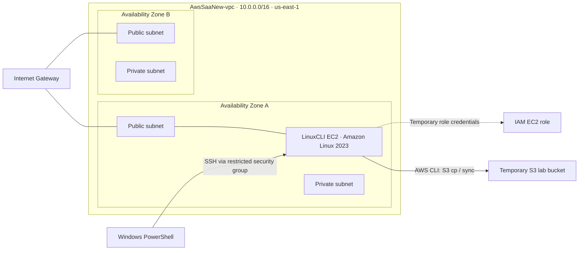

---

## 01 Building the AWS Networking Environment

### 1.1 Purpose and Objectives

The purpose of this section is to create an Amazon Virtual Private Cloud (VPC) for my temporary EC2 workstation and establish a networking foundation that I can reuse in future labs. The environment includes public and private subnets across two Availability Zones, route tables, and an internet gateway.

This exercise demonstrates how VPCs, CIDR ranges, subnets, Availability Zones, routing, and network access fit together. Creating the resources is the first step; verifying the resulting network configuration is equally important.

### 1.2 Understanding Amazon VPC

Amazon VPC provides a logically isolated virtual network within an AWS Region. Subnets divide its IP address space into smaller, non-overlapping ranges. Each subnet belongs to one Availability Zone; the VPC can contain subnets across multiple Availability Zones in the same Region.

| Component / concept | What we should understand |
| --- | --- |
| VPC | A regional virtual network for AWS resources. |
| CIDR block | The IP address range allocated to the VPC or a subnet. |
| Public subnet | A subnet whose associated route table has a route to an internet gateway; public IP and security settings are needed for direct IPv4 internet communication. |
| Private subnet | A subnet without a direct route to an internet gateway. |
| Internet gateway (IGW) | The VPC component that supports direct internet routing for appropriately configured resources. |
| Route table | A set of destinations and targets that direct network traffic. |
| Availability Zone | An isolated location within one Region, used to distribute workloads for resilience. |

### 1.3 Creating the VPC

I opened the AWS Management Console, navigated to **VPC > Create VPC**, and selected the **VPC and more** workflow. This option provisioned the VPC together with the selected subnets, route tables, and other networking components.

| Setting | My lab configuration |
| --- | --- |
| VPC name | AwsSaaNew-vpc |
| VPC ID | vpc-08c6d3188add840d1 |
| Region | us-east-1 (N. Virginia) |
| IPv4 CIDR | 10.0.0.0/16 |
| Availability Zones | 2 |
| Public subnets | 2 |
| Private subnets | 2 |
| NAT gateways | None |
| VPC endpoints | None |
| DNS resolution | Enabled |
| DNS hostnames | Enabled after verification |

The `10.0.0.0/16` VPC CIDR contains 65,536 IPv4 addresses. The subnet ranges are allocated within that space, and AWS reserves five addresses in each subnet. Public and private subnets let us examine network separation, while two Availability Zones provide the foundation for a multi-AZ architecture. This network layout alone does not make an application highly available.

I did not create NAT gateways or VPC endpoints because the workstation ran in a public subnet and the exercise did not require outbound access from private-subnet resources. Omitting a NAT gateway also avoided unnecessary hourly and data-processing charges.

<table><tr><td align="center"><a href="images/screenshot-01.png">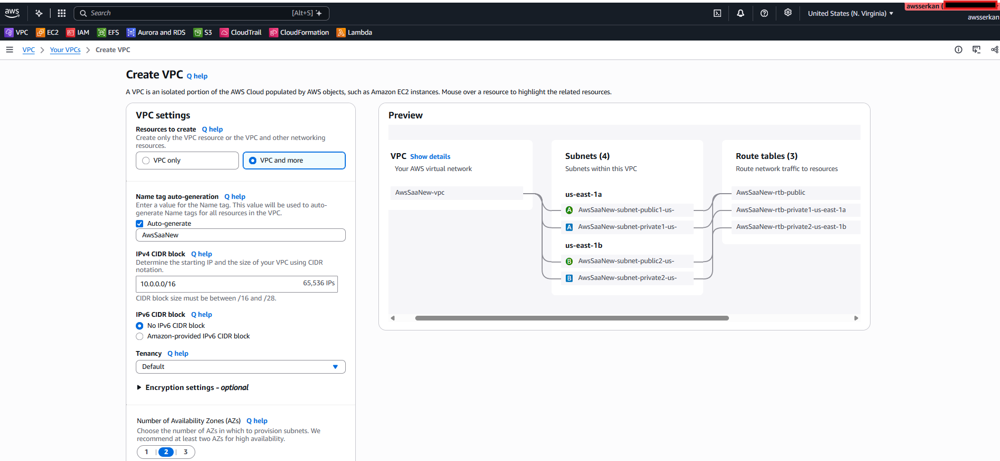</a></td></tr></table>

<p><sub><strong>Screenshot 01:</strong> VPC wizard showing the name prefix and 10.0.0.0/16 IPv4 CIDR.</sub></p>

<table><tr><td align="center"><a href="images/screenshot-02.png">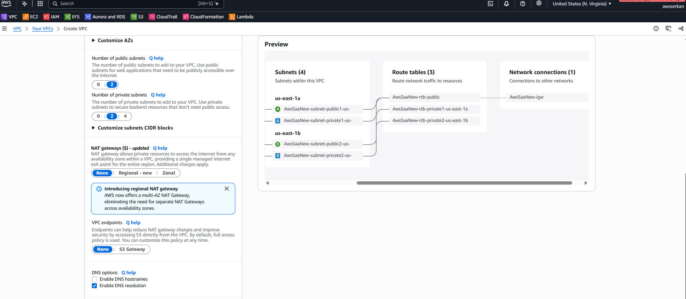</a></td></tr></table>

<p><sub><strong>Screenshot 02:</strong> VPC and more preview showing two Availability Zones, four subnets, and route tables.</sub></p>

<table><tr><td align="center"><a href="images/screenshot-03.png">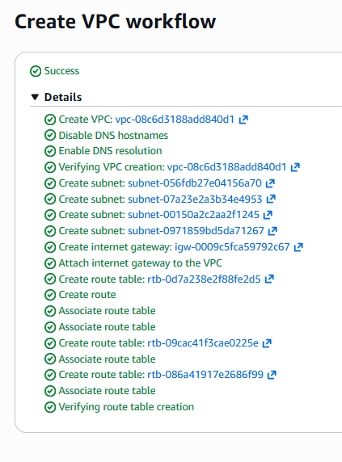</a></td></tr></table>

<p><sub><strong>Screenshot 03:</strong> VPC creation workflow showing successful completion of the networking resources.</sub></p>

### 1.4 Verifying the VPC Configuration

After the VPC was created, I opened its details and Resource Map to verify the resulting topology. I confirmed four subnets across two Availability Zones, the associated route tables, and an attached internet gateway.

During verification, I found that DNS hostnames were initially disabled. I opened **VPC > Your VPCs > `AwsSaaNew-vpc` > Actions > Edit VPC settings**, enabled DNS hostnames, and confirmed that DNS resolution remained enabled. DNS resolves hostnames to IP addresses; routing separately determines how network traffic reaches those addresses.

<table><tr><td align="center"><a href="images/screenshot-04.png">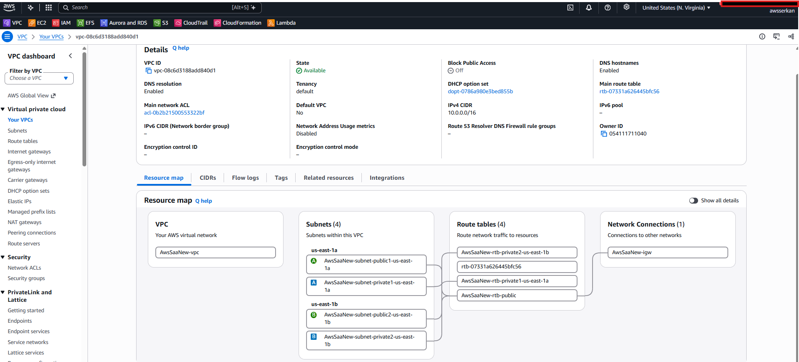</a></td></tr></table>

<p><sub><strong>Screenshot 04:</strong> Created VPC showing four subnets, its resource map, and enabled DNS settings.</sub></p>

> [!IMPORTANT]
> **SAA-C03 EXAM CONNECTION**
>
> A VPC spans one AWS Region; each subnet spans one Availability Zone. A subnet is public because its route table points to an IGW, not because the subnet name contains “public”. An EC2 instance also needs suitable public addressing and security permissions to communicate directly over IPv4.

### 1.5 Knowledge Check

> [!TIP]
> 1.  Does configuring subnets in two Availability Zones automatically make an application highly available?
>
> **Answer: No.** The network can host resources in multiple zones, but the application, data replication, traffic distribution, and failure recovery must also be designed for availability.
>
> 2.  Is the public IPv4 address by itself enough for internet access?
>
> **Answer: No.** The route to the internet gateway and the security rules must also permit traffic.
>
> 3.  Do private subnets require NAT gateways just to exist?
>
> **Answer: No.** A NAT gateway is useful when particular private IPv4 workloads need outbound internet access; not every private subnet has that requirement.

> [!NOTE]
> **KEY TAKEAWAY**
>
> I kept AwsSaaNew-vpc for future labs. Its subnets and routes are part of a reusable practice network, not temporary resources to delete after every exercise.

## 02 Setting Up an IAM Administrator for the Lab

### 2.1 Purpose and Objectives

To administer AWS resources through a dedicated console identity, I created the IAM user `awsMaster`, added it to the `Admins` group, and attached the AWS-managed `AdministratorAccess` policy to that group.

### 2.2 IAM Users, Groups and Policies

AWS Identity and Access Management (IAM) controls identities and authorization for AWS resources. Creating an IAM user, adding the user to a group, and granting permissions are separate operations. Group membership allows applicable group policies to contribute to a user's effective permissions.

| Component / concept | What we should understand |
| --- | --- |
| IAM user | A long-lived identity used by a person or a legacy application; may have console sign-in or programmatic credentials. |
| IAM group | A collection of IAM users used to assign permissions consistently. |
| IAM policy | A JSON policy document that describes allowed or denied actions on resources under defined conditions. |
| AdministratorAccess | An AWS-managed policy providing broad administrative allow permissions; not appropriate for most workload identities. |
| MFA | A second factor for authentication, strongly recommended and especially important for privileged identities. |
| IAM role | An AWS identity that can be assumed to obtain temporary credentials; I later attached one to EC2 instead of storing long-term access keys. |

### 2.3 Creating awsMaster and the Admins Group

I navigated to **IAM > Users > Create user**, entered `awsMaster`, and enabled AWS Management Console access. During permissions setup, I created the `Admins` group, attached the AWS-managed `AdministratorAccess` policy, selected the group for the new user, and reviewed the configuration before creating the user.

| Resource | Configuration / observed result |
| --- | --- |
| IAM user | awsMaster |
| Console access | Enabled for the lab |
| IAM group | Admins |
| Attached group policy | AdministratorAccess (AWS-managed) |
| MFA | Not configured by my lab-only decision |
| End-of-lab decision | Retained for future hands-on exercises |

<table><tr><td align="center"><a href="images/screenshot-05.png">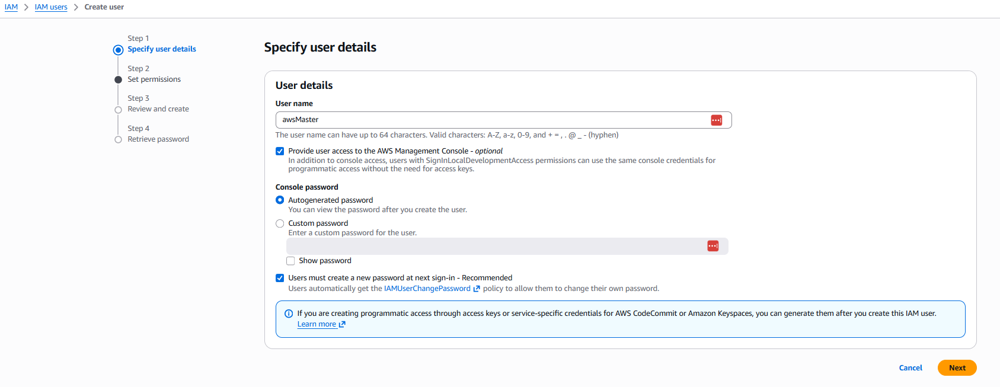</a></td></tr></table>

<p><sub><strong>Screenshot 05:</strong> IAM user setup for awsMaster with AWS Management Console access.</sub></p>

<table><tr><td align="center"><a href="images/screenshot-06.png">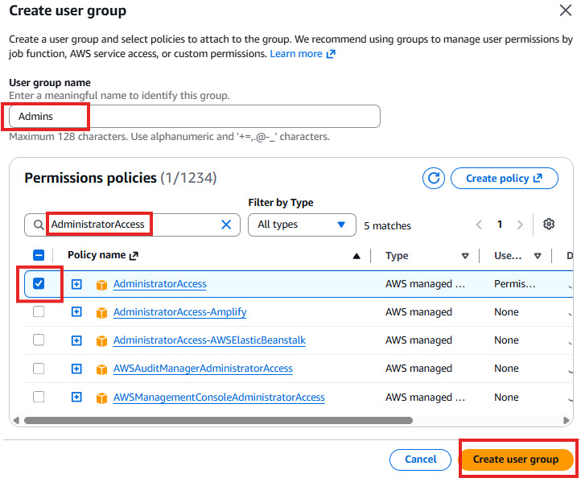</a></td></tr></table>

<p><sub><strong>Screenshot 06:</strong> Creating the Admins IAM group with the AdministratorAccess policy selected.</sub></p>

<table><tr><td align="center"><a href="images/screenshot-07.png">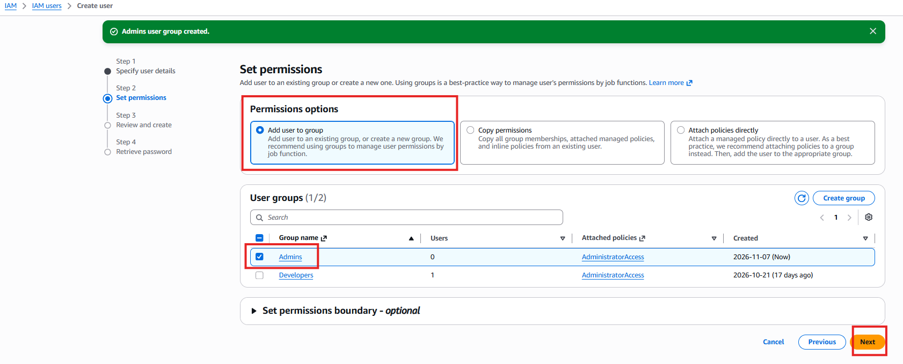</a></td></tr></table>

<p><sub><strong>Screenshot 07:</strong> Admins group created and selected as the permission source for awsMaster.</sub></p>

<table><tr><td align="center"><a href="images/screenshot-08.png">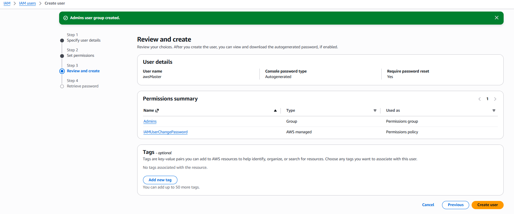</a></td></tr></table>

<p><sub><strong>Screenshot 08:</strong> Final IAM user review showing awsMaster and the selected Admins group.</sub></p>

<table><tr><td align="center"><a href="images/screenshot-09.png">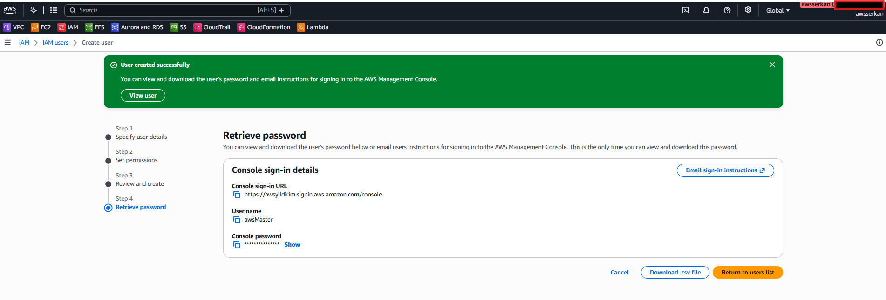</a></td></tr></table>

<p><sub><strong>Screenshot 09:</strong> Confirmation that the awsMaster IAM user was created successfully.</sub></p>

### 2.4 Understanding the Security Exception

I did not configure MFA on `awsMaster` during this exercise, and I kept the user for future labs. This was an intentional lab-only security exception, **not** a recommended security practice. A compromised administrator identity could modify or delete resources, expose data, or incur charges.

> [!CAUTION]
> **SECURITY ACTION FOR THE RETAINED USER**
>
> Enable MFA on `awsMaster` as soon as possible, including for continued lab use. Keep a unique, strong password, avoid unnecessary long-term access keys, and periodically review `Admins` membership and effective permissions.

> [!IMPORTANT]
> **SAA-C03 EXAM CONNECTION**
>
> IAM groups do not sign requests or assume roles; IAM users belong to groups. The policy attached to `Admins` contributes permissions to `awsMaster` through membership. Effective permissions depend on all applicable policies and controls, and an applicable explicit deny overrides an allow.

### 2.5 Knowledge Check

> [!TIP]
> 1.  Does creating a new IAM group automatically grant permissions?
>
> **Answer: No.** The group needs applicable policies; the users must be members to benefit from group permissions.
>
> 2.  Is AdministratorAccess suitable for the EC2 lab workstation?
>
> **Answer: No, not by default.** A workload should receive only the permissions it needs, preferably through an instance profile and role.
>
> 3.  Does an administrator account without MFA represent a good production baseline?
>
> **Answer: No.** Privileged identities should be protected with strong authentication and minimal necessary access.

> [!NOTE]
> **KEY TAKEAWAY**
>
> The administrative IAM user and the EC2 workload role serve different purposes. I used a dedicated EC2 role so commands running on the instance did not require `awsMaster` access keys.

## 03 Launching a Secure EC2 CLI Workstation

### 3.1 Purpose and Objectives

The purpose of this section is to launch a temporary Amazon Linux EC2 workstation for AWS CLI practice. The instance needs an appropriate AMI, public-subnet connectivity for SSH, a key pair for login, and an IAM role for temporary AWS API credentials.

### 3.2 Choosing the AMI, Instance and Network

I selected an Amazon Linux 2023 x86_64 AMI and a `t3.micro` instance. I named it `LinuxCLI`, placed it in a public subnet of `AwsSaaNew-vpc`, configured an **8 GiB** root EBS volume, and selected the `npoweraws` key pair.

| Setting | My observed selection |
| --- | --- |
| Instance name | LinuxCLI |
| Instance ID | i-0abe609b1d6a25320 |
| Amazon Machine Image | Amazon Linux 2023, x86_64 |
| Instance type | t3.micro |
| VPC | AwsSaaNew-vpc |
| Subnet | AwsSaaNew-subnet-public1-us-east-1a |
| Public IPv4 | Automatically assigned at launch |
| Key pair | npoweraws (.pem private key kept locally) |
| Security group | LinuxCLI-SG |
| Inbound SSH | TCP 22 from My IP only |
| Root storage | 8 GiB EBS |
| Result | Running; 3/3 checks passed |

A public subnet with an internet gateway route, a public IPv4 address, and appropriate network rules enabled me to connect directly over SSH.

I restricted inbound **TCP port 22 to My IP (`/32`)** rather than allowing access from `0.0.0.0/0`. Security groups are stateful, so response traffic for an allowed connection is automatically permitted.

The automatically assigned public IPv4 address was **not** an Elastic IP allocation.

<table><tr><td align="center"><a href="images/screenshot-10.png">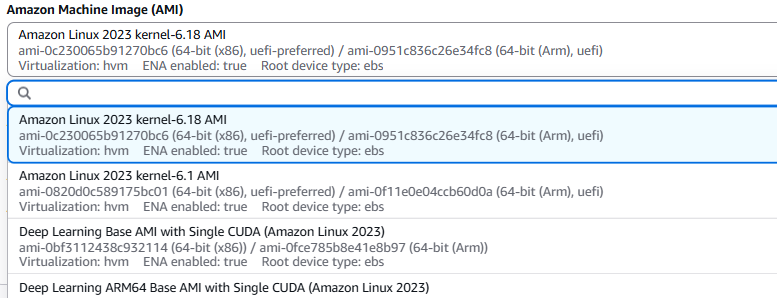</a></td></tr></table>

<p><sub><strong>Screenshot 10:</strong> Amazon Linux 2023 AMI selected for the EC2 workstation.</sub></p>

<table><tr><td align="center"><a href="images/screenshot-11.png">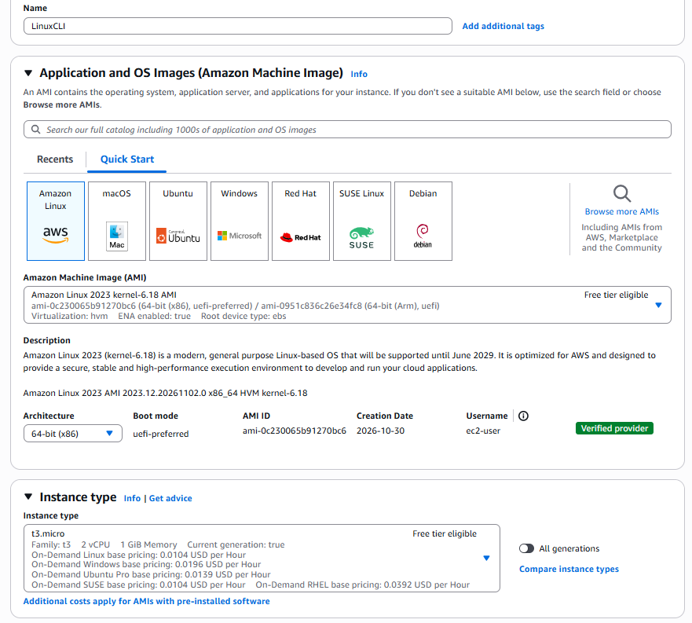</a></td></tr></table>

<p><sub><strong>Screenshot 11:</strong> EC2 launch settings showing LinuxCLI, Amazon Linux 2023, and t3.micro.</sub></p>

<table><tr><td align="center"><a href="images/screenshot-12.png">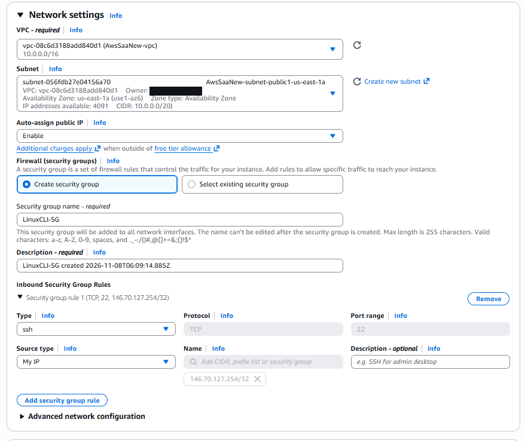</a></td></tr></table>

<p><sub><strong>Screenshot 12:</strong> EC2 network settings showing the VPC, public subnet, and SSH access restricted to My IP.</sub></p>

### 3.3 Creating a Dedicated IAM Role for EC2

I created **AwsSaaNew-CLI-EC2-Role** for this lab. I selected EC2 as the trusted AWS service and created a custom inline policy designed around the operations I expected to perform.

An IAM role has two distinct policy responsibilities: **who may assume it** and **what actions an assumed role may perform**. The trust policy permits the EC2 service to assume the role; the permissions policy defines the allowed AWS API operations. An EC2 instance profile associates the role with the instance.

**Understanding the role components**

| Component | Purpose |
| --- | --- |
| Trust policy | Identifies the trusted principal, here the EC2 service. |
| Permissions policy | Defines which actions and resources the role session may access. |
| Inline policy | A policy embedded in one IAM identity rather than managed as a reusable standalone policy. |
| Instance profile | Associates an IAM role with an EC2 instance. |
| Temporary role credentials | Short-lived credentials made available to the workload and rotated by AWS. |

**My IAM role configuration**

| Setting | Configuration |
| --- | --- |
| Role name | `AwsSaaNew-CLI-EC2-Role` |
| Trusted entity | AWS service: EC2 |
| Inline policy name | `AwsSaaNew-CLI-Lab-Policy` |
| Permission scope | EC2 operations; limited IAM operations involving `CLIGroup` and `Student`; S3 operations for the `awssaanew-cli-` bucket prefix |
| Instance association | Selected the role's instance profile under **EC2 > Advanced details** |

Even a temporary role can be overly permissive if its policy grants too much access. For this lab, I limited the policy to the operations being practiced. The screenshots show the policy setup and summary, but do not reproduce a complete copyable JSON policy; recreating the role requires preparing and reviewing the appropriate policy document.

<table><tr><td align="center"><a href="images/screenshot-13.png">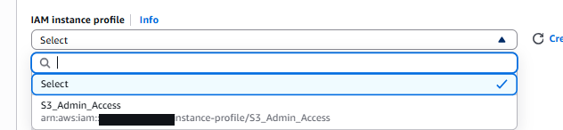</a></td></tr></table>

<p><sub><strong>Screenshot 13:</strong> Existing IAM instance profile displayed before creating a dedicated lab role.</sub></p>

<table><tr><td align="center"><a href="images/screenshot-14.png">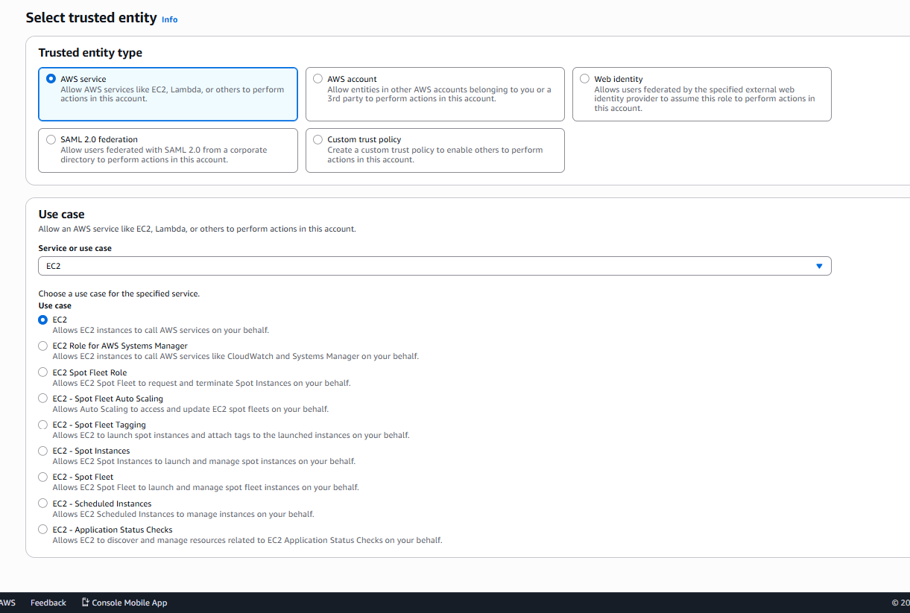</a></td></tr></table>

<p><sub><strong>Screenshot 14:</strong> Creating the EC2 IAM role with the EC2 service selected as the trusted entity.</sub></p>

<table><tr><td align="center"><a href="images/screenshot-15.png">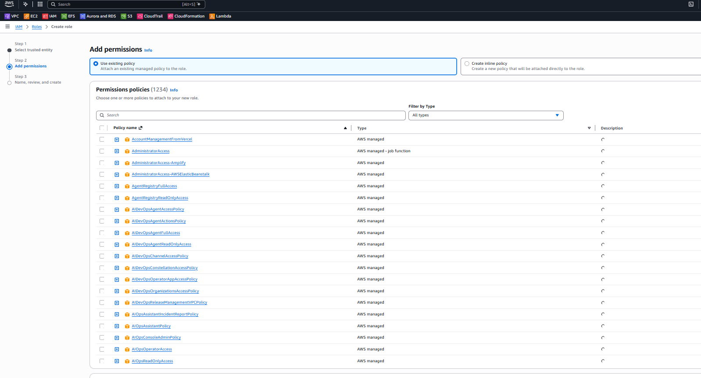</a></td></tr></table>

<p><sub><strong>Screenshot 15:</strong> IAM role permissions step during creation of the EC2 workstation role.</sub></p>

<table><tr><td align="center"><a href="images/screenshot-16.png">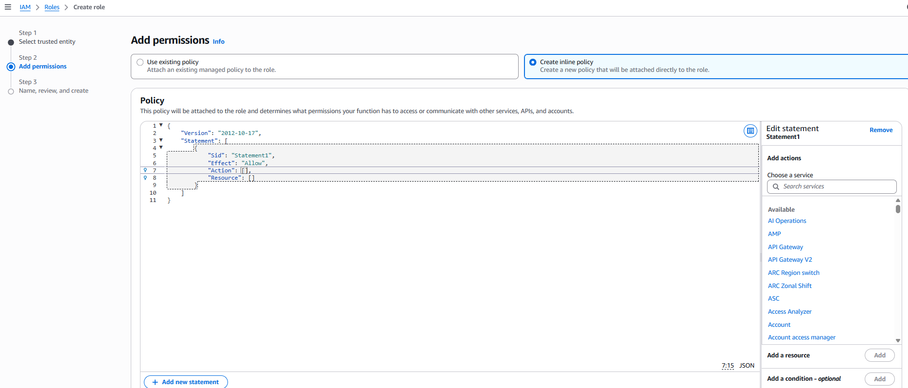</a></td></tr></table>

<p><sub><strong>Screenshot 16:</strong> JSON policy editor used to define the EC2 role permissions.</sub></p>

<table><tr><td align="center"><a href="images/screenshot-17.png">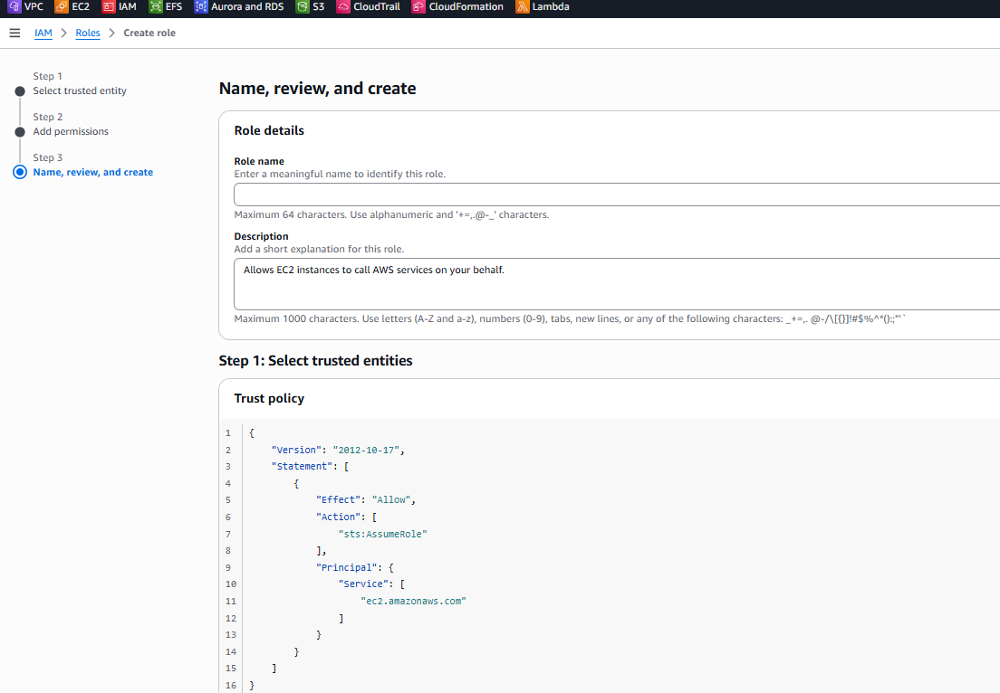</a></td></tr></table>

<p><sub><strong>Screenshot 17:</strong> Role creation review displaying the role name and EC2 trust policy.</sub></p>

<table><tr><td align="center"><a href="images/screenshot-18.png">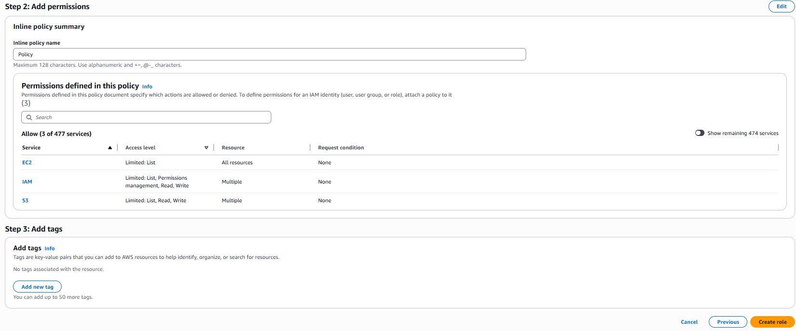</a></td></tr></table>

<p><sub><strong>Screenshot 18:</strong> Inline role policy summary showing the EC2, IAM, and S3 permissions.</sub></p>

<table><tr><td align="center"><a href="images/screenshot-19.png">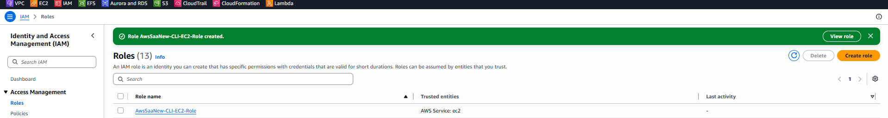</a></td></tr></table>

<p><sub><strong>Screenshot 19:</strong> Success message confirming creation of AwsSaaNew-CLI-EC2-Role.</sub></p>

<table><tr><td align="center"><a href="images/screenshot-20.png">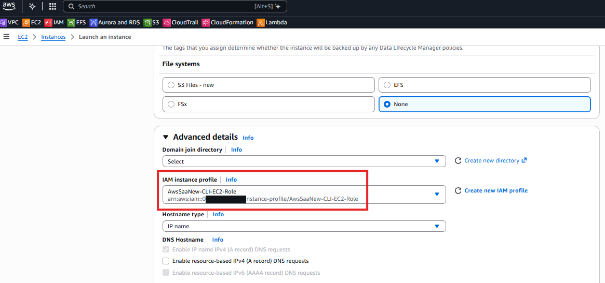</a></td></tr></table>

<p><sub><strong>Screenshot 20:</strong> EC2 Advanced details showing the new IAM instance profile selected.</sub></p>

### 3.4 Completing the Launch and Checking Health

With the instance profile selected, I reviewed the launch summary and launched `LinuxCLI`. The EC2 Console showed the instance as **Running**, with **3/3 status checks passed**. These checks indicated a healthy instance and underlying environment; SSH connectivity still needed to be verified separately.

<table><tr><td align="center"><a href="images/screenshot-21.png">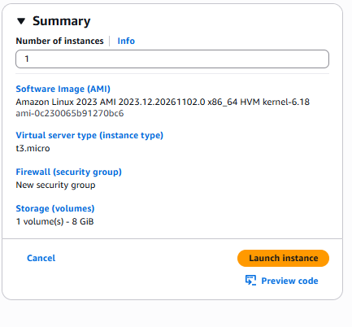</a></td></tr></table>

<p><sub><strong>Screenshot 21:</strong> EC2 launch summary showing a t3.micro instance and 8 GiB EBS volume.</sub></p>

<table><tr><td align="center"><a href="images/screenshot-22.png">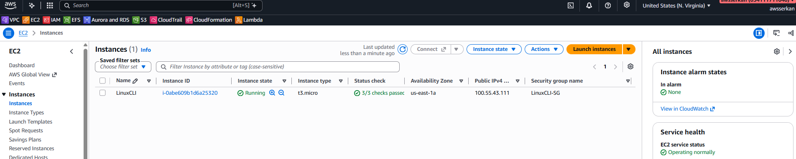</a></td></tr></table>

<p><sub><strong>Screenshot 22:</strong> LinuxCLI instance running with all three EC2 status checks passed.</sub></p>

> [!IMPORTANT]
> **SAA-C03 EXAM CONNECTION**
>
> SAA-C03 questions often distinguish an EC2 instance role from IAM user access keys. For applications running on EC2, attach an IAM role using an instance profile so the SDK or CLI can use temporary credentials. Use security groups to control network traffic; use IAM to control AWS API permissions. These mechanisms solve different problems.

### 3.5 Knowledge Check

> [!TIP]
> 1.  Which AWS component supplies temporary API credentials to EC2?
>
> **Answer: An IAM role attached through an instance profile.** The EC2 metadata credential provider supplies role credentials to compatible tools automatically.
>
> 2.  Does a security group rule granting SSH give permission to create S3 buckets?
>
> **Answer: No.** Security groups control traffic; IAM evaluates AWS API authorization.
>
> 3.  Why use My IP instead of 0.0.0.0/0 for SSH?
>
> **Answer: To reduce the exposure of TCP port 22.** Restricting source addresses reduces the accessible attack surface, though additional hardening is still needed in production.

> [!NOTE]
> **KEY TAKEAWAY**
>
> The EC2 instance served as a temporary CLI workstation. Attaching a dedicated, narrowly scoped IAM role avoided placing long-term administrator credentials on the Linux system.

## 04 Connecting to Linux and Learning AWS CLI

### 4.1 Purpose and Objectives

In this chapter, I connected to `LinuxCLI` from Windows PowerShell, checked the AWS CLI installation and caller identity, configured default Region and output settings, and compared JSON, text, and table responses. These checks establish a repeatable way to verify the CLI environment.

### 4.2 Establishing an SSH Session

I connected from Windows PowerShell using the `npoweraws.pem` private key and the default Amazon Linux user, `ec2-user`. The address shown in brackets below is a placeholder; to repeat this step, replace it with the current public IPv4 address of your instance.

```powershell
ssh -i "npoweraws.pem" ec2-user@[EC2-PublicIPaddress]
```

| Component / concept | What we should understand |
| --- | --- |
| ssh | Starts an encrypted remote shell connection. |
| -i "npoweraws.pem" | Specifies the SSH private key file on the local Windows computer. |
| ec2-user | The default login user for the selected Amazon Linux image. |
| `100.55.43.111` | The public IPv4 address used for SSH during this lab; it was temporary, not a persistent endpoint. |

<table><tr><td align="center"><a href="images/screenshot-23.png">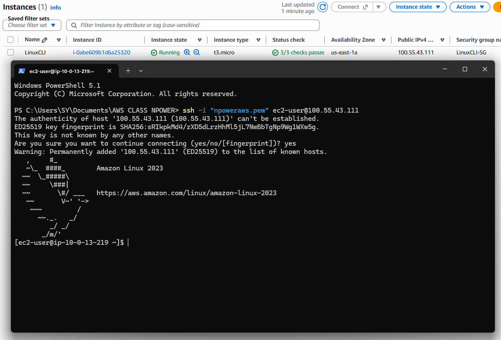</a></td></tr></table>

<p><sub><strong>Screenshot 23:</strong> Windows PowerShell SSH session successfully connected to the Amazon Linux EC2 instance.</sub></p>

### 4.3 Updating Packages and Checking AWS CLI

After signing in, I checked package updates and the AWS CLI version. Amazon Linux 2023 uses `dnf` as its package manager; the `yum` compatibility command also worked in my session. Both update checks reported that no packages needed updating. For future Amazon Linux 2023 steps, I use `dnf`.

```bash
sudo su
yum update -y
exit
sudo dnf upgrade -y
aws --version
```

`sudo` executes commands with elevated Linux privileges; it does not grant AWS IAM permissions. The `-y` argument automatically accepts package manager confirmation prompts and does not bypass IAM authorization.

The version check returned `aws-cli/2.38.0` with Python `3.9.25`. Recording the installed version helps explain differences in behavior or available commands across environments.

<table><tr><td align="center"><a href="images/screenshot-24.png">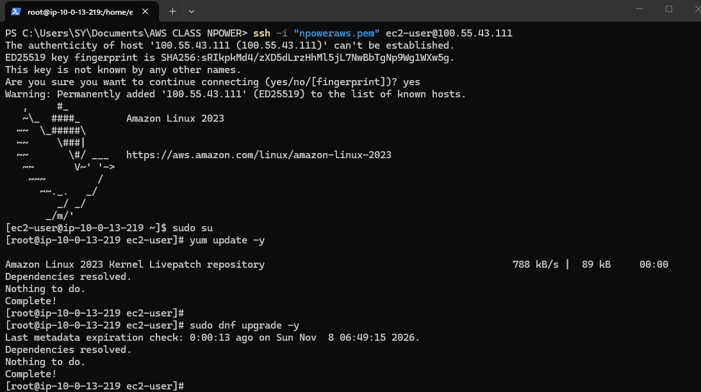</a></td></tr></table>

<p><sub><strong>Screenshot 24:</strong> Linux package update commands completed with no pending updates.</sub></p>

<table><tr><td align="center"><a href="images/screenshot-25.png">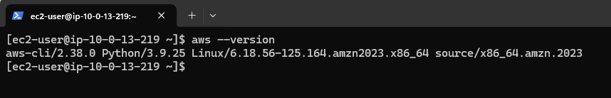</a></td></tr></table>

<p><sub><strong>Screenshot 25:</strong> aws --version output confirming AWS CLI 2.38.0 on Amazon Linux 2023.</sub></p>

### 4.4 Verifying the Instance Role Identity

Before making IAM or S3 changes, I ran the AWS STS caller identity command. Its returned ARN identified an assumed-role session for `AwsSaaNew-CLI-EC2-Role`, rather than an IAM user. Together with the role attached through the EC2 instance profile, this confirmed the intended workload identity. The STS response identifies the caller; by itself it does not identify every step of the credential-provider chain.

```bash
aws sts get-caller-identity
```

| Component / concept | What we should understand |
| --- | --- |
| aws | Invokes the AWS CLI executable. |
| sts | Selects AWS Security Token Service. |
| get-caller-identity | Returns the identity associated with the credentials currently used by the request. |
| Assumed-role ARN | Identifies the role session used to sign the request. |

<table><tr><td align="center"><a href="images/screenshot-26.png">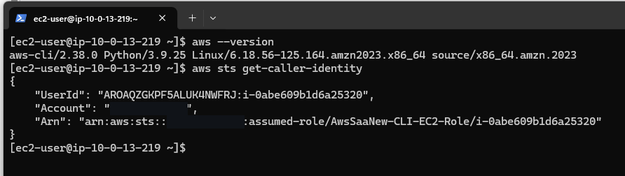</a></td></tr></table>

<p><sub><strong>Screenshot 26:</strong> *aws sts get-caller-identity* output identifying the assumed EC2 IAM role.</sub></p>

> [!NOTE]
> **WHY THIS MATTERS**
>
> I did not store `awsMaster` access keys on the instance. The attached EC2 role provided temporary credentials to the AWS CLI, reducing exposure to long-term secrets.

### 4.5 Configuring the Default Region and Output

I set the AWS CLI default Region to `us-east-1` and output format to `json`. I then retrieved both settings to verify they were saved.

```bash
aws configure set region us-east-1
aws configure get region
aws configure set output json
aws configure get output
```

These commands update local AWS CLI configuration defaults; they do not create AWS resources or grant permissions. An individual command can override the default output format with `--output`.

<table><tr><td align="center"><a href="images/screenshot-27.png">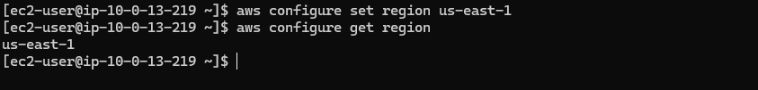</a></td></tr></table>

<p><sub><strong>Screenshot 27:</strong> AWS CLI Region configured and verified as us-east-1.</sub></p>

<table><tr><td align="center"><a href="images/screenshot-28.png">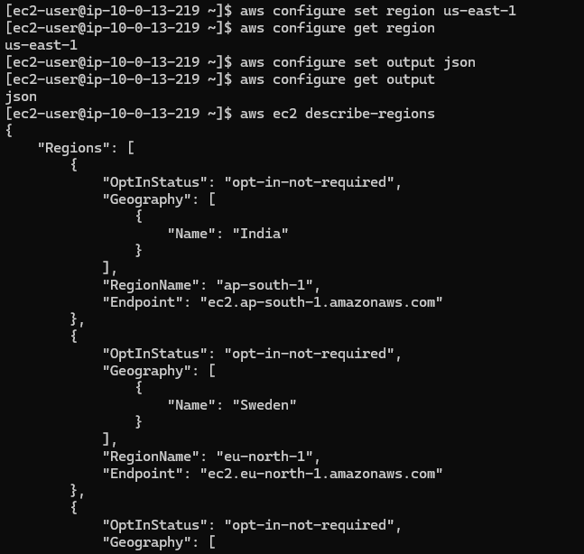</a></td></tr></table>

<p><sub><strong>Screenshot 28:</strong> AWS CLI JSON output setting and the describe-regions response.</sub></p>

### 4.6 Exploring AWS Region Data in Three Formats

I used `aws ec2 describe-regions` to view the same API response in three formats. JSON preserves structured fields, text is useful for concise command-line output, and table format is easier to scan interactively.

```bash
aws ec2 describe-regions
aws ec2 describe-regions --output text
aws ec2 describe-regions --output table
```

| Component / concept | What we should understand |
| --- | --- |
| ec2 | Selects the EC2 API command group. |
| describe-regions | Asks the EC2 API for Region information. |
| --output text | Overrides the default format for this invocation only. |
| --output table | Overrides the format with a terminal-style table for this invocation only. |

The earlier instructions contained a misspelling of `describe-regions`. I corrected it because AWS CLI operation names must be typed accurately.

<table><tr><td align="center"><a href="images/screenshot-29.png">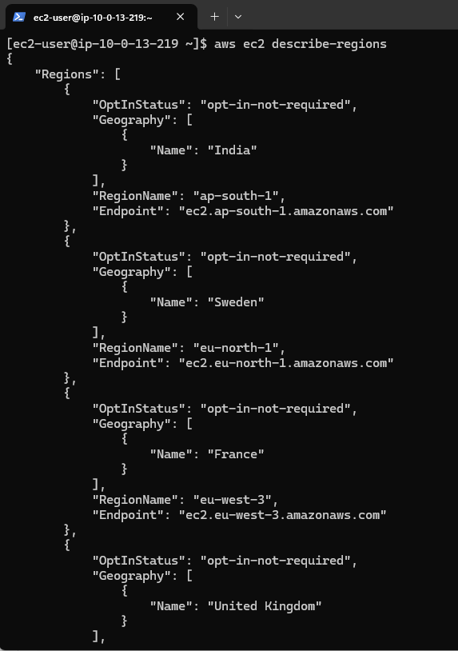</a></td></tr></table>

<p><sub><strong>Screenshot 29:</strong> Additional JSON results returned by aws ec2 describe-regions.</sub></p>

<table><tr><td align="center"><a href="images/screenshot-30.png">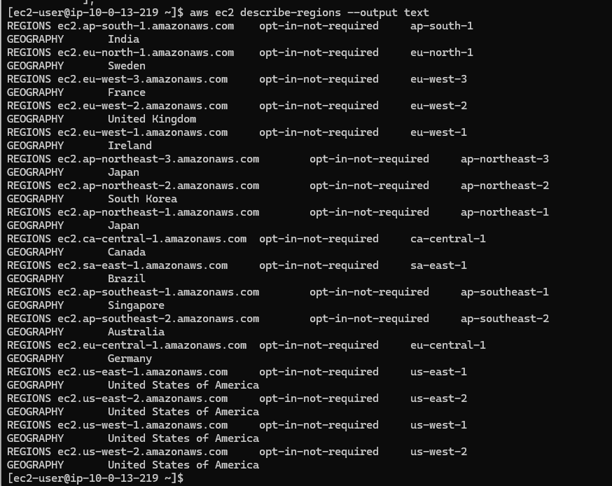</a></td></tr></table>

<p><sub><strong>Screenshot 30:</strong> aws ec2 describe-regions results displayed using text output.</sub></p>

<table><tr><td align="center"><a href="images/screenshot-31.png">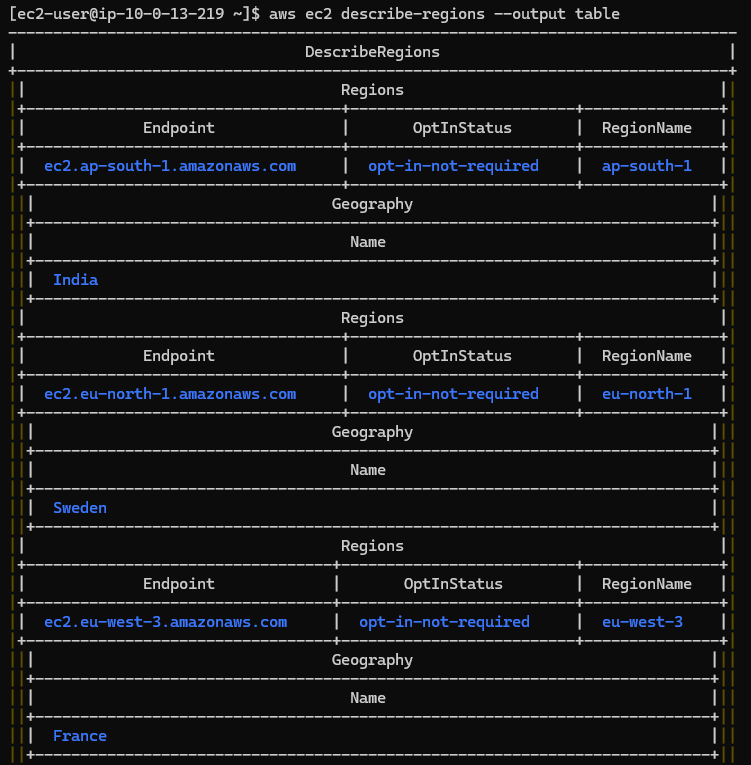</a></td></tr></table>

<p><sub><strong>Screenshot 31:</strong> aws ec2 describe-regions results displayed in table format.</sub></p>

> [!IMPORTANT]
> **SAA-C03 EXAM CONNECTION**
>
> `aws sts get-caller-identity` identifies the principal signing the request. Combined with the EC2 instance profile configuration, it helps verify the intended role-based authentication. Output-format options do not change IAM permissions or the underlying API request.

### 4.7 Knowledge Check

> [!TIP]
> 1.  Does aws configure set region us-east-1 grant API permissions?
>
> **Answer: No.** It changes a CLI default, not the IAM policy decision.
>
> 2.  Which result identifies the IAM role session used by the AWS CLI?
>
> **Answer: The assumed-role ARN returned by STS.** The instance profile association separately confirms how the role was attached to EC2.
>
> 3.  Does --output table permanently replace the configured JSON output?
>
> **Answer: No.** It applies only to that invocation.

> [!NOTE]
> **KEY TAKEAWAY**
>
> Before troubleshooting an AWS CLI request, I check the caller identity, Region, and command syntax. Authentication, authorization, endpoint selection, and syntax are different parts of a successful request.

## 05 Creating IAM Groups, Users and Policies with CLI

### 5.1 Purpose and Objectives

In this chapter, I created an IAM group and user through the AWS CLI, added the user to the group, prepared an inline policy in a JSON file, and verified the results in both the terminal and AWS Management Console.

### 5.2 Creating the CLIGroup IAM Group

```bash
aws iam create-group --group-name CLIGroup
```

In this command, `iam` selects the service, `create-group` specifies the operation, and `--group-name` supplies the name. The JSON response returned metadata for the newly created group.

At this point, the group had no members and no policies attached.

<table><tr><td align="center"><a href="images/screenshot-32.png">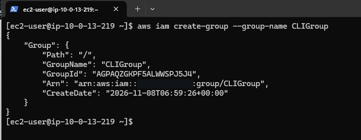</a></td></tr></table>

<p><sub><strong>Screenshot 32:</strong> *aws iam create-group* command and JSON response confirming CLIGroup creation.</sub></p>

### 5.3 Creating the Student IAM User

```bash
aws iam create-user --user-name Student
```

The `Student` user appeared in the JSON response and in the IAM Console. `create-user` does not create a console password or access keys automatically, and it does not grant permissions by itself.

<table><tr><td align="center"><a href="images/screenshot-33.png">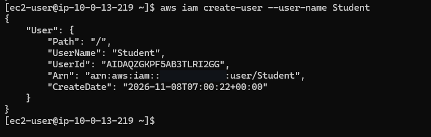</a></td></tr></table>

<p><sub><strong>Screenshot 33:</strong> aws iam create-user command and JSON response confirming Student creation.</sub></p>

<table><tr><td align="center"><a href="images/screenshot-34.png">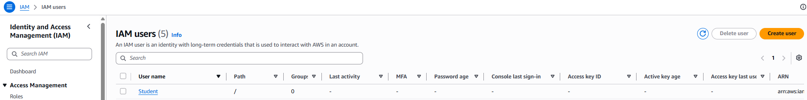</a></td></tr></table>

<p><sub><strong>Screenshot 34:</strong> IAM Users page showing Student after creation.</sub></p>

<table><tr><td align="center"><a href="images/screenshot-35.png">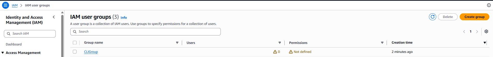</a></td></tr></table>

<p><sub><strong>Screenshot 35:</strong> IAM User groups page showing CLIGroup before adding its member.</sub></p>

### 5.4 Adding Student to CLIGroup

```bash
aws iam add-user-to-group --user-name Student --group-name CLIGroup
aws iam get-group --group-name CLIGroup --query 'Users[].UserName' --output table
```

| Component / concept | What we should understand |
| --- | --- |
| add-user-to-group | Changes the membership relationship between a user and a group. |
| --user-name Student | Identifies the user being added. |
| --group-name CLIGroup | Identifies the target IAM group. |
| get-group | Retrieves metadata and membership for the specified group. |
| `--query 'Users[].UserName'` | A JMESPath expression selecting user names from the returned `Users` array. |
| --output table | Makes this selected membership result easy to read. |

I checked the IAM Console and confirmed that `Student` appeared as a member of `CLIGroup`. Membership is what makes policies attached to the group relevant to that user; simply creating the two resources would not establish that relationship.

<table><tr><td align="center"><a href="images/screenshot-36.png">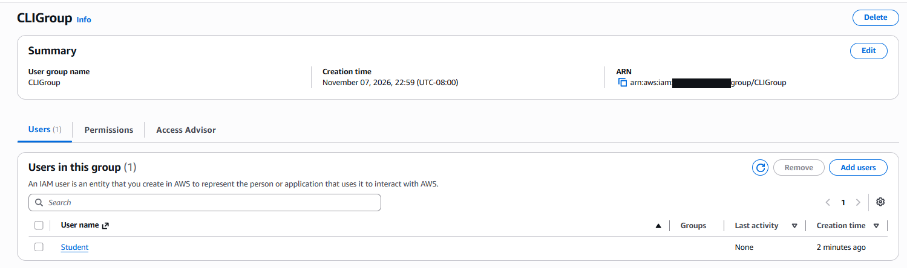</a></td></tr></table>

<p><sub><strong>Screenshot 36:</strong> CLIGroup page listing Student as a group member.</sub></p>

<table><tr><td align="center"><a href="images/screenshot-37.png">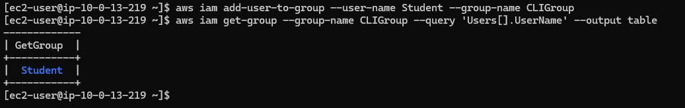</a></td></tr></table>

<p><sub><strong>Screenshot 37:</strong> CLI commands adding Student to CLIGroup and verifying group membership.</sub></p>

### 5.5 Preparing a JSON Permissions Policy

To practice IAM policy syntax, I examined the AWS-managed `PowerUserAccess` policy in the IAM Console and used its JSON structure as a reference. On the EC2 instance, I created `mypolicy.json` with the `nano` text editor.

```bash
nano mypolicy.json
python3 -m json.tool mypolicy.json > /dev/null && echo "JSON valid"
```

The JSON included `Allow` statements and a `NotAction`-based permission pattern. This broad policy is useful for studying IAM syntax but is not a least-privilege design for most workloads. AWS-managed policy versions can change, so a copied example should be reviewed rather than treated as permanently current.

| Component / concept | What we should understand |
| --- | --- |
| Effect | Allow or Deny decision expressed by a policy statement. |
| Action / NotAction | Identifies included or excluded action sets in the statement; context depends on Effect. |
| Resource | The AWS resources to which the statement applies. |
| Condition | Optional constraints for when the statement applies. |
| `python3 -m json.tool` | Validates JSON syntax, not whether the IAM actions, resources, or permissions are appropriate. |
| `file://mypolicy.json` | Tells the AWS CLI to read the policy document from a local file. |

<table><tr><td align="center"><a href="images/screenshot-38.png">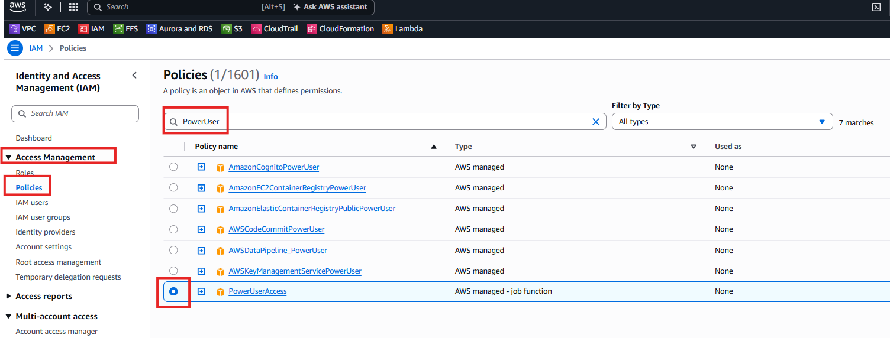</a></td></tr></table>

<p><sub><strong>Screenshot 38:</strong> IAM Console displaying the AWS-managed PowerUserAccess policy used as a reference.</sub></p>

<table><tr><td align="center"><a href="images/screenshot-39.png">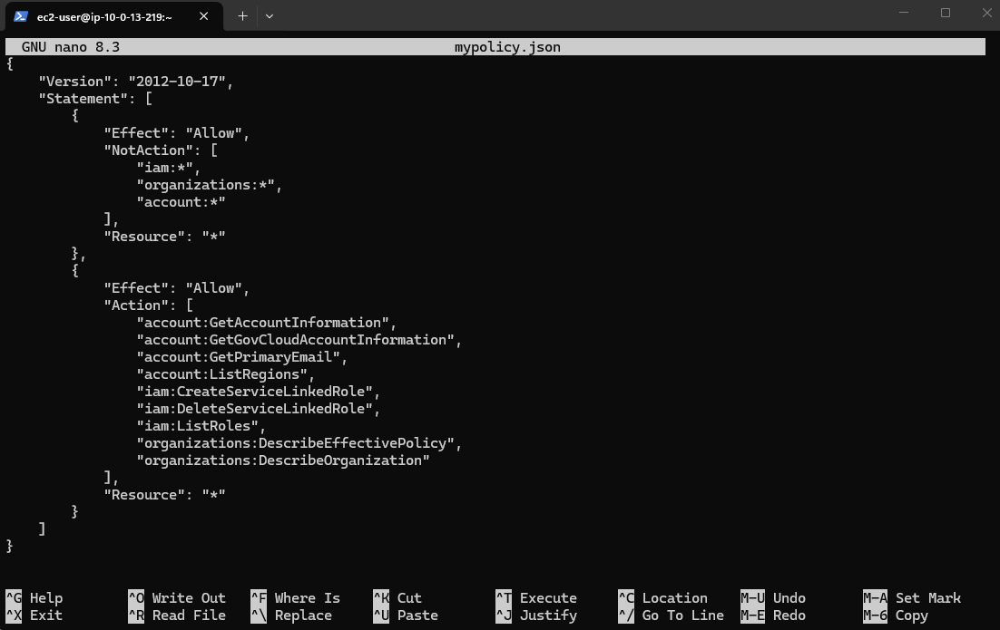</a></td></tr></table>

<p><sub><strong>Screenshot 39:</strong> Editing the local mypolicy.json permissions file in the Nano editor.</sub></p>

<table><tr><td align="center"><a href="images/screenshot-40.png">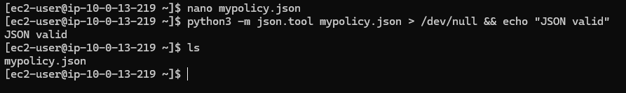</a></td></tr></table>

<p><sub><strong>Screenshot 40:</strong> Terminal confirming mypolicy.json passed JSON syntax validation and was saved.</sub></p>

### 5.6 Attaching and Verifying the Inline Group Policy

```bash
aws iam put-group-policy --group-name CLIGroup --policy-name MyPowerUser --policy-document file://mypolicy.json
aws iam get-group-policy --group-name CLIGroup --policy-name MyPowerUser --query PolicyName --output text
```

`aws iam put-group-policy` attaches an inline policy directly to a group. I named it `MyPowerUser`, retrieved the policy name using `get-group-policy`, and verified the association with `CLIGroup` in the IAM Console.

<table><tr><td align="center"><a href="images/screenshot-41.png">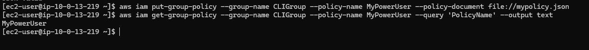</a></td></tr></table>

<p><sub><strong>Screenshot 41:</strong> CLI commands attaching MyPowerUser to CLIGroup and checking the inline policy.</sub></p>

<table><tr><td align="center"><a href="images/screenshot-42.png">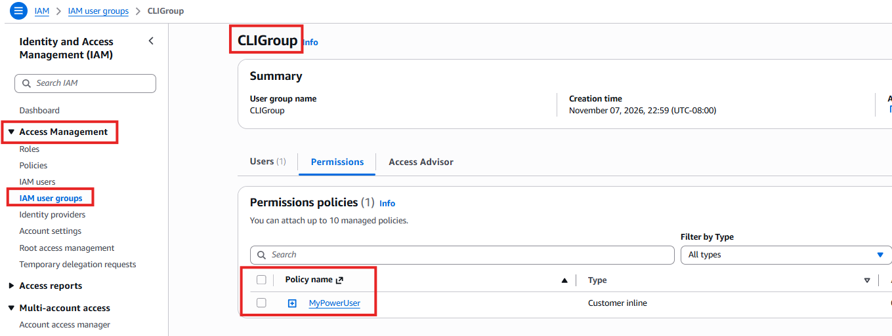</a></td></tr></table>

<p><sub><strong>Screenshot 42:</strong> CLIGroup permissions page displaying the attached MyPowerUser inline policy.</sub></p>

> [!IMPORTANT]
> **IAM PERMISSION EVALUATION**
>
> Because `Student` belongs to `CLIGroup`, the group's inline policy contributes to the user's possible permissions. Effective access still depends on applicable explicit denies, permissions boundaries, AWS Organizations controls, and other relevant policies. Users who are not group members do not inherit that group's policy.

> [!IMPORTANT]
> **SAA-C03 EXAM CONNECTION**
>
> An applicable explicit `Deny` overrides `Allow`. IAM groups organize permissions for users but cannot sign requests. Managed policies are reusable across identities, while inline policies belong to one identity. AWS workloads should generally use IAM roles rather than stored long-term access keys.

### 5.7 Knowledge Check

> [!TIP]
> 1.  Does MyPowerUser automatically grant permissions to every IAM user in the account?
>
> **Answer: No.** The policy is attached to `CLIGroup` and contributes permissions only to its members, subject to other applicable controls.
>
> 2.  Can an applicable explicit deny be overridden by the `AdministratorAccess` policy?
>
> **Answer: No.** An explicit deny takes precedence over an allow, including one granted by `AdministratorAccess`.
>
> 3.  What does json.tool prove?
>
> **Answer: That the file parses as JSON.** It does not prove the IAM statement is appropriately scoped or that its actions exist.

> [!NOTE]
> **KEY TAKEAWAY**
>
> I verified IAM resource creation, group membership, and policy attachment separately in the AWS CLI and IAM Console. These are distinct operations with different authorization effects.

## 06 Working with Amazon S3 from AWS CLI

### 6.1 Purpose and Objectives

In this section, I created a temporary S3 bucket, uploaded local test files, synchronized a selected file set, deleted the local copies, and recovered them from S3. I verified that the remote objects persisted and left an unrelated CloudFormation bucket untouched.

### 6.2 Listing Buckets Before Creating Anything

```bash
aws s3 ls
```

The initial `aws s3 ls` output included a bucket associated with another AWS workflow. I kept it untouched. Listing existing resources before creating or deleting anything helps distinguish lab-owned resources from unrelated infrastructure.

<table><tr><td align="center"><a href="images/screenshot-43.png">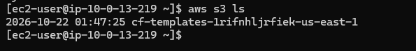</a></td></tr></table>

<p><sub><strong>Screenshot 43:</strong> Initial aws s3 ls output showing the pre-existing CloudFormation bucket.</sub></p>

### 6.3 Creating the Temporary Lab Bucket

The original bucket name contained my AWS account ID, which is redacted for publication. The commands here use `awssaanew-cli-your-unique-suffix` as a **replacement example**, not the exact historical bucket name. Before running them, substitute a suffix that makes your bucket name unique and use the same name throughout the lab. General-purpose S3 bucket names must use valid characters (such as lowercase letters, numbers, and hyphens) and be unique within the AWS partition. Buckets are created in a specific Region.

```bash
aws s3 mb s3://awssaanew-cli-your-unique-suffix --region us-east-1
aws s3 ls
aws s3 ls s3://awssaanew-cli-your-unique-suffix/
aws s3api head-bucket --bucket awssaanew-cli-your-unique-suffix
```

| Component / concept | What we should understand |
| --- | --- |
| s3 | Higher-level AWS CLI commands for common S3 file operations. |
| mb | Make bucket: create the named bucket. |
| s3://bucket-name | An S3 bucket URI, not a local filesystem path. |
| s3api | Lower-level S3 API command group. |
| head-bucket | Checks whether the bucket can be accessed; a successful result may have no visible body. |
| --region us-east-1 | Specifies the target Region for the creation command. |

<table><tr><td align="center"><a href="images/screenshot-44.png">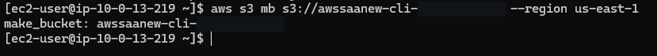</a></td></tr></table>

<p><sub><strong>Screenshot 44:</strong> aws s3 mb command confirming creation of the temporary S3 lab bucket.</sub></p>

<table><tr><td align="center"><a href="images/screenshot-45.png">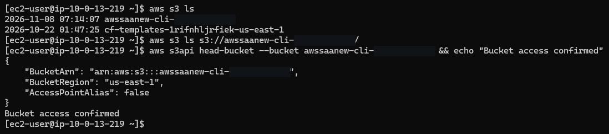</a></td></tr></table>

<p><sub><strong>Screenshot 45:</strong> S3 bucket listing and head-bucket checks confirming access to the new bucket.</sub></p>

### 6.4 Creating Local Files and Uploading One Object

```bash
touch file1.txt file2.py
ls -l file1.txt file2.py
aws s3 cp file1.txt s3://awssaanew-cli-your-unique-suffix/
```

`touch` created two empty local test files. The `aws s3 cp` command uploaded `file1.txt` as an S3 object. An S3 object is identified by a key in a bucket and is separate from files in the EC2 instance's local filesystem.

<table><tr><td align="center"><a href="images/screenshot-46.png">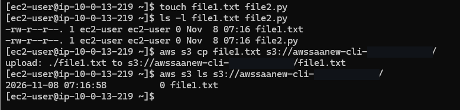</a></td></tr></table>

<p><sub><strong>Screenshot 46:</strong> Local file creation and aws s3 cp upload of file1.txt to S3.</sub></p>

### 6.5 Synchronizing a Selected File Set

```bash
aws s3 sync . s3://awssaanew-cli-your-unique-suffix/ --exclude "*" --include "file1.txt" --include "file2.py"
aws s3 ls s3://awssaanew-cli-your-unique-suffix/
```

The period (`.`) specifies the current directory. `aws s3 sync` compares source and destination and transfers eligible files according to its synchronization rules. I used `--exclude "*"` followed by two `--include` rules to select only the test files. This avoided uploading unrelated local content such as `mypolicy.json`.

Without `--delete`, `aws s3 sync` does not remove destination-only objects simply because they are missing from the source. Adding `--delete` changes that behavior and must be used carefully, especially in automation.

<table><tr><td align="center"><a href="images/screenshot-47.png">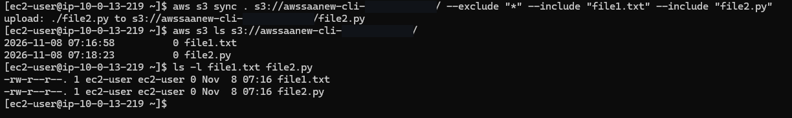</a></td></tr></table>

<p><sub><strong>Screenshot 47:</strong> Filtered aws s3 sync output showing both test objects in the S3 bucket.</sub></p>

### 6.6 Removing Local Copies and Recovering from S3

```bash
rm file1.txt file2.py
aws s3 ls s3://awssaanew-cli-your-unique-suffix/
aws s3 cp s3://awssaanew-cli-your-unique-suffix/file1.txt /home/ec2-user/
aws s3 sync s3://awssaanew-cli-your-unique-suffix/ /home/ec2-user/
ls -l file1.txt file2.py
```

I removed the two local files, then listed the S3 bucket to confirm that both remote objects remained. The Linux `rm` command affects only local files. I restored `file1.txt` using `aws s3 cp` and recovered `file2.py` by synchronizing the bucket into `/home/ec2-user/`.

The final `ls -l` output confirmed that both files were present locally again.

<table><tr><td align="center"><a href="images/screenshot-48.png">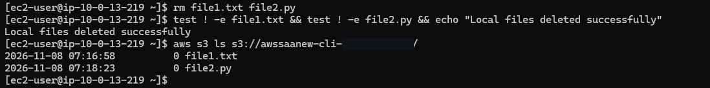</a></td></tr></table>

<p><sub><strong>Screenshot 48:</strong> Local test files removed while both objects remain stored in S3.</sub></p>

<table><tr><td align="center"><a href="images/screenshot-49.png">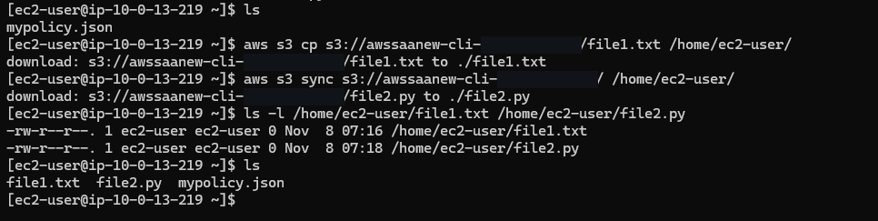</a></td></tr></table>

<p><sub><strong>Screenshot 49:</strong> aws s3 cp and aws s3 sync commands restoring the test files from S3.</sub></p>

### 6.7 Comparing cp, sync, rm and mb

| Command | What it does | Main caution |
| --- | --- | --- |
| `aws s3 mb` | Creates a bucket | Choose an available, valid bucket name and appropriate Region. |
| `aws s3 cp` | Copies files or objects | Confirm source and destination direction. |
| `aws s3 sync` | Synchronizes eligible files or objects | Filters and `--delete` determine which objects are transferred or removed. |
| `aws s3 rm` | Deletes S3 objects | `--recursive` can delete many objects. |
| `aws s3 rb` | Removes a bucket | Confirm the target bucket is empty and correctly identified. |

> [!IMPORTANT]
> **SAA-C03 EXAM CONNECTION**
>
> Amazon S3 is object storage, not an EC2 filesystem. A bucket is created in a Region, objects have keys, and permissions can be evaluated at bucket and object scope. With `sync`, always check the source/destination direction, filters, and `--delete` behavior.

### 6.8 Knowledge Check

> [!TIP]
> 1.  Does rm file1.txt delete the object file1.txt in S3?
>
> **Answer: No.** It deletes only the local filesystem entry.
>
> 2.  Will sync without --delete always remove a destination object missing from the source?
>
> **Answer: No.** Removal of such destination-only objects requires explicit delete behavior.
>
> 3.  Why exclude everything before including two file names?
>
> **Answer: To limit uploads to the intended test files.** This prevents transferring unrelated files from the current directory.

> [!NOTE]
> **KEY TAKEAWAY**
>
> The S3 objects remained available after I removed the local files. Recovering them demonstrated the separation between Amazon S3 object storage and the EC2 instance's filesystem.

## 07 Cleaning Up Resources and Verifying the Result

### 7.1 Purpose and Objectives

Responsible cleanup is part of an AWS lab. I removed resources created only for the CLI exercises and retained the VPC and administrative IAM identity for future study. I verified the main cleanup actions through the AWS Console and CLI, while recording the checks that were not performed.

> [!WARNING]
> **BEFORE DELETION**
>
> Cleanup commands can permanently delete resources. Before reusing them, confirm the AWS account, Region, resource names, and IDs. The commands below reflect this specific lab; they must not be run against another environment without checking their targets.

### 7.2 Removing the IAM Group Policy, User and Group

I deleted the inline `MyPowerUser` policy from `CLIGroup`, removed `Student` from the group, and deleted the user. My first verification still showed `CLIGroup`, so I deleted the remaining group and confirmed that its filtered lookup returned an empty list (`[]`). The unrelated `Admins` group was retained.

```bash
aws iam delete-group-policy --group-name CLIGroup --policy-name MyPowerUser
aws iam list-group-policies --group-name CLIGroup --query 'PolicyNames' --output json
aws iam remove-user-from-group --user-name Student --group-name CLIGroup
aws iam delete-user --user-name Student
aws iam list-users --query "Users[?UserName=='Student'].UserName" --output json
aws iam delete-group --group-name CLIGroup
aws iam list-groups --query "Groups[?GroupName=='CLIGroup'].GroupName" --output json
```

This was a practical troubleshooting lesson: deleting an IAM user does not automatically delete its group. The verification step revealed the remaining resource and allowed me to finish cleanup.

<table><tr><td align="center"><a href="images/screenshot-50.png"></a></td></tr></table>

<p><sub><strong>Screenshot 50:</strong> CLI command deleting the MyPowerUser inline group policy.</sub></p>

<table><tr><td align="center"><a href="images/screenshot-51.png"></a></td></tr></table>

<p><sub><strong>Screenshot 51:</strong> CLIGroup permissions page showing no attached inline policies.</sub></p>

<table><tr><td align="center"><a href="images/screenshot-52.png"></a></td></tr></table>

<p><sub><strong>Screenshot 52:</strong> CLI verification showing Student removed while CLIGroup still exists.</sub></p>

<table><tr><td align="center"><a href="images/screenshot-53.png"></a></td></tr></table>

<p><sub><strong>Screenshot 53:</strong> CLI commands deleting CLIGroup and verifying that it no longer exists.</sub></p>

### 7.3 Deleting S3 Test Objects and the Bucket

I removed the two test objects, deleted the empty lab bucket, and listed the account's S3 buckets again. The unrelated CloudFormation bucket was still present.

```bash
aws s3 rm s3://awssaanew-cli-your-unique-suffix/ --recursive
aws s3 rb s3://awssaanew-cli-your-unique-suffix/
aws s3 ls
```

<table><tr><td align="center"><a href="images/screenshot-54.png"></a></td></tr></table>

<p><sub><strong>Screenshot 54:</strong> S3 CLI commands removing both test objects and deleting the temporary bucket.</sub></p>

### 7.4 Terminating EC2 and Removing Associated Resources

I terminated `LinuxCLI` from the EC2 Console. Because this was a disposable lab workstation with no application data to preserve, I deliberately selected **Skip OS shutdown**. This is not appropriate for workloads that require graceful shutdown.

The instance later showed **Terminated**. I deleted `LinuxCLI-SG`, removed the inline policy from `AwsSaaNew-CLI-EC2-Role`, and deleted the role. The EBS Volumes page showed no remaining volumes in `us-east-1`.

<table><tr><td align="center"><a href="images/screenshot-55.png"></a></td></tr></table>

<p><sub><strong>Screenshot 55:</strong> EC2 termination confirmation with Skip OS shutdown selected for the disposable instance.</sub></p>

<table><tr><td align="center"><a href="images/screenshot-56.png"></a></td></tr></table>

<p><sub><strong>Screenshot 56:</strong> EC2 Instances page confirming LinuxCLI is terminated.</sub></p>

<table><tr><td align="center"><a href="images/screenshot-57.png"></a></td></tr></table>

<p><sub><strong>Screenshot 57:</strong> Success message confirming deletion of the LinuxCLI-SG security group.</sub></p>

<table><tr><td align="center"><a href="images/screenshot-58.png"></a></td></tr></table>

<p><sub><strong>Screenshot 58:</strong> IAM dialog for removing the custom inline policy from the EC2 role.</sub></p>

<table><tr><td align="center"><a href="images/screenshot-59.png"></a></td></tr></table>

<p><sub><strong>Screenshot 59:</strong> IAM role deletion confirmation after its inline policy was removed.</sub></p>

<table><tr><td align="center"><a href="images/screenshot-60.png"></a></td></tr></table>

<p><sub><strong>Screenshot 60:</strong> Success message confirming that AwsSaaNew-CLI-EC2-Role was deleted.</sub></p>

<table><tr><td align="center"><a href="images/screenshot-61.png"></a></td></tr></table>

<p><sub><strong>Screenshot 61:</strong> EBS Volumes page showing no volumes remaining in the selected Region.</sub></p>

### 7.5 Releasing Two Elastic IP Allocations

During the final network review, I found two Elastic IP allocations that were no longer needed. I released both addresses and verified the success notification and empty Elastic IP list in `us-east-1`.

| Elastic IP | End state |
| --- | --- |
| 100.62.10.74 | Released |
| 98.89.144.11 | Released |

AWS charges for allocated public IPv4 addresses under its standard pricing model, including unused Elastic IPs. Releasing these allocations stopped future hourly charges for the addresses, but did not erase earlier charges. I did not perform an independent AWS Billing audit.

<table><tr><td align="center"><a href="images/screenshot-62.png"></a></td></tr></table>

<p><sub><strong>Screenshot 62:</strong> Both unneeded Elastic IP addresses selected in the release confirmation dialog.</sub></p>

<table><tr><td align="center"><a href="images/screenshot-63.png"></a></td></tr></table>

<p><sub><strong>Screenshot 63:</strong> Elastic IP page showing both addresses released and no remaining allocations.</sub></p>

### 7.6 Final Resource Inventory

| Resource | Final verified / recorded state |
| --- | --- |
| AwsSaaNew-vpc; four subnets; IGW | Retained intentionally for future labs |
| awsMaster IAM user | Retained intentionally; administrator with no MFA |
| Admins + AdministratorAccess | Retained for future labs |
| LinuxCLI instance | Terminated |
| LinuxCLI-SG | Deleted |
| AwsSaaNew-CLI-EC2-Role and inline policy | Deleted |
| Student, CLIGroup, MyPowerUser | Deleted |
| awssaanew-cli-your-unique-suffix bucket and objects | Deleted |
| Two Elastic IP allocations | Released |
| EBS volumes in us-east-1 | No volumes shown in Console |
| EBS snapshots | Not audited at my request; none intentionally created |
| Account-wide cost and unrelated resources | Not independently audited |

### 7.7 Knowledge Check

> [!TIP]
> 1.  Why must the IAM inline group policy be removed before the group?
>
> **Answer: Because dependencies can block deletion.** IAM cleanups often require removing group members and inline policies first.
>
> 2.  Does a terminated instance automatically prove there are no other billable resources?
>
> **Answer: No.** EBS snapshots, public IPv4 allocations, NAT gateways, load balancers and other resources may have separate lifecycle and cost.
>
> 3.  Why was the VPC retained while the Elastic IP allocations were released?
>
> **Answer:** The VPC and basic networking components can be reused for future labs, while the Elastic IPs were unnecessary allocations that could continue to incur charges.

> [!NOTE]
> **KEY TAKEAWAY**
>
> I verified the cleanup actions I completed and recorded both the resources intentionally retained and the checks not performed. A terminated EC2 instance alone is not proof that all AWS charges have stopped.

## 08 Exam Review, Corrections and Production Lessons

### 8.1 Important Corrections I Made During the Lab

Several adjustments made the lab more accurate and secure. I checked the intended outcome of each step against the AWS services and software actually in use, rather than relying on older instructions without verification.

| Situation | What I did and why |
| --- | --- |
| Long-lived AWS access keys on EC2 | Used an EC2 instance profile and validated role identity with STS, avoiding manual secret-key configuration. |
| Older Amazon Linux examples | Used Amazon Linux 2023 and the dnf package manager; verified the installed AWS CLI version. |
| Broad SSH access | Restricted TCP/22 ingress to My IP in LinuxCLI-SG. |
| Misspelled EC2 API command | Used aws ec2 describe-regions, not the misspelled form. |
| IAM membership syntax | Used aws iam add-user-to-group with explicit --user-name and --group-name flags. |
| Inconsistent sample bucket names | Kept one exact S3 bucket name throughout the exercise. |
| Unfiltered S3 sync | Used include/exclude filters so the local IAM policy JSON file was not uploaded. |
| Copied permissions policy | Used the policy JSON available in the Console during this session rather than assuming older versions were identical. |
| Cleanup dependencies | Deleted the group policy, memberships, user and remaining group in an order that worked. |
| Unneeded public IPv4 addresses | Released both Elastic IP allocations and verified the empty list. |

### 8.2 SAA-C03 Architecture Summary

| Component / concept | What we should understand |
| --- | --- |
| VPC / subnet scope | VPC = Regional; subnet = one AZ; routing defines public/private traffic paths. |
| IGW vs NAT | IGW supports direct public routing; NAT can support private IPv4 outbound connectivity without exposing the instance to unsolicited direct inbound internet connections. |
| Security group vs IAM | Security group controls network traffic; IAM controls API actions and resource access. |
| EC2 role | An instance profile attaches the role to EC2; AWS supplies temporary role credentials to the workload. |
| IAM explicit deny | A relevant explicit deny takes precedence over an allow. |
| S3 copy and sync | Object storage persists independently of local Linux files; --delete changes sync cleanup behavior. |
| Cost hygiene | Terminate disposable compute and verify associated storage, IP allocations and other potentially billable resources. |

### 8.3 Production Considerations and Best Practices

- Use separate production and learning accounts or otherwise strong isolation; configure an account budget and billing alerts.

- Enable MFA for all privileged human identities, including awsMaster if it remains in use.

- Prefer federated workforce access and roles over long-lived IAM user credentials; remove unnecessary AdministratorAccess grants.

- Apply **least privilege** to EC2 roles and review policy Resource scoping and conditions rather than copying broad PowerUserAccess into production.

- Avoid exposing SSH broadly; consider AWS Systems Manager Session Manager where appropriate.

- Select multi-AZ application designs based on actual availability requirements and support them with load balancing, recovery and data strategies.

- Use S3 encryption, block-public-access settings, versioning, lifecycle management and bucket policies when required by the workload.

- Use clean naming, tags and a documented teardown checklist to reduce misidentification during cleanup.

### 8.4 Final Reflection

This lab brought together services that serve different purposes. The VPC and public subnet provided a network path for the EC2 workstation; the security group restricted SSH; the EC2 role supplied temporary AWS credentials; and the CLI performed IAM and S3 operations. Cleanup then confirmed which temporary resources were removed.

I verified the caller identity, compared output formats, checked IAM and S3 results in the Console, corrected an incomplete IAM group deletion, and released unused Elastic IP allocations. The process reinforced a reusable engineering practice: configure resources deliberately, verify the results, understand the security implications, and clean up carefully.

> [!NOTE]
> **WHAT REMAINS AFTER THE LAB**
>
> `AwsSaaNew-vpc`, `awsMaster`, and the `Admins` group remain for future practice. The retained administrator user still lacks MFA and should be secured. EBS snapshots and account-wide billing were not audited.

## Technical Competencies

**Cloud networking:** VPC creation, CIDR allocation, public and private subnets, Availability Zones, route tables, internet gateways, and network verification.

**Identity and security:** IAM users and groups, managed and inline policies, EC2 instance profiles, temporary credentials, security group ingress, and policy-evaluation concepts.

**Compute and Linux:** EC2 launch configuration, Amazon Linux 2023, SSH key-based access, Linux package management, and health checks.

**AWS CLI and automation foundations:** AWS CLI version checks, Region and output defaults, STS caller identity, JSON/text/table responses, and repeatable resource commands.

**Storage and data operations:** S3 bucket management, object uploads, filtered synchronization, local-versus-remote persistence, and object recovery.

**Operational hygiene:** Verification-driven cleanup of IAM, S3, EC2, security groups, EBS volumes, and public IPv4 allocations, with unverified areas recorded separately.

### Skills Matrix

| Engineering area | AWS technologies / tools | Evidence demonstrated |
| --- | --- | --- |
| Networking | Amazon VPC, subnets, route tables, internet gateway | Created a `10.0.0.0/16` VPC with four subnets across two Availability Zones |
| Identity and access | IAM, roles, policies, instance profiles | Configured admin-group permissions, a dedicated EC2 role, and temporary IAM CLI resources |
| Compute and OS | EC2, Amazon Linux 2023, SSH, PowerShell | Launched a `t3.micro` CLI workstation, restricted SSH, connected, and checked system health |
| AWS CLI | AWS CLI v2, STS, EC2 APIs | Checked the assumed-role caller identity and compared JSON, text, and table output |
| Object storage | Amazon S3, `cp`, `sync`, `rm` | Created a temporary bucket, transferred selected objects, and recovered files |
| Resource lifecycle | IAM, EC2, S3, EBS, Elastic IPs | Removed temporary resources, retained the VPC, verified the EBS volume list, and released unused Elastic IPs |

---

## Command Reference — Commands I Practiced

This section consolidates the main commands used in the lab. The relevant explanations, verification results, and screenshots appear in the earlier sections.

### Linux and role identity

```bash
sudo dnf upgrade -y
aws --version
aws sts get-caller-identity
```

### CLI defaults and EC2 output

```bash
aws configure set region us-east-1
aws configure get region
aws configure set output json
aws ec2 describe-regions --output table
```

### IAM create and verify

```bash
aws iam create-group --group-name CLIGroup
aws iam create-user --user-name Student
aws iam add-user-to-group --user-name Student --group-name CLIGroup
aws iam get-group --group-name CLIGroup --query "Users[].UserName" --output table
```

### IAM inline policy

```bash
python3 -m json.tool mypolicy.json > /dev/null && echo "JSON valid"
aws iam put-group-policy --group-name CLIGroup --policy-name MyPowerUser --policy-document file://mypolicy.json
```

### S3 create, copy and synchronize

```bash
aws s3 mb s3://awssaanew-cli-your-unique-suffix --region us-east-1
aws s3 cp file1.txt s3://awssaanew-cli-your-unique-suffix/
aws s3 sync . s3://awssaanew-cli-your-unique-suffix/ --exclude "*" --include "file1.txt" --include "file2.py"
```

### S3 recovery

```bash
aws s3 cp s3://awssaanew-cli-your-unique-suffix/file1.txt /home/ec2-user/
aws s3 sync s3://awssaanew-cli-your-unique-suffix/ /home/ec2-user/
```

> [!WARNING]
> **SAFE REUSE REMINDER**
>
> These commands describe a lab that has already been cleaned up. Before reusing them, select your own valid resource names and bucket suffix, verify the AWS account and Region, and review the permissions and target resources—especially before overwriting or deleting anything.

