# EC2 Bootstrapping Lab
**AMAZON EC2 / USER DATA / AMAZON LINUX 2023 / APACHE HTTP SERVER / IAM / AMAZON S3 / IMDSv2 / EBS**

In this lab, I automated the initial configuration of an Amazon EC2 instance using a Bash user-data script. The script updated an Amazon Linux 2023 server, installed and enabled Apache, created a personalized HTML page, and attempted to create an Amazon S3 bucket and upload the page. I then tested the website from a browser and inspected the results of the initialization process.

The exercise also covered troubleshooting an IAM authorization failure, using EC2 Instance Metadata Service Version 2 (IMDSv2), saving metadata locally and in S3, and observing the behavior of an EBS-backed instance after a normal stop/start cycle. I completed the lab by deleting its temporary resources while retaining the VPC and IAM role from previous exercises.

The deployment and screenshots document my actual lab environment and observed results. **The infrastructure diagram represents the environment while the lab was running; the temporary EC2 server, S3 bucket, and security group were removed afterward.**

---

## Contents

- [01 Preparing the Existing AWS Environment](#01-preparing-the-existing-aws-environment)
- [02 Launching and Bootstrapping an EC2 Web Server](#02-launching-and-bootstrapping-an-ec2-web-server)
- [03 Verifying Apache and Troubleshooting Amazon S3](#03-verifying-apache-and-troubleshooting-amazon-s3)
- [04 Exploring EC2 Instance Metadata](#04-exploring-ec2-instance-metadata)
- [05 Testing EC2 Stop/Start and Persistence](#05-testing-ec2-stopstart-and-persistence)
- [06 Cleaning Up Lab Resources](#06-cleaning-up-lab-resources)
- [07 Exam Review, Corrections and Production Lessons](#07-exam-review-corrections-and-production-lessons)
- [Technical Competencies](#technical-competencies)
- [Command Reference](#command-reference)

## Architecture Highlight

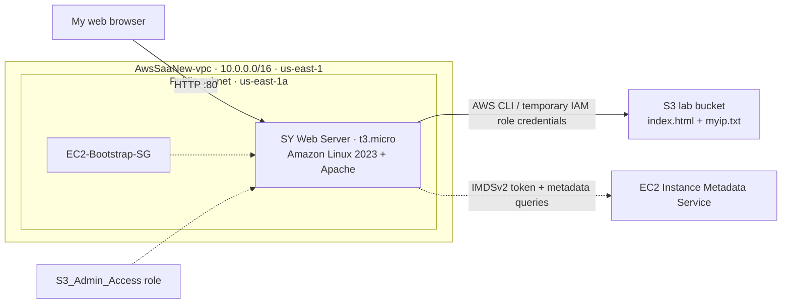

The instance launched in a public subnet with an automatically assigned public IPv4 address. An instance profile supplied temporary AWS credentials to the AWS CLI, and the web server read `index.html` from the instance's EBS-backed filesystem. The S3 copy was independent of the website's local file. The diagram omits the VPC's other retained subnets for clarity.

---

## 01 Preparing the Existing AWS Environment

### 1.1 Purpose and Objectives

I reused the VPC and supporting network infrastructure configured during my earlier AWS CLI lab. This avoided rebuilding the network and allowed the exercise to focus on bootstrap automation, permissions, metadata and instance lifecycle behavior.

### 1.2 Existing Infrastructure

| Component | Previously configured value |
| --- | --- |
| Region | `us-east-1` — US East (N. Virginia) |
| VPC | `AwsSaaNew-vpc` |
| VPC ID | `vpc-08c6d3188add840d1` |
| VPC CIDR | `10.0.0.0/16` |
| Availability Zones | 2 |
| Public subnets | 2 |
| Private subnets | 2 |
| Internet gateway | Attached |
| NAT gateways | None |
| VPC DNS resolution / DNS hostnames | Enabled |
| Reusable SSH key pair | `npoweraws` |

The new instance was placed in `AwsSaaNew-subnet-public1-us-east-1a`, which has the `10.0.0.0/20` subnet CIDR. A subnet is public when its associated route table provides a route to an internet gateway; a name containing `public` alone does not establish internet connectivity. Direct IPv4 access additionally requires suitable public addressing and security rules.

> [!IMPORTANT]
> **SAA-C03 EXAM CONNECTION**
>
> A VPC spans an AWS Region, while each subnet is located in one Availability Zone. A public subnet, internet gateway route, assigned public IPv4 address, and suitable security controls collectively support an internet-facing EC2 workload.

---

## 02 Launching and Bootstrapping an EC2 Web Server

### 2.1 Purpose and Objectives

The goal was to launch an Amazon Linux 2023 EC2 instance, configure its networking and IAM instance profile, and supply a user-data script that initializes a web server and interacts with Amazon S3. User data is useful when newly provisioned instances need repeatable startup configuration rather than manual installation after every launch.

The instance was launched as a `t3.micro` with the existing `npoweraws` key pair. I used the name `SY Web Server` as shown on the EC2 dashboard. The screenshot record documents the network, security, IAM, metadata and user-data settings; it does not include a separate screenshot of the original AMI selection screen.

### 2.2 Configuring Network and Security Group Settings

In **EC2 → Instances → Launch instances → Network settings**, I selected the existing VPC and public subnet, enabled public IPv4 assignment and configured a new security group.

| Setting | Selected value |
| --- | --- |
| VPC | `AwsSaaNew-vpc` |
| VPC ID | `vpc-08c6d3188add840d1` |
| Public subnet | `AwsSaaNew-subnet-public1-us-east-1a` |
| Subnet ID | `subnet-056fdb27e04156a70` |
| Subnet CIDR | `10.0.0.0/20` |
| Availability Zone | `us-east-1a` |
| Auto-assign public IPv4 | Enabled |
| Security group name | `EC2-Bootstrap-SG` |
| Security group description | `Security group for EC2 bootstrapping web server` |

<table><tr><td align="center"><a href="images/screenshot-01.png">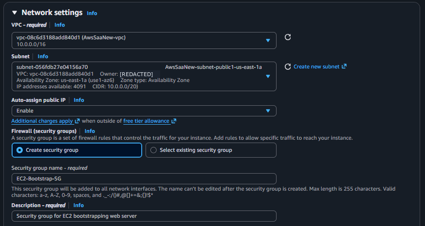</a></td></tr></table>

<p><sub><strong>Screenshot 01:</strong> The EC2 launch wizard showing the reused VPC, public subnet, public IPv4 setting and new security group name.</sub></p>

I configured SSH access from my public IP, HTTP and HTTPS access from the internet, and an additional SSH rule for the AWS-managed EC2 Instance Connect prefix list. The HTTPS rule opened the network port but did **not** install a TLS certificate or enable HTTPS on Apache.

| Type | Protocol | Port | Source |
| --- | --- | --- | --- |
| SSH | TCP | 22 | My IP (`97.189.20.180/32` at configuration time) |
| HTTP | TCP | 80 | `0.0.0.0/0` |
| HTTPS | TCP | 443 | `0.0.0.0/0` |
| SSH — EC2 Instance Connect | TCP | 22 | AWS-managed prefix list (`pl-0e4bcff02b13bef1e`) |

<table><tr><td align="center"><a href="images/screenshot-02.png">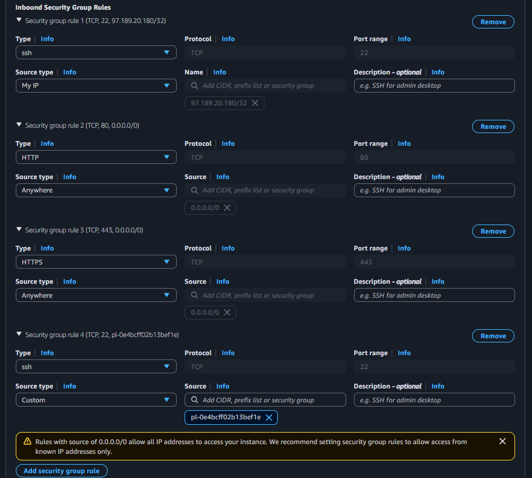</a></td></tr></table>

<p><sub><strong>Screenshot 02:</strong> The four configured inbound rules: restricted SSH, public HTTP/HTTPS, and EC2 Instance Connect.</sub></p>

Security groups are **stateful**: return traffic for an allowed connection is automatically permitted. The outbound setting was not independently captured in a screenshot, so I did not treat its exact final rule list as separately verified.

### 2.3 Attaching an IAM Instance Profile

Under **Advanced details → IAM instance profile**, I selected the existing `S3_Admin_Access` role from an earlier IAM exercise. I reused it rather than creating a new role. Its originally attached managed policy was `AmazonS3FilesFullAccess`, a detail that became important during troubleshooting.

<table><tr><td align="center"><a href="images/screenshot-03.png"></a></td></tr></table>

<p><sub><strong>Screenshot 03:</strong> The Advanced details IAM instance profile dropdown listing the reusable `S3_Admin_Access` role.</sub></p>

An instance profile makes temporary role credentials available to software on EC2 without placing permanent access keys inside the user-data script. Selecting an IAM role does not guarantee every intended API action is authorized; the effective permissions must cover each AWS API operation the workload performs.

### 2.4 Selecting Instance Metadata Settings

I configured the Instance Metadata Service to be accessible and required **IMDSv2 tokens**. I disabled instance tags in metadata. The initial configuration screenshot recorded a response hop limit of `2`; before launching I changed it to **`1`**, because Apache and the AWS CLI were running directly on the EC2 host, not inside a container.

| Metadata setting | Final selected configuration |
| --- | --- |
| Metadata accessible | Enabled |
| Metadata version | V2 only (token required) |
| Metadata response hop limit | 1 — corrected before launch |
| Allow tags in metadata | Disabled |

<table><tr><td align="center"><a href="images/screenshot-04.png"></a></td></tr></table>

<p><sub><strong>Screenshot 04:</strong> The initial metadata settings screen: IMDSv2 required, with the hop limit still at `2` before my correction to `1`.</sub></p>

The response hop limit affects how many network routing hops an IMDSv2 token response can traverse. A hop limit of `2` can be useful in container networking configurations. A hop limit of `1` was sufficient for this direct-host workload.

### 2.5 Preparing the User-Data Bootstrap Script

I entered a Bash script in the **User data** field with the base64-encoded option unchecked. The script updated packages, installed Apache, enabled the service, created the customized webpage, generated a unique S3 bucket name and attempted to upload the HTML file.

The complete script below reflects the corrected HTML quoting that I confirmed **before launch**. The original editing screenshot shows an earlier version of the HTML line, before I corrected the apostrophe in the welcome message.

```bash
#!/bin/bash
set -euo pipefail

# Update Amazon Linux 2023 and install Apache
dnf update -y
dnf install -y httpd

# Start Apache and enable it on subsequent boots
systemctl enable --now httpd

# Create the personalized website
echo "<html><h1><center>Welcome to Serkan's World</center></h1></html>" > /var/www/html/index.html

# Generate and save a unique bucket name
BUCKET_NAME="aws-saa-bootstrap-$(date -u +%Y%m%d%H%M%S)-${RANDOM}"
echo "$BUCKET_NAME" > /var/tmp/bootstrap-bucket-name.txt

# Create the bucket and upload the website file
aws s3 mb "s3://${BUCKET_NAME}" --region us-east-1
aws s3 cp /var/www/html/index.html "s3://${BUCKET_NAME}/index.html"
```

| Script component | Purpose |
| --- | --- |
| `#!/bin/bash` | Run the script with Bash |
| `set -euo pipefail` | Exit on unhandled command failures and certain shell errors |
| `dnf update -y` | Update Amazon Linux 2023 packages |
| `dnf install -y httpd` | Install Apache |
| `systemctl enable --now httpd` | Start Apache and enable it after reboot |
| `echo ... > index.html` | Write the HTML document locally |
| `BUCKET_NAME=...` | Generate a bucket name using a UTC timestamp and random suffix |
| `aws s3 mb` | Attempt to create the bucket |
| `aws s3 cp` | Attempt to upload the HTML object |

<table><tr><td align="center"><a href="images/screenshot-05.png">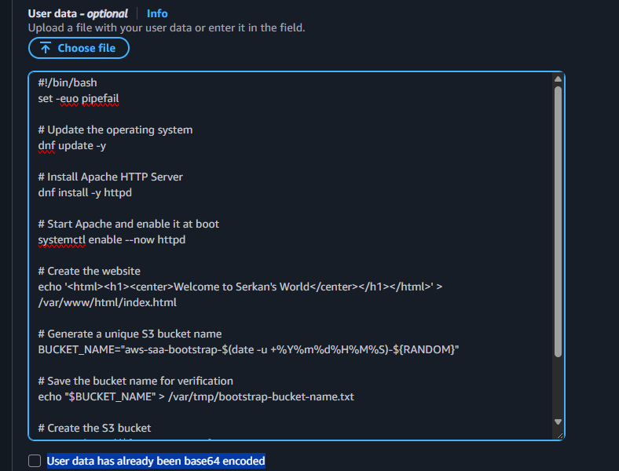</a></td></tr></table>

<p><sub><strong>Screenshot 05:</strong> The user-data editor showing the bootstrap script before the final HTML-quoting correction.</sub></p>

I used the same `BUCKET_NAME` variable for the create and copy commands. This avoided the inconsistent S3 bucket names in the original example. The script's S3 section initially **failed** because its IAM role lacked `s3:CreateBucket`; that failure and recovery are documented in Chapter 03.

> [!IMPORTANT]
> **SAA-C03 EXAM CONNECTION**
>
> User data and an AMI solve different problems: an AMI supplies an initial machine image, while user data runs initialization steps. Standard cloud-init shell user-data scripts usually run during the first launch, not every subsequent stop/start. Instance roles supply AWS API credentials separately from Linux startup configuration.

### 2.6 Launching and Checking the Instance

I launched the EC2 instance after completing the network, role, metadata and user-data configuration. AWS confirmed the launch request and returned instance ID `i-06ec08448af41c772`.

<table><tr><td align="center"><a href="images/screenshot-06.png">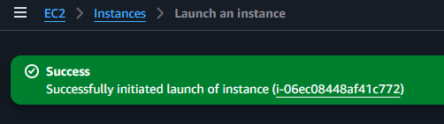</a></td></tr></table>

<p><sub><strong>Screenshot 06:</strong> AWS confirmation showing successful initiation of the EC2 instance launch.</sub></p>

The instance appeared as `SY Web Server` in the **Running** state. Its status checks were still initializing, so I did not interpret Running as proof that initialization or the application bootstrap had finished.

<table><tr><td align="center"><a href="images/screenshot-07.png"></a></td></tr></table>

<p><sub><strong>Screenshot 07:</strong> The new `t3.micro` instance in the Running state while its status checks were initializing.</sub></p>

I refreshed the EC2 dashboard and confirmed that all **3/3 status checks** passed.

<table><tr><td align="center"><a href="images/screenshot-08.png">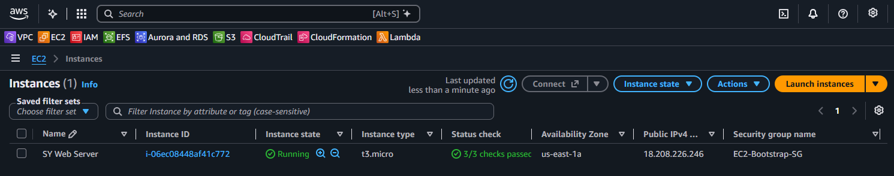</a></td></tr></table>

<p><sub><strong>Screenshot 08:</strong> The EC2 instance running with 3/3 status checks passed and its first public IPv4 address assigned.</sub></p>

| Instance attribute | Observed configuration |
| --- | --- |
| Name | `SY Web Server` |
| Instance ID | `i-06ec08448af41c772` |
| AMI family | Amazon Linux 2023, x86_64 |
| Instance type | `t3.micro` |
| Region / AZ | `us-east-1` / `us-east-1a` |
| Key pair | `npoweraws` |
| Security group | `EC2-Bootstrap-SG` |
| IAM instance profile | `S3_Admin_Access` |
| First public IPv4 | `18.208.226.246` |
| Initial health state | 3/3 checks passed |

> [!NOTE]
> **KEY TAKEAWAY**
>
> The EC2 instance reached a healthy infrastructure state, but infrastructure checks did not establish that every user-data command had succeeded. I verified the application and AWS CLI operations separately.

---

## 03 Verifying Apache and Troubleshooting Amazon S3

### 3.1 Purpose and Objectives

This part of the lab verified the actual bootstrap outcome instead of relying on the launch confirmation. I tested HTTP access, checked the expected S3 bucket, investigated a startup failure and retried the incomplete S3 operations after correcting the IAM role.

### 3.2 Verifying the Apache Website

I opened the first public IPv4 address in a browser using HTTP:

```text
http://18.208.226.246
```

The page displayed **Welcome to Serkan's World**, confirming that Apache was reachable on port 80 and serving the customized HTML file from the EC2 host.

<table><tr><td align="center"><a href="images/screenshot-09.png">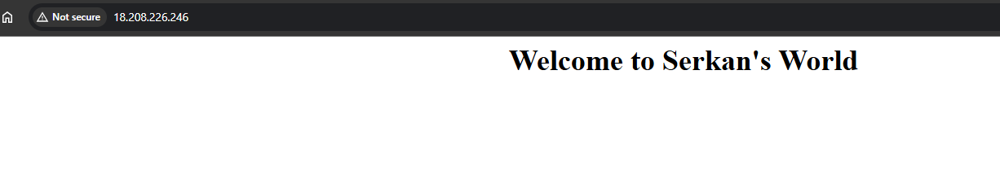</a></td></tr></table>

<p><sub><strong>Screenshot 09:</strong> The customized Apache welcome page loading at the instance's original public IPv4 address.</sub></p>

The browser's **Not secure** indicator was expected: HTTP traffic was not encrypted. An open HTTPS security group rule does not configure TLS on the web server.

### 3.3 Discovering the Missing S3 Bucket

Next, I opened **Amazon S3 → General purpose buckets** to look for the bucket generated by the user-data script. The expected `aws-saa-bootstrap-*` bucket was absent. Only an unrelated pre-existing bucket appeared in the listing.

<table><tr><td align="center"><a href="images/screenshot-10.png">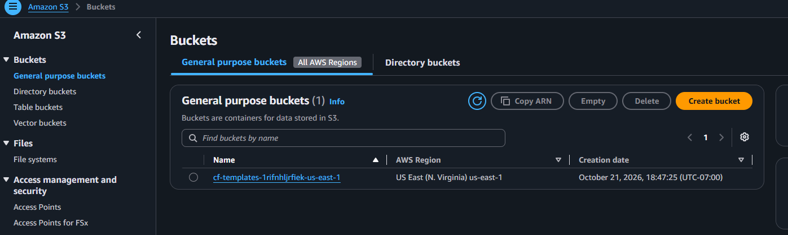</a></td></tr></table>

<p><sub><strong>Screenshot 10:</strong> The initial S3 bucket list, without the bucket expected from the bootstrap script.</sub></p>

This discrepancy meant that a successful website test was not evidence that the full user-data script completed. I connected through EC2 Instance Connect and inspected the cloud-init log:

```bash
sudo tail -n 80 /var/log/cloud-init-output.log
```

The output showed Apache installation had completed, but bucket creation failed with an authorization error:

```text
An error occurred (AccessDenied) when calling the CreateBucket operation
... no identity-based policy allows the s3:CreateBucket action
```

Cloud-init also reported that the `scripts-user` module failed. Because the script used `set -euo pipefail`, the failed bucket creation prevented the following S3 upload command from running.

<table><tr><td align="center"><a href="images/screenshot-11.png"></a></td></tr></table>

<p><sub><strong>Screenshot 11:</strong> The cloud-init output log showing `AccessDenied` for `s3:CreateBucket` and a failed user-data module.</sub></p>

### 3.4 Investigating and Correcting IAM Permissions

I opened **IAM → Roles → S3_Admin_Access → Permissions**. The role had the AWS-managed `AmazonS3FilesFullAccess` policy, not `AmazonS3FullAccess`. The names are similar, but the observed `AccessDenied` error showed that its effective permissions did not allow `s3:CreateBucket`.

<table><tr><td align="center"><a href="images/screenshot-12.png"></a></td></tr></table>

<p><sub><strong>Screenshot 12:</strong> The EC2 role initially showing `AmazonS3FilesFullAccess` as its only attached managed policy.</sub></p>

To complete the instructor's S3 exercise, I temporarily added the AWS-managed `AmazonS3FullAccess` policy to the same role. This broad policy was a **lab-specific permission change**, not the least-privilege policy I would grant a production web server.

<table><tr><td align="center"><a href="images/screenshot-13.png"></a></td></tr></table>

<p><sub><strong>Screenshot 13:</strong> The IAM Add permissions screen with `AmazonS3FullAccess` selected for attachment.</sub></p>

I confirmed that both policies appeared in the role's permissions list. The screenshot of the role summary contained an AWS account ID, which is redacted in the accompanying image for publication.

<table><tr><td align="center"><a href="images/screenshot-14.png"></a></td></tr></table>

<p><sub><strong>Screenshot 14:</strong> The role after adding `AmazonS3FullAccess`, showing both attached S3 policies.</sub></p>

### 3.5 Manually Recovering the Failed S3 Operations

The instance was already running and the website worked; I did not launch a replacement server. Instead, I reused the bucket name saved by the original user-data script in `/var/tmp/bootstrap-bucket-name.txt`:

```bash
BUCKET_NAME=$(cat /var/tmp/bootstrap-bucket-name.txt)
echo "$BUCKET_NAME"
```

The saved value was:

```text
aws-saa-bootstrap-20261111055207-21629
```

I then manually retried the operations that had failed during initialization:

```bash
aws s3 mb "s3://${BUCKET_NAME}" --region us-east-1
aws s3 cp /var/www/html/index.html "s3://${BUCKET_NAME}/index.html"
aws s3 ls "s3://${BUCKET_NAME}/"
```

AWS CLI confirmed `make_bucket`, `upload`, and a listing containing `index.html` (65 bytes). These were **manual recovery commands**, not a second automatic execution of the user-data script.

```text
2026-11-11 06:10:59         65 index.html
```

<table><tr><td align="center"><a href="images/screenshot-15.png">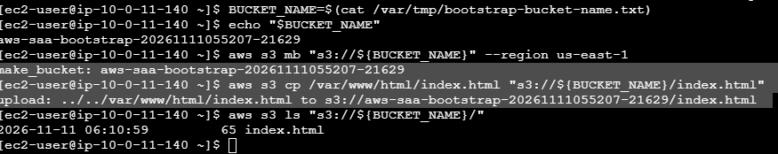</a></td></tr></table>

<p><sub><strong>Screenshot 15:</strong> EC2 terminal showing the original bucket name, successful manual S3 creation and upload, and the object listing.</sub></p>

### 3.6 Verifying the S3 Result in the Console

I returned to **Amazon S3 → General purpose buckets** and found the newly created bucket in the `us-east-1` Region.

<table><tr><td align="center"><a href="images/screenshot-16.png"></a></td></tr></table>

<p><sub><strong>Screenshot 16:</strong> The S3 bucket list showing `aws-saa-bootstrap-20261111055207-21629` in US East (N. Virginia).</sub></p>

I opened the bucket and checked the **Objects** tab. It contained `index.html`, matching the earlier AWS CLI listing and its 65-byte size.

<table><tr><td align="center"><a href="images/screenshot-17.png"></a></td></tr></table>

<p><sub><strong>Screenshot 17:</strong> The S3 Objects tab showing the uploaded `index.html` file and its 65-byte size.</sub></p>

| Verification | Observed result |
| --- | --- |
| Apache over HTTP | Working |
| Initial S3 creation via user data | Failed (`AccessDenied`) |
| IAM issue | Missing `s3:CreateBucket` permission |
| Temporary permission correction | Attached `AmazonS3FullAccess` |
| Recovered bucket creation | Successful via manual AWS CLI retry |
| Recovered HTML upload | Successful via manual AWS CLI retry |
| S3 object verified | `index.html`, 65 bytes |

> [!IMPORTANT]
> **SAA-C03 EXAM CONNECTION**
>
> IAM controls API permissions, while a security group controls network connectivity. An EC2 instance can have a healthy network and functioning website but still lack permission to create an S3 bucket. The cloud-init log and the specific denied API action were the decisive troubleshooting evidence.

### 3.7 Knowledge Check

> [!TIP]
> **1. Does a Running EC2 instance mean all of its user-data commands succeeded?**
>
> **Answer: No.** Running and passing instance checks are not application-level or user-data completion tests. The S3 portion failed despite the website working.
>
> **2. Why did the upload not run after `aws s3 mb` failed?**
>
> **Answer:** The script was configured with `set -euo pipefail`, so the failed bucket creation ended the script before the next command.
>
> **3. Would the website become S3-hosted simply because `index.html` was copied to S3?**
>
> **Answer: No.** Apache continued serving the local file from the EC2 instance. The S3 object was a separate stored copy.

> [!NOTE]
> **KEY TAKEAWAY**
>
> The bootstrap completed only part of its intended work automatically. Reviewing cloud-init output and adjusting IAM permissions let me recover the failed S3 operations without rebuilding the web server.

---

## 04 Exploring EC2 Instance Metadata

### 4.1 Purpose and Objectives

I used IMDSv2 to inspect information exposed to the running instance, including its AMI ID and public IPv4 address. I then saved the public IPv4 address to a local file and uploaded the file to the same S3 bucket.

### 4.2 Retrieving Metadata with an IMDSv2 Token

Because the instance required IMDSv2, I first requested a session token with an HTTP PUT request. The token was stored in a shell variable and was not printed or included in screenshots.

```bash
TOKEN=$(curl -fsS -X PUT \
  "http://169.254.169.254/latest/api/token" \
  -H "X-aws-ec2-metadata-token-ttl-seconds: 21600")
```

The `21600` value requests a six-hour token lifetime. I used that token to query the metadata category index and then two individual attributes:

```bash
curl -fsS -H "X-aws-ec2-metadata-token: $TOKEN" \
  http://169.254.169.254/latest/meta-data/

curl -fsS -H "X-aws-ec2-metadata-token: $TOKEN" \
  http://169.254.169.254/latest/meta-data/ami-id

curl -fsS -H "X-aws-ec2-metadata-token: $TOKEN" \
  http://169.254.169.254/latest/meta-data/public-ipv4
```

The index listed categories such as `ami-id`, `instance-id`, `instance-type`, `local-ipv4`, `public-ipv4`, `network/` and `security-groups`.

| Requested value | Actual response |
| --- | --- |
| AMI ID | `ami-09bf9dfeeb1e9adbc` |
| Public IPv4 | `18.208.226.246` |
| Metadata authentication | IMDSv2 session token |

<table><tr><td align="center"><a href="images/screenshot-18.png">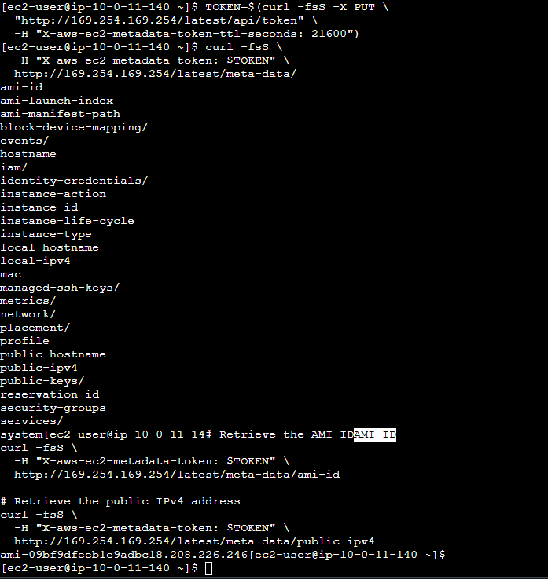</a></td></tr></table>

<p><sub><strong>Screenshot 18:</strong> The terminal showing token-based metadata queries, available categories, AMI ID and original public IPv4 address.</sub></p>

Ordinary instance metadata requests do not require an IAM policy, but AWS API commands such as S3 operations do. The metadata token is a separate mechanism from temporary IAM role credentials.

### 4.3 Saving the Original Public IP and Uploading It

I saved the response from the `public-ipv4` endpoint to a local text file:

```bash
curl -fsS -H "X-aws-ec2-metadata-token: $TOKEN" \
  http://169.254.169.254/latest/meta-data/public-ipv4 > myip.txt
cat myip.txt
```

The file contained the then-current address, `18.208.226.246`. I then uploaded it to S3 and listed the bucket contents:

```bash
aws s3 cp myip.txt \
  s3://aws-saa-bootstrap-20261111055207-21629/myip.txt

aws s3 ls s3://aws-saa-bootstrap-20261111055207-21629/
```

```text
2026-11-11 06:10:59         65 index.html
2026-11-11 06:23:18         14 myip.txt
```

<table><tr><td align="center"><a href="images/screenshot-19.png"></a></td></tr></table>

<p><sub><strong>Screenshot 19:</strong> The terminal showing creation of `myip.txt`, its public IPv4 value, successful upload and both S3 objects.</sub></p>

In the S3 Console, I verified that the bucket contained two objects with the sizes observed from AWS CLI.

| Object | Size | Purpose |
| --- | --- | --- |
| `index.html` | 65 bytes | Copy of the customized webpage |
| `myip.txt` | 14 bytes | Recorded EC2 public IPv4 address |

<table><tr><td align="center"><a href="images/screenshot-20.png"></a></td></tr></table>

<p><sub><strong>Screenshot 20:</strong> The S3 Objects tab showing `index.html` and `myip.txt` in the same lab bucket.</sub></p>

> [!IMPORTANT]
> **SAA-C03 EXAM CONNECTION**
>
> IMDSv2 requires a token in metadata requests. The public IPv4 endpoint reports the instance's address at query time; a copy saved in an ordinary file does **not** automatically update when the instance later receives a different IP address.

### 4.4 Knowledge Check

> [!TIP]
> **1. Does reading `http://169.254.169.254/latest/meta-data/` require S3 permissions?**
>
> **Answer: No.** Metadata access uses the local IMDS interface and its IMDSv2 token mechanism, whereas S3 API operations are authorized through IAM.
>
> **2. Would updating the instance's public IPv4 automatically change `myip.txt`?**
>
> **Answer: No.** The file contains the value written when I ran the command. It is not a live metadata reference.

> [!NOTE]
> **KEY TAKEAWAY**
>
> I used a token-authenticated metadata endpoint to retrieve instance attributes and stored a point-in-time copy of the public IP both locally and in S3.

---

## 05 Testing EC2 Stop/Start and Persistence

### 5.1 Purpose and Objectives

The instructor's exercise included hibernation, but I found that **Stop-hibernate behavior** was disabled on my instance. Because this setting must be enabled during launch, I did not perform a hibernation test or launch a second replacement instance. Instead, I tested a normal EC2 stop/start, which can demonstrate retained EBS data and changes to an automatically assigned public IPv4 address, but not RAM preservation.

### 5.2 Checking Hibernation Eligibility

I selected the running instance and reviewed its details. The **Stop-hibernate behavior** field displayed **Disabled**.

<table><tr><td align="center"><a href="images/screenshot-21.png">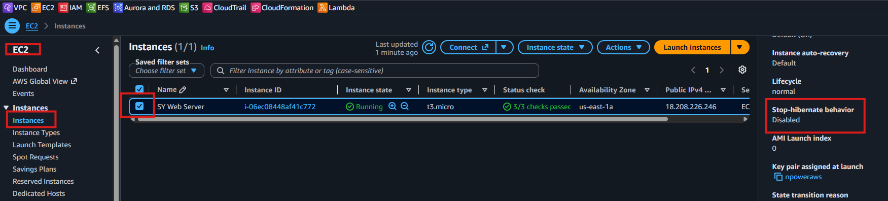</a></td></tr></table>

<p><sub><strong>Screenshot 21:</strong> The EC2 instance details showing Stop-hibernate behavior disabled.</sub></p>

| Behavior | Normal stop/start | Hibernate/start |
| --- | --- | --- |
| Retains EBS-backed files | Yes, for retained volumes | Yes, for retained volumes |
| Preserves memory (RAM) | No | Yes, using the EBS root volume |
| Retains instance ID | Yes | Yes |
| Preserves an auto-assigned public IPv4 | No | No |
| Available on this lab instance | Yes | No; disabled at launch |

Hibernation was **not tested**. My lifecycle results are therefore evidence of normal stop/start behavior only.

### 5.3 Stopping the Instance

I selected `SY Web Server` in the Instances dashboard and chose **Instance state → Stop instance**.

<table><tr><td align="center"><a href="images/screenshot-22.png">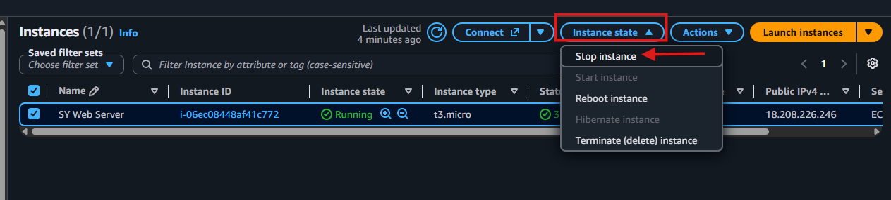</a></td></tr></table>

<p><sub><strong>Screenshot 22:</strong> The EC2 Instance state menu with Stop instance selected.</sub></p>

I reviewed the stop confirmation and left **Skip OS shutdown** unchecked to permit a graceful shutdown.

<table><tr><td align="center"><a href="images/screenshot-23.png">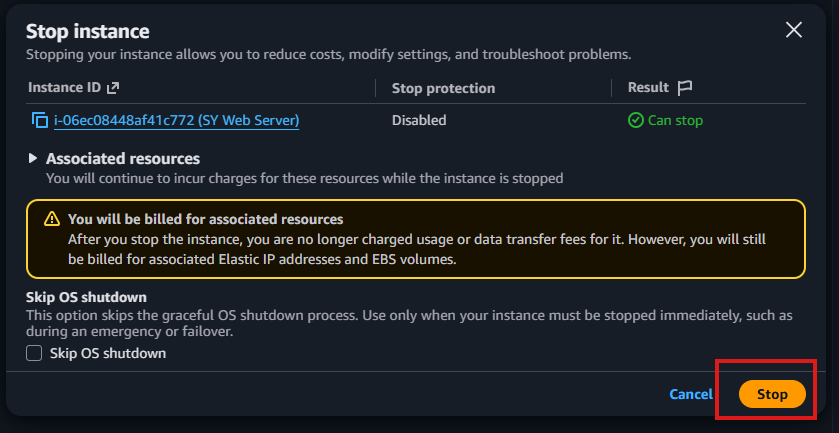</a></td></tr></table>

<p><sub><strong>Screenshot 23:</strong> The EC2 stop confirmation dialog with the graceful shutdown option retained.</sub></p>

After initiating the operation, I refreshed the dashboard until the instance showed **Stopped**. The instance ID remained `i-06ec08448af41c772`, while the automatically assigned public IPv4 was no longer displayed.

<table><tr><td align="center"><a href="images/screenshot-24.png">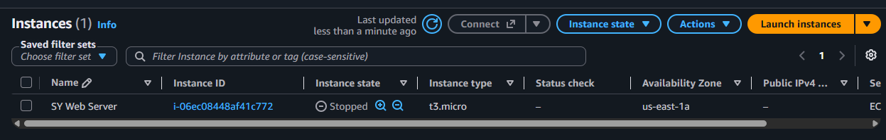</a></td></tr></table>

<p><sub><strong>Screenshot 24:</strong> The EC2 instance in the Stopped state without an assigned public IPv4 address.</sub></p>

### 5.4 Restarting and Comparing the Public IPv4 Address

I started the same instance and waited until it was **Running** with **3/3 status checks passed**. AWS assigned a different public IPv4 address.

<table><tr><td align="center"><a href="images/screenshot-25.png"></a></td></tr></table>

<p><sub><strong>Screenshot 25:</strong> The restarted EC2 instance with passed status checks and newly assigned public IPv4 `100.31.82.216`.</sub></p>

| Attribute | Before stop | After start |
| --- | --- | --- |
| Instance ID | `i-06ec08448af41c772` | Same ID |
| Instance type | `t3.micro` | `t3.micro` |
| Availability Zone | `us-east-1a` | `us-east-1a` |
| Public IPv4 | `18.208.226.246` | `100.31.82.216` |
| Instance status | Running, 3/3 passed | Running, 3/3 passed |

The instance identity and EBS-backed operating system remained available, but its automatically assigned public IPv4 changed. A stable public address would require a suitable alternative such as an Elastic IP, with applicable charges.

### 5.5 Confirming Apache and Local File Persistence

I opened the new address in a browser:

```text
http://100.31.82.216
```

The same **Welcome to Serkan's World** page loaded, demonstrating that Apache was serving the existing webpage after the normal start.

<table><tr><td align="center"><a href="images/screenshot-26.png">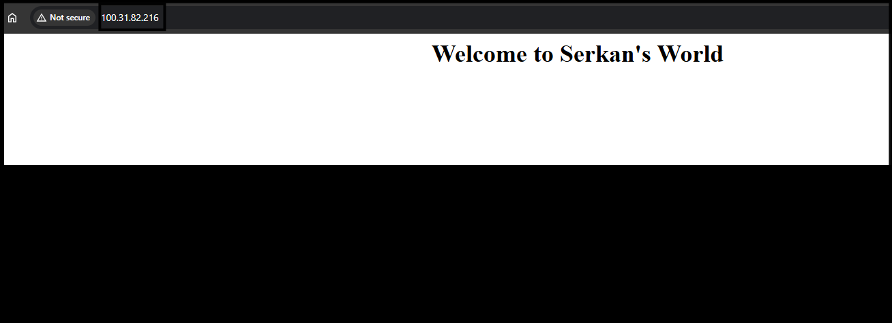</a></td></tr></table>

<p><sub><strong>Screenshot 26:</strong> The customized Apache page loading over HTTP at the instance's new public IPv4 address.</sub></p>

I also connected through EC2 Instance Connect and read `~/myip.txt`. Its output was still the **old** address, `18.208.226.246`, confirming that this local file persisted and was not automatically rewritten with the new IP.

<table><tr><td align="center"><a href="images/screenshot-27.png"></a></td></tr></table>

<p><sub><strong>Screenshot 27:</strong> The original public IPv4 address printed from `myip.txt`; the shell prompt appears on the same line because the file lacked a trailing newline.</sub></p>

The lack of a newline was a display-formatting detail rather than corruption. I then checked Apache's running and boot-enable states:

```bash
cat ~/myip.txt
systemctl is-active httpd
systemctl is-enabled httpd
```

```text
18.208.226.246
active
enabled
```

<table><tr><td align="center"><a href="images/screenshot-28.png"></a></td></tr></table>

<p><sub><strong>Screenshot 28:</strong> The EC2 terminal showing the original address preserved in `myip.txt` and Apache marked active and enabled.</sub></p>

These results are consistent with the earlier `systemctl enable --now httpd` command. They do not imply that the full original user-data script ran again after restart.

> [!IMPORTANT]
> **SAA-C03 EXAM CONNECTION**
>
> EBS-backed files can survive EC2 stop/start, but RAM contents do not. A normal stop releases an automatically assigned public IPv4 address. User-data scripts generally run only once during initial launch; system services configured as enabled can independently start on later boots.

### 5.6 Knowledge Check

> [!TIP]
> **1. Did the new public IPv4 change the saved `myip.txt` content?**
>
> **Answer: No.** I retrieved the original address after restart, while the AWS Console and browser showed the new address.
>
> **2. Did the website prove the original user-data script reran on startup?**
>
> **Answer: No.** Apache was already installed and enabled, and its existing HTML file persisted. A functioning site is not evidence that user data reran.
>
> **3. Did this lab verify hibernation memory restoration?**
>
> **Answer: No.** Hibernation was disabled at launch, so only normal stop/start behavior was tested.

> [!NOTE]
> **KEY TAKEAWAY**
>
> The same EC2 instance retained EBS-backed data and returned to service with a different automatically assigned public IPv4 address. The saved metadata file remained a record of the earlier address.

---

## 06 Cleaning Up Lab Resources

### 6.1 Purpose and Objectives

I removed the temporary resources created for this exercise while preserving the pre-existing VPC, network infrastructure and reused IAM role. Cleanup required separate actions for S3, EC2 and the custom security group; it also included checking the EBS Volumes list and restoring the role's pre-lab permissions.

### 6.2 Emptying and Deleting the Temporary S3 Bucket

The temporary bucket was `aws-saa-bootstrap-20261111055207-21629` and contained the two objects verified earlier. I selected it in the S3 bucket list and chose **Empty**.

<table><tr><td align="center"><a href="images/screenshot-29.png">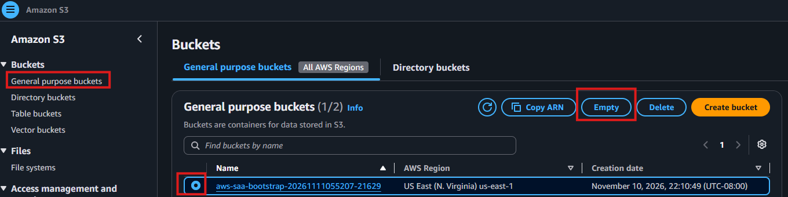</a></td></tr></table>

<p><sub><strong>Screenshot 29:</strong> The temporary S3 bucket selected in the bucket list for the Empty action.</sub></p>

AWS required the exact confirmation phrase `permanently delete`. I entered it and started object deletion.

<table><tr><td align="center"><a href="images/screenshot-30.png">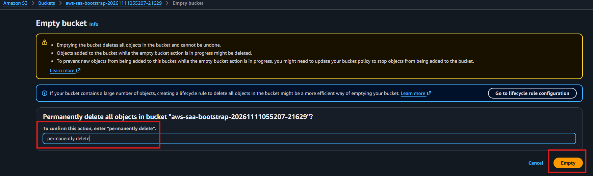</a></td></tr></table>

<p><sub><strong>Screenshot 30:</strong> The S3 Empty bucket confirmation screen with the required permanent-deletion phrase.</sub></p>

The result showed **2 objects**, totaling **79.0 B**, successfully deleted and **0 objects** failed.

<table><tr><td align="center"><a href="images/screenshot-31.png">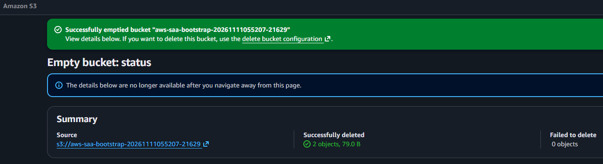</a></td></tr></table>

<p><sub><strong>Screenshot 31:</strong> The successful Empty bucket result showing two objects removed and no failures.</sub></p>

I then selected the now-empty bucket and initiated **Delete**. After the deletion procedure, I confirmed that the bucket was gone. The screenshot records the deletion selection; the final removal was confirmed in the lab conversation rather than captured in a separate success screenshot.

<table><tr><td align="center"><a href="images/screenshot-32.png">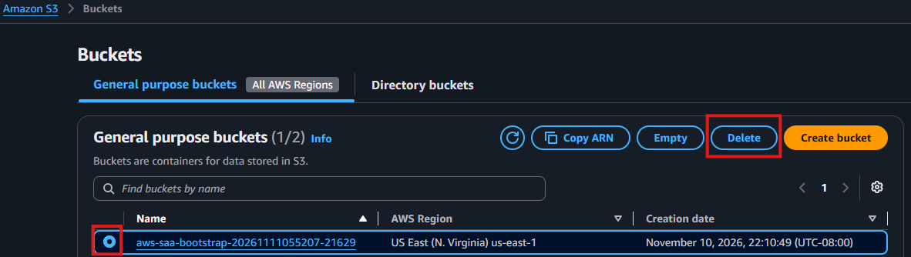</a></td></tr></table>

<p><sub><strong>Screenshot 32:</strong> The empty S3 bucket selected for the final Delete action.</sub></p>

### 6.3 Terminating the EC2 Instance

I selected the instance `SY Web Server` (`i-06ec08448af41c772`) and chose **Instance state → Terminate (delete) instance**. This was the dedicated test server, not a shared component of the retained VPC.

<table><tr><td align="center"><a href="images/screenshot-33.png">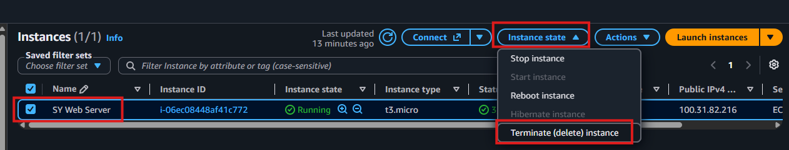</a></td></tr></table>

<p><sub><strong>Screenshot 33:</strong> The EC2 instance selected with the Terminate (delete) instance action visible.</sub></p>

The EC2 dashboard subsequently showed the instance in the **Terminated** state with no public IPv4 address.

<table><tr><td align="center"><a href="images/screenshot-34.png"></a></td></tr></table>

<p><sub><strong>Screenshot 34:</strong> The `SY Web Server` instance in the Terminated state.</sub></p>

### 6.4 Verifying EBS Volume Cleanup

I opened **EC2 → Elastic Block Store → Volumes** for the lab Region. The dashboard listed **no volumes**, so no manual EBS deletion was required. The empty list is consistent with the temporary root volume having been deleted on instance termination; I did not separately audit EBS snapshots.

<table><tr><td align="center"><a href="images/screenshot-35.png">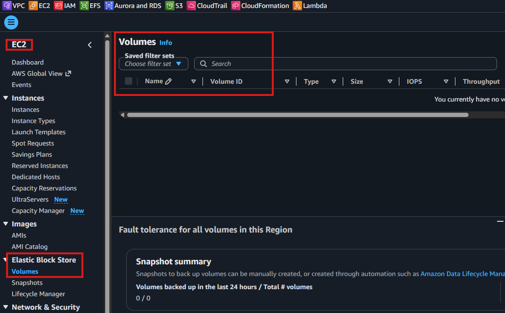</a></td></tr></table>

<p><sub><strong>Screenshot 35:</strong> The EBS Volumes dashboard showing no volumes in the selected Region.</sub></p>

### 6.5 Removing the Dedicated Security Group

I selected `EC2-Bootstrap-SG` in the Security Groups page and confirmed its ID, `sg-0fe77141f88a6f071`, and VPC ID, `vpc-08c6d3188add840d1`. I then initiated deletion and subsequently confirmed completion. The screenshot records the deletion confirmation screen, not a post-deletion list.

<table><tr><td align="center"><a href="images/screenshot-36.png"></a></td></tr></table>

<p><sub><strong>Screenshot 36:</strong> The confirmation dialog for deleting the dedicated `EC2-Bootstrap-SG` security group.</sub></p>

The shared VPC and its other security groups were retained.

### 6.6 Restoring the Reused IAM Role's Permissions

During troubleshooting, I had attached `AmazonS3FullAccess` to the reused `S3_Admin_Access` role. Because this grant was broader than the exercise required and was not part of the role's original configuration, I selected **AmazonS3FullAccess** for removal and confirmed the detachment afterward.

<table><tr><td align="center"><a href="images/screenshot-37.png"></a></td></tr></table>

<p><sub><strong>Screenshot 37:</strong> The IAM role showing `AmazonS3FullAccess` selected for detachment while the original policy remains listed.</sub></p>

I retained the original `AmazonS3FilesFullAccess` attachment and did not delete the `S3_Admin_Access` role. The image shows the policy **selected for removal**, while the completion of that action was confirmed separately.

### 6.7 Final Resource Inventory

| AWS resource | Final state and evidence |
| --- | --- |
| `SY Web Server` | **Terminated**, verified in EC2 dashboard |
| `aws-saa-bootstrap-20261111055207-21629` | **Deleted**, confirmed after the S3 empty/delete sequence |
| Lab EBS root volume | No EBS volumes remained in the Region's Volumes list |
| `EC2-Bootstrap-SG` | **Deleted**, confirmed after deletion dialog |
| `S3_Admin_Access` | **Retained**, pre-existing role |
| `AmazonS3FullAccess` role attachment | **Detached**, user-confirmed cleanup |
| `AmazonS3FilesFullAccess` role attachment | **Retained**, original policy |
| `AwsSaaNew-vpc` and public/private subnets | **Retained** for later labs |
| VPC internet gateway and route tables | **Retained** for later labs |
| EC2 hibernation test | **Not performed**; launch setting disabled |
| EBS snapshots / account-wide billing | **Not independently audited** |

> [!WARNING]
> **COST AND CLEANUP CONSIDERATION**
>
> Terminating EC2 does not automatically remove unrelated S3 buckets, security groups, IAM roles or all potentially billable resources. EBS persistence depends on volume configuration, and an empty Volumes list does not establish the absence of snapshots or all other AWS charges.

> [!NOTE]
> **KEY TAKEAWAY**
>
> I removed the resources dedicated to this exercise and restored the reused IAM role's permissions while preserving the existing VPC. I verified the EBS volume list and recorded the checks that were not performed.

---

## 07 Exam Review, Corrections and Production Lessons

### 7.1 Important Corrections and Observed Differences

| Topic | Source example or initial problem | Actual lab action / outcome |
| --- | --- | --- |
| Operating system | Older Amazon Linux 2 commands | Used Amazon Linux 2023 with `dnf` and `systemctl` |
| Webpage | Generic `hello world` | Created `Welcome to Serkan's World` page |
| HTML quoting | Original single-quoted line conflicted with apostrophe | Corrected to double-quoted HTML string before launch |
| S3 bucket naming | Original example used inconsistent bucket names | Used the same `BUCKET_NAME` variable for bucket creation and upload |
| Instance metadata | Source used token-optional IMDSv1-compatible requests | Required IMDSv2 and supplied tokens with `curl` |
| Metadata response hop limit | Initially displayed `2` | Changed to `1` for the direct-host workload before launch |
| IAM permissions | Role had `AmazonS3FilesFullAccess` and bucket creation failed | Added `AmazonS3FullAccess` temporarily; recovered S3 actions manually |
| Bootstrap validation | Website worked but S3 bucket was missing | Inspected `cloud-init-output.log` and identified `AccessDenied` |
| Hibernation | Source demonstrated hibernate/start | Not performed: Stop-hibernate behavior was disabled |
| Lifecycle verification | Expected a changed public IP | Observed `18.208.226.246` → `100.31.82.216` |
| Cleanup | Temporary resources must be removed separately | Deleted S3, EC2 and SG; checked EBS list; restored role permissions |

The S3 authorization problem was the principal troubleshooting case. I observed the exact denied action in the cloud-init log before changing role permissions, and I verified the recovery using both AWS CLI and the S3 Console. I did not claim that the original automation succeeded end to end when it had required a manual retry.

### 7.2 SAA-C03 Architecture Summary

| Component / concept | What we should understand |
| --- | --- |
| EC2 user data | Initial bootstrap automation, commonly first-boot execution |
| AMI vs user data | A machine image supplies the initial operating system; user data performs initialization commands |
| IAM instance profile | Connects an IAM role to an EC2 instance for temporary credentials |
| S3 `AccessDenied` | Review the specific denied action and the role's effective authorization |
| IMDSv2 | Session-token requests to the link-local metadata service |
| Metadata hop limit | Controls the IP TTL of IMDSv2 token responses; container networking may need a higher value |
| Security group vs application TLS | Opening port 443 does not configure a certificate or HTTPS server |
| EBS persistence | Data on retained EBS volumes survives normal stop/start |
| Normal stop vs hibernate | Normal stop does not preserve RAM; supported hibernation saves RAM to encrypted root EBS |
| Auto-assigned public IPv4 | Released on normal stop; a different address can be assigned at start |
| Resource lifecycle | EC2, S3, IAM, EBS and security groups have separate cleanup requirements |

### 7.3 Production Considerations and Best Practices

- **IAM:** Use a narrowly scoped EC2 role with only the bucket and object permissions the workload needs; avoid leaving broad `AmazonS3FullAccess` on an instance role.
- **Secure access:** Use least-privilege security groups and evaluate Systems Manager Session Manager for administration instead of exposing SSH broadly.
- **Web security:** Configure a TLS termination point and valid certificate for HTTPS; the lab's web server provided only HTTP.
- **Bootstrap reliability:** Treat cloud-init log inspection, exit status and application health checks as separate from EC2 infrastructure checks. For dependable automation, use repeatable and carefully tested startup scripts or infrastructure as code.
- **Networking:** Avoid coupling a production website to one auto-assigned public IPv4 address. Consider load balancing, DNS and multi-AZ architectures where availability requirements justify them.
- **Metadata:** Require IMDSv2 and use a practical response hop limit for the workload's network architecture.
- **Monitoring:** Add application-level monitoring, CloudWatch logs or alarms as appropriate; EC2 instance checks alone are insufficient.
- **Cost control:** Track public IPv4, EBS, S3 and other resources and document the cleanup state; billing was not independently audited in this exercise.

### 7.4 Final Reflection

This lab connected startup automation, Linux service management, network access and AWS API authorization. I observed that an Apache webpage could be fully operational while a later bootstrap step failed because of missing S3 permissions. The cloud-init log exposed that problem, and reusing the original bucket-name file allowed me to recover the S3 steps without replacing the server.

I then explored metadata through IMDSv2, saved a snapshot of the public IP to local storage and S3, and used a normal EC2 stop/start test to demonstrate persistent EBS-backed files and a changed public IPv4 address. Finally, I removed the lab-specific resources and restored the reused role's earlier policy configuration.

> [!NOTE]
> **WHAT REMAINS AFTER THE LAB**
>
> The `AwsSaaNew-vpc` networking environment and `S3_Admin_Access` IAM role remain for future practice. The temporary EC2 instance, S3 bucket and dedicated security group were removed; the EBS Volumes list was empty. Hibernation and account-wide billing/snapshot audits were not performed.

---

## Technical Competencies

**EC2 and Linux:** Launched an Amazon Linux 2023 instance, configured user data, installed Apache, checked service startup and tested instance lifecycle behavior.

**Cloud security:** Configured a security group, used an EC2 instance profile, diagnosed IAM authorization failures and restored temporary policy changes.

**Storage and metadata:** Used IMDSv2, saved metadata to the instance's EBS-backed filesystem, created and verified S3 objects, and checked EBS cleanup.

**Troubleshooting and operations:** Investigated cloud-init logs, isolated the failed S3 action, retried the incomplete work and performed evidence-based resource cleanup.

### Skills Matrix

| Engineering area | AWS service / tool | Evidence demonstrated |
| --- | --- | --- |
| Compute provisioning | EC2, Amazon Linux 2023 | Launched `t3.micro` and confirmed 3/3 checks |
| Startup automation | EC2 User Data, cloud-init, Bash | Automated Apache setup and investigated a partial failure |
| Web server operations | Apache HTTP Server, `systemctl` | Verified site from browser before/after stop/start; checked active/enabled |
| Network security | VPC, public subnet, security group | Configured public IPv4 and four inbound rules |
| IAM integration | IAM role, EC2 instance profile | Diagnosed missing `s3:CreateBucket`, attached and later removed broad permission |
| Object storage | S3, AWS CLI | Created bucket and verified `index.html` and `myip.txt` |
| Instance metadata | IMDSv2, `curl` | Retrieved AMI ID and public IPv4 with token-based requests |
| Data persistence | EBS-backed root volume | Verified local `myip.txt` survived stop/start |
| Instance lifecycle | EC2 stop/start/terminate | Observed changed public IPv4 and terminated the test instance |
| Resource cleanup | EC2, S3, EBS, IAM, SG | Removed lab resources, checked volumes and retained shared VPC |

---

## Command Reference

These are the principal commands used during the exercise. Bootstrap-script commands and the later **manual recovery** commands are distinguished in the sections above. The original resources have since been deleted; reuse commands only after replacing resource-specific values where appropriate.

### EC2 Bootstrap Script

```bash
#!/bin/bash
set -euo pipefail
dnf update -y
dnf install -y httpd
systemctl enable --now httpd
echo "<html><h1><center>Welcome to Serkan's World</center></h1></html>" > /var/www/html/index.html
BUCKET_NAME="aws-saa-bootstrap-$(date -u +%Y%m%d%H%M%S)-${RANDOM}"
echo "$BUCKET_NAME" > /var/tmp/bootstrap-bucket-name.txt
aws s3 mb "s3://${BUCKET_NAME}" --region us-east-1
aws s3 cp /var/www/html/index.html "s3://${BUCKET_NAME}/index.html"
```

### Investigating Cloud-init

```bash
sudo tail -n 80 /var/log/cloud-init-output.log
```

### Retrying the Failed S3 Operations Manually

```bash
BUCKET_NAME=$(cat /var/tmp/bootstrap-bucket-name.txt)
echo "$BUCKET_NAME"
aws s3 mb "s3://${BUCKET_NAME}" --region us-east-1
aws s3 cp /var/www/html/index.html "s3://${BUCKET_NAME}/index.html"
aws s3 ls "s3://${BUCKET_NAME}/"
```

### IMDSv2 Session and Metadata Requests

```bash
TOKEN=$(curl -fsS -X PUT \
  "http://169.254.169.254/latest/api/token" \
  -H "X-aws-ec2-metadata-token-ttl-seconds: 21600")

curl -fsS -H "X-aws-ec2-metadata-token: $TOKEN" \
  http://169.254.169.254/latest/meta-data/

curl -fsS -H "X-aws-ec2-metadata-token: $TOKEN" \
  http://169.254.169.254/latest/meta-data/ami-id

curl -fsS -H "X-aws-ec2-metadata-token: $TOKEN" \
  http://169.254.169.254/latest/meta-data/public-ipv4
```

### Saving and Uploading the Recorded IP

```bash
curl -fsS -H "X-aws-ec2-metadata-token: $TOKEN" \
  http://169.254.169.254/latest/meta-data/public-ipv4 > myip.txt
cat myip.txt
aws s3 cp myip.txt s3://aws-saa-bootstrap-20261111055207-21629/myip.txt
aws s3 ls s3://aws-saa-bootstrap-20261111055207-21629/
```

### Checking Persistence and Apache After Restart

```bash
cat ~/myip.txt
systemctl is-active httpd
systemctl is-enabled httpd
```

> [!WARNING]
> **SAFE REUSE REMINDER**
>
> The bucket and instance shown in these historical commands were deleted after the lab. S3 bucket names are globally unique, and scripts should not assume a historical bucket still exists. Use appropriately scoped IAM permissions and clean up temporary resources after testing.
