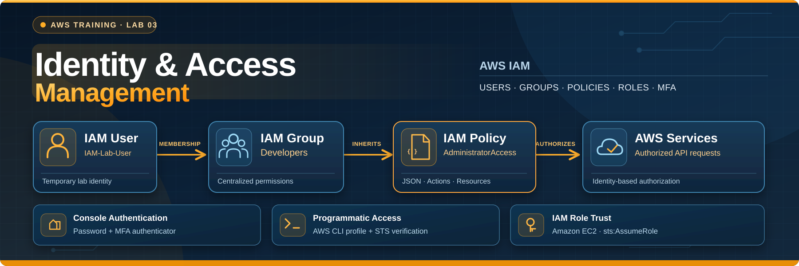

# AWS Identity and Access Management (IAM) Lab
**IDENTITY & ACCESS MANAGEMENT / IAM USERS / GROUPS / MFA / JSON POLICIES / ROLES / AWS CLI / AWS STS**

This lab covers identity creation, sign-in authentication, policy evaluation, role trust relationships, and programmatic AWS access. I created a temporary IAM user, assigned an existing group, tested console authentication, configured an authenticator-based MFA device, and examined how JSON policies control authorization.

I then created an IAM access key, installed AWS CLI v2 on Windows, configured a named profile, and used AWS Security Token Service (STS) to verify the identity behind the credentials. Finally, I deactivated and deleted the temporary key, removed its local CLI profile, and deleted the temporary IAM user.

The exercise builds on my earlier AWS CLI and EC2 Bootstrapping labs. I reused existing IAM groups and an EC2 service role rather than creating redundant resources. Those earlier resources were retained; the new IAM user and credentials were temporary.

---

## Contents

- [01 Preparing the IAM Environment and Configuring Console Access](#01-preparing-the-iam-environment-and-configuring-console-access)
- [02 Understanding IAM Policies, Roles and Programmatic Access](#02-understanding-iam-policies-roles-and-programmatic-access)
- [03 Cleaning Up Temporary IAM Resources](#03-cleaning-up-temporary-iam-resources)
- [04 Exam Review, Corrections and Production Lessons](#04-exam-review-corrections-and-production-lessons)
- [05 Technical Competencies and Skills Matrix](#05-technical-competencies-and-skills-matrix)
- [06 Consolidated Command Reference](#06-consolidated-command-reference)

## Architecture Highlight

This diagram describes the identities and authentication paths **used during the lab**. The temporary user and its access key were deleted afterward; it does not represent permanently deployed infrastructure.

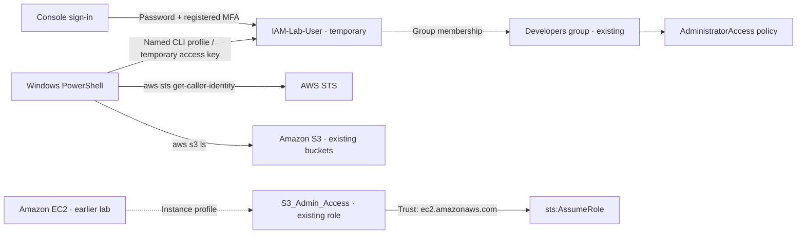

> [!NOTE]
> **SCOPE**
>
> The `Developers` and `Admins` groups, the `awsMaster` administrative user, and the `S3_Admin_Access` role predated this lab. The temporary user was created for the exercise. The role and group policies were inspected but not modified.

---

## 01 Preparing the IAM Environment and Configuring Console Access

### 1.1 Purpose and Objectives

The goal of this chapter was to create an IAM identity, assign permissions through a group, and verify secure console authentication. I used the existing AWS training account instead of provisioning new networking or compute resources.

The tasks included creating `IAM-Lab-User`, assigning the existing `Developers` group, enforcing a first-sign-in password change, signing in with the new identity, and registering an MFA authenticator.

### 1.2 Existing AWS Environment

My previous labs had already established the IAM resources needed for this exercise:

| Resource | Configuration / decision |
| --- | --- |
| AWS account | Existing training account; account ID redacted in published evidence |
| Administrative IAM user | `awsMaster` — retained |
| Existing IAM groups | `Admins` and `Developers` — retained |
| Developers group policy | AWS-managed `AdministratorAccess` — existing configuration |
| Existing EC2 IAM role | `S3_Admin_Access` — retained |
| Existing role permissions | `AmazonS3FilesFullAccess` — pre-existing, not changed in this lab |
| New training identity | `IAM-Lab-User` — created and later deleted |
| AWS Region for CLI exercises | `us-east-1` (N. Virginia) |

IAM users, groups, roles, and policies are global to an AWS account rather than tied to one AWS Region. Regional endpoints and resources still matter for some AWS CLI operations.

### 1.3 Understanding IAM Identities and Permissions

| Concept | What we should understand |
| --- | --- |
| IAM user | Account identity that can have console and/or programmatic credentials |
| IAM group | Collection of users that share policy-based permissions |
| Identity-based policy | JSON permissions attached to a user, group, or role |
| IAM role | Assumable identity that provides temporary AWS credentials |
| Trust policy | Determines which principals are allowed to assume a role |
| MFA | Adds an authentication factor beyond the password |
| Access key | Long-term credential pair used to sign AWS API requests |

Authentication establishes the identity making a request. Authorization evaluates whether that identity may perform the requested action. A successful sign-in is not equivalent to proof that every API operation is allowed.

### 1.4 Creating an IAM User

I navigated to **IAM → Users → Create user** and entered `IAM-Lab-User`. I enabled AWS Management Console access, selected an autogenerated initial password, and required the user to create a new password during the first sign-in.

| Setting | My configuration |
| --- | --- |
| User name | `IAM-Lab-User` |
| Console access | Enabled |
| Initial console password | Autogenerated |
| Password reset on first sign-in | Required |
| Access key at this stage | None |

<table><tr><td align="center"><a href="images/screenshot-01.png">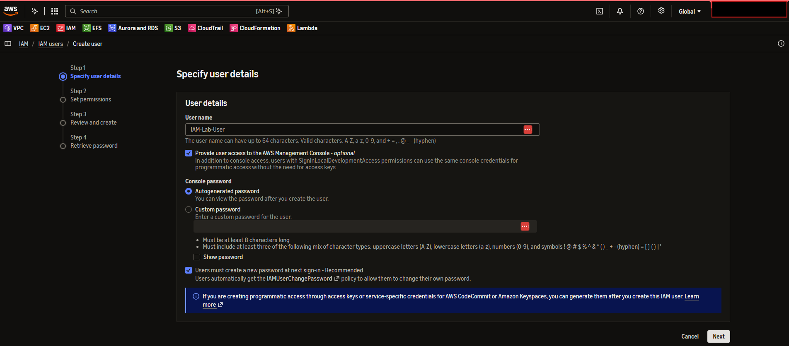</a></td></tr></table>

<p><sub><strong>Screenshot 01:</strong> IAM user creation wizard with `IAM-Lab-User`, autogenerated password, and required first-sign-in password change.</sub></p>

### 1.5 Assigning the Existing Developers Group

At the permissions step, I reused the existing `Developers` group. The group already had the AWS-managed `AdministratorAccess` policy attached, so I did not create another group or assign a direct copy of that policy to the user.

The **Review and create** screen also listed `IAMUserChangePassword`, supporting the mandatory first-login password change.

| Permission source | Observed assignment |
| --- | --- |
| Group | `Developers` |
| Group policy | `AdministratorAccess` (existing) |
| Additional user policy at creation | `IAMUserChangePassword` |
| Direct `AdministratorAccess` assignment | Not used |

<table><tr><td align="center"><a href="images/screenshot-02.png">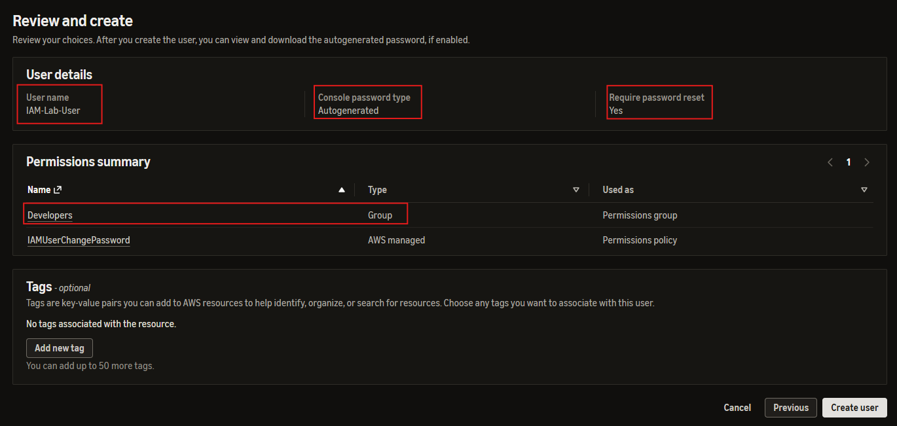</a></td></tr></table>

<p><sub><strong>Screenshot 02:</strong> IAM user creation review showing the Developers group, password reset requirement, and IAMUserChangePassword policy.</sub></p>

> [!CAUTION]
> **LAB-ONLY PERMISSION EXCEPTION**
>
> `AdministratorAccess` is broader than a normal developer role should receive. I reused the group's existing configuration for this controlled exercise, then deleted the temporary user at cleanup. In production, users should be assigned narrower permissions through appropriate groups or temporary roles.

### 1.6 Creating and Verifying the User

I selected **Create user**, and AWS displayed a success confirmation along with console sign-in information. The initial password was masked in the evidence, and no password value was included in this report.

<table><tr><td align="center"><a href="images/screenshot-03.png">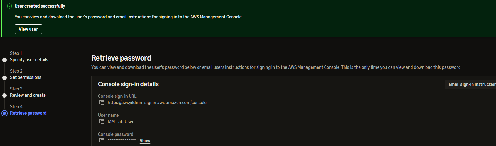</a></td></tr></table>

<p><sub><strong>Screenshot 03:</strong> AWS IAM success confirmation for `IAM-Lab-User` and the credential retrieval page with the password masked.</sub></p>

### 1.7 Testing Console Authentication and the Password Reset

I opened the IAM user sign-in page in a separate private browser window so that the administrative session could remain available. AWS presented the mandatory password reset page for `IAM-Lab-User`; I entered a new password and completed the reset.

<table><tr><td align="center"><a href="images/screenshot-04.png">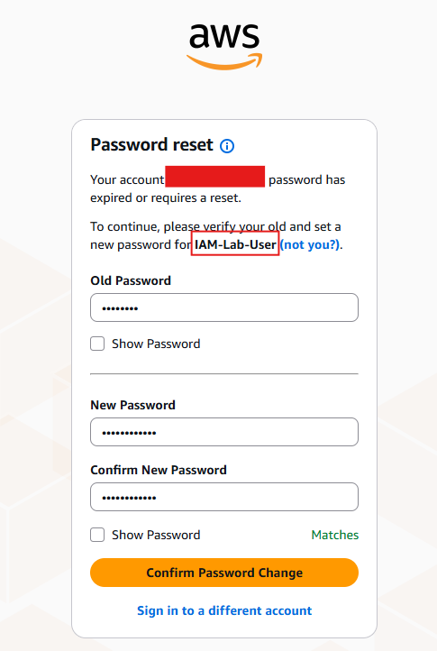</a></td></tr></table>

<p><sub><strong>Screenshot 04:</strong> First sign-in password reset form for IAM-Lab-User, with password fields masked.</sub></p>

The AWS Management Console then opened under `IAM-Lab-User`, confirming that the user could authenticate successfully. The Console happened to open with **US East (Ohio), `us-east-2`** selected. The Region selection did not change the global IAM user or group configuration.

<table><tr><td align="center"><a href="images/screenshot-05.png">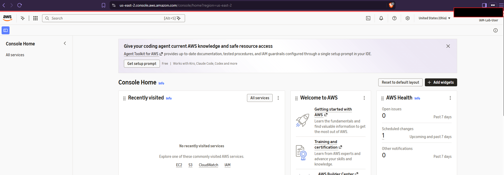</a></td></tr></table>

<p><sub><strong>Screenshot 05:</strong> AWS Management Console home page showing the newly authenticated IAM-Lab-User identity.</sub></p>

### 1.8 Configuring Multi-Factor Authentication

Next, I navigated to **IAM → Users → IAM-Lab-User → Security credentials → Assign MFA device**. I named the virtual device `IAM-Lab-User-Authenticator`, selected **Authenticator app**, and registered it using the app's one-time authentication codes. The MFA setup secret, QR code, and verification codes were not included in the captured evidence.

| Setting | Selected configuration |
| --- | --- |
| IAM user | `IAM-Lab-User` |
| Device name | `IAM-Lab-User-Authenticator` |
| MFA type | Authenticator app / virtual MFA |
| Verification | Authenticator-generated time-based codes |

<table><tr><td align="center"><a href="images/screenshot-06.png">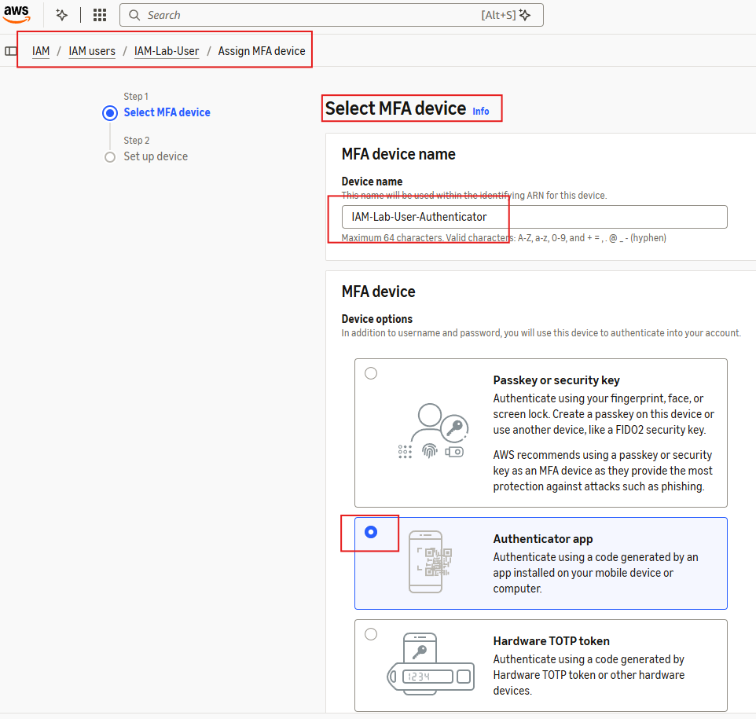</a></td></tr></table>

<p><sub><strong>Screenshot 06:</strong> MFA wizard with IAM-Lab-User-Authenticator selected as the authenticator-app device.</sub></p>

After completing enrollment, AWS displayed **MFA device assigned**. The IAM user summary showed **Console access: Enabled with MFA** and the MFA device was associated with the user.

<table><tr><td align="center"><a href="images/screenshot-07.png">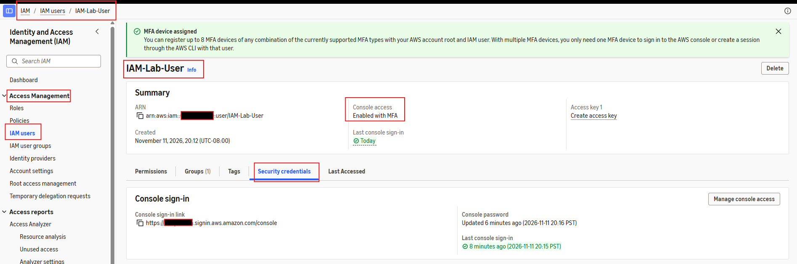</a></td></tr></table>

<p><sub><strong>Screenshot 07:</strong> IAM user security credentials with an MFA assigned success message and console access enabled with MFA.</sub></p>

The MFA registration and initial console authentication were verified in the AWS Console. A separate post-enrollment sign-in screenshot was not captured; this report does not treat that as independent evidence of another authentication test.

> [!IMPORTANT]
> **SAA-C03 EXAM CONNECTION**
>
> MFA strengthens authentication, while IAM policies govern authorization. An IAM user may be able to sign in yet still be denied a particular API operation. Access keys do not automatically inherit an MFA prompt merely because console MFA is registered.

### 1.9 Knowledge Check

> [!TIP]
> **1. Does creating an IAM user automatically grant access to AWS services?**
>
> **Answer: No.** Permissions come from applicable policies and group memberships, and can be limited by other authorization controls.
>
> **2. Is requiring a password change the same as enabling MFA?**
>
> **Answer: No.** A password reset changes a knowledge-based credential; MFA requires another authentication factor.
>
> **3. Does a policy attached to an IAM group apply to its members?**
>
> **Answer: Yes,** subject to normal IAM policy evaluation and any applicable limits or explicit denies.

> [!NOTE]
> **KEY TAKEAWAY**
>
> I created and authenticated a temporary IAM user, assigned its permissions through an existing group, and verified MFA registration without changing the existing administrative identity or group configuration.

---

## 02 Understanding IAM Policies, Roles and Programmatic Access

### 2.1 Examining AdministratorAccess JSON

To understand how AWS IAM expresses authorization, I opened **IAM → Policies → AdministratorAccess** and reviewed the AWS-managed policy under its **Permissions** tab.

```json
{
  "Version": "2012-10-17",
  "Statement": [
    {
      "Effect": "Allow",
      "Action": "*",
      "Resource": "*"
    }
  ]
}
```

| JSON element | Meaning |
| --- | --- |
| `Version` | Version of the IAM policy language |
| `Statement` | Array of individual permission statements |
| `Effect` | `Allow` or `Deny` for the matched request |
| `Action` | API actions, with `*` as a wildcard |
| `Resource` | Resources to which a statement applies |

The policy allows all actions on all applicable resources, subject to other AWS authorization mechanisms. Because this policy was attached to `Developers`, `IAM-Lab-User` inherited broad access through group membership. I examined the policy but did not edit it.

<table><tr><td align="center"><a href="images/screenshot-08.png">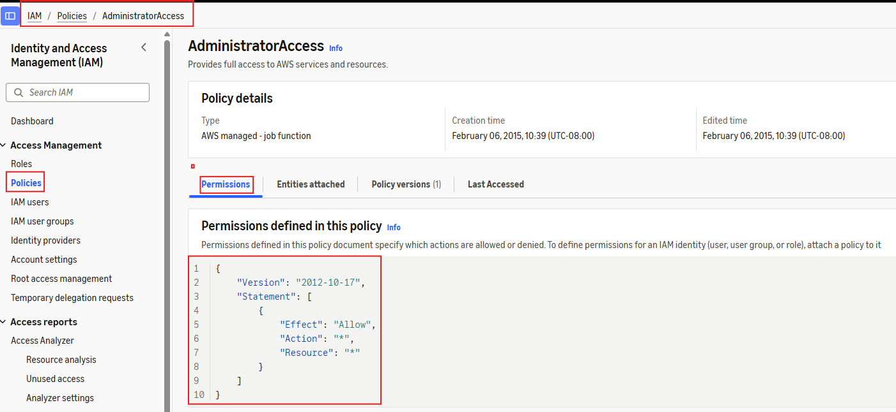</a></td></tr></table>

<p><sub><strong>Screenshot 08:</strong> AWS-managed AdministratorAccess policy showing Allow with wildcard Action and Resource values.</sub></p>

> [!IMPORTANT]
> **SAA-C03 EXAM CONNECTION**
>
> An applicable explicit deny takes precedence over an allow. Service control policies, permissions boundaries, resource-based policies, and other relevant controls can also affect the final authorization decision. An allow in `AdministratorAccess` does not override an applicable explicit deny.

### 2.2 Examining the Existing EC2 Role and Trust Relationship

The instructor's role exercise would create an EC2-trusted S3 role. I already had the `S3_Admin_Access` role from earlier work, so I inspected it rather than creating a duplicate or reattaching broad permissions.

I opened **IAM → Roles → S3_Admin_Access → Trust relationships** and examined the following trust policy:

```json
{
  "Version": "2012-10-17",
  "Statement": [
    {
      "Effect": "Allow",
      "Principal": {
        "Service": "ec2.amazonaws.com"
      },
      "Action": "sts:AssumeRole"
    }
  ]
}
```

The service principal `ec2.amazonaws.com` identifies EC2 as a trusted service, and `sts:AssumeRole` permits the role-assumption operation. That trust relationship is different from the permissions policies that govern what the role can do after assumption.

<table><tr><td align="center"><a href="images/screenshot-09.png">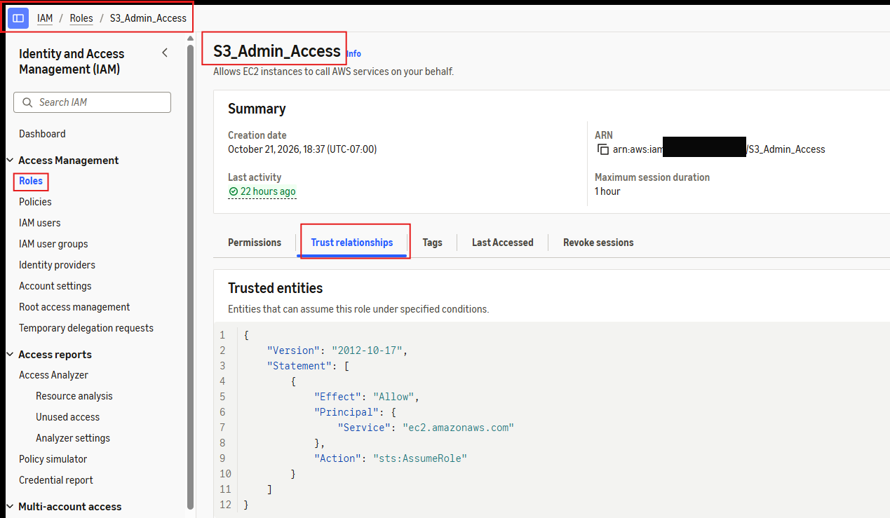</a></td></tr></table>

<p><sub><strong>Screenshot 09:</strong> S3_Admin_Access role trust policy identifying ec2.amazonaws.com and sts:AssumeRole; account number redacted.</sub></p>

The earlier EC2 Bootstrapping Lab provided a practical example: EC2 could assume the role, but an S3 bucket creation request failed until an appropriate permissions policy was attached. In this IAM exercise, I made no changes to the role.

### 2.3 Creating an IAM Access Key

I then explored programmatic authentication, which the instructor's historical user-creation workflow had included during initial setup. In the current AWS Console, access keys were created separately under the user's **Security credentials** tab.

I returned to `IAM-Lab-User`, confirmed the **Access keys** section initially showed zero keys, and selected **Create access key**.

<table><tr><td align="center"><a href="images/screenshot-10.png">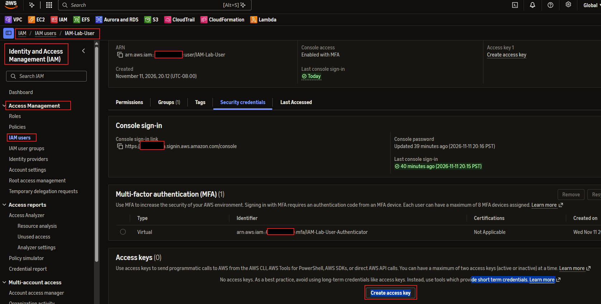</a></td></tr></table>

<p><sub><strong>Screenshot 10:</strong> Security credentials showing no access keys and the Create access key option.</sub></p>

At **Access key best practices & alternatives**, I chose **Command Line Interface (CLI)** and acknowledged AWS's recommendation to use temporary credentials when possible.

<table><tr><td align="center"><a href="images/screenshot-11.png">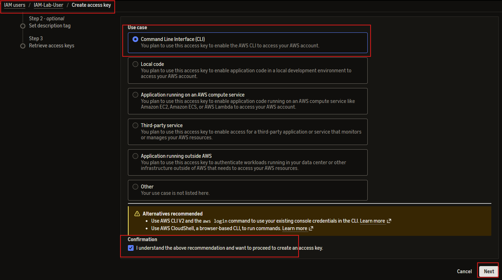</a></td></tr></table>

<p><sub><strong>Screenshot 11:</strong> Access key creation wizard with Command Line Interface selected and the security recommendation acknowledged.</sub></p>

I entered `IAM-Lab-CLI-Temporary` as the description tag so that the key could be identified and removed during cleanup.

<table><tr><td align="center"><a href="images/screenshot-12.png">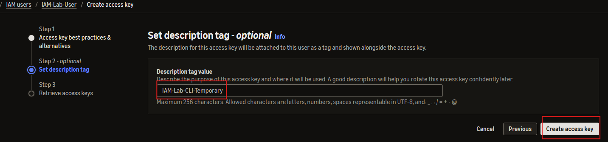</a></td></tr></table>

<p><sub><strong>Screenshot 12:</strong> Access key description set to IAM-Lab-CLI-Temporary before creation.</sub></p>

AWS then generated an Access Key ID and Secret Access Key. I reviewed the retrieval page, and the published screenshot conceals both credential values. The secret access key is only available at creation time.

<table><tr><td align="center"><a href="images/screenshot-13.png">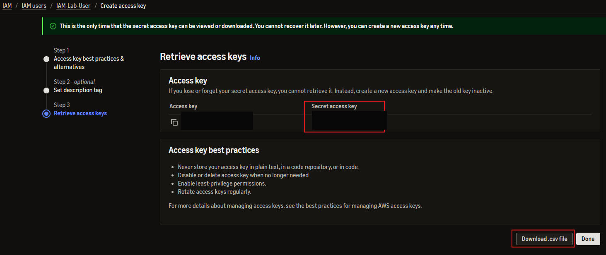</a></td></tr></table>

<p><sub><strong>Screenshot 13:</strong> Access key retrieval page following successful creation; key ID and secret redacted.</sub></p>

The subsequent Security credentials page displayed one **Active** key with the expected description. At that point the key had not yet been used.

<table><tr><td align="center"><a href="images/screenshot-14.png">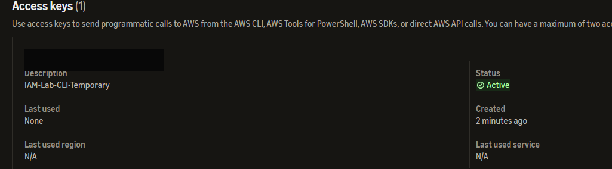</a></td></tr></table>

<p><sub><strong>Screenshot 14:</strong> New IAM-Lab-CLI-Temporary access key listed as Active; identifier redacted.</sub></p>

> [!CAUTION]
> **TEMPORARY ADMINISTRATIVE CREDENTIALS**
>
> Because the user inherited `AdministratorAccess`, this access key carried powerful permissions. The key was created for a short-lived learning exercise, not as a long-term application credential. Credential material is excluded from this public guide and from its screenshots.

### 2.4 Installing AWS CLI on Windows

To test the new key from my local machine, I first opened Windows PowerShell and attempted to configure a named profile:

```powershell
aws configure --profile iam-lab-user
```

PowerShell returned a `CommandNotFoundException` indicating that `aws` was not recognized. AWS CLI had previously been used on an EC2 Linux workstation, but was not yet available in the Windows shell.

<table><tr><td align="center"><a href="images/screenshot-15.png">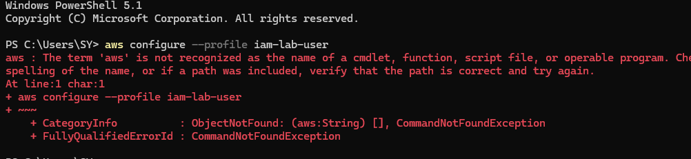</a></td></tr></table>

<p><sub><strong>Screenshot 15:</strong> Initial AWS CLI command failed in PowerShell because the aws executable was not available.</sub></p>

I installed AWS CLI v2 for Windows and verified the installation:

```powershell
aws --version
```

The version output identified **AWS CLI 2.40.1** on **Windows 11 (AMD64)**.

I then ran:

```powershell
aws configure --profile iam-lab-user
```

I supplied the temporary key pair privately, set the default Region to `us-east-1`, and selected JSON output. A named profile kept the lab credentials separate from other configurations. The published terminal screenshot hides the full credential-entry lines.

| Named profile option | Actual setting |
| --- | --- |
| Profile | `iam-lab-user` |
| Authentication | IAM access key created for the lab |
| Default Region | `us-east-1` |
| Output format | `json` |
| AWS CLI version | `2.40.1` |

<table><tr><td align="center"><a href="images/screenshot-16.png">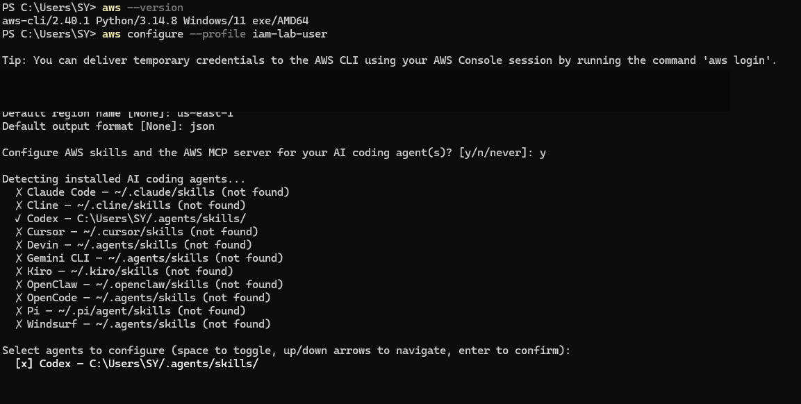</a></td></tr></table>

<p><sub><strong>Screenshot 16:</strong> AWS CLI version and named-profile configuration in PowerShell; credential-entry lines blacked out.</sub></p>

### 2.5 Verifying Authentication with AWS STS and Amazon S3

I used AWS STS to verify that the named CLI profile authenticated as the intended IAM user:

```powershell
aws sts get-caller-identity --profile iam-lab-user
```

AWS returned the `UserId`, `Account`, and `Arn` fields. The ARN ended with `user/IAM-Lab-User`, demonstrating that the credentials mapped to the temporary IAM identity. The real AWS account ID is redacted in the screenshot.

<table><tr><td align="center"><a href="images/screenshot-17.png">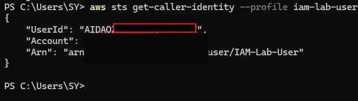</a></td></tr></table>

<p><sub><strong>Screenshot 17:</strong> STS GetCallerIdentity returned IAM-Lab-User as the authenticated principal; AWS account identifier redacted.</sub></p>

I also ran a second, read-only AWS CLI operation against S3:

```powershell
aws s3 ls --profile iam-lab-user
```

The command successfully returned an existing bucket listing. This confirmed that the profile could invoke an authorized AWS S3 operation as well as STS. I did not create or delete S3 resources during this IAM exercise.

> [!IMPORTANT]
> **SAA-C03 EXAM CONNECTION**
>
> `sts:GetCallerIdentity` identifies the principal whose credentials signed the request. An IAM access key is a long-term credential belonging to an IAM user; it is not the same as temporary credentials supplied through an assumed IAM role or an instance profile.

### 2.6 Knowledge Check

> [!TIP]
> **1. Does a successful `GetCallerIdentity` response prove that the principal has AdministratorAccess?**
>
> **Answer: No.** It identifies the caller but does not prove the full extent of permissions granted to that identity.
>
> **2. What is the difference between the IAM role trust policy and its permissions policy?**
>
> **Answer:** The trust policy determines who may assume the role; the permissions policy specifies authorized operations after assumption.
>
> **3. Why use a named AWS CLI profile?**
>
> **Answer:** It allows separate credentials and defaults to be selected explicitly for a command, preventing unintended reliance on a different profile.

> [!NOTE]
> **KEY TAKEAWAY**
>
> I examined administrative JSON permissions and an EC2 role trust policy, then installed AWS CLI on Windows, configured a temporary named profile, and verified programmatic access through STS and a read-only S3 request.

---

## 03 Cleaning Up Temporary IAM Resources

### 3.1 Purpose and Objectives

The user and key in this lab were temporary. I cleaned up the access key in IAM, removed the locally stored named profile, and deleted the new IAM user. I intentionally retained the existing groups, administrative user, and EC2 role created in earlier exercises.

### 3.2 Deactivating and Deleting the Access Key

I navigated to **IAM → Users → IAM-Lab-User → Security credentials** and located the access key labeled `IAM-Lab-CLI-Temporary`. Before cleanup, the key was **Active**, and AWS reported its most recently used service as **STS** in `us-east-1`, consistent with my CLI authentication test.

<table><tr><td align="center"><a href="images/screenshot-18.png">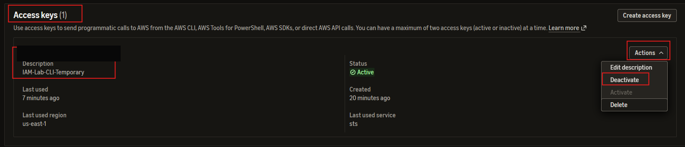</a></td></tr></table>

<p><sub><strong>Screenshot 18:</strong> IAM-Lab-CLI-Temporary access key listed as Active with recent STS usage; key ID redacted.</sub></p>

I selected **Actions → Deactivate**. The key's status changed to **Inactive**, preventing it from being used for new AWS API requests.

<table><tr><td align="center"><a href="images/screenshot-19.png">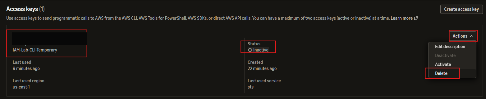</a></td></tr></table>

<p><sub><strong>Screenshot 19:</strong> The same IAM access key marked Inactive, with the Delete action available; identifier redacted.</sub></p>

I then deleted the inactive key. Its deletion was confirmed during the lab; no separate success screenshot was captured. This removed the temporary programmatic credential from AWS.

### 3.3 Removing the Local AWS CLI Profile

Deleting the access key in IAM invalidates it, but the AWS CLI configuration and credentials files may still contain the saved values. I removed the `iam-lab-user` profile from both local files using PowerShell and Notepad.

```powershell
notepad "$env:USERPROFILE\.aws\credentials"
notepad "$env:USERPROFILE\.aws\config"
aws configure list-profiles
```

I deleted the `[iam-lab-user]` section from the credentials file and its corresponding `[profile iam-lab-user]` section from the configuration file. The final `aws configure list-profiles` output was empty, confirming that this profile was no longer registered.

The same terminal screenshot also captured the earlier successful `aws s3 ls` call, which preceded profile removal. AWS CLI itself remained installed on Windows for subsequent labs.

<table><tr><td align="center"><a href="images/screenshot-20.png">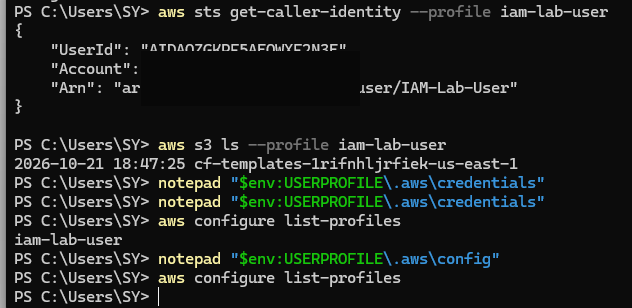</a></td></tr></table>

<p><sub><strong>Screenshot 20:</strong> PowerShell commands opening the local AWS CLI credential/configuration files and confirming no remaining named profiles; account ID redacted.</sub></p>

### 3.4 Deleting the Temporary IAM User

Finally, I returned to IAM as an administrative identity and selected `IAM-Lab-User` for deletion. The AWS dialog required explicit consent by typing `confirm`.

<table><tr><td align="center"><a href="images/screenshot-21.png">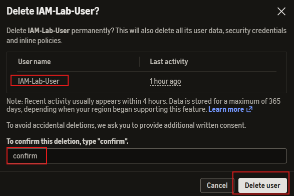</a></td></tr></table>

<p><sub><strong>Screenshot 21:</strong> Delete IAM-Lab-User confirmation dialog with the required consent text entered.</sub></p>

I completed the deletion and confirmed that the temporary user was removed. The screenshot captures the confirmation dialog, while the completed deletion was separately confirmed during the lab; a post-deletion IAM Users list screenshot was not collected.

### 3.5 Final IAM Resource State

| Resource | Final state | Evidence / basis |
| --- | --- | --- |
| `IAM-Lab-User` | Deleted | User-confirmed after deletion dialog |
| Temporary IAM access key | Deactivated, then deleted | Inactive screenshot and user confirmation |
| Local `iam-lab-user` CLI profile | Removed | Empty `aws configure list-profiles` output |
| AWS CLI v2 on Windows | Retained | Installed and verified; no uninstall performed |
| `Developers` group | Retained | Pre-existing group; no deletion performed |
| `Admins` group | Retained | Pre-existing group; no deletion performed |
| `awsMaster` administrative user | Retained | Pre-existing user; no deletion performed |
| `S3_Admin_Access` EC2 role | Retained | Existing role inspected, not modified |
| Separate orphaned MFA inventory | Not checked | MFA was registered; no standalone MFA resource audit was performed |

No EC2 instances, EBS volumes, S3 buckets, or VPC components were created for this IAM exercise. The reusable AWS networking and compute environment was not changed.

> [!WARNING]
> **CREDENTIAL SAFETY**
>
> Some original terminal screenshots displayed sensitive key-entry fields. The supplied images in this package have been modified **only to obscure sensitive credential values and the real 12-digit AWS account ID**. The access key was later deleted, but public documentation should not reproduce historical credentials.

### 3.6 Knowledge Check

> [!TIP]
> **1. Does deactivating an IAM access key delete it?**
>
> **Answer: No.** It makes the key inactive. Deletion is a separate operation.
>
> **2. Does deleting an IAM access key also remove local copies from a computer?**
>
> **Answer: No.** The credentials are invalid in AWS, but locally saved values remain until removed.
>
> **3. Does deleting the temporary user also require deleting the Developers group?**
>
> **Answer: No.** The group predated the lab and was retained for other work.

> [!NOTE]
> **KEY TAKEAWAY**
>
> I completed the IAM access-key lifecycle and removed the temporary identity and CLI profile while preserving shared IAM resources used by other labs.

---

## 04 Exam Review, Corrections and Production Lessons

### 4.1 Instructor Workflow and Current AWS Console

The IAM training exercise originally described creating a user with both console and programmatic access in one workflow. In the Console version used for this lab, I created the user first and generated its access key separately under **Security credentials**.

| Topic | Instructor exercise | My actual hands-on work |
| --- | --- | --- |
| Example username | `Jade` | `IAM-Lab-User` |
| IAM group | Create `Developers` | Reused the existing `Developers` group |
| Group permission | `AdministratorAccess` | Confirmed it was already attached |
| Console access | Enable and require password change | Completed and tested |
| Programmatic access | Create key during user creation | Created the key separately under Security credentials |
| MFA | Recommended before working | Registered MFA and verified Enabled with MFA |
| Access-key management | View and review key status | Created, used, deactivated, and deleted a temporary key |
| IAM role | Create `S3_Admin_Access` for EC2 | Inspected the existing role and trust relationship |

The source material refers to an access key as a way to access the AWS Console, but an access key is for signing programmatic API requests, not for interactive console password authentication. The access key ID is not the user's console username.

### 4.2 Troubleshooting and Security Considerations

The only command execution issue encountered was the initial Windows PowerShell error stating that `aws` was not recognized. Installing AWS CLI v2 resolved that problem. I then verified the configured IAM identity with STS and confirmed that a read-only S3 listing completed successfully.

For production workloads, long-term IAM user access keys should generally be avoided in favor of temporary credentials. Administrator permissions should be limited to identities that require them; a typical developer group should have more tightly scoped permissions than full account administration.

For privileged identities, MFA is important but does not automatically add MFA enforcement to access-key-based API calls. MFA enforcement in authorization can require explicit policy conditions and authentication design.

### 4.3 Final Technical Reflection

This exercise connected IAM console access, password and MFA authentication, group-based authorization, role trust, and AWS CLI programmatic authentication. I observed how AWS-managed policies express permissions in JSON and how the existing EC2 role identifies its trusted service principal.

Creating a named CLI profile and verifying it with AWS STS demonstrated the difference between an AWS CLI installation and the credentials associated with an individual request. The final cleanup reinforced that cloud-side credential deletion and local credential-file removal are separate responsibilities.

All temporary IAM identities and keys created for this lab were subsequently removed, while the original groups and role remained available for future exercises.

---

## 05 Technical Competencies and Skills Matrix

### 5.1 Technical Competencies

The work demonstrated IAM user lifecycle management, console authentication, MFA enrollment, group-based permissions, JSON policy interpretation, IAM role trust inspection, Windows AWS CLI installation, profile configuration, STS identity verification, S3 CLI access, and secure credential cleanup.

### 5.2 Skills Matrix

| Service or technology | Demonstrated skills |
| --- | --- |
| AWS IAM Users | Create temporary user, configure console access, verify authentication, delete identity |
| IAM Groups | Assign an existing group and interpret inherited permissions |
| IAM Policies | Inspect AdministratorAccess and understand JSON wildcard statements |
| IAM Roles | Review EC2 service trust and `sts:AssumeRole` |
| MFA | Register a virtual authenticator and verify the enabled MFA status |
| IAM Access Keys | Generate, use, deactivate, and delete long-term programmatic credentials |
| AWS CLI v2 | Install and use CLI on Windows PowerShell |
| AWS CLI Profiles | Configure a named profile and remove local credentials afterward |
| AWS STS | Run GetCallerIdentity to verify the principal behind a signed request |
| Amazon S3 | Use an IAM profile to list existing buckets |
| Troubleshooting | Diagnose an unrecognized CLI command and verify the corrected installation |
| Credential Hygiene | Remove temporary cloud credentials and local profile data |

---

## 06 Consolidated Command Reference

These commands were executed in **Windows PowerShell** during the lab. They are shown in the order needed for setup, authentication verification, and cleanup. **Do not reuse deleted access-key credentials**; configure another authorized identity if repeating the exercise.

### 6.1 Verify AWS CLI Installation

```powershell
aws --version
```

The installed CLI reported version `2.40.1` on Windows 11.

### 6.2 Configure the Temporary Named Profile

```powershell
aws configure --profile iam-lab-user
```

The CLI prompted for the Access Key ID, Secret Access Key, default Region (`us-east-1`), and output format (`json`). The actual key values were never included in this document.

### 6.3 Verify the AWS Principal

```powershell
aws sts get-caller-identity --profile iam-lab-user
```

The response identified `IAM-Lab-User` as the caller. The real 12-digit account number is redacted from the screenshots and excluded from the example below:

```json
{
  "Account": "000000000000",
  "Arn": "arn:aws:iam::000000000000:user/IAM-Lab-User"
}
```

The all-zero account number above is a **synthetic replacement** for documentation, not the actual account identifier or the complete STS response.

### 6.4 List Existing S3 Buckets

```powershell
aws s3 ls --profile iam-lab-user
```

The command successfully listed existing buckets without creating new S3 resources.

### 6.5 Remove the Local Profile and Verify Cleanup

```powershell
notepad "$env:USERPROFILE\.aws\credentials"
notepad "$env:USERPROFILE\.aws\config"
aws configure list-profiles
```

I removed only the temporary profile sections from the two configuration files. The final profile listing was empty. Deactivating and deleting the key in IAM were performed through the AWS Console rather than AWS CLI.

> [!NOTE]
> **FINAL KEY TAKEAWAY**
>
> AWS CLI provides a local tool for making AWS API requests, but the identity and authority of each request depend on the selected credentials. IAM users, groups, roles, and policies provide complementary mechanisms for authentication and authorization. Secure lifecycle management includes both AWS-side credential removal and local cleanup.
