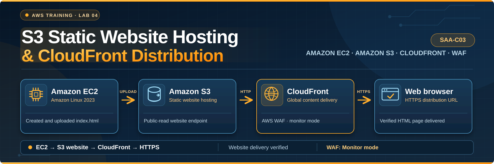

# Amazon S3 Static Website Hosting and CloudFront Distribution Lab
**AMAZON EC2 / USER DATA / AMAZON LINUX 2023 / IAM ROLES / AWS CLI / AMAZON S3 / CLOUDFRONT / AWS WAF**

In this lab, I deployed a simple HTML website on an Amazon EC2 instance, uploaded the website file to an Amazon S3 bucket, enabled S3 static website hosting, and distributed the website through Amazon CloudFront. I verified the page through three different endpoints: the EC2 public IPv4 address, the S3 website hostname, and the HTTPS CloudFront distribution hostname.

The EC2 User Data automation did not finish successfully on the first attempt. I investigated the failed initialization, recovered Apache without recreating the instance, and completed the S3 upload through the AWS CLI. This troubleshooting is included because it was part of the actual lab, not a hypothetical exercise.

I also enabled included CloudFront security protections in AWS WAF monitor mode and inspected request metrics. **All temporary lab resources were still present at the documentation checkpoint; cleanup was intentionally not performed.**

---

## Contents

- [01 Purpose, Architecture and Core Concepts](#01-purpose-architecture-and-core-concepts)
- [02 Configuring and Launching the EC2 Web Server](#02-configuring-and-launching-the-ec2-web-server)
- [03 Recovering Apache and Verifying the EC2 Website](#03-recovering-apache-and-verifying-the-ec2-website)
- [04 Creating and Publishing the S3 Website](#04-creating-and-publishing-the-s3-website)
- [05 Creating the Amazon CloudFront Distribution](#05-creating-the-amazon-cloudfront-distribution)
- [06 Verifying HTTPS Delivery and Monitoring Requests](#06-verifying-https-delivery-and-monitoring-requests)
- [07 Resources Requiring Cleanup](#07-resources-requiring-cleanup)
- [08 SAA-C03 Exam Review and Production Considerations](#08-saa-c03-exam-review-and-production-considerations)
- [09 Technical Competencies and Skills Matrix](#09-technical-competencies-and-skills-matrix)
- [10 Consolidated Command Reference](#10-consolidated-command-reference)

## Architecture Highlight

The following diagram represents the **working lab architecture**. The EC2 instance was used to create and upload the HTML file; **CloudFront's origin was the S3 website endpoint, not EC2**. The diagram documents what was built, and does not imply that cleanup has been completed.

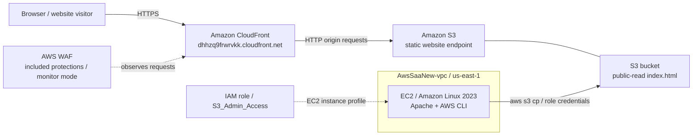

| Component | Role in the architecture |
| --- | --- |
| EC2 + Apache | Original web server and the workstation used to publish `index.html` to S3. |
| IAM instance profile | Supplied temporary AWS credentials to the instance without embedding access keys. |
| S3 bucket | Stored the HTML object and hosted the public static website. |
| S3 bucket policy | Allowed anonymous `s3:GetObject` access for this lab's website content. |
| CloudFront | Delivered the S3 website content at an AWS-assigned HTTPS hostname. |
| AWS WAF | Monitored incoming CloudFront traffic under the included security configuration. |

> [!IMPORTANT]
> **SAA-C03 EXAM CONNECTION**
>
> A static website hosted at the **S3 website endpoint** is accessed by CloudFront as a **custom origin** and supports **HTTP, not HTTPS, on the CloudFront-to-S3 origin connection**. CloudFront can still use HTTPS for the viewer connection. The website endpoint is different from the regular S3 REST bucket endpoint, for which a private origin secured with Origin Access Control (OAC) is preferable in production.

---

## 01 Purpose, Architecture and Core Concepts

### 1.1 Purpose and Objectives

The purpose of this exercise was to understand the difference between serving a webpage from an EC2 web server, hosting the same file through Amazon S3, and delivering it through Amazon CloudFront. I used the existing AWS training environment instead of creating another VPC or new IAM role.

I completed these tasks:

1. Launched an Amazon Linux 2023 EC2 instance in an existing public subnet with an IAM instance profile and User Data.
2. Diagnosed unsuccessful User Data execution and recovered the Apache web server.
3. Created an S3 bucket and uploaded the working HTML page through AWS CLI.
4. Enabled S3 static website hosting and applied a temporary public-read bucket policy.
5. Configured CloudFront with the S3 website origin and verified the HTTPS `.cloudfront.net` URL.
6. Examined WAF request metrics and identified resources for later cleanup.

### 1.2 Understanding the Delivery Options

| Delivery option | How it served the page in this lab | Important limitation or benefit |
| --- | --- | --- |
| EC2 public IP | Apache served `/var/www/html/index.html` on port 80. | No TLS was configured on Apache; direct HTTPS on the IP was not expected to work. |
| S3 website endpoint | Amazon S3 served `index.html` using its static website configuration. | Website endpoints support HTTP only, and the lab website was deliberately public. |
| CloudFront distribution | CloudFront retrieved content from the S3 website origin and served it at an HTTPS hostname. | Viewer HTTPS does not imply CloudFront-to-S3 HTTPS when using the S3 website endpoint. |

### 1.3 Environment and Resource Names

| Resource / setting | My observed lab configuration |
| --- | --- |
| AWS Region | `us-east-1` (N. Virginia) |
| Existing VPC | `AwsSaaNew-vpc` — `vpc-08c6d3188add840d1` — `10.0.0.0/16` |
| Public subnet | `AwsSaaNew-subnet-public1-us-east-1a` |
| Subnet ID | `subnet-056fdb27e04156a70` |
| Subnet CIDR | `10.0.0.0/20` |
| EC2 instance name | `S3-Website-Web-Server` |
| EC2 instance ID | `i-03351abf900c76052` |
| EC2 public IPv4 at verification | `54.196.13.136` |
| EC2 key pair | `npoweraws` — reused |
| Security group | `S3-Website-SG` — newly created for the lab |
| Existing IAM role | `S3_Admin_Access` |
| New S3 bucket | `aws-saa-cloudfront-20261113022406-1407` |
| CloudFront distribution name | `S3-Website-CloudFront` |
| CloudFront distribution ID | `E30IUHRXXOZGT2` |
| CloudFront distribution domain | `dhhzq9frwrvkk.cloudfront.net` |

> [!NOTE]
> **KEY TAKEAWAY**
>
> The EC2 instance was not the CloudFront origin. Once the website file was uploaded, CloudFront delivered content from S3 independently of Apache.

---

## 02 Configuring and Launching the EC2 Web Server

### 2.1 Selecting the Instance and Operating System

I opened **EC2 → Instances → Launch instance**, named the server `S3-Website-Web-Server`, and selected **Amazon Linux 2023**, 64-bit x86. I selected the `t3.micro` instance type and an 8 GiB EBS root volume. I chose Amazon Linux 2023 rather than the older Amazon Linux 2 image used in the training example, so the package manager commands were based on `dnf`.

| Setting | Observed selection |
| --- | --- |
| AMI | Amazon Linux 2023, x86_64 |
| AMI ID | `ami-096ef200a87f736af` |
| Instance type | `t3.micro` |
| Root volume | 8 GiB EBS |
| Instance count | 1 |

<table><tr><td align="center"><a href="images/screenshot-01.png">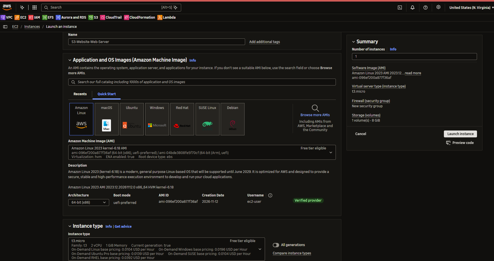</a></td></tr></table>
<p><sub><strong>Screenshot 01:</strong> EC2 launch wizard showing the server name, Amazon Linux 2023 AMI, and `t3.micro` configuration.</sub></p>

### 2.2 Reusing the VPC and Configuring Network Access

I selected the existing key pair `npoweraws`, the existing VPC `AwsSaaNew-vpc`, and its public subnet in `us-east-1a`. I enabled automatic assignment of a public IPv4 address and entered `S3-Website-SG` as the new security group name.

<table><tr><td align="center"><a href="images/screenshot-02.png">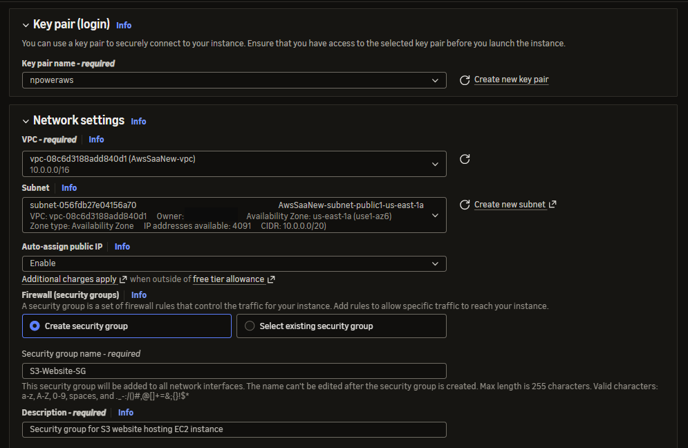</a></td></tr></table>
<p><sub><strong>Screenshot 02:</strong> Existing key pair, VPC, public subnet, public IPv4 assignment, and new security group name.</sub></p>

I configured inbound rules for SSH, HTTP, and HTTPS. The HTTP rule allowed requests to Apache from the internet. The HTTPS rule was present in the security group, but it did not install a certificate or configure Apache for TLS.

| Protocol | Port | Inbound source | Purpose |
| --- | --- | --- | --- |
| SSH (TCP) | 22 | `[IP Address Reducted]/32` | My IP access for administration. |
| HTTP (TCP) | 80 | `0.0.0.0/0` | Public Apache webpage testing. |
| HTTPS (TCP) | 443 | `0.0.0.0/0` | Allowed at the security group; no HTTPS web server configured. |
| SSH (TCP) | 22 | `pl-0e4bcff02b13bef1e` | EC2 Instance Connect managed prefix list. |

<table><tr><td align="center"><a href="images/screenshot-03.png">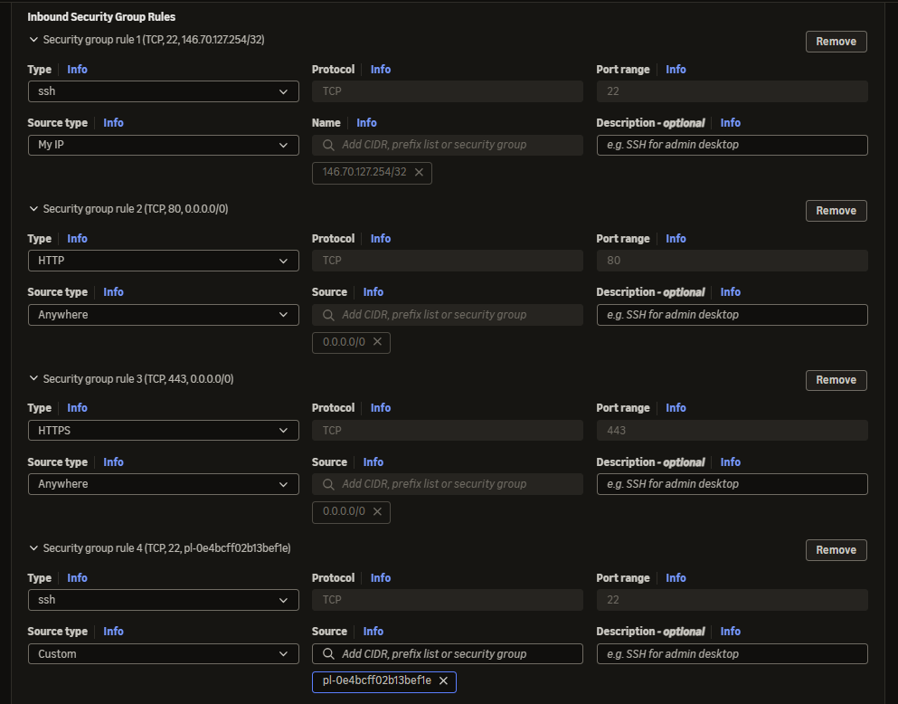</a></td></tr></table>
<p><sub><strong>Screenshot 03:</strong> Inbound SSH, HTTP, HTTPS, and EC2 Instance Connect rules in the launch wizard.</sub></p>

### 2.3 Selecting the Existing IAM Instance Profile

I reused the `S3_Admin_Access` instance profile. The advanced-details screenshot recorded the role selection and an intermediate **Stop-Hibernate behavior: Enable** setting. I did not perform a hibernation test, and the final post-launch hibernation setting was not separately verified in the evidence; I therefore do not treat hibernation as a completed objective.

<table><tr><td align="center"><a href="images/screenshot-04.png">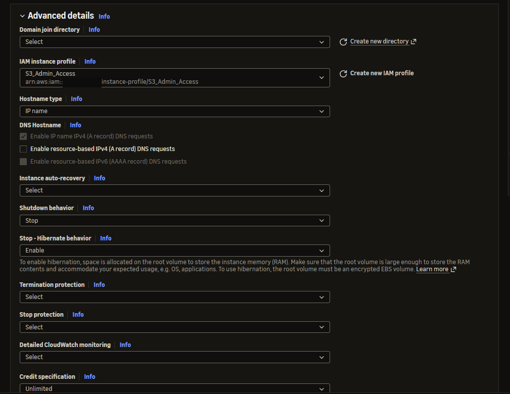</a></td></tr></table>
<p><sub><strong>Screenshot 04:</strong> Existing IAM instance profile selected in EC2 advanced details; an intermediate hibernation option is visible.</sub></p>

The role initially had `AmazonS3FilesFullAccess` attached. For this exercise, I selected the separate AWS-managed `AmazonS3FullAccess` policy so the instance could create an S3 bucket and upload its webpage. I verified that the role showed **two attached policies** after the change. This broad permission was temporary and needs to be detached later; the pre-existing policy and role should remain.

<table><tr><td align="center"><a href="images/screenshot-05.png">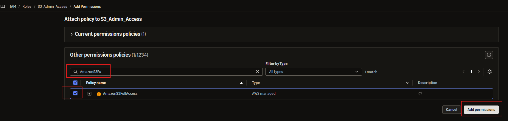</a></td></tr></table>
<p><sub><strong>Screenshot 05:</strong> Selection of the temporary `AmazonS3FullAccess` policy for `S3_Admin_Access`.</sub></p>

<table><tr><td align="center"><a href="images/screenshot-06.png">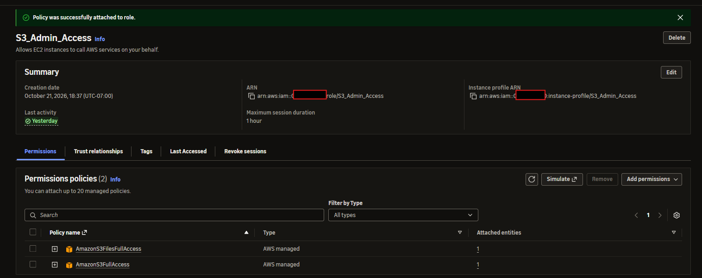</a></td></tr></table>
<p><sub><strong>Screenshot 06:</strong> IAM confirmation showing `AmazonS3FilesFullAccess` and `AmazonS3FullAccess` attached.</sub></p>

> [!IMPORTANT]
> **SAA-C03 EXAM CONNECTION**
>
> An EC2 instance profile associates an IAM role with an instance. Application code and AWS CLI can use temporary role credentials rather than stored access keys. Permissions should be scoped to required actions and resources; `AmazonS3FullAccess` was an intentionally broad, temporary lab permission.

### 2.4 Configuring User Data and IMDSv2

I selected **Metadata version: V2 only (token required)** and entered a shell script under EC2 User Data. The entered script intended to update Amazon Linux 2023, install and enable Apache, write an HTML page, generate a unique bucket name, create that bucket, and upload `index.html`. Its first lines included `#!/bin/bash` and `set -euo pipefail`, as later verified from the instance itself.

The visible User Data included these operations (the two original HTML `echo` statements were later superseded by the manually recovered website file):

```bash
#!/bin/bash
set -euo pipefail

# Initial bootstrap operations that were attempted
dnf update -y
dnf install -y httpd
systemctl enable --now httpd

# The script also intended to create and upload the website
BUCKET_NAME="aws-saa-cloudfront-$(date -u +%Y%m%d%H%M%S)-${RANDOM}"
echo "$BUCKET_NAME" > /var/tmp/cloudfront-bucket-name.txt
aws s3 mb "s3://${BUCKET_NAME}" --region us-east-1
aws s3 cp index.html "s3://${BUCKET_NAME}/index.html"
```

**This is an excerpt of the intended launch-time operations, not evidence that the bootstrap completed.** The later `cloud-init` check showed that the script failed. In particular, I did **not** rely on the S3 commands in User Data as proof of bucket creation.

<table><tr><td align="center"><a href="images/screenshot-07.png">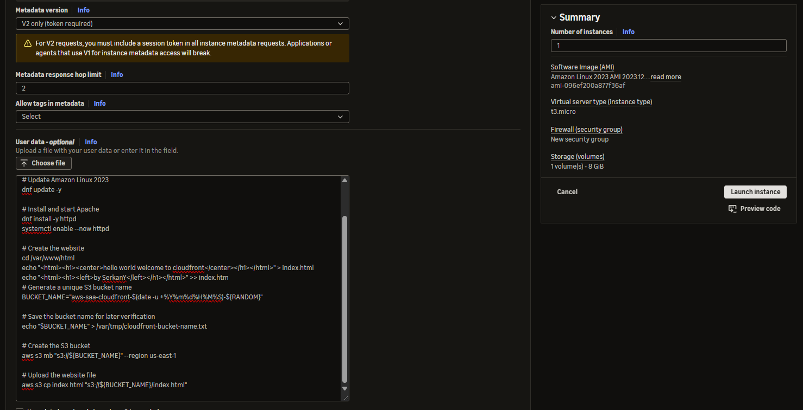</a></td></tr></table>
<p><sub><strong>Screenshot 07:</strong> IMDSv2 token-required setting and User Data commands for Apache and S3.</sub></p>

### 2.5 Launching and Checking EC2 Health

I launched the instance and received the AWS success confirmation with instance ID `i-03351abf900c76052`.

<table><tr><td align="center"><a href="images/screenshot-08.png">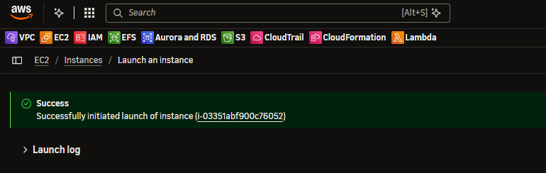</a></td></tr></table>
<p><sub><strong>Screenshot 08:</strong> Successful initiation of the EC2 instance launch.</sub></p>

I then verified that the instance was **Running** in Availability Zone `us-east-1a` with **3/3 status checks passed**. AWS assigned public IPv4 `54.196.13.136`, and the instance appeared with security group `S3-Website-SG`.

<table><tr><td align="center"><a href="images/screenshot-09.png">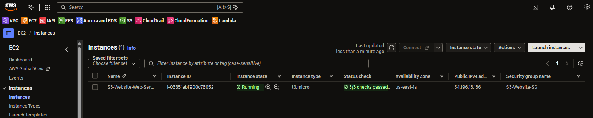</a></td></tr></table>
<p><sub><strong>Screenshot 09:</strong> Running instance, `3/3` passed checks, security group, and assigned public IPv4.</sub></p>

> [!NOTE]
> **KEY TAKEAWAY**
>
> EC2 status checks measure infrastructure and instance conditions; they do not prove that User Data installed Apache or that an application is listening on port 80.

---

## 03 Recovering Apache and Verifying the EC2 Website

### 3.1 Identifying the Website Failure

I opened `http://54.196.13.136` in the browser, but the connection reset. I also attempted HTTPS, which was not expected to work without an Apache TLS configuration. I therefore focused on verifying the web service from inside the instance before changing network resources.

<table><tr><td align="center"><a href="images/screenshot-10.png">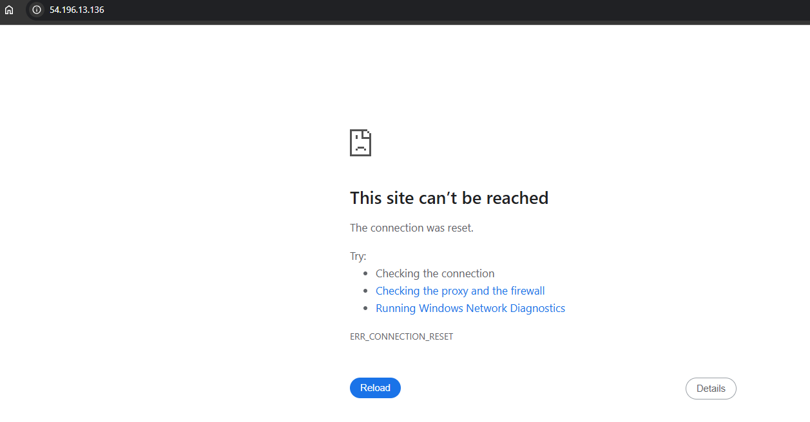</a></td></tr></table>
<p><sub><strong>Screenshot 10:</strong> Initial connection-reset error when accessing the EC2 website.</sub></p>

I connected through **EC2 Instance Connect** and checked the actual User Data file, Apache service status, local HTTP response, and bootstrap output.

```bash
sudo head -n 5 /var/lib/cloud/instance/user-data.txt
systemctl is-active httpd
curl -I --max-time 5 http://localhost
sudo cloud-init status --long
```

The first check confirmed the shell script began with `#!/bin/bash` and `set -euo pipefail`. Apache returned `inactive`, and the localhost request failed to connect. The cloud-init status reported:

```text
status: error
detail:
('scripts-user', RuntimeError('Runparts: 1 failures (part-001) in 1 attempted commands'))
```

The evidence established that the User Data execution failed, **but it did not establish which specific command caused the failure**. I did not treat the earlier use of `dnf update` or any other individual command as the proven root cause.

<table><tr><td align="center"><a href="images/screenshot-11.png">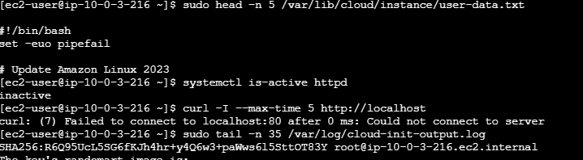</a></td></tr></table>
<p><sub><strong>Screenshot 11:</strong> EC2 terminal checks showing a valid User Data header, inactive Apache, and failed local HTTP connection.</sub></p>

### 3.2 Restoring the Apache Web Server

Rather than terminating the EC2 instance and starting over, I installed Apache manually and enabled it:

```bash
sudo dnf install -y httpd
sudo systemctl enable --now httpd
systemctl is-active httpd
```

The service returned `active`. I then created the webpage directly in the Apache document root:

```bash
echo '<html><h1>hello world welcome to cloudfront</h1><p>By Serkan</p></html>' | sudo tee /var/www/html/index.html
curl http://localhost
```

I confirmed that the webpage rendered in a browser at the EC2 public IP. The visible content was **“hello world welcome to cloudfront”** followed by **“By Serkan”**.

**EC2 website:** `http://54.196.13.136`

<table><tr><td align="center"><a href="images/screenshot-12.png">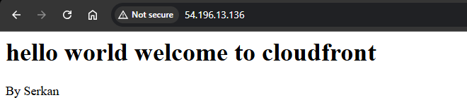</a></td></tr></table>
<p><sub><strong>Screenshot 12:</strong> Apache successfully serving the customized HTML page over HTTP from EC2.</sub></p>

> [!TIP]
> **KNOWLEDGE CHECK**
>
> **Question:** Does `3/3 checks passed` prove that a User Data script completed successfully?
>
> **Answer:** No. EC2 health checks and the instance's application initialization are different. I had a healthy EC2 instance but an inactive Apache service and a `cloud-init` error.

> [!NOTE]
> **KEY TAKEAWAY**
>
> I restored the website on the existing EC2 instance. The later S3 bucket was created manually with AWS CLI because the original User Data workflow did not complete.

---

## 04 Creating and Publishing the S3 Website

### 4.1 Creating the Bucket and Uploading HTML with AWS CLI

I checked for `/var/tmp/cloudfront-bucket-name.txt`, the file the bootstrap script was supposed to write, but it did not exist. I then generated a unique bucket name, created the bucket in `us-east-1`, uploaded the working Apache `index.html`, and listed the uploaded object.

```bash
# Executed on the EC2 instance
BUCKET_NAME="aws-saa-cloudfront-$(date -u +%Y%m%d%H%M%S)-${RANDOM}"
echo "$BUCKET_NAME"
aws s3 mb "s3://${BUCKET_NAME}" --region us-east-1
aws s3 cp /var/www/html/index.html "s3://${BUCKET_NAME}/index.html"
aws s3 ls "s3://${BUCKET_NAME}/"
```

The CLI output confirmed the creation of `aws-saa-cloudfront-20261113022406-1407`, successful upload of `index.html`, and a final object listing with **72 bytes**.

<table><tr><td align="center"><a href="images/screenshot-13.png">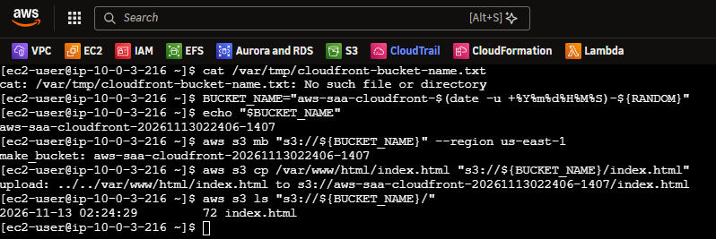</a></td></tr></table>
<p><sub><strong>Screenshot 13:</strong> AWS CLI bucket creation, HTML upload, and `index.html` object listing.</sub></p>

### 4.2 Enabling S3 Static Website Hosting

In the Amazon S3 console, I opened **General purpose buckets → `aws-saa-cloudfront-20261113022406-1407` → Properties → Static website hosting → Edit**. I enabled static website hosting, selected **Host a static website**, and entered `index.html` as the index document. I did not configure a custom error document or redirect rules.

| Setting | Selected value |
| --- | --- |
| Hosting | Enabled |
| Hosting type | Host a static website |
| Index document | `index.html` |
| Error document | Not configured |
| Redirection rules | Not configured |

<table><tr><td align="center"><a href="images/screenshot-14.png">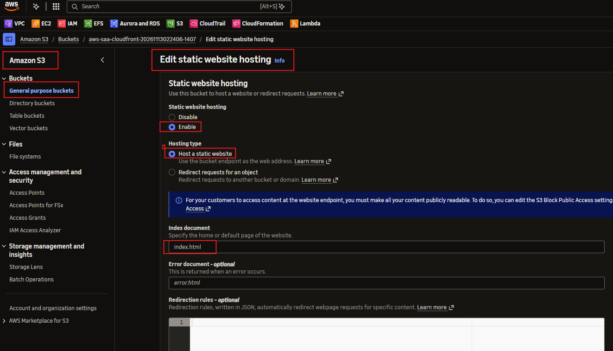</a></td></tr></table>
<p><sub><strong>Screenshot 14:</strong> S3 static website hosting enabled with `index.html` as the index document.</sub></p>

After saving, S3 displayed the bucket website endpoint. The console showed this website hostname:

`http://aws-saa-cloudfront-20261113022406-1407.s3-website.us-east-1.amazonaws.com`

<table><tr><td align="center"><a href="images/screenshot-15.png">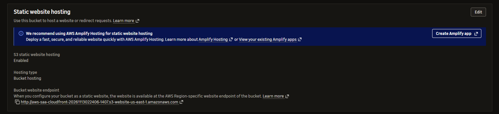</a></td></tr></table>
<p><sub><strong>Screenshot 15:</strong> Saved S3 website hosting configuration and generated HTTP website endpoint.</sub></p>

### 4.3 Configuring Temporary Public-Read Access

For the direct S3 website endpoint test, I opened the bucket **Permissions** tab and edited **Block public access (bucket settings)**. I cleared the bucket-level block-public-access selections. This was a deliberate **lab-only public access exception**, not a recommended production default. I did not change the account-wide setting as part of this exercise.

<table><tr><td align="center"><a href="images/screenshot-16.png">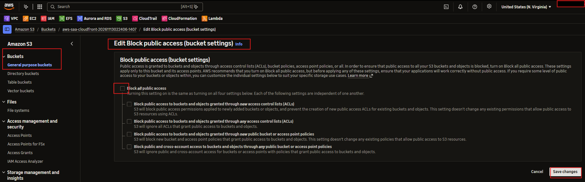</a></td></tr></table>
<p><sub><strong>Screenshot 16:</strong> Bucket-level Block Public Access selections cleared for the temporary website test.</sub></p>

Instead of enabling legacy object ACLs, I added a bucket policy permitting anonymous read access to the objects in this specific bucket:

```json
{
  "Version": "2012-10-17",
  "Statement": [
    {
      "Sid": "PublicReadGetObject",
      "Effect": "Allow",
      "Principal": "*",
      "Action": "s3:GetObject",
      "Resource": "arn:aws:s3:::aws-saa-cloudfront-20261113022406-1407/*"
    }
  ]
}
```

This policy allows public `GetObject` operations on objects in the lab bucket. It does **not** grant anonymous `PutObject`, `DeleteObject`, or `ListBucket` permission.

<table><tr><td align="center"><a href="images/screenshot-17.png">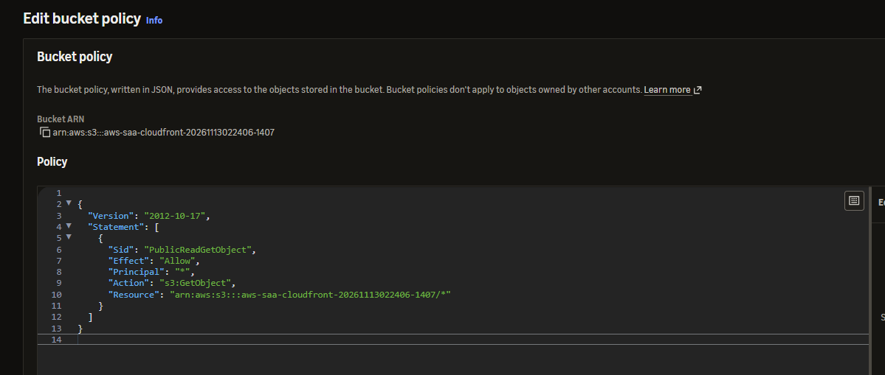</a></td></tr></table>
<p><sub><strong>Screenshot 17:</strong> Bucket policy granting anonymous `s3:GetObject` access to the lab website objects.</sub></p>

> [!WARNING]
> **PUBLIC WEBSITE EXCEPTION**
>
> A publicly readable S3 website endpoint exposes the website objects directly over HTTP. This setting was necessary for the specific architecture I tested, but should not be generalized to private content or production buckets. A regular S3 REST origin secured with CloudFront OAC is the stronger default design for many production static sites.

### 4.4 Verifying the S3 Website Endpoint

I opened the bucket website endpoint in the browser and observed the same **“hello world welcome to cloudfront”** webpage with **“By Serkan”**. This verified that the S3 website endpoint could retrieve the uploaded HTML object after the bucket policy change.

<table><tr><td align="center"><a href="images/screenshot-18.png">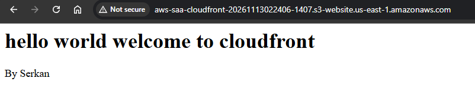</a></td></tr></table>
<p><sub><strong>Screenshot 18:</strong> Working HTML page delivered directly from the S3 static website endpoint over HTTP.</sub></p>

> [!TIP]
> **KNOWLEDGE CHECK**
>
> **Question:** Does granting `s3:GetObject` anonymously also let an internet user list every object in the bucket?
>
> **Answer:** No. Object reads and bucket listing are distinct actions. The policy shown grants `s3:GetObject` for object ARNs, not `s3:ListBucket` on the bucket ARN.

---

## 05 Creating the Amazon CloudFront Distribution

### 5.1 Choosing a Distribution Name and Plan

In **CloudFront → Distributions → Create distribution**, I selected a **Free plan** and entered `S3-Website-CloudFront` as the distribution name. I selected **Single website configuration** and left the optional Route 53 managed-domain field empty because I wanted AWS to assign a `.cloudfront.net` domain.

<table><tr><td align="center"><a href="images/screenshot-19.png">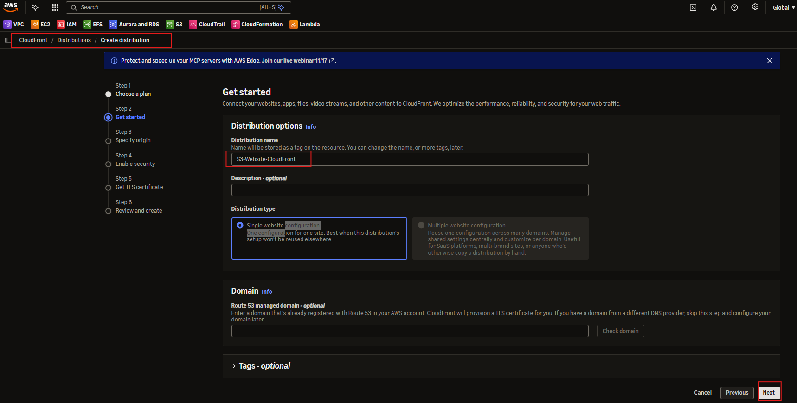</a></td></tr></table>
<p><sub><strong>Screenshot 19:</strong> CloudFront distribution name and single-website configuration.</sub></p>

### 5.2 Selecting the Correct S3 Origin

The CloudFront wizard initially displayed the normal S3 bucket REST endpoint. The console warned that the selected bucket had static website hosting enabled and presented a **Use website endpoint** button.

<table><tr><td align="center"><a href="images/screenshot-20.png">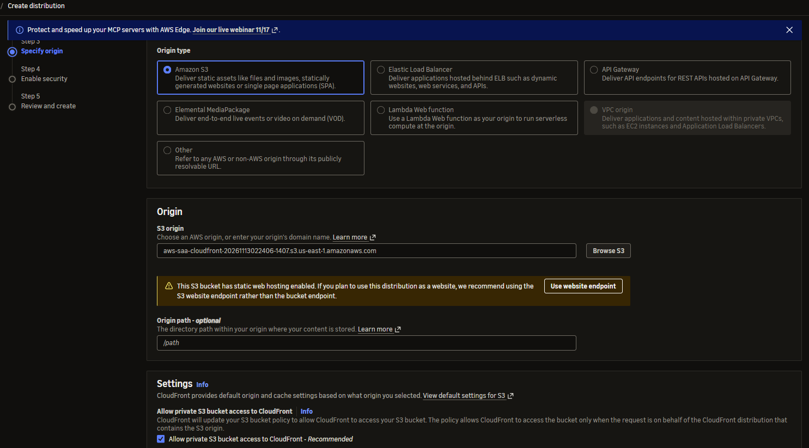</a></td></tr></table>
<p><sub><strong>Screenshot 20:</strong> Initial S3 bucket origin and CloudFront recommendation to use the website endpoint.</sub></p>

I selected **Use website endpoint** and confirmed that the origin was the S3 website hostname, not the REST API endpoint. I left the optional origin path empty and used the recommended cache settings. The review page later displayed the website origin in the `s3-website-us-east-1.amazonaws.com` hostname format, which is another valid S3 website endpoint format for the Region.

| Setting | My distribution configuration |
| --- | --- |
| Origin | S3 **website** endpoint for `aws-saa-cloudfront-20261113022406-1407` |
| Origin access | Website endpoint functioning as a custom origin; no private OAC setup |
| Origin protocol | HTTP only, as required for an S3 website endpoint |
| Origin path | Blank |
| Cache settings | Recommended settings selected |

<table><tr><td align="center"><a href="images/screenshot-21.png">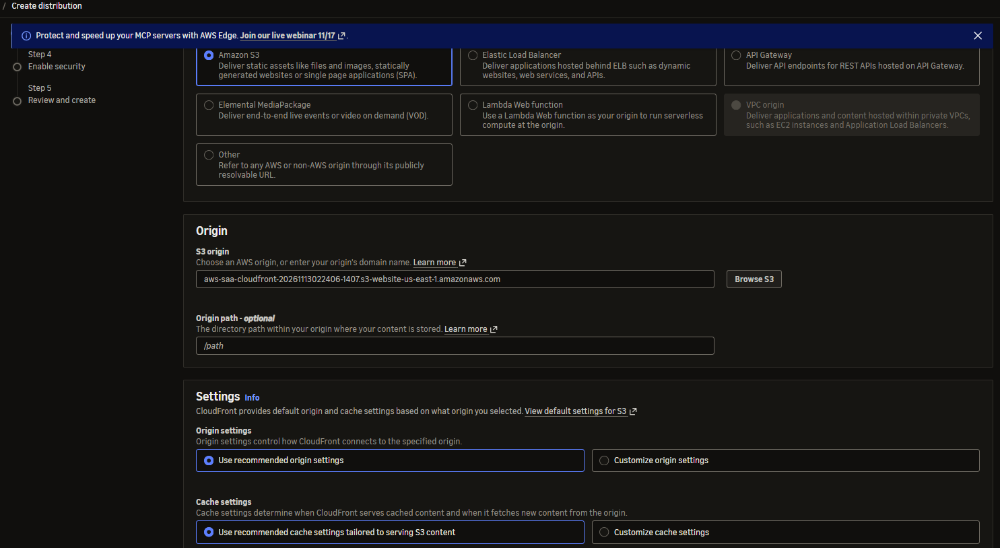</a></td></tr></table>
<p><sub><strong>Screenshot 21:</strong> S3 website endpoint selected as the CloudFront origin with recommended cache settings.</sub></p>

> [!IMPORTANT]
> **SAA-C03 EXAM CONNECTION**
>
> CloudFront OAC is supported for regular S3 bucket origins, **not for S3 website endpoints**. A website endpoint must be reachable as a custom origin. For a private bucket design, use the regular S3 origin with OAC and keep S3 Block Public Access enabled.

### 5.3 Enabling Security Protections and WAF Monitor Mode

The CloudFront wizard showed included AWS WAF security protections. Before proceeding, I enabled **Use monitor mode**, which counts requests that would match its blocking rules rather than enforcing those blocks. I did not upgrade to the paid Business plan.

<table><tr><td align="center"><a href="images/screenshot-22.png">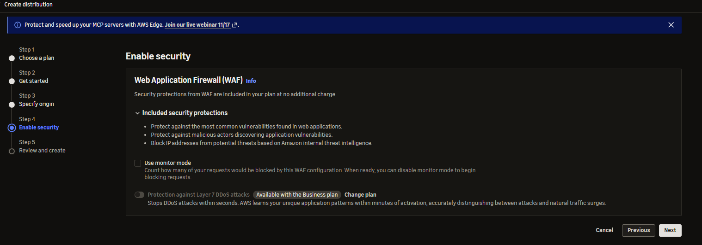</a></td></tr></table>
<p><sub><strong>Screenshot 22:</strong> Included AWS WAF protections before the monitor-mode option was selected.</sub></p>

<table><tr><td align="center"><a href="images/screenshot-23.png">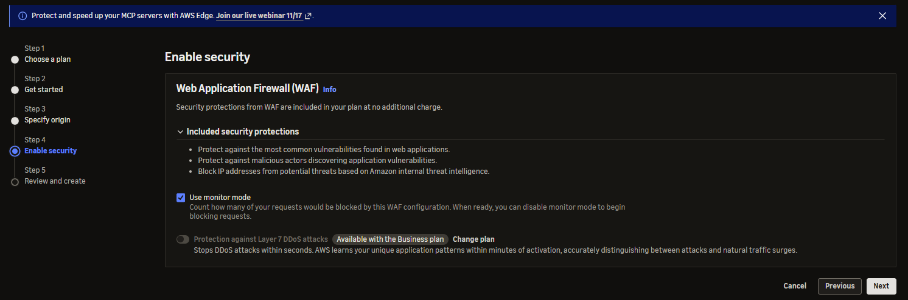</a></td></tr></table>
<p><sub><strong>Screenshot 23:</strong> AWS WAF monitor mode enabled during CloudFront distribution setup.</sub></p>

### 5.4 Reviewing and Creating the Distribution

On the final review page, I confirmed the distribution name, Free plan billing label **$0/month** (estimated initial charge **$0**), S3 website endpoint origin, no origin path, included security protections, and WAF monitor mode. The visible review did not show a configured default root object, and I do not claim to have set one: the S3 website endpoint itself was configured with `index.html`.

<table><tr><td align="center"><a href="images/screenshot-24.png">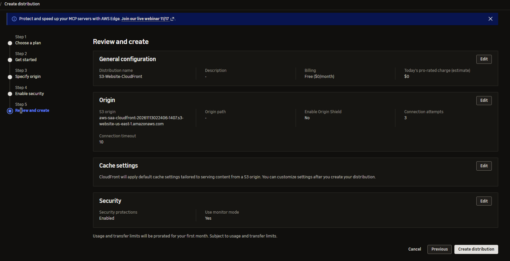</a></td></tr></table>
<p><sub><strong>Screenshot 24:</strong> Final review confirming the Free plan, S3 website origin, and WAF monitor mode.</sub></p>

I created the distribution and received a success confirmation. AWS assigned distribution ID `E30IUHRXXOZGT2` and the domain `dhhzq9frwrvkk.cloudfront.net`. The screenshot captured the initial **Deploying** state; a later browser test proved the distribution could serve the webpage, but a separate final **Deployed** status screenshot was not captured.

<table><tr><td align="center"><a href="images/screenshot-25.png">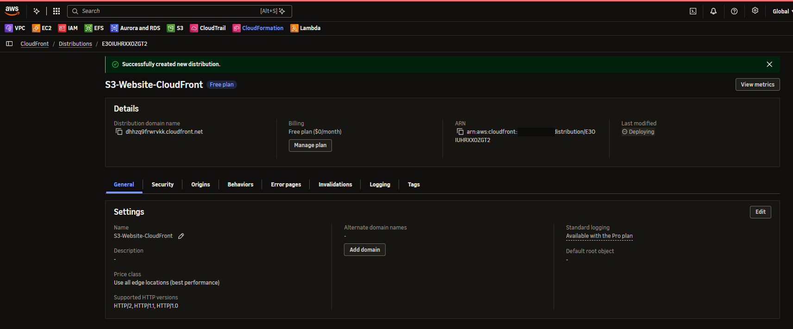</a></td></tr></table>
<p><sub><strong>Screenshot 25:</strong> Successfully created CloudFront distribution with assigned `.cloudfront.net` hostname and initial deploying status.</sub></p>

> [!NOTE]
> **KEY TAKEAWAY**
>
> The plan showed **Free ($0/month)** for CloudFront, but that label alone does not mean every resource in the lab is free. EC2 usage, public IPv4 addresses, EBS storage, S3 storage, and requests may have separate pricing rules.

---

## 06 Verifying HTTPS Delivery and Monitoring Requests

### 6.1 Testing the CloudFront HTTPS Website

I opened the assigned CloudFront domain in the browser and verified that the HTML page loaded with the expected text. The browser displayed the `.cloudfront.net` domain, and the test used the HTTPS CloudFront endpoint.

**Verified CloudFront website:** <https://dhhzq9frwrvkk.cloudfront.net>

| Test | Observed result |
| --- | --- |
| EC2 HTTP URL | Page loaded after Apache recovery. |
| S3 website HTTP URL | Page loaded with public object read enabled. |
| CloudFront HTTPS URL | Page loaded successfully at the AWS-assigned domain. |
| HTML heading | `hello world welcome to cloudfront` |
| HTML credit | `By Serkan` |

<table><tr><td align="center"><a href="images/screenshot-26.png">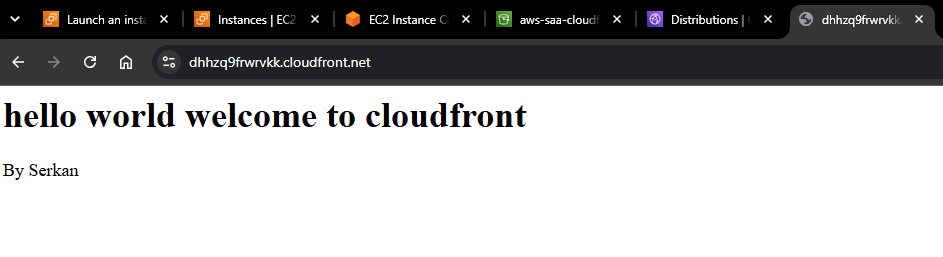</a></td></tr></table>
<p><sub><strong>Screenshot 26:</strong> Completed website rendered through the CloudFront distribution domain.</sub></p>

### 6.2 Inspecting CloudFront Security Metrics

I opened the distribution's security monitoring view and selected the **Last 24 hours** range with **1 hour** granularity. The AWS WAF dashboard displayed the following activity:

| Metric | Observed value |
| --- | ---: |
| All requests | 50 |
| Allowed requests | 50 |
| Reporting window | Last 24 hours |
| Granularity | 1 hour |

These metrics showed that CloudFront security monitoring had observed requests to the distribution. I did not infer visitor identities, unique users, or the reason for each request from this chart.

<table><tr><td align="center"><a href="images/screenshot-27.png">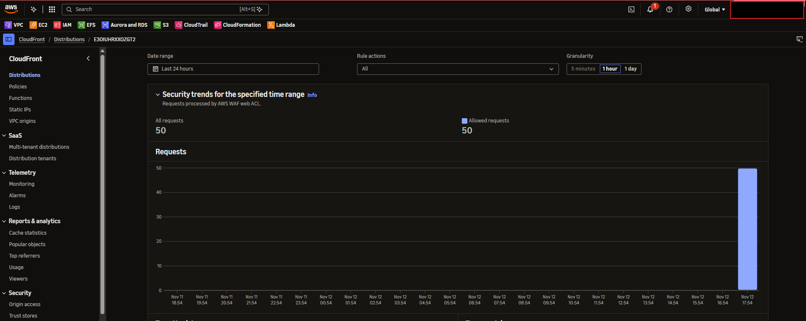</a></td></tr></table>
<p><sub><strong>Screenshot 27:</strong> AWS WAF security monitoring showing 50 total requests and 50 allowed requests in the selected window.</sub></p>

> [!TIP]
> **KNOWLEDGE CHECK**
>
> **Question:** If the CloudFront website loads over HTTPS, does that prove the S3 website origin uses HTTPS too?
>
> **Answer:** No. TLS secures the browser-to-CloudFront connection. S3 static website origins communicate with CloudFront over HTTP only. To use HTTPS from CloudFront to S3, choose the regular S3 bucket origin with OAC instead of the website endpoint.

> [!NOTE]
> **KEY TAKEAWAY**
>
> I verified a working `.cloudfront.net` HTTPS URL and observed request activity in WAF monitoring. The website was no longer dependent on the EC2 Apache process for viewer traffic because CloudFront fetched from S3.

---

## 07 Resources Requiring Cleanup

**Cleanup was not performed.** The lab resources listed below were still treated as present at the final documentation checkpoint. These are recommendations for a later cleanup session, not completed actions or claims that billing has stopped.

### 7.1 Temporary Resources to Remove

| Resource | Identifier / configuration | Required later action |
| --- | --- | --- |
| CloudFront distribution | `S3-Website-CloudFront` / `E30IUHRXXOZGT2` | Cancel the Free pricing plan; then disable and delete the distribution following current console prerequisites. |
| CloudFront-associated security configuration | Included AWS WAF protections | Check for any separately retained web ACL or other attached resources after distribution removal. Do not assume they were automatically deleted. |
| S3 bucket | `aws-saa-cloudfront-20261113022406-1407` | Remove the website objects and delete the bucket after CloudFront is no longer needed. |
| Public bucket access | `PublicReadGetObject` policy and bucket-level Block Public Access exception | Remove the public policy and restore blocking as part of bucket cleanup, especially if deletion is delayed. |
| EC2 instance | `i-03351abf900c76052` | Terminate the temporary server when no longer needed. |
| EC2 security group | `S3-Website-SG` | Delete after dependent network interfaces and instances are gone. |
| Temporary role permission | `AmazonS3FullAccess` on `S3_Admin_Access` | **Detach this policy only**; keep the existing role and its earlier policy. |
| Attached root EBS volume | 8 GiB | Verify what happens to the volume at instance termination; check for retained volume or snapshot charges. |

CloudFront Free-plan cancellation takes effect immediately under AWS's current pricing-plan documentation. The distribution must then be disabled before deletion, and the disabling update may require propagation time. Do not assume the ability to delete it instantly while it still shows **Deploying**.

### 7.2 Reusable Resources to Retain

| Existing resource | Decision |
| --- | --- |
| `AwsSaaNew-vpc` and its VPC networking | **Retain** for later AWS SAA labs. |
| Existing public and private subnets, route tables, and internet gateway | **Retain**. |
| IAM role `S3_Admin_Access` | **Retain**. |
| Pre-existing policy `AmazonS3FilesFullAccess` | **Retain** attached to the role; it was not added by this lab. |
| Key pair `npoweraws` | **Retain** for future labs. |

> [!CAUTION]
> **NOT A CLEANUP CONFIRMATION**
>
> I did not cancel or delete the CloudFront distribution, empty/delete the S3 bucket, terminate the EC2 instance, remove the security group, restore bucket public-access settings, or detach the temporary IAM policy during the documented session. These actions should be verified in AWS when cleanup is actually undertaken. Active resources and public endpoints can create ongoing cost or security exposure.

---

## 08 SAA-C03 Exam Review and Production Considerations

### 8.1 Corrections and Lessons from the Exercise

| Topic | What I observed | Correct interpretation / production lesson |
| --- | --- | --- |
| EC2 health versus application health | EC2 had `3/3` passed checks while Apache was inactive. | Use service checks and HTTP tests in addition to instance health checks. |
| User Data debugging | `cloud-init status --long` reported `scripts-user` failure; the failing line was not identified. | Read full cloud-init logs before attributing failure to a specific command; do not claim unverified root causes. |
| Amazon Linux version | I used Amazon Linux 2023 instead of the course's Amazon Linux 2 image. | Use the appropriate `dnf`/`systemctl` commands for the chosen AMI. |
| IAM access | Existing role needed temporary broader S3 permissions. | Prefer narrowly scoped S3 permissions over `AmazonS3FullAccess`; detach broad temporary policies afterward. |
| S3 website publication | I used a bucket policy for `s3:GetObject` instead of legacy public ACLs. | Modern S3 Object Ownership defaults often disable ACLs; bucket policies are appropriate for public website access when explicitly required. |
| CloudFront origin choice | The wizard initially chose the regular S3 bucket endpoint; I switched to **Use website endpoint**. | S3 website endpoints are custom HTTP origins and do not support OAC. |
| HTTPS | Apache IP and S3 website endpoints used HTTP; CloudFront served the page over HTTPS. | HTTPS to the viewer does not automatically encrypt the CloudFront-to-website-origin connection. |
| WAF monitor mode | I selected monitor mode and observed 50 total / 50 allowed requests. | Monitor/count mode provides visibility and differs from actively blocking matching traffic. |
| Cleanup | Resource deletion was intentionally deferred. | A report should distinguish verified provisioning from unperformed teardown. |

### 8.2 SAA-C03 Knowledge Checks

> [!TIP]
> **Question 1:** Why might an application fail even when an EC2 instance passes all status checks?
>
> **Answer:** Instance checks do not validate every application process. Apache can be stopped, User Data can fail, or the application can reject requests while EC2 infrastructure checks still pass.
>
> **Question 2:** Can CloudFront OAC be used with an S3 static website endpoint?
>
> **Answer:** No. S3 website endpoints are custom origins. OAC is used with regular S3 bucket REST origins, allowing a private bucket design.
>
> **Question 3:** Why was public access needed in this specific configuration?
>
> **Answer:** CloudFront fetched the publicly served S3 website endpoint as a custom origin. The S3 website content had to permit anonymous reads for those origin requests.
>
> **Question 4:** Does an S3 website endpoint support HTTPS directly?
>
> **Answer:** No. It serves HTTP. CloudFront provides HTTPS to the viewer, though it still connects to an S3 website origin by HTTP.
>
> **Question 5:** What makes the IAM role preferable to an access key hardcoded in User Data?
>
> **Answer:** An EC2 instance profile makes temporary role credentials available to the workload, avoiding exposure and manual rotation of static access keys embedded in scripts.

### 8.3 Production Design Improvements

The lab used a public S3 website because the exercise explicitly tested its HTTP website endpoint and then put CloudFront in front of it. For a new production static site without S3 website-specific redirects, I would normally keep **S3 Block Public Access enabled**, choose the **regular S3 bucket endpoint**, and configure **CloudFront Origin Access Control** to authorize only the distribution's access to the bucket.

I would also scope the instance's S3 permission to the specific bucket and required actions, remove unnecessary inbound SSH/HTTPS security group exposure, use automated deployment rather than relying on a bootstrap script to create production storage, add alarms and access logging as appropriate, and plan a repeatable cleanup or infrastructure-as-code process. These are **recommendations**, not configurations I implemented in this session.

Official AWS references: [S3 website permissions](https://docs.aws.amazon.com/AmazonS3/latest/userguide/WebsiteAccessPermissionsReqd.html), [CloudFront origin settings](https://docs.aws.amazon.com/AmazonCloudFront/latest/DeveloperGuide/DownloadDistValuesOrigin.html), [CloudFront S3 origin access controls](https://docs.aws.amazon.com/AmazonCloudFront/latest/DeveloperGuide/private-content-restricting-access-to-s3.html), [CloudFront pricing plans](https://docs.aws.amazon.com/AmazonCloudFront/latest/DeveloperGuide/flat-rate-pricing-plan.html), and [Deleting CloudFront distributions](https://docs.aws.amazon.com/AmazonCloudFront/latest/DeveloperGuide/HowToDeleteDistribution.html).

---

## 09 Technical Competencies and Skills Matrix

### 9.1 Technical Competencies Demonstrated

I practiced EC2 launch configuration, existing VPC/subnet selection, security group rules, instance profiles, Amazon Linux service management, cloud-init troubleshooting, AWS CLI S3 operations, static website hosting, public-read S3 bucket policy configuration, CloudFront origin selection, CloudFront HTTPS endpoint verification, and AWS WAF monitoring.

### 9.2 Skills Matrix

| Skill | Evidence from this lab |
| --- | --- |
| EC2 instance configuration | Selected AMI, `t3.micro`, existing subnet, key pair, IAM instance profile, and security group rules. |
| EC2 health verification | Checked Running state, `3/3` status checks, and public IP. |
| Linux troubleshooting | Verified `httpd` inactive and used `cloud-init` status to identify failed User Data execution. |
| Apache web server management | Installed/started Apache manually and verified the working website. |
| IAM role usage | Used existing EC2 instance profile; temporarily attached S3 permissions. |
| S3 object operations | Created unique bucket and uploaded/listed `index.html` using AWS CLI. |
| S3 website hosting | Enabled hosting, configured the index document, and validated its endpoint. |
| IAM/bucket policy reasoning | Granted scoped public object read access through `s3:GetObject`. |
| CloudFront setup | Selected S3 website endpoint, Free plan, and created distribution. |
| CloudFront verification | Viewed the HTML website through the AWS-assigned HTTPS hostname. |
| WAF monitoring | Enabled monitor mode and reviewed 50 total and 50 allowed requests. |
| Resource lifecycle awareness | Identified temporary resources, retention decisions, and pending cleanup dependencies. |

---

## 10 Consolidated Command Reference

These commands represent the checks and corrective operations used during the lab. The bucket name is the actual observed lab resource; repeaters should generate their own unique name rather than assume it is available.

### 10.1 User Data and Apache Troubleshooting

```bash
# Inspect the submitted User Data file
sudo head -n 5 /var/lib/cloud/instance/user-data.txt

# Check Apache and localhost availability
systemctl is-active httpd
curl -I --max-time 5 http://localhost

# Investigate cloud-init failure
sudo cloud-init status --long
sudo tail -n 100 /var/log/cloud-init-output.log
```

### 10.2 Apache Recovery and HTML File

```bash
sudo dnf install -y httpd
sudo systemctl enable --now httpd
systemctl is-active httpd

echo '<html><h1>hello world welcome to cloudfront</h1><p>By Serkan</p></html>' | sudo tee /var/www/html/index.html
curl http://localhost
```

### 10.3 S3 Bucket and Object Upload

```bash
# First check whether the original bootstrap saved a bucket name
cat /var/tmp/cloudfront-bucket-name.txt

# After the missing file was observed, create a new unique name
BUCKET_NAME="aws-saa-cloudfront-$(date -u +%Y%m%d%H%M%S)-${RANDOM}"
echo "$BUCKET_NAME"

aws s3 mb "s3://${BUCKET_NAME}" --region us-east-1
aws s3 cp /var/www/html/index.html "s3://${BUCKET_NAME}/index.html"
aws s3 ls "s3://${BUCKET_NAME}/"
```

### 10.4 Website Endpoints Used in Verification

```text
EC2 (HTTP)
http://54.196.13.136

S3 static website (HTTP)
http://aws-saa-cloudfront-20261113022406-1407.s3-website.us-east-1.amazonaws.com

CloudFront distribution (HTTPS)
https://dhhzq9frwrvkk.cloudfront.net
```

These addresses were verified during the lab. They may cease working after cleanup or later infrastructure changes.

---

**Lab outcome:** I successfully delivered the customized HTML page through Amazon EC2, Amazon S3 static website hosting, and Amazon CloudFront, and viewed WAF request metrics. The unsuccessful initial User Data execution and the subsequent manual recovery were documented accurately. **Cleanup remains pending by design.**
