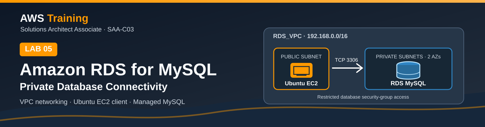

# Amazon RDS for MySQL Lab
**DATABASES / AMAZON RDS / AMAZON VPC / EC2 / MYSQL / SECURITY GROUPS**

In this lab, I built a dedicated AWS network from scratch, deployed a private Amazon RDS for MySQL instance, and connected to it from an Ubuntu EC2 workstation. I created public and private subnets, configured separate route tables and an internet gateway, and used security-group-to-security-group authorization rather than exposing MySQL to the internet.

I verified the database's endpoint and availability, installed the MySQL CLI on Ubuntu, corrected an initial hostname/command error, and successfully executed `SHOW DATABASES;` against the RDS instance. The outcome was **five returned databases, including the initial application database**.

> [!WARNING]
> **Resource state when this guide was prepared:** The RDS instance, EC2 client, and Lab 05 networking resources were still in use. **Teardown was planned but had not yet been performed or verified.** Follow the cleanup dependencies in Chapter 07 after finishing any additional exercises.

---

## Contents

- [01 Purpose, Architecture and Core Concepts](#01-purpose-architecture-and-core-concepts)
- [02 Building an Isolated VPC and Subnet Layout](#02-building-an-isolated-vpc-and-subnet-layout)
- [03 Configuring the Internet Gateway and Route Tables](#03-configuring-the-internet-gateway-and-route-tables)
- [04 Building Network Security and the DB Subnet Group](#04-building-network-security-and-the-db-subnet-group)
- [05 Provisioning and Verifying Amazon RDS MySQL](#05-provisioning-and-verifying-amazon-rds-mysql)
- [06 Connecting from Ubuntu EC2 and Running SQL](#06-connecting-from-ubuntu-ec2-and-running-sql)
- [07 Resource Cleanup Plan](#07-resource-cleanup-plan)
- [08 Exam Review, Corrections and Production Practices](#08-exam-review-corrections-and-production-practices)
- [09 Technical Competencies and Skills Matrix](#09-technical-competencies-and-skills-matrix)
- [10 Consolidated Command Reference](#10-consolidated-command-reference)

## Architecture Highlight

The architecture below depicts the **working environment built during the exercise**, not a claim that resources have been deleted. The RDS DB subnet group spans two private Availability Zones, while the observed **Single-AZ** DB instance ran in `us-east-1b`.

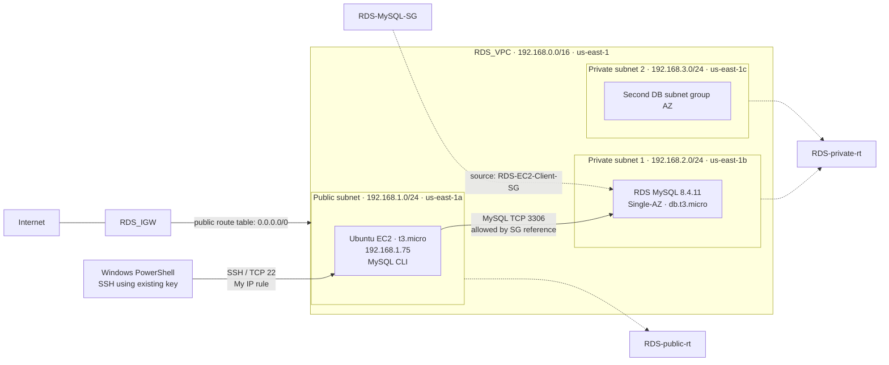

| Component | Purpose in the lab |
| --- | --- |
| Dedicated VPC | Isolated the database exercise from my reusable AWS training VPC. |
| Public subnet + IGW | Hosted the administrative Ubuntu EC2 client with internet connectivity. |
| Two private subnets | Defined private RDS subnet placement in separate Availability Zones. |
| EC2 client security group | Restricted inbound SSH to my current public IP. |
| RDS MySQL security group | Allowed TCP 3306 from the EC2 client security group, rather than `0.0.0.0/0`. |
| RDS DB subnet group | Identified the private subnets that Amazon RDS could use. |
| Amazon RDS | Provided a managed MySQL database with a DNS endpoint. |

> [!IMPORTANT]
> **SAA-C03 EXAM CONNECTION**
>
> A **DB subnet group spanning multiple Availability Zones** does not mean that a **Single-AZ DB instance** is running a standby replica. The DB subnet group provides placement options; the database's deployment mode determines whether high-availability standby capacity exists.

---

## 01 Purpose, Architecture and Core Concepts

### 1.1 Purpose and Objectives

The goal was to learn how a managed relational database can run in **private VPC subnets** while still being accessed by an authorized client within the same VPC. Rather than reuse the VPC from earlier labs, I built all Lab 05 networking components from scratch and planned to remove these temporary resources at the end.

I completed the following tasks:

1. Created a dedicated VPC, one public subnet and two private subnets across three Availability Zones.
2. Attached an Internet Gateway and separated public and private route table associations.
3. Configured dedicated security groups for SSH access and MySQL access.
4. Created an RDS DB subnet group with **only** the two private subnets.
5. Provisioned a Single-AZ RDS for MySQL instance using the Free tier template.
6. Connected to an Ubuntu EC2 client through SSH and installed the MySQL client.
7. Authenticated to the private RDS endpoint and queried the database catalog.

### 1.2 Core Concepts

| Concept | Meaning and importance |
| --- | --- |
| Amazon RDS | Managed relational database service; AWS handles important infrastructure and database operations. |
| DB instance | A specific managed database deployment with its own instance class, storage, endpoint, engine and settings. |
| RDS endpoint | DNS hostname used by database clients; distinct from the DB identifier or optional initial database name. |
| DB subnet group | Collection of VPC subnets available for RDS placement, typically spanning at least two Availability Zones. |
| Single-AZ | A DB instance deployed without the Multi-AZ standby architecture. |
| Security-group reference | Allows a destination SG rule to identify traffic from resources assigned to a specified source SG. |
| Public access: No | Prevents RDS from receiving a public IP address; authorized in-VPC access can still work. |
| MySQL port 3306 | Default TCP port used for MySQL client/server connections. |

### 1.3 Environment and Observed Resource Names

| Resource or setting | My observed value |
| --- | --- |
| Region | `us-east-1` (N. Virginia) |
| VPC | `RDS_VPC` — `vpc-014a5538a6181b6e3` — `192.168.0.0/16` |
| Public subnet | `RDSpublicsubnet` — `192.168.1.0/24` — `us-east-1a` |
| Private subnet 1 | `RDSprivatesubnet1` — `192.168.2.0/24` — `us-east-1b` |
| Private subnet 2 | `RDSprivatesubnet2` — `192.168.3.0/24` — `us-east-1c` |
| Internet gateway | `RDS_IGW` — `igw-0923ac9249164e83c` |
| Public route table | `RDS-public-rt` — `rtb-026a0674fe09964ea` |
| Private route table | `RDS-private-rt` — `rtb-08adb4ef84aa40abe` |
| EC2 security group | `RDS-EC2-Client-SG` — `sg-0a0f6f6a76e506812` |
| Database security group | `RDS-MySQL-SG` — `sg-0dbee26b780399798` |
| DB subnet group | `rds-private-subnet-group` |
| RDS DB identifier | `syrdsinstance` (AWS displayed lowercase) |
| Initial database | `SYrdsinstance` |
| DB engine, class | MySQL Community 8.4.11, `db.t3.micro` |
| Ubuntu EC2 client | `RDS-Ubuntu-Client` — `i-0bc9e2a8d48f894f5` |
| EC2 key pair | `npoweraws` — reused from earlier labs |
| EC2 private IPv4 | `192.168.1.75` |
| EC2 public IPv4 during testing | `34.229.182.101` |

> [!NOTE]
> **KEY TAKEAWAY**
>
> This was an independent networking exercise. The new VPC was **not** the `AwsSaaNew-vpc` created for an earlier lab. The previously existing `npoweraws` key pair was reused and is not a Lab 05 resource to delete.

---

## 02 Building an Isolated VPC and Subnet Layout

### 2.1 Creating the Dedicated VPC

I opened **VPC → Your VPCs → Create VPC**, chose **VPC only**, and created `RDS_VPC` with the manually specified IPv4 CIDR `192.168.0.0/16`. I left IPv6 disabled, used default tenancy, and did not enable the optional VPC encryption control. AWS returned VPC ID `vpc-014a5538a6181b6e3` and showed the VPC in **Available** state.


<table><tr><td align="center"><a href="images/screenshot-01.png">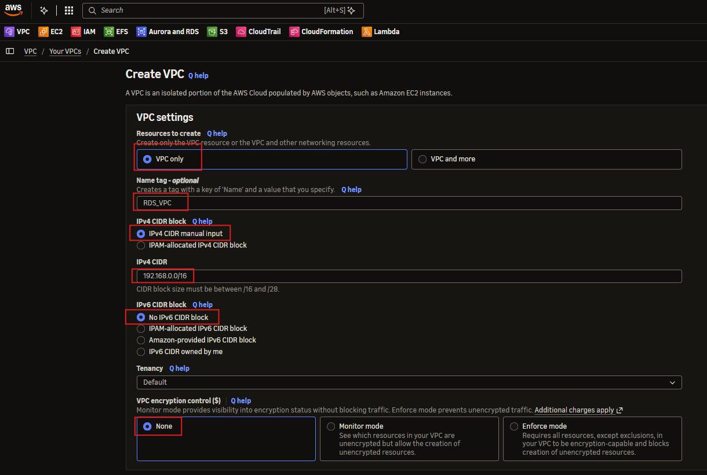</a></td></tr></table>
<p><sub><strong>Screenshot 01:</strong> VPC creation settings showing `RDS_VPC` and `192.168.0.0/16`.</sub></p>


<table><tr><td align="center"><a href="images/screenshot-02.png">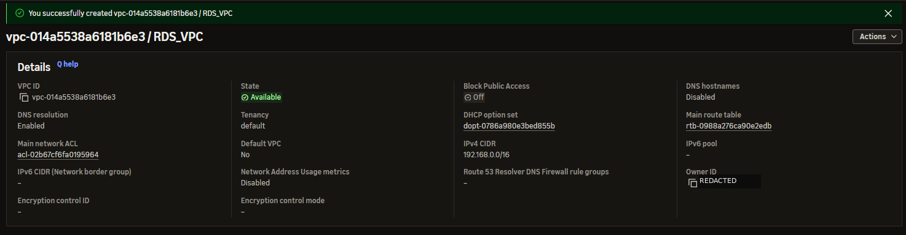</a></td></tr></table>
<p><sub><strong>Screenshot 02:</strong> AWS confirmation that `RDS_VPC` was created and reached Available status.</sub></p>


The VPC details showed DNS resolution enabled and DNS hostnames initially disabled. I opened **Edit VPC settings** to review these options. I was instructed to enable DNS hostnames; a later screenshot confirming the saved state was not supplied, so the final DNS-hostname setting is not claimed as verified here. Successful RDS endpoint resolution from Ubuntu later demonstrated that the client could resolve the database DNS name.


<table><tr><td align="center"><a href="images/screenshot-03.png">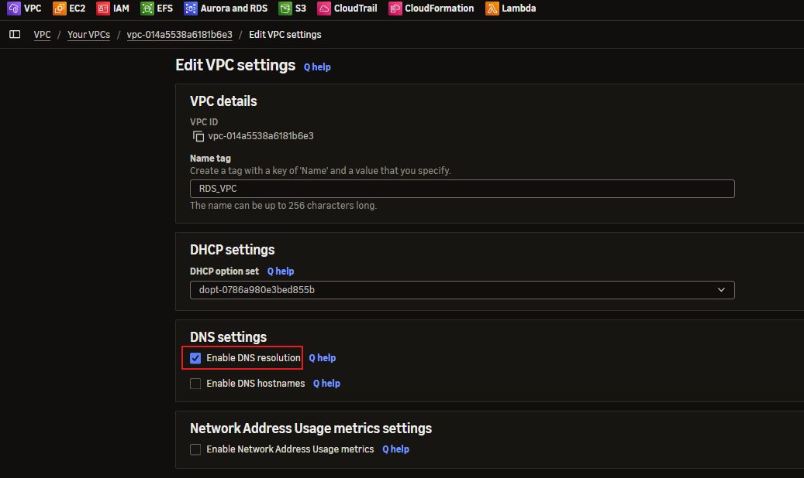</a></td></tr></table>
<p><sub><strong>Screenshot 03:</strong> VPC DNS settings: DNS resolution enabled and DNS hostnames initially unchecked.</sub></p>


### 2.2 Creating Three Non-overlapping Subnets

I created three subnets in the same VPC. Each CIDR was contained within the VPC's `/16` range and assigned to a different Availability Zone.

| Subnet | Subnet ID | AZ | IPv4 CIDR | Intended workload |
| --- | --- | --- | --- | --- |
| `RDSpublicsubnet` | `subnet-00b7e498cc600170e` | `us-east-1a` | `192.168.1.0/24` | Ubuntu EC2 client |
| `RDSprivatesubnet1` | `subnet-0ba151a3c47727e51` | `us-east-1b` | `192.168.2.0/24` | Private RDS placement |
| `RDSprivatesubnet2` | `subnet-05290697ea6b2ff14` | `us-east-1c` | `192.168.3.0/24` | Second DB subnet group AZ |

I entered the three subnet names, selected their individual Availability Zones and CIDRs, then submitted the creation wizard. All three appeared in **Available** state.


<table><tr><td align="center"><a href="images/screenshot-04.png">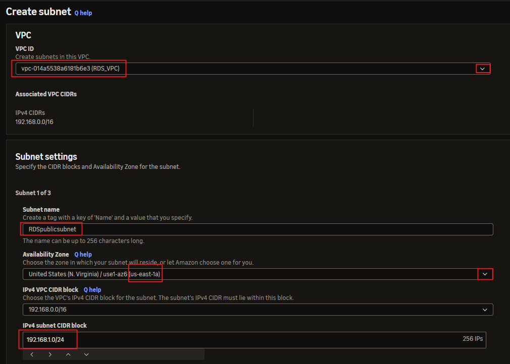</a></td></tr></table>
<p><sub><strong>Screenshot 04:</strong> Public subnet configuration in `RDS_VPC`.</sub></p>


<table><tr><td align="center"><a href="images/screenshot-05.png">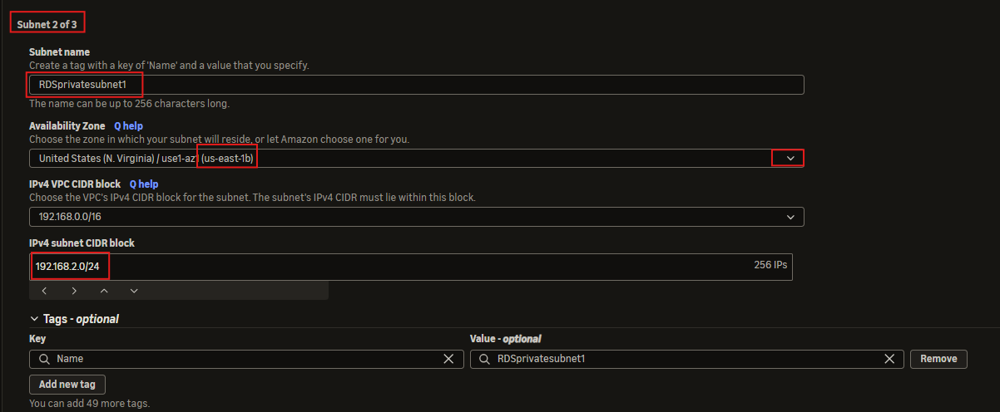</a></td></tr></table>
<p><sub><strong>Screenshot 05:</strong> First private subnet configured in `us-east-1b`.</sub></p>


<table><tr><td align="center"><a href="images/screenshot-06.png">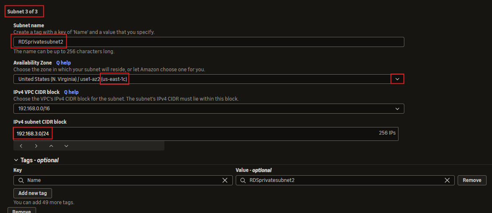</a></td></tr></table>
<p><sub><strong>Screenshot 06:</strong> Second private subnet configured in `us-east-1c`.</sub></p>


<table><tr><td align="center"><a href="images/screenshot-07.png">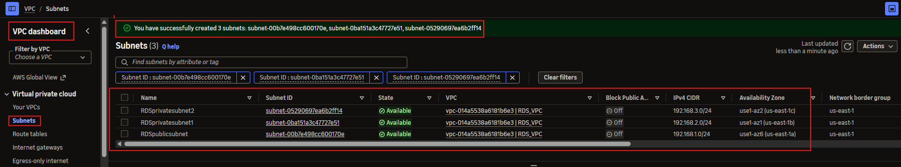</a></td></tr></table>
<p><sub><strong>Screenshot 07:</strong> All three VPC subnets listed as Available.</sub></p>


> [!IMPORTANT]
> **SAA-C03 EXAM CONNECTION**
>
> A subnet's public/private behavior depends on the **route table associated with it**, not the text in the subnet's Name tag. A route to an internet gateway makes public IPv4 routing possible; a public address and appropriate security rules are also needed for direct external access.

### 2.3 Knowledge Check

> [!TIP]
> **Q:** Why did the DB subnet group use private subnets in two Availability Zones?
>
> **A:** RDS requires placement options across different Availability Zones for many VPC-based database deployments. This provides the basis for managed placement and optional high-availability configurations. It does **not**, by itself, create a Multi-AZ standby instance.

---

## 03 Configuring the Internet Gateway and Route Tables

### 3.1 Creating and Attaching the Internet Gateway

I created `RDS_IGW` and attached it to the newly created VPC. AWS confirmed attachment of `igw-0923ac9249164e83c` to `vpc-014a5538a6181b6e3`.


<table><tr><td align="center"><a href="images/screenshot-08.png">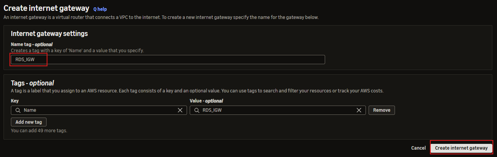</a></td></tr></table>
<p><sub><strong>Screenshot 08:</strong> Internet gateway creation wizard for `RDS_IGW`.</sub></p>


<table><tr><td align="center"><a href="images/screenshot-09.png">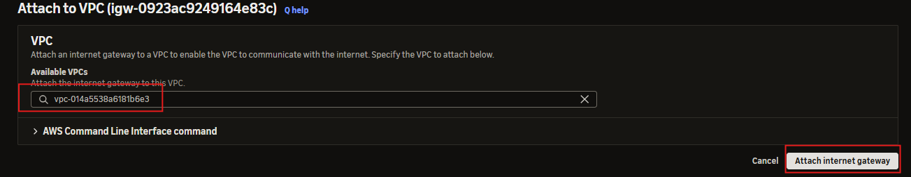</a></td></tr></table>
<p><sub><strong>Screenshot 09:</strong> Selecting `RDS_VPC` for Internet Gateway attachment.</sub></p>


<table><tr><td align="center"><a href="images/screenshot-10.png">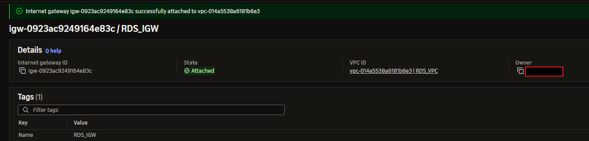</a></td></tr></table>
<p><sub><strong>Screenshot 10:</strong> Successfully attached `RDS_IGW` to the new VPC.</sub></p>


### 3.2 Configuring Public Routing

I created `RDS-public-rt` (`rtb-026a0674fe09964ea`) and added the proposed default route targeting the internet gateway.

| Route destination | Target | Purpose |
| --- | --- | --- |
| `192.168.0.0/16` | `local` | Communication inside the VPC |
| `0.0.0.0/0` | `RDS_IGW` | Outbound/inbound internet path for eligible public-subnet resources |

I explicitly associated **only `RDSpublicsubnet`** with the public route table. The saved subnet association was verified in the AWS Console. I also confirmed the public route table later contained two route entries; the screenshot of those entries had their values obscured, so it is not independent visual proof of the destination/target values. My successful SSH session and package installation are supporting evidence that the EC2 client had working connectivity.


<table><tr><td align="center"><a href="images/screenshot-11.png"></a></td></tr></table>
<p><sub><strong>Screenshot 11:</strong> Creating the `RDS-public-rt` route table.</sub></p>


<table><tr><td align="center"><a href="images/screenshot-12.png">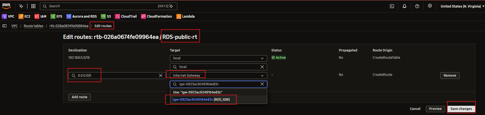</a></td></tr></table>
<p><sub><strong>Screenshot 12:</strong> Adding the `0.0.0.0/0` route to `RDS_IGW`.</sub></p>


<table><tr><td align="center"><a href="images/screenshot-13.png">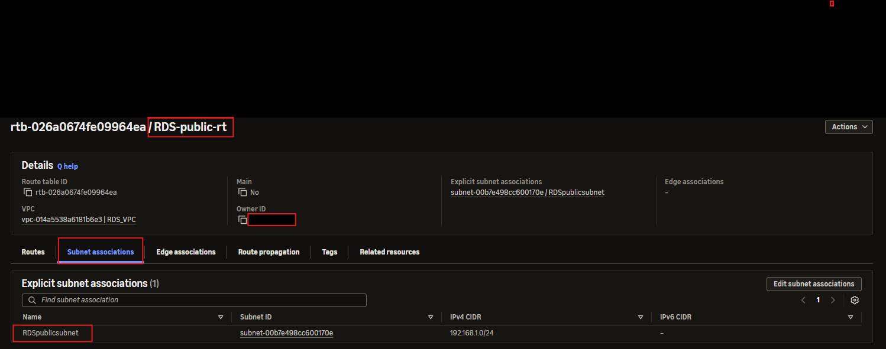</a></td></tr></table>
<p><sub><strong>Screenshot 13:</strong> Public route table showing explicit association with `RDSpublicsubnet`; account ID redacted.</sub></p>


### 3.3 Configuring Private Routing

I created `RDS-private-rt` (`rtb-08adb4ef84aa40abe`) and associated `RDSprivatesubnet1` and `RDSprivatesubnet2`. The console confirmed **two explicit private subnet associations**. The public subnet was not associated with this table.


<table><tr><td align="center"><a href="images/screenshot-14.png">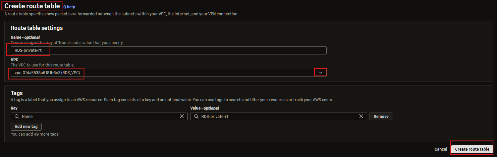</a></td></tr></table>
<p><sub><strong>Screenshot 14:</strong> Creating the `RDS-private-rt` route table.</sub></p>


<table><tr><td align="center"><a href="images/screenshot-15.png">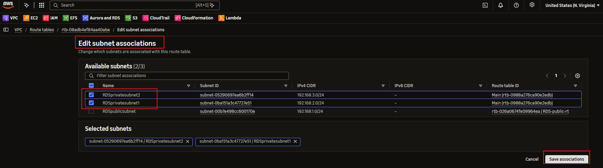</a></td></tr></table>
<p><sub><strong>Screenshot 15:</strong> Selecting both private subnets for the private route table.</sub></p>


<table><tr><td align="center"><a href="images/screenshot-16.png">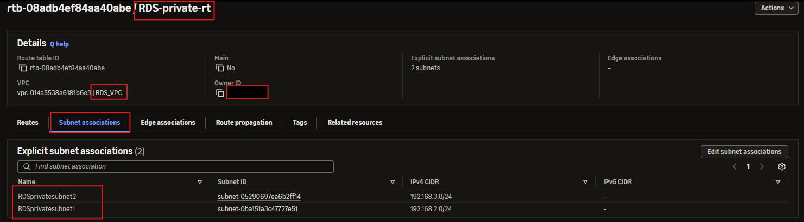</a></td></tr></table>
<p><sub><strong>Screenshot 16:</strong> Private route table showing two explicit private subnet associations.</sub></p>


The intended private route table had only `192.168.0.0/16 → local` and no direct internet gateway route. **The private table's route entries were not shown in a final screenshot**, so that exact route list is treated as a design setting requiring a later recheck, not a separately verified outcome.

> [!NOTE]
> **KEY TAKEAWAY**
>
> An Internet Gateway is a VPC-level attachment. Only subnets whose route tables point to it are internet-routable. I kept the intended database subnets separately associated with a private route table and did not provision a NAT gateway for this exercise.

---

## 04 Building Network Security and the DB Subnet Group

### 4.1 Restricting SSH to the EC2 Client

I created `RDS-EC2-Client-SG` (`sg-0a0f6f6a76e506812`) in the dedicated VPC. I configured a single inbound SSH rule for **TCP 22**, limited to the **My IP** source instead of `0.0.0.0/0`. The group retained one outbound permission entry permitting outgoing traffic.

| Security group | Protocol and port | Rule source | Reason |
| --- | --- | --- | --- |
| `RDS-EC2-Client-SG` (inbound) | TCP 22 (SSH) | My IP, `/32` | Administrative access from the current workstation |
| `RDS-EC2-Client-SG` (outbound) | All traffic | `0.0.0.0/0` | Package download and MySQL client outbound access |

The user's exact SSH source IP is intentionally **not reproduced** in this public guide or image package.


<table><tr><td align="center"><a href="images/screenshot-17.png">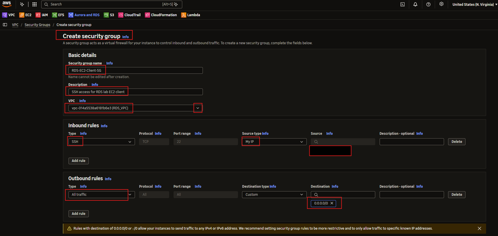</a></td></tr></table>
<p><sub><strong>Screenshot 17:</strong> Configuring `RDS-EC2-Client-SG` with a restricted SSH inbound rule.</sub></p>


<table><tr><td align="center"><a href="images/screenshot-18.png">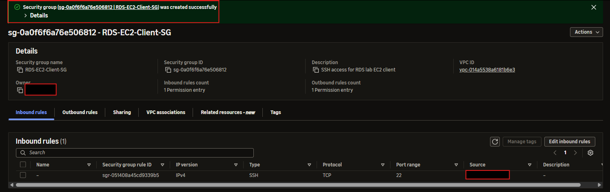</a></td></tr></table>
<p><sub><strong>Screenshot 18:</strong> Successfully created EC2 client security group with the SSH inbound rule.</sub></p>


### 4.2 Allowing MySQL Only from the EC2 Security Group

I created `RDS-MySQL-SG` (`sg-0dbee26b780399798`). Rather than following the broad `Anywhere` network rule shown in the introductory exercise, I allowed inbound **MySQL/Aurora TCP 3306** only from `RDS-EC2-Client-SG` (`sg-0a0f6f6a76e506812`). The AWS Console showed successful creation and verified the source security-group reference.


<table><tr><td align="center"><a href="images/screenshot-19.png">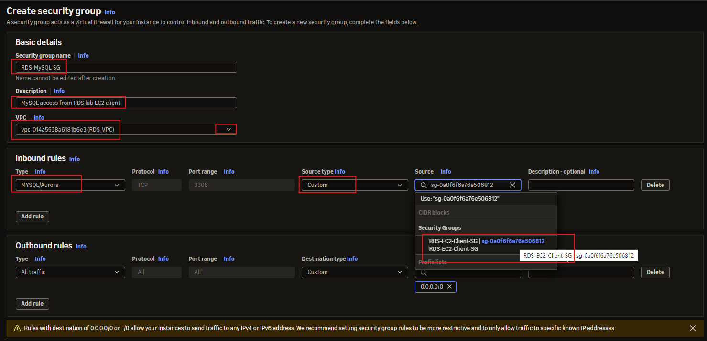</a></td></tr></table>
<p><sub><strong>Screenshot 19:</strong> Configuring `RDS-MySQL-SG` to accept TCP 3306 only from the EC2 client security group.</sub></p>


<table><tr><td align="center"><a href="images/screenshot-20.png">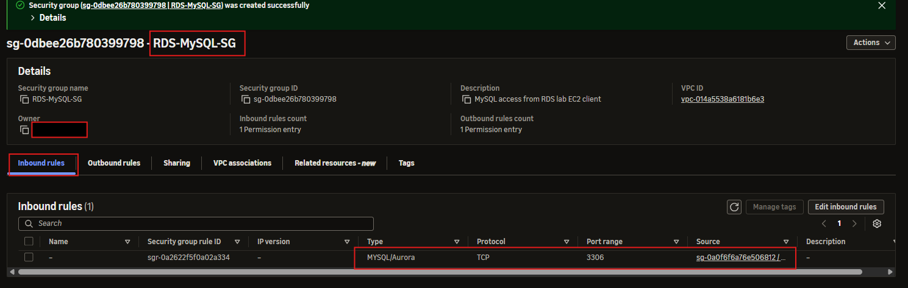</a></td></tr></table>
<p><sub><strong>Screenshot 20:</strong> Successfully created the database security group and verified the source security-group reference.</sub></p>


> [!IMPORTANT]
> **SAA-C03 EXAM CONNECTION**
>
> Referencing a source security group is preferable to maintaining an IP allowlist for EC2-to-RDS connections: the rule matches traffic from authorized network interfaces associated with that group, even if the EC2 private IP changes. It does not grant IAM permissions or replace database authentication.

### 4.3 Creating the RDS DB Subnet Group

I opened **Aurora and RDS → Subnet groups** and created `rds-private-subnet-group`. It contained **only** `RDSprivatesubnet1` in `us-east-1b` and `RDSprivatesubnet2` in `us-east-1c`. I verified the new subnet group appeared in **Complete** status.


<table><tr><td align="center"><a href="images/screenshot-21.png">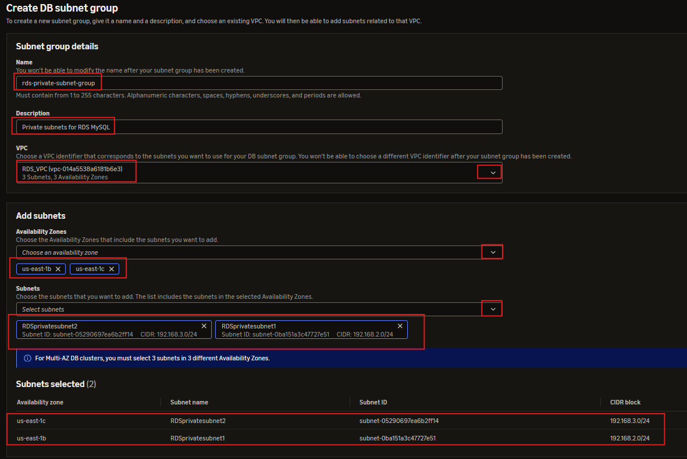</a></td></tr></table>
<p><sub><strong>Screenshot 21:</strong> DB subnet group configured with only the two private subnets.</sub></p>


<table><tr><td align="center"><a href="images/screenshot-22.png">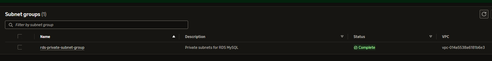</a></td></tr></table>
<p><sub><strong>Screenshot 22:</strong> RDS DB subnet group `rds-private-subnet-group` in Complete status.</sub></p>


> [!TIP]
> **KNOWLEDGE CHECK:** Does a DB subnet group need the public subnet for EC2 to reach a private RDS instance?
>
> **Answer: No.** The EC2 instance and RDS database can communicate across private VPC IP space via the VPC's local routing and appropriate security-group rules.

---

## 05 Provisioning and Verifying Amazon RDS MySQL

### 5.1 Selecting the Database Creation Workflow

I initially encountered a redesigned AWS database wizard. Its earlier default selected **Aurora (MySQL Compatible)** and **Production**. I changed this to **MySQL**, selected **Full configuration** (equivalent in purpose to the previously named Standard create workflow), and chose the **Free tier** template offered in my console.


<table><tr><td align="center"><a href="images/screenshot-23.png">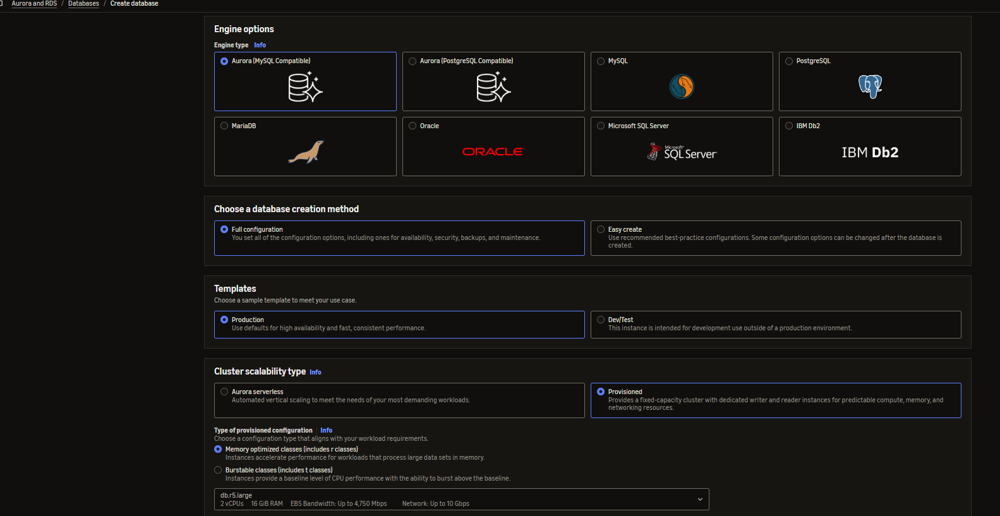</a></td></tr></table>
<p><sub><strong>Screenshot 23:</strong> Initial AWS database wizard with Aurora selected by default, before selecting standard MySQL.</sub></p>


<table><tr><td align="center"><a href="images/screenshot-24.png">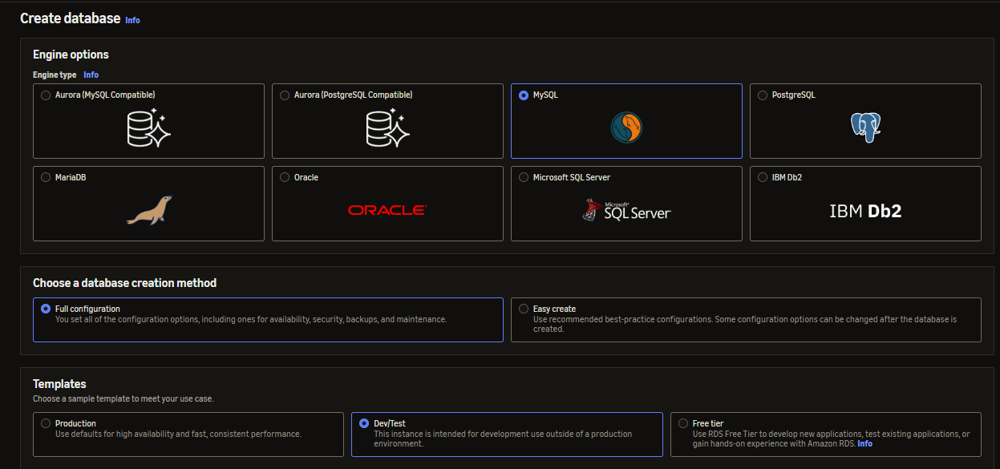</a></td></tr></table>
<p><sub><strong>Screenshot 24:</strong> Corrected selection: MySQL engine, Full configuration, and Free tier template.</sub></p>


The Free tier template limited deployment options to **Single-AZ**, which I selected. This provided a single primary database instance without a Multi-AZ standby.


<table><tr><td align="center"><a href="images/screenshot-25.png">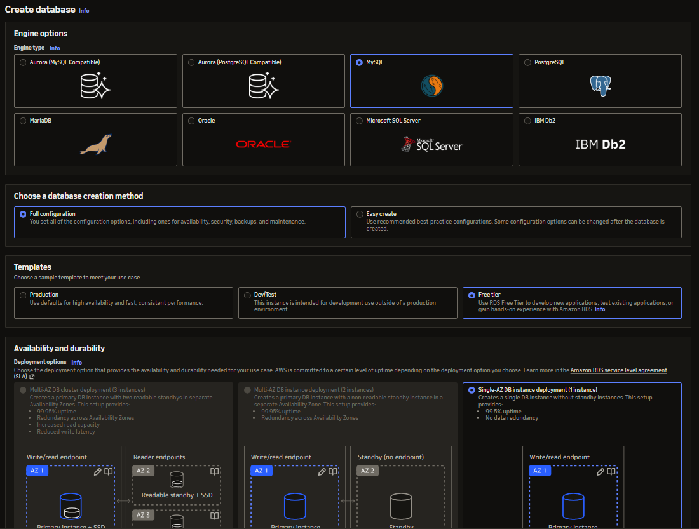</a></td></tr></table>
<p><sub><strong>Screenshot 25:</strong> Single-AZ deployment selected under the Free tier template.</sub></p>


> [!WARNING]
> **COST CONTROL:** The template displayed Free Tier allowances for eligible RDS use, but seeing "Free tier" in the AWS Console does not prove that every resource or every account is free of charges. Usage, regional pricing, eligibility, snapshots, EC2 runtime, and public IPv4 can still affect billing. I planned to delete the temporary resources after documenting the lab.

### 5.2 Engine, Credentials, Class and Storage

I configured the MySQL Community engine and a self-managed master password. Password values are never stored in this guide or screenshots. My actual DB instance identifier appeared as **`syrdsinstance`** after creation, and the initial database name was `SYrdsinstance`.

| Setting | Value from the configuration and confirmation screenshots |
| --- | --- |
| Engine and version | MySQL Community 8.4.11 |
| Template and deployment | Free tier / Single-AZ |
| DB instance identifier | `syrdsinstance` (lowercase in AWS) |
| Master username | `awsMaster` (MySQL user, not the IAM identity) |
| Credentials | Self-managed, password entered privately |
| DB instance class | `db.t3.micro` |
| Storage | 20 GiB General Purpose SSD (`gp2`) |
| Storage autoscaling | Disabled |
| Encryption | Enabled with the default `aws/rds` KMS key |
| Parameter / option group | Defaults for MySQL 8.4 |


<table><tr><td align="center"><a href="images/screenshot-26.png">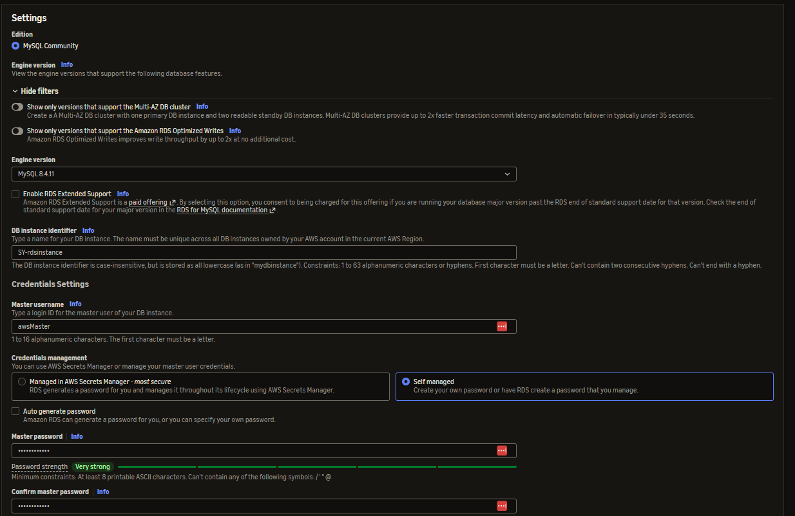</a></td></tr></table>
<p><sub><strong>Screenshot 26:</strong> MySQL engine version and masked master-credential configuration.</sub></p>


<table><tr><td align="center"><a href="images/screenshot-27.png">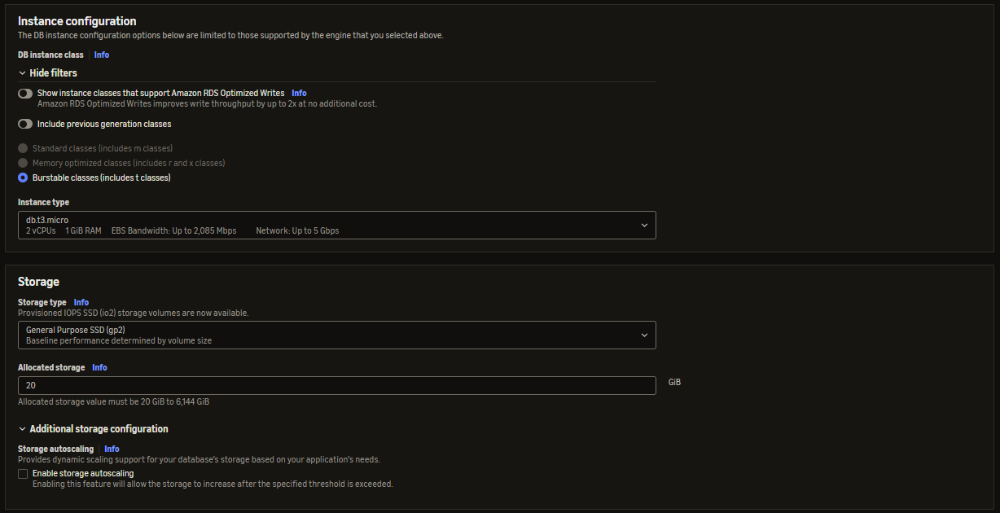</a></td></tr></table>
<p><sub><strong>Screenshot 27:</strong> `db.t3.micro` instance, 20 GiB gp2 storage, and disabled storage autoscaling.</sub></p>


### 5.3 Configuring Private Networking and Monitoring

I chose **Don't connect to an EC2 compute resource** in the wizard because I had already configured the VPC security groups. I selected `RDS_VPC`, `rds-private-subnet-group`, **Public access: No**, and only the existing `RDS-MySQL-SG`. The database port was `3306`. I did not create an RDS Proxy or enable Enhanced Monitoring, and the screenshot showed Database Insights **Standard**.


<table><tr><td align="center"><a href="images/screenshot-28.png">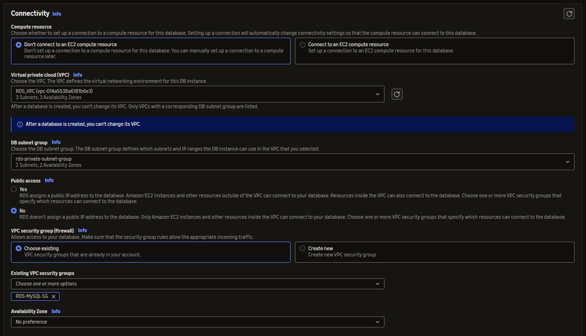</a></td></tr></table>
<p><sub><strong>Screenshot 28:</strong> Private RDS connectivity configuration: dedicated VPC, DB subnet group, public access off, and MySQL security group.</sub></p>


<table><tr><td align="center"><a href="images/screenshot-29.png">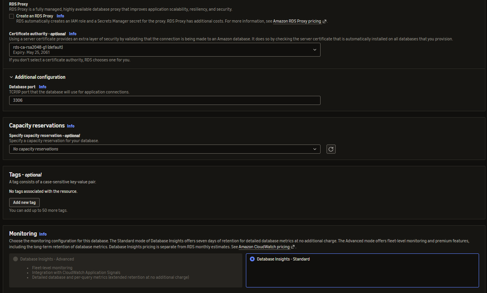</a></td></tr></table>
<p><sub><strong>Screenshot 29:</strong> MySQL port 3306, RDS Proxy off, and standard monitoring selection.</sub></p>


The additional-options capture showed the default MySQL 8.4 parameter and option groups and encryption enabled with the AWS-managed `aws/rds` key. The approved screenshot copy masks the AWS account identifier.


<table><tr><td align="center"><a href="images/screenshot-30.png">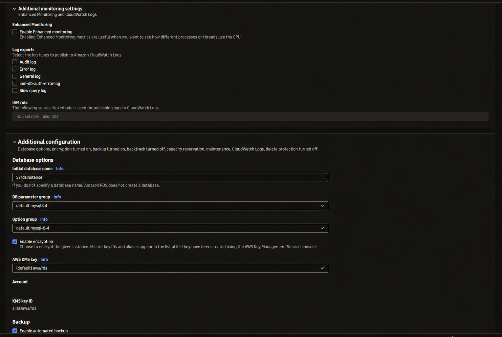</a></td></tr></table>
<p><sub><strong>Screenshot 30:</strong> Additional database options, including encryption and default parameter/option groups; privacy-edited view.</sub></p>


### 5.4 Reviewing Backup and Maintenance Choices

The pre-creation screenshot displayed **automated backups enabled**, a **1-day retention period**, **auto minor version upgrade enabled**, and **deletion protection disabled**. I was advised to turn off backups and automatic minor version upgrades for this short-lived demonstration. The eventual database settings were not reopened in a screenshot after creation, so the final on/off state for those first two options has **not** been independently verified.


<table><tr><td align="center"><a href="images/screenshot-31.png">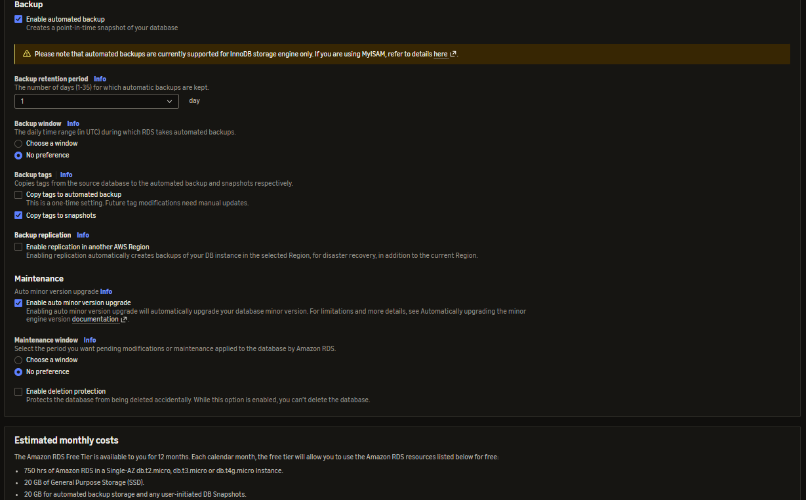</a></td></tr></table>
<p><sub><strong>Screenshot 31:</strong> Backup and maintenance options as displayed during pre-creation review.</sub></p>


This distinction matters: a screenshot taken before clicking Create is evidence of a **selection at that moment**, not necessarily the final persisted value after later edits.

### 5.5 Confirming Database Availability and Endpoint

I created the database and observed `syrdsinstance` listed as **Available** on MySQL Community, `db.t3.micro`, in **`us-east-1b`**, with **Multi-AZ: No**.


<table><tr><td align="center"><a href="images/screenshot-32.png">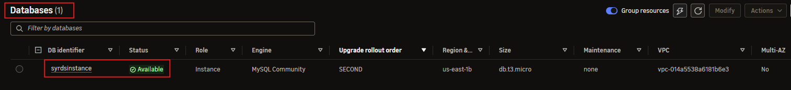</a></td></tr></table>
<p><sub><strong>Screenshot 32:</strong> RDS database listed as Available with MySQL Community on `db.t3.micro`.</sub></p>


In **Connectivity & security** I confirmed the private configuration and recorded the full endpoint hostname used later for the MySQL session:

```text
syrdsinstance.ci7usa2sqlow.us-east-1.rds.amazonaws.com
```

| Field | Verified value |
| --- | --- |
| Port | 3306 |
| Master username | `awsMaster` |
| Instance status | Available |
| Publicly accessible | No |
| VPC | `RDS_VPC` |
| DB subnet group | `rds-private-subnet-group` |
| SG | `RDS-MySQL-SG` — Active |
| AZ | `us-east-1b` |


<table><tr><td align="center"><a href="images/screenshot-33.png">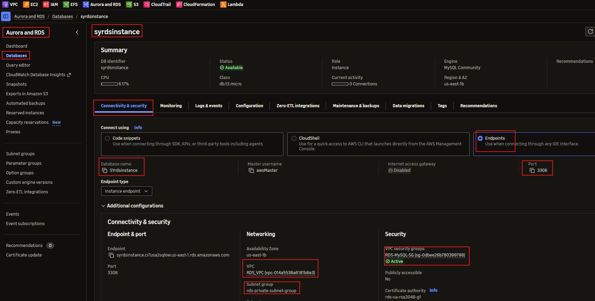</a></td></tr></table>
<p><sub><strong>Screenshot 33:</strong> RDS endpoint, port 3306, private subnet group, VPC and security group.</sub></p>


> [!IMPORTANT]
> **SAA-C03 EXAM CONNECTION**
>
> An RDS **DB identifier**, the **initial database/schema name**, and the **DNS endpoint** are three different things. Client tools use the **endpoint hostname** for `-h`, a user with sufficient MySQL privileges for `-u`, and the port selected for the engine.

---

## 06 Connecting from Ubuntu EC2 and Running SQL

### 6.1 Launching the Public-Subnet Database Client

I launched `RDS-Ubuntu-Client` using **Ubuntu Server 26.04 LTS** (x86_64), although the initial plan proposed 24.04. I selected `t3.micro`, reused the existing `npoweraws` key pair, chose `RDS_VPC` / `RDSpublicsubnet`, enabled public IPv4 assignment, and selected only `RDS-EC2-Client-SG`. I used an 8 GiB `gp3` root EBS volume.

| EC2 configuration | Observed value |
| --- | --- |
| AMI | Ubuntu Server 26.04 LTS, 64-bit x86 |
| Instance type | `t3.micro` |
| Instance ID | `i-0bc9e2a8d48f894f5` |
| Key pair | `npoweraws` |
| Public subnet | `subnet-00b7e498cc600170e` (`us-east-1a`) |
| Public IP | Enabled; observed `34.229.182.101` |
| Private IP | `192.168.1.75` |
| Client SG | `RDS-EC2-Client-SG` |
| EBS | 8 GiB `gp3` |


<table><tr><td align="center"><a href="images/screenshot-34.png">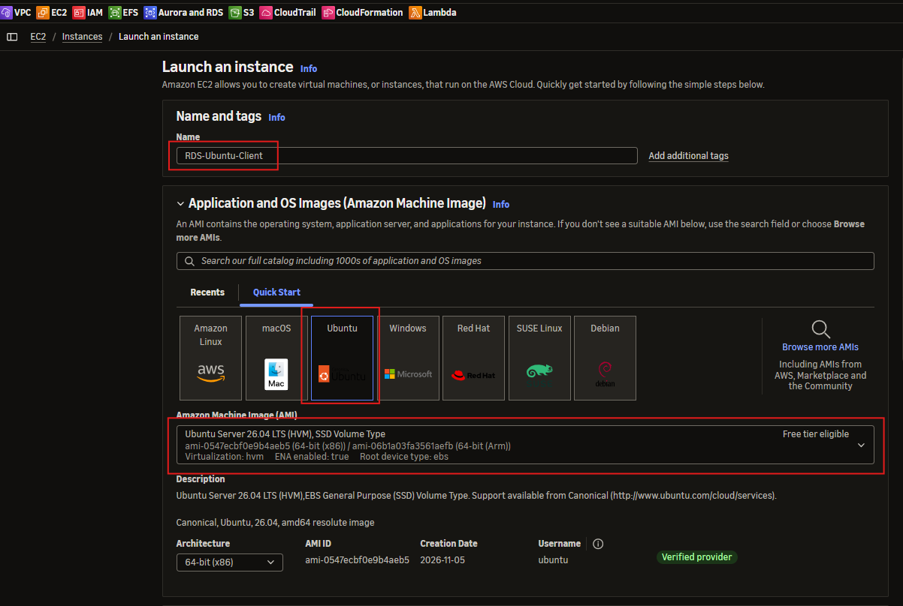</a></td></tr></table>
<p><sub><strong>Screenshot 34:</strong> Ubuntu EC2 client name and Ubuntu 26.04 LTS AMI selection.</sub></p>


<table><tr><td align="center"><a href="images/screenshot-35.png">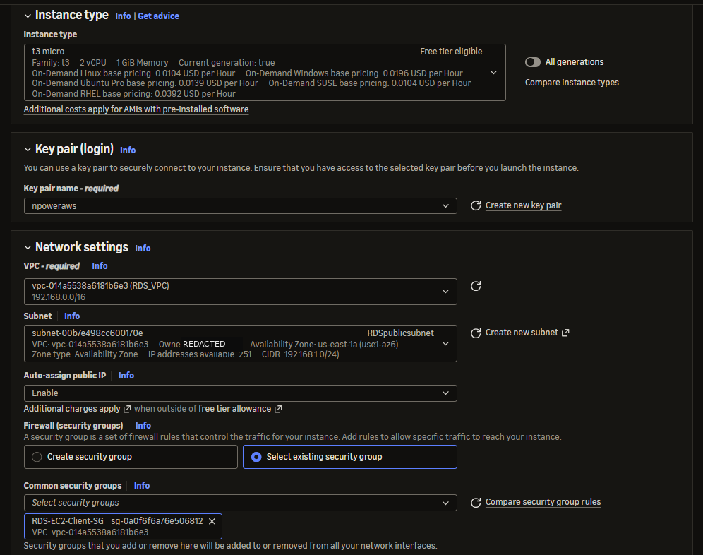</a></td></tr></table>
<p><sub><strong>Screenshot 35:</strong> EC2 instance class, key pair, public subnet and dedicated security group.</sub></p>


<table><tr><td align="center"><a href="images/screenshot-36.png">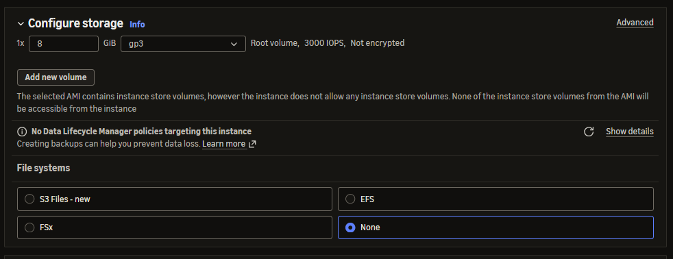</a></td></tr></table>
<p><sub><strong>Screenshot 36:</strong> 8 GiB gp3 root volume for the EC2 client.</sub></p>


Before the SSH connection, I revisited the public route table and confirmed it showed two route entries and the intended public subnet association. Values in that screenshot were masked, so I do not present those rows as independently legible verification.


<table><tr><td align="center"><a href="images/screenshot-37.png">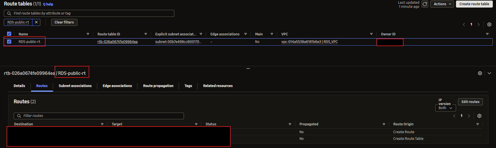</a></td></tr></table>
<p><sub><strong>Screenshot 37:</strong> Public route table displayed with two route entries and the intended subnet association; route values redacted in this capture.</sub></p>


I then observed the client in **Running** state with **3/3 EC2 status checks passed**.


<table><tr><td align="center"><a href="images/screenshot-38.png">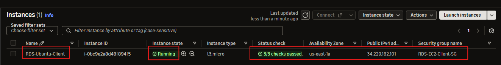</a></td></tr></table>
<p><sub><strong>Screenshot 38:</strong> Ubuntu EC2 client Running and 3/3 EC2 status checks passed.</sub></p>


### 6.2 Connecting over SSH

I opened PowerShell on Windows and used the pre-existing `npoweraws.pem` private key. After acknowledging the new host's fingerprint, I reached the Ubuntu shell. The terminal displayed Ubuntu **26.04.1 LTS** and private address `192.168.1.75`.

```powershell
# Example command; run from the folder containing the key file.
ssh -i .\npoweraws.pem ubuntu@34.229.182.101
```

The screenshot included a local Windows home-directory path; its upper lines were cropped out of the public copy because that local path could reveal personal information.


<table><tr><td align="center"><a href="images/screenshot-39.png">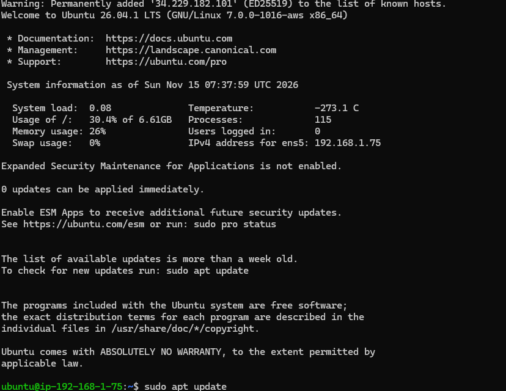</a></td></tr></table>
<p><sub><strong>Screenshot 39:</strong> Successful Ubuntu SSH session (personal Windows directory path cropped out).</sub></p>


### 6.3 Installing and Verifying the MySQL Client

I used Ubuntu APT to update the package index, install the MySQL CLI, and verify the installed client version:

```bash
sudo apt update
sudo apt install -y mysql-client
mysql --version
```

The command returned **MySQL client 8.4.13**. This client was distinct from the server version **8.4.11** shown in the successful RDS connection.


<table><tr><td align="center"><a href="images/screenshot-40.png">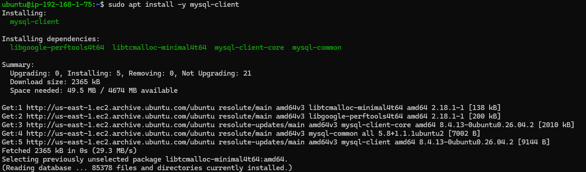</a></td></tr></table>
<p><sub><strong>Screenshot 40:</strong> APT installing the MySQL command-line client on Ubuntu.</sub></p>


<table><tr><td align="center"><a href="images/screenshot-41.png">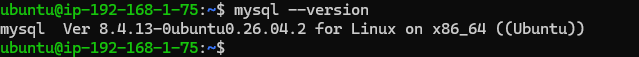</a></td></tr></table>
<p><sub><strong>Screenshot 41:</strong> MySQL client version 8.4.13 confirmed in Ubuntu terminal.</sub></p>


### 6.4 Diagnosing a Failed Hostname and Command

My first attempts used the short database identifier `syrdsinstance` (and later `SY-rdsinstance`) as the hostname, and the command omitted the `-u` switch before the database username. Both attempts failed with **`ERROR 2005 (HY000): Unknown MySQL server host`**. This was a hostname/command issue rather than proof of failed VPC routing.


<table><tr><td align="center"><a href="images/screenshot-42.png">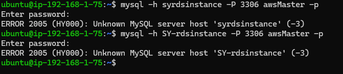</a></td></tr></table>
<p><sub><strong>Screenshot 42:</strong> First MySQL connection attempts failed because a DB identifier was used as the hostname.</sub></p>


I corrected the command by using the complete **RDS DNS endpoint** and the required `-u` flag:

```bash
mysql -h syrdsinstance.ci7usa2sqlow.us-east-1.rds.amazonaws.com -P 3306 -u awsMaster -p
```

The `-p` flag prompted for the password interactively, keeping the secret out of the command line. I successfully entered the MySQL monitor and executed:

```sql
SHOW DATABASES;
```

The server reported MySQL version **8.4.11** and returned:

```text
+--------------------+
| Database           |
+--------------------+
| SYrdsinstance      |
| information_schema |
| mysql              |
| performance_schema |
| sys                |
+--------------------+
5 rows in set (0.01 sec)
```


<table><tr><td align="center"><a href="images/screenshot-43.png">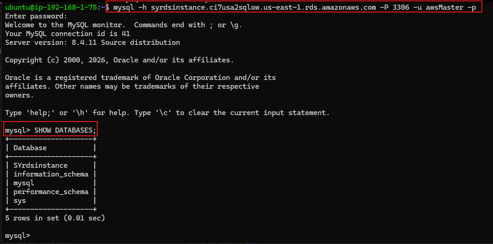</a></td></tr></table>
<p><sub><strong>Screenshot 43:</strong> Successful RDS MySQL connection and `SHOW DATABASES;` returning five databases.</sub></p>


**Verified outcome:** The Ubuntu EC2 client authenticated to a **non-public RDS MySQL instance**, traversing the VPC network under the configured MySQL security group rule. The successful query demonstrated name resolution, TCP connectivity, database login and SQL execution.

> [!NOTE]
> **KEY TAKEAWAY**
>
> EC2's public IPv4 address was used for the external **administrative SSH connection**. EC2-to-RDS traffic used the VPC networking path to a **non-public** MySQL endpoint. The internet gateway was not needed for the database-to-client private path.

### 6.5 Knowledge Check

> [!TIP]
> **Q1:** If an RDS instance is private, can an EC2 instance inside the same VPC connect to it?
>
> **A:** Yes, if DNS resolution, routing, security groups, and database credentials allow it. Publicly accessible = No does not prohibit in-VPC connections.
>
> **Q2:** What caused the first `ERROR 2005` in this lab?
>
> **A:** I supplied the DB identifier instead of its full RDS hostname, so the MySQL client could not resolve that name. Using the endpoint and correct `-u` syntax fixed the command.
>
> **Q3:** Does a `db.t3.micro` Single-AZ database automatically offer Multi-AZ failover?
>
> **A:** No. Multi-AZ requires an appropriate deployment choice. A two-subnet DB subnet group is not itself a standby deployment.

---

## 07 Resource Cleanup Plan

**Status at documentation time: planned, not executed.** I intended to tear down all infrastructure **created specifically for Lab 05** once documentation was completed. The screenshot and command evidence above was captured while the resources were operational.

| Dependency order | Temporary Lab 05 resource | Planned action |
| --- | --- | --- |
| 1 | RDS MySQL DB `syrdsinstance` | Delete DB instance; choose whether to retain final snapshot; verify any remaining automated backups/snapshots, which may incur storage charges. |
| 2 | EC2 client `RDS-Ubuntu-Client` | Terminate the EC2 instance; review its attached EBS volume and public IPv4 allocation behavior. |
| 3 | RDS DB subnet group `rds-private-subnet-group` | Delete after RDS no longer uses it. |
| 4 | RDS and EC2 client security groups | Delete after their dependent ENIs/resources are released; database SG references client SG. |
| 5 | Custom public/private route tables | Delete after removing relevant associations; keep the automatic main route table until VPC deletion. |
| 6 | Internet gateway `RDS_IGW` | Detach from `RDS_VPC`, then delete. |
| 7 | Three temporary subnets | Delete after all EC2/RDS-managed network interfaces and attachments are gone. |
| 8 | Dedicated `RDS_VPC` | Delete after dependencies are removed. |

> [!CAUTION]
> Deleting a database and choosing **no final snapshot** can permanently destroy data. That may be acceptable for a disposable exercise but is not a production default. Deletion protection must be disabled before deleting an RDS instance. Check the actual AWS Console state when doing cleanup, rather than assuming an earlier selection persisted.

### What Must Be Preserved

- The separate pre-existing training VPC `AwsSaaNew-vpc` and its infrastructure.
- The reusable `npoweraws` EC2 key pair.
- Pre-existing IAM users, roles and policies, including the role retained from earlier labs.
- The CloudFront distribution intentionally retained from the preceding lab.

**No actual resource deletions, snapshots or detached security groups are claimed in this guide.** Update this section with verified results after teardown if you want the GitHub guide to reflect the final cleanup state.

---

## 08 Exam Review, Corrections and Production Practices

### 8.1 Corrections and Differences from the Exercise Reference

| Topic | What I actually did | Why it matters |
| --- | --- | --- |
| Network build | Built new `RDS_VPC` and all associated VPC resources. | Isolated this database exercise from earlier lab infrastructure. |
| MySQL inbound SG | Permitted TCP 3306 only from `RDS-EC2-Client-SG`, not Anywhere. | Avoids exposing database access broadly. |
| Database workflow | Used **MySQL / Full configuration / Free tier**, not Aurora Production. | Selects the intended RDS engine and lower-capacity lab template. |
| Database credentials | Used a unique self-managed password and `awsMaster` username, not the instructor's example password. | Keeps credentials out of publicly shared tutorials. |
| Encryption | Enabled `aws/rds` encryption rather than disabling encryption. | Better default for data at rest. |
| Ubuntu release | Used Ubuntu **26.04.1 LTS** in the running instance. | Matches the actual environment, despite an earlier 24.04 recommendation. |
| RDS connection | Fixed the first short-hostname/flag errors by using the real endpoint and `-u`. | Demonstrates a critical troubleshooting distinction: endpoint vs identifier. |
| Backup and upgrades | Changes were recommended; final post-provision settings weren't separately shown. | Avoids asserting unverified database state. |

### 8.2 Production Considerations

This exercise deliberately focused on a temporary **Single-AZ** managed database. In a production design I would separately evaluate:

- **Multi-AZ availability**, backup retention, snapshot restore testing, PITR, and deletion protection.
- **TLS verification** for database clients using an appropriate RDS CA bundle; a successful basic `mysql` session alone does not establish that certificate identity verification was enabled.
- **Database credentials management** through an appropriate secrets store or short-lived authentication model, plus least-privilege database users rather than the master account for applications.
- **Private access paths** for administration (for example, appropriately configured Systems Manager or a managed remote access approach) rather than leaving administrative SSH exposed.
- **Cost controls** for database instance hours, attached storage, retained snapshots and allocated EC2 public IPv4 addresses.
- **Monitoring**, alarms, performance, maintenance windows, engine-version support policy and an operational runbook.

### 8.3 Exam Review

> [!IMPORTANT]
> **SAA-C03 EXAM CONNECTION**
>
> **RDS vs EC2-hosted MySQL:** RDS offloads much database infrastructure management; installing a MySQL *client* on EC2 did not mean I hosted the database server on EC2.
>
> **RDS security:** A private database accessed by a public-subnet EC2 client needs VPC networking and SG rules, not a public IP assigned to the database.
>
> **RDS availability:** Single-AZ is not equivalent to Multi-AZ; the subnet group supplied the multi-AZ placement set but not failover capacity.
>
> **Endpoints:** A stable database DNS endpoint is what applications use to locate RDS. A DB identifier alone was not a valid hostname in my first attempt.

---

## 09 Technical Competencies and Skills Matrix

### 9.1 Competencies Demonstrated

- Created an isolated AWS VPC and IPv4 subnet plan across multiple AZs.
- Attached an internet gateway and configured separate subnet route-table associations.
- Implemented restricted SSH and referenced-source security group rules for MySQL.
- Created and verified an RDS DB subnet group using private subnets.
- Provisioned and verified an encrypted Single-AZ Amazon RDS MySQL instance.
- Connected to Ubuntu over SSH and installed the MySQL CLI with APT.
- Diagnosed a MySQL client DNS/command syntax problem and established the authenticated connection.
- Ran a SQL metadata query and interpreted the returned databases.

### 9.2 Skills Matrix

| AWS or technical skill | Evidence |
| --- | --- |
| Amazon VPC / subnets | Dedicated `RDS_VPC`; three successful subnet creations |
| VPC networking and routing | IGW attachment; public/private route-table associations |
| VPC security groups | SSH restriction; source-SG-referenced MySQL 3306 access |
| Amazon RDS | MySQL 8.4.11 Single-AZ instance in Available state |
| RDS connectivity | Non-public RDS endpoint and private subnet group |
| Linux administration | SSH into Ubuntu 26.04.1; `apt update` and package install |
| MySQL CLI / SQL | Client 8.4.13; successful `SHOW DATABASES;` |
| Troubleshooting | Fixed DNS hostname usage and missing `-u` flag |
| Security hygiene | Account IDs, local home path and SSH source IP excluded from published evidence |
| Infrastructure lifecycle | Cleanup plan prepared; teardown not yet performed |

---

## 10 Consolidated Command Reference

### 10.1 SSH and MySQL CLI — Commands Used

```powershell
# Executed from PowerShell with the existing key (using a local relative key path)
ssh -i .\npoweraws.pem ubuntu@34.229.182.101
```

```bash
# Executed on the Ubuntu EC2 instance
sudo apt update
sudo apt install -y mysql-client
mysql --version

# Successful MySQL connection using the full RDS endpoint
mysql -h syrdsinstance.ci7usa2sqlow.us-east-1.rds.amazonaws.com -P 3306 -u awsMaster -p
```

```sql
SHOW DATABASES;
```

### 10.2 Command Options

| Option or expression | Meaning |
| --- | --- |
| `ssh -i` | Specifies the private key used for SSH authentication. |
| `sudo apt update` | Refreshes the Ubuntu package index before installation. |
| `sudo apt install -y mysql-client` | Installs the command-line database client and automatically accepts package prompts. |
| `mysql -h` | Selects the MySQL server's full DNS hostname. |
| `-P 3306` | Sets TCP port 3306 (uppercase `P`). |
| `-u awsMaster` | Specifies the MySQL login account (lowercase `u`). |
| `-p` | Prompts interactively for the database password. |
| `SHOW DATABASES;` | Queries visible databases in the connected MySQL server. |

### 10.3 Reproducible Connection Pattern

```bash
# Use the endpoint and database username from your own deployment.
mysql -h <YOUR-RDS-ENDPOINT> -P 3306 -u <YOUR-DB-USERNAME> -p
```

Never paste database passwords into public documentation or into a shared command transcript.

---

## Technical Reflection

This exercise confirmed how managed Amazon RDS can remain private while being reachable from a carefully controlled EC2 client inside the same VPC. The important successful verification was not only the database's **Available** status, but the subsequent **authenticated SQL session**: a correct RDS DNS endpoint, allowed traffic on TCP 3306, and valid MySQL credentials were all required.

The initial `ERROR 2005` attempts showed that a database identifier is not a substitute for its endpoint hostname. After correcting the command, the returned database list verified the deployment end to end. The dedicated VPC and temporary resources will be torn down separately once the guide and screenshots are safely archived.
