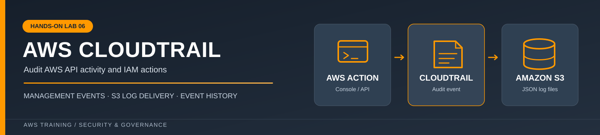

# AWS CloudTrail Auditing Lab
**SECURITY / AWS CLOUDTRAIL / AMAZON S3 / IAM / MANAGEMENT EVENTS / JSON AUDIT LOGS**

## Introduction to AWS CloudTrail

### What Is AWS CloudTrail?

**Amazon Web Services (AWS) CloudTrail** is an auditing and governance service that records activities performed within an AWS account.

It provides visibility into actions performed through the AWS Management Console, AWS CLI, AWS SDKs, and AWS service APIs.

CloudTrail helps answer important security and operational questions:

- **Who** performed an action?
- **What** action was performed?
- **When** did the activity occur?
- **Where** did the request originate?
- **Which AWS resource** was affected?

CloudTrail records these activities as events containing details such as the API operation, timestamp, IAM identity, AWS Region, source IP address, and request parameters.

### Why Is AWS CloudTrail Important?

CloudTrail is essential for maintaining accountability, investigating security incidents, monitoring administrative actions, and demonstrating compliance with organizational security requirements.

For example, if an IAM policy is modified or an S3 bucket configuration is changed, CloudTrail can help identify the API operation and the identity responsible.

### Common AWS CloudTrail Use Cases

| Use case | Description |
|---|---|
| Security auditing | Track IAM user activity, authentication events, and changes to AWS resources. |
| Incident investigation | Investigate unauthorized changes, unusual API activity, and potential security incidents. |
| Compliance and governance | Maintain audit records to support internal reviews and regulatory requirements. |
| Change tracking | Identify who created, modified, or deleted resources and when the changes occurred. |
| Operational troubleshooting | Investigate failed API requests, permission errors, and configuration changes. |
| Automated security monitoring | Integrate CloudTrail activity with AWS monitoring and security services to detect and respond to selected events. |

### CloudTrail Event Types

| Event type | Description |
|---|---|
| Management events | Record administrative API operations, such as creating resources, changing policies, and retrieving resource information. |
| Data events | Record supported resource-level operations, such as Amazon S3 object access and AWS Lambda function invocations. |
| Insights events | Identify unusual patterns in API activity or error rates. |
| Network activity events | Record supported API activity involving VPC endpoints. |

### CloudTrail Event History vs. Trails

**Event History** provides a searchable record of the previous 90 days of management events within an AWS Region. It is available without creating a trail.

A **CloudTrail trail** provides ongoing delivery of selected event records to an Amazon S3 bucket. This supports longer-term retention, investigation, and integration with other AWS services.

### How CloudTrail Was Used in This Lab

In this exercise, I configured a multi-Region AWS CloudTrail trail to capture Read and Write management events and deliver compressed JSON audit logs to a dedicated Amazon S3 bucket.

I verified that the trail was actively logging, confirmed successful log delivery to Amazon S3, and examined recorded API operations, including the read-only DescribeTrails event and write operations associated with trail creation.

As an additional hands-on exercise, I signed in using the IAM user 'awsMaster' and added a tag to an S3 bucket. I then used CloudTrail Event history to identify the corresponding 'TagResource' event and verify the 'IAM identity' responsible for the configuration change.

Event history also contained 'ConsoleLogin' and 'ChangePassword' events associated with 'awsMaster', demonstrating CloudTrail's visibility into authentication and IAM account-management activity.

This exercise demonstrated how AWS CloudTrail supports user accountability, configuration auditing, operational visibility, and security investigations in an AWS environment.

---

## Contents

- [01 Objectives, Architecture and Core Concepts](#01-objectives-architecture-and-core-concepts)
- [02 Creating and Configuring the CloudTrail Trail](#02-creating-and-configuring-the-cloudtrail-trail)
- [03 Verifying S3 Log Delivery and a Read Event](#03-verifying-s3-log-delivery-and-a-read-event)
- [04 Auditing Write Management Events](#04-auditing-write-management-events)
- [05 Auditing IAM User Sign-In and S3 Changes](#05-auditing-iam-user-sign-in-and-s3-changes)
- [06 Troubleshooting, Security and Cost Considerations](#06-troubleshooting-security-and-cost-considerations)
- [07 Resource Cleanup Procedure](#07-resource-cleanup-procedure)
- [08 SAA-C03 Review and Technical Competencies](#08-saa-c03-review-and-technical-competencies)

## Architecture Highlight

### CloudTrail Event Flow — Visual Reference

The diagram below illustrates the broader CloudTrail event flow from AWS Console, API, and CLI activity into audit records and possible log destinations. **This lab configured the trail's S3 delivery; CloudTrail Lake was not created or used.**

<table><tr><td align="center"><a href="images/cloudtrail-event-flow.png">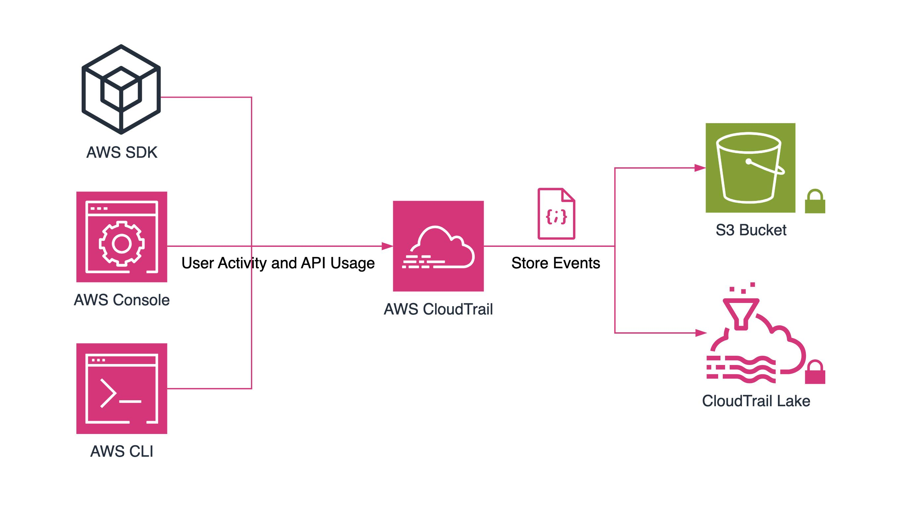</a></td></tr></table>

<p align="center"><sub><strong>Architecture reference:</strong> Conceptual CloudTrail event-processing diagram. CloudTrail Lake is illustrated for context only and was not configured in Lab 06.</sub></p>

### Implemented Lab Architecture

The following diagram represents the architecture actually configured and verified during this lab. CloudTrail Event history exists independently of a trail; the separate trail delivered selected management events to S3.

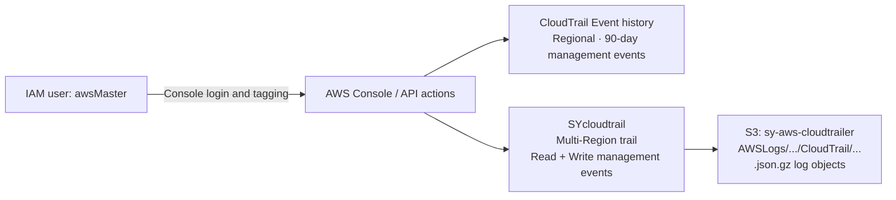

| Component | Role in this exercise |
| --- | --- |
| CloudTrail Event history | Displays recent management events for the selected Region, without requiring a trail. |
| Multi-Region trail | Configured ongoing delivery of selected events from supported Regions. |
| S3 bucket | Stored CloudTrail log objects in compressed JSON format. |
| Management events | Recorded control-plane Read and Write operations. |
| IAM identity | Associated recorded API operations with the user who performed them. |

---

## 01 Objectives, Architecture and Core Concepts

### 1.1 Purpose and Objectives

The purpose of the lab was to create an auditable record of AWS account operations and examine the evidence that CloudTrail produces. Rather than stopping at trail creation, I checked the logging status, confirmed that an S3 object had arrived, examined a JSON audit record, and correlated a deliberately generated S3 tagging action with its IAM user.

The verified objectives were to:

1. Create a dedicated multi-Region trail and S3 destination.
2. Record both Read and Write management operations.
3. Confirm actual log delivery and inspect JSON event fields.
4. Review recorded trail-creation and S3 configuration operations.
5. Associate IAM user `awsMaster` with a specific S3 change.
6. Examine recorded `ConsoleLogin` and `ChangePassword` operations.

### 1.2 Key CloudTrail Concepts

| Concept | Explanation |
| --- | --- |
| Management event | Control-plane operation such as `DescribeTrails`, `CreateTrail`, or S3 bucket configuration. |
| Read operation | Usually retrieves information and is identified with `readOnly: true`. |
| Write operation | Usually creates, modifies, or deletes a resource and is identified with `readOnly: false`. |
| Data event | Higher-volume data-plane activity, for example certain S3 object-level operations; it was not enabled in this trail. |
| CloudTrail Event history | A built-in, searchable 90-day view of management events in one Region, separate from trail delivery. |
| CloudTrail trail | A logging configuration that delivers selected events to an S3 destination. |
| Log file | A `.json.gz` object containing a `Records` array of individual event records. |
| `userIdentity` | JSON structure describing the identity associated with an event. |

> [!IMPORTANT]
> **SAA-C03 EXAM CONNECTION**
>
> CloudTrail answers **who called which AWS API, when, and from what context**. It is distinct from CloudWatch metrics and application logs. Enabling a trail extends event delivery to a chosen destination; it does not create Event history itself.

## 02 Creating and Configuring the CloudTrail Trail

### 2.1 Opening the Trails Console

I opened **AWS CloudTrail → Trails** in **US East (N. Virginia), `us-east-1`**. The Trails list initially displayed no trails. I selected **Create trail** to configure a new trail for the exercise.

<table><tr><td align="center"><a href="images/screenshot-01.png">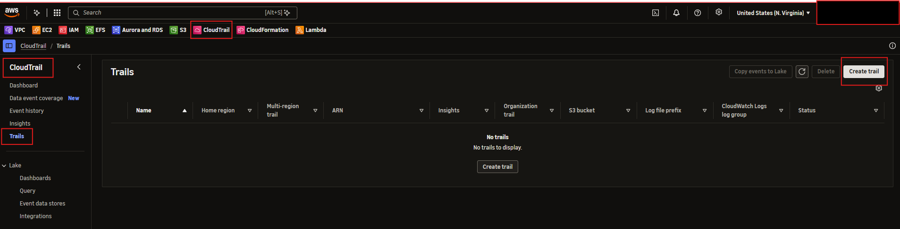</a></td></tr></table>

<p><sub><strong>Screenshot 01:</strong> CloudTrail Trails page before creating the trail, with no existing trails listed.</sub></p>

### 2.2 Choosing Trail Attributes

I configured the creation wizard with these settings:

| Setting | Configuration |
| --- | --- |
| Trail name | `SYcloudtrail` |
| Home Region | `us-east-1` |
| Multi-Region trail | Yes, as shown in the console |
| Organization trail | No |
| S3 storage | Create a new S3 bucket |
| S3 bucket name | `sy-aws-cloudtrailer` |
| Optional SSE-KMS configuration | Not enabled |
| Log file validation | Disabled for this exercise |
| Recursive logging | Disabled |
| SNS delivery notification | Disabled |

CloudTrail organizes S3 log objects under an `AWSLogs/` prefix that includes the AWS account ID. I redacted the account-ID portion from the public screenshots; the actual S3 folder organization was unchanged.

<table><tr><td align="center"><a href="images/screenshot-02.png">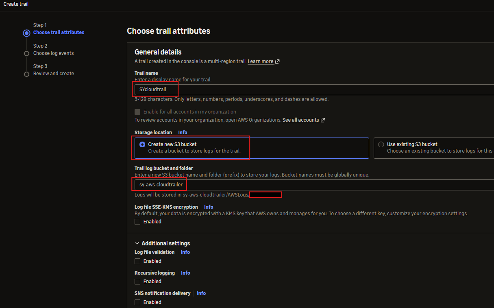</a></td></tr></table>

<p><sub><strong>Screenshot 02:</strong> Initial trail attributes with the redacted account-derived S3 log path and new dedicated bucket.</sub></p>

### 2.3 Selecting Management Events

On **Choose log events**, I enabled **Management events** and selected both **Read** and **Write** API activity. I did not enable Data events, Insights events, or Network activity events. I left the exclusions for AWS KMS and RDS Data API events unchecked.

| Event setting | Lab configuration |
| --- | --- |
| Management events | Enabled |
| Read operations | Enabled |
| Write operations | Enabled |
| Data events | Disabled |
| Insights events | Disabled |
| Network activity events | Disabled |
| Exclude KMS / RDS Data API management events | No |

The console indicated that this trail was the first copy of management events and that no additional CloudTrail event delivery charges applied to that copy. S3 storage remained a separate consideration.

<table><tr><td align="center"><a href="images/screenshot-03.png">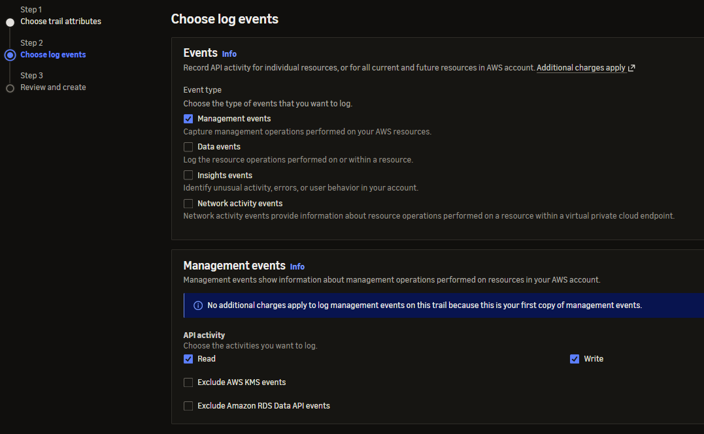</a></td></tr></table>

<p><sub><strong>Screenshot 03:</strong> Management events enabled for both Read and Write API activity.</sub></p>

### 2.4 Reviewing and Creating the Trail

I reviewed the configuration before creating the trail: `SYcloudtrail`, multi-Region logging, the S3 destination, and disabled optional validation and notification features. I then selected **Create trail**.

<table><tr><td align="center"><a href="images/screenshot-04.png">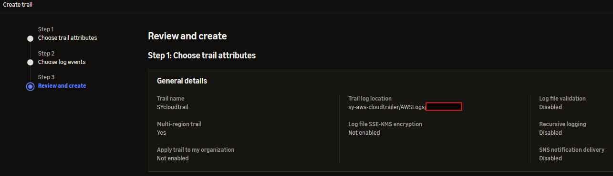</a></td></tr></table>

<p><sub><strong>Screenshot 04:</strong> Final review of multi-Region trail attributes and the S3 destination.</sub></p>

AWS displayed **Trail successfully created**. I verified `SYcloudtrail` appeared in the Trails list, with `sy-aws-cloudtrailer` as its destination and Insights disabled.

<table><tr><td align="center"><a href="images/screenshot-05.png">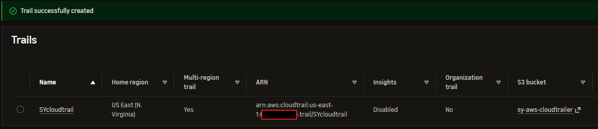</a></td></tr></table>

<p><sub><strong>Screenshot 05:</strong> Success message confirming creation of SYcloudtrail and the selected S3 bucket.</sub></p>

> [!NOTE]
> **KEY TAKEAWAY**
>
> A successful trail-creation message proves the configuration was accepted; the next verification is to confirm logging is active and that real log objects arrive at the destination.

---

## 03 Verifying S3 Log Delivery and a Read Event

### 3.1 Checking Logging Status

I opened the `SYcloudtrail` details page and confirmed that **Trail logging** displayed **Logging**. The trail was shown as multi-Region, with `sy-aws-cloudtrailer` configured as the log destination. At that moment, **Last log file delivered** did not yet display a value.

<table><tr><td align="center"><a href="images/screenshot-06.png">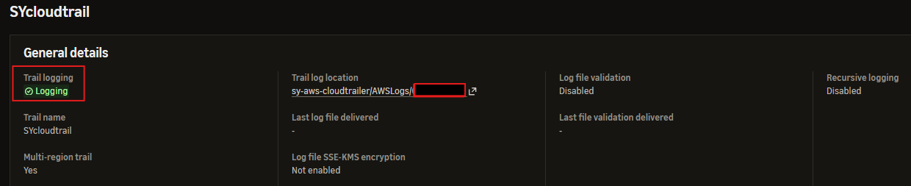</a></td></tr></table>

<p><sub><strong>Screenshot 06:</strong> Trail details showing logging enabled and the configured S3 destination.</sub></p>

### 3.2 Verifying the Delivered S3 Object

I opened **Amazon S3 → General purpose buckets → `sy-aws-cloudtrailer`** and navigated into the CloudTrail log folders for `us-east-1` and November 15, 2026.

The observed location followed this structure; the placeholder represents the redacted account-ID directory:

```text
s3://sy-aws-cloudtrailer/AWSLogs/<AWS-ACCOUNT-ID>/CloudTrail/us-east-1/2026/11/15/
```

I found **one `.json.gz` object** in the selected folder, approximately **3.9 KB** in size. Its presence verified actual delivery of a compressed CloudTrail log object to the destination bucket.

<table><tr><td align="center"><a href="images/screenshot-07.png">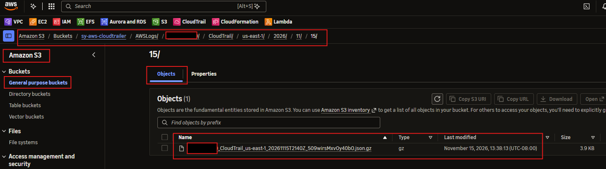</a></td></tr></table>

<p><sub><strong>Screenshot 07:</strong> CloudTrail compressed JSON log object delivered to Amazon S3 in us-east-1.</sub></p>

### 3.3 Inspecting a JSON Management Event

I inspected the contents of the delivered log file and located a `DescribeTrails` event. The following values were visible in the record:

| JSON field | Observed value |
| --- | --- |
| `eventName` | `DescribeTrails` |
| `eventSource` | `cloudtrail.amazonaws.com` |
| `eventTime` | `2026-11-15T21:35:56Z` |
| `awsRegion` | `us-east-1` |
| `eventType` | `AwsApiCall` |
| `eventCategory` | `Management` |
| `readOnly` | `true` |
| `userIdentity.type` | `Root` |
| `sessionContext.attributes.mfaAuthenticated` | `true` |
| `tlsDetails.tlsVersion` | `TLSv1.3` |

`DescribeTrails` requests information about CloudTrail configurations, rather than changing resources. The `readOnly: true` field is consistent with that operation. The JSON also recorded session identity and transport-security details; AWS account numbers and the access key ID were masked in the screenshot.

A short selection of **verified** fields from that event is shown below. This is an excerpt, not a full copy of the original record:

```json
{
  "eventTime": "2026-11-15T21:35:56Z",
  "eventSource": "cloudtrail.amazonaws.com",
  "eventName": "DescribeTrails",
  "awsRegion": "us-east-1",
  "readOnly": true,
  "eventType": "AwsApiCall",
  "eventCategory": "Management"
}
```

<table><tr><td align="center"><a href="images/screenshot-08.png">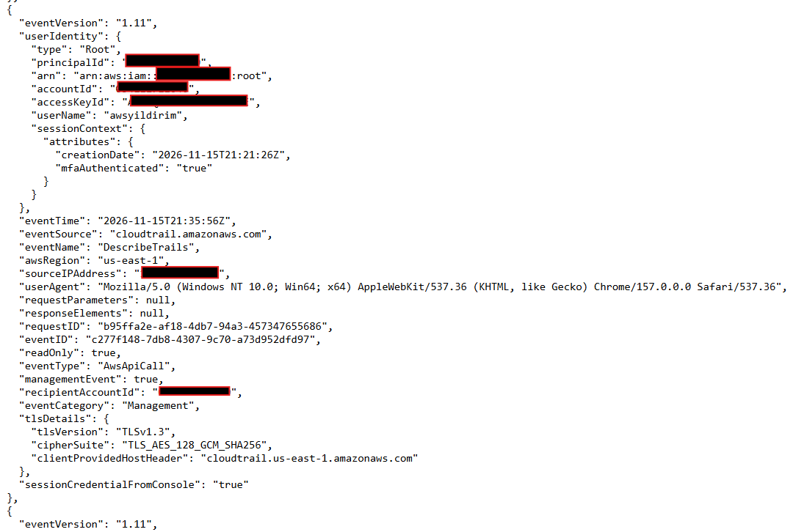</a></td></tr></table>

<p><sub><strong>Screenshot 08:</strong> Redacted CloudTrail JSON showing the read-only DescribeTrails management event.</sub></p>

> [!IMPORTANT]
> **SAA-C03 EXAM CONNECTION**
>
> CloudTrail log files contain event evidence for auditing and investigation. The S3 log bucket is the delivery destination; Event history is a separate, regional search interface for recent management events.

---

## 04 Auditing Write Management Events

### 4.1 Filtering Event History

I opened **CloudTrail → Event history** in `us-east-1` and selected the filter **Read-only = false**. The results included several changes made during setup:

| Event name | Activity reflected in Event history |
| --- | --- |
| `CreateTrail` | Creation of `SYcloudtrail`. |
| `StartLogging` | Start of trail logging. |
| `PutEventSelectors` | Configuration of management-event selectors. |
| `CreateBucket` | Creation of the new S3 log bucket. |
| `PutBucketPolicy` | Update to the bucket policy. |
| `PutBucketEncryption` | Configuration of bucket encryption. |

The console also displayed other account activity, but I focused the verification on the events associated with this exercise.

<table><tr><td align="center"><a href="images/screenshot-09.png">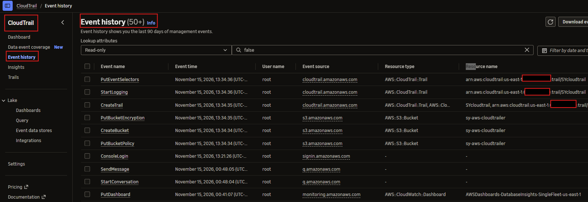</a></td></tr></table>

<p><sub><strong>Screenshot 09:</strong> Event history filtered to Write operations, including CreateTrail and S3 configuration events.</sub></p>

### 4.2 Inspecting the `CreateTrail` Record

I selected the `CreateTrail` event and inspected its details. The record identified `cloudtrail.amazonaws.com` as the event source, `us-east-1` as the Region, and **Read-only = false**. The event time displayed in the console was **November 15, 2026, 13:34:35 (UTC−08:00)**.

The event also displayed an AWS access key field and source IP address, which I redacted for the public screenshot. No error code was shown in the inspected details.

<table><tr><td align="center"><a href="images/screenshot-10.png">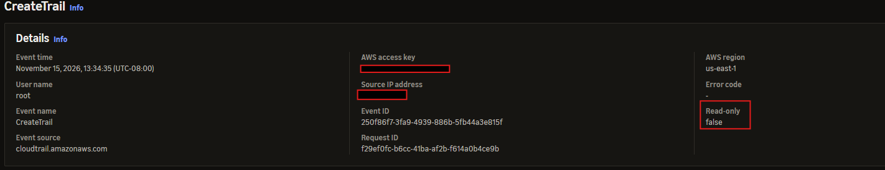</a></td></tr></table>

<p><sub><strong>Screenshot 10:</strong> CreateTrail event details confirming read-only = false.</sub></p>

> [!NOTE]
> **KEY TAKEAWAY**
>
> Comparing `DescribeTrails` (`readOnly: true`) with `CreateTrail` (`readOnly: false`) shows how CloudTrail distinguishes information retrieval from configuration changes.

---

## 05 Auditing IAM User Sign-In and S3 Changes

### 5.1 Generating a Deliberate Audit Event

For an additional practical test, I signed in to the AWS Management Console as the IAM user **`awsMaster`**. I opened **Amazon S3 → `sy-aws-cloudtrailer` → Tags** and configured a user-defined bucket tag:

| Tag key | Tag value |
| --- | --- |
| `CloudTrailAuditTest` | `CloudTrailVerified` |

The configuration was entered in the S3 console while the signed-in identity showed `awsMaster`. The account identifier in the account menu was redacted.

<table><tr><td align="center"><a href="images/screenshot-11.png">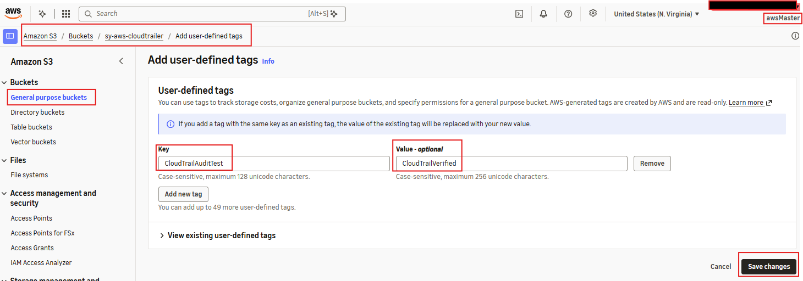</a></td></tr></table>

<p><sub><strong>Screenshot 11:</strong> IAM user awsMaster configuring the CloudTrailAuditTest bucket tag.</sub></p>

I selected **Save changes**. Amazon S3 displayed **Successfully added 1 user-defined tag**, and the new tag appeared in the bucket's user-defined tags list.

<table><tr><td align="center"><a href="images/screenshot-12.png">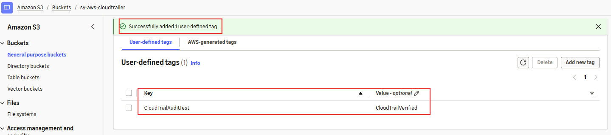</a></td></tr></table>

<p><sub><strong>Screenshot 12:</strong> Amazon S3 confirming the user-defined tag was successfully added.</sub></p>

### 5.2 Finding the IAM User's Management Events

I returned to **CloudTrail → Event history**, filtered on **Read-only = false**, and found these operations associated with `awsMaster`:

| Event | Time shown (UTC−08:00) | What the record showed |
| --- | --- | --- |
| `ConsoleLogin` | November 15, 2026, 13:56:32 | Console sign-in event for `awsMaster`. |
| `ChangePassword` | November 15, 2026, 13:56:51 | IAM password-change API event for `awsMaster`. |
| `TagResource` | November 15, 2026, 14:00:08 | S3 tagging API event for `awsMaster`. |

The displayed `ConsoleLogin` and `ChangePassword` entries are useful additional audit evidence: they show that CloudTrail Event history recorded both account sign-in activity and a password-change operation associated with the user. I did **not** inspect the complete `ChangePassword` record in this exercise, so the event listing itself is not used as evidence for additional details about the password or the API response.

`TagResource` was the actual event name recorded for the S3 console's tagging operation. Although the tagging action was expected conceptually as a bucket-tag change, I documented the event name **observed in CloudTrail** rather than substituting a different API name.

<table><tr><td align="center"><a href="images/screenshot-13.png">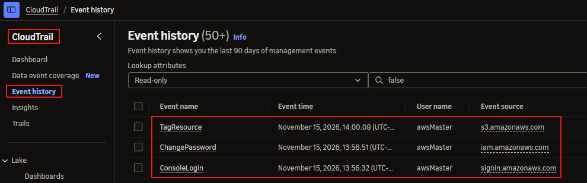</a></td></tr></table>

<p><sub><strong>Screenshot 13:</strong> Event history showing TagResource, ChangePassword, and ConsoleLogin for awsMaster.</sub></p>

### 5.3 Correlating the `TagResource` JSON Record

I opened the `TagResource` event and inspected its JSON record. It provided the association between the IAM identity, the API call, and the S3 resource:

| Field | Verified content |
| --- | --- |
| `userIdentity.type` | `IAMUser` |
| `userIdentity.userName` | `awsMaster` |
| `eventSource` | `s3.amazonaws.com` |
| `eventName` | `TagResource` |
| `eventTime` | `2026-11-15T22:00:08Z` |
| `awsRegion` | `us-east-1` |
| `requestParameters.bucketName` | `sy-aws-cloudtrailer` |
| Tag key | `CloudTrailAuditTest` |
| Tag value | `CloudTrailVerified` |

This is stronger evidence than the event name alone because it connects a **specific IAM identity**, **specific bucket**, and **specific tag values**. The screenshot retains those technical fields but masks account and credential identifiers.

<table><tr><td align="center"><a href="images/screenshot-14.png">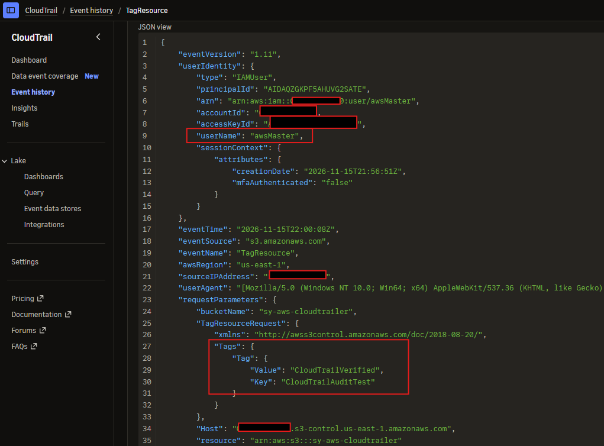</a></td></tr></table>

<p><sub><strong>Screenshot 14:</strong> Redacted TagResource JSON record identifying awsMaster, the bucket, and exact tag values.</sub></p>

### 5.4 Result of the IAM Audit Test

The deliberate tagging test produced a verifiable sequence: I entered a bucket tag as `awsMaster`, Amazon S3 confirmed the change, and CloudTrail Event history recorded the associated `TagResource` operation. The event JSON contained the same bucket and tag values.

The same Event history view also displayed **`ConsoleLogin`** and **`ChangePassword`** records under `awsMaster`. Together these observations illustrate identity-based auditing of authentication-related activity and AWS resource configuration changes.

> [!IMPORTANT]
> **SAA-C03 EXAM CONNECTION**
>
> The `userIdentity` section can help attribute API activity to the IAM principal associated with a request. Compare `eventName`, `eventTime`, `eventSource`, `awsRegion`, `readOnly`, and `requestParameters` when investigating a specific change.

---

## 06 Troubleshooting, Security and Cost Considerations

### 6.1 What I Verified and What I Did Not

| Observation | Evidence | Boundary |
| --- | --- | --- |
| Trail creation | Success notification and trail listing | Does not alone prove log delivery. |
| Logging enabled | `SYcloudtrail` showed **Logging** | Last delivery time initially showed `-`. |
| S3 delivery | A `.json.gz` object appeared in the bucket | Only the inspected `us-east-1` daily folder was verified. |
| Read event | JSON contained `DescribeTrails`, `readOnly: true` | Did not claim every service event was captured. |
| Write event | Event history showed `CreateTrail`, `readOnly: false` | CloudTrail Event history is regional. |
| IAM attribution | `TagResource` JSON matched `awsMaster` and the tag | Password-change API response was not examined. |

### 6.2 Useful Technical Distinctions

- **Event history versus a trail.** Event history displays the most recent 90 days of management events in an AWS Region. The trail delivered selected management events to S3 for stored log analysis.
- **Read versus Write.** `DescribeTrails` retrieved configuration information; `CreateTrail` and `TagResource` represented changes. The record fields—not assumptions from the names—were used in verification.
- **S3 bucket management versus object data operations.** This exercise used bucket configuration operations. We did not enable CloudTrail data events for object-level activity.
- **Expected event name versus recorded event name.** The S3 console generated `TagResource`; the event record was treated as the authoritative observation for this exercise.

### 6.3 Production and Cost Notes

The first copy of management events delivered through a trail can be free of CloudTrail event charges, but **S3 storage and requests are separate charges**, and additional copies or event types can be billable. Actual charges depend on account usage and applicable pricing.

For this short exercise I left log file validation and optional SSE-KMS configuration disabled, matching the demonstrated settings. A production audit design should consider log file integrity validation, carefully controlled access to the log bucket, appropriate encryption and retention, and alerting requirements. Disabling the optional SSE-KMS setting does not mean log objects are deliberately stored without encryption; the bucket's actual encryption configuration should be reviewed separately.

> [!CAUTION]
> **Public repository hygiene:** Do not publish full CloudTrail JSON containing AWS account numbers or actual credentials. The selected screenshots obscure AWS account IDs, the access key ID, and the source IP. IAM usernames and API names were intentionally left visible for technical clarity.

---

## 07 Resource Cleanup Procedure

The following steps describe the **planned teardown** of the two temporary resources from this exercise. They have **not yet been performed** at the time of preparing this guide. Once the cleanup is completed, this section should be updated with the actual results and any cleanup screenshots.

### 7.1 Delete the CloudTrail Trail

1. Open **AWS CloudTrail → Trails** in the trail's home Region, `us-east-1`.
2. Select **`SYcloudtrail`** and open the trail details page.
3. Choose **Delete** and review the deletion confirmation.
4. Delete the trail, then verify it is absent from the Trails list.

> [!WARNING]
> Deleting the trail stops its configured S3 log delivery, **but it does not delete the existing S3 logs or bucket**. Those require a separate cleanup step.

### 7.2 Empty the Dedicated S3 Log Bucket

1. Open **Amazon S3 → General purpose buckets**.
2. Select **`sy-aws-cloudtrailer`** and verify it is the bucket used for this lab.
3. Use **Empty** to remove the CloudTrail log objects from all its Region/date folders.
4. Review the confirmation carefully. If versioning is enabled, ensure old object versions and delete markers are handled as required.
5. Verify the bucket is empty before deleting it.

The `CloudTrailAuditTest` tag does not need separate removal if the entire bucket is deleted.

### 7.3 Delete the S3 Bucket

1. Return to **Amazon S3 → Buckets**.
2. Select **`sy-aws-cloudtrailer`**.
3. Choose **Delete**, confirm the exact bucket name, and complete the deletion.
4. Verify the bucket no longer appears in the bucket list.

### 7.4 Verify the Cleanup

- [ ] `SYcloudtrail` is absent from **CloudTrail → Trails**.
- [ ] `sy-aws-cloudtrailer` is absent from **S3 → Buckets**.
- [ ] No separate log destination, notification, or other **Lab 06** resources remain.

**Note:** CloudTrail Event history is a built-in feature separate from the trail. Deleting `SYcloudtrail` does not manually erase the normal 90-day management-event history.

---

## 08 SAA-C03 Review and Technical Competencies

### 8.1 Knowledge Check

> [!TIP]
> **1. Does an AWS account need a configured trail before CloudTrail Event history can display management events?**
>
> **Answer: No.** Event history is available independently; a trail configures delivery of selected events, such as to S3.
>
> **2. Which field helps distinguish a read-only API operation from a resource change?**
>
> **Answer: `readOnly`.** It was `true` for `DescribeTrails` and `false` for `CreateTrail` in the observed event details.
>
> **3. How did I prove the S3 tag change came from `awsMaster`?**
>
> **Answer:** The `TagResource` event included `userIdentity.userName`, the target bucket name, and the matching tag key/value in `requestParameters`.
>
> **4. Does deleting a CloudTrail trail also delete its S3 bucket?**
>
> **Answer: No.** The destination bucket and previously delivered log objects must be removed separately when no longer required.

### 8.2 Technical Competencies Demonstrated

| Skill | Evidence from the exercise |
| --- | --- |
| CloudTrail configuration | Created `SYcloudtrail` as a multi-Region management-event trail. |
| S3 logging destination | Created and verified `sy-aws-cloudtrailer` as the log bucket. |
| Event selection | Enabled both Read and Write management events. |
| Log file verification | Located a `.json.gz` CloudTrail object in the expected S3 folder. |
| Audit JSON interpretation | Inspected the `DescribeTrails` and `TagResource` event records. |
| Event history analysis | Identified `CreateTrail`, `ConsoleLogin`, `ChangePassword`, and other event names. |
| IAM action attribution | Matched `awsMaster` to an S3 tag operation using CloudTrail JSON fields. |
| Security-conscious documentation | Redacted AWS account IDs and sensitive values from published evidence. |

### 8.3 Final Technical Reflection

By the end of the hands-on portion, I had verified both **CloudTrail delivery to Amazon S3** and **Event history auditing of individual AWS activities**. The combination of Read/Write comparisons, JSON inspection, and a deliberately generated IAM user action provided concrete evidence of how CloudTrail helps reconstruct changes within an AWS environment.

The trail and S3 log bucket remain subject to the cleanup procedure in Section 07.

### AWS Documentation

- [Working with CloudTrail event history](https://docs.aws.amazon.com/awscloudtrail/latest/userguide/view-cloudtrail-events.html)
- [Understanding CloudTrail events](https://docs.aws.amazon.com/awscloudtrail/latest/userguide/cloudtrail-events.html)
- [Deleting a trail with the CloudTrail console](https://docs.aws.amazon.com/awscloudtrail/latest/userguide/cloudtrail-delete-trails-console.html)
- [AWS CloudTrail FAQ — Pricing](https://aws.amazon.com/cloudtrail/faqs/)
