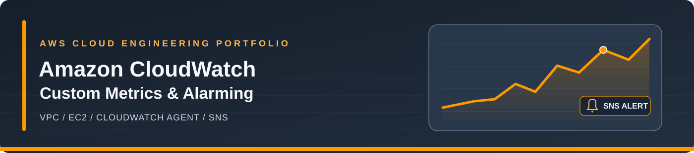

# Amazon CloudWatch Custom Metrics and Alarming Lab
**MONITORING / AMAZON CLOUDWATCH / AMAZON VPC / EC2 / AMAZON LINUX 2023 / IAM / CLOUDWATCH AGENT / AMAZON SNS**

In this exercise, I created an isolated Amazon VPC and configured its public subnet, internet gateway, route table and EC2 security group from scratch. I deployed an Amazon Linux 2023 instance with an EC2 IAM role, established SSH access, installed the Amazon CloudWatch Agent, and configured it to publish three custom operating-system memory metrics.

I verified memory utilization, memory used and memory available in the CloudWatch metrics console. To validate automated observability, I configured an Amazon SNS email subscription and a CloudWatch alarm. A real memory datapoint breached the temporary test threshold, the alarm transitioned to **ALARM**, and the SNS notification arrived in my email inbox.

The VPC configuration provides a reproducible network foundation, including the resource relationships and console settings required to deploy EC2 workloads in a public subnet.

---

## Contents

- [01 Objectives, Architecture and Core Concepts](#01-objectives-architecture-and-core-concepts)
- [02 Building the VPC Networking Foundation](#02-building-the-vpc-networking-foundation)
- [03 Creating the EC2 Security Group and IAM Role](#03-creating-the-ec2-security-group-and-iam-role)
- [04 Launching and Verifying Amazon EC2](#04-launching-and-verifying-amazon-ec2)
- [05 Installing and Configuring the CloudWatch Agent](#05-installing-and-configuring-the-cloudwatch-agent)
- [06 Verifying Custom Memory Metrics](#06-verifying-custom-memory-metrics)
- [07 Configuring Amazon SNS Email Notifications](#07-configuring-amazon-sns-email-notifications)
- [08 Creating and Testing the CloudWatch Alarm](#08-creating-and-testing-the-cloudwatch-alarm)
- [09 Resource Teardown Procedure](#09-resource-teardown-procedure)
- [10 SAA-C03 Exam Review and Production Considerations](#10-saa-c03-exam-review-and-production-considerations)
- [11 Technical Competencies and Skills Matrix](#11-technical-competencies-and-skills-matrix)
- [12 Consolidated Command Reference and AWS Documentation](#12-consolidated-command-reference-and-aws-documentation)

## Architecture Highlight

<table><tr><td align="center"><a href="../../Labs/Lab07-CloudWatch-Custom-Metrics/images/cloudwatch-monitoring-architecture.png">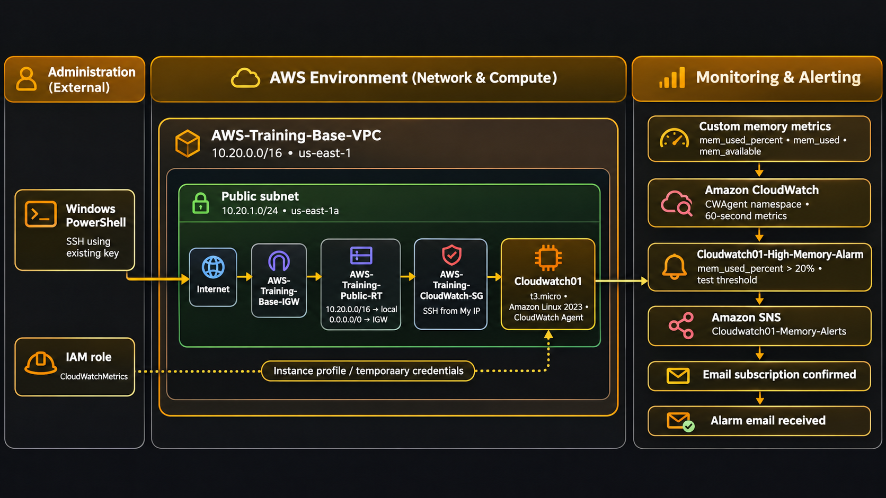</a></td></tr></table>

<p><sub><strong>Architecture:</strong> Amazon Linux EC2 in the public subnet publishes custom memory metrics to Amazon CloudWatch. A threshold breach changes the alarm state and invokes the SNS topic to email the confirmed subscriber.</sub></p>

The internet gateway and public route table are VPC networking components (the diagram groups them visually with the public-subnet traffic path); the EC2 instance and its security group are associated with the public subnet. The internet gateway and public route support the instance's direct internet connectivity. A separate IAM role provides permissions for the agent to publish metrics, and SNS provides delivery of CloudWatch alarm notifications to a confirmed email endpoint. The diagram represents the implementation used for the exercise; it does not depict additional networks, services or resources.

---

## 01 Objectives, Architecture and Core Concepts

### 1.1 Purpose and Objectives

The implementation connected network provisioning, operating-system monitoring, metric-based alerting and email delivery. Its measurable outcomes were: a functional VPC foundation; a reachable Linux EC2 instance; successful CloudWatch Agent configuration; three visible memory metrics with datapoints; and an alarm notification generated by a genuine threshold breach.

### 1.2 Understanding Amazon CloudWatch

**Amazon CloudWatch** is AWS's monitoring and observability service. It helps engineers understand the operational health and performance of AWS resources and applications by collecting measurements, displaying trends, analyzing logs and evaluating alarms. CloudWatch is used to detect performance problems, investigate incidents, monitor workloads over time and initiate notifications or automated responses when predefined conditions occur.

| CloudWatch capability | What it does |
| --- | --- |
| **Metrics** | Stores numerical measurements as time-series data, such as CPU utilization, memory usage and request counts. |
| **Logs** | Collects, stores and searches application or system log events using CloudWatch Logs. |
| **Alarms** | Evaluates metric data against thresholds and can invoke an action when alarm state changes. |
| **Dashboards** | Presents selected metrics, graphs and alarms in a consolidated operational view. |
| **CloudWatch Agent** | Runs inside supported servers to collect additional operating-system metrics and, when configured, log data. |

For an EC2 instance, the built-in service metrics include CPU utilization and networking measurements, but **guest-operating-system memory is not automatically included**. In this exercise, the CloudWatch Agent published three memory metrics from Amazon Linux 2023 into the `CWAgent` namespace. CloudWatch then evaluated `mem_used_percent`, and Amazon SNS delivered an email notification after the alarm entered the `ALARM` state.

### 1.3 Real-World Use Cases

| Use case | Practical example |
| --- | --- |
| **Server performance monitoring** | Observe CPU, memory and network trends to identify a resource bottleneck on an EC2 server. |
| **Proactive incident alerting** | Send an operations notification when memory usage, latency or error rate exceeds a defined limit. |
| **Application health monitoring** | Track application-specific metrics such as failed requests, transaction counts or queue-processing time. |
| **Troubleshooting and incident response** | Correlate metric spikes with system or application log entries to investigate an outage. |
| **Capacity planning** | Review historical utilization to determine whether an instance needs more or less compute capacity. |
| **Operational visibility** | Combine important workload metrics and alarm states on dashboards used by engineering teams. |

This implementation specifically demonstrated **server monitoring and proactive alerting**: an EC2 memory measurement exceeded a temporary test threshold, CloudWatch changed the alarm state, and SNS delivered the corresponding email.

### 1.4 Key Concepts and Definitions

| Term | Definition |
| --- | --- |
| **Metric** | A numerical measurement tracked over time, such as memory utilization or CPU usage. |
| **Datapoint** | A measurement value recorded at a particular time. |
| **Namespace** | A logical container that groups related metrics; the agent used `CWAgent`. |
| **Dimension** | A name/value label that identifies the metric's context; `InstanceId` identified `Cloudwatch01`. |
| **Statistic** | An aggregation applied to metric samples, such as `Average`, `Sum`, `Minimum` or `Maximum`. |
| **Period** | The time interval over which CloudWatch aggregates the selected metric samples; the alarm used 60 seconds. |
| **Default EC2 metric** | A measurement automatically reported by Amazon EC2, such as `CPUUtilization`. |
| **Custom metric** | A measurement published by an application or monitoring agent rather than automatically supplied as a default EC2 metric. |
| **CloudWatch Agent** | AWS monitoring software installed on a host to collect additional operating-system metrics, including memory measurements. |
| **Alarm threshold** | The value and comparison rule used to identify a condition requiring attention. |
| **Evaluation period** | The period or set of periods whose datapoints CloudWatch examines to determine an alarm's state. |
| **Alarm states** | `OK` means the evaluated condition is not breaching; `ALARM` means the alarm condition is met; `INSUFFICIENT_DATA` means there is not enough data to evaluate confidently. |
| **Amazon SNS** | A publish/subscribe messaging service that can deliver CloudWatch alarm notifications to confirmed endpoints, such as email. |
| **AWS CloudTrail** | An auditing service that records supported account and API activity; it serves a different purpose from CloudWatch performance monitoring. |

**CloudWatch versus CloudTrail:** CloudWatch answers questions such as *“How is the server performing, and should we alert?”* CloudTrail answers questions such as *“Which identity performed this AWS API operation, and when?”* The existing CloudTrail trail was independent of this monitoring implementation.

The alarm in this exercise used `Average` memory utilization over a **one-minute period** and a deliberately low test condition of **greater than 20% for one out of one datapoints**. It is a reproducible alert-delivery test, not a recommended production high-memory threshold. CloudWatch triggered its configured SNS action when the alarm changed from `INSUFFICIENT_DATA` to `ALARM`.

### 1.5 Implemented Resource Inventory

| Component | Observed configuration |
| --- | --- |
| AWS Region | `us-east-1` — US East (N. Virginia) |
| VPC | `AWS-Training-Base-VPC` — `vpc-044498ea73ae9fe82` |
| VPC CIDR | `10.20.0.0/16` |
| Public subnet | `AWS-Training-Public-Subnet-1` — `subnet-0d5d82ce1f46e1160` |
| Subnet CIDR and AZ | `10.20.1.0/24`, `us-east-1a` |
| Internet gateway | `AWS-Training-Base-IGW` — `igw-06994a411d12da9ab` |
| Public route table | `AWS-Training-Public-RT` — `rtb-04a04df480a616210` |
| EC2 security group | `AWS-Training-CloudWatch-SG` — `sg-010dd80898f7d0447` |
| EC2 IAM role | `CloudWatchMetrics` with `CloudWatchAgentServerPolicy` |
| Instance | `Cloudwatch01` — `i-03d707c51601ee52b` |
| AMI | Amazon Linux 2023, x86_64 — `ami-096ef200a87f736af` |
| Instance class / EBS | `t3.micro`, 8 GiB gp3 root volume |
| EC2 private/public IP at validation | `10.20.1.7` / `34.229.245.225` |
| Existing SSH key pair | `npoweraws` |
| CloudWatch namespace | `CWAgent` |
| Memory metrics | `mem_used_percent`, `mem_used`, `mem_available` |
| SNS topic | `Cloudwatch01-Memory-Alerts` (Standard) |
| CloudWatch alarm | `Cloudwatch01-High-Memory-Alarm` |

> [!IMPORTANT]
> **SAA-C03 EXAM CONNECTION**
>
> A VPC spans a Region, while an individual subnet resides in one Availability Zone. A public subnet must use a route table with an internet-gateway route. IPv4 connectivity from an EC2 instance additionally requires appropriate public addressing and security rules.

---


## 02 Building the VPC Networking Foundation

### 2.1 Creating the VPC

I opened **VPC → Your VPCs → Create VPC** in `us-east-1` and selected **VPC only** so that networking components could be configured explicitly rather than generated by the combined wizard.

| VPC creation setting | Selected value |
| --- | --- |
| Resources to create | VPC only |
| Name tag | `AWS-Training-Base-VPC` |
| IPv4 CIDR input | Manual |
| IPv4 CIDR | `10.20.0.0/16` |
| IPv6 CIDR | No IPv6 CIDR block |
| Tenancy | Default |
| VPC encryption control | None |

The `/16` network contains 65,536 IPv4 addresses in the CIDR range. I selected **Create VPC** and verified its assigned ID `vpc-044498ea73ae9fe82` and **Available** state. The VPC details showed DNS resolution enabled and DNS hostnames disabled at this stage; the direct-IP access used in this exercise did not require changing DNS hostnames.

<table><tr><td align="center"><a href="images/screenshot-01.png">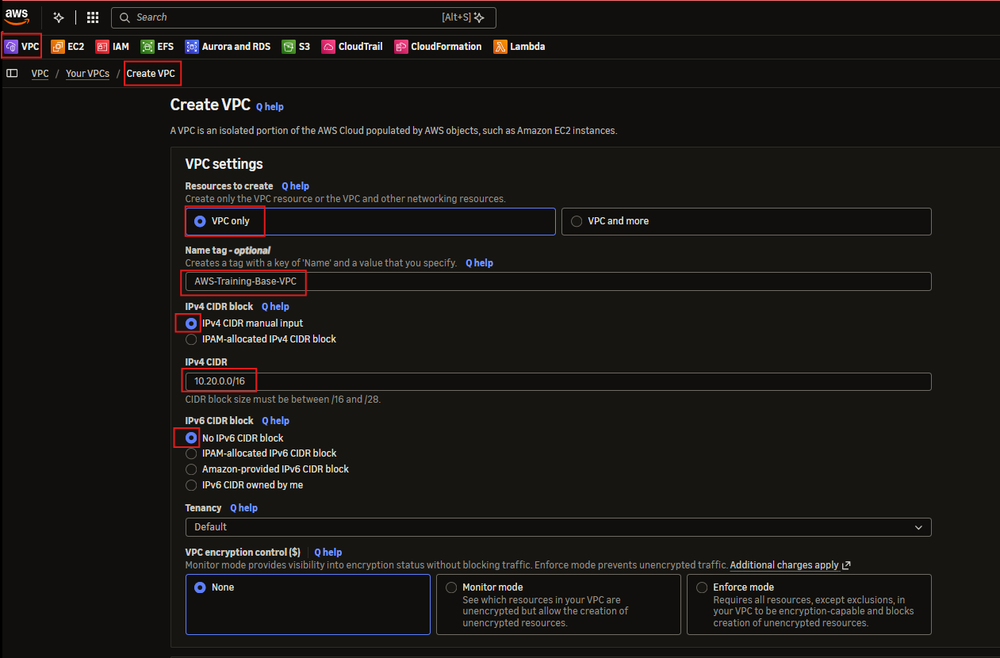</a></td></tr></table>

<p><sub><strong>Screenshot 01:</strong> VPC-only creation settings with AWS-Training-Base-VPC and IPv4 CIDR 10.20.0.0/16.</sub></p>

<table><tr><td align="center"><a href="images/screenshot-02.png">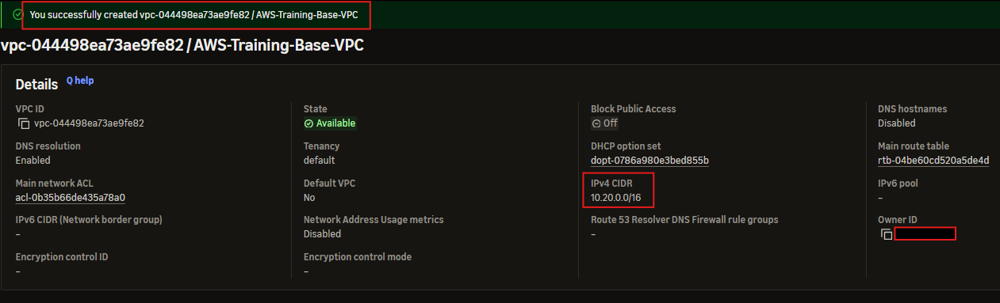</a></td></tr></table>

<p><sub><strong>Screenshot 02:</strong> Successful VPC creation with Available status and the assigned VPC ID.</sub></p>

### 2.2 Creating the Public Subnet

I used **VPC → Subnets → Create subnet**, selected the newly created VPC and entered the following values:

| Subnet setting | Selected value |
| --- | --- |
| Name | `AWS-Training-Public-Subnet-1` |
| VPC | `AWS-Training-Base-VPC` |
| Availability Zone | `us-east-1a` |
| VPC CIDR block | `10.20.0.0/16` |
| Subnet IPv4 CIDR | `10.20.1.0/24` |

A `/24` contains 256 IPv4 addresses. AWS reserves five addresses per subnet, leaving 251 usable host addresses in this subnet. After creating it, I verified the subnet ID `subnet-0d5d82ce1f46e1160`, the **Available** state and the expected VPC association.

<table><tr><td align="center"><a href="images/screenshot-03.png">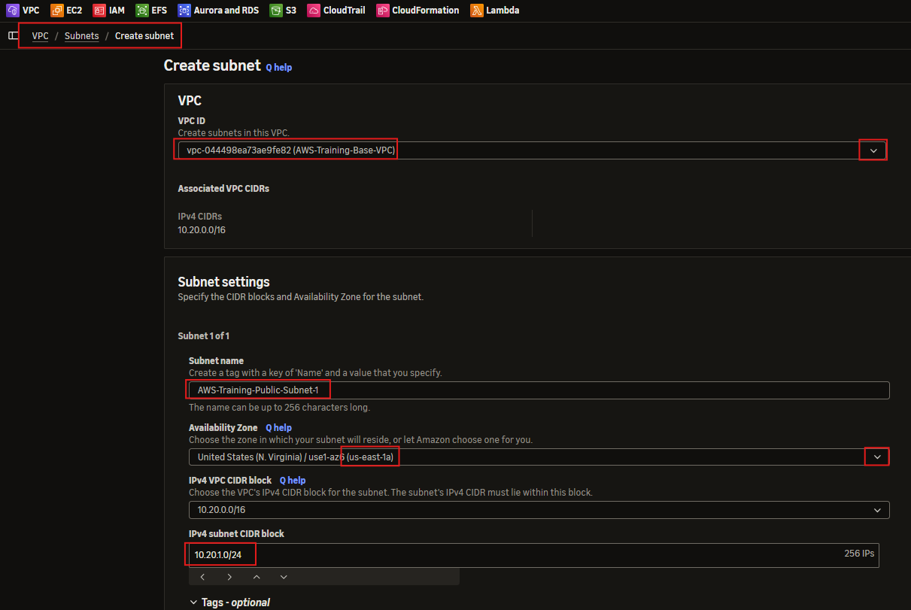</a></td></tr></table>

<p><sub><strong>Screenshot 03:</strong> Public subnet creation with VPC selection, us-east-1a and 10.20.1.0/24.</sub></p>

<table><tr><td align="center"><a href="images/screenshot-04.png">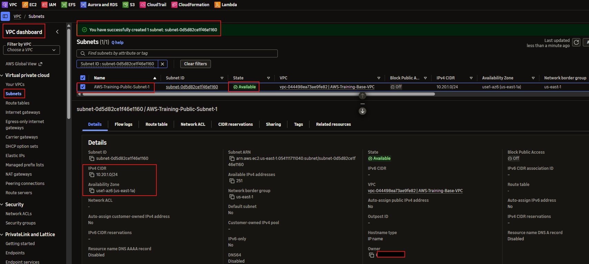</a></td></tr></table>

<p><sub><strong>Screenshot 04:</strong> Successful public subnet creation showing the new subnet ID and 251 available IPv4 addresses.</sub></p>

### 2.3 Creating and Attaching the Internet Gateway

I opened **VPC → Internet gateways → Create internet gateway** and entered `AWS-Training-Base-IGW` as the Name tag. The gateway was created with ID `igw-06994a411d12da9ab`. It initially appeared in the **Detached** state.

<table><tr><td align="center"><a href="images/screenshot-05.png">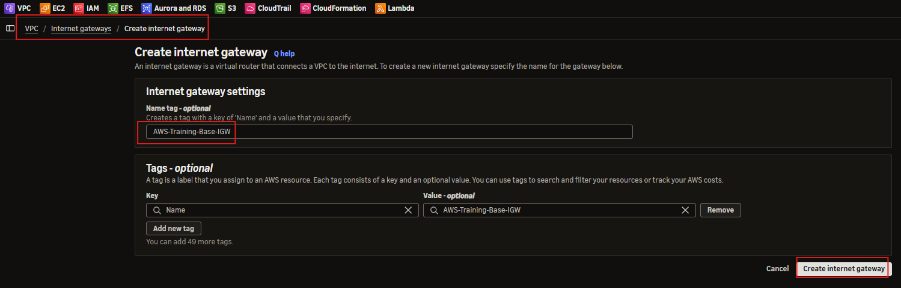</a></td></tr></table>

<p><sub><strong>Screenshot 05:</strong> Internet Gateway creation form with the AWS-Training-Base-IGW Name tag.</sub></p>

<table><tr><td align="center"><a href="images/screenshot-06.png">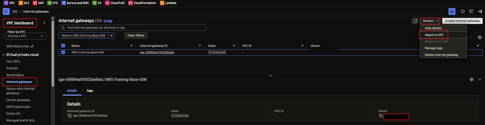</a></td></tr></table>

<p><sub><strong>Screenshot 06:</strong> New Internet Gateway in Detached state and the Attach to VPC action.</sub></p>

I then chose **Actions → Attach to VPC**, selected `AWS-Training-Base-VPC` and confirmed the attachment. The resulting gateway details displayed **Attached** and the correct VPC ID.

<table><tr><td align="center"><a href="images/screenshot-07.png">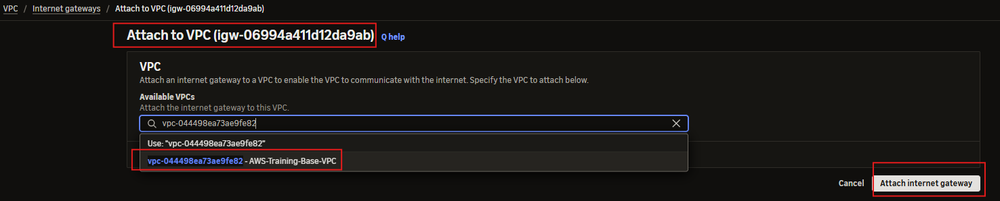</a></td></tr></table>

<p><sub><strong>Screenshot 07:</strong> Selecting AWS-Training-Base-VPC as the Internet Gateway attachment target.</sub></p>

<table><tr><td align="center"><a href="images/screenshot-08.png">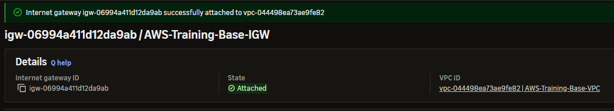</a></td></tr></table>

<p><sub><strong>Screenshot 08:</strong> Successful Internet Gateway attachment showing the VPC association and Attached state.</sub></p>

An internet gateway is attached to a VPC rather than an individual subnet. Its presence alone does not make a subnet public; routing determines which subnet traffic can reach it.

### 2.4 Creating the Dedicated Public Route Table

I opened **VPC → Route tables → Create route table**, named the resource `AWS-Training-Public-RT` and selected `AWS-Training-Base-VPC`. AWS created `rtb-04a04df480a616210` with the automatic route for the VPC CIDR.

<table><tr><td align="center"><a href="images/screenshot-09.png">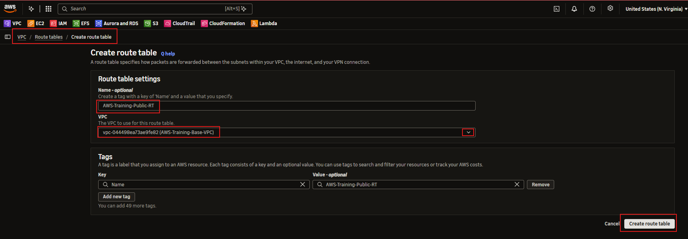</a></td></tr></table>

<p><sub><strong>Screenshot 09:</strong> Dedicated public route table creation in AWS-Training-Base-VPC.</sub></p>

<table><tr><td align="center"><a href="images/screenshot-10.png">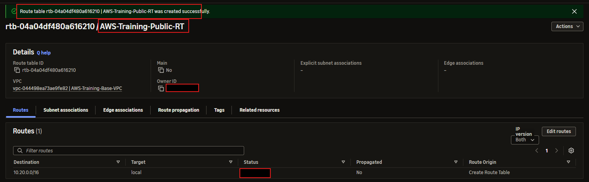</a></td></tr></table>

<p><sub><strong>Screenshot 10:</strong> Successful public route table creation showing the initial VPC-local route.</sub></p>

### 2.5 Adding the Internet Route

On the route table's **Routes** tab, I chose **Edit routes → Add route**. I preserved the existing VPC-local route and added the default IPv4 route targeting the attached internet gateway.

| Destination | Target | Reason |
| --- | --- | --- |
| `10.20.0.0/16` | `local` | Allows routing within the VPC CIDR. |
| `0.0.0.0/0` | `igw-06994a411d12da9ab` | Forwards non-local IPv4 traffic toward the internet gateway. |

The saved route table showed both routes in the **Active** state.

<table><tr><td align="center"><a href="images/screenshot-11.png">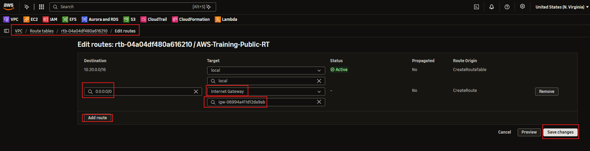</a></td></tr></table>

<p><sub><strong>Screenshot 11:</strong> Adding the default 0.0.0.0/0 route targeting the attached Internet Gateway.</sub></p>

<table><tr><td align="center"><a href="images/screenshot-12.png">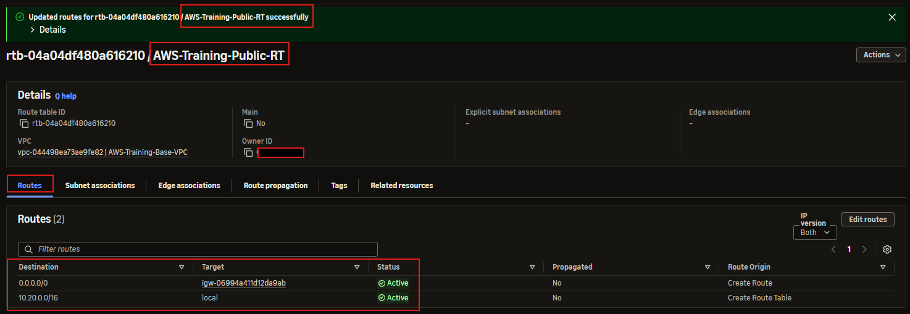</a></td></tr></table>

<p><sub><strong>Screenshot 12:</strong> Public route table with active local and Internet Gateway routes.</sub></p>

### 2.6 Associating the Public Subnet

The route table initially showed zero explicit subnet associations. Under **Subnet associations → Edit subnet associations**, I selected `AWS-Training-Public-Subnet-1` and saved. The route table then showed one explicit association to subnet `subnet-0d5d82ce1f46e1160` with CIDR `10.20.1.0/24`.

<table><tr><td align="center"><a href="images/screenshot-13.png">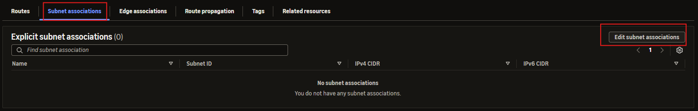</a></td></tr></table>

<p><sub><strong>Screenshot 13:</strong> Subnet associations tab before any explicit public subnet association.</sub></p>

<table><tr><td align="center"><a href="images/screenshot-14.png">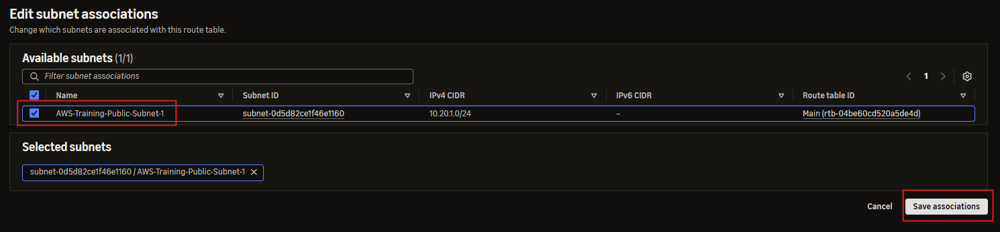</a></td></tr></table>

<p><sub><strong>Screenshot 14:</strong> Selecting AWS-Training-Public-Subnet-1 for association with the public route table.</sub></p>

<table><tr><td align="center"><a href="images/screenshot-15.png">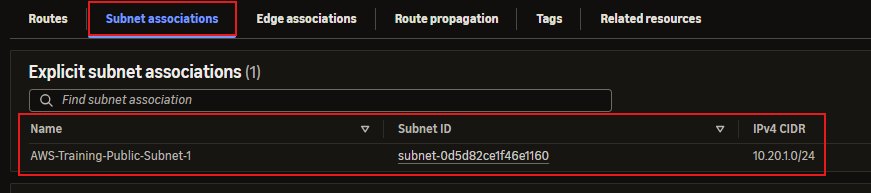</a></td></tr></table>

<p><sub><strong>Screenshot 15:</strong> Public subnet listed as an explicit route table association.</sub></p>

The association, together with the `0.0.0.0/0` internet-gateway route, established the subnet's public IPv4 routing behavior.

### 2.7 Configuring Public IPv4 Assignment

I selected the subnet, opened **Actions → Edit subnet settings**, and selected **Enable auto-assign public IPv4 address**. The instance launch wizard later explicitly selected public IPv4 assignment, and the running EC2 instance had a public IPv4 address.

<table><tr><td align="center"><a href="images/screenshot-16.png">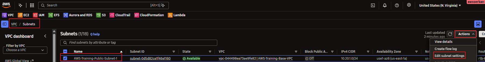</a></td></tr></table>

<p><sub><strong>Screenshot 16:</strong> Opening Edit subnet settings for the created public subnet.</sub></p>

<table><tr><td align="center"><a href="images/screenshot-17.png">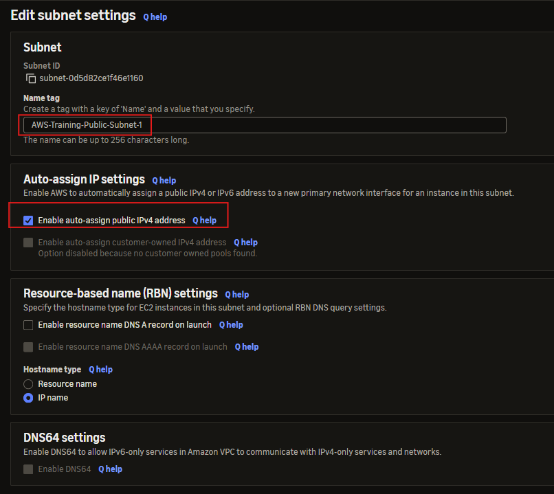</a></td></tr></table>

<p><sub><strong>Screenshot 17:</strong> Selecting Enable auto-assign public IPv4 address in subnet settings.</sub></p>

> [!IMPORTANT]
> **SAA-C03 EXAM CONNECTION**
>
> A subnet is public because of its effective route table, not its name. For EC2 to use the public internet directly over IPv4, the instance also needs a public IPv4 address and applicable allow rules in its security group. An internet gateway is not a substitute for any of those components.

### 2.8 Knowledge Check

> [!TIP]
> **Does a subnet named “Public” have internet connectivity automatically?**
>
> **Answer: No.** Its route table must direct internet-bound traffic to an internet gateway; EC2 public addressing and allowed network traffic are separate requirements.
>
> **Can a VPC contain subnets in more than one Availability Zone?**
>
> **Answer: Yes.** The VPC is regional, and each subnet is confined to a single Availability Zone.

> [!NOTE]
> **KEY TAKEAWAY** — I built the VPC, subnet, gateway, routing and association explicitly. These steps define a standalone reference procedure for public-subnet EC2 networking.

---


## 03 Creating the EC2 Security Group and IAM Role

### 3.1 Creating the EC2 Security Group

In **VPC → Security groups → Create security group**, I created `AWS-Training-CloudWatch-SG` in `AWS-Training-Base-VPC`. The rule set allowed administrative SSH access from my current public IP and retained the default all-IPv4 outbound rule for the instance to retrieve packages and publish metrics.

| Property | Configuration |
| --- | --- |
| Security group name | `AWS-Training-CloudWatch-SG` |
| Security group ID | `sg-010dd80898f7d0447` |
| Description | Security group for CloudWatch monitoring EC2 instance |
| Inbound | SSH, TCP port `22`, source **My IP** (`/32`) |
| Outbound | All traffic, IPv4 destination `0.0.0.0/0` |
| VPC | `AWS-Training-Base-VPC` |

I did not add inbound HTTP or HTTPS rules: the EC2 instance acted as a monitoring host, not a public web server. AWS confirmed the security group was created with one inbound and one outbound permission entry.

<table><tr><td align="center"><a href="images/screenshot-18.png">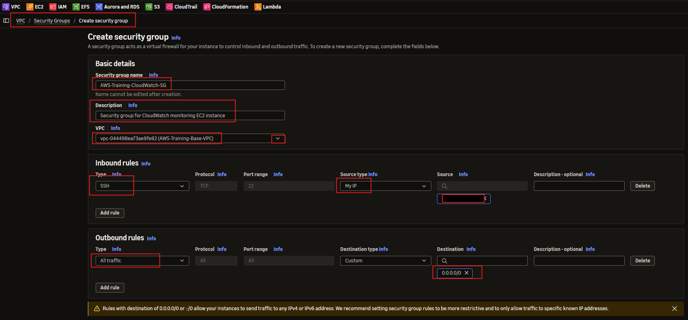</a></td></tr></table>

<p><sub><strong>Screenshot 18:</strong> EC2 security group creation with restricted SSH ingress and default IPv4 egress.</sub></p>

<table><tr><td align="center"><a href="images/screenshot-19.png">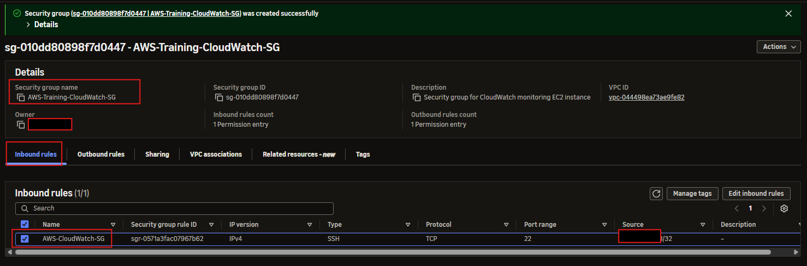</a></td></tr></table>

<p><sub><strong>Screenshot 19:</strong> Successful security group creation with a single inbound SSH rule.</sub></p>

Security groups are **stateful**: response traffic associated with an allowed connection is permitted automatically. Network ACLs operate at the subnet boundary and evaluate rules differently; no custom NACL was needed for this implementation.

### 3.2 Creating an EC2 IAM Service Role

I navigated to **IAM → Roles → Create role** and chose **AWS service** as the trusted entity type, followed by the **EC2** use case.

<table><tr><td align="center"><a href="images/screenshot-20.png">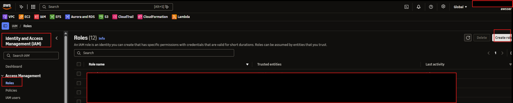</a></td></tr></table>

<p><sub><strong>Screenshot 20:</strong> IAM Roles console before creating the EC2 monitoring role.</sub></p>

<table><tr><td align="center"><a href="images/screenshot-21.png">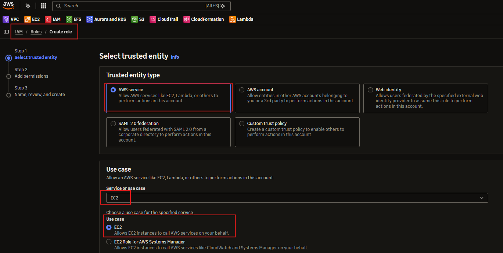</a></td></tr></table>

<p><sub><strong>Screenshot 21:</strong> Role trusted entity configured as AWS service with the EC2 use case.</sub></p>

I selected the AWS-managed `CloudWatchAgentServerPolicy` and created the IAM role named `CloudWatchMetrics` with the description `Allows EC2 CloudWatch Agent to publish monitoring metrics`.

| IAM component | Configuration |
| --- | --- |
| Role name | `CloudWatchMetrics` |
| Trusted service | EC2 (`ec2.amazonaws.com`) |
| Managed permissions policy | `CloudWatchAgentServerPolicy` |
| Instance authentication | Temporary role credentials, supplied via instance profile |

<table><tr><td align="center"><a href="images/screenshot-22.png">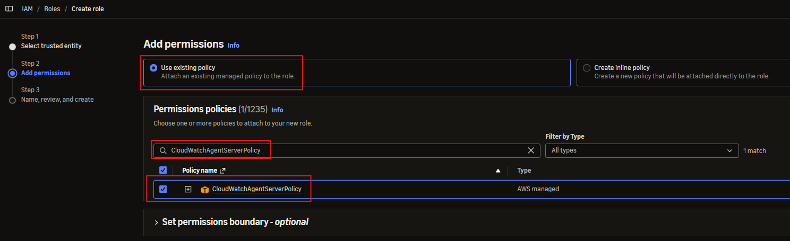</a></td></tr></table>

<p><sub><strong>Screenshot 22:</strong> Selecting the AWS-managed CloudWatchAgentServerPolicy permissions policy.</sub></p>

<table><tr><td align="center"><a href="images/screenshot-23.png">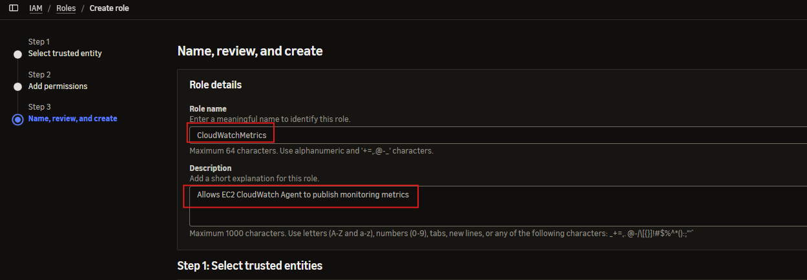</a></td></tr></table>

<p><sub><strong>Screenshot 23:</strong> Setting the CloudWatchMetrics role name and purpose description.</sub></p>

<table><tr><td align="center"><a href="images/screenshot-24.png">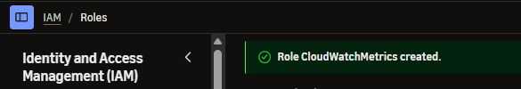</a></td></tr></table>

<p><sub><strong>Screenshot 24:</strong> IAM confirmation that the CloudWatchMetrics role was created.</sub></p>

The CloudWatch Agent requires IAM permission to publish metrics. I attached the AWS-managed `CloudWatchAgentServerPolicy` rather than granting broad CloudWatch administrative permissions. I then assigned the role through an EC2 instance profile, allowing the agent to use temporary credentials without storing long-term access keys on the server.

> [!IMPORTANT]
> **SAA-C03 EXAM CONNECTION**
>
> An IAM role's **trust policy** specifies who may assume it; an attached **permissions policy** specifies which API actions it may perform. An instance profile connects an EC2 instance to the role and provides temporary credentials without embedding access keys in scripts.

### 3.3 Knowledge Check

> [!TIP]
> **Does a security group require a reverse-direction inbound rule for responses to outbound traffic?**
>
> **Answer: No.** Security groups are stateful.
>
> **Does choosing the EC2 trusted entity automatically grant CloudWatch write permissions?**
>
> **Answer: No.** The role still needs a permissions policy such as `CloudWatchAgentServerPolicy`.

---


## 04 Launching and Verifying Amazon EC2

### 4.1 AMI and Instance Configuration

I opened **EC2 → Instances → Launch instances** and entered `Cloudwatch01`. I selected Amazon Linux 2023 (64-bit x86), the `t3.micro` instance class and one instance. The EC2 wizard displayed AMI ID `ami-096ef200a87f736af`.

<table><tr><td align="center"><a href="images/screenshot-25.png">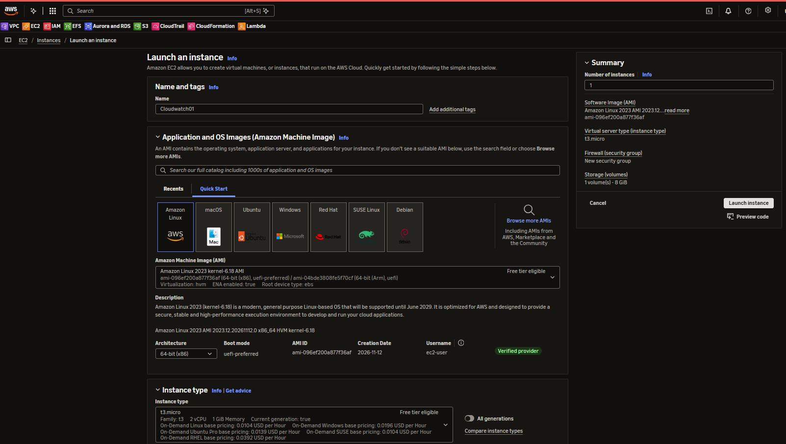</a></td></tr></table>

<p><sub><strong>Screenshot 25:</strong> EC2 launch wizard showing Cloudwatch01, Amazon Linux 2023 and t3.micro.</sub></p>

### 4.2 Key Pair, Networking and Storage

I reused the existing `npoweraws` key pair and selected the VPC and public subnet configured earlier. I explicitly enabled auto-assignment of a public IPv4 address and selected the existing `AWS-Training-CloudWatch-SG` instead of creating a duplicate security group.

| EC2 launch field | Selected configuration |
| --- | --- |
| Key pair | `npoweraws` (existing) |
| VPC | `AWS-Training-Base-VPC` — `vpc-044498ea73ae9fe82` |
| Subnet | `AWS-Training-Public-Subnet-1` — `subnet-0d5d82ce1f46e1160` |
| Auto-assign public IPv4 | Enable |
| Firewall | Select existing security group |
| Security group | `AWS-Training-CloudWatch-SG` |
| Root EBS volume | 8 GiB, gp3 |
| Additional EBS volumes | None |

<table><tr><td align="center"><a href="images/screenshot-26.png">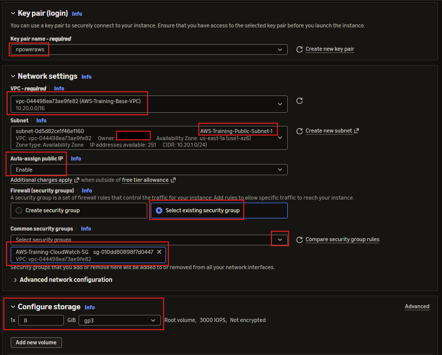</a></td></tr></table>

<p><sub><strong>Screenshot 26:</strong> EC2 key pair, VPC, public subnet, public IPv4, security group and 8 GiB gp3 root storage.</sub></p>

### 4.3 IAM Profile and Instance Metadata Settings

In **Advanced details**, I assigned the `CloudWatchMetrics` instance profile. I used default EC2 host naming, set shutdown behavior to **Stop**, disabled hibernation and termination protection, and left EC2 detailed monitoring disabled. Detailed monitoring changes the frequency of supported default metrics; it does not automatically publish operating-system memory metrics.

<table><tr><td align="center"><a href="images/screenshot-27.png">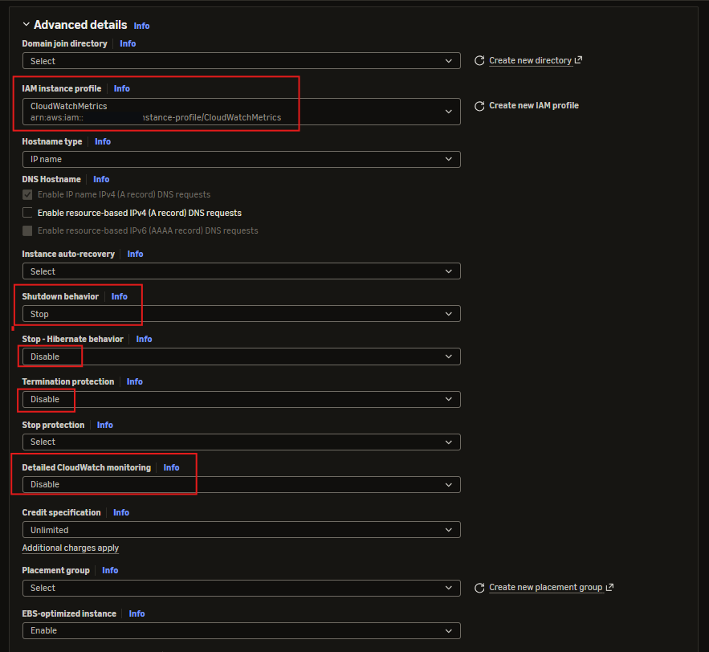</a></td></tr></table>

<p><sub><strong>Screenshot 27:</strong> EC2 advanced details showing the CloudWatchMetrics instance profile and instance lifecycle settings.</sub></p>

I enabled metadata access with **IMDSv2 only (token required)**, set the metadata response hop limit to `1`, disabled instance tags in metadata, and left user data empty. The CloudWatch Agent was installed manually after the EC2 instance started.

<table><tr><td align="center"><a href="images/screenshot-28.png">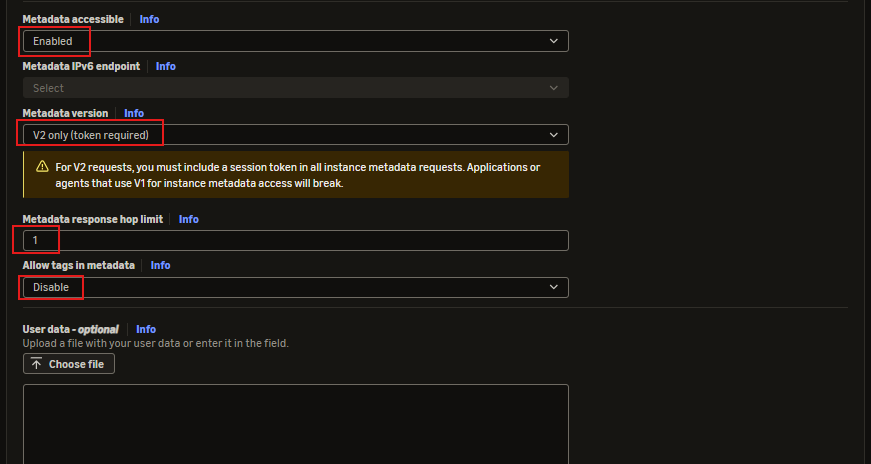</a></td></tr></table>

<p><sub><strong>Screenshot 28:</strong> Advanced EC2 metadata settings requiring IMDSv2, response hop limit 1 and empty user data.</sub></p>

Requiring IMDSv2 strengthens EC2 metadata access by requiring session tokens. A response hop limit of one was appropriate for an agent running directly on the host, without container networking hops.

### 4.4 Instance Launch and Verification

AWS showed `Cloudwatch01` in the **Running** state with **3/3 status checks passed**. The instance was in `us-east-1a` and had instance ID `i-03d707c51601ee52b`.

<table><tr><td align="center"><a href="images/screenshot-29.png">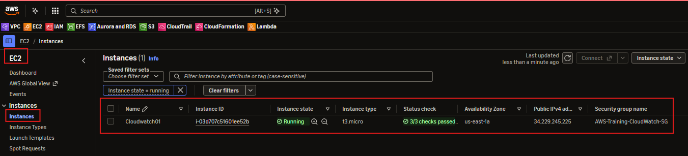</a></td></tr></table>

<p><sub><strong>Screenshot 29:</strong> Cloudwatch01 in Running state with all three EC2 status checks passed.</sub></p>

The instance details page further confirmed the expected VPC, subnet, private IPv4 address `10.20.1.7`, public IPv4 address `34.229.245.225`, `CloudWatchMetrics` IAM role, required IMDSv2 and the reused key pair.

<table><tr><td align="center"><a href="images/screenshot-30.png">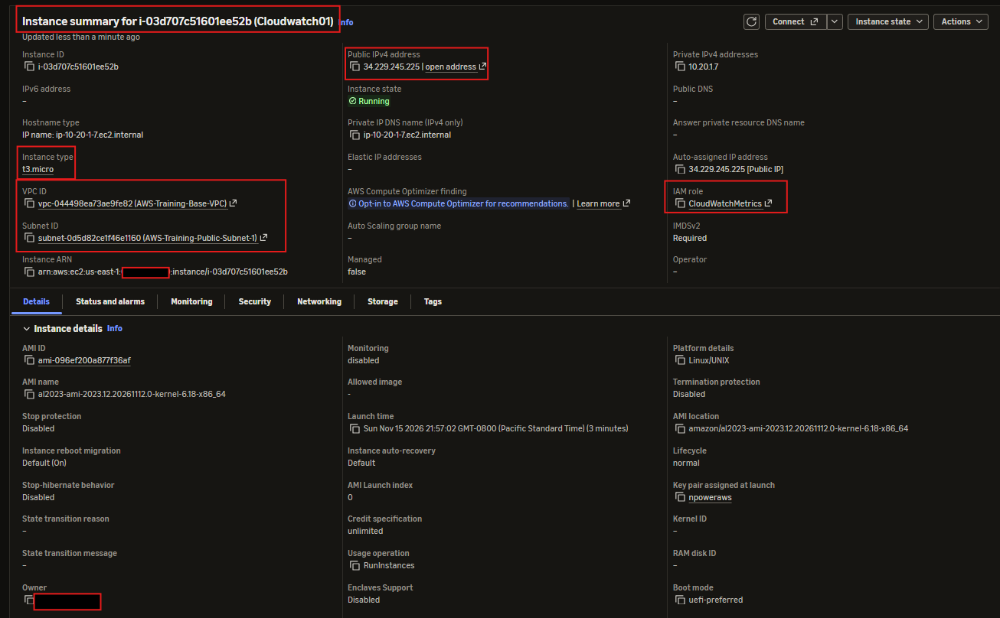</a></td></tr></table>

<p><sub><strong>Screenshot 30:</strong> Instance details showing private and public IPv4, VPC, subnet, IAM role and IMDSv2.</sub></p>

### 4.5 Connecting by SSH and Checking the OS

From Windows PowerShell, I connected to the instance using my existing private key and `ec2-user`. The following is a reproducible example; the key-file path must be substituted with the actual local path to the private key.

```powershell
ssh -i "C:\path\to\npoweraws.pem" ec2-user@34.229.245.225
```

After accepting the first-connection host-key prompt, I used the following command to identify the Linux release:

```bash
cat /etc/os-release
```

The terminal reported **Amazon Linux 2023**, `VERSION_ID="2023"`, `PLATFORM_ID="platform:al2023"` and a release string of `Amazon Linux 2023.12.20261112`.

<table><tr><td align="center"><a href="images/screenshot-31.png">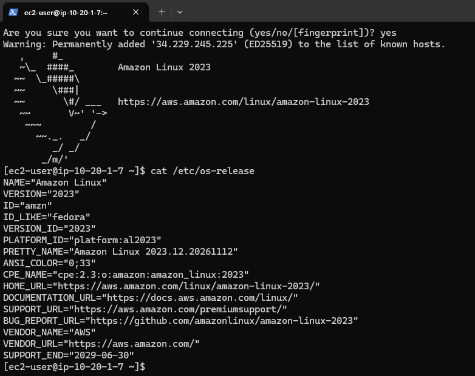</a></td></tr></table>

<p><sub><strong>Screenshot 31:</strong> SSH session established and Amazon Linux 2023 OS release verified.</sub></p>

> [!NOTE]
> **KEY TAKEAWAY** — The instance's successful SSH session and EC2 detail page verified the networking, access rules and basic launch configuration. Its IAM instance profile supplied the identity used by the monitoring agent.

---


## 05 Installing and Configuring the CloudWatch Agent

### 5.1 Installing the Agent

I installed the Amazon CloudWatch Agent on Amazon Linux 2023 through the system package manager and queried the RPM database to verify the package:

```bash
sudo dnf install -y amazon-cloudwatch-agent
rpm -q amazon-cloudwatch-agent
```

The installation completed successfully. The package query returned `amazon-cloudwatch-agent-1.300073.2-1.amzn2023.x86_64`.

<table><tr><td align="center"><a href="images/screenshot-32.png">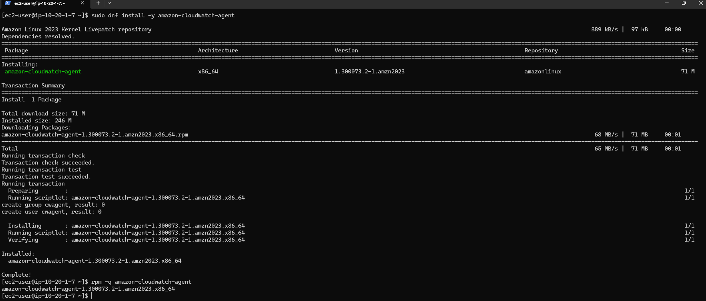</a></td></tr></table>

<p><sub><strong>Screenshot 32:</strong> CloudWatch Agent installed with dnf and confirmed by rpm package query.</sub></p>

### 5.2 Creating the Memory Metrics Configuration

I created `/opt/aws/amazon-cloudwatch-agent/etc/amazon-cloudwatch-agent.json` on the EC2 instance with the following exact configuration:

```bash
sudo tee /opt/aws/amazon-cloudwatch-agent/etc/amazon-cloudwatch-agent.json > /dev/null <<'EOF'
{
  "agent": {
    "metrics_collection_interval": 60,
    "region": "us-east-1"
  },
  "metrics": {
    "namespace": "CWAgent",
    "append_dimensions": {
      "InstanceId": "${aws:InstanceId}"
    },
    "metrics_collected": {
      "mem": {
        "measurement": [
          "mem_used_percent",
          "mem_used",
          "mem_available"
        ],
        "metrics_collection_interval": 60
      }
    }
  }
}
EOF
```

I then displayed the file to confirm its saved contents:

```bash
sudo cat /opt/aws/amazon-cloudwatch-agent/etc/amazon-cloudwatch-agent.json
```

<table><tr><td align="center"><a href="images/screenshot-33.png">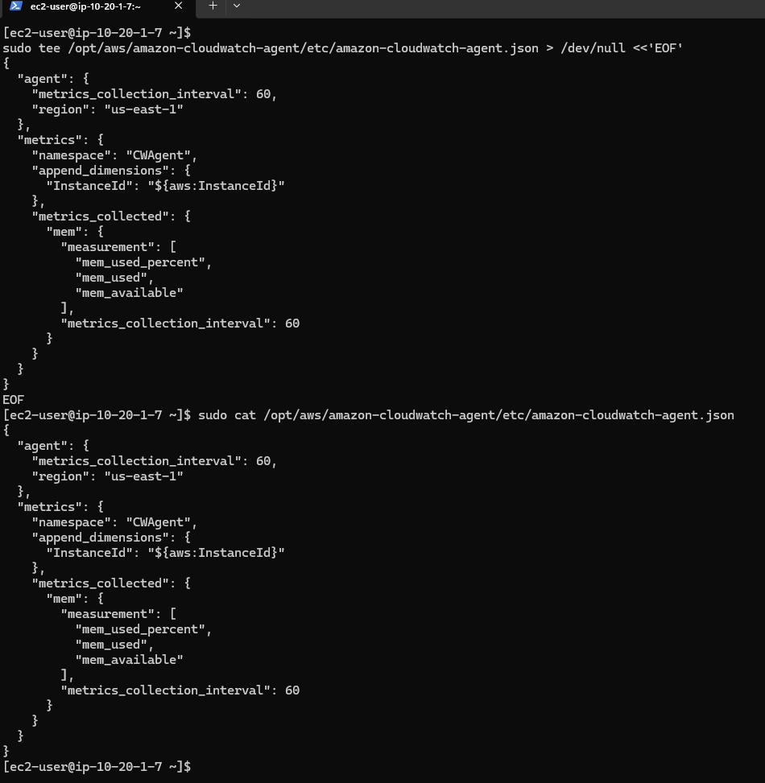</a></td></tr></table>

<p><sub><strong>Screenshot 33:</strong> Creating and displaying the JSON CloudWatch Agent memory metrics configuration.</sub></p>

The `CWAgent` namespace keeps these guest-OS measurements separate from the service-generated `AWS/EC2` metrics. The `InstanceId` dimension connects the metric series to `Cloudwatch01`. A 60-second sampling interval produces standard-resolution metrics.

| Metric name | Meaning | Unit |
| --- | --- | --- |
| `mem_used_percent` | Percentage of instance memory in use | Percent |
| `mem_used` | Memory in use | Bytes |
| `mem_available` | Memory readily available to processes | Bytes |

These names are the modern agent metrics corresponding to the original exercise's memory utilization, used memory and available memory objectives. The earlier Perl-based monitoring scripts were replaced with the supported CloudWatch Agent without changing the monitoring objective.

### 5.3 Loading the Configuration and Starting Collection

I ran the CloudWatch Agent control utility to fetch the local JSON file, apply the EC2 mode and start the service:

```bash
sudo /opt/aws/amazon-cloudwatch-agent/bin/amazon-cloudwatch-agent-ctl \
  -a fetch-config \
  -m ec2 \
  -s \
  -c file:/opt/aws/amazon-cloudwatch-agent/etc/amazon-cloudwatch-agent.json
```

The output reported a valid JSON schema and successful configuration validation in both phases. The service was enabled through systemd.

<table><tr><td align="center"><a href="images/screenshot-34.png">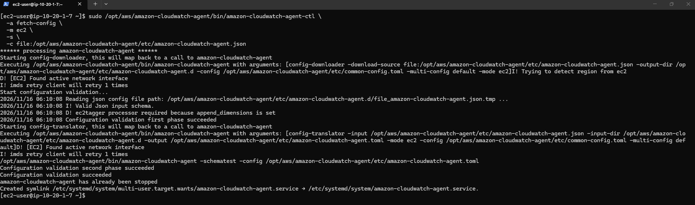</a></td></tr></table>

<p><sub><strong>Screenshot 34:</strong> CloudWatch Agent configuration loader reporting successful schema and configuration validation.</sub></p>

I then queried the agent status:

```bash
sudo /opt/aws/amazon-cloudwatch-agent/bin/amazon-cloudwatch-agent-ctl \
  -m ec2 \
  -a status
```

The resulting JSON showed `"status": "running"`, `"configstatus": "configured"` and version `1.300073.2`.

<table><tr><td align="center"><a href="images/screenshot-35.png">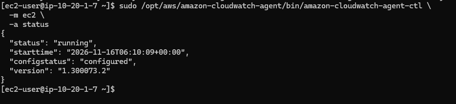</a></td></tr></table>

<p><sub><strong>Screenshot 35:</strong> CloudWatch Agent status response showing running and configured.</sub></p>

> [!IMPORTANT]
> **SAA-C03 EXAM CONNECTION**
>
> EC2 default metrics are collected by the AWS service. Guest-memory metrics require an agent or other explicit metric publisher. An IAM instance role controls API authorization, while the metrics configuration controls *what* the local agent collects and how frequently.

### 5.4 Troubleshooting Reference

| Symptom | Diagnostic action |
| --- | --- |
| Agent fails validation | Recheck JSON syntax and the names under `metrics_collected.mem.measurement`; rerun `fetch-config`. |
| Agent is not running | Query `amazon-cloudwatch-agent-ctl -a status` and inspect the service's local log files. |
| `CWAgent` is missing | Check the AWS Region, EC2 IAM role and policy, configured namespace and agent status. |
| Metrics appear without current data | Confirm instance is running, inspect the graph period/time range and agent output. |

These checks are a reproducibility reference. No package-installation or agent-validation failure was observed in this execution.

---


## 06 Verifying Custom Memory Metrics

### 6.1 Navigating to CloudWatch Metrics

I opened **CloudWatch → Metrics → Classic metrics** in `us-east-1`, selected the custom namespace **CWAgent**, and opened the **InstanceId** dimension group.

<table><tr><td align="center"><a href="images/screenshot-36.png">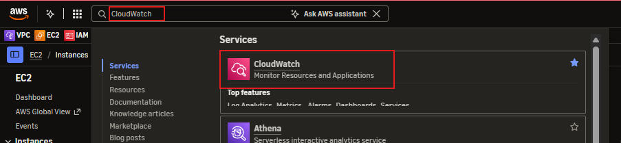</a></td></tr></table>

<p><sub><strong>Screenshot 36:</strong> Finding Amazon CloudWatch through the AWS Console service search.</sub></p>

<table><tr><td align="center"><a href="images/screenshot-37.png">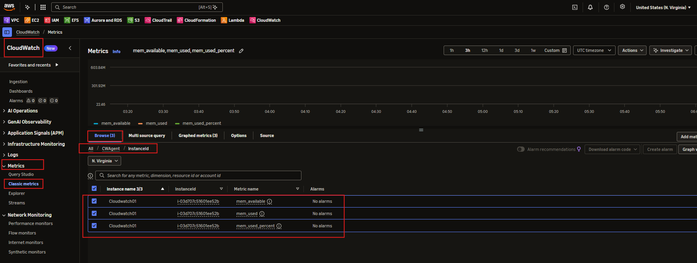</a></td></tr></table>

<p><sub><strong>Screenshot 37:</strong> CWAgent namespace showing three selected custom metrics for Cloudwatch01.</sub></p>

The metrics list displayed three rows associated with instance `i-03d707c51601ee52b`: `mem_available`, `mem_used` and `mem_used_percent`. The metric names and instance mapping demonstrated successful publication metadata; I used the graphs to verify actual datapoints.

### 6.2 Verifying Memory Utilization

I selected the percentage metric separately so that its percent unit would not be overlaid on the much larger byte values. CloudWatch displayed a datapoint around **22.46%** utilization on the line graph, confirming that `mem_used_percent` had begun reporting.

<table><tr><td align="center"><a href="images/screenshot-38.png">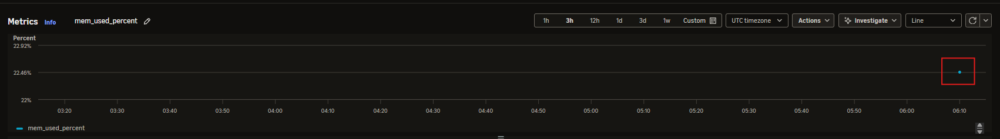</a></td></tr></table>

<p><sub><strong>Screenshot 38:</strong> Memory utilization line graph showing an actual mem_used_percent datapoint.</sub></p>

### 6.3 Verifying Memory Used and Available

I then graphed the byte-valued `mem_used` and `mem_available` measurements together. Both metrics displayed bars, with approximate values of a few hundred megabytes in use and around six hundred megabytes available.

<table><tr><td align="center"><a href="images/screenshot-39.png">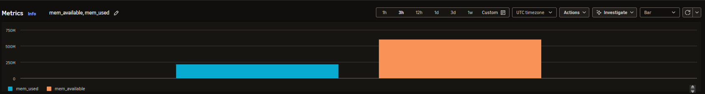</a></td></tr></table>

<p><sub><strong>Screenshot 39:</strong> CloudWatch bar graph displaying mem_used and mem_available datapoints.</sub></p>

A separate bar graph displayed `mem_used_percent` at approximately **22–23%**. The agent's memory measurements were therefore visible as real CloudWatch datapoints, not merely as configuration entries.

<table><tr><td align="center"><a href="images/screenshot-40.png">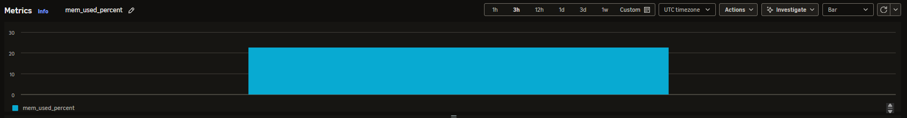</a></td></tr></table>

<p><sub><strong>Screenshot 40:</strong> CloudWatch bar graph displaying mem_used_percent utilization.</sub></p>

For a percentage, the metric's **Average** statistic and a **1-minute** period are suitable for basic utilization monitoring. For memory in bytes, compare measurements within the same unit and time period; percentages and bytes should generally be graphed separately or placed on separate axes.

> [!NOTE]
> **KEY TAKEAWAY** — Three custom CloudWatch metrics appeared for the same EC2 instance, and their graphs contained observed data. This verified both the local CloudWatch Agent path and CloudWatch metric publication.

---


## 07 Configuring Amazon SNS Email Notifications

### 7.1 Creating a Standard SNS Topic

I opened **Amazon Simple Notification Service (SNS)** through the AWS Console and navigated to **Topics → Create topic**.

<table><tr><td align="center"><a href="images/screenshot-41.png">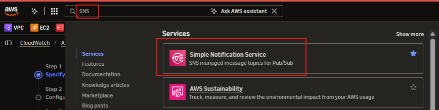</a></td></tr></table>

<p><sub><strong>Screenshot 41:</strong> Finding Amazon Simple Notification Service in AWS Console search.</sub></p>

<table><tr><td align="center"><a href="images/screenshot-42.png">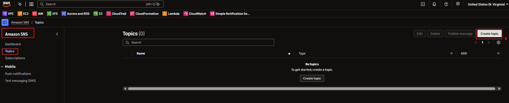</a></td></tr></table>

<p><sub><strong>Screenshot 42:</strong> SNS Topics console before topic creation.</sub></p>

I selected **Standard**, entered topic name `Cloudwatch01-Memory-Alerts` and display name `AWS-Alert`, and used the remaining default settings.

| Topic property | Selected value |
| --- | --- |
| Topic type | Standard |
| Topic name | `Cloudwatch01-Memory-Alerts` |
| Display name | `AWS-Alert` |
| AWS Region | `us-east-1` |

<table><tr><td align="center"><a href="images/screenshot-43.png">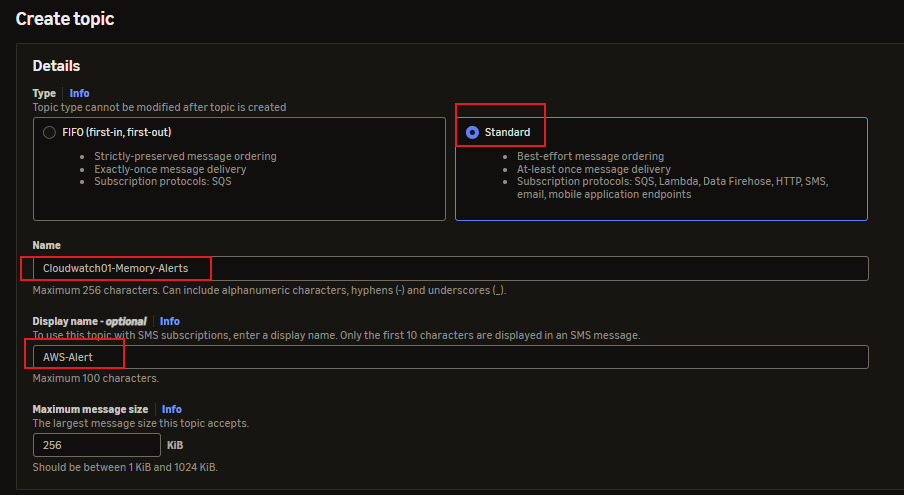</a></td></tr></table>

<p><sub><strong>Screenshot 43:</strong> SNS Standard topic configuration with name Cloudwatch01-Memory-Alerts and display name AWS-Alert.</sub></p>

AWS confirmed the topic's creation and displayed the topic details with an empty subscriptions list.

<table><tr><td align="center"><a href="images/screenshot-44.png">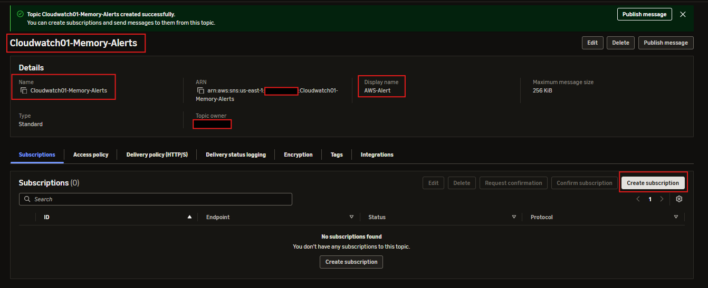</a></td></tr></table>

<p><sub><strong>Screenshot 44:</strong> Successful SNS topic creation and the Subscriptions tab.</sub></p>

### 7.2 Adding and Confirming an Email Subscription

On the topic's **Subscriptions** tab, I chose **Create subscription**, set the protocol to **Email** and supplied my destination email address. The address itself is excluded from published evidence.

<table><tr><td align="center"><a href="images/screenshot-45.png">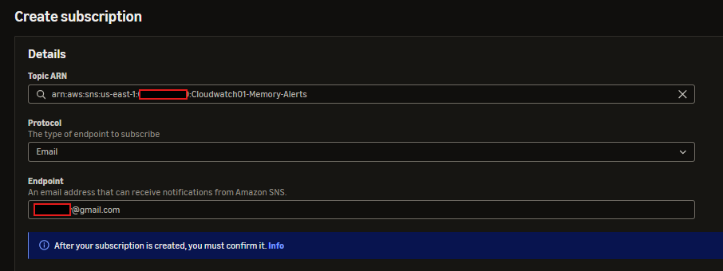</a></td></tr></table>

<p><sub><strong>Screenshot 45:</strong> Configuring an email subscription to the Cloudwatch01-Memory-Alerts topic.</sub></p>

Amazon SNS sent a subscription-confirmation message. I opened it and selected **Confirm subscription** to authorize delivery to my email endpoint.

<table><tr><td align="center"><a href="images/screenshot-46.png">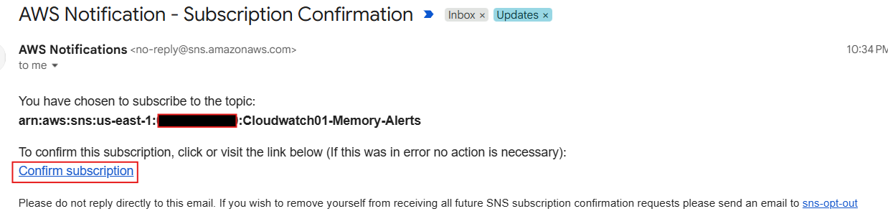</a></td></tr></table>

<p><sub><strong>Screenshot 46:</strong> AWS subscription-confirmation email requesting confirmation.</sub></p>

<table><tr><td align="center"><a href="images/screenshot-47.png">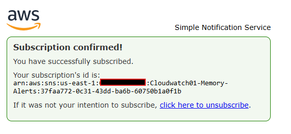</a></td></tr></table>

<p><sub><strong>Screenshot 47:</strong> Amazon SNS confirmation page showing a successfully confirmed subscription.</sub></p>

SNS then displayed **Subscription confirmed**. This confirmation is required before an SNS email endpoint can receive topic notifications.

> [!IMPORTANT]
> **SAA-C03 EXAM CONNECTION**
>
> SNS implements a publish/subscribe model. An SNS topic fans out messages to its subscriptions; email subscribers must confirm their endpoints before receiving notifications. CloudWatch alarms can invoke SNS when an alarm's configured state transition occurs.

---


## 08 Creating and Testing the CloudWatch Alarm

### 8.1 Selecting the Monitored Metric

I opened **CloudWatch → Alarms → Create alarm** and selected the existing `CWAgent / InstanceId / mem_used_percent` metric for `Cloudwatch01` (`i-03d707c51601ee52b`). The metric-selection graph already displayed a sequence of recent utilization measurements.

<table><tr><td align="center"><a href="images/screenshot-48.png">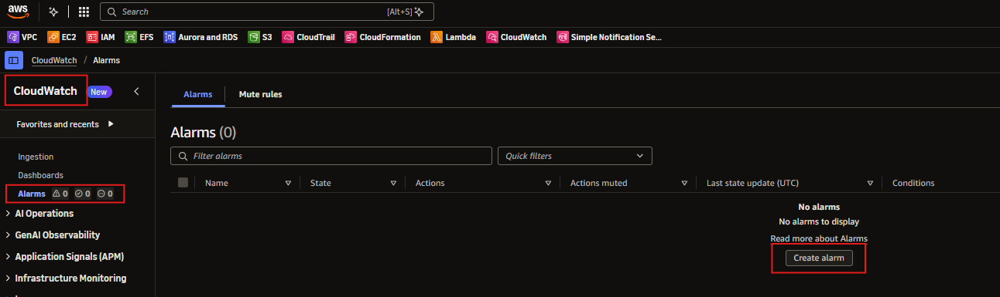</a></td></tr></table>

<p><sub><strong>Screenshot 48:</strong> CloudWatch Alarms console before the memory alarm was created.</sub></p>

<table><tr><td align="center"><a href="images/screenshot-49.png"></a></td></tr></table>

<p><sub><strong>Screenshot 49:</strong> Selecting the Cloudwatch01 mem_used_percent metric for alarm evaluation.</sub></p>

### 8.2 Defining the Temporary Test Threshold

I configured a static threshold, with **Average** as the statistic and a one-minute period. To generate a verifiable alert using the actual observed baseline, I set a deliberately low **greater-than 20%** threshold and required one out of one datapoint to breach it.

| Alarm setting | Selected value |
| --- | --- |
| Metric | `mem_used_percent` |
| Namespace / dimension | `CWAgent` / `InstanceId` |
| Instance | `i-03d707c51601ee52b` |
| Statistic | Average |
| Period | 1 minute (`60` seconds) |
| Threshold type | Static |
| Comparison operator | **Greater** (`>`) |
| Threshold | `20` percent |
| Datapoints to alarm | `1 of 1` |
| Missing-data treatment | `missing` (recorded in the notification) |

<table><tr><td align="center"><a href="images/screenshot-50.png"></a></td></tr></table>

<p><sub><strong>Screenshot 50:</strong> Configuring Average, one-minute evaluation, 1-of-1 datapoints and greater-than-20-percent threshold.</sub></p>

The threshold was chosen for a controlled end-to-end alert test. It was not a recommendation to treat 20% memory utilization as an abnormal condition in a production environment. The alarm's description said “reaches or exceeds 20 percent,” but the actual selected comparison was **strictly greater than** 20%, as shown in the configuration and later alarm details.

### 8.3 Configuring the SNS Notification Action

Under **Configure actions**, I chose the **In alarm** state trigger, selected an existing SNS topic and set it to `Cloudwatch01-Memory-Alerts`, which already had a confirmed email subscription.

<table><tr><td align="center"><a href="images/screenshot-51.png"></a></td></tr></table>

<p><sub><strong>Screenshot 51:</strong> Selecting the confirmed Cloudwatch01-Memory-Alerts SNS topic for the ALARM state action.</sub></p>

I named the alarm `Cloudwatch01-High-Memory-Alarm` and entered the description `Test alarm when EC2 memory utilization reaches or exceeds 20 percent`. AWS confirmed creation, and the alarm initially appeared in **Insufficient data** while its first evaluations were pending.

<table><tr><td align="center"><a href="images/screenshot-52.png"></a></td></tr></table>

<p><sub><strong>Screenshot 52:</strong> Specifying the Cloudwatch01-High-Memory-Alarm name and test description.</sub></p>

<table><tr><td align="center"><a href="images/screenshot-53.png"></a></td></tr></table>

<p><sub><strong>Screenshot 53:</strong> Alarm creation confirmation showing an initial Insufficient data state.</sub></p>

### 8.4 Verifying the Actual Email Notification

An AWS alert message appeared in my email inbox with the subject identifying `Cloudwatch01-High-Memory-Alarm` in US East (N. Virginia).

<table><tr><td align="center"><a href="images/screenshot-54.png"></a></td></tr></table>

<p><sub><strong>Screenshot 54:</strong> Email inbox showing the delivered CloudWatch ALARM notification.</sub></p>

The expanded email contained the exact evaluated condition and state change:

| Observed field | Verified value |
| --- | --- |
| Alarm name | `Cloudwatch01-High-Memory-Alarm` |
| State change | `INSUFFICIENT_DATA → ALARM` |
| Event time | **2026-11-16 06:48:59 UTC** |
| Metric | `CWAgent / mem_used_percent` |
| EC2 instance ID | `i-03d707c51601ee52b` |
| Triggering data point | **23.0099853684832%** (approximately 23.01%) |
| Threshold | Strictly greater than `20.0` |
| Datapoints | 1 out of the most recent 1 |
| Period / statistic | 60 seconds / Average |
| Notification mechanism | SNS topic `Cloudwatch01-Memory-Alerts` |

<table><tr><td align="center"><a href="images/screenshot-55.png"></a></td></tr></table>

<p><sub><strong>Screenshot 55:</strong> SNS email identifying the breached metric, 23.01 percent value and ALARM state transition.</sub></p>

The email demonstrated that a real metric datapoint crossed the configured threshold and that the SNS integration delivered the resulting notification.

### 8.5 Confirming the CloudWatch Alarm State

I returned to **CloudWatch → Alarms**. The alarms list displayed `Cloudwatch01-High-Memory-Alarm` as **In alarm**, with actions enabled. Its most recent state update matched the email's timestamp.

<table><tr><td align="center"><a href="images/screenshot-56.png"></a></td></tr></table>

<p><sub><strong>Screenshot 56:</strong> CloudWatch Alarms console showing Cloudwatch01-High-Memory-Alarm in ALARM with actions enabled.</sub></p>

The tested workflow was:

**CloudWatch Agent → `mem_used_percent` → CloudWatch alarm threshold → `ALARM` transition → SNS topic → confirmed email inbox.**

> [!IMPORTANT]
> **SAA-C03 EXAM CONNECTION**
>
> CloudWatch alarms evaluate metric statistics over configured periods. The choice of threshold, evaluation periods and treatment of missing data determines when the alarm enters ALARM, OK or INSUFFICIENT_DATA. SNS is one possible alarm action and does not itself evaluate metrics.

### 8.6 Knowledge Check

> [!TIP]
> **If a metric remains above the threshold for several minutes, does a CloudWatch state-change alarm email arrive every minute?**
>
> **Answer: Normally, no.** The action occurs when the alarm transitions to the relevant state, unless a separate notification or automation scheme is configured.
>
> **Why did the alarm initially display INSUFFICIENT_DATA?**
>
> **Answer:** CloudWatch had not yet evaluated enough recent datapoints at the time of the initial state display. It subsequently evaluated a real datapoint and transitioned to ALARM.
>
> **Why was a 20% threshold selected?**
>
> **Answer:** It was a purposeful test threshold below the observed memory utilization. Production alarm thresholds should reflect workload baselines, acceptable risk and operational response needs.

> [!NOTE]
> **KEY TAKEAWAY** — The alert was validated end to end, including the measured breach, CloudWatch state transition and actual SNS email receipt.

---


## 09 Resource Teardown Procedure

The following console procedure removes the infrastructure created for this exercise. It is ordered to resolve dependencies cleanly and does not require cleanup screenshots.

| Order | Resource | AWS Console action |
| --- | --- | --- |
| 1 | CloudWatch alarm | **CloudWatch → Alarms → All alarms:** select `Cloudwatch01-High-Memory-Alarm` and choose **Delete**. |
| 2 | SNS email subscription | **SNS → Subscriptions:** locate the subscription to `Cloudwatch01-Memory-Alerts` and delete it. |
| 3 | SNS topic | **SNS → Topics:** select `Cloudwatch01-Memory-Alerts` and choose **Delete**. |
| 4 | EC2 instance | **EC2 → Instances:** select `Cloudwatch01` (`i-03d707c51601ee52b`) → **Instance state → Terminate (delete) instance**. Wait until the instance has terminated and its network interface is released. |
| 5 | Root EBS volume | **EC2 → Volumes:** check whether the instance's root volume was automatically deleted; delete only an orphaned volume belonging to this exercise if one remains. |
| 6 | IAM role | **IAM → Roles:** remove the `CloudWatchMetrics` role from any instance profile if prompted, detach `CloudWatchAgentServerPolicy`, then delete `CloudWatchMetrics`. Remove any leftover dedicated instance profile if necessary. Do **not** delete the AWS-managed policy. |
| 7 | EC2 security group | **VPC → Security groups:** delete `AWS-Training-CloudWatch-SG` (`sg-010dd80898f7d0447`) after the instance's network interface is gone. |
| 8 | Public route table | **VPC → Route tables:** select `AWS-Training-Public-RT`, remove the explicit association with `AWS-Training-Public-Subnet-1`, then delete the custom route table. |
| 9 | Public subnet | **VPC → Subnets:** delete `AWS-Training-Public-Subnet-1` (`subnet-0d5d82ce1f46e1160`). |
| 10 | Internet Gateway | **VPC → Internet gateways:** detach `AWS-Training-Base-IGW` from the VPC, then delete the gateway. If detachment is blocked, check for remaining public-addressed network interfaces or allocations. |
| 11 | VPC | **VPC → Your VPCs:** delete `AWS-Training-Base-VPC` (`vpc-044498ea73ae9fe82`) after its dependencies are removed. |

A VPC deletion can be blocked by network interfaces, subnets, internet gateways or other dependent resources. Delete only the resources identified above; the existing EC2 key pair `npoweraws` predates this exercise and must not be removed as part of this teardown.

> [!CAUTION]
> **DESTRUCTIVE ACTION** — Confirm each selected resource name and identifier before deletion. Terminating an EC2 instance and deleting its root EBS storage can permanently remove local data.

---


## 10 SAA-C03 Exam Review and Production Considerations

### 10.1 Architecture Concepts

| Topic | Exam-relevant principle |
| --- | --- |
| VPCs and subnets | VPCs are regional; subnets are scoped to a single Availability Zone. |
| Public subnet reachability | An IGW route, public IPv4 and suitable security rules work together. |
| Security groups | Stateful, allow-rule-based firewall attached to network interfaces. |
| IAM instance roles | Temporary role credentials are preferred to embedded access keys on EC2. |
| CloudWatch vs. CloudTrail | CloudWatch monitors metrics and alarms; CloudTrail audits API activity. |
| Default vs. custom metrics | Guest memory requires an agent or explicit publisher. |
| Standard resolution | A 60-second metric collection interval is standard resolution. |
| CloudWatch alarms | Threshold and evaluation logic determine state transitions. |
| SNS | Confirmed subscriptions can receive messages from alarm actions. |
| IMDSv2 | Session token requirement strengthens metadata access. |

### 10.2 Implementation Design Decisions

I provisioned a dedicated VPC and explicitly configured the public subnet, internet gateway, route table and security group. This produced a clearly documented networking foundation with traceable dependencies and a reproducible EC2 deployment procedure.

I selected **Amazon Linux 2023** and installed the **Amazon CloudWatch Agent** to publish three operating-system memory metrics every **60 seconds**. The agent was configured as a managed service, providing recurring metric collection without a separate scheduled script. I used the AWS-managed **`CloudWatchAgentServerPolicy`** and an EC2 instance profile so the agent could authenticate with temporary IAM role credentials.

For alert validation, I selected a **20% test threshold** that the measured memory utilization was expected to exceed. The resulting CloudWatch alarm state change and delivered SNS email provided end-to-end evidence of metric evaluation and notification delivery.

### 10.3 Production Design Differences

The implementation used a public EC2 instance for direct SSH administration. Production monitoring hosts can instead run in private subnets with suitable connectivity to CloudWatch, such as through appropriate VPC endpoints or controlled outbound routing, and can use AWS Systems Manager for administration where applicable.

A 20% memory threshold was appropriate only for creating a demonstrable test alarm. For a real workload, choose thresholds from observed application behavior, use multiple evaluation periods when appropriate, define missing-data treatment intentionally, and establish operational ownership of the SNS notifications. Security-group egress and IAM permissions should be tailored to the deployment's actual access requirements.

### 10.4 Final Technical Findings

I verified that an EC2 instance running Amazon Linux 2023 could publish guest-operating-system memory measurements to CloudWatch under a dedicated namespace. The alarm evaluated a real `mem_used_percent` datapoint of approximately **23.01%**, transitioned into **ALARM**, and delivered a corresponding Amazon SNS email notification. The implementation connects core VPC networking, IAM, EC2 observability and event-driven notification into one reproducible workflow.

---


## 11 Technical Competencies and Skills Matrix

### Demonstrated Competencies

- Built a VPC networking foundation with explicitly configured IPv4 CIDR, subnet, internet gateway, route table and subnet association.
- Configured restricted SSH ingress and public-subnet EC2 addressing.
- Created an EC2-trusted IAM role with a purpose-specific CloudWatch Agent policy.
- Deployed Amazon Linux 2023 with IMDSv2 and verified an SSH connection.
- Installed, configured and validated the CloudWatch Agent on a Linux host.
- Published and graphed actual EC2 custom memory metrics.
- Created and confirmed an SNS email subscription.
- Designed a CloudWatch alarm and verified a threshold-driven ALARM state and delivered notification.

| AWS service / skill | Evidence-backed implementation |
| --- | --- |
| Amazon VPC | Dedicated VPC, subnet, IGW, route table and association |
| Amazon EC2 | Running `t3.micro`, SSH, Linux OS verification |
| IAM | `CloudWatchMetrics` EC2 role and managed permissions policy |
| Amazon EBS | Configured 8 GiB gp3 root volume |
| CloudWatch Agent | Installed version `1.300073.2`, configured and running |
| CloudWatch metrics | Three memory measurements with actual data points |
| CloudWatch alarms | Real 23.01% threshold breach and ALARM transition |
| Amazon SNS | Standard topic, confirmed email subscription and delivered alarm notification |
| Linux / shell | Package installation, JSON configuration and service-status commands |

---


## 12 Consolidated Command Reference and AWS Documentation

### 12.1 Commands Used on the Instance

| Command | Purpose |
| --- | --- |
| `cat /etc/os-release` | Verify the Amazon Linux distribution and release. |
| `sudo dnf install -y amazon-cloudwatch-agent` | Install the CloudWatch Agent. |
| `rpm -q amazon-cloudwatch-agent` | Verify the installed agent RPM. |
| `sudo cat /opt/aws/amazon-cloudwatch-agent/etc/amazon-cloudwatch-agent.json` | Review the saved agent configuration. |

The longer `tee` and `amazon-cloudwatch-agent-ctl` commands are reproduced in the installation and configuration chapter above, alongside the exact validated JSON.

### 12.2 AWS Documentation

- [CloudWatch Agent metrics collected on Linux](https://docs.aws.amazon.com/AmazonCloudWatch/latest/monitoring/metrics-collected-by-CloudWatch-agent.html)
- [CloudWatch Agent configuration file reference](https://docs.aws.amazon.com/AmazonCloudWatch/latest/monitoring/CloudWatch-Agent-Configuration-File-Details.html)
- [CloudWatch alarm missing-data behavior](https://docs.aws.amazon.com/AmazonCloudWatch/latest/monitoring/alarms-and-missing-data.html)
- [Amazon SNS monitoring and CloudWatch integration](https://docs.aws.amazon.com/sns/latest/dg/sns-monitoring-using-cloudwatch.html)
- [Deleting an internet gateway](https://docs.aws.amazon.com/vpc/latest/userguide/delete-igw.html)
- [Deleting a VPC and dependent resources](https://docs.aws.amazon.com/vpc/latest/userguide/delete-vpc.html)
