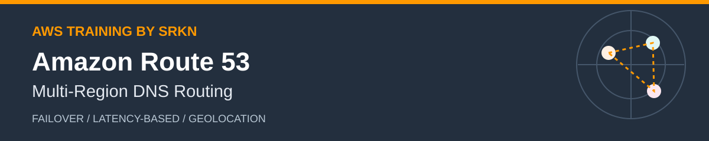

# Amazon Route 53 — Multi-Region DNS Routing

**DNS / CLOUDFLARE / AMAZON ROUTE 53 / AMAZON EC2 / APACHE / HEALTH CHECKS / FAILOVER / LATENCY / GEOLOCATION**

I built and tested a multi-Region DNS-routing environment across **N. Virginia (`us-east-1`)**, **Paris (`eu-west-3`)**, and **Singapore (`ap-southeast-1`)**. I deployed three region-identifiable Apache websites, created a Route 53 public hosted zone for a subdomain delegated from Cloudflare, and associated nine DNS routing records with three HTTP health checks.

I validated **active-passive failover and recovery**, **latency-based selection**, and **geolocation with a default destination**. The tests included direct authoritative DNS queries, Route 53's Test record simulator, actual browser requests, and VPN-based checks from France, Australia, and Singapore.

The published examples use the documentation-only domain **`awspractice.example.com`**. I configured an actual delegated `awspractice` subdomain, but its parent domain is intentionally omitted from this public guide. IPs, AWS instance identifiers, health-check IDs, and technical outcomes reflect the verified exercise; domain placeholders are not literal deployed hostnames.

---

## Understanding Amazon Route 53 and DNS Fundamentals

### What Is Amazon Route 53?

**Amazon Route 53** is a highly available and scalable Domain Name System (DNS) web service provided by Amazon Web Services (AWS).

It allows organizations to manage DNS records, direct users to application endpoints, monitor endpoint health, and implement advanced routing policies across different AWS Regions.

Route 53 can route DNS queries to resources such as Amazon EC2 instances, Elastic Load Balancers, Amazon S3 websites, and other publicly accessible application endpoints.

Unlike a traditional DNS configuration that simply maps a domain name to an IP address, Route 53 supports intelligent DNS routing based on:

- **Endpoint health:** Whether an application is available.
- **Network latency:** Which AWS Region is expected to provide favorable network performance.
- **Geographic location:** Where a DNS query originates.
- **Traffic distribution:** How DNS responses should be distributed across multiple endpoints.

These capabilities make Route 53 an important service for building highly available, globally distributed applications.

### How DNS Works

The **Domain Name System (DNS)** translates human-readable domain names into information that computers use to locate services, including IP addresses.

For example, when a user visits a website, a DNS resolver looks up the domain name and obtains the appropriate destination address.

A simplified DNS resolution process is:

1. A user enters a domain name in a browser.
2. The browser or operating system requests DNS information from a recursive resolver.
3. The resolver discovers the authoritative DNS servers responsible for the domain.
4. The authoritative DNS service returns the appropriate DNS record.
5. The browser connects to the destination web server using the returned address.

DNS resolution and application traffic are separate operations. **Route 53 provides DNS answers; it does not act as an HTTP reverse proxy for our EC2 websites.**

### Core DNS Terminology

| Concept | Definition | Purpose |
|---|---|---|
| DNS | Domain Name System | Resolves domain names to addresses and other DNS information. |
| Hosted Zone | Container for DNS records in Route 53 | Defines how Route 53 answers queries for a domain or subdomain. |
| Public Hosted Zone | DNS zone accessible through public DNS | Manages internet-facing domain records. |
| A Record | Maps a DNS name to an IPv4 address | Directs clients to our EC2 web servers. |
| NS Record | Identifies authoritative name servers | Delegates DNS authority for a domain or subdomain. |
| SOA Record | Start of Authority record | Contains administrative information about a DNS zone. |
| TTL | Time to Live | Indicates how long DNS resolvers may cache a response. |
| Authoritative DNS Server | Server responsible for answering queries for a DNS zone | Provides DNS responses based on configured records and policies. |
| Recursive DNS Resolver | Service that obtains DNS answers on behalf of clients | Retrieves and caches DNS information. |
| Health Check | Automated endpoint availability monitoring | Helps Route 53 avoid unhealthy endpoints when supported by the routing policy. |
| DNS Delegation | Assignment of DNS authority to another set of name servers | Allows a subdomain to be managed independently from its parent domain. |

### Amazon Route 53 Routing Policies

Amazon Route 53 provides several routing policies for different application requirements.

| Routing Policy | Description | Real-World Use Case |
|---|---|---|
| Simple | Returns DNS records without specialized traffic-selection rules. | A basic website hosted on a single endpoint. |
| Weighted | Distributes DNS responses according to configured weights. | Gradual application migrations and traffic splitting. |
| Failover | Selects a primary or secondary endpoint according to health-check status. | Disaster recovery and active-passive architectures. |
| Latency-Based | Selects an AWS Region using Route 53 network latency information. | Global applications serving users from multiple Regions. |
| Geolocation | Selects records according to geographic rules, including continent, country, or US state. | Regional content, localization, and geographic traffic control. |
| Geoproximity | Routes according to resource locations and optional geographic bias. | Adjusting the geographic distribution of application traffic. |
| Multivalue Answer | Returns multiple healthy records using DNS-based selection. | Basic DNS-level distribution across healthy endpoints. |

**Important:** DNS routing is not the same as application-level load balancing. Route 53 changes DNS answers, while services such as Application Load Balancers distribute HTTP requests among application targets.

### Routing Policies Implemented in This Project

I implemented three Route 53 routing policies using separate DNS names within a shared public hosted zone.

#### 1. Failover Routing — High Availability

Failover routing supports an **active-passive architecture**, in which a preferred primary endpoint serves the application and a secondary endpoint is available if the primary fails.

In this implementation:

- **Primary:** N. Virginia (`us-east-1`)
- **Secondary:** Paris (`eu-west-3`)
- **Monitoring:** Route 53 HTTP health checks
- **DNS record:** `failover.awspractice.example.com`

I simulated an application failure by stopping Apache on the primary EC2 instance.

Route 53 detected the unhealthy endpoint and returned the Paris secondary IP address. After restoring Apache, I verified that DNS responses returned to the N. Virginia primary endpoint.

**Real-world use case:** Maintaining access to an application when its primary regional deployment becomes unavailable.

#### 2. Latency-Based Routing — Global Performance

Latency-based routing selects among regional application endpoints using Route 53's measurements of network latency between DNS query origins and AWS Regions.

In this implementation, I configured endpoints in:

- N. Virginia (`us-east-1`)
- Paris (`eu-west-3`)
- Singapore (`ap-southeast-1`)

**DNS record:** `latency.awspractice.example.com`

I tested regional DNS selections using Route 53's Test record tool and verified the Singapore endpoint using a VPN connection, DNS lookup, and web browser.

**Real-world use case:** Improving the expected network performance of globally distributed applications.

**Key distinction:** Latency-based routing does not necessarily choose the geographically closest server. It uses Route 53's regional latency information.

#### 3. Geolocation Routing — Geographic Traffic Control

Geolocation routing selects DNS records according to the geographic location associated with a DNS query.

In this implementation, I configured:

- **Virginia, United States:** N. Virginia endpoint
- **France:** Paris endpoint
- **Singapore:** Singapore endpoint
- **Default:** N. Virginia endpoint

**DNS record:** `geo.awspractice.example.com`

I verified country-specific behavior and demonstrated the importance of a default record.

Before configuring the default record, an unmatched geographic query returned no IP address. After adding the default record, the same query returned the configured N. Virginia destination.

I also verified website selection through VPN connections from France, Australia, and Singapore.

**Real-world use case:** Geographic content delivery, localization, country-specific application endpoints, and regional routing requirements.

### AWS and Supporting Technologies

The project combined multiple services and technologies to build and test a functioning multi-Region DNS architecture.

| Technology | Role in the Project |
|---|---|
| Amazon Route 53 | Hosted DNS records, applied routing policies, and monitored endpoint health. |
| Amazon EC2 | Hosted three independent regional web servers. |
| Amazon Linux 2023 | Provided the operating system for the EC2 instances. |
| Apache HTTP Server | Served regional websites and HTTP health-check endpoints. |
| Amazon VPC | Provided isolated networking within each AWS Region. |
| Security Groups | Controlled inbound SSH and HTTP access to EC2 instances. |
| Cloudflare DNS | Managed the parent DNS zone and delegated the training subdomain to Route 53. |
| AWS CloudShell | Provided a command-line environment for DNS and HTTP testing. |
| `dig` and `nslookup` | Verified DNS resolution and selected IP addresses. |
| `curl` | Tested HTTP connectivity and health-check responses. |
| VPN | Supported real-browser tests from different geographic locations. |

### DNS Delegation Between Cloudflare and Route 53

The project used **subdomain delegation** to allow Cloudflare and Amazon Route 53 to manage different portions of the DNS namespace.

Cloudflare remained authoritative for the parent domain, while Route 53 became authoritative for the dedicated training subdomain.

I created a Route 53 public hosted zone, obtained its four authoritative name servers, and configured matching NS delegation records in Cloudflare.

This allowed all three routing exercises to operate within one Route 53 hosted zone without migrating the parent domain to AWS.

**Real-world use case:** Organizations can delegate application-specific subdomains to different teams, cloud platforms, or DNS providers while maintaining centralized management of their parent domain.

### Route 53 Health Checks and DNS Caching

Route 53 health checks periodically monitor endpoints using protocols such as HTTP, HTTPS, or TCP.

For HTTP health checks, Route 53 evaluates the endpoint's HTTP response to determine availability.

In this project, each regional Apache server exposed a dedicated endpoint:

`/health`

A successful request returned:

```text
healthy
```

The three health checks monitored the regional web servers independently and were reused across the supported routing policies.

**DNS TTL and caching are important considerations:** Even after Route 53 changes an authoritative DNS answer, recursive resolvers and clients may continue using cached answers until those caches expire.

As a result, DNS failover is not an instantaneous replacement for existing connections, and it does not automatically repair an unavailable application.

### AWS Solutions Architect Associate — Key Takeaways

- Route 53 is a global DNS service that supports different routing strategies.
- EC2 instances, VPCs, subnets, security groups, and EC2 key pairs are Region-scoped resources.
- Failover routing supports active-passive disaster recovery through endpoint health monitoring.
- Latency-based routing uses regional latency information, not simply geographic distance.
- Geolocation routing uses explicitly configured geographic rules.
- A default geolocation record handles locations without a specific matching rule.
- Health checks can be reused across multiple DNS records when the routing configuration supports them.
- DNS caching influences how quickly clients observe routing changes.
- Public DNS delegation allows different DNS providers to manage a parent domain and its subdomains independently.
- Route 53 provides DNS-based endpoint selection; application load balancing and application recovery require additional mechanisms.

---
## Contents

- [Architecture Highlight](#architecture-highlight)
- [01 Purpose, Objectives and DNS Fundamentals](#01-purpose-objectives-and-dns-fundamentals)
- [02 Delegating Cloudflare DNS to Route 53](#02-delegating-cloudflare-dns-to-route-53)
- [03 Deploying Three Regional Web Servers](#03-deploying-three-regional-web-servers)
- [04 Configuring HTTP Health Checks](#04-configuring-http-health-checks)
- [05 Active-Passive Failover Routing](#05-active-passive-failover-routing)
- [06 Latency-Based Routing](#06-latency-based-routing)
- [07 Geolocation and Default Routing](#07-geolocation-and-default-routing)
- [08 Live Website and VPN Verification](#08-live-website-and-vpn-verification)
- [09 SAA-C03 Knowledge Checks](#09-saa-c03-knowledge-checks)
- [10 Troubleshooting and Production Considerations](#10-troubleshooting-and-production-considerations)
- [11 Cleanup Procedure and Resource State](#11-cleanup-procedure-and-resource-state)
- [12 Technical Competencies and Reflection](#12-technical-competencies-and-reflection)
- [Command Reference](#command-reference)
- [AWS and Cloudflare Documentation](#aws-and-cloudflare-documentation)

## Architecture Highlight

The diagram represents the environment I built for the three completed routing exercises. **It does not indicate that teardown has occurred.** Route 53 answered public DNS queries for the delegated subdomain; EC2 web servers remained independently reachable over HTTP in three Regions.

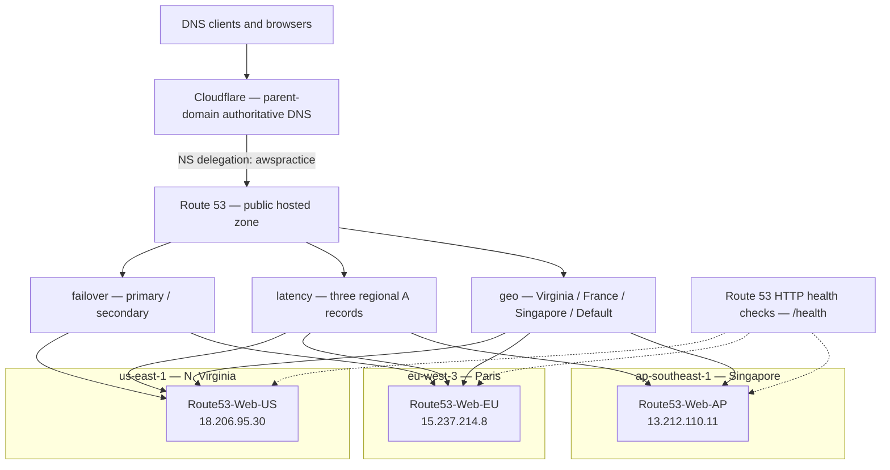

| Component | Verified configuration | Purpose |
| --- | --- | --- |
| Domain authority | Cloudflare parent zone; NS delegation for `awspractice` | Keep the parent zone at Cloudflare while using Route 53 for lab records |
| Route 53 | One public hosted zone, four authoritative name servers | Authoritative responses for the delegated subdomain |
| DNS routing names | `failover`, `latency`, `geo` | Isolate the three routing policies |
| EC2 endpoints | Three `t3.micro` Amazon Linux 2023 instances | Distinct HTTP origins in separate Regions |
| Apache | `httpd` on port 80; `/health` endpoint | Web content and health-check response |
| Health checks | Three public HTTP checks | Evaluate application availability |

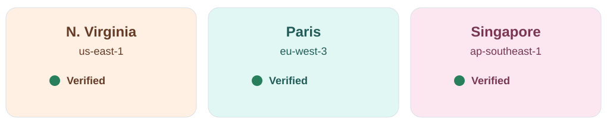

> [!IMPORTANT]
> **SAA-C03 EXAM CONNECTION** — Route 53 is a global DNS service, but the VPCs, subnets, EC2 instances, security groups, and EC2 key pairs used by the endpoints are Region-scoped. A DNS answer selects an endpoint; it does not itself replicate application data, establish HTTPS, or migrate user sessions.

---


## 01 Purpose, Objectives and DNS Fundamentals

### 1.1 Purpose and Objectives

The purpose of the project was to configure one coherent public DNS namespace for three AWS routing experiments and to verify the outcomes rather than rely on a diagram alone. I used different website colors to make each selected Region visually identifiable in browser evidence.

The three routing policies demonstrate distinct design goals:

| Routing policy | Selection principle | Typical use case |
| --- | --- | --- |
| **Failover** | Preferred primary unless its health check is unhealthy | Active-passive disaster recovery |
| **Latency** | AWS latency measurements for the query origin and candidate Regions | Improving perceived responsiveness across Regions |
| **Geolocation** | Explicit location mapping (continent, country, or US state) plus optional Default | Geographic experiences, language/currency routing, location-specific destinations |

### 1.2 Core DNS Concepts

| Concept | Definition in this exercise |
| --- | --- |
| Public hosted zone | Route 53 namespace containing public DNS record sets for the delegated subdomain |
| NS record | Identifies authoritative name servers for the subdomain; parent-zone delegation enables public discovery |
| SOA record | Zone-level administrative and authority information |
| A record | Returns an IPv4 destination, here an EC2 public IPv4 address |
| TTL | Intended DNS cache lifetime in seconds; not a strict guarantee of instantaneous client behavior |
| Resolver | DNS server making queries on behalf of a client; Route 53 may use resolver IP or EDNS Client Subnet information for routing decisions |
| HTTP health check | Periodic HTTP request against an endpoint and path, here TCP/80 `/health` |
| Alias | Route 53-specific record mode for supported AWS targets; this project used **non-alias A records** pointing to public IPv4 addresses |

> [!NOTE]
> **KEY TAKEAWAY** — The DNS routing policies were tested independently under separate record names. A working server reachable by IP does not prove the desired DNS policy; the authoritative answer and the actual website experience must also be verified.

---


## 02 Delegating Cloudflare DNS to Route 53

### 2.1 Purpose and Architecture

I created a **public hosted zone** for the `awspractice` subdomain in Amazon Route 53. The existing parent-domain authority remained at Cloudflare, where I added the delegation NS records. This demonstrates a common organizational pattern: one DNS provider manages the parent zone while a delegated application namespace is controlled by a different team or cloud platform.

For reproduction, the placeholder namespace is `awspractice.example.com`; only the label `awspractice` belongs to the original deployed name.

### 2.2 Creating the Public Hosted Zone

I opened **Route 53 → Hosted zones → Create hosted zone** and used the following settings:

| Field | Configuration |
| --- | --- |
| Domain | `awspractice.<PARENT_DOMAIN>` (real parent withheld) |
| Hosted-zone type | Public |
| Description | `AWS Route 53 multi-region DNS routing practice` |
| Automatically created records | NS and SOA |

The creation form and new hosted-zone record list are shown below.


<table><tr><td align="center"><a href="images/screenshot-01.png">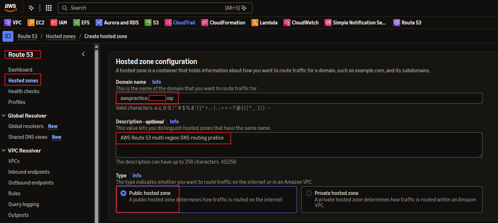</a></td></tr></table>

<p><sub><strong>Screenshot 01:</strong> Route 53 public hosted-zone creation with the awspractice subdomain.</sub></p>

<table><tr><td align="center"><a href="images/screenshot-02.png">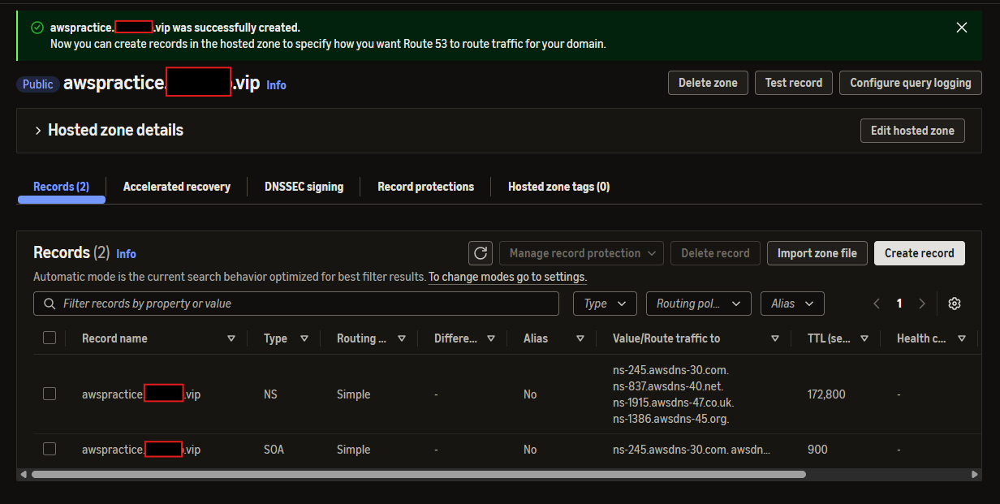</a></td></tr></table>

<p><sub><strong>Screenshot 02:</strong> Created public hosted zone containing the NS and SOA records.</sub></p>


### 2.3 Delegating the Subdomain in Cloudflare

The Route 53 hosted zone received four authoritative nameservers. I created **four DNS-only NS records at the `awspractice` label** in **Cloudflare → DNS → Records**:

| Type | Cloudflare name | Route 53 name server | TTL |
| --- | --- | --- | --- |
| NS | `awspractice` | `ns-245.awsdns-30.com` | Auto |
| NS | `awspractice` | `ns-837.awsdns-40.net` | Auto |
| NS | `awspractice` | `ns-1915.awsdns-47.co.uk` | Auto |
| NS | `awspractice` | `ns-1386.awsdns-45.org` | Auto |

The original delegation had a transcribed name-server mismatch: `ns-837.awsdns-30.net` was entered instead of the authoritative `ns-837.awsdns-40.net`. I compared the published records with Route 53's own NS values and corrected the Cloudflare entry. The final four values matched exactly.

The evidence below documents the initial entry, authoritative answer, and corrected Cloudflare configuration. The private parent-domain and unrelated DNS names have been concealed.


<table><tr><td align="center"><a href="images/screenshot-03.png">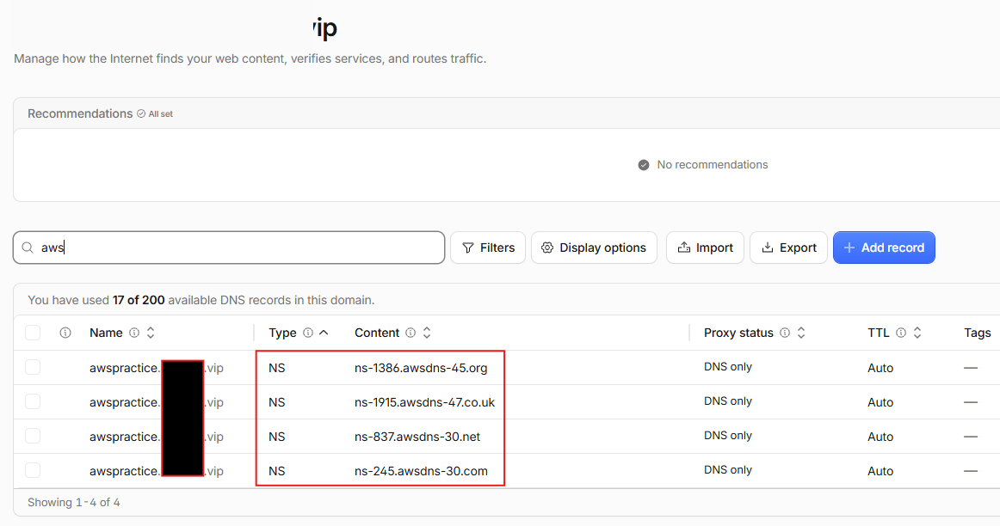</a></td></tr></table>

<p><sub><strong>Screenshot 03:</strong> Initial Cloudflare NS delegation configuration before a value was corrected.</sub></p>

<table><tr><td align="center"><a href="images/screenshot-04.png">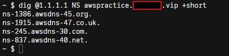</a></td></tr></table>

<p><sub><strong>Screenshot 04:</strong> DNS lookup confirming that a recursive resolver could return Route 53 name servers.</sub></p>

<table><tr><td align="center"><a href="images/screenshot-05.png">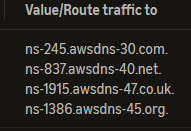</a></td></tr></table>

<p><sub><strong>Screenshot 05:</strong> Authoritative NS values assigned by Route 53.</sub></p>

<table><tr><td align="center"><a href="images/screenshot-06.png">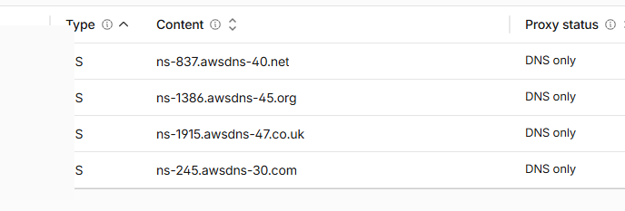</a></td></tr></table>

<p><sub><strong>Screenshot 06:</strong> Corrected Cloudflare delegation, with four matching DNS-only NS records.</sub></p>


### 2.4 Verifying DNS Delegation

I queried a public recursive resolver and confirmed that it returned the four Route 53 name servers:

```bash
dig @1.1.1.1 NS awspractice.<PARENT_DOMAIN> +short
```

The nameserver ordering in the response was not significant. The important verification was that the delegation values matched the Route 53 hosted zone. I then used a Route 53 authoritative server for later record-level tests:

```bash
dig @ns-245.awsdns-30.com failover.awspractice.<PARENT_DOMAIN> A +short
```

`<PARENT_DOMAIN>` is a placeholder; replace it with a domain you control. The commands show the actual query structure, while the published domain is intentionally anonymized.


> [!IMPORTANT]
> **SAA-C03 EXAM CONNECTION** — Creating an NS record inside a child hosted zone is not the same as publishing a delegation in the parent zone. Public recursive resolvers need the parent zone's NS referral. Changing the registrar's parent-domain nameservers was **not required** for this subdomain delegation.

---


## 03 Deploying Three Regional Web Servers

### 3.1 Why Separate Regional Endpoints?

I deployed a simple static HTTP website on each regional EC2 instance. Each page used the same white-card design and **AWS TRAINING BY SRKN** branding, but distinct background colors and Region labels. This made routing decisions visible in real browser screenshots.

| Region | EC2 name | Instance ID | Public IPv4 | Background |
| --- | --- | --- | --- | --- |
| N. Virginia, `us-east-1a` | `Route53-Web-US` | `i-034f96e7a21f61c76` | `18.206.95.30` | Light orange, `#FFF0E3` |
| Paris, `eu-west-3a` | `Route53-Web-EU` | `i-05e6e145d37350c55` | `15.237.214.8` | Light turquoise, `#E0F7F4` |
| Singapore, `ap-southeast-1a` | `Route53-Web-AP` | `i-06848aa5a69778cd5` | `13.212.110.11` | Light pink, `#FCE7F0` |

> [!NOTE]
> The public IPv4 addresses in this report are **historical test endpoints**, not guaranteed permanent addresses. In particular, a stopped-and-started instance without an Elastic IP can acquire a different public IPv4 address. Reproduction requires updating DNS and health-check targets accordingly.

### 3.2 Configuring N. Virginia

I used the N. Virginia default VPC and a default subnet in `us-east-1a`, selected Amazon Linux 2023 x86_64, `t3.micro`, an 8 GiB gp3 root volume, and the existing regional EC2 key pair `npoweraws`.

The inbound security group allowed **SSH TCP 22 from My IP** and **HTTP TCP 80 from `0.0.0.0/0`**. I created the security group under the name `Route53-Web-US-SG` and enabled automatic public IPv4 assignment.

The US launch-form configuration and final running instance are documented below. The running instance ID and public IPv4 shown in the report correspond to the replacement instance used for the actual routing tests.


<table><tr><td align="center"><a href="images/screenshot-07.png">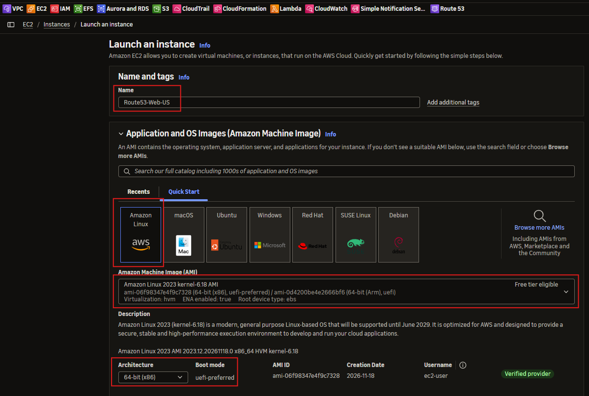</a></td></tr></table>

<p><sub><strong>Screenshot 07:</strong> N. Virginia EC2 launch settings: instance name and Amazon Linux 2023.</sub></p>

<table><tr><td align="center"><a href="images/screenshot-08.png">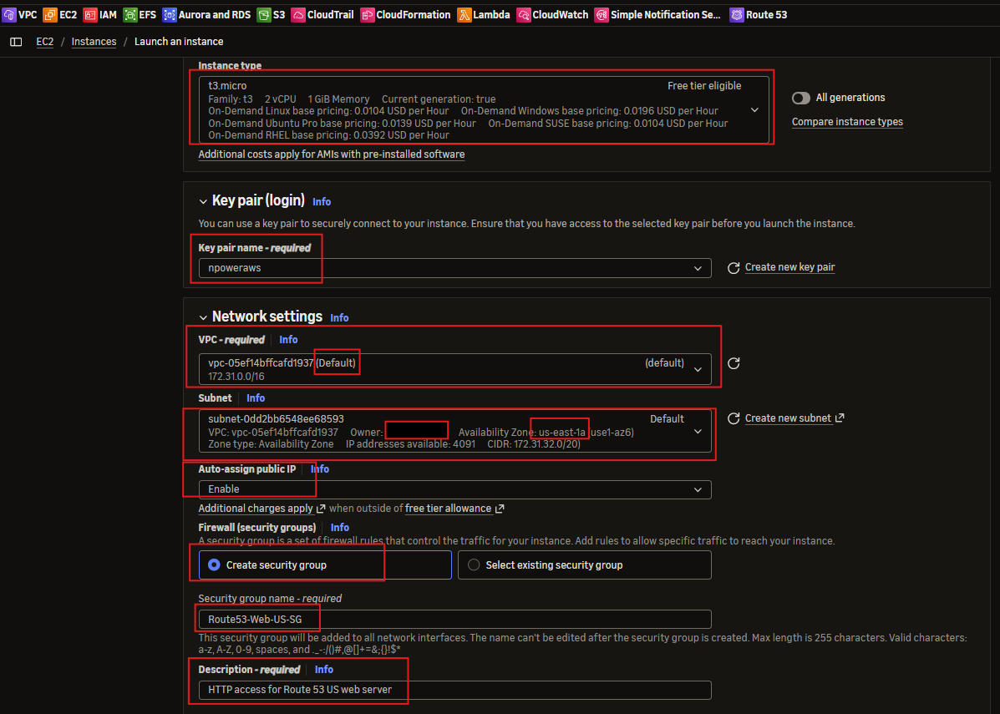</a></td></tr></table>

<p><sub><strong>Screenshot 08:</strong> US EC2 launch network settings: default VPC, public subnet, and security group.</sub></p>

<table><tr><td align="center"><a href="images/screenshot-09.png">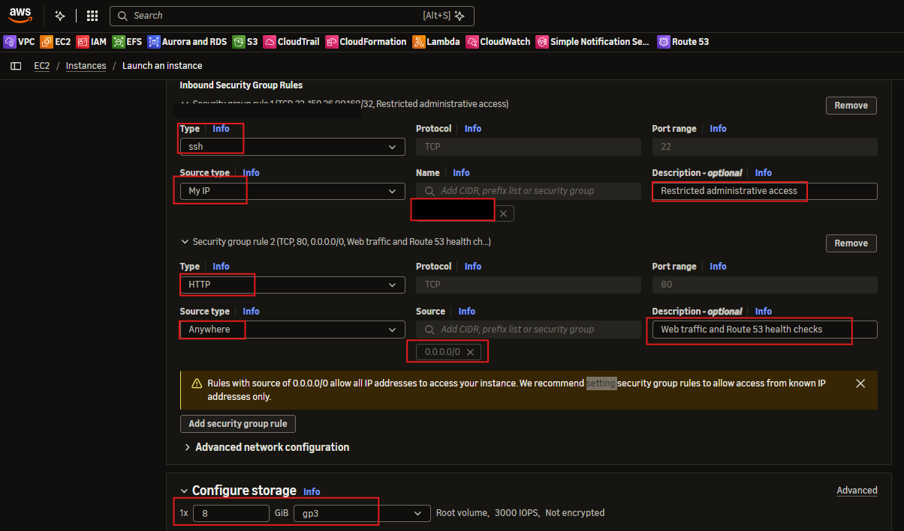</a></td></tr></table>

<p><sub><strong>Screenshot 09:</strong> US EC2 inbound rules, permitting restricted SSH and public HTTP.</sub></p>

<table><tr><td align="center"><a href="images/screenshot-10.png">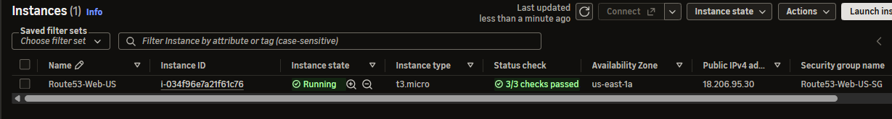</a></td></tr></table>

<p><sub><strong>Screenshot 10:</strong> Replacement US EC2 instance running in us-east-1a with three checks passed.</sub></p>


### 3.3 Installing Apache and Creating Region-Specific Pages

I connected to the EC2 instances using SSH, installed the Amazon Linux `httpd` package, started Apache, and enabled the service at startup:

```bash
sudo dnf update -y
sudo dnf install -y httpd
sudo systemctl enable --now httpd
```

I created `/var/www/html/index.html` using a shell heredoc (`sudo tee ... <<'EOF'`) and generated a separate `/health` file:

```bash
echo 'healthy' | sudo tee /var/www/html/health
```

The **US webpage** used a centered white card, `#FFF0E3` body background, and labels for `us-east-1` and `Route53-Web-US`. The Paris and Singapore pages reused the same page structure with their own Region text and colors.

The important regional values in the deployed HTML were:

| HTML field | N. Virginia | Paris | Singapore |
| --- | --- | --- | --- |
| `<title>` | `AWS Route 53 \| US East` | `AWS Route 53 \| Paris` | `AWS Route 53 \| Singapore` |
| `<h1>` | `US East - N. Virginia` | `Europe - Paris` | `Asia Pacific - Singapore` |
| Region code | `us-east-1` | `eu-west-3` | `ap-southeast-1` |
| Instance label | `Route53-Web-US` | `Route53-Web-EU` | `Route53-Web-AP` |
| CSS body background | `#FFF0E3` | `#E0F7F4` | `#FCE7F0` |
| CSS badge background | `#FFE0CA` | `#C9EEEA` | `#F8D4E3` |

A representative excerpt from the page structure is:

```html
<main class="card">
  <div class="badge">AWS TRAINING BY SRKN</div>
  <h1>US East - N. Virginia</h1>
  <h2>Regional Web Server</h2>
  <p><strong>Region:</strong> us-east-1</p>
  <p><strong>Instance:</strong> Route53-Web-US</p>
  <p class="status">&#9679; Server Healthy</p>
  <p>Multi-Region DNS Routing Demonstration</p>
</main>
```

I updated the initial US and Paris badge text consistently using the following command on each of those instances:

```bash
sudo sed -i 's/AWS ROUTE 53 TRAINING/AWS TRAINING BY SRKN/' /var/www/html/index.html
```

The badge, background color, Region labels, and page contents made it easy to distinguish DNS destinations visually. The displayed “Server Healthy” text was **static HTML**; actual availability was tested independently through `/health` and Route 53 health checks.

### 3.4 Verifying the US HTTP Service and Connectivity

I initially encountered an unusual terminal paste display while creating the US HTML file. I checked the saved file using `tail -n 15 /var/www/html/index.html`; its ending was normal. A regular browser request subsequently reset its connection, but Apache itself was running and responding locally.

I verified service status and response codes with:

```bash
sudo systemctl status httpd --no-pager
curl -I http://localhost
curl http://localhost/health
```

I then checked the security group, queried the public endpoint from CloudShell, and repeated the HTTP request from Windows PowerShell. Both external command-line checks returned `HTTP/1.1 200 OK` and `healthy`. Finally, an InPrivate browser window rendered the intended US webpage. These tests isolated the initial symptom to the browser/client path rather than Apache or the inbound HTTP rule.


<table><tr><td align="center"><a href="images/screenshot-11.png">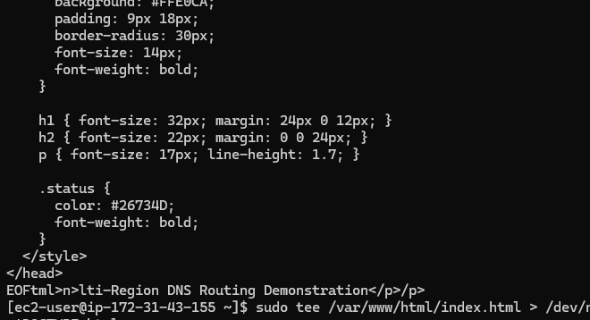</a></td></tr></table>

<p><sub><strong>Screenshot 11:</strong> Terminal paste displaying an unusual ending during the HTML creation step.</sub></p>

<table><tr><td align="center"><a href="images/screenshot-12.png">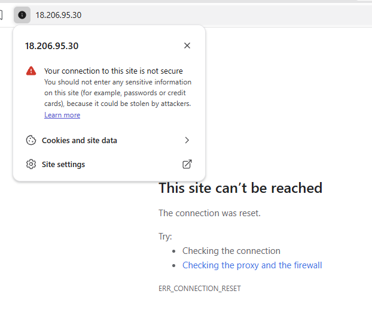</a></td></tr></table>

<p><sub><strong>Screenshot 12:</strong> Initial browser connection reset during the US HTTP reachability test.</sub></p>

<table><tr><td align="center"><a href="images/screenshot-13.png">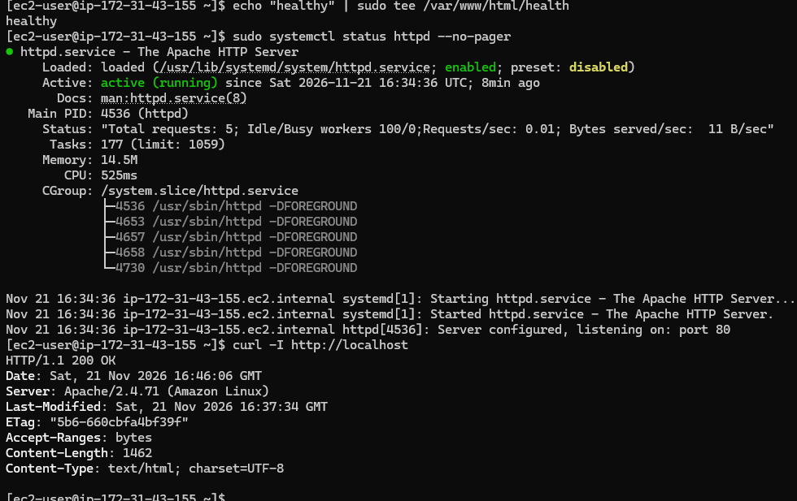</a></td></tr></table>

<p><sub><strong>Screenshot 13:</strong> Apache running locally and responding with HTTP 200 on the US instance.</sub></p>

<table><tr><td align="center"><a href="images/screenshot-14.png">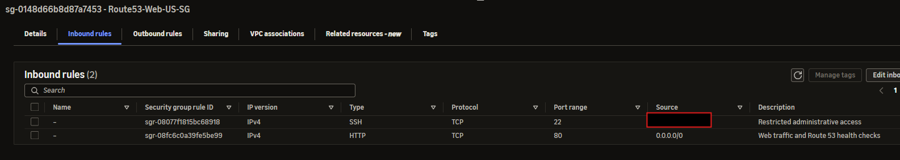</a></td></tr></table>

<p><sub><strong>Screenshot 14:</strong> US security group inbound rules: TCP 22 restricted and TCP 80 public.</sub></p>

<table><tr><td align="center"><a href="images/screenshot-15.png">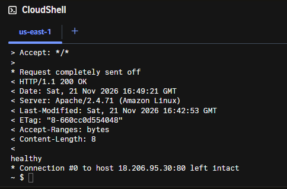</a></td></tr></table>

<p><sub><strong>Screenshot 15:</strong> Public HTTP health endpoint returning 200 and healthy from AWS CloudShell.</sub></p>

<table><tr><td align="center"><a href="images/screenshot-16.png">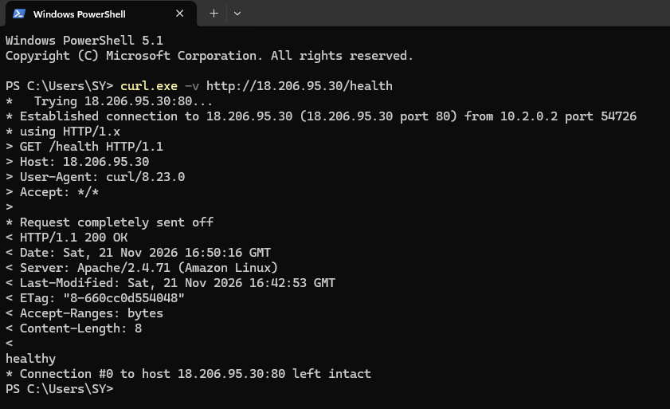</a></td></tr></table>

<p><sub><strong>Screenshot 16:</strong> Windows PowerShell reaching the public HTTP health endpoint successfully.</sub></p>

<table><tr><td align="center"><a href="images/screenshot-17.png">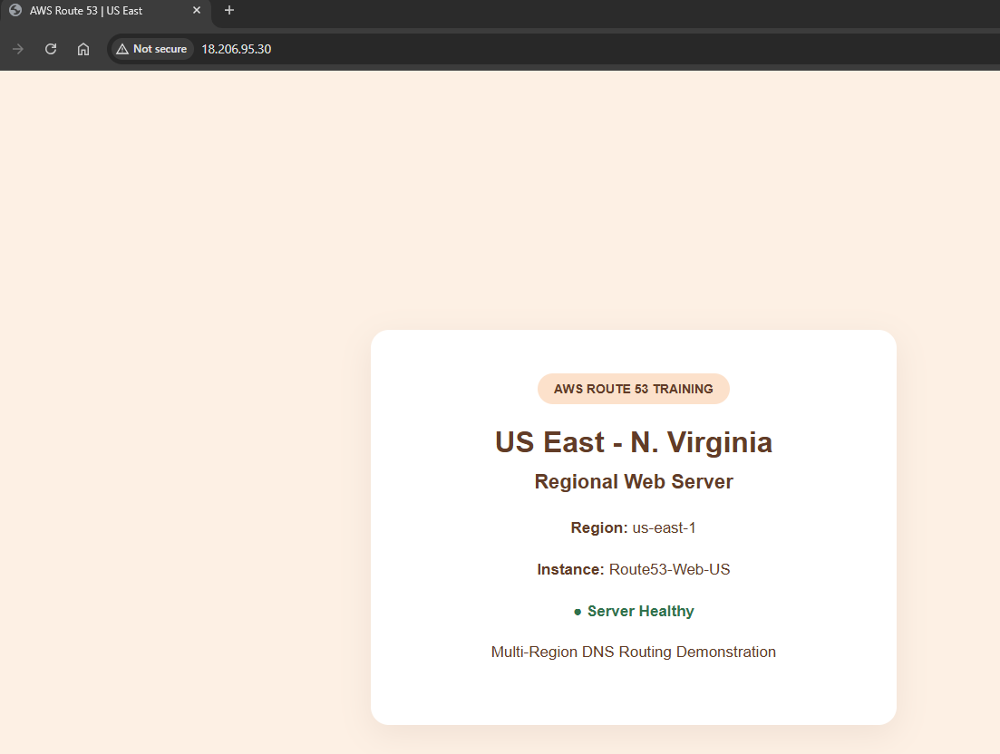</a></td></tr></table>

<p><sub><strong>Screenshot 17:</strong> US East orange regional website displayed in the browser.</sub></p>


### 3.5 Deploying the Paris Server

I switched to the **Paris (`eu-west-3`)** Region, where the US VPC, subnets, security groups, and EC2 key pair were not available because those resources are regional. I selected the Paris default VPC and `eu-west-3a` subnet, used the regional key pair `pariskey`, enabled public IPv4 assignment, and created `Route53-Web-EU-SG` with restricted SSH and public HTTP access.

The Paris instance reported **Running** and **3/3 status checks passed**. After installing Apache and writing the light-turquoise HTML, I opened the website by its public IP and later updated its badge to **AWS TRAINING BY SRKN**.


<table><tr><td align="center"><a href="images/screenshot-18.png">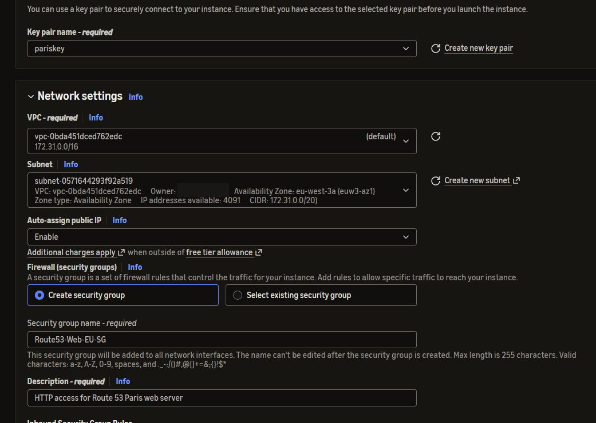</a></td></tr></table>

<p><sub><strong>Screenshot 18:</strong> Paris instance launch networking using the default VPC in eu-west-3.</sub></p>

<table><tr><td align="center"><a href="images/screenshot-19.png">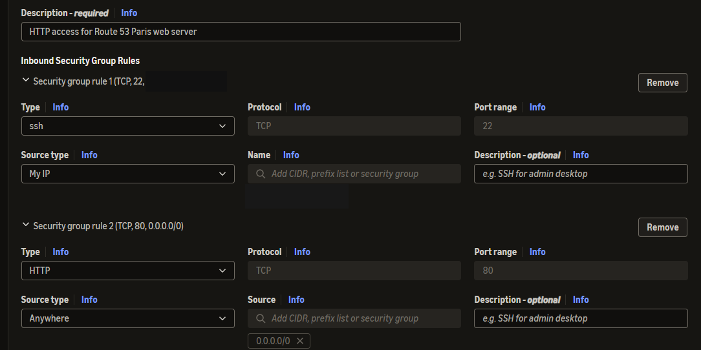</a></td></tr></table>

<p><sub><strong>Screenshot 19:</strong> Paris security group launch rules for restricted SSH and public HTTP.</sub></p>

<table><tr><td align="center"><a href="images/screenshot-20.png">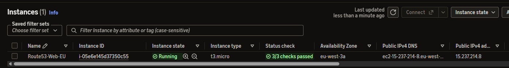</a></td></tr></table>

<p><sub><strong>Screenshot 20:</strong> Paris EC2 instance running in eu-west-3a with three checks passed.</sub></p>

<table><tr><td align="center"><a href="images/screenshot-21.png">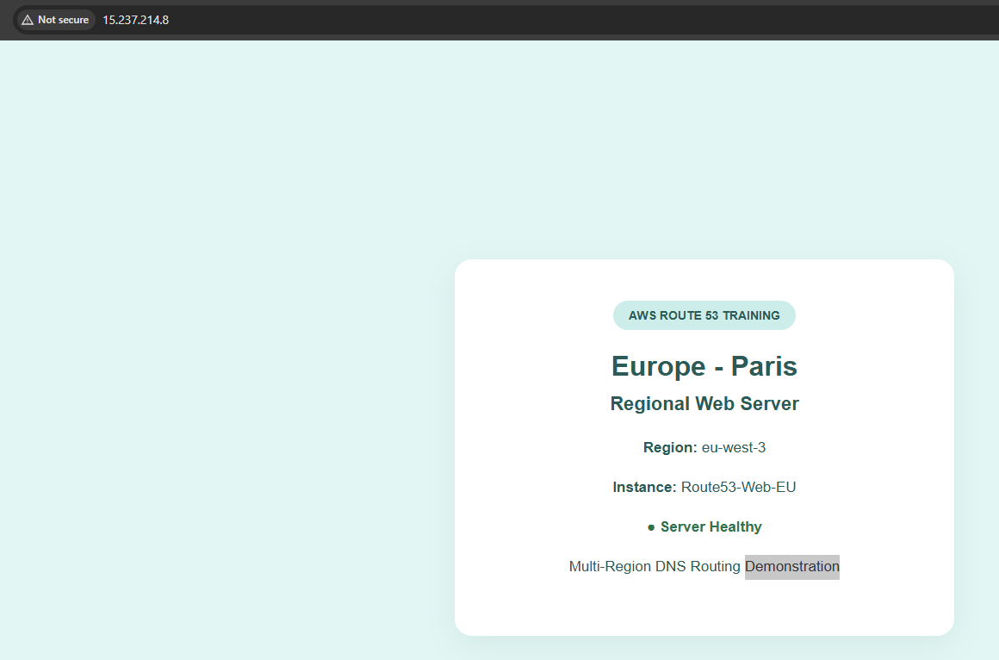</a></td></tr></table>

<p><sub><strong>Screenshot 21:</strong> Paris light-turquoise webpage displayed before the branding change.</sub></p>

<table><tr><td align="center"><a href="images/screenshot-22.png">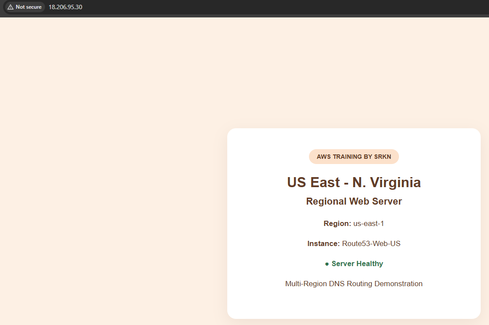</a></td></tr></table>

<p><sub><strong>Screenshot 22:</strong> US East webpage displaying the AWS TRAINING BY SRKN brand.</sub></p>

<table><tr><td align="center"><a href="images/screenshot-23.png">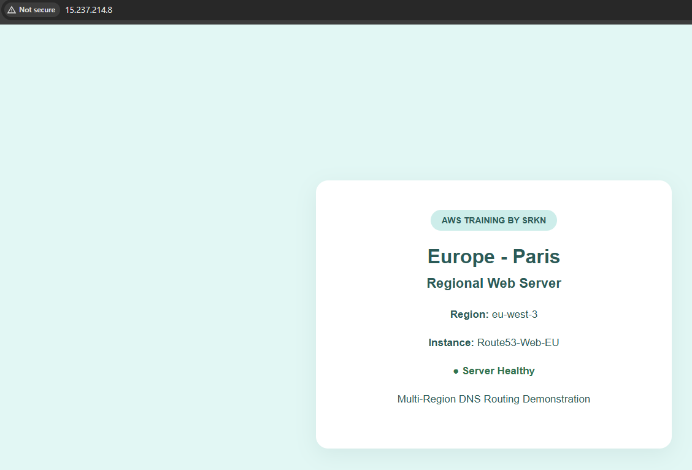</a></td></tr></table>

<p><sub><strong>Screenshot 23:</strong> Paris webpage displaying the AWS TRAINING BY SRKN brand.</sub></p>


### 3.6 Deploying the Singapore Server

I launched `Route53-Web-AP` in the Singapore default VPC, subnet `ap-southeast-1a`, with public IPv4 enabled. While configuring the security group, the new custom TCP rule initially had **port 0**. I corrected it to **HTTP TCP 80** before completing deployment. I connected using SSH from Windows PowerShell, installed Apache, and deployed the light-pink branded website.

The final Singapore instance reported **Running** and **3/3 status checks passed**, and the browser displayed the expected `ap-southeast-1` webpage.


<table><tr><td align="center"><a href="images/screenshot-24.png">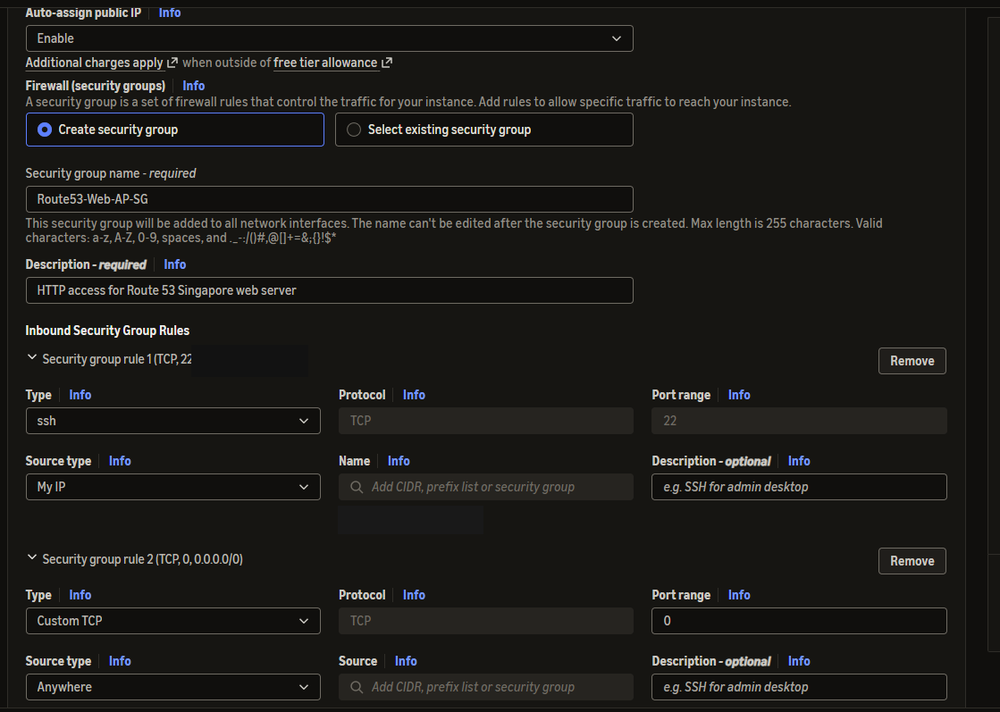</a></td></tr></table>

<p><sub><strong>Screenshot 24:</strong> Singapore launch form showing an inbound TCP port requiring correction.</sub></p>

<table><tr><td align="center"><a href="images/screenshot-25.png">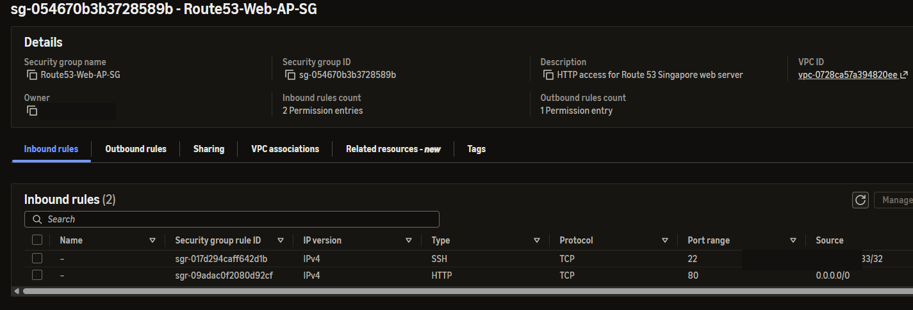</a></td></tr></table>

<p><sub><strong>Screenshot 25:</strong> Singapore security group with TCP 80 corrected and SSH restricted.</sub></p>

<table><tr><td align="center"><a href="images/screenshot-26.png">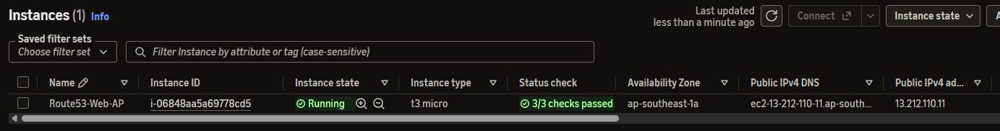</a></td></tr></table>

<p><sub><strong>Screenshot 26:</strong> Singapore EC2 instance running in ap-southeast-1a with three checks passed.</sub></p>

<table><tr><td align="center"><a href="images/screenshot-27.png">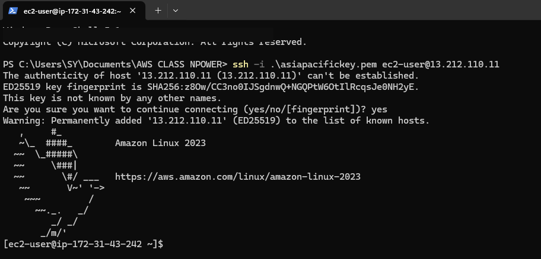</a></td></tr></table>

<p><sub><strong>Screenshot 27:</strong> Successful SSH login to the Singapore Amazon Linux 2023 server.</sub></p>

<table><tr><td align="center"><a href="images/screenshot-28.png">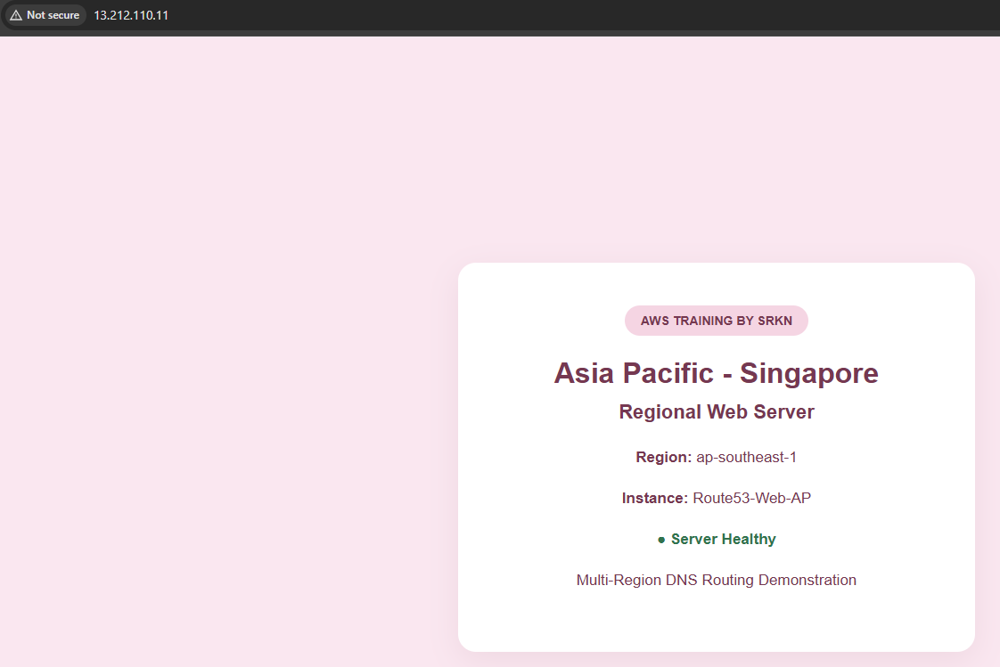</a></td></tr></table>

<p><sub><strong>Screenshot 28:</strong> Singapore light-pink webpage with regional identification and branding.</sub></p>


### 3.7 Testing All Three Application Health Endpoints

From AWS CloudShell, I tested each regional web server using its public IPv4 and `/health` path:

```bash
for ip in 18.206.95.30 15.237.214.8 13.212.110.11; do
  echo "Testing $ip"
  curl -sS --max-time 10 -w '\nHTTP Status: %{http_code}\n' "http://$ip/health"
  echo '----------------------'
done
```

| Endpoint | Body | HTTP status | Verified |
| --- | --- | --- | --- |
| `http://18.206.95.30/health` | `healthy` | 200 | Yes |
| `http://15.237.214.8/health` | `healthy` | 200 | Yes |
| `http://13.212.110.11/health` | `healthy` | 200 | Yes |

The combined test confirmed that all three regional endpoints were ready for Route 53 monitoring.


<table><tr><td align="center"><a href="images/screenshot-29.png">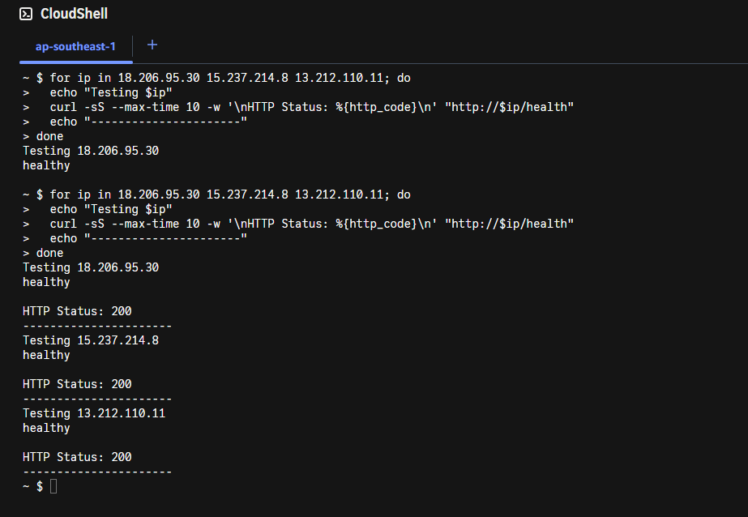</a></td></tr></table>

<p><sub><strong>Screenshot 29:</strong> CloudShell verification of all three /health endpoints returning HTTP 200 and healthy.</sub></p>


> [!IMPORTANT]
> **SAA-C03 EXAM CONNECTION** — Security groups are stateful, but VPC networking and the application are separate dependencies. A successful `curl http://localhost` proves only local service behavior; testing the instance's public IPv4 confirms whether external traffic can reach the application. Region-specific key pairs and VPCs cannot be selected from another Region's EC2 launch form.

---


## 04 Configuring HTTP Health Checks

### 4.1 Purpose and Mechanism

A Route 53 HTTP health check regularly connects to a public endpoint and assesses whether the application returns a successful HTTP response. I used the dedicated `/health` path so monitoring could test the service without relying on the webpage's static status label.

I created three **public endpoint** health checks using IP-based monitoring. In the version of the Route 53 Console used, the endpoint was supplied as an **IP-plus-path value**, such as `18.206.95.30/health`; the saved check then displayed the resolved URL `http://18.206.95.30:80/health`.

| Health-check name | Endpoint | Interval | Failure threshold | Verified status |
| --- | --- | --- | --- | --- |
| `Route53-Failover-US-Primary-HC` | `http://18.206.95.30:80/health` | 30 s | 3 | Healthy |
| `Route53-Failover-EU-Secondary-HC` | `http://15.237.214.8:80/health` | 30 s | 3 | Healthy |
| `Route53-AP-Singapore-HC` | `http://13.212.110.11:80/health` | 30 s | 3 | Healthy |

I left string matching and inverted status disabled, used a standard 30-second interval, and did not configure notification alarms for the checks. These health-check objects were reused by multiple DNS policies; I did **not** create separate checks for every record.

### 4.2 Primary Endpoint Check

I created `Route53-Failover-US-Primary-HC`. The health-check list was initially empty; after creation, the new check showed **Unknown** while results were being established, then subsequently reported **Healthy**. I verified the saved URL, enabled state, and reported status.


<table><tr><td align="center"><a href="images/screenshot-30.png">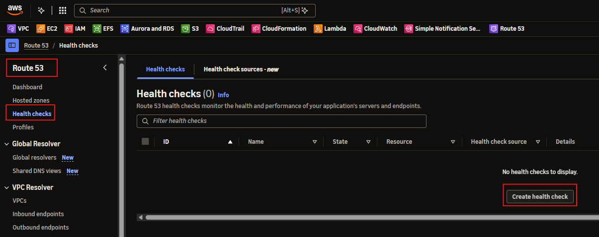</a></td></tr></table>

<p><sub><strong>Screenshot 30:</strong> Route 53 health checks page before creating the endpoint checks.</sub></p>

<table><tr><td align="center"><a href="images/screenshot-31.png">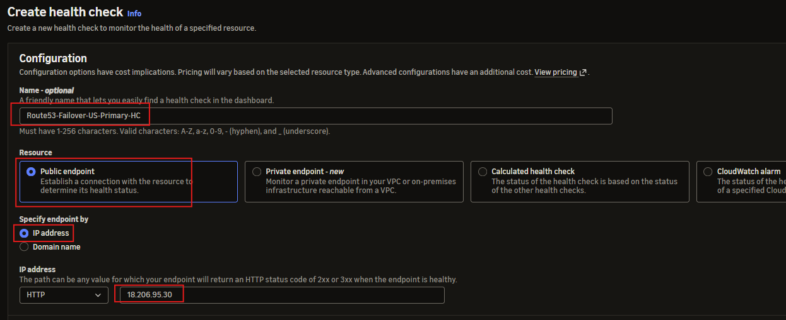</a></td></tr></table>

<p><sub><strong>Screenshot 31:</strong> Primary US health-check configuration: public endpoint and IP-based monitoring.</sub></p>

<table><tr><td align="center"><a href="images/screenshot-32.png">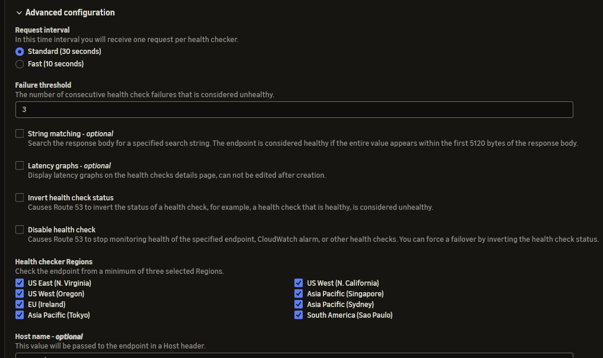</a></td></tr></table>

<p><sub><strong>Screenshot 32:</strong> Primary health-check advanced settings: 30-second interval and failure threshold 3.</sub></p>

<table><tr><td align="center"><a href="images/screenshot-33.png">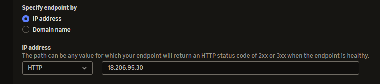</a></td></tr></table>

<p><sub><strong>Screenshot 33:</strong> Current Route 53 endpoint input accepting a combined IP and /health path.</sub></p>

<table><tr><td align="center"><a href="images/screenshot-34.png">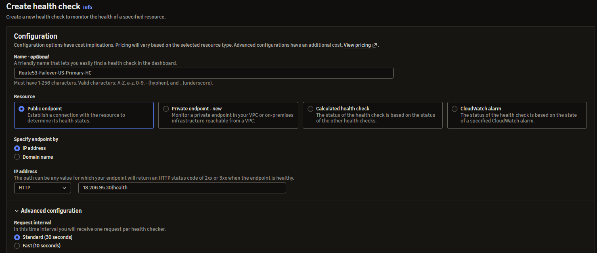</a></td></tr></table>

<p><sub><strong>Screenshot 34:</strong> Primary HTTP health-check creation form with 18.206.95.30/health.</sub></p>

<table><tr><td align="center"><a href="images/screenshot-35.png">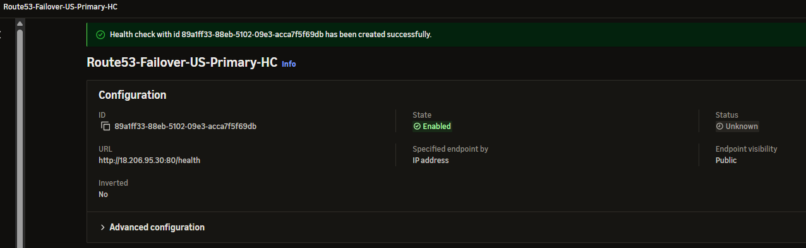</a></td></tr></table>

<p><sub><strong>Screenshot 35:</strong> New primary health check enabled with initial status Unknown.</sub></p>

<table><tr><td align="center"><a href="images/screenshot-36.png">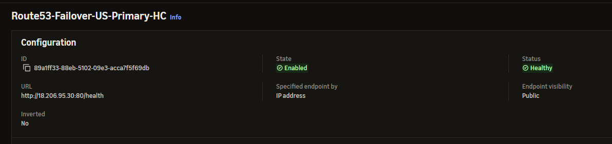</a></td></tr></table>

<p><sub><strong>Screenshot 36:</strong> US primary health check reporting Healthy.</sub></p>


### 4.3 Secondary and Singapore Checks

I created the Paris secondary check and the Singapore check using the same HTTP `/health` pattern. Each completed configuration was enabled and independently reported Healthy.


<table><tr><td align="center"><a href="images/screenshot-37.png">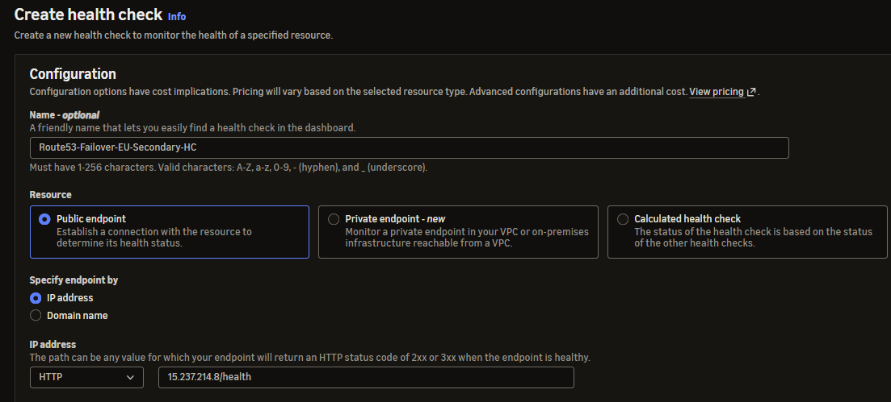</a></td></tr></table>

<p><sub><strong>Screenshot 37:</strong> Paris secondary HTTP health-check creation configuration.</sub></p>

<table><tr><td align="center"><a href="images/screenshot-38.png">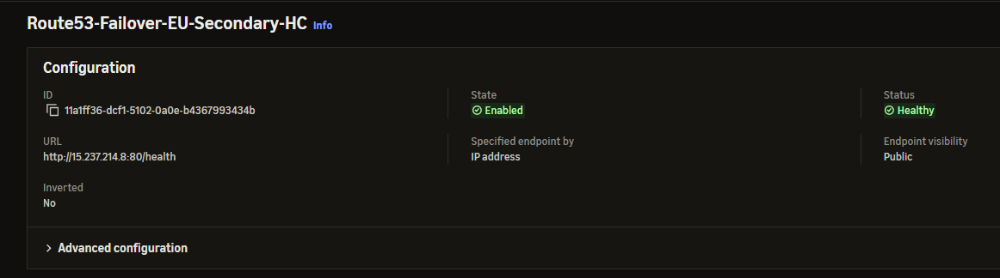</a></td></tr></table>

<p><sub><strong>Screenshot 38:</strong> Paris secondary health check reporting Healthy.</sub></p>

<table><tr><td align="center"><a href="images/screenshot-39.png">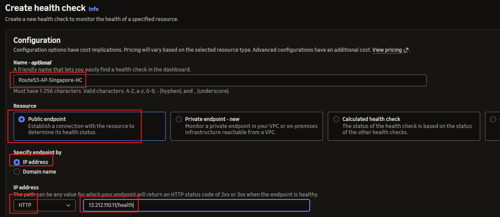</a></td></tr></table>

<p><sub><strong>Screenshot 39:</strong> Singapore HTTP health-check creation configuration.</sub></p>

<table><tr><td align="center"><a href="images/screenshot-40.png">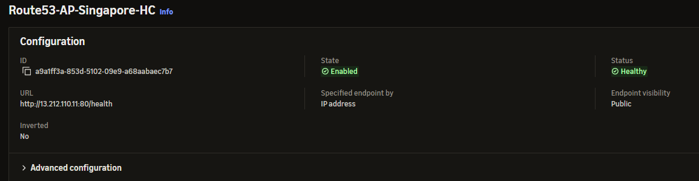</a></td></tr></table>

<p><sub><strong>Screenshot 40:</strong> Singapore health check reporting Healthy.</sub></p>


> [!NOTE]
> **KEY TAKEAWAY** — A healthy HTTP check validates only the monitored path at the time of the check. The checks do not guarantee database integrity, application correctness, regional recovery capacity, or user-session continuity.

---


## 05 Active-Passive Failover Routing

### 5.1 Purpose and Configuration

I configured active-passive DNS failover with **N. Virginia as Primary** and **Paris as Secondary**. Both were non-alias A records sharing the same name and record type, but each had a different failover role, record ID, value, and associated health check.

| Field | Primary record | Secondary record |
| --- | --- | --- |
| Name | `failover` | `failover` |
| Type | A | A |
| Alias | No | No |
| Policy | Failover | Failover |
| Failover type | Primary | Secondary |
| Value | `18.206.95.30` | `15.237.214.8` |
| TTL | 60 | 60 |
| Record ID | `US-Primary` | `EU-Secondary` |
| Health check | US primary check | Paris secondary check |

The resulting example hostname is `failover.awspractice.example.com`. In normal operation the authoritative answer was the primary. When Apache stopped in N. Virginia and the US check became Unhealthy, Route 53 selected the healthy Paris secondary.

### 5.2 Creating the Failover Record Pair

I opened **Route 53 → Hosted zones → Create record**, selected the Failover policy, saved the Primary A record, then created the Secondary A record with the same name and type. Each was linked to its existing regional health check.


<table><tr><td align="center"><a href="images/screenshot-41.png">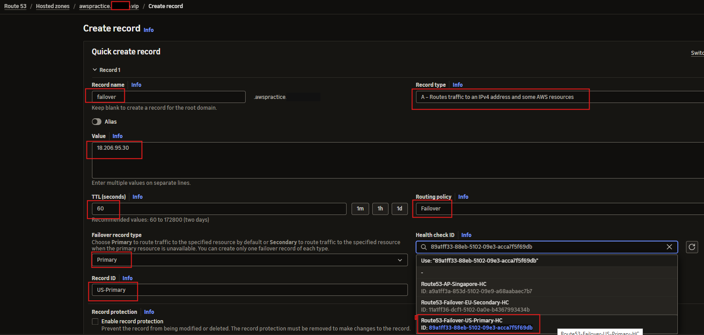</a></td></tr></table>

<p><sub><strong>Screenshot 41:</strong> Primary failover A-record creation, associated with the US health check.</sub></p>

<table><tr><td align="center"><a href="images/screenshot-42.png">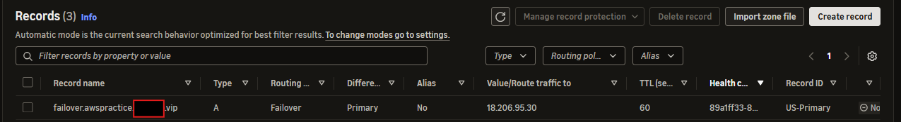</a></td></tr></table>

<p><sub><strong>Screenshot 42:</strong> Saved primary failover record with TTL 60 and US-Primary record ID.</sub></p>

<table><tr><td align="center"><a href="images/screenshot-43.png">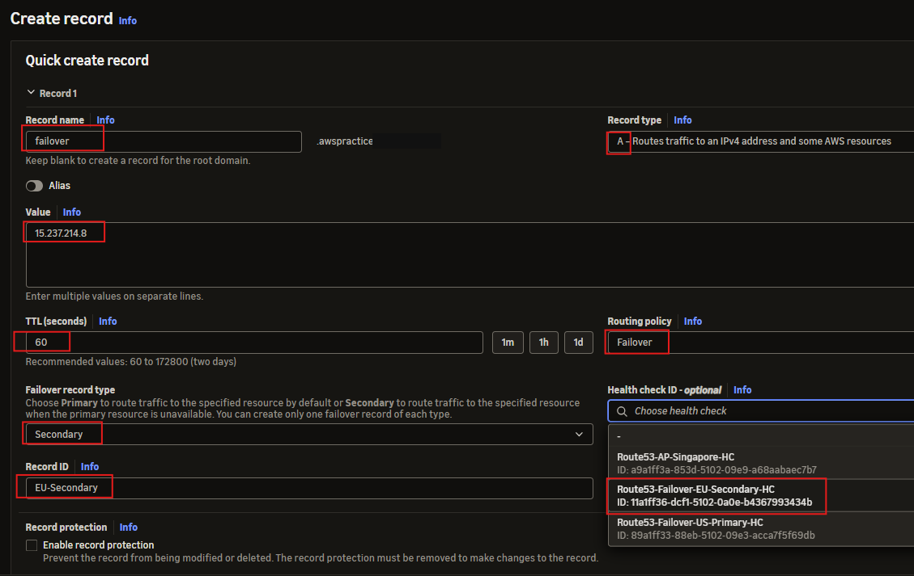</a></td></tr></table>

<p><sub><strong>Screenshot 43:</strong> Secondary failover A-record creation, associated with the Paris health check.</sub></p>

<table><tr><td align="center"><a href="images/screenshot-44.png">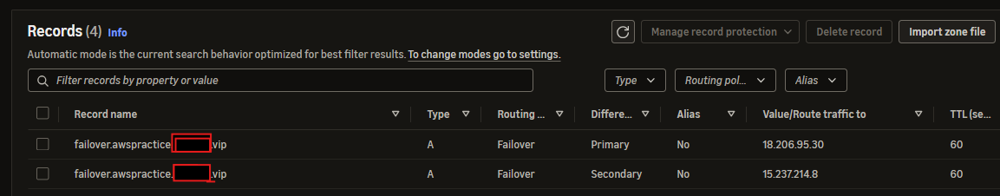</a></td></tr></table>

<p><sub><strong>Screenshot 44:</strong> Both primary and secondary failover A records in the hosted zone.</sub></p>


### 5.3 Establishing the Healthy Primary Baseline

I queried a Route 53 authoritative name server directly to minimize the effect of recursive resolver caches:

```bash
dig @ns-245.awsdns-30.com failover.awspractice.<PARENT_DOMAIN> A +short
```

**Observed baseline answer:** `18.206.95.30` — N. Virginia.

### 5.4 Simulating an Application Failure

Instead of terminating the EC2 instance, I deliberately stopped Apache on the US primary:

```bash
sudo systemctl stop httpd
sudo systemctl is-active httpd
# Observed: inactive
```

The direct browser request stopped working. Route 53 reported the **US primary Unhealthy**, while the **Paris secondary remained Healthy**. The same authoritative DNS query then returned `15.237.214.8`.

### 5.5 Restoring the Application and Verifying Failback

I restarted Apache and confirmed that it was active and that its `/health` file responded:

```bash
sudo systemctl start httpd
sudo systemctl is-active httpd
curl http://localhost/health
# Observed: active, healthy
```

After the US health check returned to Healthy, I repeated the authoritative query and observed `18.206.95.30` again.

| Phase | US application / health check | Paris health check | Authoritative A answer |
| --- | --- | --- | --- |
| Healthy baseline | Healthy | Healthy | `18.206.95.30` |
| Apache stopped | Unhealthy | Healthy | `15.237.214.8` |
| Apache restored | Healthy | Healthy | `18.206.95.30` |

The screenshots below preserve the actual before/failure/recovery sequence.


<table><tr><td align="center"><a href="images/screenshot-45.png">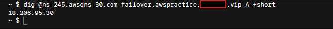</a></td></tr></table>

<p><sub><strong>Screenshot 45:</strong> Authoritative DNS query returning the US primary address before failure.</sub></p>

<table><tr><td align="center"><a href="images/screenshot-46.png">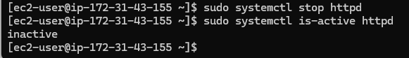</a></td></tr></table>

<p><sub><strong>Screenshot 46:</strong> Apache stopped on the US primary server; systemd reports inactive.</sub></p>

<table><tr><td align="center"><a href="images/screenshot-47.png">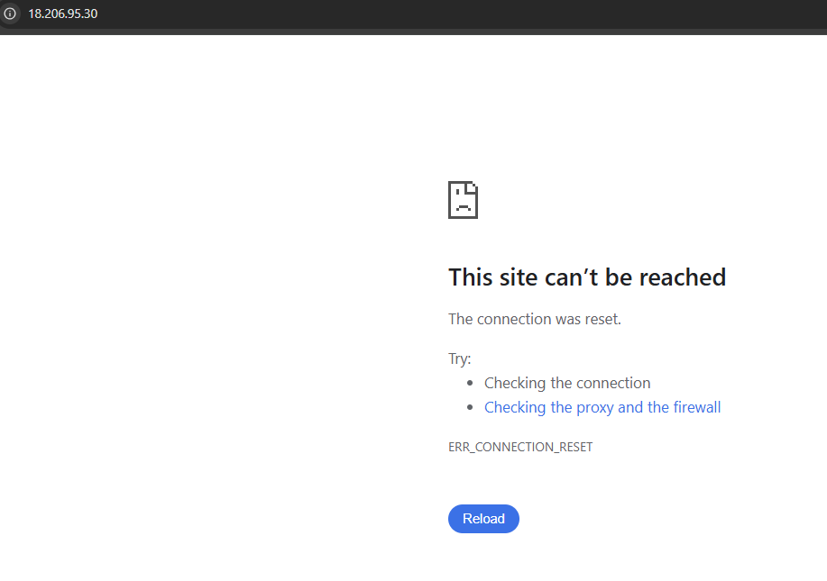</a></td></tr></table>

<p><sub><strong>Screenshot 47:</strong> Browser unable to reach the US Apache web server after the simulated outage.</sub></p>

<table><tr><td align="center"><a href="images/screenshot-48.png"></a></td></tr></table>

<p><sub><strong>Screenshot 48:</strong> Route 53 primary HTTP health check reporting Unhealthy.</sub></p>

<table><tr><td align="center"><a href="images/screenshot-49.png"></a></td></tr></table>

<p><sub><strong>Screenshot 49:</strong> Paris secondary health check remaining Healthy during the primary outage.</sub></p>

<table><tr><td align="center"><a href="images/screenshot-50.png"></a></td></tr></table>

<p><sub><strong>Screenshot 50:</strong> Authoritative DNS query returning the Paris secondary address during failover.</sub></p>

<table><tr><td align="center"><a href="images/screenshot-51.png"></a></td></tr></table>

<p><sub><strong>Screenshot 51:</strong> Primary US health check reporting Healthy after Apache recovery.</sub></p>

<table><tr><td align="center"><a href="images/screenshot-52.png"></a></td></tr></table>

<p><sub><strong>Screenshot 52:</strong> Apache restarted and the US /health endpoint returning healthy.</sub></p>

<table><tr><td align="center"><a href="images/screenshot-53.png"></a></td></tr></table>

<p><sub><strong>Screenshot 53:</strong> Authoritative DNS query returning the recovered US primary address.</sub></p>


> [!IMPORTANT]
> **SAA-C03 EXAM CONNECTION** — DNS failover changes **answers to new DNS queries**, not existing TCP connections. Recursive resolver caching, OS DNS caches, browser behavior, and application connection reuse can delay a client-visible switch even after Route 53 has selected the secondary.

---


## 06 Latency-Based Routing

### 6.1 Purpose and Record Configuration

I configured three non-alias latency A records using a **shared `latency` hostname**. Route 53 associated each record with the AWS Region of its EC2 endpoint and the existing HTTP health check for that endpoint.

| AWS Region | Record ID | Public IPv4 | TTL | Health check |
| --- | --- | --- | --- | --- |
| `us-east-1` | `Latency-US-East` | `18.206.95.30` | 60 | US primary |
| `eu-west-3` | `Latency-EU-Paris` | `15.237.214.8` | 60 | Paris secondary |
| `ap-southeast-1` | `Latency-AP-Singapore` | `13.212.110.11` | 60 | Singapore |

I created the three records together from the Route 53 record-creation workflow, using **Latency** as the routing policy for all three entries. The example FQDN is `latency.awspractice.example.com`.

### 6.2 Verifying Latency-Based DNS Responses

I used **Route 53 → Test record** to simulate DNS queries. The tool evaluated a given resolver IP; the response was an AWS routing decision, not a guaranteed probe of the current end-user round-trip time.

| Test input | Observed A answer | Selected Region |
| --- | --- | --- |
| Default simulation | `18.206.95.30` | N. Virginia |
| Paris simulated resolver (`15.237.214.8`) | `15.237.214.8` | Paris |
| Singapore simulated resolver (`13.212.110.11`) | `13.212.110.11` | Singapore |

Each test returned **No Error**. The evidence shows different regional selections under the tested conditions; it does not establish a permanent country-to-Region mapping.


<table><tr><td align="center"><a href="images/screenshot-54.png"></a></td></tr></table>

<p><sub><strong>Screenshot 54:</strong> US latency routing record configured for us-east-1 with health check.</sub></p>

<table><tr><td align="center"><a href="images/screenshot-55.png"></a></td></tr></table>

<p><sub><strong>Screenshot 55:</strong> Three regional latency records saved under the same DNS name.</sub></p>

<table><tr><td align="center"><a href="images/screenshot-56.png"></a></td></tr></table>

<p><sub><strong>Screenshot 56:</strong> Route 53 Test record returning the N. Virginia address for the initial test.</sub></p>

<table><tr><td align="center"><a href="images/screenshot-57.png"></a></td></tr></table>

<p><sub><strong>Screenshot 57:</strong> Latency test returning the Paris endpoint for the European simulation.</sub></p>

<table><tr><td align="center"><a href="images/screenshot-58.png"></a></td></tr></table>

<p><sub><strong>Screenshot 58:</strong> Latency test returning the Singapore endpoint for the Asia-Pacific simulation.</sub></p>


> [!IMPORTANT]
> **SAA-C03 EXAM CONNECTION** — Latency routing is distinct from geolocation. The DNS resolver's apparent location (or supported EDNS Client Subnet information) influences which Region Route 53 evaluates. A Region's geographical distance is not, by itself, a precise latency measurement. A latency record can reuse an already-created health check.

---


## 07 Geolocation and Default Routing

### 7.1 Purpose and Geographic Rules

I created geolocation A records with the same `geo` name. Here **Virginia** means the **US state-level geographic rule**, whereas **France** and **Singapore** are **country-level rules**. These are matching criteria for the origin of a DNS query, not descriptions of where EC2 itself is hosted.

| Route 53 location | Record ID | Destination | Associated check |
| --- | --- | --- | --- |
| United States → Virginia | `Geo-US-Virginia` | `18.206.95.30` | US primary |
| France | `Geo-EU-France` | `15.237.214.8` | Paris secondary |
| Singapore | `Geo-AP-Singapore` | `13.212.110.11` | Singapore |
| Default (added later) | `Geo-Default-US-East` | `18.206.95.30` | US primary |

All four records were non-alias A records with **60-second TTL**. More-specific geographic rules take precedence over broader matching rules where the locations overlap.

### 7.2 Testing the Three Specific Rules

I initially created **only the Virginia, France, and Singapore records**, without a default. Route 53's Test record response matched the expected destination for the three simulated locations:

| Simulated location | DNS status | Observed answer |
| --- | --- | --- |
| Virginia resolver | No Error | `18.206.95.30` |
| France resolver | No Error | `15.237.214.8` |
| Singapore resolver | No Error | `13.212.110.11` |

The first three records and their test responses are shown below.


<table><tr><td align="center"><a href="images/screenshot-59.png"></a></td></tr></table>

<p><sub><strong>Screenshot 59:</strong> Geolocation record list showing Virginia, France, and Singapore.</sub></p>

<table><tr><td align="center"><a href="images/screenshot-60.png"></a></td></tr></table>

<p><sub><strong>Screenshot 60:</strong> Test record form returning the Virginia endpoint for its simulated resolver.</sub></p>

<table><tr><td align="center"><a href="images/screenshot-61.png"></a></td></tr></table>

<p><sub><strong>Screenshot 61:</strong> Geolocation Test record response returning the Paris endpoint.</sub></p>

<table><tr><td align="center"><a href="images/screenshot-62.png"></a></td></tr></table>

<p><sub><strong>Screenshot 62:</strong> Geolocation Test record response returning the Singapore endpoint.</sub></p>


### 7.3 Demonstrating the Missing Default Rule

I tested resolver IP `8.8.8.8` using **Route 53 → Test record** while no default geolocation rule existed. Route 53 returned **No Error** but **no A-record address**. This is a valid DNS response sometimes called **NOERROR/NODATA**. It demonstrated an important failure mode: clients in unconfigured or unmapped geographic locations might receive no usable destination.

I then created a **Default** geolocation A record using `18.206.95.30` and the US primary health check. The record ID was `Geo-Default-US-East`. Repeating the same `8.8.8.8` simulator test returned `18.206.95.30`.

| Exact test | Before default | After default |
| --- | --- | --- |
| Resolver IP | `8.8.8.8` | `8.8.8.8` |
| DNS status | No Error | No Error |
| Answer | **No IP address** | **`18.206.95.30`** |
| Explanation | No matching geographic rule | Default record selected |

This comparison is the central result of the default-geolocation portion of the exercise.


<table><tr><td align="center"><a href="images/screenshot-63.png"></a></td></tr></table>

<p><sub><strong>Screenshot 63:</strong> Unmatched resolver 8.8.8.8 receiving no A-record answer before a default was created.</sub></p>

<table><tr><td align="center"><a href="images/screenshot-64.png"></a></td></tr></table>

<p><sub><strong>Screenshot 64:</strong> Four geolocation records after creation of the Default rule.</sub></p>

<table><tr><td align="center"><a href="images/screenshot-65.png"></a></td></tr></table>

<p><sub><strong>Screenshot 65:</strong> Repeating the 8.8.8.8 simulation returned the default US endpoint.</sub></p>


> [!NOTE]
> **KEY TAKEAWAY** — A default geolocation record is important when queries originate from locations outside the explicit rules or cannot be geographically identified. It must not be confused with the default route of a VPC route table; these are unrelated concepts.

---


## 08 Live Website and VPN Verification

### 8.1 End-to-End Browser-Based Failover

Authoritative DNS responses were useful, but I also tested the actual web experience using the `failover` hostname. With both servers healthy, the hostname displayed the **light-orange US East website**. After I stopped US Apache and Route 53 marked the primary Unhealthy, the **same hostname** displayed the **light-turquoise Paris website**. I restored Apache afterward and confirmed that the orange US website returned.

| Browser scenario | Hostname | Webpage observed | Outcome |
| --- | --- | --- | --- |
| Normal | `failover` | N. Virginia, light orange | Pass |
| US Apache stopped | `failover` | Paris, light turquoise | Pass |
| US Apache restored | `failover` | N. Virginia, light orange | Confirmed |

The following browser and health-check screenshots show the live hostname test, not merely a Route 53 simulator response.


<table><tr><td align="center"><a href="images/screenshot-66.png"></a></td></tr></table>

<p><sub><strong>Screenshot 66:</strong> The failover hostname displaying the orange US primary website.</sub></p>

<table><tr><td align="center"><a href="images/screenshot-67.png"></a></td></tr></table>

<p><sub><strong>Screenshot 67:</strong> During browser failover, the US health check was Unhealthy while Paris remained Healthy.</sub></p>

<table><tr><td align="center"><a href="images/screenshot-68.png"></a></td></tr></table>

<p><sub><strong>Screenshot 68:</strong> The same failover hostname displaying the turquoise Paris website.</sub></p>


### 8.2 Real VPN-Based Geolocation Tests

I connected a VPN to **France**, **Australia**, and **Singapore** and visited the `geo` hostname. The selected webpages were consistent with the configured geolocation records. I used `nslookup` and a public-IP query where needed to validate the client context, but did not treat a VPN country setting as proof of which geographic information Route 53 ultimately used.


| VPN exit location | `geo` website observed | Applicable rule | Outcome |
| --- | --- | --- | --- |
| France — Paris | Turquoise Paris website | France | Passed |
| Australia — Sydney | Orange N. Virginia website | Default | Passed |
| Singapore | Pink Singapore website | Singapore | Passed |

For the France test, DNS resolution returned `15.237.214.8` and the browser displayed the Paris page. In Australia, an unmatched country, the browser displayed the default US page. In Singapore, the browser displayed the country-specific pink page. VPN exit public IPs are withheld from publication; the EC2 destination IP addresses remain visible.

The VPN screenshots and resulting webpages are arranged in the order tested: France, Australia, then Singapore.


<table><tr><td align="center"><a href="images/screenshot-69.png"></a></td></tr></table>

<p><sub><strong>Screenshot 69:</strong> Proton VPN connected to France for the live geolocation test.</sub></p>

<table><tr><td align="center"><a href="images/screenshot-70.png"></a></td></tr></table>

<p><sub><strong>Screenshot 70:</strong> PowerShell check confirming a changed public exit address through the VPN.</sub></p>

<table><tr><td align="center"><a href="images/screenshot-71.png"></a></td></tr></table>

<p><sub><strong>Screenshot 71:</strong> DNS query from the France VPN returning the Paris web server address.</sub></p>

<table><tr><td align="center"><a href="images/screenshot-72.png"></a></td></tr></table>

<p><sub><strong>Screenshot 72:</strong> Geolocation hostname displaying the Paris website from the France VPN.</sub></p>

<table><tr><td align="center"><a href="images/screenshot-73.png"></a></td></tr></table>

<p><sub><strong>Screenshot 73:</strong> Proton VPN connected to Australia for the unmatched-location test.</sub></p>

<table><tr><td align="center"><a href="images/screenshot-74.png"></a></td></tr></table>

<p><sub><strong>Screenshot 74:</strong> Geolocation hostname displaying the default US website from the Australia VPN.</sub></p>

<table><tr><td align="center"><a href="images/screenshot-75.png"></a></td></tr></table>

<p><sub><strong>Screenshot 75:</strong> Proton VPN connected to Singapore for a country-level location test.</sub></p>

<table><tr><td align="center"><a href="images/screenshot-76.png"></a></td></tr></table>

<p><sub><strong>Screenshot 76:</strong> Geolocation hostname displaying the Singapore pink regional website.</sub></p>


### 8.3 Singapore VPN — Real Latency Hostname

While connected through the Singapore VPN, I queried the `latency` hostname from Windows PowerShell and opened it in the browser. `nslookup` returned **`13.212.110.11`**; the browser displayed the **pink Singapore website**.

```powershell
nslookup latency.awspractice.<PARENT_DOMAIN>
```

The resolver in the displayed PowerShell output was a VPN-side resolver. This test is one observed network condition rather than proof that every client using a Singapore VPN will receive the same latency answer.


<table><tr><td align="center"><a href="images/screenshot-77.png"></a></td></tr></table>

<p><sub><strong>Screenshot 77:</strong> DNS resolution over Singapore VPN returning the Singapore latency endpoint.</sub></p>

<table><tr><td align="center"><a href="images/screenshot-78.png"></a></td></tr></table>

<p><sub><strong>Screenshot 78:</strong> Latency hostname displaying the Singapore webpage in the browser.</sub></p>


### 8.4 Consolidated Verified Results

| Policy | Test | Evidence-backed result |
| --- | --- | --- |
| Failover | Healthy baseline | US A record returned |
| Failover | Application outage | Primary health check Unhealthy; Paris A record returned |
| Failover | Recovery | US health check Healthy; US A record returned |
| Failover | Browser-based outage | Same hostname rendered US then Paris regional pages |
| Latency | Route 53 simulation | US, Paris, Singapore answers observed for respective test inputs |
| Latency | Singapore VPN | DNS returned `13.212.110.11`; pink website rendered |
| Geolocation | Specific rules | Virginia, France, Singapore answers observed |
| Geolocation | Missing default | No address returned for unmatched `8.8.8.8` simulation |
| Geolocation | Default added | Same simulation returned `18.206.95.30` |
| Geolocation | Real VPN tests | France → Paris; Australia → US Default; Singapore → Singapore |

> [!IMPORTANT]
> **SAA-C03 EXAM CONNECTION** — A full browser-based DNS test validates more than the hosted-zone record. It also depends on successful DNS delegation, the resolver's answer, IP networking, EC2 security controls, Apache, and the webpage content. This is why authoritative `dig` tests and actual browser screenshots serve complementary purposes.

---


## 09 SAA-C03 Knowledge Checks

> [!TIP]
> **1. Why does an NS record inside a Route 53 child hosted zone not automatically delegate that subdomain?**  
> **Answer:** Public resolvers discover authority through the parent DNS zone. The parent must publish the child-zone NS delegation; merely creating the hosted zone does not change the parent-zone referral.
>
> **2. How do failover and latency routing differ?**  
> **Answer:** Failover gives preference to a primary endpoint while it is healthy. Latency routing selects from regional records using AWS latency information, subject to health-based eligibility. It has no permanent primary.
>
> **3. Does a healthy EC2 instance guarantee a healthy application?**  
> **Answer:** No. I stopped Apache while leaving the US instance in place. The Route 53 HTTP health check correctly marked the application endpoint Unhealthy.
>
> **4. What can a NOERROR response with no A answer indicate for geolocation?**  
> **Answer:** The DNS name exists but no record is eligible for the requested location and no default record is configured. My unmatched-location test showed exactly this behavior.
>
> **5. Does a VPN automatically force Route 53 to treat the client as being in the VPN country?**  
> **Answer:** No. The authoritative decision can depend on the recursive resolver IP or EDNS Client Subnet information, and DNS caches may influence observed browser behavior.
>
> **6. What does a 60-second TTL guarantee during failover?**  
> **Answer:** It specifies how long a cooperative DNS resolver can cache the answer; it does not guarantee every browser will switch exactly 60 seconds after a failure. Different caches and existing connections can extend client-visible delays.
>
> **7. Can a single Route 53 health check be associated with more than one routing-policy record?**  
> **Answer:** Yes. I reused the existing US, Paris, and Singapore HTTP health checks across failover, latency, and geolocation records.
>
> **8. Does Route 53 handle application data replication between Regions?**  
> **Answer:** No. Route 53 supplies DNS decisions. Production disaster recovery also needs independently functioning workloads, data strategy, and a recovery process.

---


## 10 Troubleshooting and Production Considerations

### 10.1 Corrections and Observations From the Implementation

| Observation | Diagnostic action / correction | Technical lesson |
| --- | --- | --- |
| Cloudflare NS record differed from Route 53 | Corrected the `.net` name server to `ns-837.awsdns-40.net` | Exact authoritative delegation values matter |
| `dig: command not found` in CloudShell | Installed the `bind-utils` package using `sudo dnf install -y bind-utils` | Ephemeral/Region-specific environments may need DNS tools installed |
| HTML paste appeared malformed in terminal | Checked the saved file with `tail -n 15` | The terminal echo may be misleading; verify actual file content |
| US browser request reset despite healthy Apache | Compared localhost, CloudShell, Windows curl, SG rules, and InPrivate browser | Separate client-specific symptoms from AWS application/network failures |
| Singapore SG initially targeted TCP port 0 | Corrected the rule to HTTP TCP 80 before testing | A running application still needs the correct port permitted |
| Newly created health check initially Unknown | Rechecked until Route 53 reported Healthy | Initial state is not sufficient evidence of working monitoring |
| Published IPs are temporary | Recorded the verified addresses used in the tests | EC2 auto-assigned public IPv4 is not a stable service endpoint |

### 10.2 Production Architecture Considerations

The implementation was intentionally small and static for a DNS-routing exercise. A production-grade multi-Region application would require additional controls:

- **TLS and HTTPS:** The demo sites used HTTP and produced browser “Not secure” labels. Public production websites should use valid certificates, HTTPS endpoints, and appropriate edge/application protections.
- **Stable endpoints:** Use supported load balancers, suitable DNS alias records, or other persistent endpoints instead of hardcoding auto-assigned instance public IPs.
- **High availability within each Region:** Each website was one EC2 instance in one Availability Zone. DNS routing alone does not provide intra-Region multi-AZ redundancy.
- **Data consistency and session state:** Route 53 does not synchronize databases or user sessions across Regions.
- **Monitoring depth:** The static `/health` file indicates Apache can serve an HTTP response; a deeper readiness check could validate application dependencies when appropriate.
- **Cost and operations:** Running three EC2 instances, EBS volumes, public IPv4 addresses, Route 53 hosted-zone records, and three health checks can incur ongoing charges. Delete temporary resources once evidence has been preserved.
- **Security boundaries:** Restrict SSH administrative access, prefer role-based AWS permissions, and manage SSH private keys securely. HTTP access was intentionally public for the exercise.

> [!NOTE]
> **KEY TAKEAWAY** — A successful failover demonstration proves that the configured DNS selection worked for the monitored HTTP endpoints; it should not be overinterpreted as a complete disaster recovery or business continuity design.

---


## 11 Cleanup Procedure and Resource State

### 11.1 Current State at Documentation Time

All three routing policies were created and tested, and the US application was restored after the last browser-failover simulation. **Cleanup was not performed or verified within the evidence captured for this report.** The list below is a safe teardown procedure, not a claim of completed deletion.

| Resource group | Exercise-specific items | Documented state |
| --- | --- | --- |
| Cloudflare DNS | Four `awspractice` delegation NS records | Configured; removal not verified |
| Route 53 | Public hosted zone for the delegated subdomain | Created; deletion not verified |
| Route 53 A records | 2 failover + 3 latency + 4 geolocation = **9 A records** | Created; deletion not verified |
| Route 53 health checks | US, Paris, Singapore = **3** | Created; deletion not verified |
| EC2 instances | `Route53-Web-US`, `Route53-Web-EU`, `Route53-Web-AP` | Deployed; termination not verified |
| Custom EC2 security groups | `Route53-Web-US-SG`, `Route53-Web-EU-SG`, `Route53-Web-AP-SG` | Created; deletion not verified |
| Root EBS volumes | Associated with the regional EC2 instances | Deletion not verified |
| SSH key pairs | Regional keys used to connect | Reuse/deletion decisions not verified |

### 11.2 Safe Teardown Sequence

> [!WARNING]
> These are **destructive cleanup instructions**. Do not perform them until the required screenshots, DNS test results, and webpage evidence have been safely archived. Deleting a hosted zone or EC2 instance can disrupt names or workloads still using them.

1. **Cloudflare parent zone:** Remove only the **four NS records** for `awspractice`; leave all unrelated parent-zone records untouched. Verify that those four delegated NS entries are gone.
2. **Route 53 records:** In the delegated hosted zone, delete the **nine exercise-specific A records**: two `failover`, three `latency`, and four `geo` entries. Do not delete the auto-generated NS/SOA records individually; they are removed with the hosted zone.
3. **Route 53 health checks:** Delete the three checks after removing their record associations. Verify that they no longer appear in the health-check inventory.
4. **Route 53 hosted zone:** Delete the now-unneeded public hosted zone and verify it no longer appears in **Hosted zones**. Deleting the delegation at Cloudflare first reduces the chance that resolvers continue being referred to the retiring hosted zone.
5. **EC2 in each Region:** Terminate the three specific instances, one Region at a time. Verify termination; check EBS root-volume delete-on-termination behavior and inspect for retained volumes.
6. **Regional network resources:** After associated network interfaces are gone, remove the **exercise-created custom security groups** if unused. Retain default VPCs, subnets, their default security groups, and other preexisting regional networking.
7. **SSH keys:** Do **not** delete reusable keys simply because the exercise ended. Review the key pairs in each Region and remove a key only after confirming it was created solely for the temporary activity and is no longer used. In particular, the existing `npoweraws` key pair is outside the deletion scope.
8. **Final verification:** Inspect Route 53, Cloudflare delegation records, EC2 instances, custom security groups, EBS volumes, and any remaining test endpoints. Record actual findings separately after cleanup rather than marking these steps complete without evidence.

### 11.3 Retention Boundary

The cleanup scope is limited to resources provisioned for this Route 53 project. Unrelated AWS infrastructure, existing CloudTrail logging, retained EC2 keys, and previously existing environments are outside that scope.

---


## 12 Technical Competencies and Reflection

### 12.1 Technical Reflection

I configured a delegated Route 53 public DNS namespace and deployed three independently reachable Apache endpoints in N. Virginia, Paris, and Singapore. I verified the endpoints with HTTP requests before linking them to Route 53 health checks.

The failover experiment demonstrated a full application-level sequence: healthy primary DNS selection, Apache failure, unhealthy health check, secondary DNS selection, application recovery, and automatic return to the primary. The latency exercise showed Region-dependent DNS decisions, including a live Singapore VPN/browser test. The geolocation exercise demonstrated state- and country-level rules, the failure mode of an unmatched location without Default, and successful default and VPN-based routing behavior.

### 12.2 Technical Competencies

| Skill area | Demonstrated action | Evidence |
| --- | --- | --- |
| DNS authority delegation | Created a public hosted zone and corrected parent-zone NS records | Route 53 and Cloudflare screenshots; `dig` response |
| Multi-Region EC2 | Launched three regional Amazon Linux instances | Running-instance screenshots |
| Linux web administration | Installed and enabled Apache; deployed distinct HTML pages | Terminal and browser screenshots |
| Network access controls | Configured restricted SSH and public HTTP security-group rules | Security-group screenshots |
| Route 53 monitoring | Created three HTTP endpoint health checks | Route 53 Healthy statuses |
| Disaster recovery DNS | Configured primary/secondary failover and tested outage/failback | `dig`, health-check, and browser evidence |
| Latency-based DNS | Created three regional latency records and simulated different resolver origins | Route 53 Test record outputs |
| Geolocation DNS | Created geographic and default records and tested matching/unmatched origins | Route 53 and VPN/browser evidence |
| Troubleshooting | Isolated browser reset from Apache/network behavior and corrected configuration values | PowerShell, curl, CloudShell, and Console evidence |

> [!NOTE]
> **FINAL TAKEAWAY** — Route 53 routing policies are not interchangeable. Failover prioritizes availability of a primary endpoint, latency selects an eligible Region based on latency information, and geolocation follows explicit geographic matching rules. Testing both DNS answers and actual application responses makes these distinctions observable.

---


## Command Reference

These are commands used in the hands-on activity or their **anonymized equivalents** where the actual parent domain would otherwise be exposed. Commands using `<PARENT_DOMAIN>` are templates: substitute a domain under your control.

### Linux/Apache administration

```bash
sudo dnf update -y
sudo dnf install -y httpd
sudo systemctl enable --now httpd
sudo systemctl status httpd --no-pager
sudo systemctl is-active httpd
curl -I http://localhost
curl http://localhost/health
echo 'healthy' | sudo tee /var/www/html/health
tail -n 15 /var/www/html/index.html
sudo sed -i 's/AWS ROUTE 53 TRAINING/AWS TRAINING BY SRKN/' /var/www/html/index.html
```

### Controlled failover and recovery

```bash
sudo systemctl stop httpd
sudo systemctl is-active httpd
sudo systemctl start httpd
curl http://localhost/health
```

### DNS and external HTTP tests

```bash
sudo dnf install -y bind-utils
dig @1.1.1.1 NS awspractice.<PARENT_DOMAIN> +short
dig @ns-245.awsdns-30.com failover.awspractice.<PARENT_DOMAIN> A +short
curl -sS --max-time 10 -w '\nHTTP Status: %{http_code}\n' http://18.206.95.30/health
```

### Windows PowerShell and VPN-side tests

```powershell
curl.exe -v http://18.206.95.30/health
curl.exe -s https://api.ipify.org
nslookup geo.awspractice.<PARENT_DOMAIN>
nslookup latency.awspractice.<PARENT_DOMAIN>
```

A public-IP query from the VPN was used to establish changed egress; the actual VPN exit address is intentionally omitted from this public guide.

---


## AWS and Cloudflare Documentation

These official references support the DNS behavior and reproducible configuration described in the guide. The **screenshots and test outcomes above are evidence from the hands-on implementation**, not from these reference pages.

- [Amazon Route 53 — Failover routing](https://docs.aws.amazon.com/Route53/latest/DeveloperGuide/routing-policy-failover.html)
- [Amazon Route 53 — Latency-based routing](https://docs.aws.amazon.com/Route53/latest/DeveloperGuide/routing-policy-latency.html)
- [Amazon Route 53 — Geolocation routing](https://docs.aws.amazon.com/Route53/latest/DeveloperGuide/routing-policy-geo.html)
- [Amazon Route 53 — Checking DNS responses using Test record](https://docs.aws.amazon.com/Route53/latest/DeveloperGuide/dns-test.html)
- [Amazon Route 53 — How Route 53 chooses records when health checking is configured](https://docs.aws.amazon.com/Route53/latest/DeveloperGuide/health-checks-how-route-53-chooses-records.html)
- [Amazon Route 53 — EDNS Client Subnet and location estimation](https://docs.aws.amazon.com/Route53/latest/DeveloperGuide/routing-policy-edns0.html)
- [Cloudflare — Delegate subdomains to nameservers outside Cloudflare](https://developers.cloudflare.com/dns/manage-dns-records/how-to/subdomains-outside-cloudflare/)

---

*AWS Training by SRKN — Amazon Route 53 Multi-Region DNS Routing*

