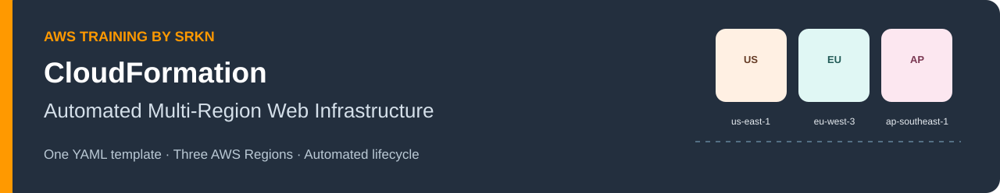

# AWS CloudFormation — Automated Multi-Region Web Infrastructure

**AWS CLOUDFORMATION / INFRASTRUCTURE AS CODE / AWS CLI / EC2 / USER DATA / AMAZON LINUX 2023 / APACHE / MULTI-REGION DEPLOYMENT**

## From Manual Deployment to Infrastructure as Code

### The Challenge That Inspired This Project

During my previous **Amazon Route 53 Multi-Region DNS Routing** project, I built a working infrastructure across three AWS Regions: **N. Virginia, Paris, and Singapore**.

Each Region required its own EC2 instance, security group, network configuration, Apache installation, and regional website. I repeated the provisioning process, configured the applications, verified their connectivity, and tested their HTTP health endpoints.

The infrastructure worked as intended. However, the experience raised an important question:

> **What if I needed to rebuild this entire environment tomorrow? Or deploy the same infrastructure across ten AWS Regions instead of three?**

Repeating the same configuration through the AWS Management Console would be time-consuming, repetitive, and prone to human error. I wanted to define the infrastructure once, automate the deployment, and recreate the same working environment whenever I needed it.

### The Solution — AWS CloudFormation

That challenge led me to **AWS CloudFormation**, AWS's Infrastructure as Code (IaC) service. Instead of manually creating individual AWS resources, I could describe the desired infrastructure in a YAML template and let CloudFormation manage its creation and deletion.

I decided to put this capability to the test:

> **Rebuild the same three-Region web infrastructure from my Route 53 project, but automate the provisioning using one reusable CloudFormation YAML template and a single deployment script.**

The new deployment needed to reproduce the EC2 instances, regional security groups, automatically installed Apache servers, distinctive pastel websites, **AWS TRAINING BY SRKN** branding, and `/health` endpoints. I added **CLOUDFORMATION DEPLOYMENT** to the webpages to distinguish this exercise from the earlier manual deployment. The website content was positioned at the upper left for clearer screenshots.

I deliberately excluded Route 53 DNS records, health checks, and Cloudflare delegation. Those had already been covered and tested in the previous project. **This time, the focus was infrastructure automation—not DNS routing.**

### The Result — Three Regions in Less Than Five Minutes

**One YAML template. One deployment script. Three AWS Regions. Three working websites.**

I created a reusable CloudFormation template that defined the EC2 instance, security group, and application bootstrap configuration. EC2 User Data installed Apache, generated the region-specific HTML/CSS webpages, enabled the service, and created the health-check endpoints.

Using AWS CloudShell, I deployed the same template as independent stacks across N. Virginia, Paris, and Singapore. **I had three functioning regional websites in less than five minutes**, compared with the extensive manual configuration required for the preceding Route 53 project.

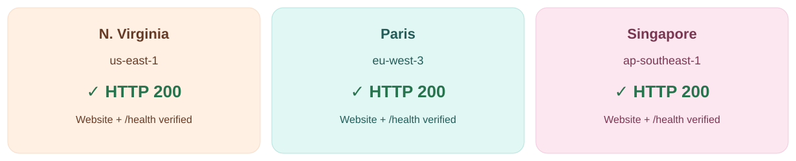

| AWS Region | Website design | Deployment result |
|---|---|---|
| N. Virginia (`us-east-1`) | Light orange | Website and `/health` verified |
| Paris (`eu-west-3`) | Light turquoise | Website and `/health` verified |
| Singapore (`ap-southeast-1`) | Light pink | Website and `/health` verified |

The deployment was only the beginning. I then inspected stack events and outputs, reviewed a **Change Set**, updated an existing EC2 instance in place, and used **Drift Detection** to confirm that its managed configuration was synchronized with the template. Finally, I deleted all three regional stacks with one CloudShell script, verifying the deletion operations.

**Define → Deploy → Verify → Update → Detect Drift → Delete**

The infrastructure was temporary. **The YAML template became the reusable asset.**

---

## Contents

- [01 Purpose, Architecture and CloudFormation Fundamentals](#01-purpose-architecture-and-cloudformation-fundamentals)
- [02 Preparing the AWS Environment and Validating the Template](#02-preparing-the-aws-environment-and-validating-the-template)
- [03 Deploying Three Regional Websites Automatically](#03-deploying-three-regional-websites-automatically)
- [04 Verifying CloudFormation Outputs, Events and Resources](#04-verifying-cloudformation-outputs-events-and-resources)
- [05 Updating an Existing Stack with a Change Set](#05-updating-an-existing-stack-with-a-change-set)
- [06 Detecting Configuration Drift](#06-detecting-configuration-drift)
- [07 Automated Multi-Region Teardown](#07-automated-multi-region-teardown)
- [08 Troubleshooting, Security and Production Lessons](#08-troubleshooting-security-and-production-lessons)
- [09 SAA-C03 Exam Review and Technical Competencies](#09-saa-c03-exam-review-and-technical-competencies)
- [Reusable Source Files and Command Reference](#reusable-source-files-and-command-reference)

## Architecture Highlight

The diagram represents the **deployed lab environment at verification time**. I subsequently deleted all three stacks; it is not a depiction of currently running infrastructure.

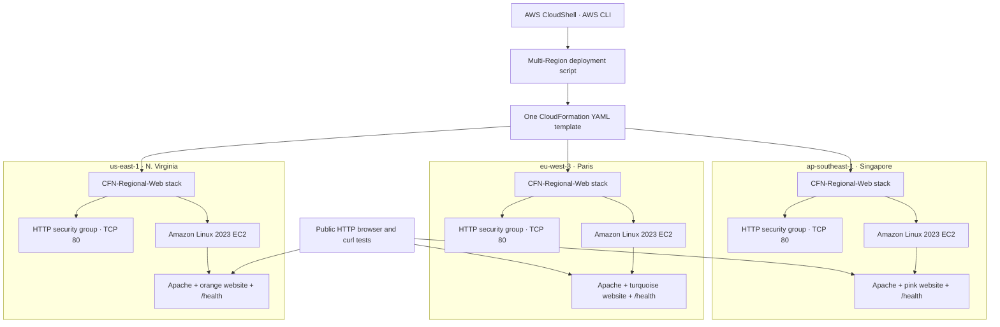

The stacks **reused existing default VPCs and default subnets**, passed as parameters. CloudFormation did not create or own those networks. Each stack created one EC2 instance and one custom security group. The browser accessed each server by its temporary public IPv4 address; no Route 53 routing or other DNS delegation was configured for this exercise.

---

## 01 Purpose, Architecture and CloudFormation Fundamentals

### 1.1 Purpose and Objectives

The purpose of this lab was to demonstrate reproducible AWS infrastructure deployment using CloudFormation instead of repeated manual console configuration. I reused one template in three AWS Regions, validated the resulting applications, performed a controlled stack update, checked for drift, and deleted the managed resources.

The specific objectives were to:

1. Define a reusable **YAML template** with parameters, mappings, resources, User Data, and outputs.
2. Deploy that template to three AWS Regions using one **AWS CLI script**.
3. Confirm working Apache websites and `/health` endpoints in each Region.
4. Use **stack events, resources, outputs, and parameters** to inspect what CloudFormation created.
5. Preview an in-place EC2 tag update with a **Change Set**, execute it, and verify the result.
6. Run **Drift Detection** against the updated stack.
7. Delete all three stacks through one cleanup script.

### 1.2 Understanding AWS CloudFormation

**AWS CloudFormation** is an Infrastructure as Code service that provisions and manages AWS resources from declarative templates. Rather than issuing an individual create command for each EC2 instance and security group, I declared the desired end state in YAML and asked CloudFormation to create and maintain it.

| Concept | Definition | How I used it |
|---|---|---|
| **Template** | YAML or JSON document describing desired infrastructure | One shared `cloudformation-regional-web.yaml` file |
| **Stack** | Regional group of resources managed as a unit | `CFN-Regional-Web` in three different Regions |
| **Parameters** | Values supplied at deployment | Default VPC and subnet IDs; optional AMI and instance type |
| **Mappings** | Static lookup table inside a template | Region → website name, heading, and pastel colors |
| **Resources** | AWS objects managed by the stack | EC2 instance and security group |
| **User Data** | Initialization instructions provided at EC2 launch | Install Apache and generate the website and `/health` file |
| **Outputs** | Values exposed by a deployed stack | Public IP URL, health URL, instance ID, security group ID, Region |
| **Stack Events** | Record of provisioning and update operations | Verified `CREATE_COMPLETE` and later `DELETE_COMPLETE` |
| **Change Set** | Preview of proposed updates | Added an EC2 `Environment=Training` tag |
| **Drift Detection** | Comparison of supported live resource properties to template values | Confirmed `IN_SYNC` and zero drifted resources |

> [!IMPORTANT]
> **SAA-C03 EXAM CONNECTION**
>
> A CloudFormation stack operates in a specific AWS Region. Reusing a template in several Regions creates **separate regional stacks**, even when the stack names match. A CLI loop can coordinate deployments, while CloudFormation StackSets is another service capability for multi-account or multi-Region operations. I used a CLI loop in this lab, not StackSets.

### 1.3 Regional Design and Verification Targets

| Attribute | N. Virginia | Paris | Singapore |
|---|---|---|---|
| Region | `us-east-1` | `eu-west-3` | `ap-southeast-1` |
| EC2 Name tag | `Route53-Web-US` | `Route53-Web-EU` | `Route53-Web-AP` |
| Instance type | `t3.micro` | `t3.micro` | `t3.micro` |
| Operating system | Amazon Linux 2023, x86_64 | Same | Same |
| VPC / subnet | Existing regional default network | Existing regional default network | Existing regional default network |
| Website background | `#FFF0E3` | `#E0F7F4` | `#FCE7F0` |
| Website layout | Upper-left white card | Upper-left white card | Upper-left white card |
| Branding | AWS TRAINING BY SRKN | AWS TRAINING BY SRKN | AWS TRAINING BY SRKN |
| Identifier | CLOUDFORMATION DEPLOYMENT | Same | Same |
| Application check | HTTP `/health` → `healthy` | Same | Same |

The original Route 53-inspired instance names and webpage footer were retained to make the manual and automated infrastructure comparable. **No Route 53 DNS configuration was deployed here.**

### 1.4 How the Template Worked

The source file is provided in full at [`cloudformation-regional-web.yaml`](cloudformation-regional-web.yaml). Its principal sections were:

| YAML element | Implementation |
|---|---|
| `AWSTemplateFormatVersion` | Declared the CloudFormation template format version. |
| `Parameters.VpcId` / `SubnetId` | Received existing regional network IDs; the stack did not own those resources. |
| `Parameters.AmiId` | Used an AWS Systems Manager public parameter for the Amazon Linux 2023 AMI. |
| `Mappings.RegionDesign` | Selected the correct server name, colors, and heading based on `AWS::Region`. |
| `Resources.WebSecurityGroup` | Created a security group with inbound HTTP on TCP 80 from `0.0.0.0/0`. |
| `Resources.WebInstance` | Created the EC2 instance, attached the security group, and set launch User Data. |
| `MetadataOptions.HttpTokens` | Required IMDSv2 for the instance metadata endpoint. |
| `Outputs` | Exported Region, InstanceId, SecurityGroupId, WebsiteURL, and HealthURL as stack outputs. |

The template used CloudFormation functions including `!Ref`, `!FindInMap`, `!GetAtt`, and `Fn::Sub`. Those let the same source document resolve its resource values for each deployment Region.

The key automation was the `UserData` block. It installed `httpd` with `dnf`, wrote `/var/www/html/index.html` using the Region mapping, created `/var/www/html/health`, and enabled/started `httpd`. I did **not** manually SSH into the new instances or copy HTML to them.

The webpage's green **Server Healthy** text is a static display label. I separately tested the real `/health` URL; the label is not dynamic monitoring data.

> [!NOTE]
> The template intentionally exposed HTTP only and did not configure an SSH key pair or an SSH ingress rule. A working public webpage did not require SSH access. This was a temporary training environment rather than a production-ready HTTPS deployment.

### 1.5 Knowledge Check

> [!TIP]
> **Question:** If I deploy a stack named `CFN-Regional-Web` in `us-east-1` and `eu-west-3`, is it one globally managed stack?
>
> **Answer:** No. There are two independently managed regional stacks, even though they share a name and template. The deployment script coordinates the operations.

---

## 02 Preparing the AWS Environment and Validating the Template

### 2.1 Discovering Existing Regional Networking

I started by checking each Region for an existing default VPC and default subnets. Using existing networks kept the CloudFormation exercise focused on repeatable compute and application infrastructure rather than VPC creation.

The read-only CLI checks were based on:

```bash
for region in us-east-1 eu-west-3 ap-southeast-1; do
  echo "Checking $region"
  aws ec2 describe-vpcs --region "$region" \
    --filters 'Name=is-default,Values=true' \
    --query 'Vpcs[].VpcId' --output text
  aws ec2 describe-subnets --region "$region" \
    --filters 'Name=default-for-az,Values=true' \
    --query 'Subnets[].SubnetId' --output text
  echo '-------------------------'
done
```

All three Regions returned an existing default VPC and default subnet IDs. I did not create replacement VPCs or alter their default security groups.

<table><tr><td align="center"><a href="images/screenshot-01.png">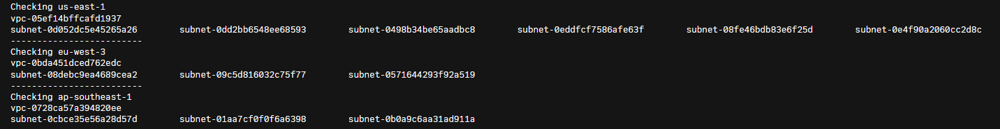</a></td></tr></table>

<p><sub><strong>Screenshot 01:</strong> CloudShell inventory showing default VPC and subnet availability across N. Virginia, Paris, and Singapore.</sub></p>

### 2.2 Uploading the YAML to AWS CloudShell

I downloaded the initial template, opened **CloudShell → Actions → Upload file** in N. Virginia, and uploaded `cloudformation-regional-web.yaml` to `/home/cloudshell-user`.

<table><tr><td align="center"><a href="images/screenshot-02.png">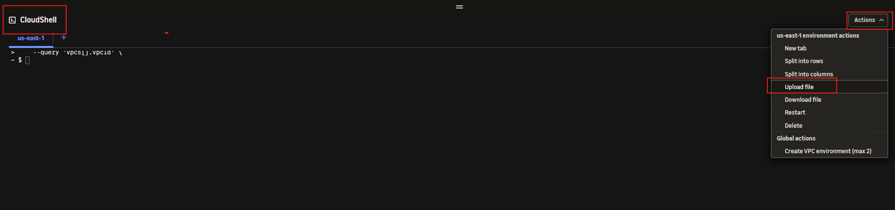</a></td></tr></table>

<p><sub><strong>Screenshot 02:</strong> CloudShell Actions menu showing the Upload file option.</sub></p>

<table><tr><td align="center"><a href="images/screenshot-03.png">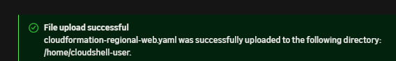</a></td></tr></table>

<p><sub><strong>Screenshot 03:</strong> CloudShell confirmation that the YAML was uploaded into the home directory.</sub></p>

### 2.3 Validating the Template Before Provisioning

I ran the CloudFormation validation command:

```bash
aws cloudformation validate-template \
  --template-body file://cloudformation-regional-web.yaml
```

The command returned the recognized template parameters, including `VpcId`, `SubnetId`, `InstanceType`, and `AmiId`, without a validation error. **Validation confirmed the template's accepted structure, not that all future EC2 provisioning or User Data commands would necessarily succeed.**

<table><tr><td align="center"><a href="images/screenshot-04.png">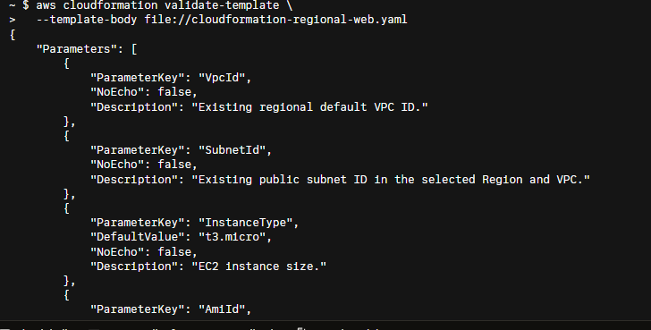</a></td></tr></table>

<p><sub><strong>Screenshot 04:</strong> Successful validate-template response listing the input parameters.</sub></p>

> [!IMPORTANT]
> **SAA-C03 EXAM CONNECTION**
>
> `AWS::SSM::Parameter::Value<AWS::EC2::Image::Id>` resolved the Amazon Linux AMI in each Region through Systems Manager. That avoided copying a single Region-specific AMI ID into every deployment.

---

## 03 Deploying Three Regional Websites Automatically

### 3.1 One Script, Three Stacks

I used one Bash deployment loop from AWS CloudShell. In each Region, the script:

1. Discovered the default VPC and an available default subnet.
2. Passed those IDs to the same CloudFormation YAML template.
3. Deployed the stack named `CFN-Regional-Web`.
4. Retrieved the stack status and outputs.
5. Continued to the next Region.

The full reusable script is [`scripts/deploy-multi-region.sh`](scripts/deploy-multi-region.sh). It follows the same deployment sequence I executed during the exercise.

From the lab directory, the reproducible invocation is:

```bash
bash scripts/deploy-multi-region.sh
```

Or from the repository root:

```bash
bash Labs/Lab09-CloudFormation-Multi-Region-Web/scripts/deploy-multi-region.sh
```

The critical AWS CLI operation was:

```bash
aws cloudformation deploy \
  --region "$REGION" \
  --template-file "$TEMPLATE" \
  --stack-name CFN-Regional-Web \
  --parameter-overrides "VpcId=$VPC" "SubnetId=$SUBNET" \
  --tags Project=CloudFormation-Multi-Region-Web
```

The Bash loop is the multi-Region orchestrator; **CloudFormation did not create resources in other Regions from a single regional stack**. The deployment was sequential, and the template was reused unchanged for all three Regions.

### 3.2 Verifying the Generated Regional Websites

After the deployment, I opened each EC2 public IPv4 address in a browser. The three pages preserved the original Route 53 project's pastel theme, with the new **CLOUDFORMATION DEPLOYMENT** identifier and an upper-left-aligned white card.

**N. Virginia:** The automatically deployed orange website showed `us-east-1`, `Route53-Web-US`, and the expected branding.

<table><tr><td align="center"><a href="images/screenshot-05.png">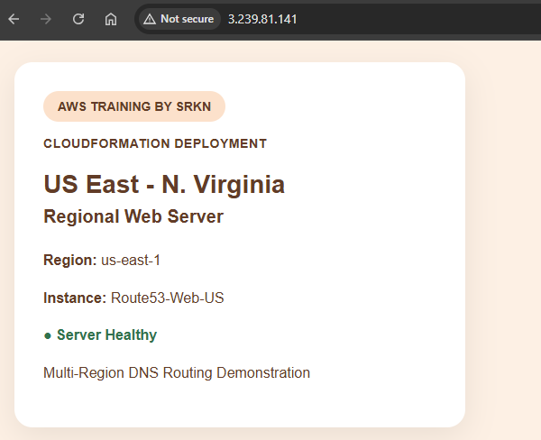</a></td></tr></table>

<p><sub><strong>Screenshot 05:</strong> N. Virginia HTTP website with the light-orange background, upper-left card, and CloudFormation identifier.</sub></p>

**Paris:** The turquoise website showed `eu-west-3` and `Route53-Web-EU`.

<table><tr><td align="center"><a href="images/screenshot-06.png">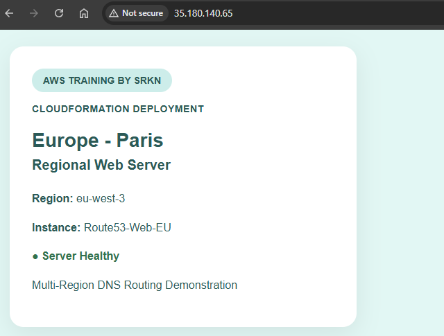</a></td></tr></table>

<p><sub><strong>Screenshot 06:</strong> Paris HTTP website with the light-turquoise background and regional details.</sub></p>

**Singapore:** The pink website showed `ap-southeast-1` and `Route53-Web-AP`.

<table><tr><td align="center"><a href="images/screenshot-07.png">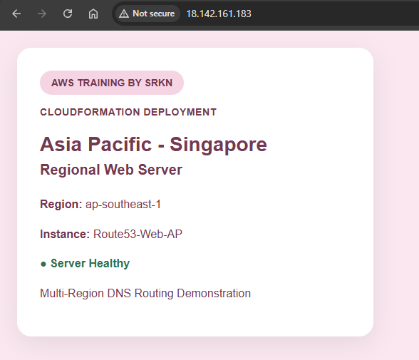</a></td></tr></table>

<p><sub><strong>Screenshot 07:</strong> Singapore HTTP website with the light-pink background and regional details.</sub></p>

| Region | Public IPv4 assigned during this deployment | Browser result |
|---|---|---|
| N. Virginia (`us-east-1`) | `3.239.81.141` | Orange page loaded |
| Paris (`eu-west-3`) | `35.180.140.65` | Turquoise page loaded |
| Singapore (`ap-southeast-1`) | `18.142.161.183` | Pink page loaded |

These were temporary AWS-assigned public addresses. They were removed from service when the instances were terminated; a new deployment should be expected to receive different addresses.

### 3.3 Checking Stack Creation Across Regions

I ran one read-only query across the three Regions:

```bash
for region in us-east-1 eu-west-3 ap-southeast-1; do
  echo "=== $region ==="
  aws cloudformation describe-stacks \
    --region "$region" --stack-name CFN-Regional-Web \
    --query 'Stacks[0].[StackName,StackStatus]' --output table
done
```

All three stacks returned `CREATE_COMPLETE`.

<table><tr><td align="center"><a href="images/screenshot-08.png">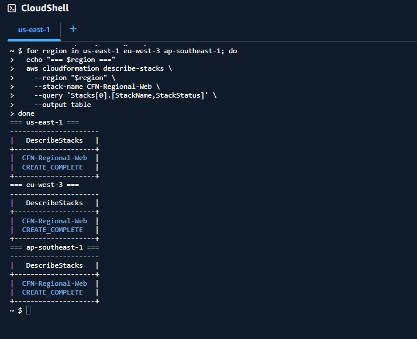</a></td></tr></table>

<p><sub><strong>Screenshot 08:</strong> CloudShell showing CREATE_COMPLETE for CFN-Regional-Web in all three Regions.</sub></p>

### 3.4 Verifying the Actual HTTP Health Endpoints

A stack can reach `CREATE_COMPLETE` before it is clear that every service initialized successfully inside the instance. To verify the actual application, I tested all three HTTP health endpoints from CloudShell:

```bash
for ip in 3.239.81.141 35.180.140.65 18.142.161.183; do
  echo "Testing $ip"
  curl -sS --max-time 10 \
    -w '\nHTTP Status: %{http_code}\n' \
    "http://$ip/health"
  echo '------------------------'
done
```

| Region | HTTP response code | Response body | Verification |
|---|---:|---|---|
| N. Virginia | `200` | `healthy` | Passed |
| Paris | `200` | `healthy` | Passed |
| Singapore | `200` | `healthy` | Passed |

<table><tr><td align="center"><a href="images/screenshot-09.png">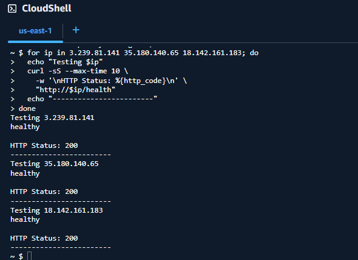</a></td></tr></table>

<p><sub><strong>Screenshot 09:</strong> CloudShell test showing healthy and HTTP 200 for all three regional /health endpoints.</sub></p>

> [!NOTE]
> The static `/health` file confirmed that Apache was reachable and served content. It was not a deep application readiness check, and the webpage's visual status label was not linked to live health monitoring.

### 3.5 Verifying Stack Outputs

The template exposed the Region, instance ID, security group ID, website URL, and health URL. I retrieved those values across all three regional stacks using:

```bash
for region in us-east-1 eu-west-3 ap-southeast-1; do
  echo "===== $region — Stack Outputs ====="
  aws cloudformation describe-stacks \
    --region "$region" --stack-name CFN-Regional-Web \
    --query 'Stacks[0].Outputs[].[OutputKey,OutputValue]' \
    --output table
done
```

Outputs are useful for automated testing and deployment pipelines because they expose generated resource information without manual console lookup.

<table><tr><td align="center"><a href="images/screenshot-10.png">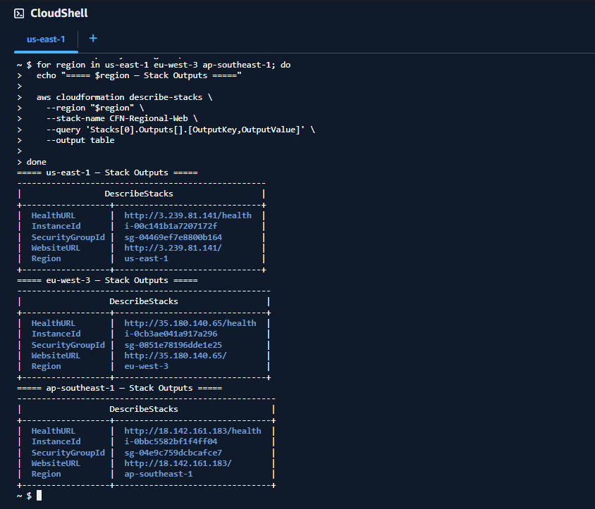</a></td></tr></table>

<p><sub><strong>Screenshot 10:</strong> Stack outputs listing each Region, instance ID, security group ID, HTTP website URL, and health URL.</sub></p>

> [!IMPORTANT]
> **SAA-C03 EXAM CONNECTION**
>
> CloudFormation manages the resource lifecycle; it does not inherently make an application highly available. I deployed one instance per Region, with no load balancer, replication, Auto Scaling, or cross-Region failover in this CloudFormation-only exercise.

---

## 04 Verifying CloudFormation Outputs, Events and Resources

### 4.1 Inspecting the Stack in the Console

I opened **CloudFormation → Stacks** in N. Virginia. The `CFN-Regional-Web` stack showed `CREATE_COMPLETE`. This verified the stack as a manageable CloudFormation resource rather than an EC2 instance configured manually after creation.

<table><tr><td align="center"><a href="images/screenshot-11.png">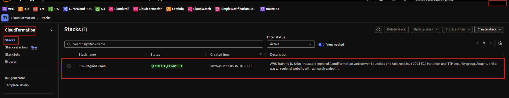</a></td></tr></table>

<p><sub><strong>Screenshot 11:</strong> CloudFormation Stacks page displaying CFN-Regional-Web in CREATE_COMPLETE state.</sub></p>

### 4.2 Reviewing Stack Events

I inspected the **Events** tab to understand the provisioning sequence. The screenshots showed `CREATE_IN_PROGRESS` and `CREATE_COMPLETE` transitions for `WebSecurityGroup`, `WebInstance`, and the stack itself.

| Event or field | Significance |
|---|---|
| `CREATE_IN_PROGRESS` | CloudFormation is provisioning the stack or resource. |
| `CREATE_COMPLETE` | The resource creation operation completed. |
| Resource logical ID | Identifies the object by the name used in the YAML template. |
| Resource status reason | Provides details when creation or updates encounter errors. |

The Events tab showed 11 events in the captured creation history and no `CREATE_FAILED` entry.

<table><tr><td align="center"><a href="images/screenshot-12.png">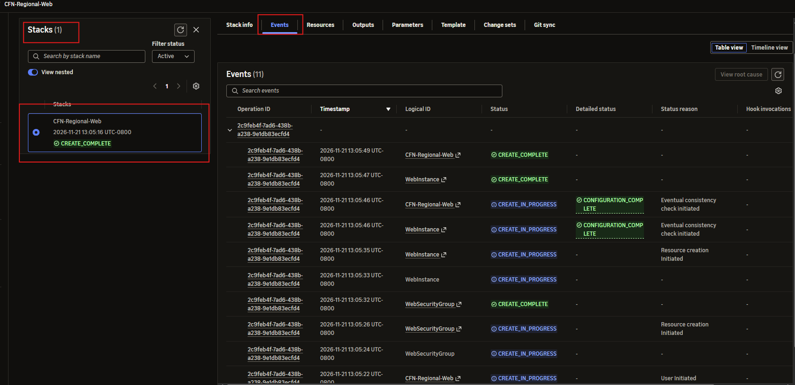</a></td></tr></table>

<p><sub><strong>Screenshot 12:</strong> CloudFormation Events tab showing the stack, WebInstance, and WebSecurityGroup creation history.</sub></p>

### 4.3 Understanding Logical and Physical Resource IDs

I reviewed the **Resources** tab. It listed two CloudFormation-managed resources:

| Logical ID | Type | Result |
|---|---|---|
| `WebInstance` | `AWS::EC2::Instance` | `CREATE_COMPLETE` |
| `WebSecurityGroup` | `AWS::EC2::SecurityGroup` | `CREATE_COMPLETE` |

The logical IDs come from the YAML template. Each corresponding physical ID identifies the actual EC2 instance or security group in the AWS Region.

<table><tr><td align="center"><a href="images/screenshot-13.png">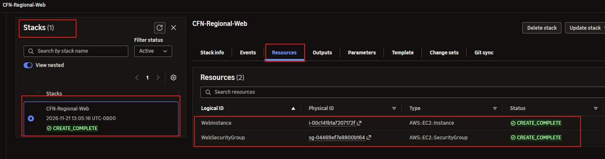</a></td></tr></table>

<p><sub><strong>Screenshot 13:</strong> Resources tab showing the physical IDs for WebInstance and WebSecurityGroup.</sub></p>

### 4.4 Inspecting Resolved Deployment Parameters

I then opened the **Parameters** tab, confirming the same instance type and the existing default network values supplied by the automation. The AMI parameter displayed its Systems Manager path and resolved regional AMI ID.

<table><tr><td align="center"><a href="images/screenshot-14.png">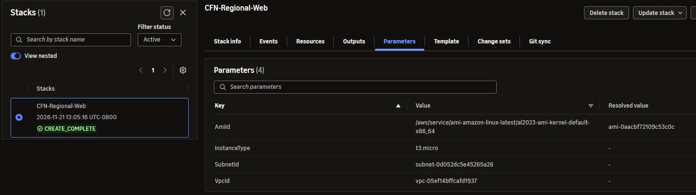</a></td></tr></table>

<p><sub><strong>Screenshot 14:</strong> Parameters tab showing AmiId, InstanceType, SubnetId, and VpcId for the N. Virginia stack.</sub></p>

> [!TIP]
> **Knowledge Check:** Does deleting this CloudFormation stack also delete the supplied default VPC and subnet?
>
> **Answer: No.** The VPC and subnet were supplied as existing IDs via parameters, not created as resources in this stack. CloudFormation deletes the resources it manages, subject to retention/deletion policies and deletion outcomes.

---

## 05 Updating an Existing Stack with a Change Set

### 5.1 Purpose of the Update

I wanted to demonstrate how Infrastructure as Code manages changes to existing resources without repeating the entire deployment. I chose a limited change to the N. Virginia instance: add the EC2 tag **`Environment=Training`**.

I kept the original template intact and made a Version 2 copy, [`cloudformation-regional-web-v2.yaml`](cloudformation-regional-web-v2.yaml). The only intentional source change was the additional tag inside `Resources.WebInstance.Properties.Tags`:

```yaml
      Tags:
        - Key: Name
          Value: !FindInMap [RegionDesign, !Ref 'AWS::Region', ServerName]
        - Key: Project
          Value: CloudFormation-Multi-Region-Web
        - Key: Environment
          Value: Training
```

I created the new file by copying the original template and inserting this additional tag. Then I validated Version 2:

```bash
aws cloudformation validate-template \
  --template-body file://cloudformation-regional-web-v2.yaml
```

The validation returned the expected parameter information and no template error.

<table><tr><td align="center"><a href="images/screenshot-15.png">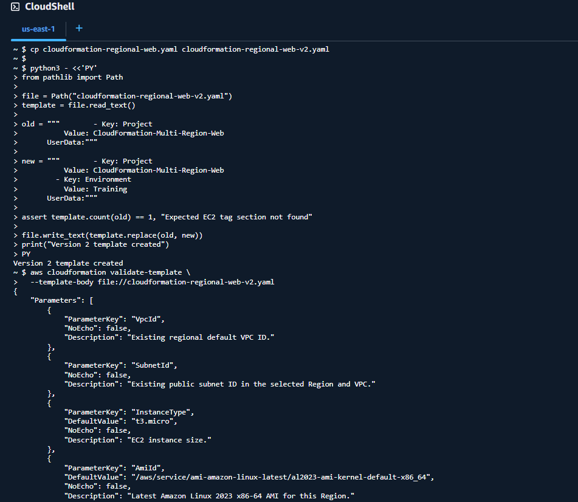</a></td></tr></table>

<p><sub><strong>Screenshot 15:</strong> CloudShell showing the Version 2 file creation and successful template validation.</sub></p>

### 5.2 Creating a Change Set Without Executing It

A **Change Set** describes the changes CloudFormation expects when applying an updated template to an existing stack. I created one for N. Virginia only:

```bash
aws cloudformation create-change-set \
  --region us-east-1 \
  --stack-name CFN-Regional-Web \
  --change-set-name CFN-Add-Environment-Tag \
  --change-set-type UPDATE \
  --template-body file://cloudformation-regional-web-v2.yaml \
  --parameters \
    ParameterKey=VpcId,UsePreviousValue=true \
    ParameterKey=SubnetId,UsePreviousValue=true \
    ParameterKey=InstanceType,UsePreviousValue=true \
    ParameterKey=AmiId,UsePreviousValue=true
```

CloudFormation returned a change set identifier and stack identifier. **Creating the change set did not execute the update.**

<table><tr><td align="center"><a href="images/screenshot-16.png">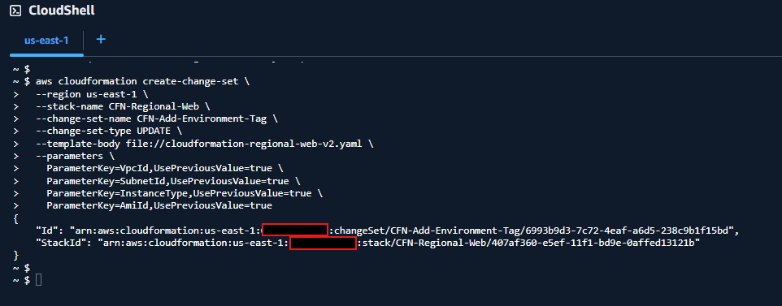</a></td></tr></table>

<p><sub><strong>Screenshot 16:</strong> CloudShell output confirming acceptance of the named Change Set creation request.</sub></p>

### 5.3 Inspecting Change Action and Replacement Risk

I inspected the planned changes before modifying the stack:

```bash
aws cloudformation describe-change-set \
  --region us-east-1 \
  --stack-name CFN-Regional-Web \
  --change-set-name CFN-Add-Environment-Tag \
  --query '{Status:Status,ExecutionStatus:ExecutionStatus,Changes:Changes[].ResourceChange.{Resource:LogicalResourceId,Action:Action,Replacement:Replacement}}' \
  --output json
```

The actual response contained:

```json
{
  "Status": "CREATE_COMPLETE",
  "ExecutionStatus": "AVAILABLE",
  "Changes": [
    {
      "Resource": "WebInstance",
      "Action": "Modify",
      "Replacement": "False"
    }
  ]
}
```

`Replacement: False` meant the proposed change did **not** require replacing the EC2 instance. This was important because replacing an instance could also change its assigned public IPv4 address and temporarily disrupt its website.

<table><tr><td align="center"><a href="images/screenshot-17.png">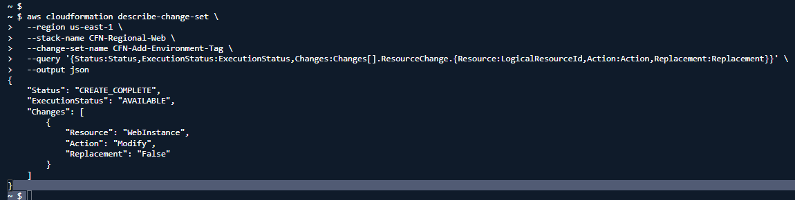</a></td></tr></table>

<p><sub><strong>Screenshot 17:</strong> Change Set preview showing WebInstance Modify and Replacement False.</sub></p>

### 5.4 Executing and Verifying the Change Set

Immediately after creating the change set, the stack itself still showed `CREATE_COMPLETE`. That reflected its existing deployment state, **not** a completed update.

<table><tr><td align="center"><a href="images/screenshot-18.png">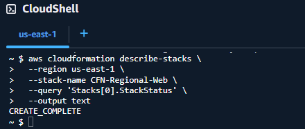</a></td></tr></table>

<p><sub><strong>Screenshot 18:</strong> Initial stack-status check still returning CREATE_COMPLETE before Change Set execution.</sub></p>

I then executed the reviewed change:

```bash
aws cloudformation execute-change-set \
  --region us-east-1 \
  --stack-name CFN-Regional-Web \
  --change-set-name CFN-Add-Environment-Tag

aws cloudformation describe-stacks \
  --region us-east-1 \
  --stack-name CFN-Regional-Web \
  --query 'Stacks[0].StackStatus' --output text
```

CloudFormation returned **`UPDATE_COMPLETE`**.

<table><tr><td align="center"><a href="images/screenshot-19.png">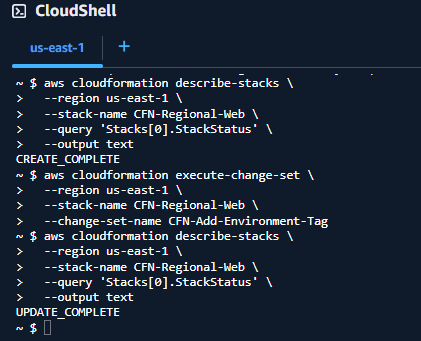</a></td></tr></table>

<p><sub><strong>Screenshot 19:</strong> Change Set execution followed by the N. Virginia stack reaching UPDATE_COMPLETE.</sub></p>

I verified the EC2 resource directly rather than relying only on the stack status:

```bash
aws ec2 describe-instances \
  --region us-east-1 \
  --instance-ids i-00c141b1a7207172f \
  --query 'Reservations[].Instances[].{InstanceId:InstanceId,State:State.Name,EnvironmentTag:Tags[?Key==`Environment`].Value|[0],PublicIP:PublicIpAddress}' \
  --output table
```

| Property | Verified outcome |
|---|---|
| Instance ID | `i-00c141b1a7207172f` — unchanged |
| State | `running` |
| Environment tag | `Training` |
| Public IPv4 | `3.239.81.141` — unchanged |
| Stack status | `UPDATE_COMPLETE` |

The EC2 instance was modified **in place**, with no observed instance ID or public IP replacement. Paris and Singapore were not updated in this exercise.

<table><tr><td align="center"><a href="images/screenshot-20.png">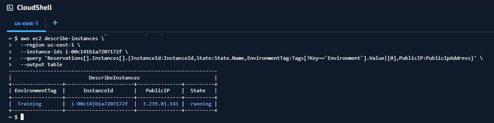</a></td></tr></table>

<p><sub><strong>Screenshot 20:</strong> EC2 query verifying unchanged instance ID/public IP and the new Environment=Training tag.</sub></p>

> [!IMPORTANT]
> **SAA-C03 EXAM CONNECTION**
>
> A Change Set is a **preview**, not an update. The `Replacement` field describes whether CloudFormation anticipates recreating a resource. I inspected the Change Set before running `execute-change-set` and verified the final stack and EC2 resource afterward.

---

## 06 Detecting Configuration Drift

### 6.1 Understanding Drift Detection

**Configuration drift** occurs when actual AWS resource properties differ from the properties defined in their managing CloudFormation template. For example, a manual security group rule change outside CloudFormation could make the resource differ from the declared configuration.

Drift detection compares supported live resource properties against the current deployed template. It **does not automatically repair drift** and does not inspect every possible property or application file.

I initiated detection on the updated N. Virginia stack:

```bash
aws cloudformation detect-stack-drift \
  --region us-east-1 \
  --stack-name CFN-Regional-Web
```

CloudFormation returned a `StackDriftDetectionId`, which I used to retrieve the result.

<table><tr><td align="center"><a href="images/screenshot-21.png">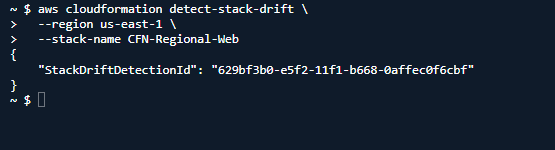</a></td></tr></table>

<p><sub><strong>Screenshot 21:</strong> Drift detection started successfully and returned a detection identifier.</sub></p>

### 6.2 Verifying the Result

I queried the completed detection:

```bash
aws cloudformation describe-stack-drift-detection-status \
  --region us-east-1 \
  --stack-drift-detection-id 629bf3b0-e5f2-11f1-b668-0affec0f6cbf \
  --query '{DetectionStatus:DetectionStatus,StackDriftStatus:StackDriftStatus,DriftedResources:DriftedStackResourceCount}' \
  --output table
```

| Field | Actual result |
|---|---|
| `DetectionStatus` | `DETECTION_COMPLETE` |
| `StackDriftStatus` | `IN_SYNC` |
| `DriftedStackResourceCount` | `0` |

The result confirmed no reported drift in the supported resource properties for the N. Virginia stack. **I did not deliberately introduce configuration drift, and I did not run drift detection on the Paris or Singapore stacks.**

<table><tr><td align="center"><a href="images/screenshot-22.png">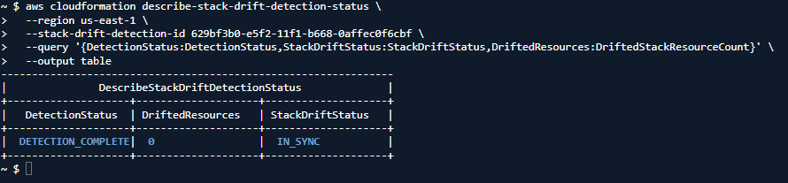</a></td></tr></table>

<p><sub><strong>Screenshot 22:</strong> Drift detection completed with IN_SYNC and zero drifted resources.</sub></p>

> [!TIP]
> **Knowledge Check:** How are Change Sets and drift detection different?
>
> **Answer:** Change Sets preview the effects of *proposed template updates*. Drift detection looks for differences between the *current deployed template* and supported properties of the live resources. Neither action by itself fixes an unhealthy Apache application.

---

## 07 Automated Multi-Region Teardown

### 7.1 Why Deleting a Stack Is Different From Manual Cleanup

In the earlier Route 53 project, I deleted EC2 instances, security groups, DNS records, and other temporary resources individually. In this CloudFormation exercise, the EC2 instances and custom security groups belonged to their regional stacks.

CloudFormation could therefore manage their deletion as a stack operation. I used [`scripts/delete-multi-region.sh`](scripts/delete-multi-region.sh) to request and verify the deletion of `CFN-Regional-Web` in the same three Regions.

> [!CAUTION]
> **Destructive operation:** Stack deletion permanently removed the stack-managed EC2 instances and their websites. Reuse this script only when you intend to delete stacks with the exact name `CFN-Regional-Web` in the three hard-coded Regions. It is not a general account cleanup utility.

The main deletion logic was:

```bash
STACK="CFN-Regional-Web"
REGIONS=(us-east-1 eu-west-3 ap-southeast-1)

for REGION in "${REGIONS[@]}"; do
  aws cloudformation delete-stack \
    --region "$REGION" --stack-name "$STACK"
done

for REGION in "${REGIONS[@]}"; do
  aws cloudformation wait stack-delete-complete \
    --region "$REGION" --stack-name "$STACK"
  echo "DELETE_COMPLETE: $REGION"
done
```

I issued deletion requests across the Regions, then used the waiter to confirm successful deletion completion for each Region.

<table><tr><td align="center"><a href="images/screenshot-23.png">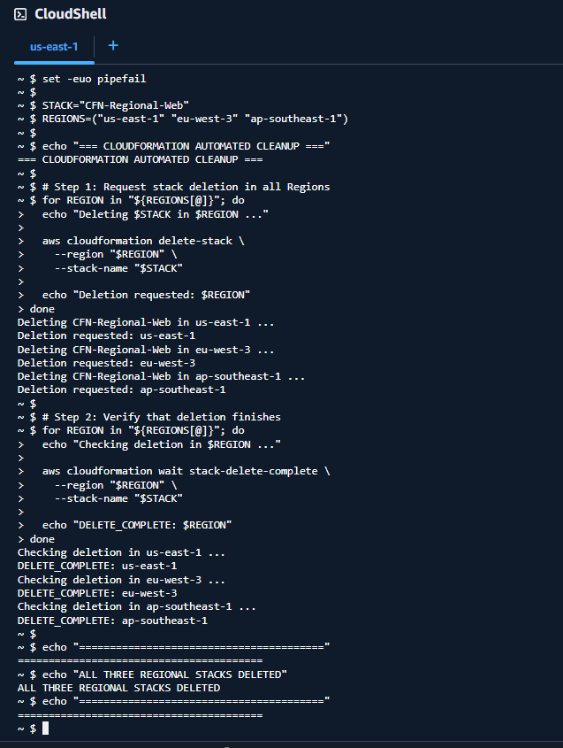</a></td></tr></table>

<p><sub><strong>Screenshot 23:</strong> Automated cleanup output showing DELETE_COMPLETE in N. Virginia, Paris, and Singapore.</sub></p>

### 7.2 Verifying Deletion Through the CloudFormation Console

I also inspected the N. Virginia stack's **Events** tab during the deletion history. It showed the EC2 instance, security group, and stack reaching `DELETE_COMPLETE`.

| Logical resource | Captured deletion result |
|---|---|
| `WebInstance` | `DELETE_COMPLETE` |
| `WebSecurityGroup` | `DELETE_COMPLETE` |
| `CFN-Regional-Web` | `DELETE_COMPLETE` |

All three `stack-delete-complete` wait operations succeeded in CloudShell. The N. Virginia console screenshot provides a separate view of the managed-resource deletion sequence.

<table><tr><td align="center"><a href="images/screenshot-24.png">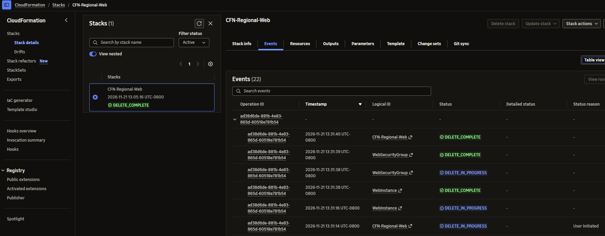</a></td></tr></table>

<p><sub><strong>Screenshot 24:</strong> N. Virginia CloudFormation Events tab showing DELETE_COMPLETE for the instance, security group, and stack.</sub></p>

### 7.3 Verifying That the Reusable Source Files Survived

After deleting the infrastructure, I checked CloudShell for the YAML files:

```bash
ls -lh ~/cloudformation-regional-web*.yaml
```

Both the original and Version 2 templates remained in the CloudShell home directory. **Stack deletion did not delete the local source files.** I included both files in this GitHub package so they remain accessible independently of CloudShell storage.

<table><tr><td align="center"><a href="images/screenshot-25.png">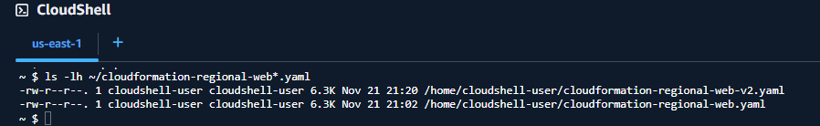</a></td></tr></table>

<p><sub><strong>Screenshot 25:</strong> CloudShell listing both YAML template versions after successful regional stack deletion.</sub></p>

### 7.4 Final Recorded Resource State

| Item | Final evidenced state |
|---|---|
| `CFN-Regional-Web` in `us-east-1` | `DELETE_COMPLETE` |
| `CFN-Regional-Web` in `eu-west-3` | `DELETE_COMPLETE` |
| `CFN-Regional-Web` in `ap-southeast-1` | `DELETE_COMPLETE` |
| N. Virginia managed EC2 and security group | `DELETE_COMPLETE` shown in Console events |
| Paris and Singapore managed resources | Regional stack deletion waiters succeeded; no separate resource-list screenshots recorded |
| Existing regional default VPCs and subnets | Not owned by these stacks; not targeted for deletion |
| Original and Version 2 YAML files | Present in CloudShell after teardown and preserved in GitHub package |
| Additional post-deletion EC2 / security-group inventory audit | Script supplied for reuse; not recorded as executed during the original exercise |
| Remaining EBS volumes and snapshots | Not separately inventoried after stack deletion |

The repository includes an optional **read-only** [`scripts/audit-multi-region.sh`](scripts/audit-multi-region.sh). It checks for active stack-tagged EC2 instances, matching security groups, and active stack names. This is a reproducible follow-up check, **not a test claimed as completed**.

---

## 08 Troubleshooting, Security and Production Lessons

### 8.1 Lessons From the Actual Deployment

| Lesson | What I observed | Engineering implication |
|---|---|---|
| Template validation precedes provisioning | `validate-template` returned recognized parameters | Validate structure first, then verify live resource creation separately. |
| Deployment and application health are distinct | All stacks reached `CREATE_COMPLETE` and `/health` separately returned `200` | Stack status does not prove application readiness on its own. |
| CloudFormation deployments are regional | Three independent `CFN-Regional-Web` stacks appeared | A shared name/template does not create a global stack. |
| Change Set creation is not execution | Stack still showed `CREATE_COMPLETE` before `execute-change-set` | Inspect proposed updates, execute them, then verify `UPDATE_COMPLETE`. |
| A tag update can preserve an instance | `Replacement: False`; instance ID and public IP unchanged | Changes with no replacement can minimize disruption. |
| Drift detection has defined scope | N. Virginia reported `IN_SYNC`, zero drifted resources | It checks supported resource properties rather than all software behavior. |
| Delete operations can be automated | Three waiters reported deletion completion | IaC enables both infrastructure creation and controlled teardown. |
| Source files are independent | Both YAML versions remained after deleting stacks | Git provides durable versioning beyond ephemeral CloudShell state. |

### 8.2 Production Considerations

The deployment was appropriate for a short AWS training exercise; several differences would matter in production:

- **HTTPS:** HTTP port 80 and plain browser URLs were used for verification. Production public sites generally need TLS, certificates, and secure application endpoints.
- **Network design:** Default VPCs and default public subnets simplified this exercise. A production environment typically has purpose-designed networks, routes, security controls, and separated public/private tiers.
- **Operational access:** No SSH key pair or port 22 rule was created by the template. Production access might use AWS Systems Manager Session Manager with an appropriately configured IAM instance profile and network connectivity.
- **Resilience:** One EC2 instance per Region is not a highly available regional application. ALBs, Auto Scaling, multi-AZ deployment, and data replication are separate design decisions.
- **Health checks:** A static `healthy` file proves HTTP service reachability, not application/database readiness.
- **Bootstrap robustness:** User Data used package installation during instance initialization. Production automation may use pre-baked AMIs, package version pinning, logging, failure signaling, or application deployment tooling.
- **Resource lifecycle:** CloudFormation deletion follows the template's ownership and policies. Resources with retention policies or deletion failures require separate attention; a successful waiter is evidence of stack deletion, not an independent comprehensive account inventory.
- **Public IP changes:** Automatically assigned public IPv4 addresses are not stable identifiers across recreation. A future architecture might place DNS, an ALB, or another supported entry point in front of applications.
- **Access and cost:** CloudFormation itself coordinates operations, while underlying compute, storage, and networking resources can incur charges until removed.

### 8.3 Important Corrections and Boundaries

- I did **not** deploy Route 53 failover, latency, or geolocation records in this CloudFormation project. The earlier DNS project already covered them.
- The public website pages were generated automatically through EC2 User Data; the deployment did not require manual Apache installation over SSH.
- I did **not** demonstrate a deliberate `DRIFTED` condition. I demonstrated an `IN_SYNC` result after a managed update.
- I did **not** update the Paris or Singapore stacks to Version 2; the demonstrated Change Set targeted N. Virginia.
- I did **not** create default VPCs through the template; I reused them.
- The displayed “Server Healthy” text was static HTML and was backed by a separate actual `/health` check during testing.

---

## 09 SAA-C03 Exam Review and Technical Competencies

### 9.1 Knowledge Checks

> [!TIP]
> **1. Why can the same `CFN-Regional-Web` stack name exist in three Regions?**
>
> **Answer:** CloudFormation stacks are Region-scoped. Each name refers to a separate stack in its Region, with independent resources and lifecycle.
>
> **2. Does `validate-template` guarantee that Apache will run after deployment?**
>
> **Answer:** No. It checks template validity; bootstrap scripts and application readiness require separate live verification. I used browser and `curl` tests for that reason.
>
> **3. What was the purpose of `Fn::Sub` and the Region mapping?**
>
> **Answer:** The template interpolated regional values and resolved names/colors from the mapping, allowing one source file to produce three different websites.
>
> **4. Why examine `Replacement` in a Change Set?**
>
> **Answer:** CloudFormation may replace a resource to apply some property changes. The `Replacement` value helps assess potential downtime and resource identity changes before execution.
>
> **5. What does `IN_SYNC` mean after drift detection?**
>
> **Answer:** Supported inspected resource properties match the deployed template. It does not verify application content, every AWS setting, or every resource in the account.
>
> **6. Why were the existing VPCs preserved after stack deletion?**
>
> **Answer:** The VPCs and subnets were referenced through parameters rather than created as CloudFormation resources in the stack.

### 9.2 Technical Competencies Demonstrated

| Competency | Verified evidence |
|---|---|
| Infrastructure as Code (YAML) | Reusable CloudFormation template accepted by `validate-template` |
| Multi-Region automation | One deployment loop; three `CREATE_COMPLETE` stacks |
| EC2 and security group provisioning | Stack Resources and Events tabs |
| EC2 User Data bootstrap | Three working Apache websites without manual SSH setup |
| HTTP endpoint verification | Three `curl` responses with HTTP 200 and `healthy` |
| CloudFormation parameters and outputs | Regional networking inputs and stack output tables |
| Change Sets and risk review | `Modify` / `Replacement: False` preview |
| In-place stack update | `UPDATE_COMPLETE`, unchanged EC2 ID/IP, new tag |
| Drift detection | `DETECTION_COMPLETE`, `IN_SYNC`, zero drifted resources |
| Automated cleanup | Three `stack-delete-complete` wait successes and console Events |
| Reusability and source control | Both YAML versions and scripts included in this project |

### 9.3 Final Technical Reflection

The previous Route 53 deployment taught me how regional AWS resources and DNS routing fit together. This CloudFormation exercise taught me how to **reproduce the underlying web infrastructure as code**.

I reduced repetitive console work to a reusable template and one regional deployment script. I verified the actual applications, safely updated an existing resource through a Change Set, confirmed its supported configuration was synchronized with the template, and deleted the temporary stacks using an automated teardown script.

The important result was not only the rapid deployment. **The same infrastructure definition could be reviewed, versioned, redeployed, and removed without rebuilding each resource manually.**

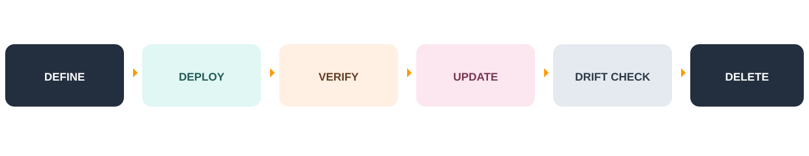

---

## Reusable Source Files and Command Reference

### Files Provided

| File | Purpose |
|---|---|
| [`cloudformation-regional-web.yaml`](cloudformation-regional-web.yaml) | Original verified YAML infrastructure definition |
| [`cloudformation-regional-web-v2.yaml`](cloudformation-regional-web-v2.yaml) | Same template with `Environment=Training` on the EC2 resource |
| [`scripts/deploy-multi-region.sh`](scripts/deploy-multi-region.sh) | Reusable three-Region deployer (represents the executed CloudShell sequence) |
| [`scripts/delete-multi-region.sh`](scripts/delete-multi-region.sh) | Automated three-Region stack deletion (represents the executed CloudShell sequence) |
| [`scripts/audit-multi-region.sh`](scripts/audit-multi-region.sh) | Optional read-only inventory checks; not recorded as executed |
| [`images/`](images/) | Numbered original deployment evidence screenshots and a manifest |
| [`../../assets/cloudformation-multi-region-banner.svg`](../../assets/cloudformation-multi-region-banner.svg) | AWS-style project banner |
| [`../../assets/cloudformation-regional-results.svg`](../../assets/cloudformation-regional-results.svg) | Pastel regional verification summary |
| [`../../assets/cloudformation-lifecycle.svg`](../../assets/cloudformation-lifecycle.svg) | Lifecycle visualization |

The included files can be added under `Labs/Lab09-CloudFormation-Multi-Region-Web/` in an AWS training repository, with the SVG assets in the repository-root `assets/` directory. All screenshot and asset links in this guide are relative.

### Repeating the Deployment

**Prerequisites:** AWS CLI credentials with the required CloudFormation/EC2/SSM permissions, an existing default VPC and suitable default subnet in each selected Region, and the local template/script files. CloudShell in a Region such as N. Virginia provides a convenient shell environment. The supplied template's mapping supports exactly `us-east-1`, `eu-west-3`, and `ap-southeast-1`; adding another Region requires adding its map entry.

```bash
# Run from the Lab09 project directory
aws cloudformation validate-template \
  --template-body file://cloudformation-regional-web.yaml

bash scripts/deploy-multi-region.sh

# Optional: deploy Version 2 from the beginning instead
# bash scripts/deploy-multi-region.sh cloudformation-regional-web-v2.yaml
```

The existing `CFN-Regional-Web` stacks must not conflict with the intended operation. Each new run may generate different EC2 IDs, security group IDs, and public IPs. The script performs **stack deployment/update**, not a globally atomic transaction; if one Region fails, previously deployed regional stacks may still exist and require review.

### Common Read-Only Verification Commands

```bash
# Stack states across all three Regions
for region in us-east-1 eu-west-3 ap-southeast-1; do
  aws cloudformation describe-stacks --region "$region" \
    --stack-name CFN-Regional-Web \
    --query 'Stacks[0].[StackName,StackStatus]' --output table
done

# Stack outputs, including live HTTP URLs
for region in us-east-1 eu-west-3 ap-southeast-1; do
  aws cloudformation describe-stacks --region "$region" \
    --stack-name CFN-Regional-Web \
    --query 'Stacks[0].Outputs[].[OutputKey,OutputValue]' \
    --output table
done
```

For a new deployment, retrieve the new website addresses from stack outputs rather than copying the historical IPs in this report.

### Deleting the Lab Infrastructure

```bash
# Run from the Lab09 project directory
bash scripts/delete-multi-region.sh

# Optional read-only post-deletion audit; provided but not used in the recorded run
bash scripts/audit-multi-region.sh
```

> [!WARNING]
> The deletion script terminates EC2 instances and deletes stack-managed infrastructure in three Regions. Review the target stack name and regional list before running it. This lab's historical stacks have already been deleted.

