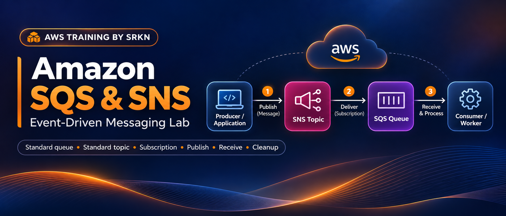
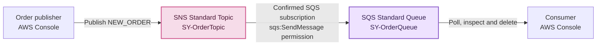
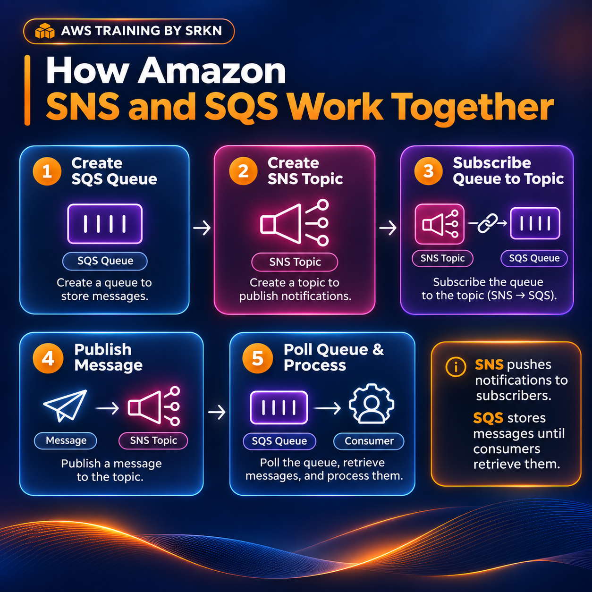
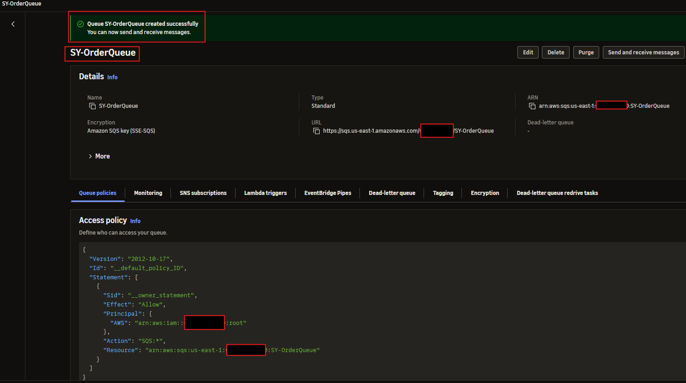
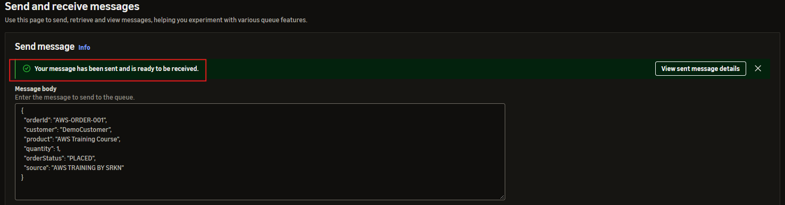
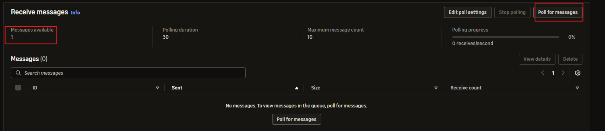
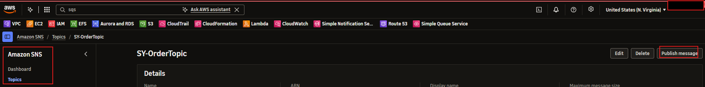
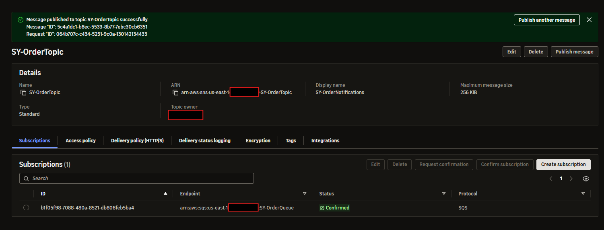

<p align="center"></p>

# Amazon SQS & SNS — Event-Driven Messaging Lab

**AMAZON SQS / AMAZON SNS / PUBLISH-SUBSCRIBE / MESSAGE QUEUES / ACCESS POLICIES / EVENT-DRIVEN ARCHITECTURE**

## **The Problem Messaging Solves**
Imagine an online store receiving a customer order. A simple application might try to perform every task immediately: store the order, charge the customer, reserve inventory, generate a receipt, and notify the shipping system. If any downstream service is slow or temporarily unavailable, the original request may become slow or fail.

I wanted to understand how AWS separates those responsibilities without requiring every component to be online at the same time. That is the value of **asynchronous messaging and loose coupling**:

Without a messaging layer	With Amazon SQS and SNS 

An order producer calls a worker directly and may have to wait for it.	The producer can hand off work as a message and continue.
Temporary worker downtime can interrupt the flow.	SQS can retain queued work until a consumer becomes available, subject to retention and delivery settings.

The publisher must know about every recipient.	SNS lets the publisher address one topic rather than manage individual subscribers.
Adding another recipient requires changes to the publishing application.	A new subscription can receive the same published event without changing the original publisher.

[!NOTE]
**The simplest mental model**: **SNS** announces that something happened; **SQS** holds the work until a consumer is ready. The examples in this report use an order event, but the same architectural pattern applies to many business workflows.

### WHAT I ACTUALLY TESTED

I simulated both the order publisher and the consumer in the AWS Management Console. No production application, email subscriber, Lambda function, or worker fleet was deployed. The later sections include the screenshots proving one SNS topic delivered a notification to one subscribed SQS queue.

----

I built and tested a messaging workflow for a simulated e-commerce application using **Amazon Simple Queue Service (SQS)** and **Amazon Simple Notification Service (SNS)**. First, I created an SQS Standard queue, sent a customer-order message directly to it, retrieved its contents, and deleted it. I then created a Standard SNS topic, subscribed the queue, and published a new order notification through SNS. The received SQS message contained the original order information inside an SNS notification envelope, confirming the end-to-end integration.

The exercise demonstrated why messaging services are useful even when applications are simple: a publisher can send an event without managing each consumer's availability, while a queue retains a delivered message until a consumer retrieves and processes it. 
**After verifying the workflow, I removed the subscription, SNS topic, and SQS queue.** 

| Lab facts | Verified configuration |
| --- | --- |
| AWS Region | US East (N. Virginia), `us-east-1` |
| SQS queue | `SY-OrderQueue` — Standard |
| SNS topic | `SY-OrderTopic` — Standard |
| SNS display name | `SY-OrderNotifications` |
| SQS encryption | Amazon SQS managed key (`SSE-SQS`) |
| Direct queue test | `AWS-ORDER-001` — sent, retrieved, deleted |
| SNS-to-SQS test | `AWS-ORDER-002` — published and received in SQS |
| Final state | Test messages, subscription, topic, and queue deleted |

## Contents

- [01 Purpose and Objectives](#01-purpose-and-objectives)
- [02 Understanding Amazon SQS and SNS](#02-understanding-amazon-sqs-and-sns)
- [03 Architecture Highlight](#03-architecture-highlight)
- [04 Creating the SQS Standard Queue](#04-creating-the-sqs-standard-queue)
- [05 Sending Receiving and Deleting an SQS Message](#05-sending-receiving-and-deleting-an-sqs-message)
- [06 Creating the SNS Standard Topic](#06-creating-the-sns-standard-topic)
- [07 Subscribing SQS to SNS](#07-subscribing-sqs-to-sns)
- [08 Publishing an Order Notification](#08-publishing-an-order-notification)
- [09 Verifying SNS-to-SQS Delivery](#09-verifying-sns-to-sqs-delivery)
- [10 Removing Temporary Messaging Resources](#10-removing-temporary-messaging-resources)
- [11 Verified Results and SAA-C03 Knowledge Checks](#11-verified-results-and-saa-c03-knowledge-checks)
- [12 Troubleshooting and Production Considerations](#12-troubleshooting-and-production-considerations)
- [13 Technical Competencies](#13-technical-competencies)
- [14 AWS Documentation References](#14-aws-documentation-references)

---

## 01 Purpose and Objectives

### 1.1 The Application Scenario

I simulated an online store that generates new-order events. At first, I sent a JSON order directly to SQS to understand the queue's message lifecycle. Next, I changed the message path: the order publisher submitted a notification to SNS, and an SQS subscription received that notification without a separate application server.

The objective was to practice the difference between **queue-based decoupling** and **topic-based publish-subscribe messaging**, then demonstrate how the two services work together. No EC2 instance, Lambda function, real checkout service, or automated worker was created for this activity. The AWS Console represented the publisher and consumer during testing.

### 1.2 Objectives

- Create and inspect a Standard SQS queue with its documented settings.
- Send a sample order directly to SQS, poll for it, inspect it, and delete it.
- Create a Standard SNS topic and subscribe the SQS queue.
- Verify that the queue policy permits delivery from the intended topic.
- Publish a new order notification to SNS and retrieve it from the queue.
- Verify the SNS envelope, source topic, subject, and order payload.
- Remove the temporary messaging resources after testing.

> [!NOTE]
> **KEY TAKEAWAY**
>
> The key change from the first test to the second was the message producer's destination: the direct test sent to **SQS**, whereas the integrated test published to **SNS**, which delivered the notification to **SQS** through the subscription.

## 02 Understanding Amazon SQS and SNS

### 2.1 Amazon Simple Queue Service (SQS)

Amazon SQS is a managed message-queuing service. A producer places messages in a queue, and one or more consumers poll the queue to retrieve work. The producer and consumer do not need to be running at the same time. This is useful for absorbing traffic spikes, buffering tasks, decoupling microservices, and recovering from temporary downstream outages.

**In this lab**, the queue represented an order-processing backlog. A consumer retrieved JSON describing an order; processing was simulated by reading the payload in the console before deleting the message.

| SQS concept | Practical meaning |
| --- | --- |
| Producer | Application or service that sends a message to a queue. |
| Queue | Managed buffer that retains messages until they are deleted or expire. |
| Consumer | Worker or application that receives and handles messages. |
| Standard queue | At-least-once delivery with best-effort ordering; consumers should handle duplicates. |
| Visibility timeout | Period during which a received message is normally hidden from other consumers; it is **not** automatic deletion. |
| Retention period | Maximum time an undeleted message can remain in the queue. |
| Short polling | A receive request that does not wait for newly arriving messages when the queue appears empty. |
| Long polling | A receive request that can wait for messages, reducing unnecessary empty responses. |
| Dead-letter queue (DLQ) | Optional queue used to isolate messages that repeatedly cannot be processed. |

### 2.2 Amazon Simple Notification Service (SNS)

Amazon SNS is a managed **publish-subscribe (pub/sub)** service. A publisher sends an event to an SNS topic. SNS then attempts delivery to subscribed endpoints according to the subscription configuration. Supported integration patterns include SQS queues, Lambda functions, and notification endpoints.

In our architecture, `SY-OrderTopic` represented the publisher's event destination; `SY-OrderQueue` acted as its subscribed receiver. This pattern is often called **fanout** because a single published event can be sent to multiple independent subscribers. We tested **one subscriber** rather than a multi-queue fanout.

### 2.3 SQS Versus SNS

| Question | Amazon SQS | Amazon SNS |
| --- | --- | --- |
| Primary role | Store messages for processing | Publish and distribute notifications |
| Communication pattern | Producer → queue → polling consumer | Publisher → topic → subscribers |
| Delivery model | Consumer polls | SNS pushes to supported subscribed destinations |
| Message lifetime | Queue retains messages until deletion or expiry | Topic is not a general-purpose message inbox |
| Scaling use case | Buffer and process workloads independently | Distribute the same event to multiple services |
| How used here | Stored and exposed orders to our console consumer | Delivered a new order event to the subscribed queue |

### 2.4 Standard, FIFO, and Delivery Guarantees

I used a **Standard** SQS queue and a **Standard** SNS topic. Standard queue delivery is at least once, and message ordering is best effort. A system consuming Standard queue messages should therefore be designed to be **idempotent**—processing the same business event again should not create a duplicate order or charge.

FIFO queues and FIFO topics provide different ordering and deduplication features but require deliberate design; those were not the configuration used in the final verified environment.

### 2.5 Security and Reliability Fundamentals

- **Queue access policy:** An SNS subscription must be authorized to send messages to its SQS destination. The queue policy can allow `sqs:SendMessage` only from the relevant topic ARN.
- **Encryption at rest:** Our SQS queue showed **Amazon SQS managed encryption (SSE-SQS)**. This does not mean a customer-managed KMS key was configured.
- **Visibility timeout:** Our queue used 30 seconds. A consumer that takes longer to process work may need a longer timeout or extensions during processing.
- **Message retention:** The queue used 4 days. Messages not deleted can eventually expire after the configured retention period.
- **Dead-letter queue:** No DLQ was configured in this exercise. Production applications often need a redrive policy and DLQ for poison messages.

> [!IMPORTANT]
> **SAA-C03 EXAM CONNECTION**
>
> Choose **SQS** when workloads need durable buffering and asynchronous processing. Choose **SNS** when one event should be distributed to one or more subscribers. Combine **SNS → SQS** when services need both event fanout and independent durable processing backlogs.

## 03 Architecture Highlight

The diagram below represents the **deployed and verified** subscription path. The producer and consumer were simulated through the AWS Console; no worker application was launched.



**Message movement:**

1. I published a new-order JSON payload to the topic.
2. SNS delivered a notification to the confirmed queue subscription.
3. SQS stored the notification, which I retrieved by polling.
4. I inspected the original order inside the SNS notification envelope.
5. I deleted the test messages and ultimately removed the lab resources.


<p align="center"></p>
The diagram below is a visual learning aid. It explains the general messaging pattern; the screenshots in later sections show the actual console operations I performed.


<p align="center"></p>
---

## 04 Creating the SQS Standard Queue

### 4.1 Creating the Queue

I opened **Amazon SQS → Queues → Create queue** in **US East (N. Virginia), `us-east-1`**. I selected **Standard** and entered the name `SY-OrderQueue`. I left the standard queue configuration at the values shown below.

| Setting | My verified configuration | Why it matters |
| --- | --- | --- |
| Queue name | `SY-OrderQueue` | Identifies the workload backlog. |
| Queue type | Standard | Supports scalable, asynchronous messages with at-least-once delivery. |
| Visibility timeout | 30 seconds | Temporarily hides a received message from other consumers. |
| Retention period | 4 days | Defines how long an undeleted message may remain. |
| Delivery delay | 0 seconds | Makes new messages eligible for delivery immediately. |
| Receive message wait time | 0 seconds | Uses short-poll behavior by default. |
| Maximum message size | 1,024 KiB | Upper bound configured for an individual message. |
| Encryption | SSE-SQS | Uses SQS-managed encryption at rest. |
| Dead-letter queue | Not configured | Sufficient for this introductory test; production may differ. |


<table><tr><td align="center"><a href="images/screenshot-01.png"></a></td></tr></table>

<p><sub><strong>Screenshot 01:</strong> SQS creation form showing the Standard queue and the `SY-OrderQueue` configuration.</sub></p>
### 4.2 Verifying the Queue

I selected **Create queue** and confirmed the success message. The queue details showed `SY-OrderQueue`, **Type: Standard**, and **Amazon SQS key (SSE-SQS)**. I also inspected the access-policy tab; permissions later changed when the SNS subscription was added.


<table><tr><td align="center"><a href="images/screenshot-02.png"></a></td></tr></table>

<p><sub><strong>Screenshot 02:</strong> SQS queue created successfully, showing the queue type, SSE-SQS and initial access policy.</sub></p>
> [!NOTE]
> **KEY TAKEAWAY**
>
> An SQS queue is a durable buffer, not a web application or database table. Message processing behavior depends on consumers, visibility timeouts, retry handling, and explicit deletion after successful processing.

## 05 Sending Receiving and Deleting an SQS Message

### 5.1 Sending a Direct Order Message

I opened **`SY-OrderQueue` → Send and receive messages**, entered a customer-order JSON payload, left the delivery delay at **0 seconds**, and selected **Send message**. I used this payload to simulate an online-store order:

```json
{
  "orderId": "AWS-ORDER-001",
  "customer": "DemoCustomer",
  "product": "AWS Training Course",
  "quantity": 1,
  "orderStatus": "PLACED",
  "source": "AWS TRAINING BY SRKN"
}
```

The payload was a sample business event. It was **not** an API call to a real checkout service. I did not configure optional custom message attributes during the verified test.


<table><tr><td align="center"><a href="images/screenshot-03.png"></a></td></tr></table>

<p><sub><strong>Screenshot 03:</strong> SQS Send message form containing the sample `AWS-ORDER-001` JSON order.</sub></p>
The console confirmed that the message was sent successfully and was ready to be received.


<table><tr><td align="center"><a href="images/screenshot-04.png"></a></td></tr></table>

<p><sub><strong>Screenshot 04:</strong> SQS confirms successful submission of the direct order message.</sub></p>
### 5.2 Polling and Inspecting the Message

I moved to the **Receive messages** section and selected **Poll for messages**. The queue showed one available message. The console polling session used a displayed **polling duration of 30 seconds**; this is distinct from the queue's configured **0-second receive-message wait time**.


<table><tr><td align="center"><a href="images/screenshot-05.png"></a></td></tr></table>

<p><sub><strong>Screenshot 05:</strong> SQS Receive messages interface showing one available message before retrieval.</sub></p>
I opened the retrieved message and verified the JSON body. It contained the expected order ID, customer, product, quantity, status, and source. The recorded first receive count was **1**.


<table><tr><td align="center"><a href="images/screenshot-06.png"></a></td></tr></table>

<p><sub><strong>Screenshot 06:</strong> Received `AWS-ORDER-001` message showing the original JSON order payload.</sub></p>
### 5.3 Deleting the Processed Message

After inspecting the message, I selected its checkbox and chose **Delete**. Deleting the message simulated acknowledging successful work. SQS confirmed that the message was removed, and the visible available-message count was **0**.


<table><tr><td align="center"><a href="images/screenshot-07.png"></a></td></tr></table>

<p><sub><strong>Screenshot 07:</strong> Selecting the received SQS message for deletion after the simulated processing step.</sub></p>
<table><tr><td align="center"><a href="images/screenshot-08.png"></a></td></tr></table>

<p><sub><strong>Screenshot 08:</strong> SQS deletion confirmation with zero available messages.</sub></p>
> [!IMPORTANT]
> **SAA-C03 EXAM CONNECTION**
>
> **Receiving is not the same as deleting.** A received message is normally hidden for the visibility timeout. If a consumer crashes or fails to delete it, the message can become visible again and be processed another time. Design consumers to handle retries and duplicate deliveries safely.

### 5.4 Knowledge Check

> [!TIP]
> **Question:** Does receiving an SQS message permanently remove it?
>
> **Answer: No.** Receiving temporarily hides the message. The consumer must explicitly delete it after successful processing. Without deletion, it can become visible after the visibility timeout.

## 06 Creating the SNS Standard Topic

### 6.1 Creating the Topic

To introduce publish-subscribe delivery, I navigated to **Amazon SNS → Topics → Create topic**, selected **Standard**, and created the following final topic:

| Property | My verified configuration |
| --- | --- |
| Topic type | Standard |
| Topic name | `SY-OrderTopic` |
| Display name | `SY-OrderNotifications` |
| Maximum message size shown | 256 KiB |
| Region | `us-east-1` |

An SNS topic is the publisher's event destination. The topic alone does not queue messages for a consumer to poll; subscriptions determine where notifications are delivered.


<table><tr><td align="center"><a href="images/screenshot-09.png"></a></td></tr></table>

<p><sub><strong>Screenshot 09:</strong> Final Standard SNS topic creation settings for `SY-OrderTopic`.</sub></p>
I created the topic and verified the successful creation notification. The initial topic details showed **Subscriptions (0)**, which was expected before connecting the queue.


<table><tr><td align="center"><a href="images/screenshot-10.png"></a></td></tr></table>

<p><sub><strong>Screenshot 10:</strong> SNS topic created successfully with type Standard and no subscriptions yet.</sub></p>
> [!NOTE]
> **KEY TAKEAWAY**
>
> A **Standard SNS topic** can fan out one event to multiple independent subscribers. Our exercise used one queue to verify the subscription mechanics and delivery path.

## 07 Subscribing SQS to SNS

### 7.1 Creating the Subscription From the Queue

I returned to **Amazon SQS → Queues**, selected `SY-OrderQueue`, opened **Actions**, and selected **Subscribe to Amazon SNS topic**. Creating the subscription from the SQS Console streamlined the integration and added a corresponding queue-policy permission.


<table><tr><td align="center"><a href="images/screenshot-11.png"></a></td></tr></table>

<p><sub><strong>Screenshot 11:</strong> SQS Actions menu with the Subscribe to Amazon SNS topic option selected.</sub></p>
In the subscription form, I chose the existing `SY-OrderTopic` topic and saved the configuration.


<table><tr><td align="center"><a href="images/screenshot-12.png"></a></td></tr></table>

<p><sub><strong>Screenshot 12:</strong> Selecting the `SY-OrderTopic` ARN for the SQS queue subscription.</sub></p>
### 7.2 Verifying Subscription and Access Permissions

The SQS Console confirmed the subscription was created successfully. The resulting queue access policy contained an additional topic-related statement. SNS needs authorization to send to the queue; the relevant action is **`sqs:SendMessage`**.


<table><tr><td align="center"><a href="images/screenshot-13.png"></a></td></tr></table>

<p><sub><strong>Screenshot 13:</strong> Subscription success confirmation and queue access policy containing the SNS-related statement.</sub></p>
The subscription was subsequently visible as **Confirmed** with protocol **SQS** on the SNS topic page. This was essential evidence before publishing a message.

For reference, a tightly scoped **illustrative** SQS policy statement has this shape. It was **not** manually entered in this lab; the SQS Console configured the integration. `123456789012` is a synthetic, valid-format 12-digit account ID used only in the example; it is not the account ID from this exercise.

```json
{
  "Effect": "Allow",
  "Principal": { "Service": "sns.amazonaws.com" },
  "Action": "sqs:SendMessage",
  "Resource": "arn:aws:sqs:us-east-1:123456789012:SY-OrderQueue",
  "Condition": {
    "ArnEquals": {
      "aws:SourceArn": "arn:aws:sns:us-east-1:123456789012:SY-OrderTopic"
    }
  }
}
```

> [!IMPORTANT]
> **SAA-C03 EXAM CONNECTION**
>
> Creating a subscription is not enough if a destination's resource policy blocks delivery. For **SNS → SQS**, the SQS queue policy must grant the appropriate send permission to the SNS topic, typically scoped by `aws:SourceArn`.

## 08 Publishing an Order Notification

### 8.1 Preparing the SNS Message

I opened **Amazon SNS → Topics → `SY-OrderTopic`** and selected **Publish message**.


<table><tr><td align="center"><a href="images/screenshot-14.png"></a></td></tr></table>

<p><sub><strong>Screenshot 14:</strong> SNS topic details with the Publish message action.</sub></p>
I configured the message with a subject and selected **Identical payload for all delivery protocols**. I left optional message-group and TTL fields unchanged; I did not need FIFO-specific message-group settings for this Standard-topic workflow.

| SNS field | Verified value |
| --- | --- |
| Topic | `SY-OrderTopic` |
| Subject | `New Customer Order - AWS-ORDER-002` |
| Payload mode | Identical payload for all delivery protocols |
| Business event | `NEW_ORDER` |
| Message body | JSON order data below |

```json
{
  "orderId": "AWS-ORDER-002",
  "customer": "DemoCustomer",
  "product": "AWS Cloud Training",
  "quantity": 2,
  "orderStatus": "PLACED",
  "source": "AWS TRAINING BY SRKN",
  "notificationType": "NEW_ORDER"
}
```


<table><tr><td align="center"><a href="images/screenshot-15.png"></a></td></tr></table>

<p><sub><strong>Screenshot 15:</strong> SNS publish form containing the `AWS-ORDER-002` subject and JSON payload.</sub></p>
### 8.2 Verifying Successful Publication

I selected **Publish message** and received a success notification from SNS. The topic page also showed **one confirmed SQS subscription**, identifying the intended delivery destination. A successful publish confirms topic acceptance; I verified actual queue delivery in the next section.


<table><tr><td align="center"><a href="images/screenshot-16.png"></a></td></tr></table>

<p><sub><strong>Screenshot 16:</strong> SNS publication success banner and the confirmed SQS subscription.</sub></p>
> [!NOTE]
> **KEY TAKEAWAY**
>
> SNS publication success establishes that the topic accepted the event. **End-to-end success** requires checking the subscribed destination—in our case, the SQS queue.

## 09 Verifying SNS-to-SQS Delivery

### 9.1 Retrieving the Published Notification

I opened **Amazon SQS → `SY-OrderQueue`** and selected **Send and receive messages** to inspect messages delivered through the subscription.


<table><tr><td align="center"><a href="images/screenshot-17.png"></a></td></tr></table>

<p><sub><strong>Screenshot 17:</strong> SQS queue details before inspecting a delivered SNS notification.</sub></p>
I polled the queue and opened the delivered notification. The message body contained the SNS wrapper with `Type: Notification`, the topic ARN, the publication subject, and the original order information inside the **`Message`** field. I verified that the event referred to `AWS-ORDER-002` and `NEW_ORDER`.

The screenshot below is cropped to the message details; this keeps the **evidence of delivery** visible while excluding notification-generated unsubscribe links and unrelated console areas.


<table><tr><td align="center"><a href="images/screenshot-18.png"></a></td></tr></table>

<p><sub><strong>Screenshot 18:</strong> Received SNS envelope showing the source topic, subject and `AWS-ORDER-002` payload.</sub></p>
### 9.2 Why the Message Body Is Wrapped

Because **raw message delivery was not enabled**, the SQS message body arrived as an **SNS notification envelope**, not simply as the original order JSON. The envelope included metadata such as:

| Envelope field | What it tells the consumer |
| --- | --- |
| `Type` | Identifies an SNS notification. |
| `TopicArn` | Identifies the source SNS topic. |
| `Subject` | Carries the published subject when provided. |
| `Message` | Contains the business payload, represented as a JSON-encoded string in the envelope. |
| `Timestamp` | Indicates when the notification was published. |
| `Signature` and related fields | Support notification authenticity checking for relevant endpoint integrations. |

**Conceptual structure (synthetic account ID and abbreviated message):**

```json
{
  "Type": "Notification",
  "TopicArn": "arn:aws:sns:us-east-1:123456789012:SY-OrderTopic",
  "Subject": "New Customer Order - AWS-ORDER-002",
  "Message": "{\"orderId\":\"AWS-ORDER-002\",\"notificationType\":\"NEW_ORDER\"}"
}
```

This illustrates the relevant fields rather than reproducing the full raw service-generated notification, signature, or unsubscribe URL. An application consuming the default envelope would typically parse the outer JSON and then parse the `Message` string to obtain the order record.

### 9.3 Outcome

The delivery test verified the path:

**Console publisher → SNS Standard topic → confirmed SQS subscription → SQS Standard queue → console consumer.**

I deleted the test notifications after inspecting them. The deletion of the subscription, topic, and queue was handled separately during cleanup.

> [!IMPORTANT]
> **SAA-C03 EXAM CONNECTION**
>
> SNS **raw message delivery** can remove the SNS JSON envelope for supported endpoints such as SQS. When raw delivery is disabled, consumers should expect SNS metadata around the original published payload.

## 10 Removing Temporary Messaging Resources

I removed the resources after the successful end-to-end verification. This avoided retaining unnecessary test messaging infrastructure and also demonstrated the correct cleanup order. The screenshots below show the **delete confirmation dialogs**; the final deletion outcomes were additionally **confirmed by me** after completing those dialogs.

### 10.1 Deleting the Subscription

I opened **Amazon SNS → Subscriptions**, selected the confirmed subscription connecting `SY-OrderTopic` to `SY-OrderQueue`, and deleted it.


<table><tr><td align="center"><a href="images/screenshot-19.png"></a></td></tr></table>

<p><sub><strong>Screenshot 19:</strong> Deletion confirmation for the SNS-to-SQS subscription.</sub></p>
### 10.2 Deleting the SNS Topic

I opened **Amazon SNS → Topics**, selected `SY-OrderTopic`, entered the requested confirmation phrase, and deleted the topic.


<table><tr><td align="center"><a href="images/screenshot-20.png"></a></td></tr></table>

<p><sub><strong>Screenshot 20:</strong> Deletion confirmation for the `SY-OrderTopic` Standard topic.</sub></p>
### 10.3 Deleting the SQS Queue

Finally, I opened **Amazon SQS → Queues**, selected `SY-OrderQueue`, and confirmed its deletion. The deletion dialog showed **0 messages** remaining in the queue.


<table><tr><td align="center"><a href="images/screenshot-21.png"></a></td></tr></table>

<p><sub><strong>Screenshot 21:</strong> SQS queue deletion dialog confirming `SY-OrderQueue` contained zero messages.</sub></p>
### 10.4 Final Resource State

| Temporary lab resource | Final state | Basis |
| --- | --- | --- |
| Direct SQS order test | Deleted | SQS success screenshot |
| SNS-delivered test notification(s) | Deleted | User-confirmed queue cleanup |
| SNS subscription to SQS | Deleted | User-confirmed console action |
| SNS topic `SY-OrderTopic` | Deleted | User-confirmed console action |
| SQS queue `SY-OrderQueue` | Deleted | User-confirmed console action |

No EC2 instances, security groups, VPCs, IAM roles, or CloudFormation stacks were created for this exercise. No additional API-based inventory audit was performed after the queue and topic were removed; the final resource state above reflects the user-confirmed teardown actions.

> [!CAUTION]
> **CLEANUP SAFETY**
>
> Deleting an SQS queue removes its stored messages; deleting a topic or subscription stops delivery through that resource. In a production account, verify ownership and dependencies before deleting messaging resources.

## 11 Verified Results and SAA-C03 Knowledge Checks

### 11.1 End-to-End Verification Summary

| Test | Evidence | Result |
| --- | --- | --- |
| Create Standard SQS queue | Queue success page and details | Passed |
| Send direct order message | `AWS-ORDER-001` send confirmation | Passed |
| Receive direct order message | JSON order in received-message modal | Passed |
| Delete processed direct order | SQS deletion success, available count 0 | Passed |
| Create Standard SNS topic | Topic success page and details | Passed |
| Subscribe SQS queue | Subscription success and queue policy | Passed |
| Publish new order event | SNS publish success banner | Passed |
| Receive notification through SQS | SNS envelope containing `AWS-ORDER-002` | Passed |
| Remove temporary resources | User-confirmed deletion sequence | Completed |

### 11.2 Knowledge Checks

> [!TIP]
> **1. What is the main difference between SNS and SQS?**
>
> **Answer:** SNS publishes and distributes events to subscribers; SQS retains messages in a queue for consumers to retrieve. This matters when choosing between event fanout and workload buffering.
>
> **2. What happens if a consumer receives an SQS message but does not delete it?**
>
> **Answer:** It normally becomes visible again after its visibility timeout, unless it expires or other controls intervene. Consumers must handle retries and possible duplicate processing.
>
> **3. Why did the SQS queue need an access-policy update?**
>
> **Answer:** SNS needed `sqs:SendMessage` permission to deliver to the queue. An SNS subscription alone does not override a destination's resource policy.
>
> **4. Why did the received SQS message contain `TopicArn` and `Subject` fields?**
>
> **Answer:** SNS delivered its normal notification envelope because raw delivery was not enabled. The original order payload was inside the `Message` field.
>
> **5. When should an architecture combine SNS and SQS?**
>
> **Answer:** When producers need to publish events to potentially multiple recipients while each worker receives a durable, independently managed queue of work.
>
> **6. Does a Standard SQS queue guarantee exactly-once processing?**
>
> **Answer:** No. Standard SQS provides at-least-once delivery, and consumers should be idempotent. Exactly-once business effects require careful application-level design even when stronger queue semantics are used.

## 12 Troubleshooting and Production Considerations

The following is a **reproduction reference**, not a claim that these incidents occurred during the verified exercise.

### 12.1 Troubleshooting Reference

| Symptom | What to check | Why it matters |
| --- | --- | --- |
| Topic publishes but SQS remains empty | Subscription status and topic/queue ARNs | Confirm the actual destination and Region. |
| No message received while polling | Visibility timeout, message availability, and receive wait settings | A message may already be in flight or a short poll may return empty. |
| SNS cannot send to SQS | Queue policy allowing `sqs:SendMessage` from source topic | Resource policies govern delivery. |
| Order JSON appears nested inside a string | SNS notification envelope and raw-delivery setting | Default SNS delivery adds metadata around `Message`. |
| Message appears again | Visibility timeout and consumer deletion | At-least-once processing permits retries and duplicates. |
| Processing repeatedly fails | DLQ and redrive policy | Poison messages should not block normal processing indefinitely. |

### 12.2 Production Improvements

The lab was intentionally small and Console-driven. A production implementation would consider the following controls:

- **Idempotent consumers:** Deduplicate business actions using order IDs or event IDs so retries do not create duplicate operations.
- **Dead-letter queues:** Set an appropriate `maxReceiveCount` and monitor failure queues.
- **Long polling and efficient consumers:** Reduce empty receive operations and handle appropriate batch sizes.
- **Least-privilege resource policies:** Limit `sqs:SendMessage` to intended SNS topics and tightly scope IAM permissions.
- **CloudWatch observability:** Monitor queue depth, age of oldest messages, consumer failures, and DLQ activity.
- **Message filtering:** Use SNS subscription filter policies when subscribers need different event types.
- **Retention and encryption:** Match retention, encryption, and key policies to application data needs.
- **Schema and versioning:** Validate payload structure and evolve message formats without breaking consumers.
- **Fanout scaling:** Add dedicated queues for independent worker services rather than forcing all subscribers to share one processing backlog.

### 12.3 Important Scope Limitations

I verified an **SNS-to-SQS subscription and Console polling**. I did **not** deploy a production consumer, configure message filtering, create a dead-letter queue, test load or retries, deploy resources through CloudFormation, or configure an email subscription. The order-processing logic in this exercise was simulated by viewing and deleting messages.

## 13 Technical Competencies

### 13.1 Technical Reflection

This exercise connected two messaging approaches I had previously viewed separately. With SQS alone, I could enqueue an order, retrieve it later, and delete it after inspection. By adding SNS, I changed the publishing destination without introducing a new server: the queue became a subscriber receiving notifications from a topic. Inspecting the delivered SNS envelope demonstrated that the event contained both business data and publication metadata.

The most important architectural lesson was the division of responsibility: **SNS distributes events; SQS buffers work**. I also verified that the destination queue required an appropriate policy and that receiving and deleting a message are separate operations. The exercise ended with the temporary resources removed.

### 13.2 Skills Matrix

| Skill | Evidence from my lab | Practical capability demonstrated |
| --- | --- | --- |
| Standard SQS provisioning | Queue configuration and success screenshots | Configure basic asynchronous message storage |
| JSON message testing | Direct order send and received body | Model application events and validate delivery |
| SQS lifecycle | Poll, inspect, delete | Understand visibility and acknowledgment |
| Standard SNS provisioning | Topic configuration and success screenshots | Establish pub/sub event destinations |
| Cross-service integration | Confirmed SQS subscription and queue policy | Connect SNS delivery to SQS securely |
| Notification validation | SNS publish and SQS received envelope | Verify end-to-end event flow |
| Resource cleanup | Subscription, topic, and queue deletion | Remove temporary messaging dependencies |

**Demonstrated technologies:** Amazon SQS, Amazon SNS, AWS Management Console, JSON messaging, AWS resource policies, at-least-once message delivery, pub/sub messaging, and asynchronous application decoupling.

## 14 AWS Documentation References

- [Amazon SQS — Receiving and deleting a message](https://docs.aws.amazon.com/AWSSimpleQueueService/latest/SQSDeveloperGuide/step-receive-delete-message.html)
- [Amazon SQS — Visibility timeout](https://docs.aws.amazon.com/AWSSimpleQueueService/latest/SQSDeveloperGuide/sqs-visibility-timeout.html)
- [Amazon SNS — Subscribing an SQS queue to an SNS topic](https://docs.aws.amazon.com/sns/latest/dg/subscribe-sqs-queue-to-sns-topic.html)
- [Amazon SQS Console — Subscribe a queue to an SNS topic](https://docs.aws.amazon.com/AWSSimpleQueueService/latest/SQSDeveloperGuide/sqs-configure-subscribe-queue-sns-topic.html)
- [Amazon SNS — Raw message delivery](https://docs.aws.amazon.com/sns/latest/dg/sns-large-payload-raw-message-delivery.html)
- [Amazon SNS — Message delivery](https://docs.aws.amazon.com/sns/latest/dg/message-delivery.html)

---

**AWS TRAINING BY SRKN** · **Amazon SQS & SNS — Event-Driven Messaging** · **SAA-C03 Cloud Engineering Portfolio**
