<p align="center"></p>

# Amazon SQS & SNS — Event-Driven Messaging Lab

**AMAZON SQS / AMAZON SNS / ASYNCHRONOUS MESSAGING / PUBLISH–SUBSCRIBE / SQS ACCESS POLICIES / EVENT-DRIVEN ARCHITECTURE**

## The Problem Messaging Solves

Imagine an online store receiving a new order. Completing that order might involve recording the purchase, updating inventory, preparing a receipt, and notifying fulfillment. If the storefront must contact every downstream system directly and wait for each response, one slow or unavailable component can delay the entire request.

**Messaging separates the moment an event occurs from the work that follows it.** Instead of making every application depend on the immediate availability of every other application, AWS provides managed services for exchanging events and holding tasks until they can be processed.

| Without a messaging layer | With Amazon SQS and SNS |
| --- | --- |
| A producer calls a worker directly and may wait for it to respond. | The producer hands off work as a message; an available consumer can process it independently. |
| A temporary downstream outage can interrupt the workflow. | An SQS queue can retain work while a consumer is unavailable, within its configured retention period. |
| The publisher needs to know which individual systems to contact. | SNS lets the publisher send an event to a topic, and subscriptions define its destinations. |
| Adding a new event recipient can require changes to the publisher. | Another subscribed endpoint can receive the event without changing how the publisher publishes it. |

> [!NOTE]
> **The simplest distinction:** **SNS announces an event; SQS holds messages for processing.** Together, they support systems that communicate without being tightly dependent on one another.

I explored this design using a simulated online-order workflow. I first sent an order directly to an SQS queue to examine how queued messages are received and deleted. I then introduced an SNS topic, subscribed the same queue, and published a second order event through SNS. The order arrived in SQS wrapped in an SNS notification, confirming the full **SNS → SQS** delivery path.

| Lab at a glance | Verified configuration |
| --- | --- |
| AWS Region | US East (N. Virginia), `us-east-1` |
| SQS queue | `SY-OrderQueue` — **Standard** |
| SNS topic | `SY-OrderTopic` — **Standard** |
| SNS display name | `SY-OrderNotifications` |
| Queue encryption | Amazon SQS managed encryption, **SSE-SQS** |
| Test 1: direct queuing | `AWS-ORDER-001` — sent, received, deleted |
| Test 2: SNS-to-SQS | `AWS-ORDER-002` — published through SNS, received in SQS |
| Final resource state | Messages, subscription, topic, and queue deleted |

---

## Contents

- [01 Purpose and Objectives](#01-purpose-and-objectives)
- [02 Understanding Amazon SQS and SNS](#02-understanding-amazon-sqs-and-sns)
- [03 Architecture Highlight](#03-architecture-highlight)
- [04 Creating the SQS Standard Queue](#04-creating-the-sqs-standard-queue)
- [05 Sending, Receiving, and Deleting an SQS Message](#05-sending-receiving-and-deleting-an-sqs-message)
- [06 Creating the SNS Standard Topic](#06-creating-the-sns-standard-topic)
- [07 Subscribing SQS to SNS](#07-subscribing-sqs-to-sns)
- [08 Publishing an Order Notification](#08-publishing-an-order-notification)
- [09 Verifying SNS-to-SQS Delivery](#09-verifying-sns-to-sqs-delivery)
- [10 Removing Temporary Messaging Resources](#10-removing-temporary-messaging-resources)
- [11 Verified Results and SAA-C03 Knowledge Checks](#11-verified-results-and-saa-c03-knowledge-checks)
- [12 Troubleshooting and Production Considerations](#12-troubleshooting-and-production-considerations)
- [13 Technical Competencies](#13-technical-competencies)
- [14 AWS Documentation References](#14-aws-documentation-references)
- [15 Conclusion](#15-conclusion)

---

## 01 Purpose and Objectives

### 1.1 The E-Commerce Scenario

I used an online store's **new-order event** to demonstrate two messaging patterns. A store can generate an order immediately, but processing the order may require work by systems that run on different schedules or experience different levels of traffic.

I treated the **AWS Management Console as the order publisher** and used the SQS message viewer to represent a consumer. The business data was an intentionally simple JSON order containing an ID, customer, product, quantity, and status. This made it possible to follow the event from publication to receipt without introducing unrelated application code.

The exercise had two stages:

| Stage | Message route | Question I tested |
| ---- | --- | --- |
| **1&#8209;SQS&nbsp;alone** | Publisher → `SY-OrderQueue` → Consumer | Can SQS retain an order until it is retrieved and explicitly deleted? |
| **2&#8209;SNS&nbsp;+&nbsp;SQS** | Publisher → `SY-OrderTopic` → Subscription → `SY-OrderQueue` → Consumer | Can SNS deliver a published order event to an independently managed queue? |

The difference between the stages was deliberate. In the first, the publisher knew the queue's destination. In the second, the publisher addressed an **SNS topic**, while the **subscription** determined where its notifications went.

### 1.2 Objectives

- Configure an SQS Standard queue and understand its message-handling settings.
- Send, receive, inspect, and delete a direct customer-order message.
- Create an SNS Standard topic for new-order notifications.
- Connect the existing SQS queue as a topic subscriber and examine the destination permissions.
- Publish an SNS notification and verify its arrival in SQS, including the SNS metadata envelope.
- Remove the temporary messaging resources after validating the workflow.

> [!NOTE]
> **Key takeaway:** The exercise tested **message storage** first, then **event distribution**. SQS and SNS solve related but different problems, and the integrated design uses each service for its strongest role.

## 02 Understanding Amazon SQS and SNS

### 2.1 Amazon Simple Queue Service (SQS) — A Buffer for Work

**Amazon Simple Queue Service (SQS)** is a fully managed message-queuing service that decouples the system **producing a task** from the system **processing that task**. A producer sends a message to a queue. A consumer polls the queue, retrieves a message, performs its work, and deletes the message after successful processing.

This is an **asynchronous** interaction: the sender does not need to wait for the receiving application's business operation to finish. SQS can absorb incoming messages faster than workers process them and hold a backlog while workers are busy or temporarily unavailable.

**Where SQS is useful:**

- **Order fulfillment:** Queue orders while fulfillment workers process them independently.
- **Background processing:** Hold requests to resize images, generate documents, or export reports.
- **Traffic spikes:** Buffer sudden bursts of work instead of forcing a downstream service to handle every request immediately.
- **Microservices:** Let independently deployed services communicate through messages rather than synchronous chains of HTTP calls.
- **Resilience:** Retain pending work during temporary consumer interruptions, within the queue's retention policy.

#### How an SQS message is processed

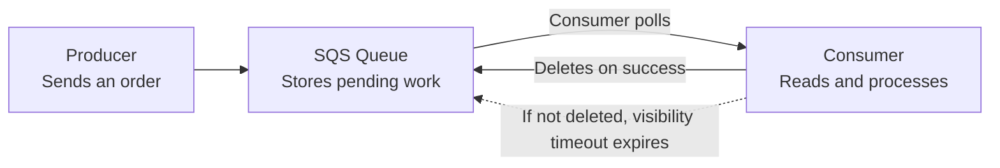

| Concept | Why it matters |
| --- | --- |
| **Producer** | Sends a message without requiring a worker to be available immediately. |
| **Consumer** | Polls for work and acknowledges successful handling by deleting the message. |
| **Visibility timeout** | Temporarily hides a received message; it does **not** delete it. |
| **Retention period** | Limits how long an undeleted message can remain available in the queue. |
| **Short / long polling** | Controls whether a receive request returns promptly or waits for messages to arrive. |
| **Dead-letter queue (DLQ)** | Can isolate messages that repeatedly fail processing. |
| **Idempotency** | Keeps repeat deliveries from producing duplicate business actions. |

Our Standard queue used a **30-second visibility timeout** and a **4-day retention period**. After retrieving `AWS-ORDER-001`, I manually deleted it to complete the processing demonstration.

### 2.2 Amazon Simple Notification Service (SNS) — Publishing Events

**Amazon Simple Notification Service (SNS)** is a fully managed **publish–subscribe (pub/sub)** service. An application sends an event or notification to a **topic**, and SNS delivers it to the endpoints subscribed to that topic, subject to their subscription configuration and permissions.

The publisher only needs to know the topic, not every destination. That separation is valuable when several services need to react to the same business event.

**Where SNS is useful:**

- **Order events:** Notify inventory, billing, and fulfillment systems that a new order was placed.
- **Operational alerts:** Distribute application or infrastructure alerts to subscribed endpoints.
- **Business notifications:** Publish changes such as order-status updates or account events.
- **Service integration:** Trigger subscribed Lambda functions or deliver events to SQS queues for later processing.
- **Fanout:** Send the same published event to multiple independent subscribers.

An **SNS topic** acts as the publication address. A **subscription** identifies an endpoint and protocol, such as an SQS queue or Lambda function. Unlike SQS, a Standard SNS topic is not a general-purpose queue that an application polls later for its message history.

#### Conceptual fanout example

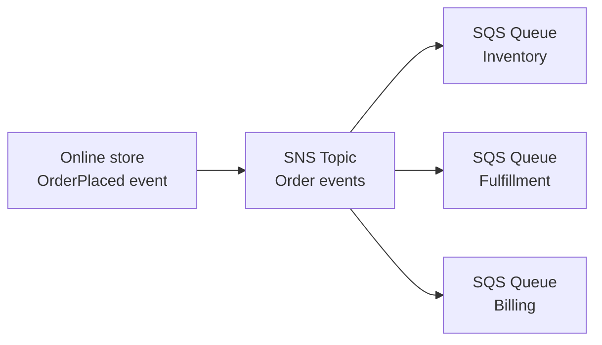

Each queue in this **illustrative design** can be consumed independently. Adding a new subscriber does not require the original publisher to send another copy directly to a new destination.

### 2.3 Why Combine SNS and SQS?

SNS and SQS complement each other:

- **SNS distributes the event.** It determines which subscribed endpoints should receive the publication.
- **SQS buffers the work.** A subscribed queue holds the delivered notification until its consumer retrieves it.

In a real order-processing architecture, different services can receive their own copy of a new-order event, while each service controls its own processing rate and retry behavior. In **this project**, I used one Standard SNS topic and one Standard SQS queue to validate that fundamental connection.

| Question | Amazon SQS | Amazon SNS |
| --- | --- | --- |
| Main responsibility | Buffer messages for asynchronous processing | Publish and distribute events |
| Typical pattern | Producer → queue → polling consumer | Publisher → topic → subscribed endpoints |
| How work is received | Consumers **poll** the queue | SNS **delivers** to subscriptions |
| Where messages wait | Queue, subject to retention settings | Not a queue that consumers poll for history |
| Best fit | Backlogs, tasks, independent processing | Notifications, event publication, fanout |
| Role in this project | `SY-OrderQueue` stored both test orders | `SY-OrderTopic` published the integrated order event |

### 2.4 Standard Versus FIFO

I selected **Standard** for both services. A Standard SQS queue supports **at-least-once delivery** and **best-effort ordering**, making it appropriate for scalable workloads that can tolerate occasional redelivery or out-of-order messages. Consumers should use idempotent processing—for example, checking the order ID before generating a second charge.

**FIFO** (first-in, first-out) options are intended for workloads requiring stronger ordering and deduplication controls. Those requirements affect configuration and application design. The choice depends on the business need, not simply on which option sounds more reliable.

### 2.5 Security and Reliability Essentials

Messaging still requires explicit access controls and processing decisions. The main ones relevant to this exercise were:

| Control | Practical meaning | What I used |
| --- | --- | --- |
| **SQS resource policy** | Grants the intended SNS topic permission to deliver to the queue. | Console-configured subscription permission |
| **Encryption at rest** | Protects stored queue messages using the selected encryption mode. | SQS-managed key (`SSE-SQS`) |
| **Visibility timeout** | Allows a consumer time to process before a message may be redelivered. | 30 seconds |
| **Message retention** | Controls when undelivered or undeleted messages expire. | 4 days |
| **Dead-letter queue** | Supports isolating messages that repeatedly fail. | Explained as a production design consideration |

> [!IMPORTANT]
> **SAA-C03 exam connection:** Choose **SQS** when an application needs asynchronous buffering. Choose **SNS** when a publisher must notify subscribers. Combine **SNS → SQS** when an event should be distributed while consumers maintain independent, durable processing queues.

## 03 Architecture Highlight

### 3.1 The Messaging Path I Built

I used two messages with different destinations. The direct SQS test established the queue lifecycle. The subsequent SNS test confirmed that the same queue could receive a notification from a topic through a confirmed subscription.

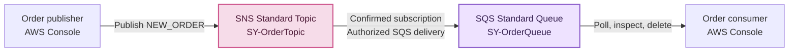

**The complete notification journey:**

1. I published the `NEW_ORDER` event to `SY-OrderTopic`.
2. The confirmed SQS subscription identified `SY-OrderQueue` as the destination, and the queue policy authorized delivery.
3. SNS delivered the notification to the queue, where SQS held it for retrieval.
4. I polled the queue and inspected the message body, including its SNS metadata and embedded order JSON.
5. I deleted the processed test messages and later removed the temporary subscription, topic, and queue.

The following visuals provide two complementary views: the **general messaging concept**, followed by the **actual sequence of steps** completed in this lab.

<p align="center"></p>

<p><sub><strong>Architecture visual:</strong> How a publisher, SNS topic, SQS queue, and consumer fit together in an event-driven system.</sub></p>

<p align="center">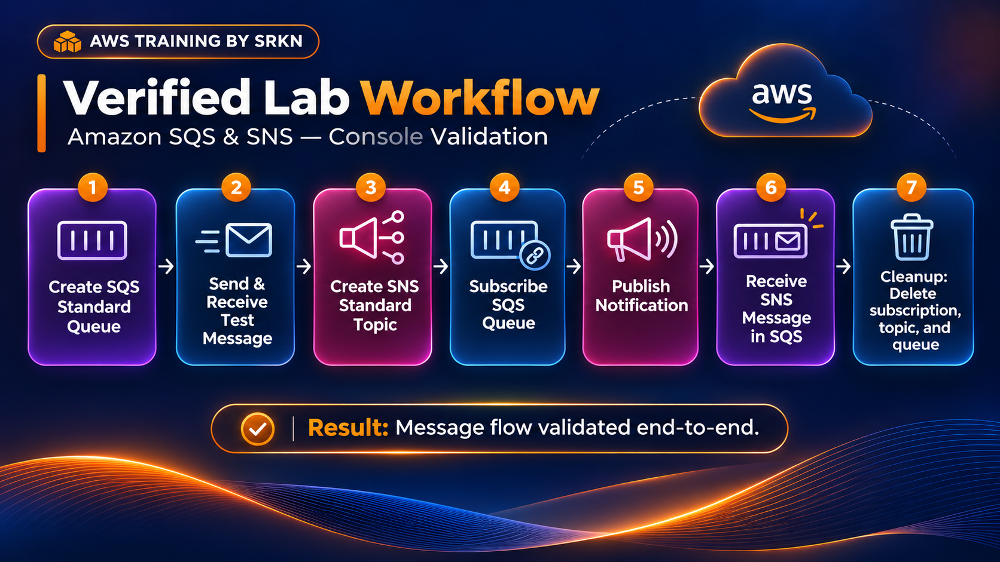</p>

<p><sub><strong>Workflow visual:</strong> My verified sequence, from creating the queue through publishing, receiving, and cleaning up.</sub></p>

---

## 04 Creating the SQS Standard Queue

### 4.1 Provisioning `SY-OrderQueue`

I began with SQS because I wanted to understand the queue's behavior **before adding another service to the message path**. In **Amazon SQS → Queues → Create queue**, I selected **Standard** and named the queue `SY-OrderQueue` in **US East (N. Virginia), `us-east-1`**.

| Setting | Verified configuration | Significance |
| --- | --- | --- |
| Queue name | `SY-OrderQueue` | Named backlog for the sample order workflow |
| Queue type | Standard | At-least-once delivery, best-effort message ordering |
| Visibility timeout | 30 seconds | Temporarily hides a received message during processing |
| Message retention | 4 days | Maximum time an undeleted order message may remain |
| Delivery delay | 0 seconds | New messages become eligible for delivery immediately |
| Receive message wait time | 0 seconds | Queue default uses short polling |
| Maximum message size | 1,024 KiB | Configured upper limit per message |
| Encryption | Amazon SQS key (`SSE-SQS`) | SQS-managed encryption at rest |
| Dead-letter queue | None | Simple initial queue configuration |

The **0-second delivery delay** let me test message receipt immediately. The **30-second visibility timeout** mattered later, when I received the message and needed to delete it explicitly rather than assume polling had removed it.

<table><tr><td align="center"><a href="images/screenshot-01.png"></a></td></tr></table>

<p><sub><strong>Screenshot 01:</strong> SQS creation form showing the Standard queue and the `SY-OrderQueue` configuration.</sub></p>

### 4.2 Confirming the Queue and Its Settings

After selecting **Create queue**, I received the success notification and opened the queue details. The page confirmed the queue name, **Standard** type, and **Amazon SQS managed encryption**. I also inspected the access-policy tab as a baseline before connecting SNS.

<table><tr><td align="center"><a href="images/screenshot-02.png"></a></td></tr></table>

<p><sub><strong>Screenshot 02:</strong> SQS queue created successfully, showing the queue type, SSE-SQS and initial access policy.</sub></p>

At this point, I had a functioning queue with no need for an application server: I could act as the publisher and consumer directly from the AWS Console.

> [!NOTE]
> **Key takeaway:** Creating a queue establishes where messages can wait; it does not process those messages. A consumer is responsible for retrieving work and deleting it after processing.

## 05 Sending, Receiving, and Deleting an SQS Message

### 5.1 Sending the First Order Directly to SQS

To establish the queue lifecycle, I opened **`SY-OrderQueue` → Send and receive messages** and entered a simulated online-store order. I left the delivery delay at **0 seconds**, so the message could be retrieved without an intentional waiting period.

```json
{
  "orderId": "AWS-ORDER-001",
  "customer": "DemoCustomer",
  "product": "AWS Training Course",
  "quantity": 1,
  "orderStatus": "PLACED",
  "source": "AWS TRAINING BY SRKN"
}
```

The `orderId` identifies the business event, while `orderStatus` records its initial state. In a real application, the same structure could tell a separate worker what task to perform. Here, it gave me recognizable data to verify after retrieval.

<table><tr><td align="center"><a href="images/screenshot-03.png"></a></td></tr></table>

<p><sub><strong>Screenshot 03:</strong> SQS Send message form containing the sample `AWS-ORDER-001` JSON order.</sub></p>

I selected **Send message**. Amazon SQS confirmed that the message had been sent and was ready to be received. This established the **producer → queue** portion of the workflow.

<table><tr><td align="center"><a href="images/screenshot-04.png"></a></td></tr></table>

<p><sub><strong>Screenshot 04:</strong> SQS confirms successful submission of the direct order message.</sub></p>

### 5.2 Polling the Queue and Inspecting the Order

Next, I used **Receive messages → Poll for messages** to request work from the queue. The console initially displayed **one available message**, and the retrieved message showed the original JSON body with `AWS-ORDER-001` and the expected customer and product information.

<table><tr><td align="center"><a href="images/screenshot-05.png"></a></td></tr></table>

<p><sub><strong>Screenshot 05:</strong> SQS Receive messages interface showing one available message before retrieval.</sub></p>

<table><tr><td align="center"><a href="images/screenshot-06.png"></a></td></tr></table>

<p><sub><strong>Screenshot 06:</strong> Received `AWS-ORDER-001` message showing the original JSON order payload.</sub></p>

The received message showed a **receive count of 1**. The Console's displayed **30-second polling duration** described the viewer's polling session; it should not be confused with the queue's configured **0-second receive-message wait time** or its separate **30-second visibility timeout**.

**What polling demonstrated:** The message remained available for processing after it was published. Reading it from the queue was a separate operation from sending it.

### 5.3 Deleting the Processed Order

After verifying the payload, I selected the message and chose **Delete**. The console confirmed its removal and displayed **0 available messages**. This represented the consumer acknowledging that the order had been handled.

<table><tr><td align="center"><a href="images/screenshot-07.png">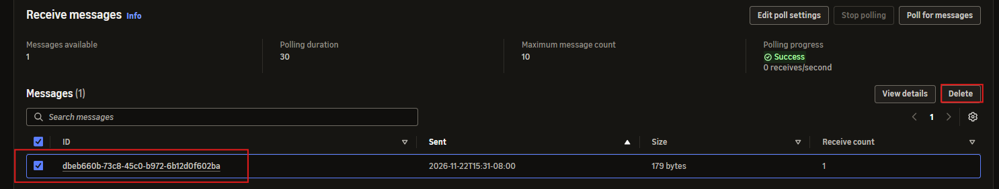</a></td></tr></table>

<p><sub><strong>Screenshot 07:</strong> Selecting the received SQS message for deletion after the simulated processing step.</sub></p>

<table><tr><td align="center"><a href="images/screenshot-08.png">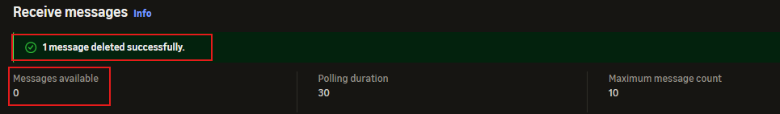</a></td></tr></table>

<p><sub><strong>Screenshot 08:</strong> SQS deletion confirmation with zero available messages.</sub></p>

The full direct-queue lifecycle was now complete: **send → store → receive → inspect → delete**.

> [!IMPORTANT]
> **SAA-C03 exam connection:** Receiving a message does **not** delete it. During the visibility timeout, the message is normally hidden from other consumers. If processing fails or the consumer never deletes it, the message can become available again. Standard SQS consumers should be safe to retry.

> [!TIP]
> **Knowledge check — Why delete an SQS message after processing?**
>
> **Answer:** Deletion acknowledges successful handling and prevents the message from remaining in the queue for later redelivery. A receive operation alone only provides temporary visibility protection.

## 06 Creating the SNS Standard Topic

### 6.1 Introducing a Publisher's Event Destination

The direct test showed how a producer and consumer exchange work through a queue. I then introduced **Amazon SNS** to separate **publishing an event** from **choosing the system that receives it**.

In **Amazon SNS → Topics → Create topic**, I selected **Standard** and created the following topic:

| Topic setting | Verified value |
| --- | --- |
| Topic name | `SY-OrderTopic` |
| Topic type | Standard |
| Display name | `SY-OrderNotifications` |
| Maximum message size shown | 256 KiB |
| Region | `us-east-1` |

The topic name describes the event category rather than a specific worker. This is the architectural advantage of publish–subscribe messaging: the publisher addresses the topic, and the topic's subscriptions determine which endpoints receive the event.

<table><tr><td align="center"><a href="images/screenshot-09.png"></a></td></tr></table>

<p><sub><strong>Screenshot 09:</strong> Final Standard SNS topic creation settings for `SY-OrderTopic`.</sub></p>

### 6.2 Confirming the SNS Topic

I created the topic and verified the success banner. Its details page initially showed **Subscriptions (0)**, as expected. The topic existed, but there was not yet a destination for notifications.

<table><tr><td align="center"><a href="images/screenshot-10.png">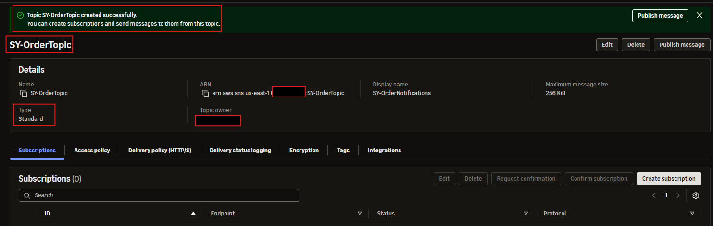</a></td></tr></table>

<p><sub><strong>Screenshot 10:</strong> SNS topic created successfully with type Standard and no subscriptions yet.</sub></p>

That led to the next stage: connecting the SQS queue as a subscriber so the new-order event would have a durable destination.

> [!NOTE]
> **Key takeaway:** SNS provides the publication address and delivery mechanism. Its subscriptions create the connections to endpoints such as SQS queues.

## 07 Subscribing SQS to SNS

### 7.1 Connecting the Existing Queue

With both resources created, I returned to **Amazon SQS → Queues**, selected `SY-OrderQueue`, and chose **Actions → Subscribe to Amazon SNS topic**. I selected the existing `SY-OrderTopic` ARN and saved the subscription.

<table><tr><td align="center"><a href="images/screenshot-11.png">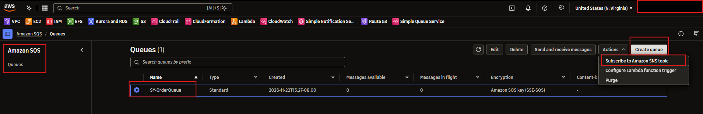</a></td></tr></table>

<p><sub><strong>Screenshot 11:</strong> SQS Actions menu with the Subscribe to Amazon SNS topic option selected.</sub></p>

<table><tr><td align="center"><a href="images/screenshot-12.png"></a></td></tr></table>

<p><sub><strong>Screenshot 12:</strong> Selecting the `SY-OrderTopic` ARN for the SQS queue subscription.</sub></p>

I created the subscription **from the SQS Console**, which streamlined the setup and added the topic-related access-policy permission to the queue. This was an important part of the implementation: defining a destination is not enough unless the destination is authorized to accept messages from the source.

### 7.2 Verifying Subscription Permissions

The SQS Console displayed a successful subscription confirmation and an updated queue access policy. The SNS topic also showed the SQS subscription as **Confirmed**, establishing the intended route before I published the second order.

<table><tr><td align="center"><a href="images/screenshot-13.png">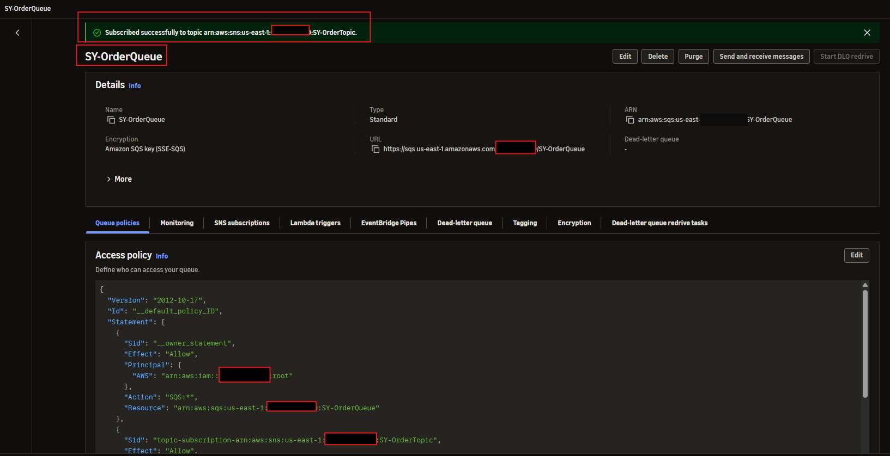</a></td></tr></table>

<p><sub><strong>Screenshot 13:</strong> Subscription success confirmation and queue access policy containing the SNS-related statement.</sub></p>

The key permission is **`sqs:SendMessage`**. SNS must be allowed to send a notification to the SQS queue. A typical least-privilege configuration grants the **SNS service principal** this action on the queue, restricted to the intended topic with `aws:SourceArn`.

The following is a **reference example**, not a policy I manually entered. The account number is a synthetic placeholder:

```json
{
  "Effect": "Allow",
  "Principal": { "Service": "sns.amazonaws.com" },
  "Action": "sqs:SendMessage",
  "Resource": "arn:aws:sqs:us-east-1:123456789012:SY-OrderQueue",
  "Condition": {
    "ArnEquals": {
      "aws:SourceArn": "arn:aws:sns:us-east-1:123456789012:SY-OrderTopic"
    }
  }
}
```

This statement illustrates the **authorization relationship**; the actual console-created policy was associated with our real topic and queue.

> [!IMPORTANT]
> **SAA-C03 exam connection:** For SNS to deliver messages to an SQS queue, the queue's resource policy must permit the intended SNS topic to call `sqs:SendMessage`. A confirmed subscription and valid permissions are both necessary parts of the integration.

## 08 Publishing an Order Notification

### 8.1 Publishing Through SNS Instead of Directly to SQS

For the second experiment, I changed the message's destination. Instead of opening SQS and sending the next order directly into the queue, I opened **Amazon SNS → Topics → `SY-OrderTopic` → Publish message**.

<table><tr><td align="center"><a href="images/screenshot-14.png"></a></td></tr></table>

<p><sub><strong>Screenshot 14:</strong> SNS topic details with the Publish message action.</sub></p>

I entered the subject **`New Customer Order - AWS-ORDER-002`**, selected **Identical payload for all delivery protocols**, and used this JSON message:

```json
{
  "orderId": "AWS-ORDER-002",
  "customer": "DemoCustomer",
  "product": "AWS Cloud Training",
  "quantity": 2,
  "orderStatus": "PLACED",
  "source": "AWS TRAINING BY SRKN",
  "notificationType": "NEW_ORDER"
}
```

The added `notificationType` identifies the kind of event. A subscriber could eventually use that field in business logic or filtering decisions; for this exercise, it made the received event easy to recognize. Because the topic and queue were **Standard**, there was no FIFO message-group requirement for this publication.

<table><tr><td align="center"><a href="images/screenshot-15.png"></a></td></tr></table>

<p><sub><strong>Screenshot 15:</strong> SNS publish form containing the `AWS-ORDER-002` subject and JSON payload.</sub></p>

### 8.2 Confirming SNS Accepted the Publication

I selected **Publish message**. SNS displayed a success banner, while the topic's subscription list showed the confirmed SQS destination.

<table><tr><td align="center"><a href="images/screenshot-16.png"></a></td></tr></table>

<p><sub><strong>Screenshot 16:</strong> SNS publication success banner and the confirmed SQS subscription.</sub></p>

The success banner established that SNS accepted the new-order notification. The more important end-to-end question remained: **Did the subscribed queue receive it?** I answered that in the following verification step.

> [!NOTE]
> **Key takeaway:** A successful publish operation is not the same as verifying downstream delivery. Checking the subscription's receiving endpoint completes the test.

## 09 Verifying SNS-to-SQS Delivery

### 9.1 Finding the Published Order in SQS

I returned to **Amazon SQS → `SY-OrderQueue` → Send and receive messages**, polled the queue, and opened the delivered notification.

<table><tr><td align="center"><a href="images/screenshot-17.png">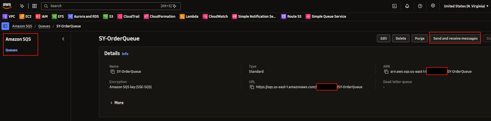</a></td></tr></table>

<p><sub><strong>Screenshot 17:</strong> SQS queue details before inspecting a delivered SNS notification.</sub></p>

The received message showed the source topic and subject, including **`New Customer Order - AWS-ORDER-002`**. Inside the `Message` field, I found the original order details with `orderId: AWS-ORDER-002` and `notificationType: NEW_ORDER`.

<table><tr><td align="center"><a href="images/screenshot-18.png"></a></td></tr></table>

<p><sub><strong>Screenshot 18:</strong> Received SNS envelope showing the source topic, subject and `AWS-ORDER-002` payload.</sub></p>

This was the decisive result of the lab. The message had not been sent directly to SQS; it traveled through **SNS publication → confirmed subscription → SQS delivery** and remained available for the consumer to retrieve.

### 9.2 Understanding the SNS Notification Envelope

The received SQS message contained additional fields because the subscription used the normal SNS notification format rather than raw message delivery.

| SNS field | What it tells us |
| --- | --- |
| `Type` | The message represents an SNS notification. |
| `TopicArn` | Which SNS topic published the event. |
| `Subject` | The human-readable subject supplied during publication. |
| `Message` | The original business JSON, serialized inside the outer SNS notification. |
| `Timestamp` | When SNS recorded publication of the notification. |
| `Signature` and related metadata | Information included in the SNS notification format for supported authenticity checks. |

A simplified representation of what the consumer receives is shown below. The AWS account ID is illustrative, and the business payload is abbreviated:

```json
{
  "Type": "Notification",
  "TopicArn": "arn:aws:sns:us-east-1:123456789012:SY-OrderTopic",
  "Subject": "New Customer Order - AWS-ORDER-002",
  "Message": "{\"orderId\":\"AWS-ORDER-002\",\"notificationType\":\"NEW_ORDER\"}"
}
```

A consumer using the default SNS envelope can parse the outer JSON, then parse the `Message` string to recover the original order object. With **raw message delivery** enabled for supported subscriptions, SNS can deliver the original payload without this enclosing SNS JSON structure.

### 9.3 What the Delivery Test Proved

| Verification question | Result |
| --- | --- |
| Did the SNS topic accept the order event? | Yes — publication success banner |
| Was there a confirmed queue subscription? | Yes — subscription was shown as Confirmed |
| Did a message arrive through SNS? | Yes — received SQS body contained the SNS notification envelope |
| Was the expected business data preserved? | Yes — `AWS-ORDER-002`, `NEW_ORDER`, and order details were present |
| Could the queue consumer retrieve the notification? | Yes — it was opened through SQS polling |

I deleted the processed test notifications after inspection, completing the messaging demonstration before removing the resources themselves.

> [!IMPORTANT]
> **SAA-C03 exam connection:** When a queue subscribes to SNS without **raw message delivery**, expect an outer SNS notification containing the business payload within `Message`. The distinction matters when designing consumers that parse event data.

## 10 Removing Temporary Messaging Resources

After the successful direct-queue and SNS-to-SQS tests, I completed the resource lifecycle by deleting the temporary messaging resources in dependency order: **subscription → SNS topic → SQS queue**.

### 10.1 Deleting the SNS Subscription

I opened **Amazon SNS → Subscriptions**, selected the confirmed SQS subscription associated with `SY-OrderTopic`, and completed the deletion. This removed the event-delivery connection between the topic and queue.

<table><tr><td align="center"><a href="images/screenshot-19.png">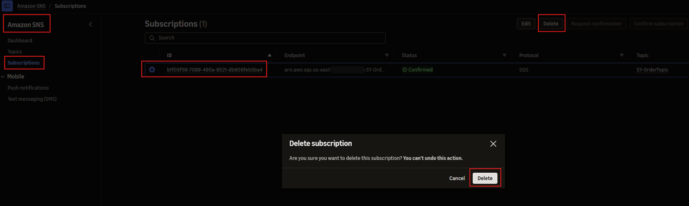</a></td></tr></table>

<p><sub><strong>Screenshot 19:</strong> Deletion confirmation for the SNS-to-SQS subscription.</sub></p>

### 10.2 Deleting the SNS Topic

Next, I returned to **Amazon SNS → Topics**, selected `SY-OrderTopic`, and completed the topic deletion. At that point, the order-event publication destination for this exercise had been removed.

<table><tr><td align="center"><a href="images/screenshot-20.png"></a></td></tr></table>

<p><sub><strong>Screenshot 20:</strong> Deletion confirmation for the `SY-OrderTopic` Standard topic.</sub></p>

### 10.3 Deleting the SQS Queue

Finally, I selected **`SY-OrderQueue`** from **Amazon SQS → Queues** and deleted it. The confirmation dialog showed that the queue contained **0 messages**.

<table><tr><td align="center"><a href="images/screenshot-21.png"></a></td></tr></table>

<p><sub><strong>Screenshot 21:</strong> SQS queue deletion dialog confirming `SY-OrderQueue` contained zero messages.</sub></p>

### 10.4 Final Resource State

| Resource | Final outcome |
| --- | --- |
| Direct SQS order test (`AWS-ORDER-001`) | Message deleted |
| SNS-delivered test notifications (`AWS-ORDER-002`) | Messages deleted |
| SNS-to-SQS subscription | Deleted |
| SNS topic `SY-OrderTopic` | Deleted |
| SQS queue `SY-OrderQueue` | Deleted |

The screenshots record the cleanup actions, and I confirmed that the subscription, topic, and queue deletions were completed. The exercise therefore ended with the temporary messaging resources removed.

> [!CAUTION]
> **Cleanup consideration:** Deleting a queue also removes its messages. Before removing messaging resources in a shared or production account, confirm the owners, subscribers, and downstream dependencies.

## 11 Verified Results and SAA-C03 Knowledge Checks

### 11.1 Results at a Glance

The two experiments validated different parts of the design: SQS proved **queued-message handling**, while the SNS integration proved **topic-based delivery into a queue**.

| Validation | Verified evidence | Outcome |
| --- | --- | --- |
| Create the SQS Standard queue | Queue details and creation confirmation | Passed |
| Submit an order directly to SQS | `AWS-ORDER-001` send confirmation | Passed |
| Receive and inspect the direct order | Received JSON and receive count | Passed |
| Delete the direct order | SQS deletion confirmation | Passed |
| Create the SNS Standard topic | Topic configuration and success banner | Passed |
| Subscribe the SQS queue | Subscription success and topic-related queue policy | Passed |
| Publish a new-order event to SNS | `AWS-ORDER-002` publication confirmation | Passed |
| Receive the SNS notification in SQS | SNS envelope, subject, topic ARN, and original order payload | Passed |
| Remove the temporary messaging resources | Completed subscription, topic, and queue deletions | Completed |

### 11.2 SAA-C03 Knowledge Checks

> [!TIP]
> **1. An application must keep accepting orders even when the fulfillment worker is temporarily unavailable. Which AWS service fits the processing backlog?**
>
> **Answer: Amazon SQS.** The queue separates order submission from fulfillment processing and retains pending messages within its configured retention period.

> [!TIP]
> **2. Inventory and billing both need to react to the same order event, but independently. What pattern would you use?**
>
> **Answer: SNS fanout to separate SQS queues.** SNS distributes the published event to each subscribed queue; each service can then process its copy at its own rate.

> [!TIP]
> **3. Does a successful `ReceiveMessage` operation mean SQS has removed the message?**
>
> **Answer: No.** Receiving normally makes the message temporarily invisible. Deletion is the explicit acknowledgement after processing.

> [!TIP]
> **4. A topic publishes successfully, but the SQS destination receives nothing. What authorization should you verify?**
>
> **Answer: The SQS queue resource policy.** It needs to allow the intended SNS topic to invoke `sqs:SendMessage`, commonly constrained by `aws:SourceArn`.

> [!TIP]
> **5. Why was the customer-order JSON nested inside an SNS `Message` field?**
>
> **Answer: Raw message delivery was not enabled.** SNS delivered its notification envelope, including publication metadata, around the business payload.

> [!TIP]
> **6. Can a Standard SQS queue deliver a message more than once?**
>
> **Answer: Yes.** Standard SQS uses at-least-once delivery. Consumers should make repeated processing safe, often by checking an order or event ID.

## 12 Troubleshooting and Production Considerations

### 12.1 Troubleshooting This Architecture

When reproducing the SNS-to-SQS design, the following checks help distinguish publishing, permission, and consumption issues.

| Symptom | Check | Explanation |
| --- | --- | --- |
| SNS publishes but the queue stays empty | Subscription **Confirmed** status; correct topic and queue ARNs | Delivery requires the intended destination to be subscribed. |
| Subscription exists but delivery fails | Queue resource policy and `sqs:SendMessage` permission | SNS requires destination authorization. |
| Polling returns no message | Queue depth, visibility timeout, and polling configuration | A message may be temporarily in flight or a short poll may return empty. |
| Consumer sees a JSON string rather than a direct order object | SNS envelope and raw-message setting | The default notification puts the business payload inside `Message`. |
| Message reappears after retrieval | Consumer deletion logic and visibility timeout | An undeleted message may become visible again. |
| A message repeatedly fails processing | DLQ and redrive policy design | Failed messages may need isolation for investigation. |

### 12.2 Production Design Considerations

The verified workflow illustrates a production-relevant pattern. Taking it further would require thinking carefully about delivery semantics, failure handling, and operational visibility:

- **Idempotent processing:** Use stable business identifiers such as `orderId` to guard against repeated work when a message is redelivered.
- **Dedicated queues per service:** If inventory, billing, and fulfillment all subscribe to the same SNS topic, each can have its own queue and independent consumer fleet.
- **Dead-letter queues and retries:** Design redrive rules so repeatedly failing messages can be isolated and investigated.
- **Visibility timeout sizing:** Give consumers enough time to finish work; extend the timeout when necessary for long-running tasks.
- **Long polling:** Reduce unnecessary empty receives and improve consumer efficiency.
- **Least-privilege policies:** Restrict queue send permissions to the intended topic and authorize only necessary API actions.
- **Observability:** Use Amazon CloudWatch metrics for queue depth, age of the oldest message, and failure backlogs.
- **Schema management:** Define event types and version message structures so subscribers can evolve safely.
- **SNS filtering:** Apply subscription filter policies when different subscribers need different categories of events.

These are **architecture considerations for future implementations**, not additional changes to the configuration documented above.

## 13 Technical Competencies

### 13.1 Engineering Lessons

The first test gave me a concrete understanding of asynchronous processing: I could submit an order, retrieve it independently, inspect its contents, and delete it when finished. The queue handled storage and delivery, while the consumer controlled when and how the work was acknowledged.

The SNS integration added a second architectural capability. The publisher no longer addressed the queue directly; it sent the event to a topic whose subscription determined the destination. Inspecting the SNS envelope in SQS verified not only that the message arrived but also **where it came from** and **which business event it represented**.

### 13.2 Skills Matrix

| Skill | Evidence from this exercise | Engineering capability |
| --- | --- | --- |
| SQS configuration | Standard queue creation and verified settings | Provision an asynchronous workload buffer |
| JSON event design | `AWS-ORDER-001` and `AWS-ORDER-002` payloads | Represent business operations as messages |
| Message lifecycle | Direct send, poll, inspect, and delete | Explain delivery, visibility, and acknowledgement |
| SNS configuration | Standard topic creation and details | Configure a publish–subscribe event destination |
| Cross-service authorization | Queue policy updated during subscription | Explain why resource permissions matter for delivery |
| SNS-to-SQS integration | Confirmed subscription and received notification | Validate end-to-end event publication and queue receipt |
| Message interpretation | SNS envelope containing source and order details | Distinguish event metadata from the business payload |
| Resource lifecycle | Subscription, topic, and queue deletion | Cleanly retire temporary messaging resources |

**Technologies and patterns demonstrated:** Amazon SQS, Amazon SNS, JSON messaging, AWS Management Console, SQS queue policies, at-least-once delivery, asynchronous processing, pub/sub messaging, and event-driven decoupling.

## 14 AWS Documentation References

- [Amazon SQS — Receiving and deleting a message](https://docs.aws.amazon.com/AWSSimpleQueueService/latest/SQSDeveloperGuide/step-receive-delete-message.html)
- [Amazon SQS — Visibility timeout](https://docs.aws.amazon.com/AWSSimpleQueueService/latest/SQSDeveloperGuide/sqs-visibility-timeout.html)
- [Amazon SNS — Subscribing an SQS queue to an SNS topic](https://docs.aws.amazon.com/sns/latest/dg/subscribe-sqs-queue-to-sns-topic.html)
- [Amazon SQS Console — Subscribe a queue to an SNS topic](https://docs.aws.amazon.com/AWSSimpleQueueService/latest/SQSDeveloperGuide/sqs-configure-subscribe-queue-sns-topic.html)
- [Amazon SNS — Raw message delivery](https://docs.aws.amazon.com/sns/latest/dg/sns-large-payload-raw-message-delivery.html)
- [Amazon SNS — Message delivery](https://docs.aws.amazon.com/sns/latest/dg/message-delivery.html)

## 15 Conclusion

This exercise began with a simple question: **How can an online store hand off work without depending on every downstream system being available at the same moment?** The answer became clearer through two connected tests.

First, I used **Amazon SQS** to store a customer order, retrieve it through polling, and explicitly delete it after inspection. That demonstrated queue-based asynchronous processing and the distinction between receiving a message and acknowledging completion. Next, I introduced **Amazon SNS** as the event publisher, subscribed the queue, and confirmed that a new-order notification traveled from the SNS topic into SQS. The received notification preserved the original business payload and included SNS metadata identifying its source.

The result established the value of the two services working together: **SNS distributes events; SQS buffers them for independent processing.** That pattern allows applications to grow beyond direct service-to-service calls, introduces resilience during temporary downstream interruptions, and supports multiple consumers without coupling each one to the original publisher.

Finally, I removed the temporary subscription, topic, and queue after completing the verification. The activity demonstrated the complete messaging lifecycle—from initial provisioning and direct queue testing to integrated event delivery, validation, and cleanup—and gave me a practical foundation for designing event-driven AWS applications.

---

**AWS TRAINING BY SRKN** · **Amazon SQS & SNS — Event-Driven Messaging** · **SAA-C03 Cloud Engineering Portfolio**
