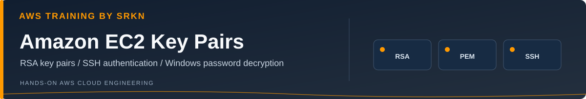
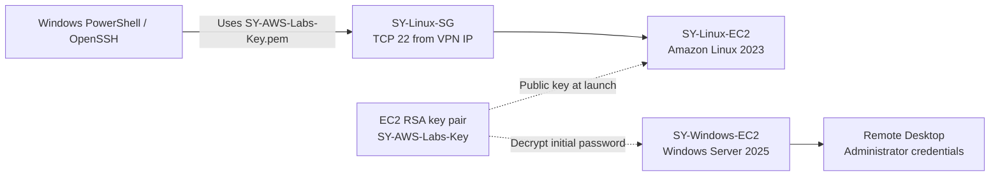
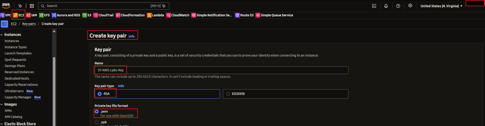
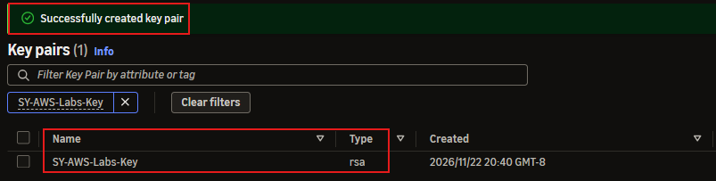
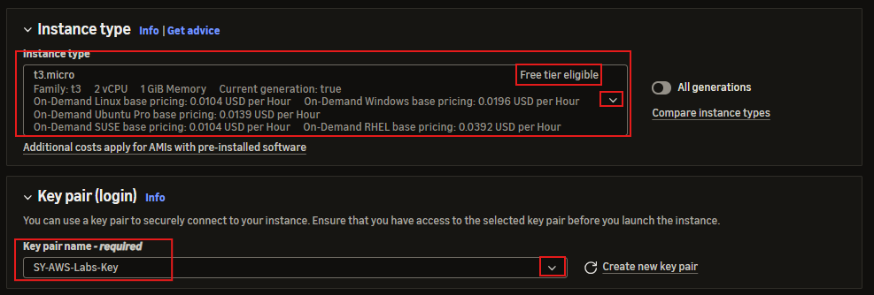
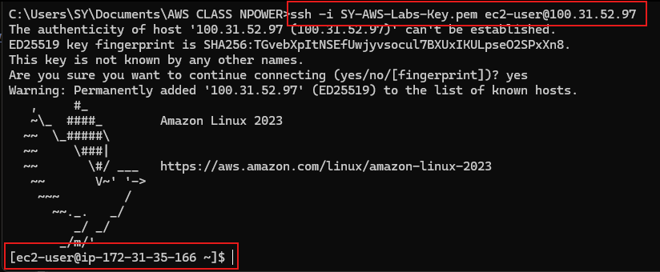
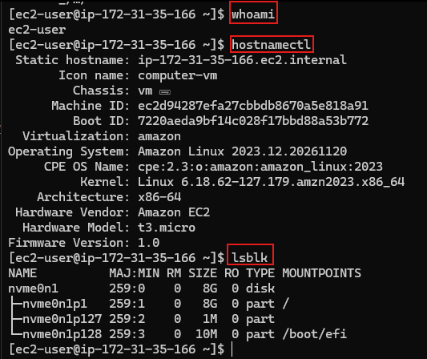
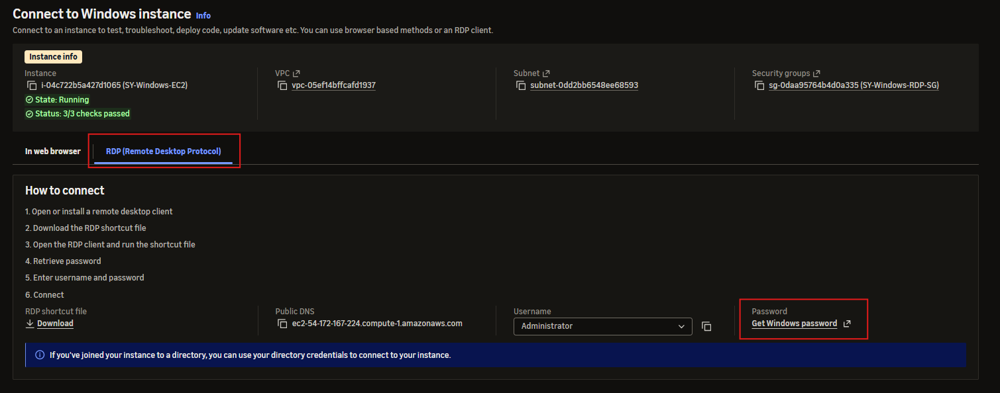
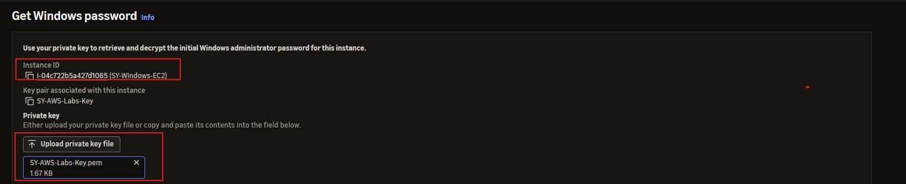
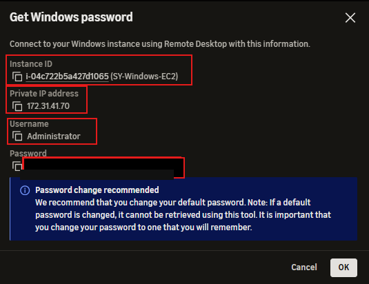

<p align="center"></p>

# Amazon EC2 Key Pairs — RSA Authentication Lab
**AMAZON EC2 / RSA KEY PAIRS / OPENSSH / WINDOWS PASSWORD DECRYPTION**

An EC2 key pair provides a practical way to establish who is permitted to access a virtual machine. For Linux workloads, an SSH client proves possession of the private key while the instance checks the associated public key. For AWS-provided Windows Server instances, the key pair can also be used to decrypt the initial local Administrator password.

I created an RSA key pair in `us-east-1`, assigned it to an Amazon Linux 2023 EC2 instance, and authenticated over SSH from Windows PowerShell. I later reused the same key pair to retrieve the initial Administrator password for a Windows Server EC2 instance. These tests established how one AWS key-pair resource supports two different remote-access workflows.

---

## Contents
- [01 Purpose, Scenario, and Key Pair Fundamentals](#01-purpose-scenario-and-key-pair-fundamentals)
- [02 Creating the RSA Key Pair](#02-creating-the-rsa-key-pair)
- [03 Authenticating to Amazon Linux with SSH](#03-authenticating-to-amazon-linux-with-ssh)
- [04 Using the Key Pair for Windows Password Retrieval](#04-using-the-key-pair-for-windows-password-retrieval)
- [05 Security Practices and SAA-C03 Review](#05-security-practices-and-saa-c03-review)
- [06 Results and Cleanup](#06-results-and-cleanup)
- [Technical Competencies](#technical-competencies)
- [Command Reference](#command-reference)
- [AWS Documentation](#aws-documentation)

## Architecture Highlight



The diagram represents the environment used during the activity. Both temporary instances and the lab key pair were subsequently removed during the combined cleanup.

## 01 Purpose, Scenario, and Key Pair Fundamentals

### 1.1 What is an EC2 key pair?

An **Amazon EC2 key pair** is an asymmetric cryptographic credential consisting of a public key and a private key. AWS associates the public key with an instance at launch. The private key remains under the operator's control; for SSH, a matching key is required to authenticate successfully.

| Element | Role in the workflow |
|---|---|
| Public key | Associated with the EC2 instance; used to verify a private-key signature. |
| Private key (`.pem`) | Stored locally and referenced by the SSH client. |
| RSA | The key algorithm selected for compatibility with Linux access and Windows password decryption. |
| Security group | Separately controls whether SSH/RDP network traffic can reach the instance. |
| SSH host key | Identifies the *server* to the SSH client; distinct from the user's EC2 key pair. |

A key pair solves **authentication**, not network access by itself. The EC2 instance must also be reachable through its VPC routing and permitted security-group rules. IAM authorization to manage EC2 resources and operating-system login permissions are distinct controls.

### 1.2 Why use key pairs? Real-world applications

Key-based access is useful for administering Linux servers without transmitting reusable login passwords, establishing consistent machine access during controlled deployments, and recovering initial Windows EC2 credentials. In production environments, teams typically combine it with tightly controlled ingress, secret handling, short-lived access workflows, and centralized audit processes.

**My scenario:** I created one key pair, attached it at Linux instance launch, authenticated from my Windows workstation, and later used that RSA key for the Windows Server password retrieval exercise. These activities also supported the [Amazon EC2](../Lab12-Amazon-EC2/Amazon-EC2-Lab.md) and [Windows EC2 & RDP](../Lab15-Windows-EC2-RDP/Windows-EC2-RDP-Lab.md) labs.

## 02 Creating the RSA Key Pair

I opened **EC2 → Network & Security → Key Pairs → Create key pair** in N. Virginia and selected the following configuration.

| Setting | Configured value |
|---|---|
| Key pair name | `SY-AWS-Labs-Key` |
| Region | `us-east-1` |
| Key pair type | RSA |
| Private key format | `.pem` (OpenSSH-compatible) |
| Local downloaded file | `SY-AWS-Labs-Key.pem` |

The `.pem` file was downloaded and stored on my Windows computer. Because the private key provides authentication capability, it was never committed to GitHub.

<table><tr><td align="center"><a href="images/screenshot-01.png"></a></td></tr></table>

<p><sub><strong>Screenshot 01:</strong> EC2 key-pair creation form with the RSA algorithm and OpenSSH-compatible PEM format selected.</sub></p>

After selecting **Create key pair**, I verified the success notification and the RSA entry in the EC2 Key Pairs list.

<table><tr><td align="center"><a href="images/screenshot-02.png"></a></td></tr></table>

<p><sub><strong>Screenshot 02:</strong> AWS confirmation showing the newly created SY-AWS-Labs-Key RSA key pair.</sub></p>

I subsequently selected this key during the Amazon Linux EC2 instance launch. Selecting a key pair at launch provides the instance with the public-key material required for later SSH login.

<table><tr><td align="center"><a href="images/screenshot-03.png"></a></td></tr></table>

<p><sub><strong>Screenshot 03:</strong> EC2 launch configuration showing t3.micro and SY-AWS-Labs-Key selected for instance login.</sub></p>

> [!NOTE]
> **Key takeaway:** The private key stays with the client; the corresponding public key is made available to the instance. The security group and OS account must still permit the intended connection.

## 03 Authenticating to Amazon Linux with SSH

### 3.1 Connection scenario

I launched `SY-Linux-EC2` with Amazon Linux 2023 and attached the security group `SY-Linux-SG`, which restricted **TCP port 22** to the public IP of my VPN connection. I then authenticated as the default Amazon Linux user, `ec2-user`.

| Connection property | Actual value |
|---|---|
| Instance | `SY-Linux-EC2` |
| Operating system | Amazon Linux 2023 |
| Original public IPv4 | `100.31.52.97` |
| SSH username | `ec2-user` |
| SSH port | `22/TCP` |
| Private key | `SY-AWS-Labs-Key.pem` |

From the directory containing the downloaded key, I ran:

```powershell
ssh -i SY-AWS-Labs-Key.pem ec2-user@100.31.52.97
```

The `-i` option identifies the private-key file. On first connection, OpenSSH displayed the server's ED25519 host-key fingerprint and requested confirmation of the new host identity. After accepting the verified destination, the instance presented its **Amazon Linux 2023** shell prompt.

<table><tr><td align="center"><a href="images/screenshot-04.png"></a></td></tr></table>

<p><sub><strong>Screenshot 04:</strong> Windows OpenSSH session authenticated to Amazon Linux 2023 using SY-AWS-Labs-Key.pem.</sub></p>

### 3.2 Confirming the authenticated account and host

I checked the current user and host configuration with:

```bash
whoami
hostnamectl
lsblk
```

`whoami` returned `ec2-user`. `hostnamectl` identified Amazon Linux 2023, the `x86-64` architecture and the t3.micro hardware model. `lsblk` showed the 8 GiB EBS-backed root disk.

<table><tr><td align="center"><a href="images/screenshot-05.png"></a></td></tr></table>

<p><sub><strong>Screenshot 05:</strong> Successful Linux authentication and system verification with whoami, hostnamectl, and lsblk.</sub></p>

> [!IMPORTANT]
> **SAA-C03 exam connection:** A key pair verifies login identity; a security group governs network traffic. Allowing TCP 22 in a security group does not replace SSH authentication, and possessing the private key does not bypass a blocked network path.

## 04 Using the Key Pair for Windows Password Retrieval

The same RSA key pair later supported a different authentication workflow for `SY-Windows-EC2`. I launched the Windows instance with `SY-AWS-Labs-Key`, opened **EC2 → Connect → RDP client → Get Windows password**, and supplied the private key to decrypt the initial local Administrator password.

<table><tr><td align="center"><a href="images/screenshot-06.png"></a></td></tr></table>

<p><sub><strong>Screenshot 06:</strong> Windows instance RDP connection page showing the Administrator account and Get Windows password workflow.</sub></p>

<table><tr><td align="center"><a href="images/screenshot-07.png"></a></td></tr></table>

<p><sub><strong>Screenshot 07:</strong> Windows password retrieval page showing the matching EC2 key pair and private-key file upload.</sub></p>

After decryption, the console displayed the Windows connection details and the Administrator username; the credential itself is not published.

<table><tr><td align="center"><a href="images/screenshot-08.png"></a></td></tr></table>

<p><sub><strong>Screenshot 08:</strong> Windows EC2 Administrator connection details following successful RSA-key password decryption; secret concealed.</sub></p>

This differs from Linux SSH authentication: for Windows RDP, the RSA key facilitated **retrieval of the initial password** rather than serving as the credential sent over the RDP connection. The full RDP configuration and graphical login test are documented in the [Windows EC2 & RDP lab](../Lab15-Windows-EC2-RDP/Windows-EC2-RDP-Lab.md).

## 05 Security Practices and SAA-C03 Review

### Practical security principles

| Principle | Application |
|---|---|
| Protect private keys | Store `.pem` material outside version control, preferably with restricted filesystem permissions. |
| Limit inbound access | Permit SSH or RDP only from approved IP ranges or secure access paths. |
| Verify host identity | Evaluate unexpected SSH host-key changes rather than automatically accepting them. |
| Prefer managed access at scale | Consider Systems Manager Session Manager and centralized identity/audit controls when appropriate. |
| Separate AWS and OS permissions | IAM controls AWS API authorization; instance users and OS services control local login. |
| Treat key removal correctly | Deleting the EC2 key-pair record does not automatically remove copies of the private key from local computers. |

### Knowledge check

**Q1.** Can an EC2 key pair alone open TCP port 22 to an instance? **Answer:** No. The security group and network route must also allow SSH traffic. **Reason:** Authentication and network filtering operate at separate layers.

**Q2.** Why was RSA appropriate in this activity? **Answer:** It supported SSH login to Amazon Linux and decryption of the initial Windows Server Administrator password. **Reason:** EC2 Windows password decryption requires an appropriate RSA key pair.

**Q3.** What does the first-use SSH fingerprint prompt identify? **Answer:** The remote server's SSH host key. **Reason:** The host key is used to assess server identity, not to provide the user's login private key.

## 06 Results and Cleanup

The tests confirmed that a single RSA EC2 key pair enabled successful Linux SSH authentication and Windows Administrator password retrieval for the two instances used in this training environment. SSH login was independently verified using `whoami`, `hostnamectl`, and the live Linux terminal prompt.

After the associated EC2, EBS, Elastic IP, and RDP activities were complete, I deleted the temporary `SY-AWS-Labs-Key` key pair in the coordinated cleanup. The reusable `npoweraws` key pair was preserved.

### Conclusion

This activity connected the mechanics of asymmetric key pairs with real EC2 administration. I created and assigned a key pair, used the locally held private key to authenticate to Amazon Linux, and used RSA password decryption to support a Windows RDP connection. The practical distinction among **identity, network access, and operating-system login** is the most important architectural lesson from this lab.

## Technical Competencies

| Skill | Demonstrated work |
|---|---|
| EC2 access credentials | Created and selected an RSA key pair. |
| Linux system access | Authenticated to Amazon Linux using Windows OpenSSH. |
| Host identity awareness | Confirmed the first-use SSH host-key prompt. |
| Windows credentials | Retrieved the initial Administrator password using the RSA key. |
| Operational security | Restricted SSH ingress and retained private-key confidentiality. |
| Resource lifecycle | Removed the temporary key-pair resource after testing. |

## Command Reference

```powershell
# From the Windows directory that contained the downloaded private key
ssh -i SY-AWS-Labs-Key.pem ec2-user@100.31.52.97
```

```bash
# Executed on the Linux EC2 instance
whoami
hostnamectl
lsblk
```

## AWS Documentation
- [Amazon EC2 key pairs and Amazon EC2 instances](https://docs.aws.amazon.com/AWSEC2/latest/UserGuide/ec2-key-pairs.html)
- [Connect to your Windows instance using an RDP client](https://docs.aws.amazon.com/AWSEC2/latest/UserGuide/connect-rdp.html)
- [Connect to your EC2 instance](https://docs.aws.amazon.com/AWSEC2/latest/UserGuide/connect.html)
