<p align="center">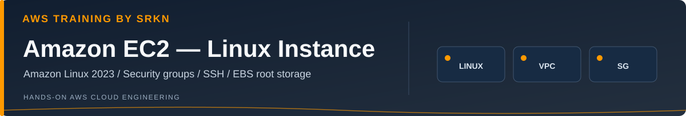</p>

# Amazon EC2 — Linux Instance Deployment Lab
**AMAZON EC2 / AMAZON LINUX 2023 / DEFAULT VPC / SECURITY GROUPS / EBS**

**Amazon Elastic Compute Cloud (EC2)** provides resizable virtual servers on AWS. Instead of purchasing and maintaining physical hardware, I can select an Amazon Machine Image (AMI), choose a compute size, attach storage, and define network access rules for an instance that runs in an AWS Region and Availability Zone.

I deployed an Amazon Linux 2023 instance in the existing default VPC in N. Virginia, configured tightly scoped SSH access, verified instance health and Linux system information, and identified its EBS-backed root storage. That server subsequently provided the working environment for the EBS and Elastic IP labs.

---

## Contents
- [01 Purpose and EC2 Fundamentals](#01-purpose-and-ec2-fundamentals)
- [02 Architecture and Lab Scenario](#02-architecture-and-lab-scenario)
- [03 Configuring the Linux Instance](#03-configuring-the-linux-instance)
- [04 Launching and Verifying EC2](#04-launching-and-verifying-ec2)
- [05 Accessing the Operating System](#05-accessing-the-operating-system)
- [06 EBS Root Storage and Instance Lifecycle](#06-ebs-root-storage-and-instance-lifecycle)
- [07 SAA-C03 Review and Production Considerations](#07-saa-c03-review-and-production-considerations)
- [08 Conclusion and Cleanup](#08-conclusion-and-cleanup)
- [AWS Cost Estimate — Monthly (730 Hours)](#aws-cost-estimate--monthly-730-hours)
- [Technical Competencies](#technical-competencies)
- [Command Reference](#command-reference)
- [AWS Documentation](#aws-documentation)

## 01 Purpose and EC2 Fundamentals

An EC2 instance is a virtual machine hosted on AWS-managed infrastructure. EC2 lets engineers select an operating system, CPU and memory capacity, network placement, storage, and lifecycle settings. Common workloads include application servers, API backends, development environments, specialized compute processes, and administrative workstations.

| EC2 concept | Purpose |
|---|---|
| AMI | Provides the operating system and starting software configuration. |
| Instance family/size | Determines available virtual CPU and memory resources. |
| VPC and subnet | Place the instance in an isolated network and a specific Availability Zone. |
| Security group | Acts as a stateful virtual firewall at the network interface. |
| Public/private IP | Support public reachability and internal VPC communication respectively. |
| Key pair | Supports operating-system access authentication. |
| EBS | Provides durable, persistent block storage, including the root disk. |
| Instance state | Determines whether compute is running, stopped, or terminated. |

The goal of my exercise was to create a working Linux server, rather than simply leave an EC2 resource in the **Running** state. I verified both the AWS-side configuration and the guest operating system.

## 02 Architecture and Lab Scenario

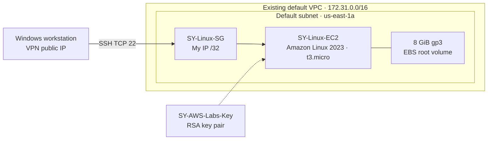

The environment used the existing default VPC and subnet in `us-east-1a`. The virtual machine and its temporary security group were removed during the combined lab cleanup.

### Actual deployment inventory

| Setting | Lab configuration |
|---|---|
| EC2 instance name | `SY-Linux-EC2` |
| Instance ID | `i-02a05dfec91c806fe` |
| Region / AZ | `us-east-1` / `us-east-1a` |
| AMI | Amazon Linux 2023, x86_64 |
| Instance type | `t3.micro` (2 vCPU, 1 GiB memory) |
| Key pair | `SY-AWS-Labs-Key` |
| VPC | Default, `172.31.0.0/16` |
| Security group | `SY-Linux-SG` |
| Inbound access | SSH `22/TCP` from one VPN public IPv4 `/32` |
| Initial public IPv4 | `100.31.52.97` |
| Root storage | 8 GiB gp3 EBS |

## 03 Configuring the Linux Instance

### 3.1 Selecting the AMI, size, and login key

I opened **EC2 → Instances → Launch instances**, named the instance `SY-Linux-EC2`, and selected the Amazon Linux 2023 64-bit x86 AMI. The `t3.micro` type was sufficient for our command-line verification and small EBS exercises. I chose the previously created RSA key pair to enable SSH authentication.

<table><tr><td align="center"><a href="images/screenshot-01.png">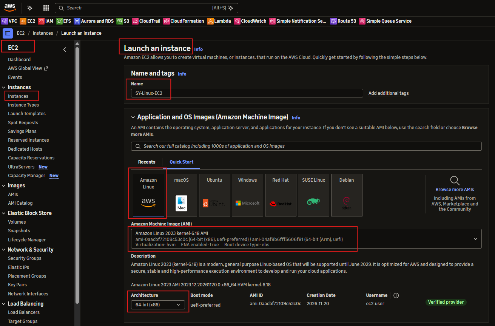</a></td></tr></table>

<p><sub><strong>Screenshot 01:</strong> EC2 launch wizard showing the SY-Linux-EC2 name and Amazon Linux 2023 x86 AMI.</sub></p>

<table><tr><td align="center"><a href="images/screenshot-02.png">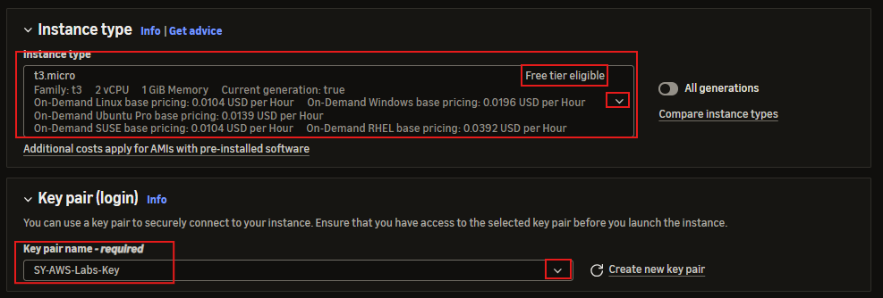</a></td></tr></table>

<p><sub><strong>Screenshot 02:</strong> Selected t3.micro instance type and SY-AWS-Labs-Key during EC2 launch.</sub></p>

### 3.2 Networking and inbound firewall policy

I used the existing default VPC and a default subnet in `us-east-1a`. Public IPv4 assignment was enabled so I could reach the instance from my Windows workstation. I created a dedicated security group permitting SSH only from the detected VPN public IP, rather than from all internet addresses.

| Setting | Configured value |
|---|---|
| VPC | Existing default VPC |
| Subnet | Default subnet in `us-east-1a` |
| Auto-assign public IP | Enabled |
| Group | `SY-Linux-SG` |
| Description | `SSH access for AWS Training Linux EC2 Instance` |
| Inbound | SSH / TCP / 22 / My IP (`/32`) |

<table><tr><td align="center"><a href="images/screenshot-03.png">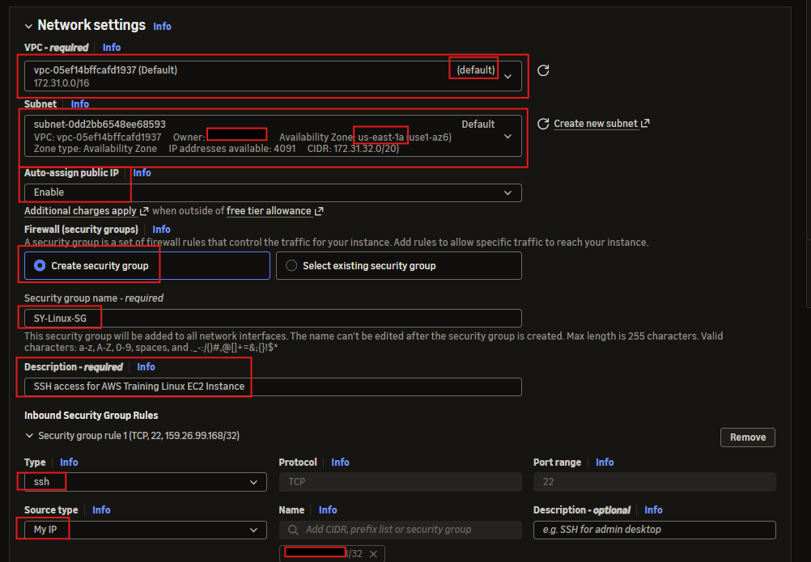</a></td></tr></table>

<p><sub><strong>Screenshot 03:</strong> Default VPC and subnet selection, automatic public IPv4, and restricted SSH security-group rule.</sub></p>

A security group is **stateful**: response traffic for an allowed inbound connection is permitted automatically. A `/32` source represents one individual public IPv4 address. In this environment that address was my VPN egress IP.

### 3.3 Root EBS storage

The instance was launched with one **8 GiB General Purpose SSD (`gp3`)** root volume. Its default performance included 3,000 baseline IOPS. The root disk holds the Linux OS; later EBS exercises used separately created data volumes.

<table><tr><td align="center"><a href="images/screenshot-04.png">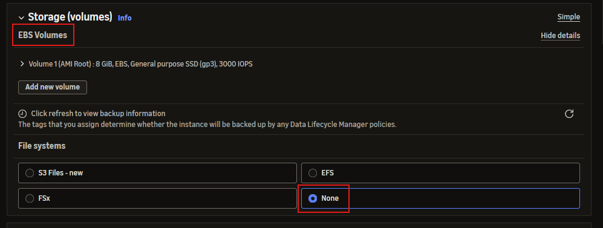</a></td></tr></table>

<p><sub><strong>Screenshot 04:</strong> EC2 launch storage configuration showing the 8 GiB gp3 EBS root volume.</sub></p>

## 04 Launching and Verifying EC2

After reviewing the configuration, I selected **Launch instance**. I then checked the Instances page until the instance showed `Running` and all three health checks passed.

<table><tr><td align="center"><a href="images/screenshot-05.png">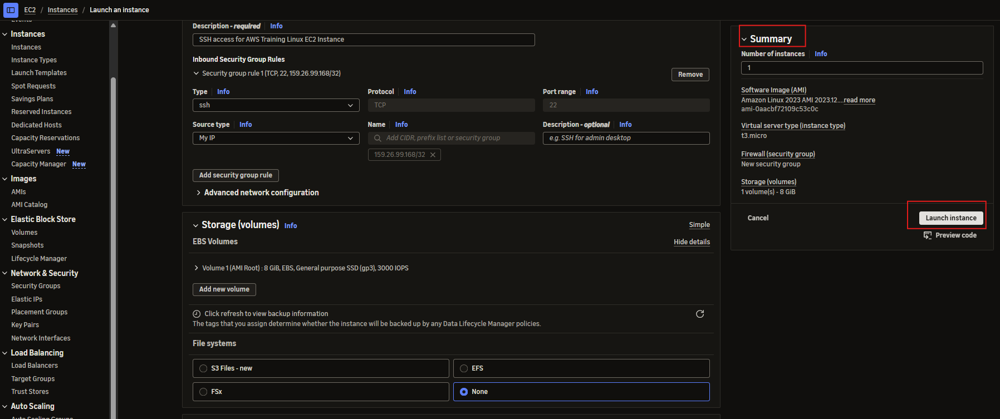</a></td></tr></table>

<p><sub><strong>Screenshot 05:</strong> EC2 launch summary showing one t3.micro instance and one 8 GiB root volume before launch.</sub></p>

<table><tr><td align="center"><a href="images/screenshot-06.png">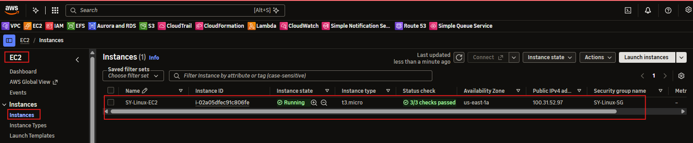</a></td></tr></table>

<p><sub><strong>Screenshot 06:</strong> Running SY-Linux-EC2 with t3.micro, three passing status checks, and public IPv4 assigned.</sub></p>

I also verified that the dedicated security group had the matching `Name` tag for straightforward identification among the account's security groups.

<table><tr><td align="center"><a href="images/screenshot-07.png">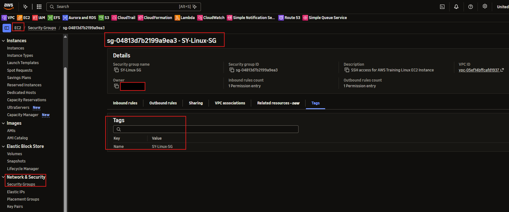</a></td></tr></table>

<p><sub><strong>Screenshot 07:</strong> SY-Linux-SG details showing its Name tag and VPC association.</sub></p>

<table><tr><td align="center"><a href="images/screenshot-08.png">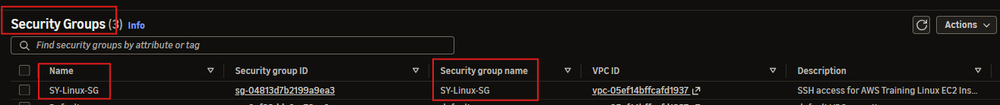</a></td></tr></table>

<p><sub><strong>Screenshot 08:</strong> EC2 security groups list identifying SY-Linux-SG by its display name and security-group name.</sub></p>

> [!IMPORTANT]
> **SAA-C03 exam connection:** An instance state of `Running` is not the same as a healthy instance. EC2 status checks help detect infrastructure and instance-level issues, and the exact checks displayed depend on the instance and networking configuration.

## 05 Accessing the Operating System

I opened Windows PowerShell in the local directory containing the RSA private key and connected with OpenSSH:

```powershell
ssh -i SY-AWS-Labs-Key.pem ec2-user@100.31.52.97
```

The connection reached Amazon Linux 2023. The first-use host-key prompt was accepted for the intended instance, and I received the `ec2-user` shell prompt.

<table><tr><td align="center"><a href="images/screenshot-09.png">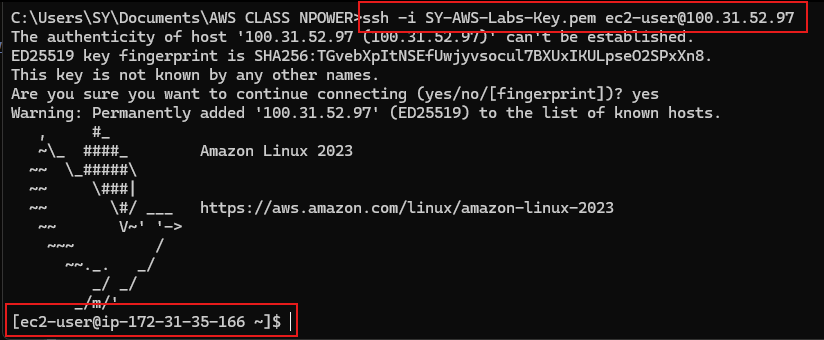</a></td></tr></table>

<p><sub><strong>Screenshot 09:</strong> Successful SSH session from Windows to Amazon Linux 2023 using the RSA key pair.</sub></p>

I verified the Linux user, OS, architecture, virtualization environment, and root disk with:

```bash
whoami
hostnamectl
lsblk
```

The output confirmed `ec2-user`, Amazon Linux 2023, x86-64, and an 8 GiB NVMe-backed block device with the root filesystem mounted at `/`.

<table><tr><td align="center"><a href="images/screenshot-10.png">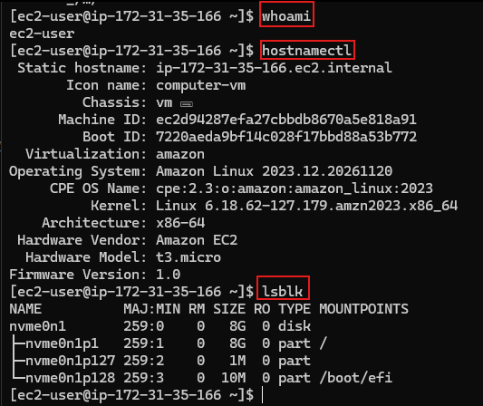</a></td></tr></table>

<p><sub><strong>Screenshot 10:</strong> Linux terminal displaying the authenticated user, OS and hardware details, and root block device.</sub></p>

## 06 EBS Root Storage and Instance Lifecycle

### 6.1 Mapping the AWS root device to Linux

In the EC2 **Storage** tab, I inspected the block-device attachment and identified the EBS root volume.

| Property | Verified value |
|---|---|
| EBS root volume ID | `vol-07a5d6d348734816d` |
| Volume size | 8 GiB |
| AWS device mapping | `/dev/xvda` |
| Guest Linux device | `/dev/nvme0n1` |
| Volume state | `In-use` / Attached |
| EBS optimization | Enabled |

<table><tr><td align="center"><a href="images/screenshot-11.png">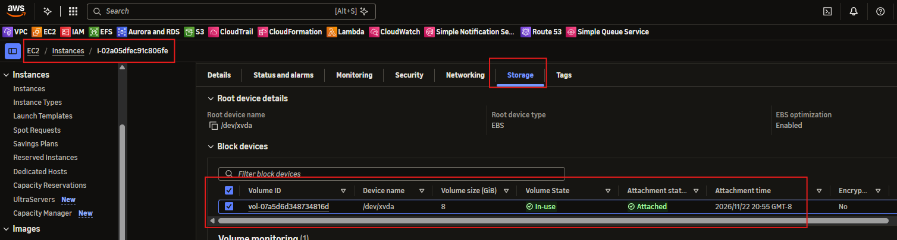</a></td></tr></table>

<p><sub><strong>Screenshot 11:</strong> EC2 Storage tab showing the attached 8 GiB EBS root volume and AWS device mapping.</sub></p>

The device mapping difference is expected with EC2 Nitro-based instances: AWS may show `/dev/xvda` while Linux exposes the EBS volume through an NVMe device name. The EBS lab further verified volume identity through the NVMe serial number.

### 6.2 Stop, terminate, and storage persistence

After the related EBS, Elastic IP, and Windows exercises were finished, I **stopped** this instance for cost control. Once all tests and the coordinated cleanup were complete, I **terminated** it and confirmed that its root storage was removed as configured.

| EC2 lifecycle action | Key distinction |
|---|---|
| Reboot | Restarts the guest OS; EBS storage remains attached. |
| Stop | Ends running-instance compute billing for supported EBS-backed instances; attached EBS/public IPv4 resources can still incur charges. |
| Start | Launches the stopped instance again; an ordinary auto-assigned public IPv4 may change. |
| Terminate | Ends the instance permanently; EBS volume removal follows each attachment's Delete on termination setting. |

The **2 GiB EBS data volumes** attached later were separate resources and required their own cleanup; those tests are documented in [Amazon EBS & Snapshots](../Lab13-Amazon-EBS-Snapshots/Amazon-EBS-Snapshots-Lab.md).

## 07 SAA-C03 Review and Production Considerations

**Q1. How is an EC2 AMI different from an instance type?**  
**Answer:** An AMI describes the operating system and initial machine image; the instance type determines compute resources such as vCPU and memory. **Reason:** Software image selection and hardware sizing are separate design decisions.

**Q2. Does a public IP guarantee SSH access?**  
**Answer:** No. The subnet routing, security group, instance service, and authentication must also allow the connection. **Reason:** Internet reachability is a path and permission problem, not a single checkbox.

**Q3. Why did the AWS block-device name differ from the Linux name?**  
**Answer:** The Nitro-based guest exposes the EBS-backed device through NVMe. **Reason:** Device identification should use AWS metadata/serial information rather than assumptions about Linux device ordering.

### Production considerations

For a production workload I would evaluate private-subnet placement, Systems Manager Session Manager for administrative access, stronger instance-role-based operations, patching, monitoring, encryption at rest, least-privilege security groups, backup and recovery policies, and multi-AZ architecture for applications requiring high availability. The lab's single instance was designed to validate essential EC2 operations and serve as an infrastructure foundation for subsequent exercises.

## 08 Conclusion and Cleanup

I configured and deployed a working Amazon Linux EC2 instance, verified its health in the AWS Console, authenticated over SSH, inspected the Linux OS and storage, and traced its root disk back to the associated EBS resource. The exercise demonstrated the relationship between EC2 compute, VPC networking, security groups, key-based access, and persistent storage.

Following completion of the related exercises, I terminated the lab instance and removed its dedicated security group and temporary key pair in the final cleanup. Existing account networking and unrelated AWS resources were retained.

## AWS Cost Estimate — Monthly (730 Hours)

The principal costs of this Linux EC2 deployment are **instance hours, provisioned EBS storage, and a public IPv4 address**. The default VPC and the security group have no separate hourly fee in this setup.

> **Estimate basis:** November 23, 2026; AWS US East (N. Virginia, `us-east-1`); USD; On-Demand list prices; **730 hours per average month** (AWS Pricing Calculator convention). An exact 30-day period is 720 hours. These figures describe a hypothetical deployment left provisioned for a month, **not actual charges from the completed lab**. Free Tier benefits, promotional credits, taxes, data transfer, CPU-credit overages, and other unlisted services are excluded unless specified.

| Lab resource | Calculation | Estimated monthly cost |
|---|---|---:|
| `SY-Linux-EC2` — Linux `t3.micro` | 730 h × $0.0104/h | $7.59 |
| 8 GiB `gp3` root EBS | 8 × $0.08/GiB-month | $0.64 |
| One public IPv4 address | 730 h × $0.005/h | $3.65 |
| **Estimated total** | **$7.592 + $0.64 + $3.65** | **$11.88/month** |

For example, an eight-hour lab session with the instance and public IPv4 present for eight hours, and the root disk present for the same period, would cost approximately **$0.13** at these rates (`8 × $0.0104 + 8 × $0.005 + $0.64 × 8/730`). This is a modeled example, not a measured bill. EBS storage can remain billable after an instance is stopped; public IPv4 assignments and EBS capacity must be considered separately from compute state.

**Scope:** The additional two 2 GiB EBS volumes and snapshot are priced in the dedicated EBS lab; the Elastic IP replaced the Linux instance's original public address during the network lab and is not counted as a second simultaneous public IP here. Outbound internet data and excess T3 Unlimited CPU credits are excluded.

**Pricing references:** [AWS EC2 T3](https://aws.amazon.com/ec2/instance-types/t3/) · [EBS gp3](https://aws.amazon.com/ebs/general-purpose/) · [Public IPv4](https://aws.amazon.com/vpc/pricing/) · [AWS calculator assumptions](https://aws.amazon.com/calculator/calculator-assumptions/).

---

## Technical Competencies

| Capability | Evidence |
|---|---|
| Instance provisioning | Configured Linux AMI and t3.micro type and launched EC2. |
| Virtual networking | Selected existing default VPC/subnet with public IPv4. |
| Access control | Created and tagged a single-purpose SSH security group. |
| Linux administration | Connected through SSH and checked OS/hardware details. |
| Block storage | Identified root EBS volume and NVMe device mapping. |
| Operational lifecycle | Verified health; later stopped and terminated the instance. |

## Command Reference

```powershell
ssh -i SY-AWS-Labs-Key.pem ec2-user@100.31.52.97
```

```bash
whoami
hostnamectl
lsblk
```

## AWS Documentation
- [Get started with Amazon EC2](https://docs.aws.amazon.com/AWSEC2/latest/UserGuide/EC2_GetStarted.html)
- [Amazon EC2 instance state changes](https://docs.aws.amazon.com/AWSEC2/latest/UserGuide/ec2-instance-lifecycle.html)
- [Amazon EBS volume lifecycle](https://docs.aws.amazon.com/ebs/latest/userguide/ebs-volume-lifecycle.html)
- [Amazon EC2 key pairs](https://docs.aws.amazon.com/AWSEC2/latest/UserGuide/ec2-key-pairs.html)
