<p align="center">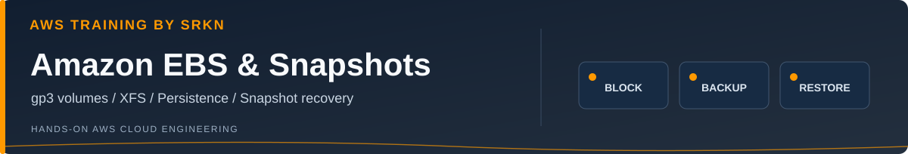</p>

# Amazon EBS and Snapshots — Persistent Storage and Recovery Lab
**AMAZON EBS / GP3 / XFS / LINUX / SNAPSHOTS / DATA RECOVERY**

Amazon Elastic Block Store (EBS) provides persistent block-level storage for Amazon EC2. An EBS volume behaves like a disk attached to a virtual machine: the operating system can create a filesystem, mount it, read and write files, and use it for application data. Unlike temporary instance-store storage, an EBS volume can retain its data across EC2 reboots and normal detach/reattach operations.

I worked through the complete storage lifecycle using an Amazon Linux 2023 EC2 instance: **creating a data volume, attaching it, identifying its NVMe device, formatting and mounting it, persisting a test file, configuring automatic mounting, and verifying the data after a reboot and a detach/reattach cycle**. I then created an EBS snapshot, restored it to a separate volume, handled duplicate XFS UUIDs, and verified the recovered file with SHA-256 checksums.

---

## Contents
- [01 Understanding Amazon EBS](#01-understanding-amazon-ebs)
- [02 Scenario and Storage Architecture](#02-scenario-and-storage-architecture)
- [03 Creating and Attaching a Data Volume](#03-creating-and-attaching-a-data-volume)
- [04 Preparing the Linux Filesystem](#04-preparing-the-linux-filesystem)
- [05 Testing Persistence Across Reboot](#05-testing-persistence-across-reboot)
- [06 Detaching and Reattaching EBS](#06-detaching-and-reattaching-ebs)
- [07 Creating a Point-in-Time EBS Snapshot](#07-creating-a-point-in-time-ebs-snapshot)
- [08 Restoring from the Snapshot](#08-restoring-from-the-snapshot)
- [09 Verifying Data Integrity and Completing Recovery](#09-verifying-data-integrity-and-completing-recovery)
- [10 SAA-C03 Review and Production Design](#10-saa-c03-review-and-production-design)
- [11 Results, Conclusion, and Cleanup](#11-results-conclusion-and-cleanup)
- [AWS Cost Estimate — Monthly (730 Hours)](#aws-cost-estimate--monthly-730-hours)
- [Technical Competencies](#technical-competencies)
- [Command Reference](#command-reference)
- [AWS Documentation](#aws-documentation)

## 01 Understanding Amazon EBS

### 1.1 What is EBS and why is it used?

Amazon EBS is AWS-managed **block storage** designed primarily for use with EC2. The guest operating system reads and writes fixed-size disk blocks; the filesystem controls how those blocks represent files and directories. EBS volumes can be used as root disks, application data disks, database storage, and general-purpose persistent storage.

EBS is useful when workloads require storage that remains available across restarts, predictable performance characteristics, and a way to back up or restore disk contents. A conventional EBS volume is created in an **Availability Zone** and can be attached to an appropriate EC2 instance in that same AZ. EBS snapshots provide regional point-in-time backups from which replacement volumes can be created.

### 1.2 EBS storage types — choosing based on workload

| Volume family | Primary strength | Typical workload |
|---|---|---|
| **gp3** — General Purpose SSD | Independently configurable capacity, IOPS, and throughput | Boot volumes, application servers, common database workloads |
| **gp2** — General Purpose SSD | SSD performance tied partly to provisioned size | Existing general-purpose workloads |
| **io2** — Provisioned IOPS SSD | High, consistent I/O performance and durability | I/O-intensive databases and critical workloads |
| **st1** — Throughput Optimized HDD | Cost-effective, sustained sequential throughput | Large streaming workloads, logs, analytics |
| **sc1** — Cold HDD | Low-cost storage for infrequently accessed sequential data | Cold, throughput-oriented workloads |

For this lab I selected **gp3**, which was appropriate for small Linux data disks and provided the default **3,000 IOPS / 125 MiB/s** performance settings in the creation wizard. Performance needs, access patterns, and cost determine the right volume type; gp3 is not universally the best choice for every workload.

### 1.3 EBS volume lifecycle and snapshots

A new blank volume starts in the **`available`** state. After attachment, it normally becomes **`in-use`**. The operating system must still identify the disk and mount a suitable filesystem before files can be stored. Unmounting makes a filesystem inaccessible through its mount directory, while detaching removes the disk attachment from EC2.

An **EBS snapshot** is a point-in-time backup managed by AWS. Snapshots are incremental at the storage-block level across a snapshot lineage. A snapshot can be used to provision a replacement volume without modifying the source. It is not the same thing as creating a regular Linux file copy: it preserves disk blocks and filesystem metadata, which matters when mounting restored volumes.

> [!IMPORTANT]
> **SAA-C03 exam connection:** EBS volumes are AZ-scoped resources, while snapshots are managed at the Region level. A snapshot can be used to create a new volume in another Availability Zone in the same Region. The volume must be attached to a compatible instance in the selected AZ.

## 02 Scenario and Storage Architecture

I used the running Linux instance `SY-Linux-EC2` in `us-east-1a` and built the following storage arrangement.

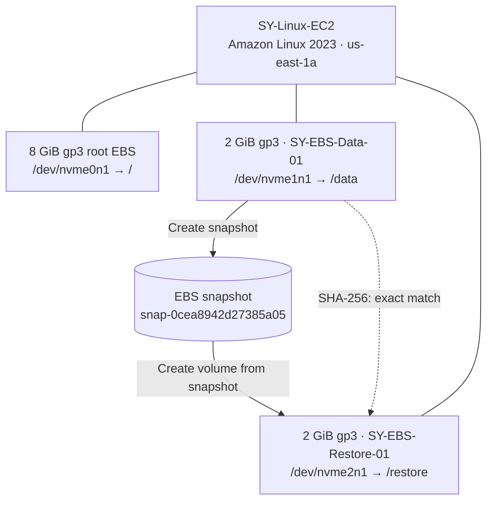

This architecture describes the completed experiment; its temporary resources were subsequently deleted.

| Resource | ID | Purpose |
|---|---|---|
| Linux EC2 root EBS | `vol-07a5d6d348734816d` | Existing OS disk, 8 GiB |
| Data volume | `vol-0836c5beb8086d677` | New 2 GiB gp3 disk, XFS, `/data` |
| Snapshot | `snap-0cea8942d27385a05` | Point-in-time backup of data volume |
| Restored volume | `vol-070070131938574ac` | New 2 GiB gp3 disk restored from snapshot |
| Linux instance | `i-02a05dfec91c806fe` | Host for attachment and filesystem tests |

## 03 Creating and Attaching a Data Volume

### 3.1 Inspecting the existing root disk

Before adding storage, I examined **EC2 → Instances → `SY-Linux-EC2` → Storage** and confirmed that its 8 GiB EBS root volume was attached and `In-use`. This established which disk contained the Linux operating system and should not be formatted during the data-volume exercise.

<table><tr><td align="center"><a href="images/screenshot-01.png">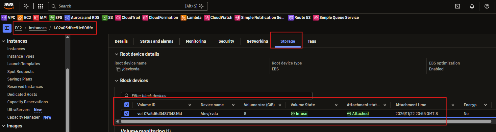</a></td></tr></table>

<p><sub><strong>Screenshot 01:</strong> EC2 Storage tab identifying the existing 8 GiB EBS-backed root volume.</sub></p>

### 3.2 Creating a new gp3 data disk

In **EC2 → Elastic Block Store → Volumes → Create volume**, I configured an independent, empty data disk.

| Setting | Value |
|---|---|
| Name | `SY-EBS-Data-01` |
| Volume type | `gp3` |
| Capacity | 2 GiB |
| IOPS | 3,000 |
| Throughput | 125 MiB/s |
| Availability Zone | `us-east-1a` |
| Source snapshot | None |
| Tags | `Name=SY-EBS-Data-01`; `Project=SY-AWS-Labs`; `CleanupEligible=false` |

Using the same AZ as the EC2 instance was essential: a normal EBS volume cannot be attached across Availability Zones. The `CleanupEligible=false` tag marked this working data disk as outside the scope of the later Lambda deletion test.

<table><tr><td align="center"><a href="images/screenshot-02.png">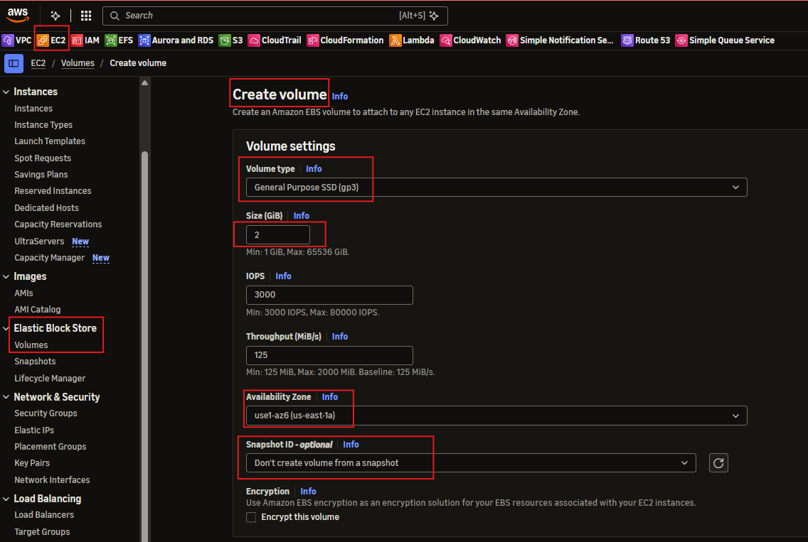</a></td></tr></table>

<p><sub><strong>Screenshot 02:</strong> EBS volume creation form showing gp3, 2 GiB, 3,000 IOPS, and the matching Availability Zone.</sub></p>

<table><tr><td align="center"><a href="images/screenshot-03.png">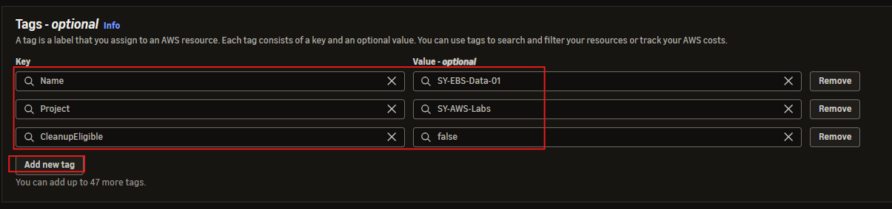</a></td></tr></table>

<p><sub><strong>Screenshot 03:</strong> Final data-volume tags identifying the project and the protected working disk.</sub></p>

I created the volume and verified that its initial state was **`Available`**, meaning AWS had provisioned it but no instance was using it yet.

<table><tr><td align="center"><a href="images/screenshot-04.png">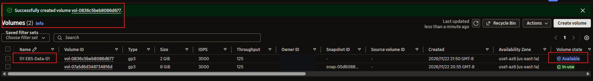</a></td></tr></table>

<p><sub><strong>Screenshot 04:</strong> AWS confirmation and Volumes list showing SY-EBS-Data-01 as a new available 2 GiB disk.</sub></p>

### 3.3 Attaching the disk to the running EC2 instance

I selected the new volume and opened **Actions → Attach volume**, chose `SY-Linux-EC2`, and assigned the requested device name `/dev/sdf`. AWS then moved the new volume into the **`In-use`** state.

<table><tr><td align="center"><a href="images/screenshot-05.png">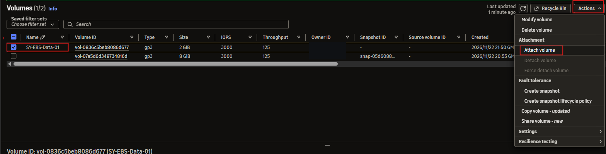</a></td></tr></table>

<p><sub><strong>Screenshot 05:</strong> EBS volume Actions menu showing the Attach volume operation for SY-EBS-Data-01.</sub></p>

<table><tr><td align="center"><a href="images/screenshot-06.png">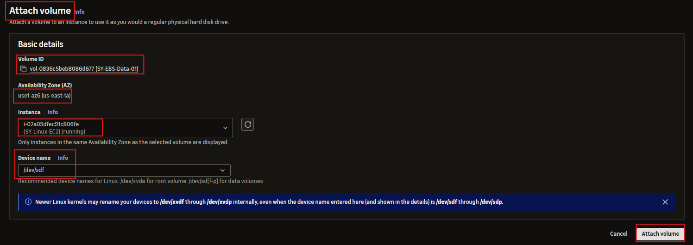</a></td></tr></table>

<p><sub><strong>Screenshot 06:</strong> Attachment form selecting the Linux instance and the requested /dev/sdf device mapping.</sub></p>

<table><tr><td align="center"><a href="images/screenshot-07.png">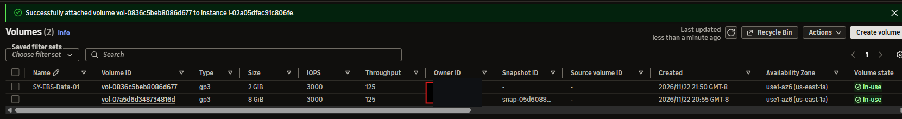</a></td></tr></table>

<p><sub><strong>Screenshot 07:</strong> Successful EBS attachment confirmation with the new volume in the In-use state.</sub></p>

## 04 Preparing the Linux Filesystem

### 4.1 Identifying the disk safely

Attaching the volume made the block device visible to Linux, but did not automatically create a filesystem. I inspected the device layout from the SSH terminal:

```bash
lsblk -o NAME,SIZE,TYPE,FSTYPE,MOUNTPOINTS
lsblk -o NAME,SIZE,MODEL,SERIAL,FSTYPE,MOUNTPOINTS
```

The first command showed a new 2 GiB disk with no filesystem; the second matched its NVMe serial number to the AWS volume ID `vol-0836c5beb8086d677`. The disk appeared as `/dev/nvme1n1`, despite having been attached through AWS as `/dev/sdf`.

<table><tr><td align="center"><a href="images/screenshot-08.png">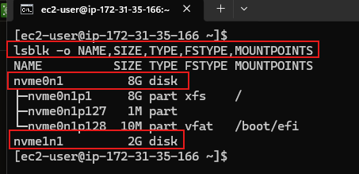</a></td></tr></table>

<p><sub><strong>Screenshot 08:</strong> Linux lsblk output showing the 8 GiB operating-system disk and the new unformatted 2 GiB disk.</sub></p>

<table><tr><td align="center"><a href="images/screenshot-09.png">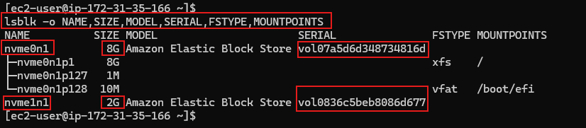</a></td></tr></table>

<p><sub><strong>Screenshot 09:</strong> NVMe model and serial numbers confirming that /dev/nvme1n1 matched the 2 GiB EBS data volume.</sub></p>

Matching the EBS volume ID before formatting is important: **Linux device ordering is not a reliable substitute for identifying the target disk**. Formatting the root disk instead would destroy the operating system.

### 4.2 Creating the filesystem

I formatted the confirmed data disk with XFS and inspected the result:

```bash
sudo mkfs.xfs /dev/nvme1n1
lsblk -f
```

`mkfs.xfs` created the filesystem and generated its UUID; `lsblk -f` showed `xfs` on the new device while the root filesystem remained unchanged.

<table><tr><td align="center"><a href="images/screenshot-10.png">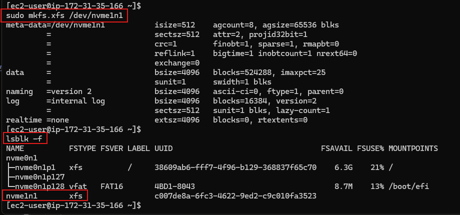</a></td></tr></table>

<p><sub><strong>Screenshot 10:</strong> XFS filesystem creation output and lsblk verification on the 2 GiB EBS data disk.</sub></p>

### 4.3 Mounting the volume at /data

A filesystem becomes accessible when mounted into the Linux directory tree. I created `/data`, mounted the new disk, and checked free space:

```bash
sudo mkdir -p /data
sudo mount /dev/nvme1n1 /data
df -hT /data
```

The output showed the 2.0 GiB XFS volume at `/data`, with approximately 1.9 GiB available.

<table><tr><td align="center"><a href="images/screenshot-11.png">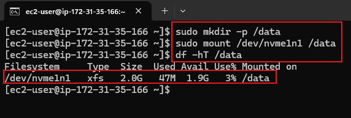</a></td></tr></table>

<p><sub><strong>Screenshot 11:</strong> Mounted XFS EBS volume verified by df -hT, with /data backed by the 2 GiB device.</sub></p>

### 4.4 Writing a persistence-test file

I wrote a recognizable string and a UTC timestamp into a test file, then read the file back:

```bash
echo "AWS TRAINING BY SRKN - EBS Persistence Test" | sudo tee /data/ebs-test.txt
date -u | sudo tee -a /data/ebs-test.txt
cat /data/ebs-test.txt
ls -lh /data/
```

This test produced a **73-byte** file at `/data/ebs-test.txt` containing the project label and the timestamp `Mon Nov 23 06:06:46 UTC 2026`. The same file would be used for the reboot, detachment, and snapshot-recovery checks.

<table><tr><td align="center"><a href="images/screenshot-12.png">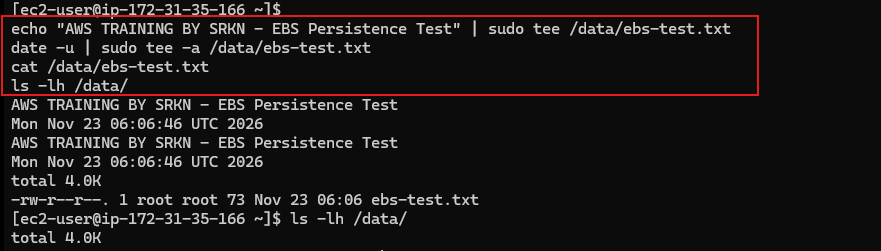</a></td></tr></table>

<p><sub><strong>Screenshot 12:</strong> Created, read, and listed ebs-test.txt on the mounted EBS volume.</sub></p>

## 05 Testing Persistence Across Reboot

### 5.1 Configuring an automatic mount with /etc/fstab

A manual mount does not automatically reappear after a reboot unless the OS is configured to mount that filesystem. I used the filesystem **UUID** instead of the NVMe device name because the name may change as devices are attached or reordered.

```bash
DATA_UUID=$(sudo blkid -s UUID -o value /dev/nvme1n1)
echo "$DATA_UUID"
sudo cp /etc/fstab /etc/fstab.bak-aws-ebs-lab
printf 'UUID=%s /data xfs defaults,nofail 0 2\n' "$DATA_UUID" | sudo tee -a /etc/fstab
sudo findmnt --verify --verbose
grep '/data xfs' /etc/fstab
```

The UUID was `c007de8a-6fc3-4622-9ed2-c9c010fa3523`. The `nofail` option reduces the risk of an unavailable *secondary* volume preventing system startup. The `findmnt --verify` output reported **no errors or warnings**.

<table><tr><td align="center"><a href="images/screenshot-13.png">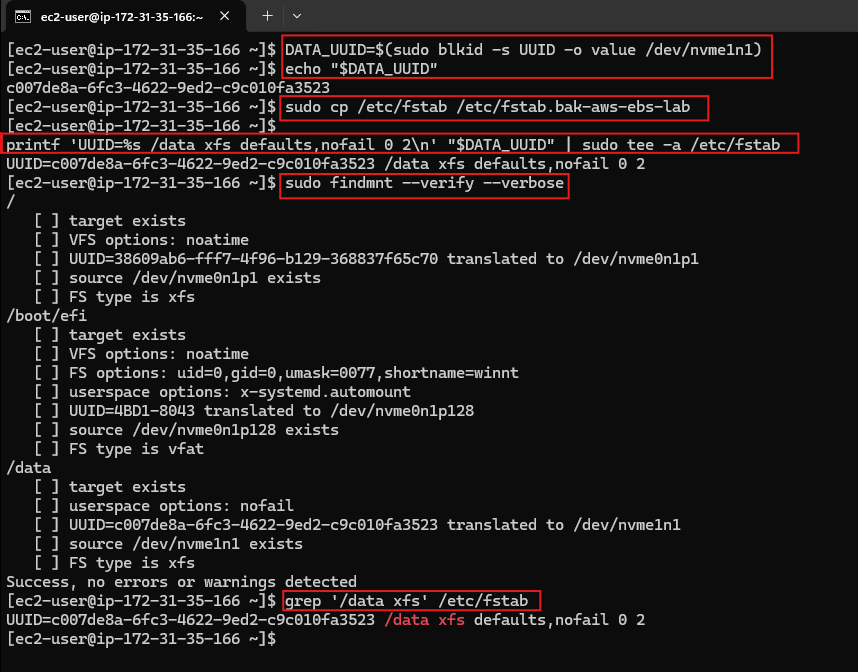</a></td></tr></table>

<p><sub><strong>Screenshot 13:</strong> Saved a UUID-based /etc/fstab entry and verified all mount definitions without errors.</sub></p>

> [!NOTE]
> **Key takeaway:** EBS preserves the blocks on the volume, while `/etc/fstab` tells Linux where to mount that persistent filesystem when the instance boots. Both pieces are needed for automatic access to the same files after restart.

### 5.2 Rebooting and verifying the data

I rebooted the instance from the SSH shell:

```bash
sudo reboot
```

After the expected SSH disconnect, I reconnected to the same instance with the EC2 key pair.

<table><tr><td align="center"><a href="images/screenshot-14.png">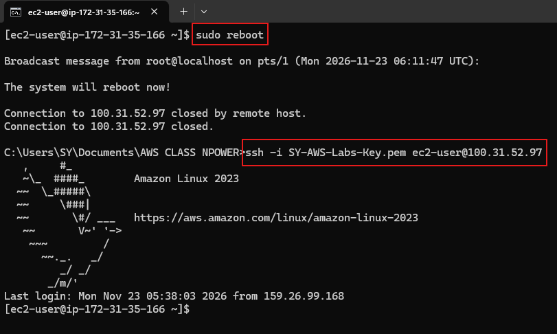</a></td></tr></table>

<p><sub><strong>Screenshot 14:</strong> Linux instance reboot followed by a successful SSH reconnection from Windows.</sub></p>

I then verified that `/data` was remounted and that the original file still contained its initial timestamp:

```bash
df -hT /data
cat /data/ebs-test.txt
lsblk -f
```

The data volume was mounted automatically and the original contents remained intact. This confirmed both **EBS persistence across reboot** and the correct UUID-based mount configuration.

<table><tr><td align="center"><a href="images/screenshot-15.png">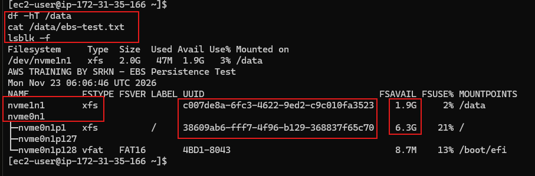</a></td></tr></table>

<p><sub><strong>Screenshot 15:</strong> Post-reboot verification showing the automatically mounted EBS volume and unchanged test file.</sub></p>

## 06 Detaching and Reattaching EBS

### 6.1 Unmounting before detachment

To safely remove the EBS attachment without deleting its stored data, I flushed pending writes and unmounted the filesystem:

```bash
sync
sudo umount /data
lsblk -f
findmnt /data
```

`lsblk -f` showed that the XFS filesystem was still present, but its mount point was empty; `findmnt /data` showed no active mount.

<table><tr><td align="center"><a href="images/screenshot-16.png">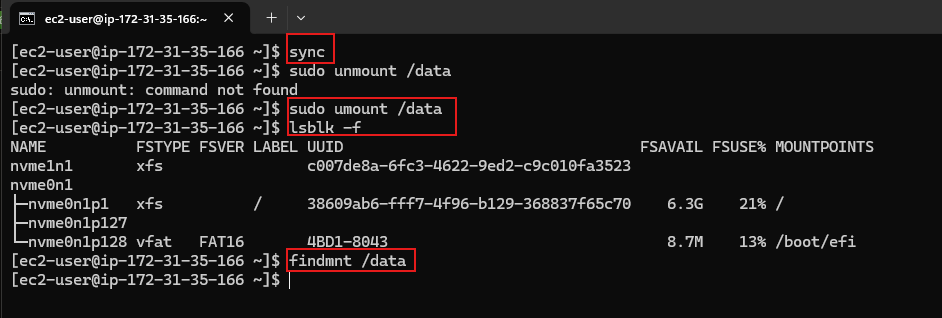</a></td></tr></table>

<p><sub><strong>Screenshot 16:</strong> Original data volume safely unmounted; XFS filesystem intact and /data no longer mounted.</sub></p>

### 6.2 Detaching and confirming Available

From **EC2 → Volumes**, I selected the data volume and used **Actions → Detach volume**, then verified that AWS returned it to `Available`.

<table><tr><td align="center"><a href="images/screenshot-17.png">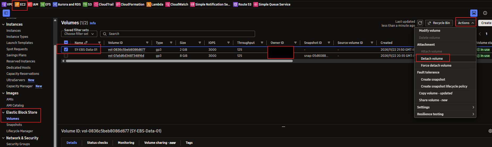</a></td></tr></table>

<p><sub><strong>Screenshot 17:</strong> Selected the original EBS data volume and chose normal detachment from EC2.</sub></p>

<table><tr><td align="center"><a href="images/screenshot-18.png">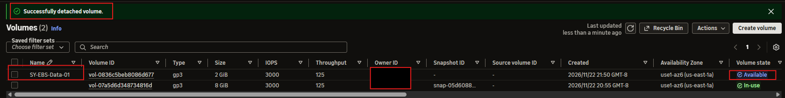</a></td></tr></table>

<p><sub><strong>Screenshot 18:</strong> AWS success notification and Available state after detaching the data volume.</sub></p>

A detached volume still exists as a separately billable storage resource. It can be moved to a compatible instance in the same AZ; it is not erased merely because it is no longer attached.

### 6.3 Reattaching and reusing the filesystem

I reattached the *same* EBS volume to `SY-Linux-EC2` using `/dev/sdf`. AWS again reported successful attachment and `In-use` state.

<table><tr><td align="center"><a href="images/screenshot-19.png">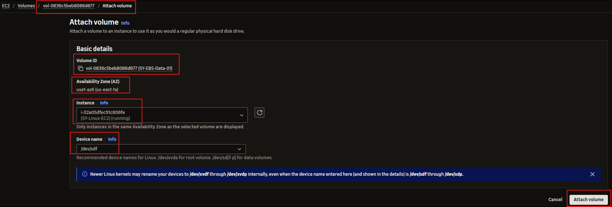</a></td></tr></table>

<p><sub><strong>Screenshot 19:</strong> Reattachment configuration selecting the same volume and Linux EC2 instance.</sub></p>

<table><tr><td align="center"><a href="images/screenshot-20.png">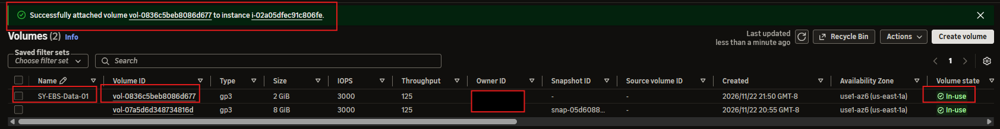</a></td></tr></table>

<p><sub><strong>Screenshot 20:</strong> AWS confirmation that SY-EBS-Data-01 was reattached and marked In-use.</sub></p>

I verified the disk's existing XFS filesystem and matching serial number before mounting it again. This avoided formatting an already populated volume.

<table><tr><td align="center"><a href="images/screenshot-21.png">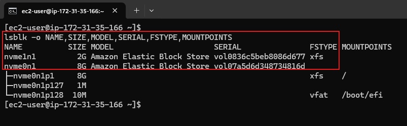</a></td></tr></table>

<p><sub><strong>Screenshot 21:</strong> Linux serial number and filesystem identification after reattaching the original EBS volume.</sub></p>

With the UUID-based `/etc/fstab` entry still in place, I mounted by directory and read the original file:

```bash
sudo mount /data
df -hT /data
cat /data/ebs-test.txt
ls -lh /data/
```

The contents and timestamp matched the data written before detachment. That established **data persistence across a complete detach-and-reattach cycle**.

<table><tr><td align="center"><a href="images/screenshot-22.png">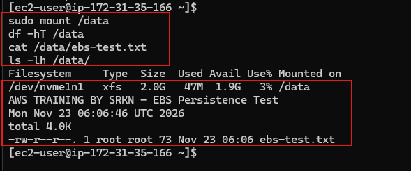</a></td></tr></table>

<p><sub><strong>Screenshot 22:</strong> Original file and timestamp successfully recovered after detaching, reattaching, and remounting EBS.</sub></p>

## 07 Creating a Point-in-Time EBS Snapshot

EBS snapshots back up disk data independently of the attached instance. I selected `SY-EBS-Data-01` and opened **Actions → Create snapshot** after the file-writing exercise was complete.

<table><tr><td align="center"><a href="images/screenshot-23.png">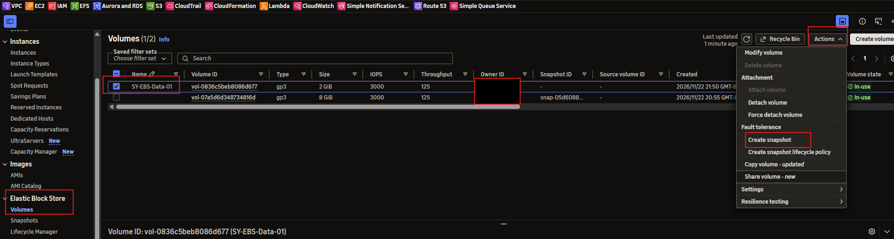</a></td></tr></table>

<p><sub><strong>Screenshot 23:</strong> EBS volume Actions menu showing Create snapshot for the tested data volume.</sub></p>

The snapshot was created with the following settings:

| Field | Actual value |
|---|---|
| Source volume | `vol-0836c5beb8086d677` |
| Description | `AWS Training - EBS Data Volume Backup` |
| Name tag | `SY-EBS-Data-01-Snapshot` |
| Project tag | `SY-AWS-Labs` |
| Snapshot ID | `snap-0cea8942d27385a05` |

<table><tr><td align="center"><a href="images/screenshot-24.png">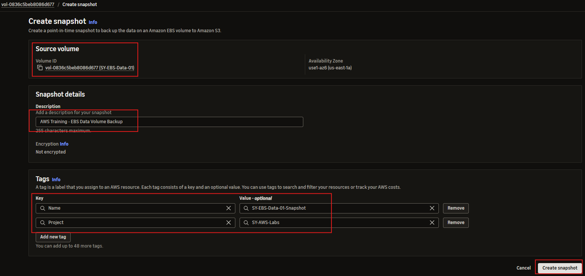</a></td></tr></table>

<p><sub><strong>Screenshot 24:</strong> Snapshot creation form showing the source volume, description, and identifying tags.</sub></p>

AWS confirmed successful snapshot creation; the snapshot inventory subsequently showed status **Completed**, progress **100%**, source volume size **2 GiB**, and reported full snapshot size **68.5 MiB**.

<table><tr><td align="center"><a href="images/screenshot-25.png">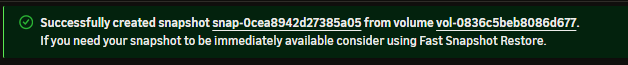</a></td></tr></table>

<p><sub><strong>Screenshot 25:</strong> AWS confirmation of a new EBS snapshot from SY-EBS-Data-01.</sub></p>

<table><tr><td align="center"><a href="images/screenshot-26.png">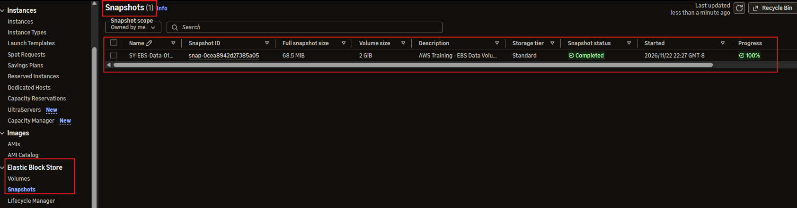</a></td></tr></table>

<p><sub><strong>Screenshot 26:</strong> Snapshot inventory confirming the backup completed with 100% progress.</sub></p>

The snapshot size reported in the console is not the same as the provisioned 2 GiB source capacity. EBS snapshots preserve data blocks, and subsequent snapshots can store changes incrementally.

> [!IMPORTANT]
> **SAA-C03 exam connection:** Snapshot creation supports point-in-time recovery, but application-consistent snapshots of actively written databases may require filesystem/application quiescing or coordinated backup mechanisms.

## 08 Restoring from the Snapshot

### 8.1 Creating a new volume from the snapshot

I selected the completed snapshot and chose **Actions → Create volume from snapshot**. Restoring to a new volume let me validate recovery while leaving the original `/data` disk intact.

<table><tr><td align="center"><a href="images/screenshot-27.png">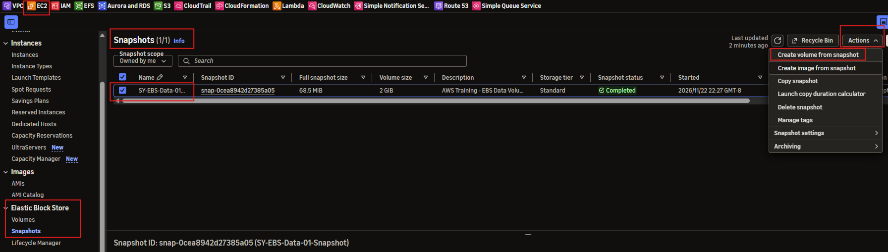</a></td></tr></table>

<p><sub><strong>Screenshot 27:</strong> Selected the completed EBS snapshot and opened the Create volume from snapshot operation.</sub></p>

| Field | Restored configuration |
|---|---|
| Restored name | `SY-EBS-Restore-01` |
| New volume ID | `vol-070070131938574ac` |
| Source snapshot | `snap-0cea8942d27385a05` |
| Type / size | `gp3` / 2 GiB |
| Performance | 3,000 IOPS, 125 MiB/s |
| Availability Zone | `us-east-1a` |
| Tags | `Project=SY-AWS-Labs`, `CleanupEligible=false` |

<table><tr><td align="center"><a href="images/screenshot-28.png">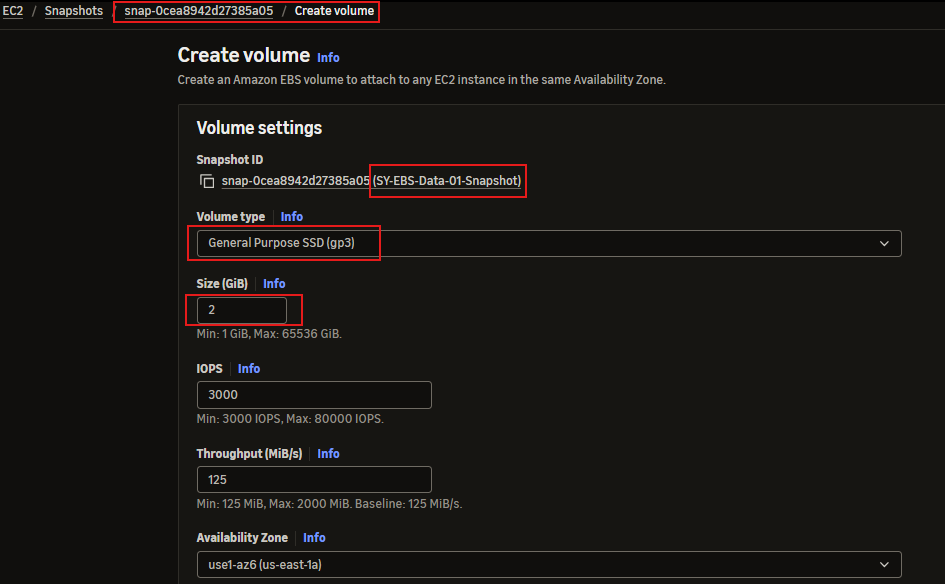</a></td></tr></table>

<p><sub><strong>Screenshot 28:</strong> Restored EBS volume settings showing snapshot source, gp3, size, and performance.</sub></p>

<table><tr><td align="center"><a href="images/screenshot-29.png">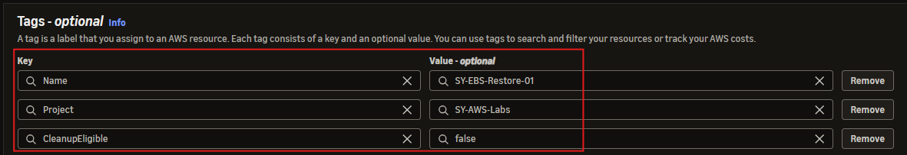</a></td></tr></table>

<p><sub><strong>Screenshot 29:</strong> Restored-volume Name, Project, and CleanupEligible tags.</sub></p>

AWS successfully created the new volume. The Volumes list showed `SY-EBS-Restore-01` in the **Available** state, with its source snapshot ID populated.

<table><tr><td align="center"><a href="images/screenshot-30.png">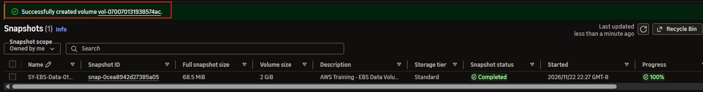</a></td></tr></table>

<p><sub><strong>Screenshot 30:</strong> AWS confirmation that a new EBS volume was created from the snapshot.</sub></p>

<table><tr><td align="center"><a href="images/screenshot-31.png">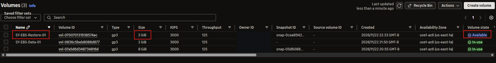</a></td></tr></table>

<p><sub><strong>Screenshot 31:</strong> New restored EBS volume shown as Available while the original data disk remained In-use.</sub></p>

### 8.2 Attaching the restored volume

I attached `SY-EBS-Restore-01` to the running Linux instance using the requested mapping `/dev/sdg`, alongside the original data volume.

<table><tr><td align="center"><a href="images/screenshot-32.png">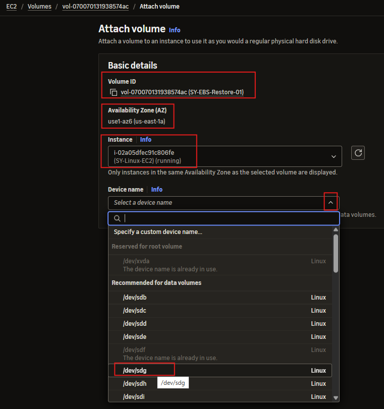</a></td></tr></table>

<p><sub><strong>Screenshot 32:</strong> Attachment form selecting the restored EBS volume and the /dev/sdg device mapping.</sub></p>

<table><tr><td align="center"><a href="images/screenshot-33.png">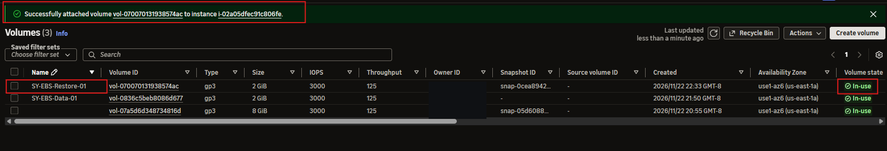</a></td></tr></table>

<p><sub><strong>Screenshot 33:</strong> Successful attachment of the restored EBS volume; all three EBS disks shown In-use.</sub></p>

### 8.3 Identifying the duplicate XFS UUID

The Linux command below displayed the full disk layout and identifiers:

```bash
lsblk -o NAME,SIZE,MODEL,SERIAL,FSTYPE,UUID,MOUNTPOINTS
```

It showed `/dev/nvme2n1` as the restored volume, with serial matching `vol-070070131938574ac`. Both the original and restored disks had the **same XFS filesystem UUID**: `c007de8a-6fc3-4622-9ed2-c9c010fa3523`.

<table><tr><td align="center"><a href="images/screenshot-34.png">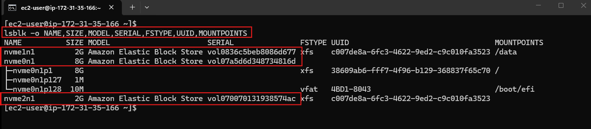</a></td></tr></table>

<p><sub><strong>Screenshot 34:</strong> Linux identified the restored 2 GiB NVMe disk and duplicate XFS filesystem UUID.</sub></p>

This is a consequence of restoring the disk's blocks and filesystem metadata. Simply mounting two XFS filesystems that share a UUID can fail; the restored copy needs a deliberate mounting strategy.

## 09 Verifying Data Integrity and Completing Recovery

### 9.1 Mounting the recovered copy read-only

I created a separate `/restore` directory and mounted the recovered XFS filesystem read-only:

```bash
sudo mkdir -p /restore
sudo mount -t xfs -o ro,nouuid,norecovery /dev/nvme2n1 /restore
findmnt /restore
cat /restore/ebs-test.txt
```

The options served distinct roles: `ro` kept the restored copy read-only; `nouuid` permitted a clone with a duplicate XFS UUID; `norecovery` prevented journal replay during this read-only inspection.

<table><tr><td align="center"><a href="images/screenshot-35.png">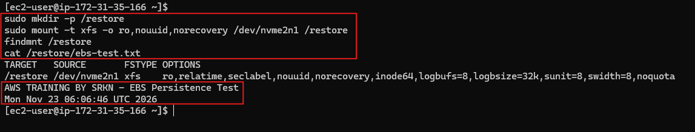</a></td></tr></table>

<p><sub><strong>Screenshot 35:</strong> Restored XFS volume mounted at /restore using read-only duplicate-UUID-safe options, with test file recovered.</sub></p>

The restored file displayed the original content and the same UTC timestamp written before the snapshot:

```text
AWS TRAINING BY SRKN - EBS Persistence Test
Mon Nov 23 06:06:46 UTC 2026
```

### 9.2 Confirming file integrity with SHA-256

To validate more than the visible text, I computed cryptographic checksums for the source and recovered files:

```bash
sha256sum /data/ebs-test.txt /restore/ebs-test.txt
```

The two outputs had **identical SHA-256 digests**. A matching cryptographic hash is strong evidence that the two files have identical contents.

<table><tr><td align="center"><a href="images/screenshot-36.png">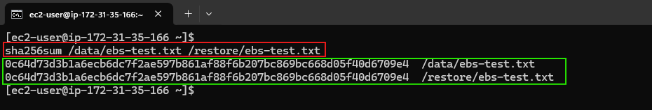</a></td></tr></table>

<p><sub><strong>Screenshot 36:</strong> Matching SHA-256 hashes for the original and restored EBS test files.</sub></p>

### 9.3 Finishing the recovery inspection

After validating the recovered copy, I unmounted the snapshot-derived volume without formatting or deleting it during the active testing phase:

```bash
sudo umount /restore
lsblk -f
findmnt /restore
```

The original data disk remained mounted at `/data`, while the restored volume retained its XFS filesystem without an active mount point.

<table><tr><td align="center"><a href="images/screenshot-37.png">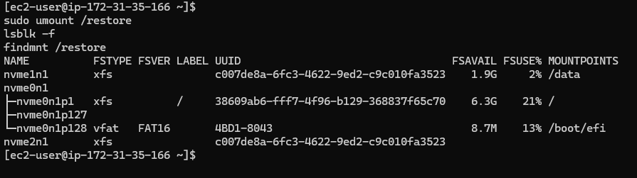</a></td></tr></table>

<p><sub><strong>Screenshot 37:</strong> Restored EBS volume unmounted; original data volume remained mounted at /data.</sub></p>

## 10 SAA-C03 Review and Production Design

### Architectural decisions demonstrated

| Decision | Why it matters |
|---|---|
| Keep root and data EBS separate | Data disks can be managed independently from the operating-system disk. |
| Match volume and instance AZ | EBS volume attachments are generally AZ-local. |
| Identify NVMe serials | Prevents accidental formatting of the wrong disk. |
| Use UUID in `/etc/fstab` | More reliable than relying on changing NVMe enumeration. |
| Snapshot before recovery testing | Supports creating independent replacement volumes. |
| Verify restored data with hashes | Tests recovery correctness, not merely snapshot completion. |
| Plan encryption and backup policy | Important for production confidentiality and recovery objectives. |

### Knowledge check

**Q1. Does detaching an EBS volume delete its data?**  
**Answer:** No. The volume and its data continue to exist until it is deleted. **Reason:** Attachment state and volume existence are separate concepts.

**Q2. Why did the snapshot-restored disk share the original XFS UUID?**  
**Answer:** The snapshot captured filesystem metadata along with the data blocks. **Reason:** Restoring a disk reproduces its filesystem identity unless that metadata is changed.

**Q3. Is a successful snapshot creation enough to prove files are recoverable?**  
**Answer:** No. A recovery test must create or access a restored volume and validate the data. **Reason:** Backup completion and successful restoration are separate requirements.

### Production considerations

I would normally enable EBS encryption at rest, apply automated snapshot retention and cross-Region recovery policies where required, monitor backup status, and coordinate application-consistent backups for actively written data. Attaching and mounting restored filesystems should be performed only after checking device identity, mount options, access controls, and the risk of duplicate UUIDs.

## 11 Results, Conclusion, and Cleanup

### Verified outcome

| Test | Result |
|---|---|
| New gp3 volume created and attached | Passed |
| Disk matched to EBS serial | Passed |
| XFS filesystem and `/data` mount | Passed |
| Test file written and read | Passed |
| UUID-based automatic mount after reboot | Passed |
| Detach, reattach, and data recovery | Passed |
| Snapshot creation | Completed / 100% |
| Snapshot restored into a separate volume | Passed |
| Duplicate UUID handled safely | Passed |
| SHA-256 comparison of original and restored file | Exact match |

### Cleanup

After the complete six-lab series, I terminated the temporary EC2 instances and removed the data volume, the restored volume, and the training snapshot. The separate 1 GiB Lambda cleanup target was deleted through the AWS Lambda for EBS Cleanup exercise and verified during that activity. Existing account resources outside these labs were retained.

### Conclusion

This lab demonstrated that EBS is more than extra disk capacity. I provisioned storage separately from compute, prepared an XFS filesystem, established persistent access across reboots, and proved that the same data survived disconnection and reattachment. I then moved from **storage availability** to **recoverability**: creating a snapshot, restoring a second disk, overcoming duplicate filesystem identity, and validating the recovered data byte-for-byte using SHA-256. Together, these tests established the storage lifecycle and recovery principles that underpin reliable EC2 architectures.

## AWS Cost Estimate — Monthly (730 Hours)

EBS `gp3` volume storage is billed for the **provisioned capacity**, whether the volume is mounted, detached, or idle. Standard snapshots are billed for **incremental stored blocks**, not the full provisioned size of the source volume. This lab added two independent 2 GiB data volumes to the Linux environment.

> **Estimate basis:** November 23, 2026; AWS US East (N. Virginia, `us-east-1`); USD; On-Demand list prices; **730 hours per average month** (AWS Pricing Calculator convention). An exact 30-day period is 720 hours. These figures describe a hypothetical deployment left provisioned for a month, **not actual charges from the completed lab**. Free Tier benefits, promotional credits, taxes, data transfer, CPU-credit overages, and other unlisted services are excluded unless specified.

| Lab resource | Calculation | Estimated monthly cost |
|---|---|---:|
| `SY-EBS-Data-01` (2 GiB gp3) | 2 × $0.08/GiB-month | $0.16 |
| `SY-EBS-Restore-01` (2 GiB gp3) | 2 × $0.08/GiB-month | $0.16 |
| One standard EBS snapshot | Illustrative **68.5 MiB** billed data × $0.05/GiB-month | About $0.0033 |
| **Incremental storage total** | **$0.16 + $0.16 + ~$0.0033** | **About $0.32/month** |

The snapshot estimate assumes the observed ~68.5 MiB figure corresponds to charged snapshot blocks; the precise billed amount depends on incremental data retained and should be confirmed in AWS billing. Its 2 GiB source volume size should **not** automatically be treated as 2 GiB of snapshot storage.

**Complete teaching environment:** If the shared Linux `t3.micro` instance, 8 GiB root EBS volume, and its single public IPv4 address also remained active for the same 730 hours, add the **$11.88/month** Linux environment estimate for an approximately **$12.21/month** total. That shared baseline belongs to the EC2 lab and must be counted only once in a combined budget.

**Operational takeaway:** Deleting the EC2 instance does not automatically delete these separately created data volumes or their snapshot. We verified the volume and snapshot cleanup, eliminating their continuing storage charges.

**Pricing references:** [Amazon EBS pricing](https://aws.amazon.com/ebs/pricing/) · [EBS gp3](https://aws.amazon.com/ebs/general-purpose/) · [AWS EC2 T3](https://aws.amazon.com/ec2/instance-types/t3/) · [EBS gp3](https://aws.amazon.com/ebs/general-purpose/) · [Public IPv4](https://aws.amazon.com/vpc/pricing/) · [AWS calculator assumptions](https://aws.amazon.com/calculator/calculator-assumptions/).

---

## Technical Competencies

| Area | Demonstrated capability |
|---|---|
| EBS provisioning | Created and attached gp3 volumes with appropriate AZ and performance. |
| Linux block devices | Mapped AWS volume IDs to Nitro NVMe serials. |
| Filesystem operations | Formatted XFS, mounted disks, and checked capacity. |
| Persistence | Used UUID-based fstab entries and validated reboot recovery. |
| Disk lifecycle | Safely unmounted, detached, and reattached volumes. |
| Backup and restoration | Created snapshot and independently restored its contents. |
| File integrity | Compared SHA-256 hashes across source and restored volume. |
| Resource management | Removed test EBS volumes and snapshot after final validation. |

## Command Reference

Commands below were executed during the lab; device names refer to this specific training instance.

```bash
# Identify the attached volume
lsblk -o NAME,SIZE,TYPE,FSTYPE,MOUNTPOINTS
lsblk -o NAME,SIZE,MODEL,SERIAL,FSTYPE,MOUNTPOINTS

# Prepare the new, positively identified data disk
sudo mkfs.xfs /dev/nvme1n1
lsblk -f
sudo mkdir -p /data
sudo mount /dev/nvme1n1 /data
df -hT /data

# Write and read test data
echo "AWS TRAINING BY SRKN - EBS Persistence Test" | sudo tee /data/ebs-test.txt
date -u | sudo tee -a /data/ebs-test.txt
cat /data/ebs-test.txt
ls -lh /data/

# Persist the mount across boot
DATA_UUID=$(sudo blkid -s UUID -o value /dev/nvme1n1)
sudo cp /etc/fstab /etc/fstab.bak-aws-ebs-lab
printf 'UUID=%s /data xfs defaults,nofail 0 2\n' "$DATA_UUID" | sudo tee -a /etc/fstab
sudo findmnt --verify --verbose

# Test reboot and existing data
sudo reboot
df -hT /data
cat /data/ebs-test.txt

# Detach/reattach lifecycle
sync
sudo umount /data
lsblk -f
findmnt /data
sudo mount /data

# Snapshot-restored duplicate-UUID disk inspection
lsblk -o NAME,SIZE,MODEL,SERIAL,FSTYPE,UUID,MOUNTPOINTS
sudo mkdir -p /restore
sudo mount -t xfs -o ro,nouuid,norecovery /dev/nvme2n1 /restore
findmnt /restore
cat /restore/ebs-test.txt
sha256sum /data/ebs-test.txt /restore/ebs-test.txt
sudo umount /restore
```

> [!CAUTION]
> The `mkfs.xfs` command is destructive to the selected disk. Verify the actual EBS volume ID and NVMe serial in your own account before formatting. Do not reuse these training device names blindly on another instance.

## AWS Documentation
- [Amazon EBS volume lifecycle](https://docs.aws.amazon.com/ebs/latest/userguide/ebs-volume-lifecycle.html)
- [Create an EBS volume](https://docs.aws.amazon.com/ebs/latest/userguide/ebs-creating-volume.html)
- [Make a volume available for use](https://docs.aws.amazon.com/ebs/latest/userguide/ebs-using-volumes.html)
- [How Amazon EBS snapshots work](https://docs.aws.amazon.com/ebs/latest/userguide/how_snapshots_work.html)
- [Create EBS snapshots](https://docs.aws.amazon.com/ebs/latest/userguide/ebs-creating-snapshot.html)
