<p align="center"></p>

# Amazon EC2 Elastic IP Addresses — Static Public IPv4 Lab
**AMAZON EC2 / ELASTIC IP / PUBLIC IPv4 / ASSOCIATION / NETWORKING**

An **Elastic IP address (EIP)** is a public IPv4 address allocated to an AWS account for use with supported AWS resources. It gives engineers control over a stable public address even when the underlying compute instance changes. Elastic IPs are especially useful when an endpoint requires a fixed address or a public IP needs to be moved from one resource to another.

I allocated an Elastic IP, associated it with an Amazon Linux EC2 instance that already had an automatically assigned public address, verified SSH connectivity to the new address, disassociated it without releasing the allocation, and successfully reassociated it. I later released the address as part of the complete lab cleanup.

---

## Contents
- [01 Purpose and Understanding Elastic IP](#01-purpose-and-understanding-elastic-ip)
- [02 Architecture and Scenario](#02-architecture-and-scenario)
- [03 Allocating an Elastic IP](#03-allocating-an-elastic-ip)
- [04 Associating the Address with EC2](#04-associating-the-address-with-ec2)
- [05 Verifying Connectivity Through the Static IP](#05-verifying-connectivity-through-the-static-ip)
- [06 Disassociating and Reassociating](#06-disassociating-and-reassociating)
- [07 SAA-C03 Review and Production Considerations](#07-saa-c03-review-and-production-considerations)
- [08 Cleanup and Conclusion](#08-cleanup-and-conclusion)
- [Technical Competencies](#technical-competencies)
- [Command Reference](#command-reference)
- [AWS Documentation](#aws-documentation)

## 01 Purpose and Understanding Elastic IP

Amazon EC2 can automatically assign a public IPv4 address when an instance launches into a subnet that supports public connectivity. That automatically assigned address can change across certain lifecycle events. An **Elastic IP** remains allocated to the AWS account until released and can be associated with supported resources such as an EC2 instance or its network interface.

An EIP solves a different problem than a security group: it provides **address stability**, not authentication or an open firewall rule. Public reachability still depends on VPC routing, internet gateway availability, the security group, and the instance's running service.

### Practical use cases

| Scenario | Why a static IPv4 address can help |
|---|---|
| External IP allowlists | Partners or administrators can permit a stable source/destination address. |
| Server replacement | An address can be moved to a replacement instance or interface. |
| Small administrative endpoints | A stable IP makes a temporary or specialized host easier to reach. |
| IP-based application integrations | Systems configured with an address avoid changes caused by ordinary auto-assigned public IP turnover. |

For highly available production applications, a load balancer, DNS design, or other managed entry point can be more appropriate than relying on a single EC2 Elastic IP. An EIP itself does not automatically fail over between instances.

> [!IMPORTANT]
> **Cost awareness:** AWS charges for public IPv4 addresses, including allocated Elastic IPs, whether associated or idle. A static address should be retained only when it serves a defined purpose.

## 02 Architecture and Scenario

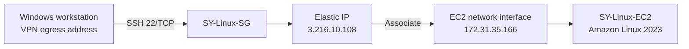

The diagram shows the successful **associated** state. I also tested the temporary unassociated state and later released the address in the final cleanup.

| Property | Actual value |
|---|---|
| Region | `us-east-1` |
| Elastic IP name | `SY-Linux-ElasticIP` |
| Elastic public IPv4 | `3.216.10.108` |
| Allocation ID | `eipalloc-0e3b758f5cb0063bb` |
| EC2 instance | `SY-Linux-EC2` |
| Instance ID | `i-02a05dfec91c806fe` |
| Instance private IPv4 | `172.31.35.166` |
| Previous automatically assigned public IPv4 | `100.31.52.97` |
| Network / security | Existing default VPC, restricted SSH group |

## 03 Allocating an Elastic IP

I opened **EC2 → Network & Security → Elastic IPs → Allocate Elastic IP address** and selected Amazon's public IPv4 pool in the `us-east-1` network border group. I applied project identification tags.

| Configuration | Value |
|---|---|
| IP source | Amazon's pool of IPv4 addresses |
| Network border group | `us-east-1` |
| `Name` tag | `SY-Linux-ElasticIP` |
| `Project` tag | `SY-AWS-Labs` |

<table><tr><td align="center"><a href="images/screenshot-01.png">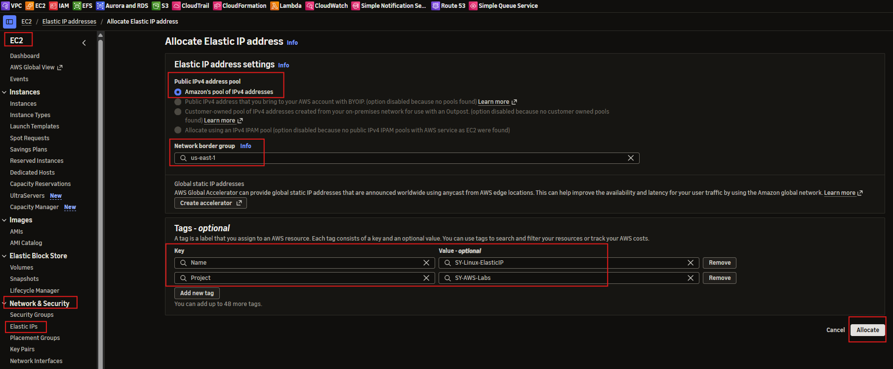</a></td></tr></table>

<p><sub><strong>Screenshot 01:</strong> Elastic IP allocation form with the AWS IPv4 pool, us-east-1 border group, and project tags.</sub></p>

After selecting **Allocate**, AWS assigned `3.216.10.108` and showed the new EIP in the Elastic IP list. At that point it belonged to the account but was not yet associated with an instance.

<table><tr><td align="center"><a href="images/screenshot-02.png">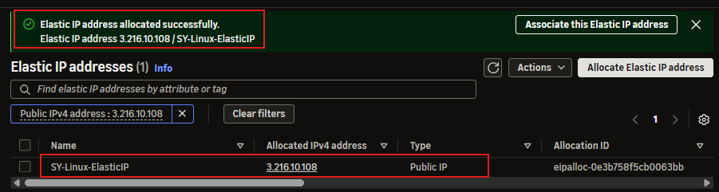</a></td></tr></table>

<p><sub><strong>Screenshot 02:</strong> Elastic IP allocation success showing the assigned static address and allocation ID.</sub></p>

## 04 Associating the Address with EC2

To give the existing Linux instance a stable public address, I selected `SY-Linux-ElasticIP` and chose **Actions → Associate Elastic IP address**.

<table><tr><td align="center"><a href="images/screenshot-03.png">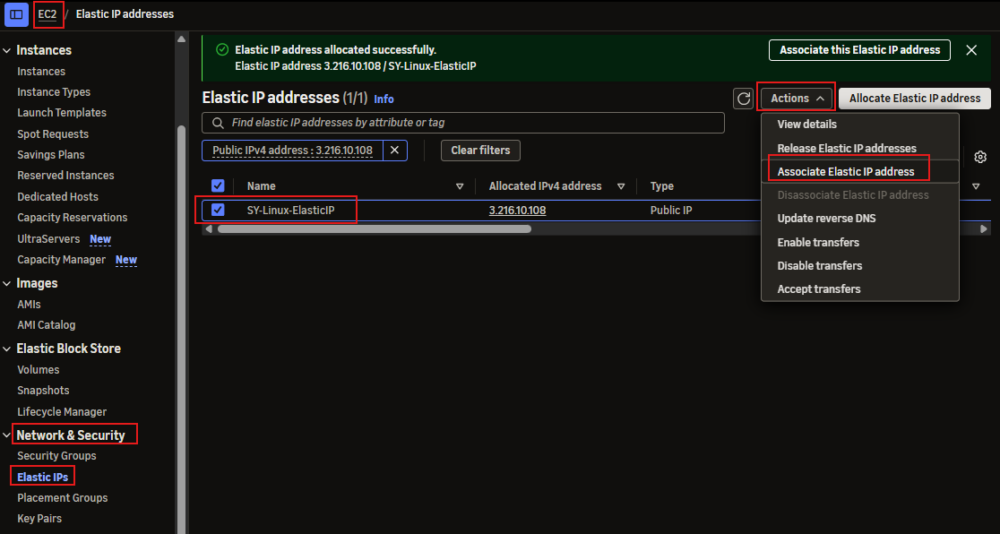</a></td></tr></table>

<p><sub><strong>Screenshot 03:</strong> Elastic IP Actions menu with the Associate Elastic IP address operation selected.</sub></p>

I selected **Resource type: Instance**, chose `SY-Linux-EC2`, and associated the EIP with the instance's existing private address, `172.31.35.166`.

<table><tr><td align="center"><a href="images/screenshot-04.png">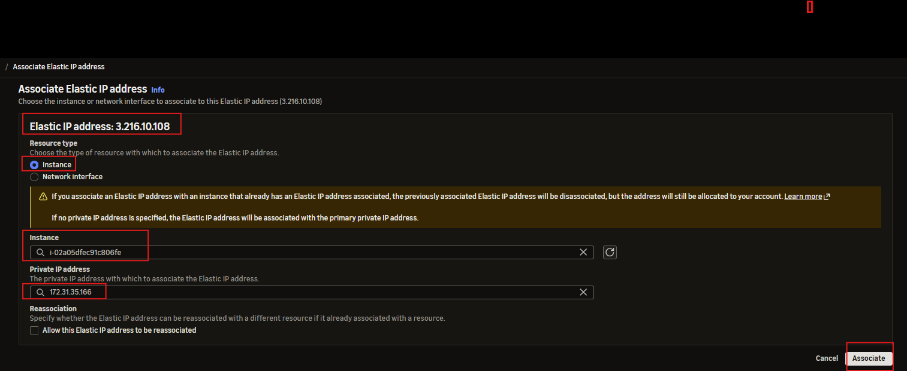</a></td></tr></table>

<p><sub><strong>Screenshot 04:</strong> Elastic IP association form identifying the Linux instance and its private IPv4 address.</sub></p>

AWS confirmed the association and displayed the target EC2 instance ID in the Elastic IP inventory.

<table><tr><td align="center"><a href="images/screenshot-05.png">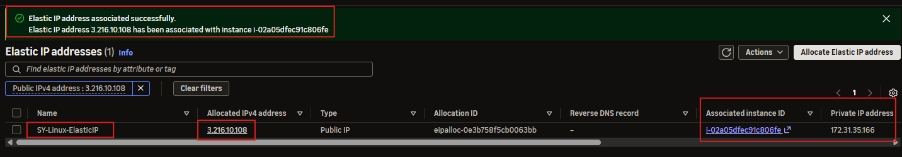</a></td></tr></table>

<p><sub><strong>Screenshot 05:</strong> Successful Elastic IP association with SY-Linux-EC2 and the existing private IPv4 address.</sub></p>

Associating the EIP replaced the instance's previously auto-assigned public address `100.31.52.97` for this public interface. The **private IPv4 remained unchanged**: EIP association updates public reachability, not the operating system's VPC private address.

## 05 Verifying Connectivity Through the Static IP

I opened Windows PowerShell and connected to the Linux server at its new Elastic IP:

```powershell
ssh -i SY-AWS-Labs-Key.pem ec2-user@3.216.10.108
```

After authenticating, I ran:

```bash
whoami
hostname
```

The SSH session succeeded, `whoami` returned `ec2-user`, and the hostname identified the same instance (`ip-172-31-35-166.ec2.internal`). The SSH client also recognized the server's host key from the previous public address, reinforcing that the destination was the existing Linux host rather than a newly provisioned machine.

<table><tr><td align="center"><a href="images/screenshot-06.png">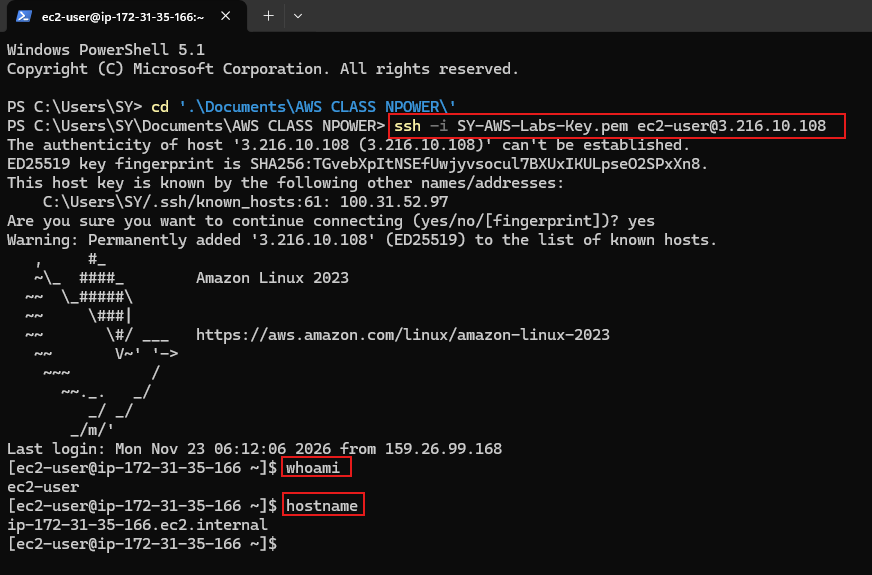</a></td></tr></table>

<p><sub><strong>Screenshot 06:</strong> Successful SSH login through the Elastic IP and verification of the original Linux EC2 host.</sub></p>

> [!NOTE]
> **Key takeaway:** Public IPv4 changed from `100.31.52.97` to `3.216.10.108`, while the private IPv4 and EC2 instance identity stayed constant.

## 06 Disassociating and Reassociating

### 6.1 Disassociation — keep the allocation

I next tested the distinction between **disassociating** and **releasing** an Elastic IP. From the EIP Actions menu, I chose **Disassociate Elastic IP address**, which removed its binding to the EC2 instance without returning the address to AWS.

<table><tr><td align="center"><a href="images/screenshot-07.png">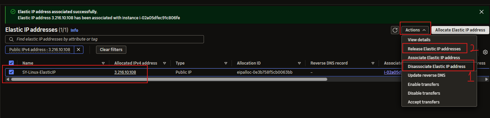</a></td></tr></table>

<p><sub><strong>Screenshot 07:</strong> Elastic IP Actions menu showing Disassociate rather than Release.</sub></p>

After disassociation, AWS still listed `3.216.10.108`, but the **Associated instance ID** and **Private IP address** columns were blank.

<table><tr><td align="center"><a href="images/screenshot-08.png">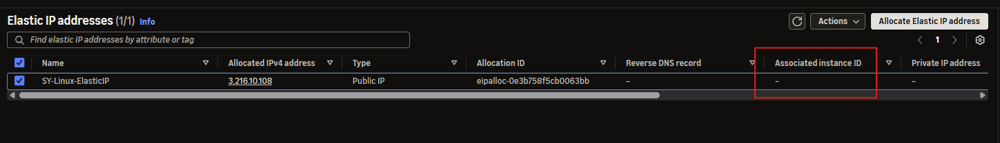</a></td></tr></table>

<p><sub><strong>Screenshot 08:</strong> Elastic IP still allocated to the account with no associated EC2 instance after disassociation.</sub></p>

### 6.2 Reassociation — restore the static endpoint

I reopened the association wizard and selected the same instance and private IPv4 address. Because the EIP was currently free, there was no need to enable forced reassociation from another occupied resource.

<table><tr><td align="center"><a href="images/screenshot-09.png">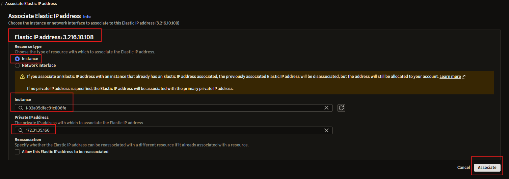</a></td></tr></table>

<p><sub><strong>Screenshot 09:</strong> Reassociation form targeting SY-Linux-EC2 and private IPv4 172.31.35.166.</sub></p>

AWS confirmed successful reassociation, and the EIP list again showed the correct instance ID.

<table><tr><td align="center"><a href="images/screenshot-10.png">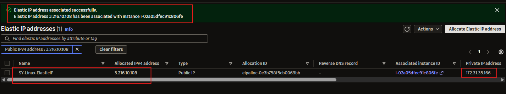</a></td></tr></table>

<p><sub><strong>Screenshot 10:</strong> Elastic IP successfully reassociated with the same EC2 instance.</sub></p>

| Operation | Result |
|---|---|
| Allocate | Reserved `3.216.10.108` in the AWS account |
| Associate | Linked the address to `SY-Linux-EC2` |
| SSH verification | Confirmed successful Linux connectivity |
| Disassociate | Removed the link; address remained allocated |
| Reassociate | Restored the same public address to the same instance |
| Release during cleanup | Returned the address to AWS |

## 07 SAA-C03 Review and Production Considerations

### Knowledge check

**Q1. What is the main difference between an Elastic IP and an automatically assigned public IPv4?**  
**Answer:** The Elastic IP remains allocated to the account until released and can be deliberately associated with supported resources. **Reason:** It is intended for address portability and stability.

**Q2. Does disassociation stop ownership of the Elastic IP?**  
**Answer:** No. The allocation remains in the AWS account until released. **Reason:** Allocation and association are independent lifecycle states.

**Q3. Would using an Elastic IP automatically make one EC2 instance highly available?**  
**Answer:** No. An EIP does not monitor host health or automatically recover the application. **Reason:** Availability requires additional architecture and failover mechanisms.

### Operational considerations

I would evaluate AWS load balancers or DNS-based routing for services that need redundant endpoints, minimize long-lived public IPv4 allocations, restrict inbound traffic to approved sources, and monitor the allocation/association inventory for unused billable addresses. A public IP also does not substitute for private-subnet architecture or instance authentication.

## 08 Cleanup and Conclusion

After all six related labs were complete, I disassociated and **released** `SY-Linux-ElasticIP` (`3.216.10.108`), then proceeded with the temporary EC2 and EBS resource cleanup. Existing, unrelated account resources remained untouched.

This lab demonstrated the complete Elastic IP lifecycle and the network distinction between stable public addressing and the EC2 instance's private VPC identity. I allocated and attached a static address, authenticated to the same Linux instance through it, temporarily removed and restored the association, and finally released the allocation. The exercise made clear why **address allocation, address association, and IP-based access controls** must be understood separately.

## Technical Competencies

| Skill | Demonstrated activity |
|---|---|
| Public IPv4 planning | Allocated an Elastic IP from Amazon's address pool. |
| EC2 network association | Attached EIP to an instance's private IPv4. |
| Connectivity validation | Authenticated via SSH to the new static address. |
| Elastic IP lifecycle | Disassociated and reassociated without losing allocation. |
| Cost-aware cleanup | Released the allocated address after the lab. |

## Command Reference

```powershell
# Executed from the directory containing the RSA private key
ssh -i SY-AWS-Labs-Key.pem ec2-user@3.216.10.108
```

```bash
whoami
hostname
```

## AWS Documentation
- [Elastic IP addresses](https://docs.aws.amazon.com/AWSEC2/latest/UserGuide/elastic-ip-addresses-eip.html)
- [Work with Elastic IP addresses](https://docs.aws.amazon.com/AWSEC2/latest/UserGuide/working-with-eips.html)
- [EC2 instance lifecycle and public IPv4 behavior](https://docs.aws.amazon.com/AWSEC2/latest/UserGuide/ec2-instance-lifecycle.html)
