<p align="center">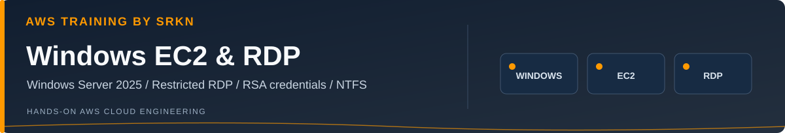</p>

# Windows EC2 and RDP — Windows Server 2025 Lab
**AMAZON EC2 / WINDOWS SERVER 2025 / REMOTE DESKTOP / RSA KEY PAIR / NTFS**

Amazon EC2 can host Windows Server workloads as well as Linux. Windows Server instances provide familiar Microsoft administration tools and can run applications that require the Windows operating system. AWS supplies Windows Server AMIs, manages the underlying compute infrastructure, and exposes the instance's network and EBS storage settings through the EC2 console.

I deployed **Windows Server 2025 Datacenter** on a `t3.small` EC2 instance, configured restricted Remote Desktop access, used the RSA key pair from the EC2 Key Pairs lab to decrypt the initial Administrator password, and established a graphical RDP connection. I then verified the Windows version and inspected the EBS-backed system disk and NTFS volume using PowerShell.

---

## Contents
- [01 Understanding Windows EC2 and RDP](#01-understanding-windows-ec2-and-rdp)
- [02 Scenario and Architecture](#02-scenario-and-architecture)
- [03 Configuring the Windows Instance](#03-configuring-the-windows-instance)
- [04 Launching and Verifying Windows EC2](#04-launching-and-verifying-windows-ec2)
- [05 Retrieving the Administrator Password](#05-retrieving-the-administrator-password)
- [06 Connecting Using Remote Desktop](#06-connecting-using-remote-desktop)
- [07 Verifying Windows Server and EBS Storage](#07-verifying-windows-server-and-ebs-storage)
- [08 SAA-C03 Review and Production Considerations](#08-saa-c03-review-and-production-considerations)
- [09 Cleanup and Conclusion](#09-cleanup-and-conclusion)
- [Technical Competencies](#technical-competencies)
- [Command Reference](#command-reference)
- [AWS Documentation](#aws-documentation)

## 01 Understanding Windows EC2 and RDP

A **Windows EC2 instance** is a Windows Server virtual machine hosted on AWS infrastructure. The AWS-provided AMI determines the OS version and starting configuration; the selected instance type sets the available compute capacity. Amazon EBS provides the root disk, while a security group and VPC network configuration control how the instance can be reached.

**Remote Desktop Protocol (RDP)** enables graphical Windows administration. The Windows Remote Desktop client connects over TCP port `3389` by default. A successful connection requires network reachability, a permitted firewall path, a working RDP service, and valid Windows account credentials.

### Where Windows EC2 is useful

| Use case | Practical value |
|---|---|
| Windows application hosting | Supports software requiring Windows Server APIs or services. |
| Legacy application migration | Provides a path for moving compatible Windows workloads to AWS infrastructure. |
| Windows administration | Enables Remote Desktop and familiar graphical management tools. |
| Windows development and testing | Offers repeatable Windows environments on demand. |
| Windows-dependent integrations | Supports specific enterprise tools and Microsoft-based application stacks. |

## 02 Scenario and Architecture

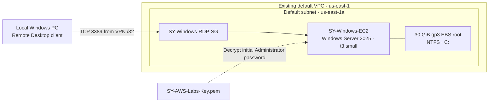

The diagram represents the environment used during the lab; the temporary instance and security group were removed during final cleanup.

| Property | Actual lab configuration |
|---|---|
| Instance name | `SY-Windows-EC2` |
| Instance ID | `i-04c722b5a427d1065` |
| Region / AZ | `us-east-1` / `us-east-1a` |
| AMI | Microsoft Windows Server 2025 Base, 64-bit x86 |
| Edition verified inside guest | Windows Server 2025 Datacenter |
| Instance type | `t3.small` (2 vCPU, 2 GiB memory) |
| Key pair | `SY-AWS-Labs-Key` (RSA) |
| VPC/subnet | Existing default VPC, default subnet |
| Security group | `SY-Windows-RDP-SG` |
| Inbound RDP | TCP 3389 from the specified VPN IPv4 `/32` |
| Public IPv4 | `54.172.167.224` |
| Private IPv4 | `172.31.41.70` |
| Root disk | 30 GiB gp3 EBS |

## 03 Configuring the Windows Instance

### 3.1 Selecting the Windows AMI and instance size

I opened **EC2 → Instances → Launch instances**, named the server `SY-Windows-EC2`, and selected the AWS-provided **Windows Server 2025 Base** AMI. I chose `t3.small`, providing 2 vCPU and 2 GiB memory for the graphical Windows environment.

<table><tr><td align="center"><a href="images/screenshot-01.png">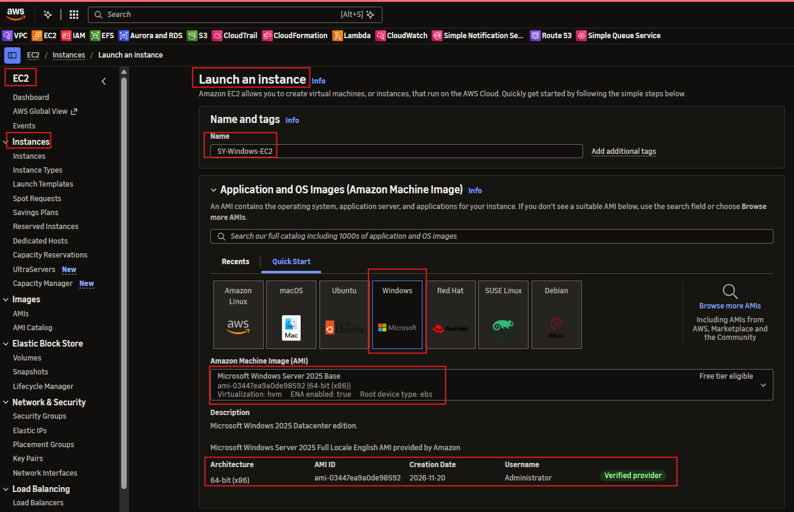</a></td></tr></table>

<p><sub><strong>Screenshot 01:</strong> EC2 launch wizard selecting Windows Server 2025 Base and naming the instance SY-Windows-EC2.</sub></p>

I reused the RSA key pair `SY-AWS-Labs-Key`; with AWS Windows AMIs, this key supports retrieval of the initial randomly generated Administrator password.

<table><tr><td align="center"><a href="images/screenshot-02.png">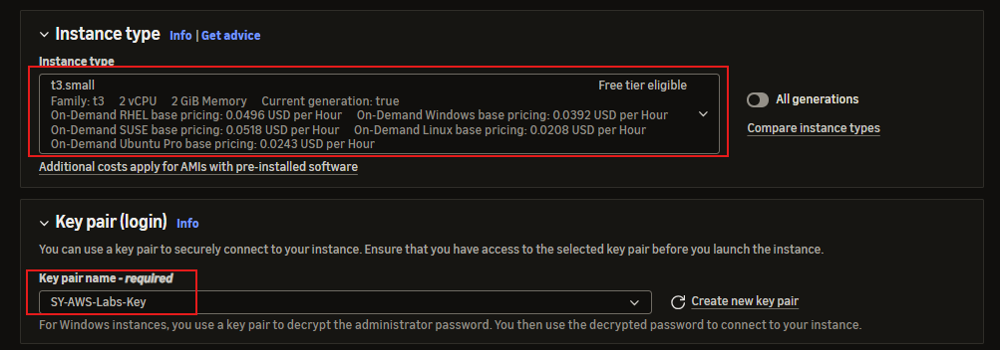</a></td></tr></table>

<p><sub><strong>Screenshot 02:</strong> Windows EC2 t3.small instance type and the existing RSA key-pair selection.</sub></p>

### 3.2 Configuring the network and RDP security group

I used the same default VPC and `us-east-1a` subnet as the Linux instance, enabled automatic public IPv4 assignment, and created a dedicated RDP security group. Its inbound rule allowed **TCP 3389 only from my VPN public IP**.

| Setting | Actual value |
|---|---|
| VPC | Existing default VPC (`172.31.0.0/16`) |
| Subnet | Default subnet in `us-east-1a` |
| Auto-assign public IP | Enabled |
| Security group | `SY-Windows-RDP-SG` |
| Description | `RDP access for AWS Training Windows EC2 Instance` |
| Inbound rule | RDP / TCP / `3389` / `My IP` (`/32`) |

<table><tr><td align="center"><a href="images/screenshot-03.png">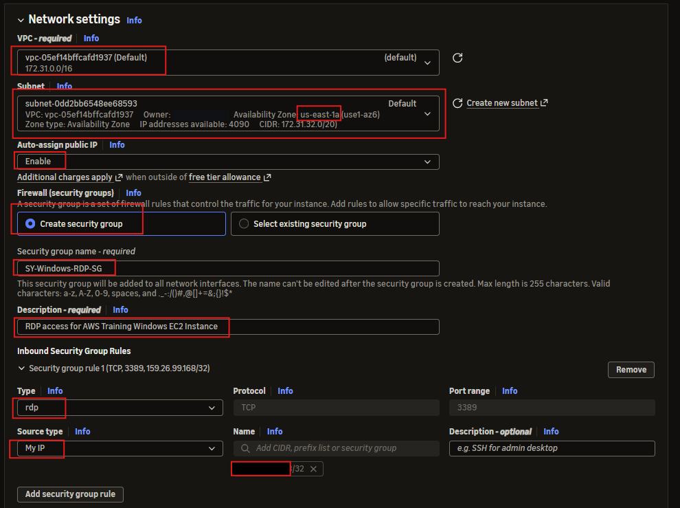</a></td></tr></table>

<p><sub><strong>Screenshot 03:</strong> Windows EC2 network configuration showing the default VPC, public IPv4, and restricted RDP rule.</sub></p>

This configuration permits a defined remote workstation to request RDP access without exposing the Windows login service to every internet address. The correct Windows password is still required for successful authentication.

### 3.3 Configuring Windows root storage

The Windows AMI was launched with one **30 GiB gp3 EBS root volume**, with baseline 3,000 IOPS. The root volume stores Windows and the installed system software. 

<table><tr><td align="center"><a href="images/screenshot-04.png">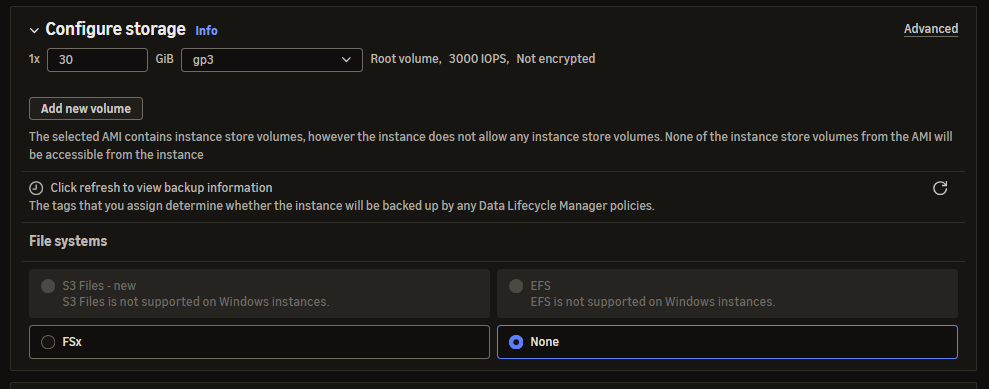</a></td></tr></table>

<p><sub><strong>Screenshot 04:</strong> Windows EC2 root storage configuration showing 30 GiB gp3 and 3,000 IOPS.</sub></p>

## 04 Launching and Verifying Windows EC2

I launched the instance and confirmed that `SY-Windows-EC2` entered the **Running** state with **3/3 status checks passed**. The Instances page simultaneously showed our already running Linux EC2 host, demonstrating two different operating systems sharing the Region and AZ under separate security groups.

<table><tr><td align="center"><a href="images/screenshot-05.png">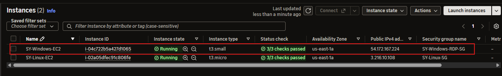</a></td></tr></table>

<p><sub><strong>Screenshot 05:</strong> Windows and Linux EC2 instances both running with all displayed status checks passed.</sub></p>

I also verified the Windows RDP security group's matching Name tag, ensuring that the firewall could be identified clearly during resource review and cleanup.

<table><tr><td align="center"><a href="images/screenshot-06.png">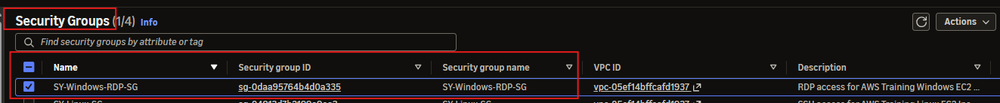</a></td></tr></table>

<p><sub><strong>Screenshot 06:</strong> Security groups list identifying SY-Windows-RDP-SG by name and tag.</sub></p>

> [!IMPORTANT]
> **SAA-C03 exam connection:** EC2 provides compute capacity, while the AMI defines the guest OS. A Windows EC2 instance uses the same VPC, EBS, instance-type, and security-group foundations as Linux, but typically requires a Windows-specific administration and authentication workflow.

## 05 Retrieving the Administrator Password

### 5.1 Password decryption with an RSA private key

The initial password for an AWS-provided Windows Server instance is generated by the instance's launch components and made available encrypted through EC2. I opened the instance's **Connect** page, selected the **RDP client** tab, and chose **Get Windows password**.

<table><tr><td align="center"><a href="images/screenshot-07.png">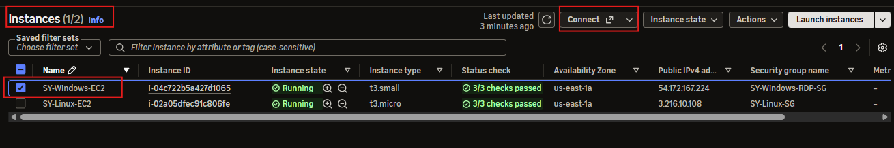</a></td></tr></table>

<p><sub><strong>Screenshot 07:</strong> Selected SY-Windows-EC2 and opened its Connect workflow.</sub></p>

<table><tr><td align="center"><a href="images/screenshot-08.png">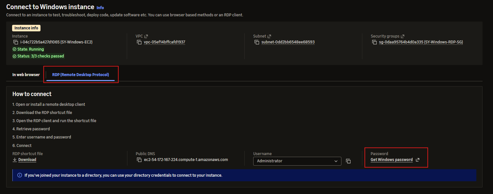</a></td></tr></table>

<p><sub><strong>Screenshot 08:</strong> Windows RDP connection tab showing Administrator and the Get Windows password action.</sub></p>

On the retrieval page, I selected the previously downloaded `SY-AWS-Labs-Key.pem` file, whose RSA private key corresponds to the pair assigned at instance launch. I then used **Decrypt password** to obtain the initial Administrator credentials.

<table><tr><td align="center"><a href="images/screenshot-09.png">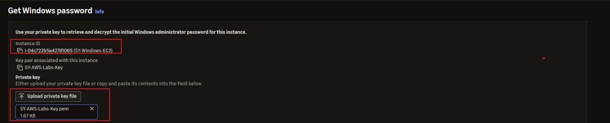</a></td></tr></table>

<p><sub><strong>Screenshot 09:</strong> Windows password retrieval workflow selecting the assigned RSA key and private-key file.</sub></p>

The connection dialog showed the instance's private IP, Administrator username, and password field. The secret is intentionally concealed in the public screenshot.

<table><tr><td align="center"><a href="images/screenshot-10.png">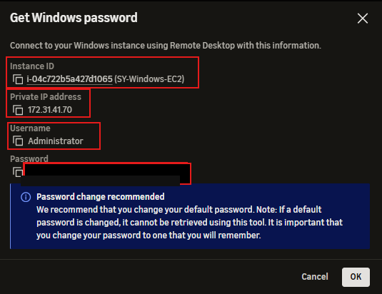</a></td></tr></table>

<p><sub><strong>Screenshot 10:</strong> Decrypted Windows connection details with the Administrator username and password concealed.</sub></p>

**Important distinction:** The same key pair was used differently in the two operating-system labs: Linux accepted SSH public-key authentication, while Windows used the RSA key to **decrypt an initial password** for the RDP login. The Linux authentication test is covered in [EC2 Key Pairs](../Lab11-EC2-Key-Pairs/EC2-Key-Pairs-Lab.md).

## 06 Connecting Using Remote Desktop

### 6.1 Configuring the RDP client

On my local Windows computer I opened **Remote Desktop Connection** (`mstsc`), entered the Windows instance's public IPv4 address and the `Administrator` username, and initiated the connection.

| RDP setting | Value |
|---|---|
| Computer | `54.172.167.224` |
| Username | `Administrator` |
| Network port | TCP 3389 |
| Access source | Restricted VPN egress IPv4 |

<table><tr><td align="center"><a href="images/screenshot-11.png">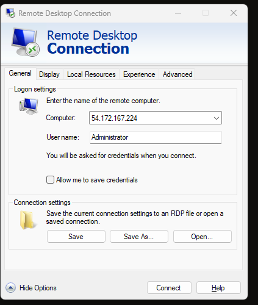</a></td></tr></table>

<p><sub><strong>Screenshot 11:</strong> Local Windows Remote Desktop client configured for the EC2 public IPv4 and Administrator username.</sub></p>

### 6.2 Evaluating the RDP certificate prompt

The client displayed a certificate trust prompt indicating that the presented certificate was not issued by a locally trusted certification authority. I verified that the intended EC2 host was the destination and continued to the remote desktop.

<table><tr><td align="center"><a href="images/screenshot-12.png">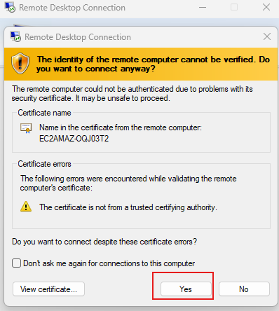</a></td></tr></table>

<p><sub><strong>Screenshot 12:</strong> Remote Desktop certificate warning encountered during the initial Windows EC2 connection.</sub></p>

This illustrates the separation between transport/certificate trust and Windows logon: connecting to the intended IP and knowing the password is necessary, but production remote access should also use trusted certificate practices and appropriately secured access paths.

### 6.3 Verifying the Windows graphical session

The connection opened the Windows Server desktop. The instance information displayed on screen matched the EC2 console's instance ID, public/private IPv4 addresses, `t3.small` instance type, and `us-east-1a` Availability Zone.

<table><tr><td align="center"><a href="images/screenshot-13.png">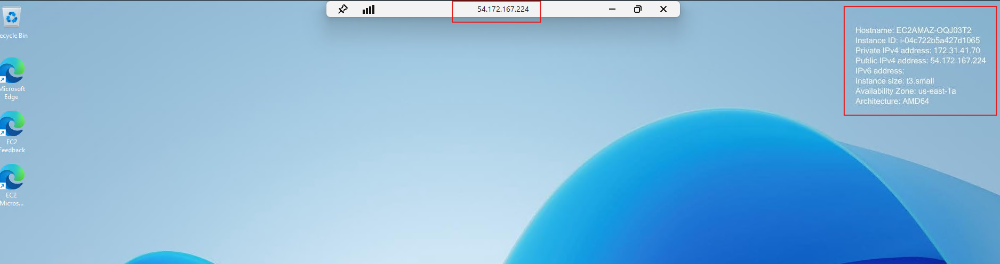</a></td></tr></table>

<p><sub><strong>Screenshot 13:</strong> Successful graphical RDP login to Windows Server with EC2 instance details visible on the desktop.</sub></p>

## 07 Verifying Windows Server and EBS Storage

### 7.1 Confirming the operating-system version

Inside the RDP session, I opened an Administrator PowerShell terminal and ran:

```powershell
winver
```

The **About Windows** dialog identified **Windows Server 2025 Datacenter, version 24H2, OS build 26100.33822**.

<table><tr><td align="center"><a href="images/screenshot-14.png">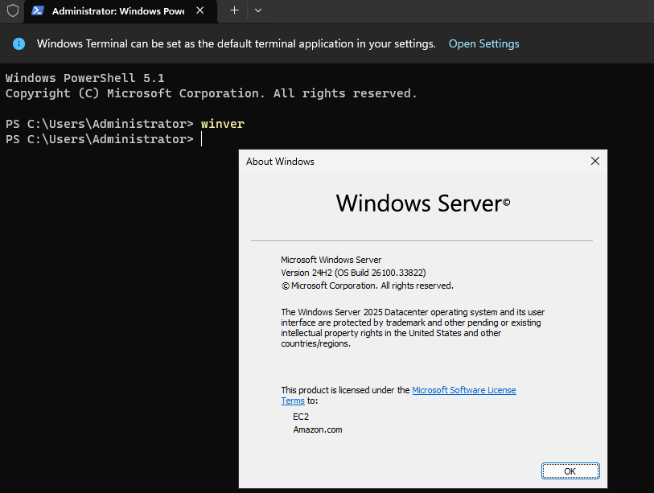</a></td></tr></table>

<p><sub><strong>Screenshot 14:</strong> Windows Server 2025 Datacenter version 24H2 confirmed using winver.</sub></p>

### 7.2 Inspecting the disk and NTFS system partition

I then checked the guest operating system's disk and filesystem using PowerShell:

```powershell
Get-Disk
Get-Volume -DriveLetter C
```

| Reported property | Verified value |
|---|---|
| Disk | Disk 0, 30 GiB, Healthy / Online |
| Partition style | GPT |
| Windows drive | `C:` |
| Filesystem | NTFS |
| Drive capacity | 29.5 GiB |
| Free space | 7.45 GiB |
| Volume state | Healthy / OK |

<table><tr><td align="center"><a href="images/screenshot-15.png">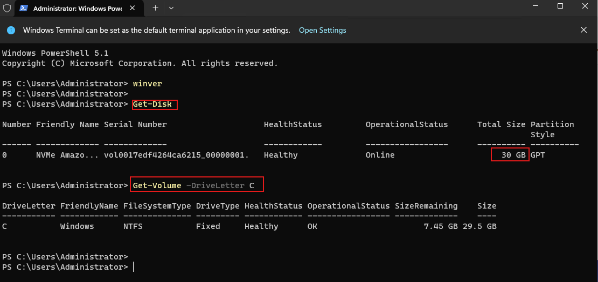</a></td></tr></table>

<p><sub><strong>Screenshot 15:</strong> PowerShell verification of the 30 GiB healthy NVMe disk and NTFS Windows C: volume.</sub></p>

The EBS root disk was provisioned through EC2, while PowerShell reported how Windows sees that storage internally. The difference between 30 GiB provisioned disk size and 29.5 GiB shown for C: is consistent with space reserved for additional system partitions.

## 08 SAA-C03 Review and Production Considerations

### Knowledge check

**Q1. Which AWS control restricted remote desktop reachability?**  
**Answer:** The EC2 security group allowing RDP TCP 3389 from the selected VPN public IP. **Reason:** It filters network traffic to the instance interface.

**Q2. Did Windows use the RSA PEM file as an RDP login password?**  
**Answer:** No. The RSA private key decrypted the initial Windows Administrator password. **Reason:** RDP authenticated with the Windows account credentials.

**Q3. Why inspect `Get-Disk` and `Get-Volume` separately?**  
**Answer:** One reports the recognized physical/virtual disk, the other the mounted logical volume and its filesystem. **Reason:** A disk's provisioned capacity and a partition's usable space can differ.

### Operational considerations

For an enterprise Windows environment I would evaluate Systems Manager access, managed identities, secure password rotation, OS patch policies, Windows event logging, trusted RDP certificates, protected network access (for example VPN or a managed remote-access path), backups, and multi-AZ application architecture. Publicly reachable RDP should remain tightly restricted and monitored.

## 09 Cleanup and Conclusion

After completing the Windows OS, RDP, and EBS checks, I stopped `SY-Windows-EC2` to reduce ongoing compute charges, then terminated it during the coordinated final cleanup. Its dedicated RDP security group and the shared training key pair were also removed after all related exercises. Existing default networking resources remained intact.

### Conclusion

This exercise covered the operational path from **Windows AMI selection to verified remote administration**. I provisioned a Windows Server instance, configured network and storage settings, retrieved its initial Administrator password using an RSA key, established an RDP session, verified the installed Windows Server version, and inspected its NTFS root volume. The key architectural lesson is that Windows on EC2 uses the same AWS compute, storage, and networking controls as Linux while requiring distinct guest-OS authentication and administration procedures.

## Technical Competencies

| Skill | Demonstrated activity |
|---|---|
| Windows EC2 provisioning | Selected Server 2025 AMI and t3.small instance type. |
| Network security | Restricted RDP to a `/32` VPN source IP. |
| RSA key management | Decrypted the initial Windows Administrator password. |
| Remote administration | Established Windows Remote Desktop connectivity. |
| OS verification | Confirmed Windows edition, version, and build. |
| Storage administration | Inspected healthy GPT disk and NTFS C: volume. |
| Resource lifecycle | Stopped and terminated instance; removed training security group. |

## Command Reference

Commands I used in the Windows Server session:

```powershell
winver
Get-Disk
Get-Volume -DriveLetter C
```

To open the client on the local Windows machine:

```powershell
mstsc
```

## AWS Documentation
- [Connect to a Windows instance using an RDP client](https://docs.aws.amazon.com/AWSEC2/latest/UserGuide/connect-rdp.html)
- [Amazon EC2 key pairs](https://docs.aws.amazon.com/AWSEC2/latest/UserGuide/ec2-key-pairs.html)
- [Configure Windows instances](https://docs.aws.amazon.com/AWSEC2/latest/UserGuide/ec2-windows-instances.html)
- [GetPasswordData API](https://docs.aws.amazon.com/AWSEC2/latest/APIReference/API_GetPasswordData.html)
