<p align="center">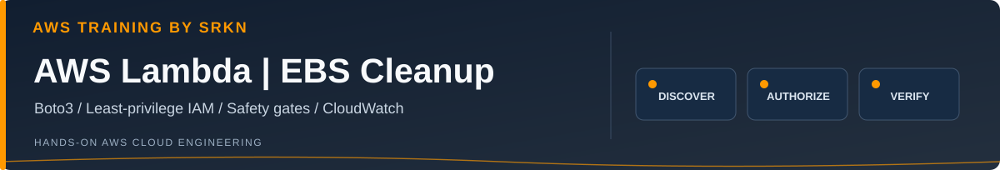</p>

# AWS Lambda — Controlled Amazon EBS Cleanup Lab
**AWS LAMBDA / PYTHON / BOTO3 / IAM / AMAZON EBS / AMAZON CLOUDWATCH**

AWS Lambda runs application code in response to invocations without requiring an administrator to provision or maintain a server for that code. When combined with AWS Identity and Access Management (IAM), the AWS SDK for Python (Boto3), and Amazon CloudWatch Logs, Lambda can automate infrastructure maintenance while providing an auditable execution record. One practical application is identifying unused Amazon Elastic Block Store (EBS) volumes that continue to incur storage charges after workloads have finished.

In this lab, I implemented a **controlled EBS cleanup function** in **US East (N. Virginia), `us-east-1`**. I first configured read-only discovery, verified a specifically tagged **unattached 1 GiB gp3 training volume**, then added an exact-resource IAM deletion permission. I tested the function with deletion disabled, explicitly authorized a single target volume through a JSON event, and confirmed the successful deletion through **Lambda output, CloudWatch Logs, and the EBS Volumes inventory**.

The exercise demonstrates how serverless automation, fine-grained permissions, resource tags, and application-level checks can work together to reduce the risk of deleting the wrong cloud resource.

---

## Contents
- [01 Purpose and Learning Objectives](#01-purpose-and-learning-objectives)
- [02 Understanding Serverless EBS Cleanup](#02-understanding-serverless-ebs-cleanup)
- [03 Lab Scenario and Architecture](#03-lab-scenario-and-architecture)
- [04 Preparing the IAM Execution Role](#04-preparing-the-iam-execution-role)
- [05 Creating the Lambda Function](#05-creating-the-lambda-function)
- [06 Running a Read-Only Preview and Reviewing Logs](#06-running-a-read-only-preview-and-reviewing-logs)
- [07 Adding Least-Privilege Delete Permissions](#07-adding-least-privilege-delete-permissions)
- [08 Inspecting the Tagged EBS Target](#08-inspecting-the-tagged-ebs-target)
- [09 Implementing the Explicit Deletion Safeguards](#09-implementing-the-explicit-deletion-safeguards)
- [10 Executing and Verifying the Approved Deletion](#10-executing-and-verifying-the-approved-deletion)
- [11 Cleaning Up Training Resources](#11-cleaning-up-training-resources)
- [12 SAA-C03 Review and Production Design](#12-saa-c03-review-and-production-design)
- [13 Results and Conclusion](#13-results-and-conclusion)
- [Technical Competencies](#technical-competencies)
- [Reference Implementation](#reference-implementation)
- [AWS Documentation](#aws-documentation)

## 01 Purpose and Learning Objectives

The purpose of this exercise was to understand the complete lifecycle of a **manual, approval-gated serverless maintenance operation**. EBS volumes can exist independently of an EC2 instance. A detached volume remains billable until it is deleted, making unused-volume discovery a legitimate cloud operations and cost-governance task.

The specific objectives were to:

1. Create an IAM execution role with CloudWatch logging and regional, read-only EBS discovery permissions.
2. Create a Python-based Lambda function that uses Boto3 to examine EBS volumes and check resource tags.
3. Identify one explicitly approved training volume in the `available` state.
4. Add `ec2:DeleteVolume` permission limited to the target volume ARN and required resource tags.
5. Confirm a **preview-only result** before allowing any destructive action.
6. Require an explicit deletion switch and an invocation event confirming the exact volume ID.
7. Verify the completed deletion in the Lambda result, CloudWatch Logs, and EC2 volume inventory.
8. Remove temporary training infrastructure after validation.

## 02 Understanding Serverless EBS Cleanup

### 2.1 What AWS Lambda provides

Lambda is a managed compute service for running functions on demand. The function receives an **event**, executes code using a selected runtime and its **execution role**, and produces a result. AWS manages the underlying compute environment, while the function's configuration determines its runtime, memory, timeout, permissions, and other operational settings.

A Lambda function can be invoked manually, by an application, or by another AWS service. This lab used **manual synchronous test events** in the Lambda console so each execution and its result could be inspected before the next action.

### 2.2 Why EBS deletion requires careful controls

Amazon EBS volumes are persistent block devices. A volume can be attached (`in-use`) or unattached (`available`); an unattached volume may still contain important data. **The `available` state alone is not sufficient authorization to delete it.**

For this lab, I combined several independent protections:

| Control | Purpose in the lab |
|---|---|
| AWS Region | Restrict discovery and API access to `us-east-1` |
| Exact volume ID | Avoid affecting any other EBS volume |
| `available` state | Only consider a volume not currently attached to an instance |
| `Project=SY-AWS-Labs` | Identify the training project |
| `CleanupEligible=true` | Require an affirmative deletion-eligibility tag |
| IAM resource restriction | Allow `ec2:DeleteVolume` only on the approved volume ARN |
| IAM tag conditions | Prevent use of the delete permission if the expected tags are absent |
| `DELETE_ENABLED` switch | Keep deletion disabled until the authorized test |
| Confirmed event payload | Require `action=DELETE` and the matching `confirmVolumeId` |
| CloudWatch execution logs | Record the preview and deletion outcomes |

> [!IMPORTANT]
> **SAA-C03 exam connection:** IAM authorizes what the function is permitted to do; application code decides whether to call an authorized API. The IAM role and the code-level checks complement one another. Tags help identify the intended resource, but they are not a substitute for least-privilege IAM permissions or approval.

### 2.3 Related AWS services and responsibilities

| AWS service | Role in this exercise |
|---|---|
| **AWS Lambda** | Executes the Python automation when invoked |
| **AWS IAM** | Grants temporary function credentials and restricts EC2 API permissions |
| **Amazon EC2 / EBS** | Stores the test volume and exposes `DescribeVolumes` / `DeleteVolume` APIs |
| **Boto3** | Calls Amazon EC2 APIs from Python code |
| **Amazon CloudWatch Logs** | Captures invocation details, output, and runtime diagnostics |

## 03 Lab Scenario and Architecture

The target was the **unattached, tagged 1 GiB gp3 volume** `SY-EBS-Cleanup-Test-01`. It was intentionally separate from the Linux and Windows EC2 root disks and from the data and restored volumes used in the earlier EBS lab.

| Setting | Value |
|---|---|
| AWS Region | `us-east-1` (N. Virginia) |
| Function name | `SY-EBS-Cleanup-Lambda` |
| Runtime | Python 3.15 |
| Architecture | x86_64 |
| Execution role | `SY-Lambda-EBS-Cleanup-Role` |
| Memory | 256 MB |
| Timeout | 30 seconds |
| Target volume | `SY-EBS-Cleanup-Test-01` |
| Target volume ID | `vol-0123f0fade0a1d8e2` |
| Target volume storage | 1 GiB, gp3 |
| Target initial state | `available` |
| Required project tag | `Project=SY-AWS-Labs` |
| Required eligibility tag | `CleanupEligible=true` |
| Log group | `/aws/lambda/SY-EBS-Cleanup-Lambda` |
| Invocation method | Manual Lambda console test events |

### Architecture Highlight

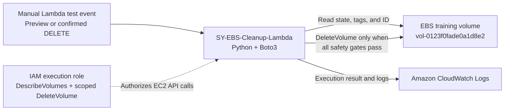

The diagram depicts the **lab execution path**. The temporary function, role, target volume, and log group were deleted after the exercise.

## 04 Preparing the IAM Execution Role

### 4.1 Understanding the Lambda execution role

A Lambda **execution role** is an IAM role that the Lambda service assumes to obtain temporary credentials for AWS API calls. The trust relationship permits the Lambda service principal, `lambda.amazonaws.com`, to use the role. Permission policies then define which actions those credentials can perform.

I used the role **`SY-Lambda-EBS-Cleanup-Role`**, with the AWS-managed **`AWSLambdaBasicExecutionRole`** policy for CloudWatch logging. I then added an inline policy named **`SY-Lambda-EBS-ReadOnly-Policy`**.

### 4.2 Limiting the first policy to EBS discovery

I opened **IAM → Roles → `SY-Lambda-EBS-Cleanup-Role` → Add permissions → Create inline policy**, selected the JSON editor, and entered the regional discovery permission:

```json
{
  "Version": "2012-10-17",
  "Statement": [
    {
      "Sid": "DescribeEBSVolumesInTrainingRegion",
      "Effect": "Allow",
      "Action": "ec2:DescribeVolumes",
      "Resource": "*",
      "Condition": {
        "StringEquals": {
          "ec2:Region": "us-east-1"
        }
      }
    }
  ]
}
```

For the EC2 `DescribeVolumes` API, `Resource: "*"` is appropriate because the action does not support limiting the read request to individual volume ARNs. The `ec2:Region` condition restricted the authorized Region.

<table><tr><td align="center"><a href="images/screenshot-01.png">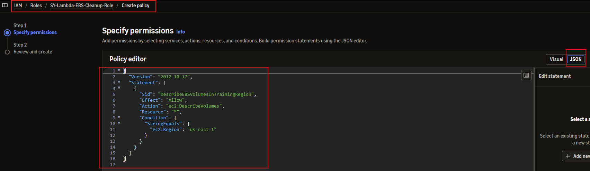</a></td></tr></table>

<p><sub><strong>Screenshot 01:</strong> IAM JSON policy permitting regional EBS volume discovery through ec2:DescribeVolumes.</sub></p>

I reviewed the policy, saved it as `SY-Lambda-EBS-ReadOnly-Policy`, and confirmed the execution role contained that inline policy alongside `AWSLambdaBasicExecutionRole`.

<table><tr><td align="center"><a href="images/screenshot-02.png">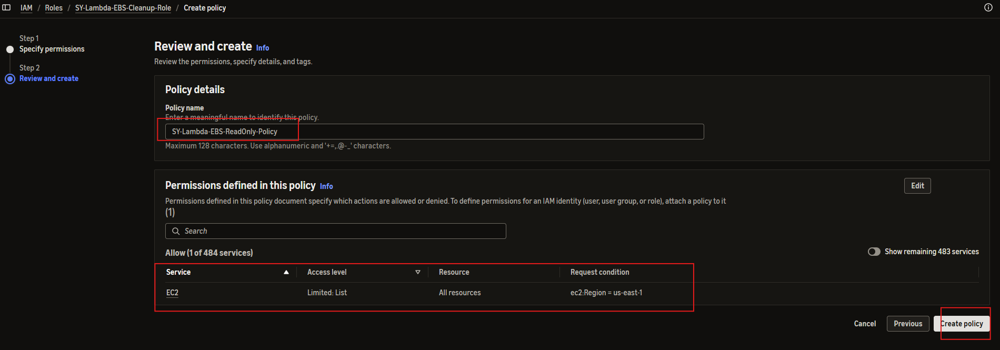</a></td></tr></table>

<p><sub><strong>Screenshot 02:</strong> Review and creation of the SY-Lambda-EBS-ReadOnly-Policy inline policy.</sub></p>

<table><tr><td align="center"><a href="images/screenshot-03.png">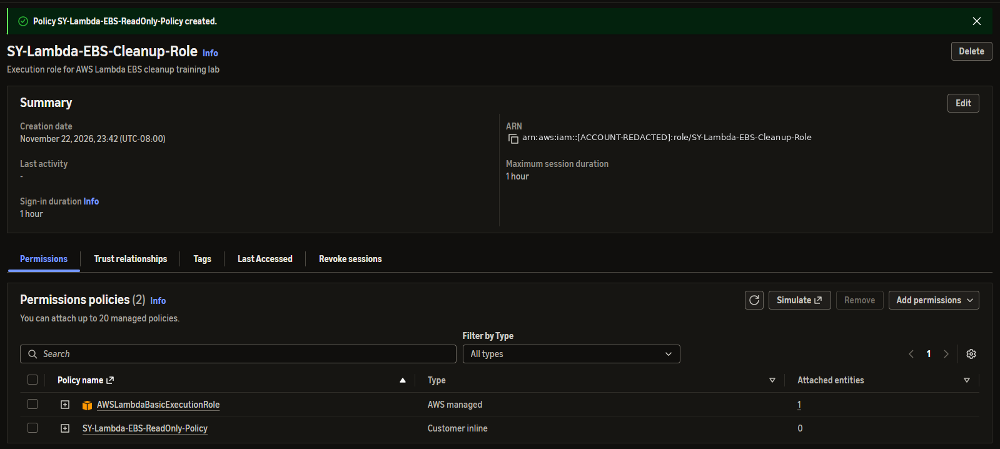</a></td></tr></table>

<p><sub><strong>Screenshot 03:</strong> Lambda execution role with CloudWatch logging and EBS read-only permissions.</sub></p>

### 4.3 Preparing the broader training environment

The Linux and Windows instances from the preceding EC2 exercises were also selected for shutdown as part of the coordinated environment teardown. The Lambda deletion test itself targeted only the **independent, unattached** `SY-EBS-Cleanup-Test-01` volume—not either instance's operating-system disk.

<table><tr><td align="center"><a href="images/screenshot-04.png">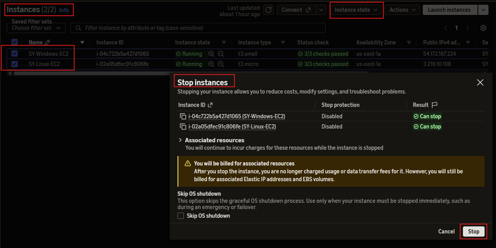</a></td></tr></table>

<p><sub><strong>Screenshot 04:</strong> EC2 instances selected for shutdown during the coordinated training environment cleanup.</sub></p>

## 05 Creating the Lambda Function

### 5.1 Selecting the runtime and execution role

In **Lambda → Functions → Create function**, I selected **Author from scratch** and entered the training function name. The console configuration used the following settings:

| Lambda option | Selected value |
|---|---|
| Function name | `SY-EBS-Cleanup-Lambda` |
| Runtime | Python 3.15 |
| Architecture | x86_64 |
| Execution role | Use an existing role |
| Existing role | `SY-Lambda-EBS-Cleanup-Role` |

<table><tr><td align="center"><a href="images/screenshot-05.png">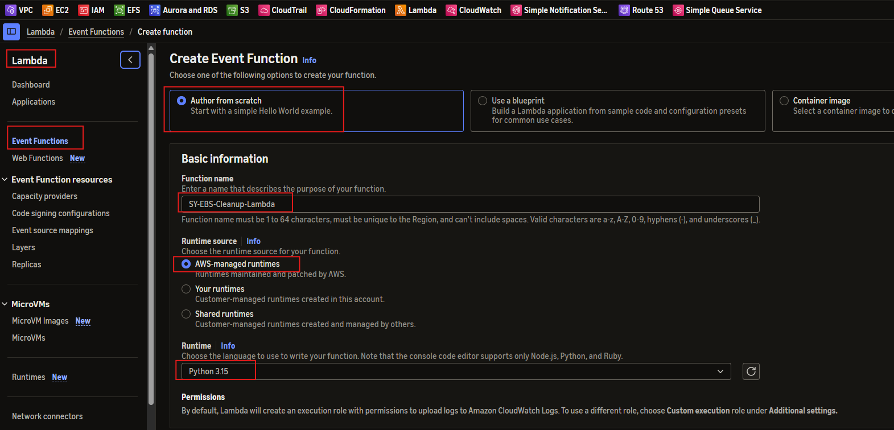</a></td></tr></table>

<p><sub><strong>Screenshot 05:</strong> Lambda function creation with Author from scratch, Python 3.15, and SY-EBS-Cleanup-Lambda.</sub></p>

<table><tr><td align="center"><a href="images/screenshot-06.png">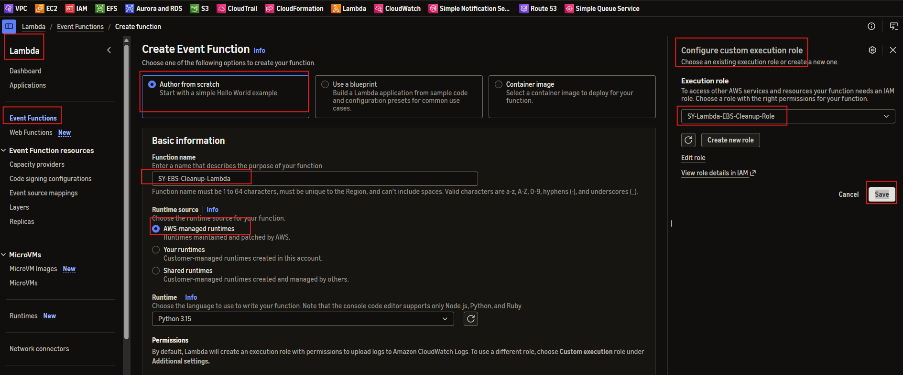</a></td></tr></table>

<p><sub><strong>Screenshot 06:</strong> Existing SY-Lambda-EBS-Cleanup-Role selected as the execution role.</sub></p>

The function was created successfully, and the console opened its built-in Python editor with `lambda_function.py`.

<table><tr><td align="center"><a href="images/screenshot-07.png">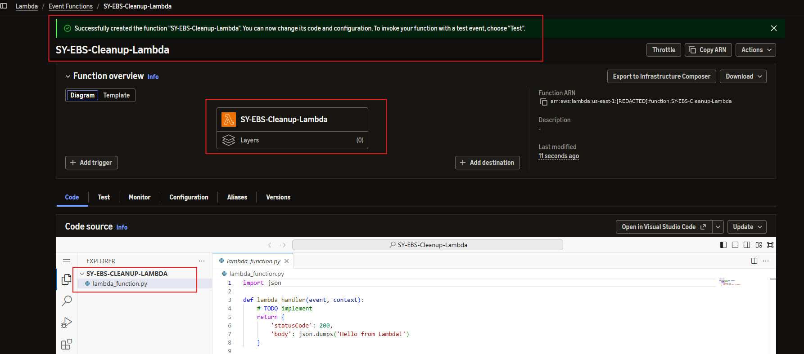</a></td></tr></table>

<p><sub><strong>Screenshot 07:</strong> Successful creation of the Lambda function and its default Python code editor.</sub></p>

### 5.2 Writing the read-only discovery logic

I replaced the starter code with a Boto3-based EBS discovery function. The initial discovery version used `describe_volumes` with a paginator and filters that identified volumes which were **unattached, associated with the training project, and marked for cleanup**. It also checked the exact volume ID before including the candidate.

The principal discovery filters were:

```python
filters = [
    {"Name": "status", "Values": ["available"]},
    {"Name": "tag:Project", "Values": ["SY-AWS-Labs"]},
    {"Name": "tag:CleanupEligible", "Values": ["true"]},
]
```

These are **EC2 API search filters**, not IAM permissions. The application still needed the execution role to authorize the corresponding API call.

<table><tr><td align="center"><a href="images/screenshot-08.png">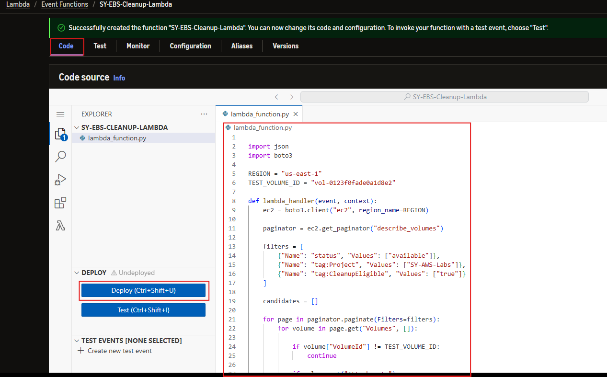</a></td></tr></table>

<p><sub><strong>Screenshot 08:</strong> Initial Boto3 discovery code filtering available volumes by project and cleanup-eligibility tags.</sub></p>

I deployed the updated code before executing a test event.

<table><tr><td align="center"><a href="images/screenshot-09.png">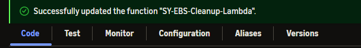</a></td></tr></table>

<p><sub><strong>Screenshot 09:</strong> Confirmation that the updated Lambda function code was deployed.</sub></p>

## 06 Running a Read-Only Preview and Reviewing Logs

### 6.1 Creating the first test event

On the function's **Test** tab, I created a private, synchronous test event to run the discovery code. The function configuration was set to **256 MB** of memory and a **30-second timeout**, allowing the Boto3 request and logging work to finish.

<table><tr><td align="center"><a href="images/screenshot-10.png">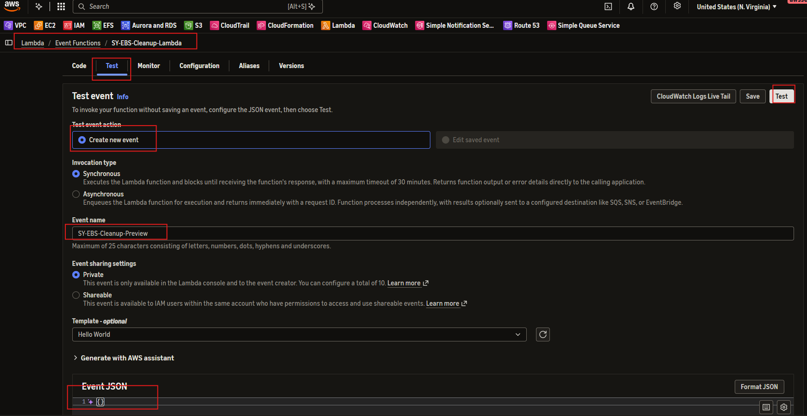</a></td></tr></table>

<p><sub><strong>Screenshot 10:</strong> Creation of a synchronous Lambda console test event for the discovery preview.</sub></p>

### 6.2 Verifying the preview result

The Lambda invocation succeeded and identified **one eligible volume**. The response showed the volume ID `vol-0123f0fade0a1d8e2`, its `available` state, and `PREVIEW_ONLY` mode. No EBS volume was deleted during this check.

A representative view of the verified response values is:

```json
{
  "Mode": "PREVIEW_ONLY",
  "VolumeId": "vol-0123f0fade0a1d8e2",
  "VolumeState": "available",
  "Eligible": true,
  "DeletionEnabled": false,
  "DeletionPerformed": false
}
```

<table><tr><td align="center"><a href="images/screenshot-11.png">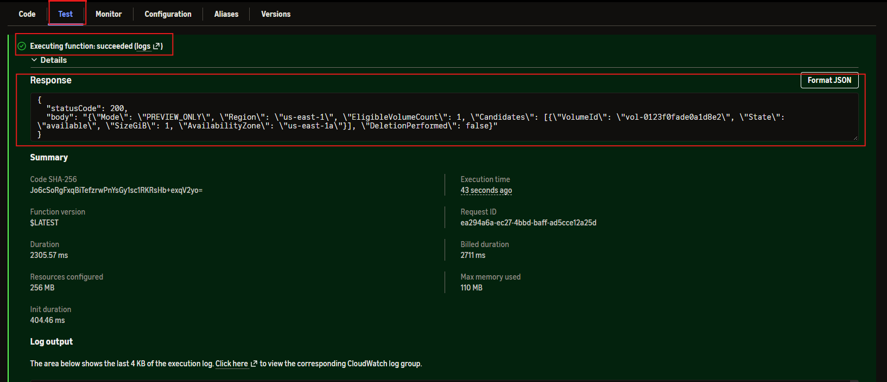</a></td></tr></table>

<p><sub><strong>Screenshot 11:</strong> Successful preview response identifying one eligible 1 GiB volume, with no deletion performed.</sub></p>

### 6.3 Verifying CloudWatch observability

The Lambda **Monitor** tab showed the invocation metrics, including invocation count and duration. I then opened the associated CloudWatch log group:

```text
/aws/lambda/SY-EBS-Cleanup-Lambda
```

Lambda writes function output and diagnostic records to CloudWatch Logs when the execution role has the required log permissions. The log group contained the invocation's log streams and the structured preview output.

<table><tr><td align="center"><a href="images/screenshot-12.png">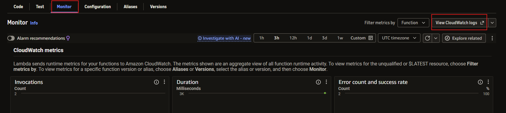</a></td></tr></table>

<p><sub><strong>Screenshot 12:</strong> Lambda monitoring tab showing invocation and duration metrics.</sub></p>

<table><tr><td align="center"><a href="images/screenshot-13.png">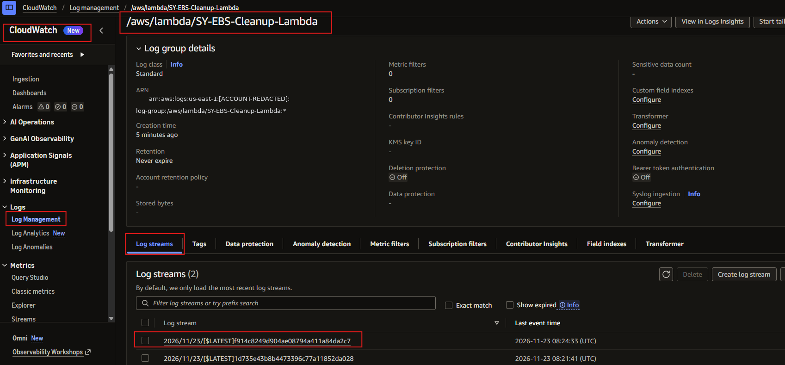</a></td></tr></table>

<p><sub><strong>Screenshot 13:</strong> CloudWatch log group and log streams created for the Lambda function.</sub></p>

<table><tr><td align="center"><a href="images/screenshot-14.png">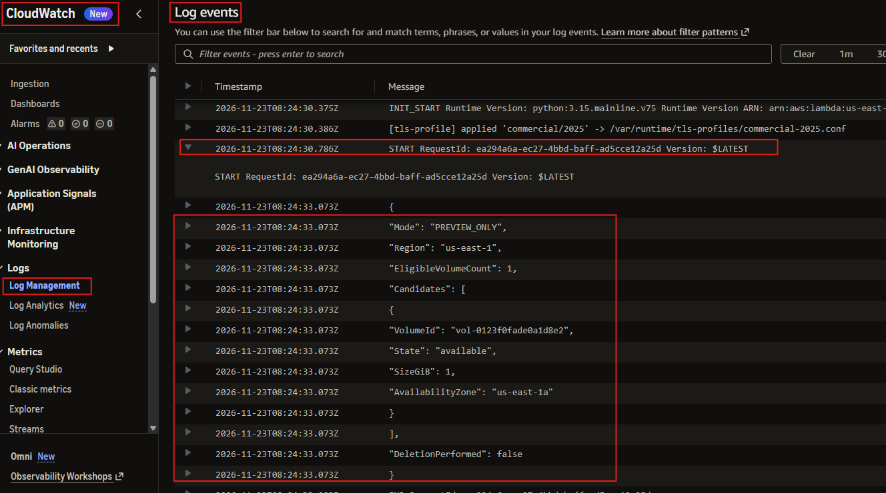</a></td></tr></table>

<p><sub><strong>Screenshot 14:</strong> CloudWatch log entries reporting PREVIEW_ONLY and DeletionPerformed=false.</sub></p>

> [!NOTE]
> **Key takeaway:** A successful invocation alone does not prove deletion safety. The meaningful validation was the combination of **eligible target identified**, **deletion disabled**, and **`DeletionPerformed=false`**, corroborated by the CloudWatch record.

## 07 Adding Least-Privilege Delete Permissions

### 7.1 Granting deletion only for the approved volume

After the read-only preview, I added a second inline IAM policy, **`SY-Lambda-EBS-Delete-Policy`**, to the same execution role. It allowed the `ec2:DeleteVolume` API for **one volume ARN** and required the exact cleanup tags to remain present.

```json
{
  "Version": "2012-10-17",
  "Statement": [
    {
      "Sid": "DeleteOnlyApprovedTrainingVolume",
      "Effect": "Allow",
      "Action": "ec2:DeleteVolume",
      "Resource": "arn:aws:ec2:us-east-1:*:volume/vol-0123f0fade0a1d8e2",
      "Condition": {
        "StringEquals": {
          "ec2:ResourceTag/Project": "SY-AWS-Labs",
          "ec2:ResourceTag/CleanupEligible": "true"
        }
      }
    }
  ]
}
```

The ARN uses the exact training volume ID and the account wildcard shown in the lab policy; the active IAM role was used within the training account. The combination of the target ARN and `ec2:ResourceTag` conditions tightly constrained this particular operation.

<table><tr><td align="center"><a href="images/screenshot-15.png">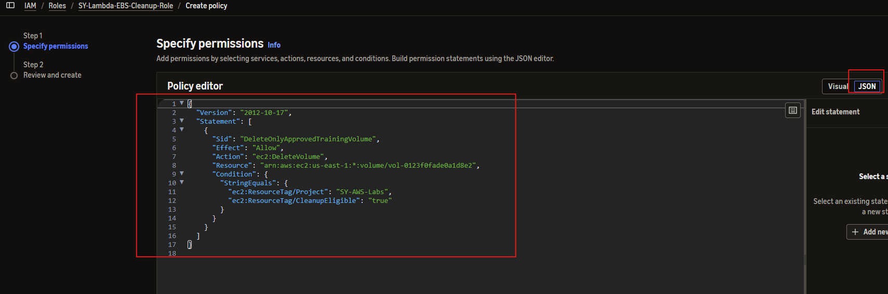</a></td></tr></table>

<p><sub><strong>Screenshot 15:</strong> IAM JSON policy restricting DeleteVolume to the exact training volume and its required tags.</sub></p>

### 7.2 Verifying the role's permission set

I reviewed and created `SY-Lambda-EBS-Delete-Policy`, then verified that the role had **three policies**:

| Policy | Type | Purpose |
|---|---|---|
| `AWSLambdaBasicExecutionRole` | AWS managed | Create log streams and write events to CloudWatch Logs |
| `SY-Lambda-EBS-ReadOnly-Policy` | Customer inline | Describe EBS volumes in `us-east-1` |
| `SY-Lambda-EBS-Delete-Policy` | Customer inline | Delete only the specifically tagged, approved volume |

<table><tr><td align="center"><a href="images/screenshot-16.png">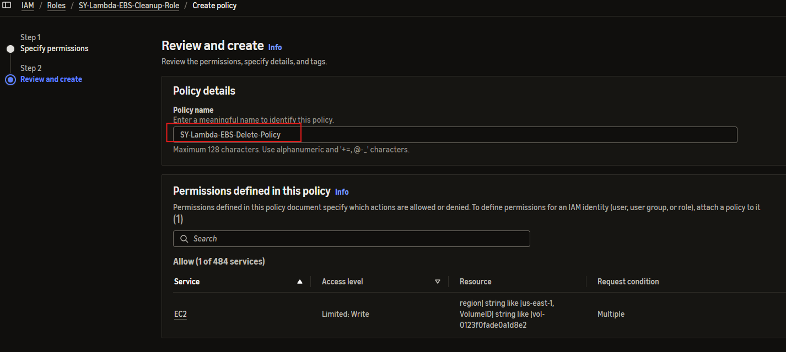</a></td></tr></table>

<p><sub><strong>Screenshot 16:</strong> Review of the SY-Lambda-EBS-Delete-Policy inline policy.</sub></p>

<table><tr><td align="center"><a href="images/screenshot-17.png">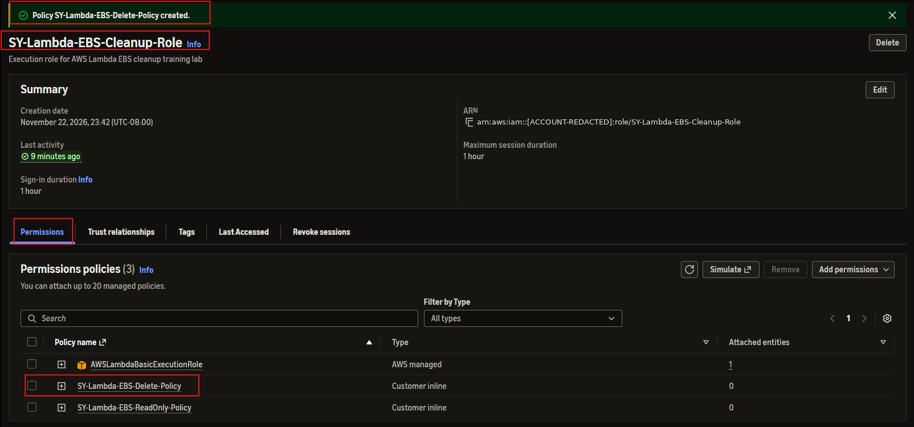</a></td></tr></table>

<p><sub><strong>Screenshot 17:</strong> Execution role showing the managed logging policy and both custom inline EBS policies.</sub></p>

> [!IMPORTANT]
> **SAA-C03 exam connection:** IAM permissions are evaluated against both **resource scopes** and **conditions**. A broad permission such as `ec2:*` or `ec2:DeleteVolume` on all volumes was unnecessary for this test. The function needed limited read access, logging permissions, and a very narrow delete authorization.

## 08 Inspecting the Tagged EBS Target

I opened **EC2 → Elastic Block Store → Volumes**, selected `SY-EBS-Cleanup-Test-01`, and verified its identity, size, type, and attachment status.

| Volume attribute | Verified value |
|---|---|
| Name | `SY-EBS-Cleanup-Test-01` |
| Volume ID | `vol-0123f0fade0a1d8e2` |
| Type | `gp3` |
| Size | 1 GiB |
| State | `Available` |
| Availability Zone | `us-east-1a` |
| Attached resource | None |
| Tag: Project | `SY-AWS-Labs` |
| Tag: CleanupEligible | `true` |

<table><tr><td align="center"><a href="images/screenshot-18.png">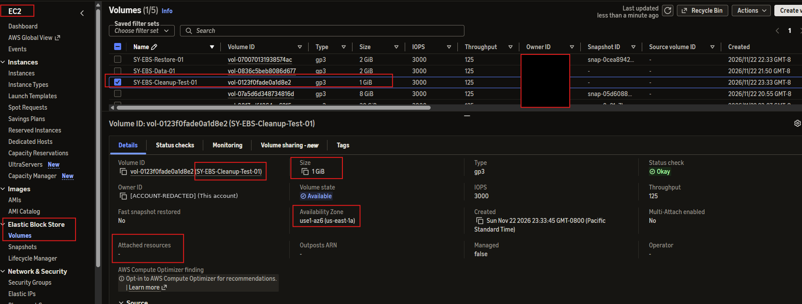</a></td></tr></table>

<p><sub><strong>Screenshot 18:</strong> Unattached 1 GiB gp3 training volume in the Available state.</sub></p>

The **Tags** tab showed the explicit `CleanupEligible=true` value. This tag distinguished the authorized cleanup target from other volumes in the same project, such as `SY-EBS-Data-01`, which had been retained for the persistence and snapshot exercises.

<table><tr><td align="center"><a href="images/screenshot-19.png">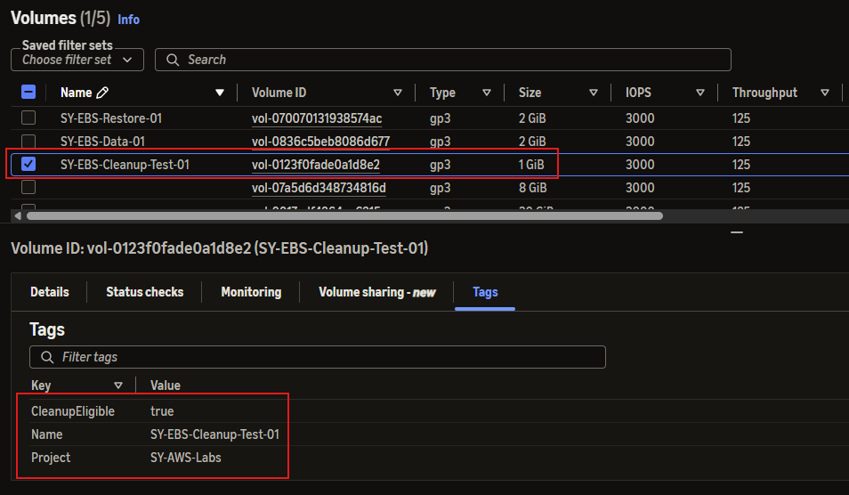</a></td></tr></table>

<p><sub><strong>Screenshot 19:</strong> Training EBS volume tags showing Project=SY-AWS-Labs and CleanupEligible=true.</sub></p>

## 09 Implementing the Explicit Deletion Safeguards

### 9.1 Default-deny behavior in the function code

The final guarded version of `lambda_function.py` referenced the exact target ID and introduced a safety switch initially set to `False`:

```python
REGION = "us-east-1"
TARGET_VOLUME_ID = "vol-0123f0fade0a1d8e2"
DELETE_ENABLED = False
```

The function checked the target volume's state and resource tags, then required the invocation payload to contain **both** `action="DELETE"` and `confirmVolumeId` matching the target before it could call `delete_volume`.

<table><tr><td align="center"><a href="images/screenshot-20.png">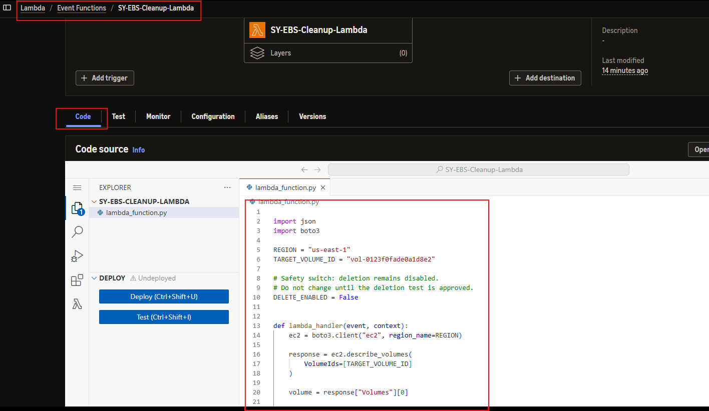</a></td></tr></table>

<p><sub><strong>Screenshot 20:</strong> Lambda code with exact target-volume ID and a default-disabled deletion switch.</sub></p>

### 9.2 Testing the guardrails before deletion

I ran another test while `DELETE_ENABLED` was still `False`. The invocation succeeded and reported that the target was eligible, but deletion was not enabled and **`DeletionPerformed` remained `false`**. This confirmed the explicit safety gate before the authorized destructive run.

<table><tr><td align="center"><a href="images/screenshot-21.png">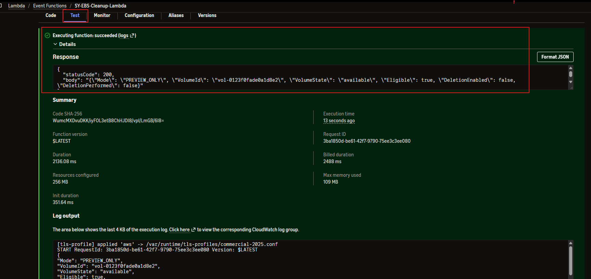</a></td></tr></table>

<p><sub><strong>Screenshot 21:</strong> Successful guarded preview: eligible volume found while deletion remains disabled.</sub></p>

> [!CAUTION]
> `DeleteVolume` is destructive. An unattached EBS volume may contain valuable data, and deletion is not the same as safe archival. For a production cleanup process, ownership, approval, retention periods, backup requirements, and exceptions should be validated before deletion is permitted.

## 10 Executing and Verifying the Approved Deletion

### 10.1 Enabling the single approved test

After the guarded preview passed, I changed the code switch to **`DELETE_ENABLED = True`** and deployed the updated function for the approved single-volume deletion. The function still required a matching invocation event and the exact IAM-authorized volume.

<table><tr><td align="center"><a href="images/screenshot-22.png">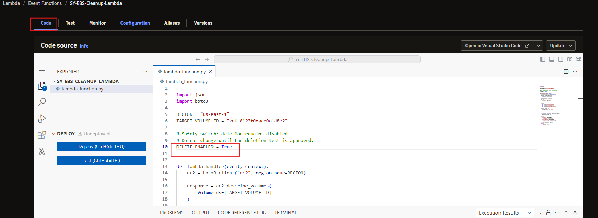</a></td></tr></table>

<p><sub><strong>Screenshot 22:</strong> Lambda code configured for the individually approved deletion test.</sub></p>

### 10.2 Sending the explicit confirmation event

I created a private synchronous test event named **`SY-EBS-Delete-Approved`** with the following payload:

```json
{
  "action": "DELETE",
  "confirmVolumeId": "vol-0123f0fade0a1d8e2"
}
```

Because both fields were required to match, an unrelated test event or different volume ID would not satisfy the function's deletion conditions.

<table><tr><td align="center"><a href="images/screenshot-23.png">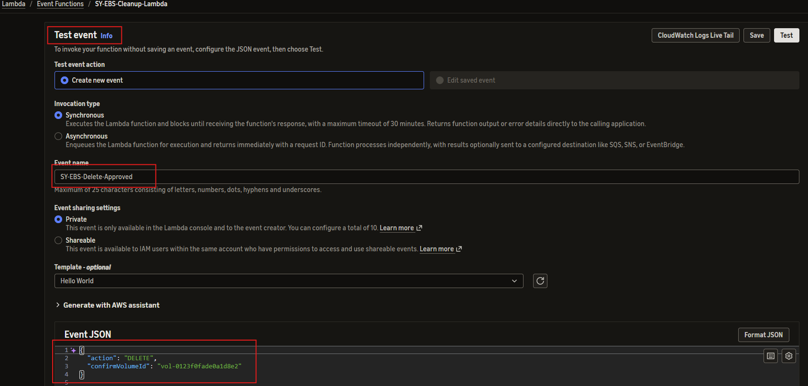</a></td></tr></table>

<p><sub><strong>Screenshot 23:</strong> Manual test event containing action=DELETE and the exact confirmed EBS volume ID.</sub></p>

### 10.3 Confirming deletion in CloudWatch

The deletion execution completed, and the CloudWatch log stream recorded the meaningful result fields:

```json
{
  "Mode": "DELETE",
  "VolumeId": "vol-0123f0fade0a1d8e2",
  "VolumeState": "available",
  "Eligible": true,
  "DeletionEnabled": true,
  "DeletionPerformed": true
}
```

This was an **actual deletion test**, not only a simulated or preview response.

<table><tr><td align="center"><a href="images/screenshot-24.png">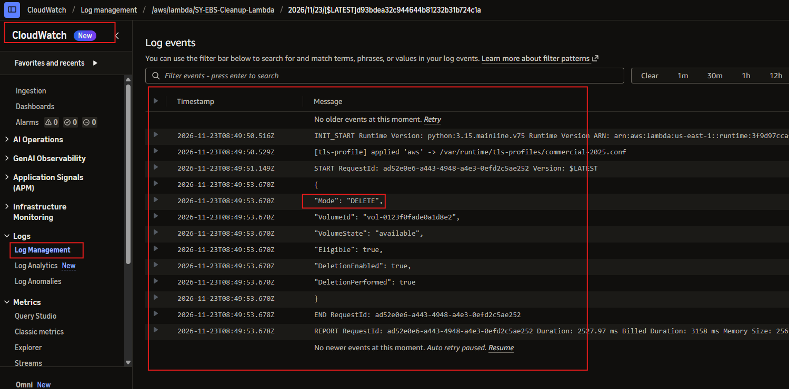</a></td></tr></table>

<p><sub><strong>Screenshot 24:</strong> CloudWatch execution record showing Mode=DELETE and DeletionPerformed=true.</sub></p>

### 10.4 Checking the EBS inventory

I returned to the EBS Volumes console and confirmed that the volume inventory dropped from **five volumes to four**. The target `SY-EBS-Cleanup-Test-01` was absent, while the other training volumes remained in the list. This independent inventory check corroborated the Lambda and CloudWatch results.

<table><tr><td align="center"><a href="images/screenshot-25.png">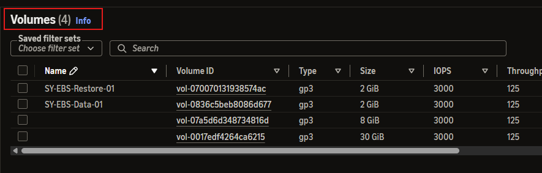</a></td></tr></table>

<p><sub><strong>Screenshot 25:</strong> EBS inventory following the automated deletion, with the test volume absent.</sub></p>

Finally, I restored the function's safety switch to **`DELETE_ENABLED = False`** and deployed that change, returning the temporary function to its non-destructive state before teardown.

## 11 Cleaning Up Training Resources

The automated EBS deletion was one part of a broader cleanup of the completed EC2, EBS, networking, and Lambda exercises. I removed temporary resources in a controlled sequence and verified their final state.

### 11.1 Releasing temporary networking and compute resources

I released the training Elastic IP **`3.216.10.108`** and confirmed that the Region's Elastic IP list was empty.

<table><tr><td align="center"><a href="images/screenshot-26.png">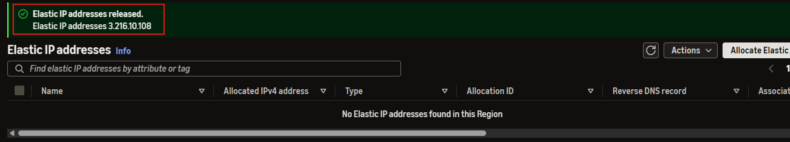</a></td></tr></table>

<p><sub><strong>Screenshot 26:</strong> Elastic IP address released as part of the wider resource teardown.</sub></p>

I terminated the Linux and Windows training EC2 instances and confirmed their **Terminated** state in the EC2 console.

<table><tr><td align="center"><a href="images/screenshot-27.png">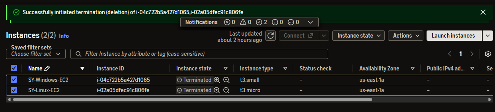</a></td></tr></table>

<p><sub><strong>Screenshot 27:</strong> Training Linux and Windows EC2 instances shown in the Terminated state.</sub></p>

### 11.2 Removing remaining storage and the snapshot

After the EC2 root volumes were removed with the instances, two separately created 2 GiB training data volumes remained: `SY-EBS-Data-01` and `SY-EBS-Restore-01`. They were **not** targets of the Lambda deletion; both were subsequently deleted manually.

<table><tr><td align="center"><a href="images/screenshot-28.png">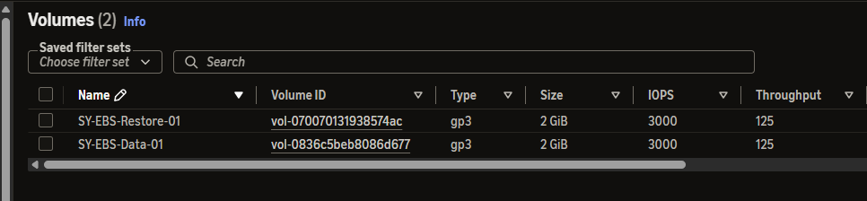</a></td></tr></table>

<p><sub><strong>Screenshot 28:</strong> Two remaining training data volumes awaiting final manual cleanup.</sub></p>

I also deleted the EBS snapshot **`snap-0cea8942d27385a05`** and confirmed the empty snapshot inventory.

<table><tr><td align="center"><a href="images/screenshot-29.png">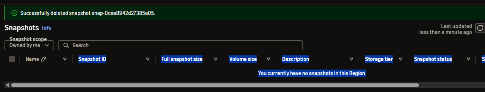</a></td></tr></table>

<p><sub><strong>Screenshot 29:</strong> Successful deletion of the separate EBS snapshot and empty snapshot inventory.</sub></p>

### 11.3 Removing the Lambda function and permissions

With the deletion validated, I deleted **`SY-EBS-Cleanup-Lambda`** and verified that the Lambda Functions list no longer contained it.

<table><tr><td align="center"><a href="images/screenshot-30.png">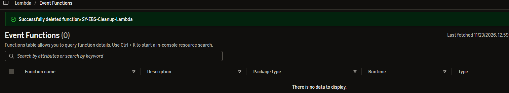</a></td></tr></table>

<p><sub><strong>Screenshot 30:</strong> Lambda function successfully deleted, with no functions listed.</sub></p>

I removed the temporary IAM role **`SY-Lambda-EBS-Cleanup-Role`**, including its two inline EBS permission policies. The AWS-managed `AWSLambdaBasicExecutionRole` policy itself was retained as an AWS-managed policy.

<table><tr><td align="center"><a href="images/screenshot-31.png">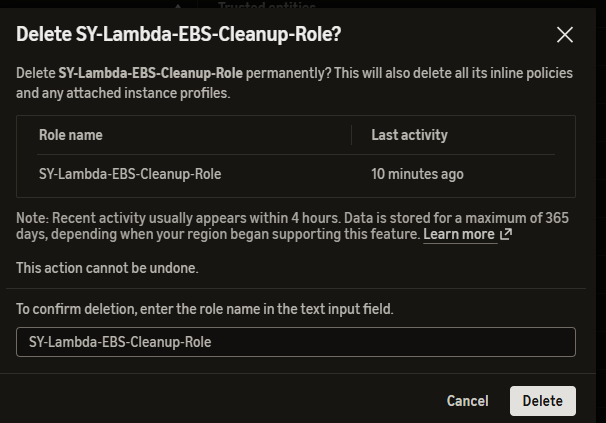</a></td></tr></table>

<p><sub><strong>Screenshot 31:</strong> IAM confirmation dialog for removing the temporary Lambda execution role.</sub></p>

### 11.4 Removing the remaining lab-specific access controls

The two security groups used for the Linux and Windows EC2 exercises were deleted:

- `SY-Linux-SG`
- `SY-Windows-RDP-SG`

<table><tr><td align="center"><a href="images/screenshot-32.png">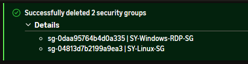</a></td></tr></table>

<p><sub><strong>Screenshot 32:</strong> Successful deletion of the Linux SSH and Windows RDP training security groups.</sub></p>

I also removed the Lambda log group `/aws/lambda/SY-EBS-Cleanup-Lambda` and the temporary EC2 key pair `SY-AWS-Labs-Key` during the final coordinated audit. The previously existing `npoweraws` key pair and unrelated AWS resources were preserved.

The final `us-east-1` audit confirmed that the temporary Lambda function, execution role, test volume, supporting logs, security groups, and other training resources had been cleaned up.

## 12 SAA-C03 Review and Production Design

### 12.1 Essential architectural lessons

| Concept | AWS architecture lesson |
|---|---|
| Serverless execution | Lambda runs code without a permanently running EC2 maintenance server |
| IAM execution role | The role grants the function temporary permissions to call other services |
| Least privilege | Read permissions and a scoped delete permission are distinct responsibilities |
| Tag-based governance | Resource tags make targeted automation practical but must be combined with authorization |
| Event-driven invocation | A structured event can carry an operation request and its exact target identifier |
| EBS persistence | Unattached EBS volumes can continue to exist and incur charges |
| Observability | CloudWatch Logs and a second AWS inventory check provide independent evidence |
| Lifecycle management | Removing the function does not by itself remove the role, log group, or remaining EBS resources |

### 12.2 Knowledge Check

> [!TIP]
> **Q1. Why was `ec2:DescribeVolumes` granted on `*`, but `ec2:DeleteVolume` restricted to one volume ARN?**  
> **Answer:** `DescribeVolumes` does not provide per-volume resource-level permission scoping, while `DeleteVolume` supports volume resources and tag conditions. A narrow delete ARN and the correct tags reduce the blast radius of the destructive permission.
>
> **Q2. Can an `available` EBS volume always be deleted safely?**  
> **Answer:** No. `available` means the volume is not currently attached; it does not establish that its data is unneeded. Ownership, retention, backups, and explicit approval still matter.
>
> **Q3. What does the Lambda execution role authorize?**  
> **Answer:** The AWS API operations the function can perform, including writing CloudWatch logs and calling the permitted EC2 actions. It does not automatically authorize every operation in the AWS account.
>
> **Q4. Why verify deletion in the EBS console after checking the CloudWatch result?**  
> **Answer:** The log confirms the function's reported action; the EBS inventory independently verifies that the target resource is no longer present.
>
> **Q5. Why is `DELETE_ENABLED=False` useful even after granting delete permission?**  
> **Answer:** It adds an application-level default-deny gate. A routine preview can run without issuing the destructive API call even when IAM would otherwise authorize it.

### 12.3 Production considerations

For a real organization, a cleanup service would usually use resource ownership records, defined expiration periods, monitoring, a notification or approval mechanism, and consistent backup/retention policies. It should be able to handle missing or already-deleted volumes, API throttling, retries, and unexpected responses without treating every failed request as a reason to delete something else.

A production design might discover candidate volumes at scale and invoke an approval workflow before deletion. The **manual, exact-ID confirmation** used here was appropriate for a deliberately limited training operation. Its direct, single-target safeguards are not a substitute for lifecycle governance across an entire AWS account.

## 13 Results and Conclusion

### 13.1 Verified results

| Validation | Observed outcome |
|---|---|
| Read-only EBS discovery | One eligible training volume identified |
| Project and eligibility tags | `SY-AWS-Labs` and `CleanupEligible=true` verified |
| Preview safety | `PREVIEW_ONLY`, `DeletionEnabled=false`, `DeletionPerformed=false` |
| IAM deletion scope | Exact target volume ARN plus two resource-tag conditions |
| Explicit approval event | `action=DELETE` with matching `confirmVolumeId` |
| Authorized function run | `Mode=DELETE`, `DeletionPerformed=true` in CloudWatch |
| EC2/EBS inventory | Target test volume absent after the run |
| Post-test safety | `DELETE_ENABLED` reset to `False` before teardown |
| Lab cleanup | Temporary Lambda, IAM, logging, EBS, EC2, networking, and key-pair resources removed and audited |

### 13.2 Conclusion

This lab demonstrated a complete **discovery → preview → authorization → deletion → verification** lifecycle using AWS Lambda, Python, Boto3, IAM, Amazon EBS, and CloudWatch Logs.

The most important engineering principle was **controlled scope**: the function identified only a specially tagged, unattached training volume; its execution role allowed deletion only for that volume; and the code required two deliberate confirmations before calling the destructive API. The resulting CloudWatch record and EBS inventory check established that the intended resource was deleted while the remaining EBS volumes were left unchanged by the automation.

## Technical Competencies

| Skill | Demonstrated work |
|---|---|
| AWS Lambda deployment | Created, configured, deployed, tested, and deleted a Python Lambda function |
| IAM role management | Used an execution role and distinguished AWS-managed from inline policies |
| IAM policy design | Applied regional read restrictions, a single-volume ARN, and resource-tag conditions |
| Python and Boto3 | Used the EC2 client to inspect volumes and perform a controlled deletion |
| Resource tagging | Applied and verified `Project` and `CleanupEligible` selection criteria |
| Change safety | Implemented preview-only behavior, a disabled-by-default switch, and confirmation event |
| Observability | Used Lambda response, CloudWatch metrics, and CloudWatch Logs to validate execution |
| AWS cleanup | Confirmed the target removal and completed coordinated lab teardown |

## Reference Implementation

The following **reproducible reference** captures the control flow exercised in the console: exact target selection, state and tag checks, a default-disabled switch, and an explicit matching event. When repeating the lab, first create a **new, disposable** test volume and update `TARGET_VOLUME_ID`; do not reuse the historical ID of the deleted training volume.

```python
import json

import boto3

REGION = "us-east-1"
TARGET_VOLUME_ID = "vol-0123f0fade0a1d8e2"  # Replace with your new test volume.
DELETE_ENABLED = False  # Change only for an approved, verified test.


def lambda_handler(event, context):
    ec2 = boto3.client("ec2", region_name=REGION)
    response = ec2.describe_volumes(VolumeIds=[TARGET_VOLUME_ID])
    volume = response["Volumes"][0]

    tags = {tag["Key"]: tag["Value"] for tag in volume.get("Tags", [])}
    eligible = (
        volume["State"] == "available"
        and tags.get("Project") == "SY-AWS-Labs"
        and tags.get("CleanupEligible") == "true"
        and volume["VolumeId"] == TARGET_VOLUME_ID
    )
    confirmed = (
        event.get("action") == "DELETE"
        and event.get("confirmVolumeId") == TARGET_VOLUME_ID
    )

    deletion_performed = False
    if DELETE_ENABLED and eligible and confirmed:
        ec2.delete_volume(VolumeId=TARGET_VOLUME_ID)
        deletion_performed = True

    result = {
        "Mode": "DELETE" if deletion_performed else "PREVIEW_ONLY",
        "VolumeId": TARGET_VOLUME_ID,
        "VolumeState": volume["State"],
        "Eligible": eligible,
        "DeletionEnabled": DELETE_ENABLED,
        "DeletionPerformed": deletion_performed,
    }
    print(json.dumps(result))
    return {"statusCode": 200, "body": json.dumps(result)}
```

Use an empty test event (`{}`) for the default preview, then, only for the approved one-volume deletion, enable the switch and invoke with:

```json
{
  "action": "DELETE",
  "confirmVolumeId": "vol-0123f0fade0a1d8e2"
}
```

This example deliberately leaves `DELETE_ENABLED` set to `False`. An approved deletion test also requires the matching volume to exist in `us-east-1` with the required tags and `available` state and requires the role's corresponding IAM permissions.

## AWS Documentation

- [AWS Lambda Developer Guide — What is AWS Lambda?](https://docs.aws.amazon.com/lambda/latest/dg/welcome.html)
- [Lambda execution roles and permissions](https://docs.aws.amazon.com/lambda/latest/dg/lambda-intro-execution-role.html)
- [AWSLambdaBasicExecutionRole managed policy](https://docs.aws.amazon.com/aws-managed-policy/latest/reference/AWSLambdaBasicExecutionRole.html)
- [Sending Lambda logs to CloudWatch Logs](https://docs.aws.amazon.com/lambda/latest/dg/monitoring-cloudwatchlogs.html)
- [Amazon EC2 IAM actions, resources, and condition keys](https://docs.aws.amazon.com/service-authorization/latest/reference/list_ec2.html)
- [Working with EBS volumes](https://docs.aws.amazon.com/ebs/latest/userguide/ebs-volumes.html)
- [AWS SDK for Python (Boto3) EC2 documentation](https://boto3.amazonaws.com/v1/documentation/api/latest/reference/services/ec2.html)

---

**AWS Training by SRKN** · Hands-on AWS Cloud Engineering · AWS Solutions Architect Associate (SAA-C03)
