<p align="center"></p>

# Amazon S3 — Object Storage, Security & Lifecycle Management
**AMAZON S3 / OBJECT STORAGE / IAM / SSE-S3 / VERSIONING / LIFECYCLE / METADATA**

Amazon Simple Storage Service (Amazon S3) provides scalable object storage for applications, backups, analytics, media and long-term archives. It combines API-based access with configurable storage classes, authorization, encryption, versioning and lifecycle management.

I implemented a private general purpose S3 bucket in US East (N. Virginia), verified object access and encryption, demonstrated version recovery, and configured automated retention. I also applied object tags and custom metadata and examined how versioning affects storage consumption.

---

## Contents

- [01 Purpose and Learning Objectives](#01-purpose-and-learning-objectives)
- [02 Core Concepts and Architecture](#02-core-concepts-and-architecture)
- [03 Creating the Secure S3 Bucket](#03-creating-the-secure-s3-bucket)
- [04 Uploading Objects and Selecting Storage Classes](#04-uploading-objects-and-selecting-storage-classes)
- [05 Inspecting Object Properties and Security](#05-inspecting-object-properties-and-security)
- [06 Verifying Private and Signed Access](#06-verifying-private-and-signed-access)
- [07 Renaming an Object](#07-renaming-an-object)
- [08 Enabling Versioning and Updating Data](#08-enabling-versioning-and-updating-data)
- [09 Deletion and Object Recovery](#09-deletion-and-object-recovery)
- [10 Configuring Lifecycle Management](#10-configuring-lifecycle-management)
- [11 Applying Object Tags and Metadata](#11-applying-object-tags-and-metadata)
- [12 Final Security Review and Resource State](#12-final-security-review-and-resource-state)
- [13 SAA-C03 Review and Production Design](#13-saa-c03-review-and-production-design)
- [14 AWS Cost Estimate — Monthly Usage Scenario](#14-aws-cost-estimate--monthly-usage-scenario)
- [15 Results and Conclusion](#15-results-and-conclusion)
- [Technical Competencies](#technical-competencies)
- [AWS Documentation](#aws-documentation)

## 01 Purpose and Learning Objectives

Amazon S3 is a managed object storage service for retaining and retrieving data through APIs and HTTPS. A bucket is a regional container; an object consists of data, a key and associated attributes. S3 scales without provisioning file servers or block devices. S3 Standard is designed for 99.999999999% durability and stores data redundantly across at least three Availability Zones; durability is not the same as availability.

### 1.1 What Amazon S3 provides

S3 separates storage from compute. Applications send requests to a regional service endpoint rather than mount a disk or manage a storage server. The bucket establishes a namespace and shared configuration; the object key identifies the data inside it. A key can contain slash-delimited prefixes such as `reports/2026/summary.json`, which applications use to organize and retrieve objects.

An architecture typically combines four decisions: where to store data (Region and storage class), who may access it (IAM and resource policies), how it is protected (encryption and recovery), and how long it should remain (lifecycle and retention). These decisions address different requirements and can be configured independently.

### 1.2 Industry use cases

| Use case | Architectural purpose |
|---|---|
| Backup and recovery | Store backup objects and retain recoverable versions |
| Data lakes | Store raw and processed analytics datasets |
| Application assets | Deliver documents, images and media through authorized requests or CloudFront |
| Security and auditing | Retain CloudTrail logs and other audit records |
| Archival | Transition eligible cold data to lower-cost classes under a retention policy |

### 1.3 Implementation objectives

I created a private bucket, uploaded and inspected objects, compared unsigned and signed access, renamed an object, enabled versioning, recovered a logically deleted object, configured lifecycle retention, and applied tags and metadata. I retained the bucket for a subsequent encryption and auditing implementation.

## 02 Core Concepts and Architecture

| Storage service | Storage model | Typical use |
|---|---|---|
| Amazon S3 | Object storage accessed by API | Documents, backups, data lakes |
| Amazon EBS | Block storage | EC2 disks and databases |
| Amazon EFS | Shared NFS file storage | Linux workloads requiring shared filesystem access |

S3 general purpose buckets use a flat key namespace; folder-like prefixes organize objects but are not traditional directories. Keys are case-sensitive. IAM identity policies and bucket policies can authorize access, while Block Public Access restricts public grants. Encryption at rest, integrity checks and authorization address different risks.

### 2.1 Implemented architecture

<p align="center">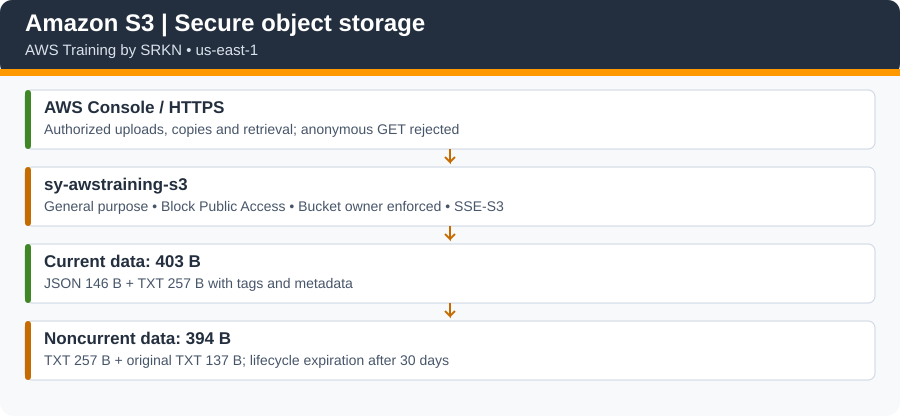</p>

| Resource | Configuration |
|---|---|
| Region | `us-east-1` (N. Virginia) |
| Bucket | `sy-awstraining-s3` |
| Namespace | Global |
| Bucket type | General purpose |
| Storage class | Standard |
| Ownership | Bucket owner enforced |
| Public access | Block all public access |
| Encryption | SSE-S3 |
| Final versioning | Enabled |
| Object Lock | Disabled |

No EC2 instance or VPC was required for this console-based storage implementation. The browser used AWS Console authorization to upload and retrieve objects, while the S3 endpoint handled the data requests. The bucket was the only newly provisioned storage resource; IAM policies were used as the authorization model, not newly created as part of this exercise.

The diagram depicts the final inventory after the metadata copy and recovery tests. The initial bucket was unversioned and empty; these controls and objects were added progressively.

## 03 Creating the Secure S3 Bucket

The purpose was to establish a private regional storage container before introducing object data. I started with managed encryption, disabled ACLs, blocked public access and deferred versioning until the recovery exercise.

### 3.1 Selecting the bucket type and Region

I started in the general purpose bucket inventory and chose **Create bucket**. A general purpose bucket supports the storage classes and versioning operations required for this implementation, unlike a specialized directory bucket.

<details>
<summary>Screenshot 01 — General purpose buckets dashboard and Create bucket action</summary>

<table><tr><td align="center"><a href="images/screenshot-01.png"></a></td></tr></table>

<p><sub><strong>Screenshot 01:</strong> General purpose buckets dashboard and Create bucket action.</sub></p>

</details>

In the creation form, I selected `us-east-1`, **General purpose**, and **Global namespace**. The global namespace requires a unique bucket name within the AWS partition; it does not make data globally public. The final lowercase name was `sy-awstraining-s3`.

<table><tr><td align="center"><a href="images/screenshot-02.png"></a></td></tr></table>

<p><sub><strong>Screenshot 02:</strong> Creation wizard with N. Virginia, general purpose type, global namespace and initial bucket name.</sub></p>

### 3.2 Configuring ownership and public access

I chose **ACLs disabled (Bucket owner enforced)** so that bucket ownership is consistent and access is managed through policies rather than per-object ACL grants. I left **Block all public access** selected to prevent public grants through ACLs and policies. These settings address authorization and ownership, not encryption.

<table><tr><td align="center"><a href="images/screenshot-03.png"></a></td></tr></table>

<p><sub><strong>Screenshot 03:</strong> Bucket owner enforced and all four public access blocks selected.</sub></p>

### 3.3 Choosing the initial protection settings

I deliberately started with versioning disabled so that the initial objects could later demonstrate the difference between unversioned and versioned writes. I left bucket tags empty and chose SSE-S3 for encryption at rest. The Bucket Key selection was enabled in the form, but has no SSE-S3 cost benefit.

| Initial setting | Selected value | Reason |
|---|---|---|
| Versioning | Disabled | Establish an unversioned baseline |
| Bucket tags | None | No bucket-level classification was needed |
| Default encryption | SSE-S3 | Encrypt new uploads without a customer-managed KMS key |
| Bucket Key | Enabled in form | Relevant to SSE-KMS, not SSE-S3 |

<details>
<summary>Screenshot 04 — Initial versioning disabled and SSE-S3 selected</summary>

<table><tr><td align="center"><a href="images/screenshot-04.png">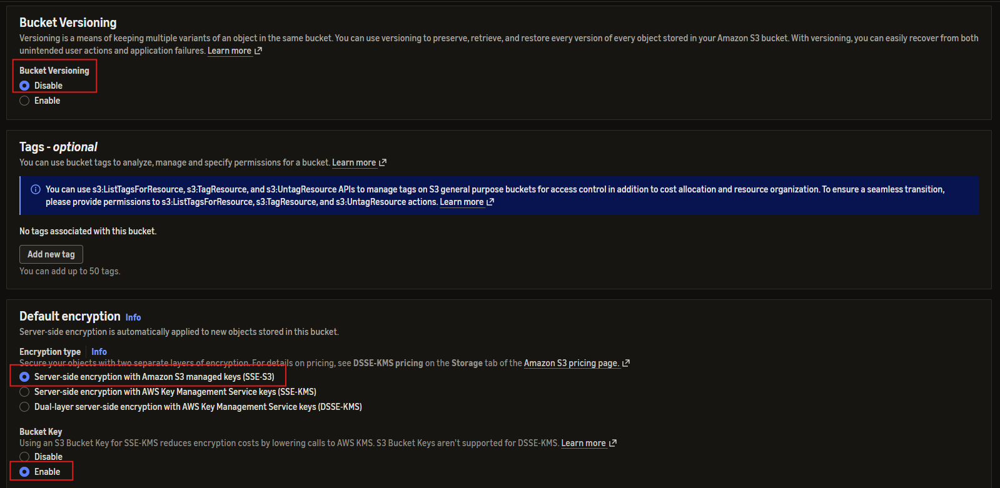</a></td></tr></table>

<p><sub><strong>Screenshot 04:</strong> Initial versioning disabled and SSE-S3 selected.</sub></p>

</details>

### 3.4 Verifying the bucket

The success banner identified the final bucket name and the Objects tab showed zero objects. This confirmed that bucket creation had completed before any test data was uploaded.

<table><tr><td align="center"><a href="images/screenshot-05.png"></a></td></tr></table>

<p><sub><strong>Screenshot 05:</strong> Successful creation of the empty sy-awstraining-s3 bucket.</sub></p>

> [!IMPORTANT]
> **SAA-C03 exam connection:** A globally named general purpose bucket has a unique name within its AWS partition. The bucket itself resides in a selected Region. Disabling ACLs does not disable authorized policy-based access.

## 04 Uploading Objects and Selecting Storage Classes

### 4.1 Preparing local test data

I used a plain-text configuration document and a JSON document to compare object types. The TXT file recorded the bucket name and storage purpose; the JSON file represented structured project information. Both contained nonsensitive sample data.

The initial TXT content was:

```text
AWS Training by SRKN

Amazon S3 Object Storage
Bucket: sy-awstraining-s3
Purpose: Object storage, security, and lifecycle management.
```

For a repeat implementation, the JSON can contain descriptive fields such as `project`, `activity`, `service`, `environment`, and `status`. The actual upload size is recorded below; an exact final JSON payload is not necessary to reproduce the storage behavior.

<details>
<summary>Screenshot 06 — Local TXT and JSON files prepared for upload</summary>

<table><tr><td align="center"><a href="images/screenshot-06.png"></a></td></tr></table>

<p><sub><strong>Screenshot 06:</strong> Local TXT and JSON files prepared for upload.</sub></p>

</details>

### 4.2 Staging the upload

From **Objects → Upload → Add files**, I selected both files without a destination prefix. Their names would become the object keys at the bucket root. The upload form identified the MIME types and reported 283 bytes in total; this was the pre-upload inventory, not yet a successful write.

<table><tr><td align="center"><a href="images/screenshot-07.png"></a></td></tr></table>

<p><sub><strong>Screenshot 07:</strong> Two files staged for upload to the bucket.</sub></p>

| Object | Content type | Size |
|---|---|---:|
| `Sy-S3-info.json` | application/json | 146 B |
| `Sy-S3-info.txt` | text/plain | 137 B |
| Total | | 283 B |

| Storage class | AZs | Minimum duration | Minimum billable object size | Access pattern |
|---|---:|---|---|---|
| Standard | 3+ | None | None | Frequent |
| Intelligent-Tiering | 3+ | None | None | Changing access; objects under 128 KB stay in frequent tier without monitoring fee |
| Standard-IA | 3+ | 30 days | 128 KB | Infrequent, immediate access |
| One Zone-IA | 1 | 30 days | 128 KB | Re-creatable, infrequent data |
| Glacier Instant Retrieval | 3+ | 90 days | 128 KB | Archive with immediate access |
| Glacier Flexible Retrieval | 3+ | 90 days | None; archival metadata overhead | Minutes to hours |
| Glacier Deep Archive | 3+ | 180 days | None; archival metadata overhead | Long-term archive, hours |
| Reduced Redundancy | 3+ | None | None | Legacy, not recommended |

Retrieval charges apply to IA and archive classes as applicable. S3 Express One Zone is a separate single-AZ, low-latency class for directory buckets and was not part of this general purpose upload selection.

### 4.3 Choosing a storage class

Under **Properties → Storage class**, I selected **Standard**. The workload consisted of tiny documents that would be read and overwritten during the exercise. A class with a 128 KB minimum billable size would charge for much more than either actual payload, and infrequent-access classes may also impose retrieval or early-deletion costs. The comparison above provides the criteria for choosing a class in a larger workload.

<table><tr><td align="center"><a href="images/screenshot-08.png">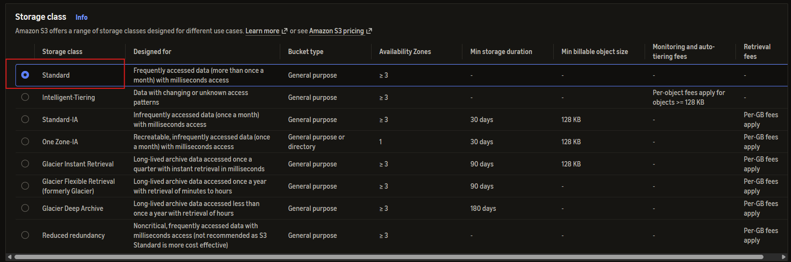</a></td></tr></table>

<p><sub><strong>Screenshot 08:</strong> Storage class comparison with Standard selected.</sub></p>

### 4.4 Verifying the upload

I submitted the upload and inspected the status page before closing it. The successful count was two, the failure count was zero, and the reported payload matched the staged 283 bytes. This establishes the initial data baseline for later versioning tests.

<table><tr><td align="center"><a href="images/screenshot-09.png"></a></td></tr></table>

<p><sub><strong>Screenshot 09:</strong> Both uploads succeeded, totaling 283 bytes.</sub></p>

> [!NOTE]
> Lower storage rates do not necessarily mean lower total cost. Minimum billable size, retrieval, transitions and retention charges matter, especially for small objects.

## 05 Inspecting Object Properties and Security

After uploading, I inspected the TXT object to establish its actual storage properties and security attributes. Bucket configuration defines defaults; the object properties show what was applied to the selected object.

| Attribute | Observed value |
|---|---|
| Key | `Sy-S3-info.txt` |
| Size | 137 B |
| S3 URI | `s3://sy-awstraining-s3/Sy-S3-info.txt` |
| ARN | `arn:aws:s3:::sy-awstraining-s3/Sy-S3-info.txt` |
| Object URL | `https://sy-awstraining-s3.s3.us-east-1.amazonaws.com/Sy-S3-info.txt` |
| ETag | `6a0e5e2caad8e5d48b2d726f8bf79f51` |
| Storage | Standard |
| Encryption | SSE-S3 |
| Checksum | CRC64NVME, full object |
| Content-Type | `text/plain` |
| Tags / annotations | 0 / 0 |

### 5.1 Understanding object identifiers

I opened the TXT object by its key. The overview identifies the object using an S3 URI for AWS tools, an ARN for policy resource scoping and an HTTPS URL for requests. None of these identifiers grants permission by itself. The original size and ETag provide useful points of comparison for later writes.

<table><tr><td align="center"><a href="images/screenshot-10.png">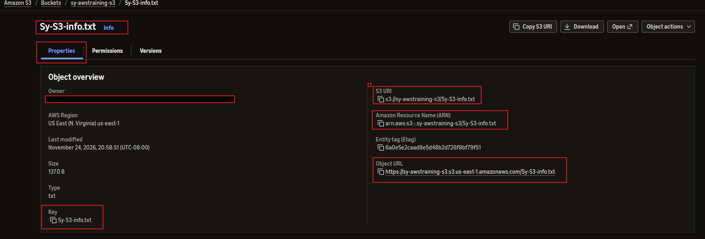</a></td></tr></table>

<p><sub><strong>Screenshot 10:</strong> TXT object overview with key, URI, ARN, ETag and URL.</sub></p>

### 5.2 Checking encryption and data integrity

The storage class and encryption sections confirmed Standard and SSE-S3 on the actual object, rather than merely on the bucket defaults. The CRC64NVME full-object checksum is a separate integrity attribute; encryption protects confidentiality at rest, and authorization controls who can retrieve the data. The checksum shown is not an independently performed download-integrity test.

<table><tr><td align="center"><a href="images/screenshot-11.png">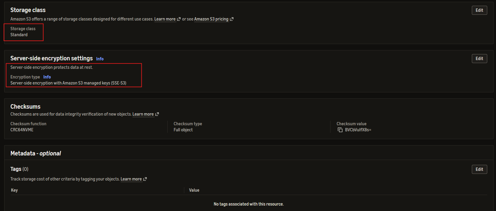</a></td></tr></table>

<p><sub><strong>Screenshot 11:</strong> Standard storage, SSE-S3, CRC64NVME and no tags.</sub></p>

### 5.3 Inspecting metadata

The metadata section showed a system-defined `Content-Type` of `text/plain` and no annotations. Content-Type tells a consuming application how to interpret the bytes; it does not change the bytes themselves. This is the baseline for the custom metadata operation later.

<details>
<summary>Screenshot 12 — System-defined Content-Type and no annotations</summary>

<table><tr><td align="center"><a href="images/screenshot-12.png"></a></td></tr></table>

<p><sub><strong>Screenshot 12:</strong> System-defined Content-Type and no annotations.</sub></p>

</details>

An ETag may be an MD5 digest for particular uploads but is not universally an MD5 checksum. For multipart or other encryption configurations, use the documented checksum mechanism rather than treating the ETag as a universal integrity proof.

## 06 Verifying Private and Signed Access

The access tests compared an unsigned request, an authorized signed request and an expired signed request against the same private object. This models a common application requirement: temporary document delivery without public bucket access.

### 6.1 Testing an unsigned request

I copied the Object URL into a browser and received an XML `AccessDenied` response. An ordinary URL without a valid authorization signature is not equivalent to an authenticated S3 API request. This test confirmed denial for the specific unsigned request without requiring any change to public access settings.

<table><tr><td align="center"><a href="images/screenshot-13.png"></a></td></tr></table>

<p><sub><strong>Screenshot 13:</strong> Unsigned object URL returned AccessDenied.</sub></p>

### 6.2 Retrieving the private object

I returned to the authenticated Console and chose **Open**. The Console issued a signed URL, and the browser displayed the expected text. This demonstrated that permitted access still works even when anonymous retrieval is blocked.

<table><tr><td align="center"><a href="images/screenshot-14.png">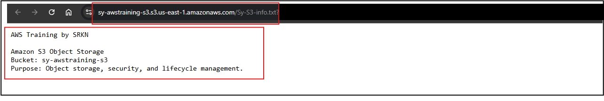</a></td></tr></table>

<p><sub><strong>Screenshot 14:</strong> Successful signed retrieval of the TXT object.</sub></p>

### 6.3 Checking signed-request expiration

A later signed request returned `Request has expired`, with a 300-second expiry parameter. This distinguishes an expired authorization from the initial unsigned denial. The result verifies the observed expiry behavior, not a separate, independently captured URL-sharing configuration.

<table><tr><td align="center"><a href="images/screenshot-15.png"></a></td></tr></table>

<p><sub><strong>Screenshot 15:</strong> Expired signed request rejected after its 300-second validity.</sub></p>

<p align="center">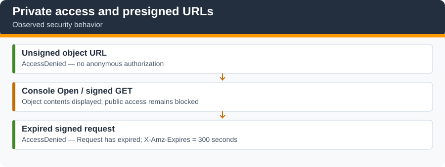</p>

Presigned URLs provide temporary access to a specific operation using the signer's authorization. They can be used by anyone holding the valid URL and may expire sooner if the signing credentials expire. They are useful for temporary private document delivery; they should be treated as bearer credentials.

> [!IMPORTANT]
> Block Public Access does not prevent authorized signed requests. Public exposure is not required for controlled object sharing.

## 07 Renaming an Object

The rename exercise demonstrated how object identity changes when a key changes, without changing the intended document contents. The bucket was still unversioned.

### 7.1 Starting the rename

I opened the original TXT object and selected **Object actions → Rename object**. In a general purpose bucket, the new name is a new key; changing it requires a copy followed by deletion of the old key.

<details>
<summary>Screenshot 16 — Object actions menu with Rename object</summary>

<table><tr><td align="center"><a href="images/screenshot-16.png"></a></td></tr></table>

<p><sub><strong>Screenshot 16:</strong> Object actions menu with Rename object.</sub></p>

</details>

### 7.2 Preserving object settings

I entered `Sy-S3-storage-info.txt` and selected **Copy source settings** rather than explicitly replacing storage, metadata or encryption. This was intended to keep the object configuration consistent while changing only its key.

<details>
<summary>Screenshot 17 — New object name and Copy source settings</summary>

<table><tr><td align="center"><a href="images/screenshot-17.png">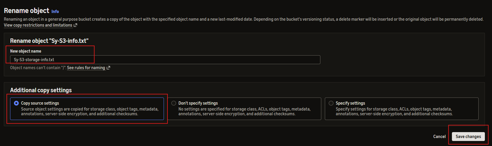</a></td></tr></table>

<p><sub><strong>Screenshot 17:</strong> New object name and Copy source settings.</sub></p>

</details>

### 7.3 Verifying the new key

After saving, I checked the success notification and object list. The renamed TXT object still measured 137 bytes and the JSON object remained unchanged. The new last-modified timestamp is consistent with a new copy. The original key was absent from the unversioned inventory.

<table><tr><td align="center"><a href="images/screenshot-18.png"></a></td></tr></table>

<p><sub><strong>Screenshot 18:</strong> Successful rename and two-object inventory.</sub></p>

<p align="center">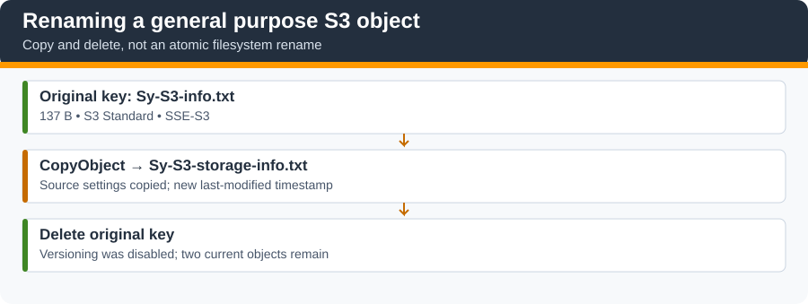</p>

In a general purpose bucket, renaming is a copy followed by deletion of the original key. It is not an atomic rename. Because versioning was disabled at this point, the original key was removed rather than hidden by a delete marker.

## 08 Enabling Versioning and Updating Data

The objective was to protect against accidental overwrites. Versioning maintains complete objects under a single key, so an update does not have to destroy the previous data.

### 8.1 Establishing the original versioning state

Before editing the bucket, I opened **Properties → Bucket Versioning** and confirmed it was Disabled. MFA Delete was also disabled. The baseline matters because objects created in an unversioned bucket carry a `null` version ID.

<details>
<summary>Screenshot 19 — Bucket Versioning initially disabled</summary>

<table><tr><td align="center"><a href="images/screenshot-19.png"></a></td></tr></table>

<p><sub><strong>Screenshot 19:</strong> Bucket Versioning initially disabled.</sub></p>

</details>

### 8.2 Enabling versioning

I selected **Edit → Enable → Save changes**. This is a bucket-wide setting rather than a per-object option. I left MFA Delete unchanged; versioning alone is not immutable retention.

<details>
<summary>Screenshot 20 — Enable selected in the versioning editor</summary>

<table><tr><td align="center"><a href="images/screenshot-20.png">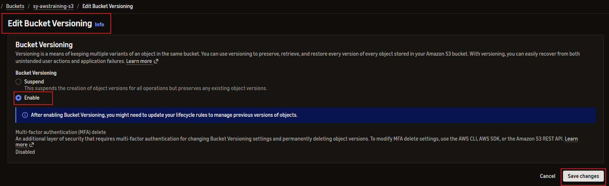</a></td></tr></table>

<p><sub><strong>Screenshot 20:</strong> Enable selected in the versioning editor.</sub></p>

</details>

The bucket properties then displayed Enabled. This confirmed the setting was saved. Existing objects retain their `null` IDs; subsequent writes can receive new unique IDs. AWS recommends a 15-minute propagation allowance before writes after first enabling versioning.

<table><tr><td align="center"><a href="images/screenshot-21.png">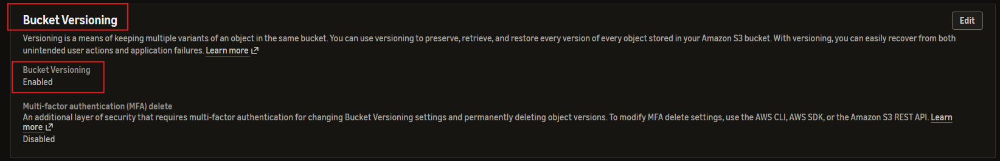</a></td></tr></table>

<p><sub><strong>Screenshot 21:</strong> Bucket Versioning enabled.</sub></p>

The updated document retained the original purpose and added a document version and storage configuration:

```text
AWS Training by SRKN

Amazon S3 Object Storage
Bucket: sy-awstraining-s3
Purpose: Object storage, security, and lifecycle management.

Document Version: 2
Bucket Versioning: Enabled
Encryption: SSE-S3
Storage Class: Standard
Public Access: Blocked
```

### 8.3 Updating the document under the existing key

I prepared the updated document shown above, adding version and configuration information. I selected the same exact filename as the existing S3 key; a different key would create an independent object instead of a new version.

<table><tr><td align="center"><a href="images/screenshot-22.png">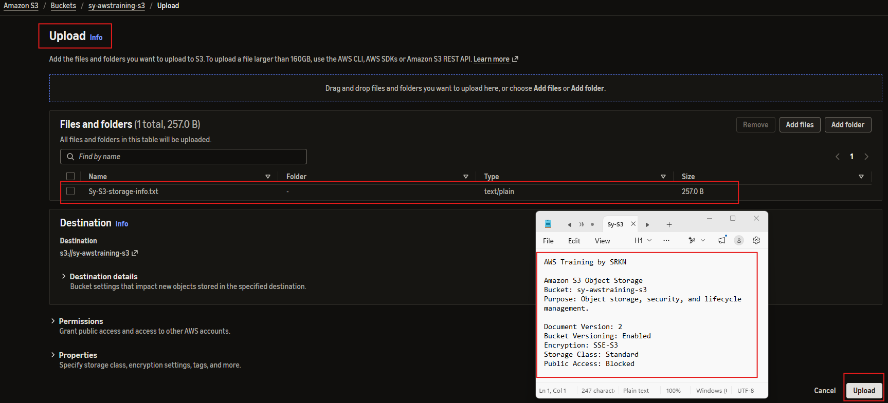</a></td></tr></table>

<p><sub><strong>Screenshot 22:</strong> Updated 257-byte document staged under the same key.</sub></p>

The upload status reported one successful 257-byte file and zero failures. The content update was complete; the next check establishes whether the original data remained stored.

<details>
<summary>Screenshot 23 — Updated document upload succeeded</summary>

<table><tr><td align="center"><a href="images/screenshot-23.png"></a></td></tr></table>

<p><sub><strong>Screenshot 23:</strong> Updated document upload succeeded.</sub></p>

</details>

### 8.4 Verifying the version inventory

On the Objects tab I enabled **Show versions**. The current 257-byte TXT entry had a unique S3 version ID, while the original 137-byte entry had `null`. The unchanged 146-byte JSON object also had `null`. The resulting 540 bytes included the earlier version, not just the latest contents.

<table><tr><td align="center"><a href="images/screenshot-24.png">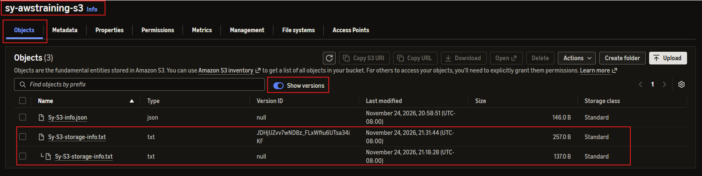</a></td></tr></table>

<p><sub><strong>Screenshot 24:</strong> Current and original TXT versions visible in inventory.</sub></p>

> [!IMPORTANT]
> S3 stores full versions, not differences. A versioning-enabled bucket can be suspended but cannot return to its initial unversioned state.

## 09 Deletion and Object Recovery

I simulated accidental deletion of the updated TXT document, then restored the current version by removing only its delete marker. This is a logical-deletion recovery exercise rather than a backup restore from another bucket.

### 9.1 Creating a delete marker

I turned **Show versions** off before selecting the TXT key. This ensured that the deletion targeted the ordinary current-key view rather than an explicitly selected data version.

<details>
<summary>Screenshot 25 — TXT selected for ordinary deletion with Show versions off</summary>

<table><tr><td align="center"><a href="images/screenshot-25.png">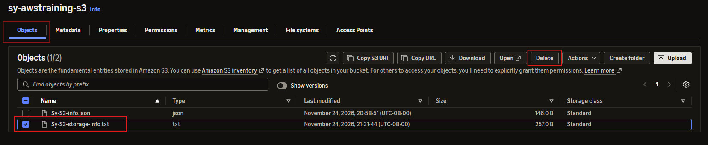</a></td></tr></table>

<p><sub><strong>Screenshot 25:</strong> TXT selected for ordinary deletion with Show versions off.</sub></p>

</details>

On the confirmation page, the Console indicated that a delete marker would be added. I typed `delete` and submitted the operation for the TXT key only; the JSON object was not selected.

<details>
<summary>Screenshot 26 — Deletion confirmation explaining delete marker creation</summary>

<table><tr><td align="center"><a href="images/screenshot-26.png">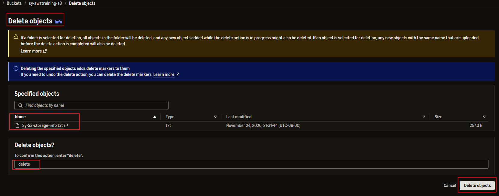</a></td></tr></table>

<p><sub><strong>Screenshot 26:</strong> Deletion confirmation explaining delete marker creation.</sub></p>

</details>

The success message explicitly reported that a delete marker was added and previous versions were retained. The displayed 257-byte deletion result therefore represents logical removal from the current view, not deletion of those data bytes.

<details>
<summary>Screenshot 27 — Successful logical deletion with previous versions retained</summary>

<table><tr><td align="center"><a href="images/screenshot-27.png">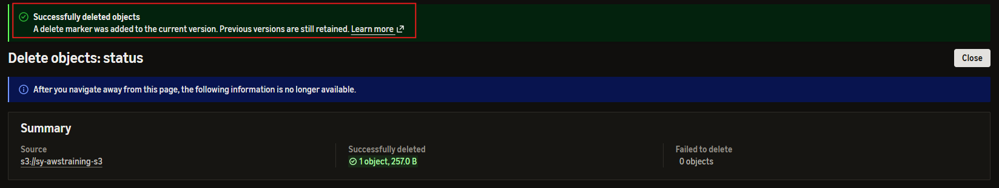</a></td></tr></table>

<p><sub><strong>Screenshot 27:</strong> Successful logical deletion with previous versions retained.</sub></p>

</details>

I enabled **Show versions** again and checked the actual inventory: a current delete marker, the 257-byte version and the original 137-byte version were all present. This independently corroborated the deletion status.

<table><tr><td align="center"><a href="images/screenshot-28.png">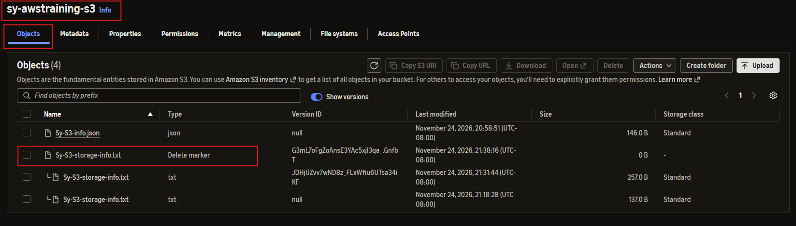</a></td></tr></table>

<p><sub><strong>Screenshot 28:</strong> Current delete marker and two preserved TXT versions.</sub></p>

The version inventory showed a current 0-byte delete marker and both retained data versions. The ordinary deletion hid the object without removing its 257-byte and 137-byte contents. Delete markers have storage overhead based on their key length even when displayed as 0 B.

### 9.2 Recovering the current version

To reverse the logical deletion, I kept **Show versions** enabled and selected only the row marked **Delete marker**, with a displayed size of 0 B. Neither TXT data version was selected.

<details>
<summary>Screenshot 29 — Only the delete marker selected for removal</summary>

<table><tr><td align="center"><a href="images/screenshot-29.png"></a></td></tr></table>

<p><sub><strong>Screenshot 29:</strong> Only the delete marker selected for removal.</sub></p>

</details>

The confirmation screen identified a specific marker version ID. I entered `permanently delete` only after confirming the selected type was Delete marker. Permanently deleting a data version instead would remove that data.

<details>
<summary>Screenshot 30 — Permanent deletion confirmation for the marker</summary>

<table><tr><td align="center"><a href="images/screenshot-30.png">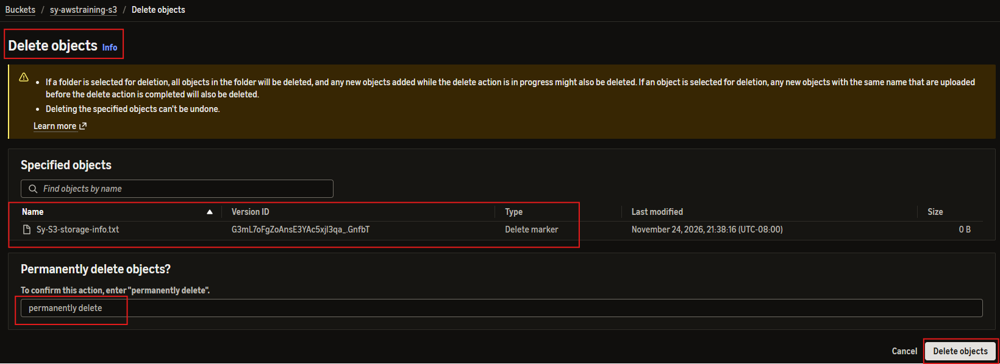</a></td></tr></table>

<p><sub><strong>Screenshot 30:</strong> Permanent deletion confirmation for the marker.</sub></p>

</details>

The operation reported one successful deletion and zero failures. In this case the deleted entry was the marker, not an object payload.

<details>
<summary>Screenshot 31 — Delete marker removal succeeded</summary>

<table><tr><td align="center"><a href="images/screenshot-31.png">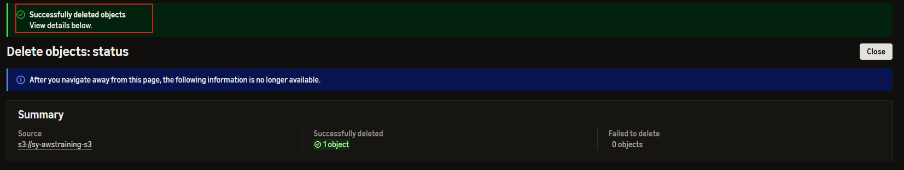</a></td></tr></table>

<p><sub><strong>Screenshot 31:</strong> Delete marker removal succeeded.</sub></p>

</details>

The version inventory then displayed the 257-byte data version at the top of the TXT key, with the original 137-byte version still underneath. No replacement upload was needed, and the inventory returned to 540 bytes of payload.

<table><tr><td align="center"><a href="images/screenshot-32.png"></a></td></tr></table>

<p><sub><strong>Screenshot 32:</strong> Restored current version and retained original version.</sub></p>

<p align="center"></p>

Recovery was verified through the version inventory; a separate post-recovery retrieval of the file contents was not captured. Versioning is not immutable storage: an authorized permanent deletion of a specific data version cannot be reversed through versioning alone. Object Lock can provide retention protection where required.

## 10 Configuring Lifecycle Management

Lifecycle rules automate storage transitions, expiration and cleanup. For this small-object workload, I configured retention of previous versions rather than archival transitions.

### 10.1 Opening lifecycle configuration

I opened **Management → Create lifecycle rule**. The initial list showed no lifecycle rules. I chose a single bucket-wide rule to manage obsolete versions and unfinished uploads without introducing archival transitions.

<details>
<summary>Screenshot 33 — Management tab before lifecycle rule creation</summary>

<table><tr><td align="center"><a href="images/screenshot-33.png">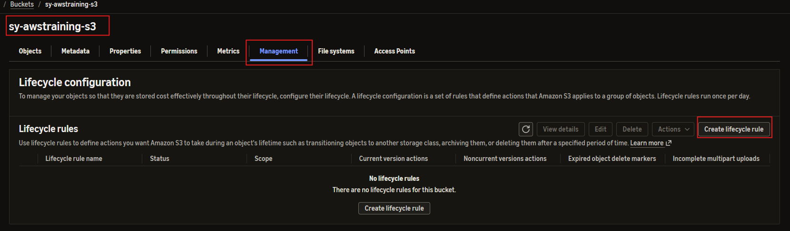</a></td></tr></table>

<p><sub><strong>Screenshot 33:</strong> Management tab before lifecycle rule creation.</sub></p>

</details>

| Rule setting | Configured value |
|---|---|
| Name | `S3-Object-Retention-Policy` |
| Scope | Entire bucket |
| Current version actions | None |
| Noncurrent version expiration | 30 days after becoming noncurrent |
| Number of newer versions to retain | Not specified |
| Expired delete marker removal | Enabled |
| Abort incomplete multipart uploads | After 7 days |
| Storage transitions | None |

### 10.2 Defining scope and actions

I named the rule `S3-Object-Retention-Policy`, selected all objects and acknowledged the scope. I enabled noncurrent-version deletion and cleanup of expired markers or incomplete multipart uploads. I left transitions and current-version expiration unchecked so active data would remain available.

<details>
<summary>Screenshot 34 — Lifecycle rule name, scope and selected actions</summary>

<table><tr><td align="center"><a href="images/screenshot-34.png"></a></td></tr></table>

<p><sub><strong>Screenshot 34:</strong> Lifecycle rule name, scope and selected actions.</sub></p>

</details>

### 10.3 Defining retention periods

I entered 30 days for noncurrent versions and left the optional newer-version count empty. I enabled expired delete marker cleanup and set incomplete multipart uploads to seven days. These are separate timers: the first is relative to a version becoming noncurrent; the second is relative to initiation of an unfinished multipart upload.

<table><tr><td align="center"><a href="images/screenshot-35.png"></a></td></tr></table>

<p><sub><strong>Screenshot 35:</strong> 30-day noncurrent retention and seven-day multipart cleanup.</sub></p>

### 10.4 Verifying the lifecycle rule

After creating the rule, I checked the success notification and the Enabled row. The scope and action columns matched the configuration. The displayed 128 KB minimum applies to default storage transitions, not to noncurrent-version expiration.

<table><tr><td align="center"><a href="images/screenshot-36.png"></a></td></tr></table>

<p><sub><strong>Screenshot 36:</strong> Enabled lifecycle rule successfully created.</sub></p>

<p align="center">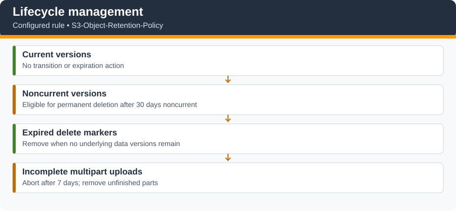</p>

The 30-day period is based on when a version becomes noncurrent. Eligible actions are asynchronous. The default 128 KB transition threshold does not block expiration of smaller objects. Automatic expiration was not observed during this short implementation.

### 10.5 Example production tiering

<p align="center"></p>

This is a design example, not a rule applied to this bucket. A production workload could start in Standard, move qualifying data to an infrequent-access class as access declines, and eventually archive records before a business-approved expiration date. The example applies to eligible objects only. Transition fees, retrieval costs, minimum durations and business retention requirements must be evaluated before adopting it.

> [!IMPORTANT]
> **SAA-C03 exam connection:** Expiring a current object in a versioned bucket generally creates a delete marker; noncurrent version expiration is needed to remove historical data. A lifecycle rule that deletes noncurrent versions is destructive once the retention window ends.

## 11 Applying Object Tags and Metadata

Tags and metadata are both key-value attributes but serve different purposes. Tags support classification and policy or lifecycle filters, whereas metadata describes the object for consuming applications. I tested both update mechanisms on the same current TXT version.

### 11.1 Object tagging

| Key | Value |
|---|---|
| Project | SY-AWS-Training |
| Environment | Training |
| DataClassification | NonSensitive |
| Purpose | ObjectStorage |

From the current TXT object, I selected **Metadata → Tags → Edit**, entered the four pairs above, and saved. The selected object was the 257-byte version. These tags classify the object independently of its file contents.

<details>
<summary>Screenshot 37 — Four object tags configured for the current TXT</summary>

<table><tr><td align="center"><a href="images/screenshot-37.png"></a></td></tr></table>

<p><sub><strong>Screenshot 37:</strong> Four object tags configured for the current TXT.</sub></p>

</details>

I reopened the metadata view and verified that the four tags persisted. The system-defined metadata still contained only Content-Type. This demonstrates that changing object tags does not require rewriting the data or replacing metadata.

<table><tr><td align="center"><a href="images/screenshot-38.png">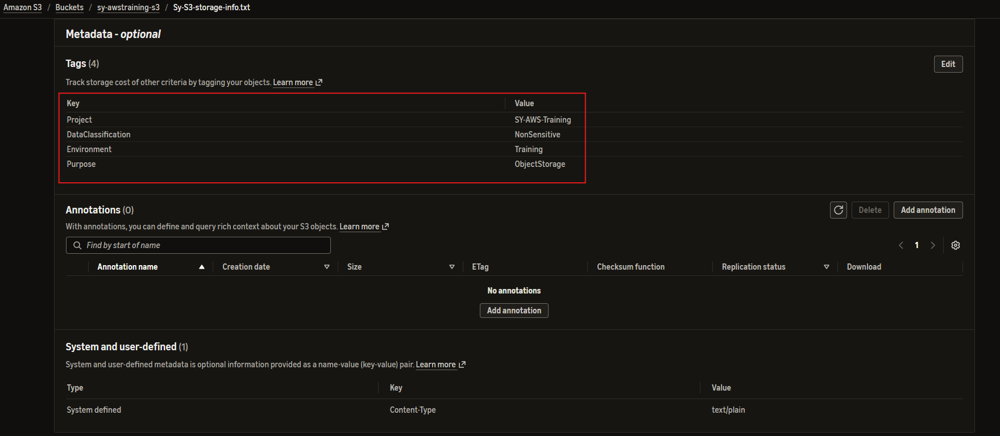</a></td></tr></table>

<p><sub><strong>Screenshot 38:</strong> Saved tags and existing Content-Type metadata.</sub></p>

Object tags support classification, lifecycle filtering and policy conditions; they do not enforce authorization by themselves. Tag updates do not create a new object version. Tags belong to specific versions; up to ten tags can be assigned per object.

### 11.2 Replacing metadata with a same-key copy

I opened **Object actions → Copy**, supplied `s3://sy-awstraining-s3/` with no prefix, and chose **Specify settings**. Using the original destination key allows the copy to replace metadata while retaining the logical object name. The destination showed versioning enabled and Object Lock disabled.

<details>
<summary>Screenshot 39 — Same-bucket copy destination and Specify settings</summary>

<table><tr><td align="center"><a href="images/screenshot-39.png"></a></td></tr></table>

<p><sub><strong>Screenshot 39:</strong> Same-bucket copy destination and Specify settings.</sub></p>

</details>

I selected **Copy existing storage class**, **Copy existing encryption settings**, and **Copy existing checksum functions**. These selections retained the intended storage and protection configuration rather than introducing an unrelated change.

<details>
<summary>Screenshot 40 — Existing storage class, encryption and checksum function selected for copying</summary>

<table><tr><td align="center"><a href="images/screenshot-40.png">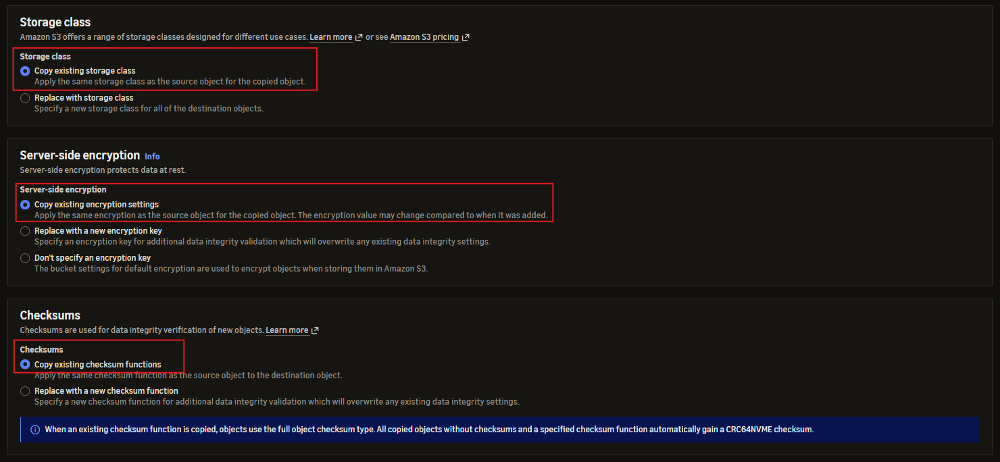</a></td></tr></table>

<p><sub><strong>Screenshot 40:</strong> Existing storage class, encryption and checksum function selected for copying.</sub></p>

</details>

| Type | Key | Value |
|---|---|---|
| System defined | Content-Type | text/plain |
| User defined | x-amz-meta-author | SRKN |
| User defined | x-amz-meta-project | SY-AWS-Training |
| User defined | x-amz-meta-document-version | 2 |
| User defined | x-amz-meta-description | Amazon S3 storage configuration |

I chose **Copy existing tags** and **Replace all metadata**. Because the metadata replacement is a complete replacement, I included the existing `Content-Type: text/plain` as well as four custom `x-amz-meta-` attributes. The custom document version remained `2` because the document bytes were not being revised.

<table><tr><td align="center"><a href="images/screenshot-41.png">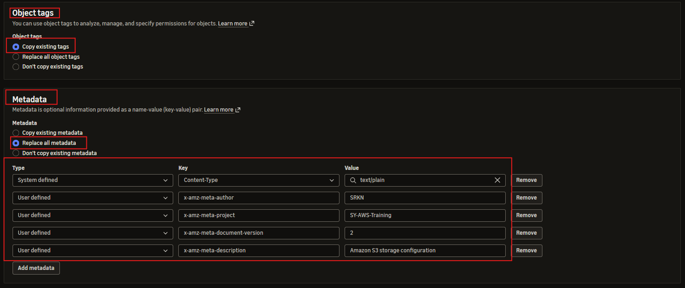</a></td></tr></table>

<p><sub><strong>Screenshot 41:</strong> Existing tags copied and five metadata entries configured.</sub></p>

### 11.3 Verifying the copy and resulting version

The copy status reported one successful 257-byte object and zero failures. This confirmed the write, but the inventory and object properties were needed to establish its version and metadata outcomes.

<details>
<summary>Screenshot 42 — Successful 257-byte copy with no failures</summary>

<table><tr><td align="center"><a href="images/screenshot-42.png">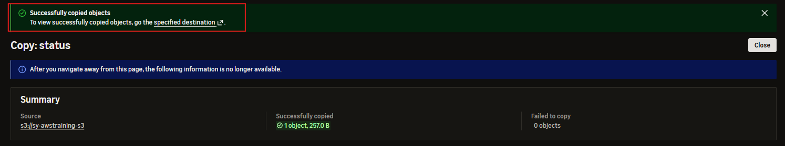</a></td></tr></table>

<p><sub><strong>Screenshot 42:</strong> Successful 257-byte copy with no failures.</sub></p>

</details>

With **Show versions** enabled, the inventory showed a new unique version ID for a third TXT version, alongside the prior 257-byte version and the 137-byte original. The JSON object was unchanged. The extra version increased payload from 540 to 797 bytes.

<table><tr><td align="center"><a href="images/screenshot-43.png">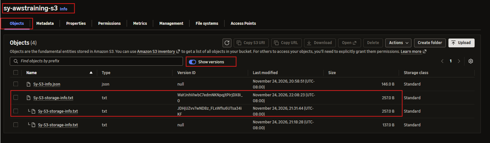</a></td></tr></table>

<p><sub><strong>Screenshot 43:</strong> Three TXT versions and one JSON version in inventory.</sub></p>

I opened the current TXT object and checked the metadata section. All four object tags remained present; the table showed five metadata entries, one system-defined and four user-defined. This establishes that the copy applied the requested metadata rather than only creating another version.

<table><tr><td align="center"><a href="images/screenshot-44.png">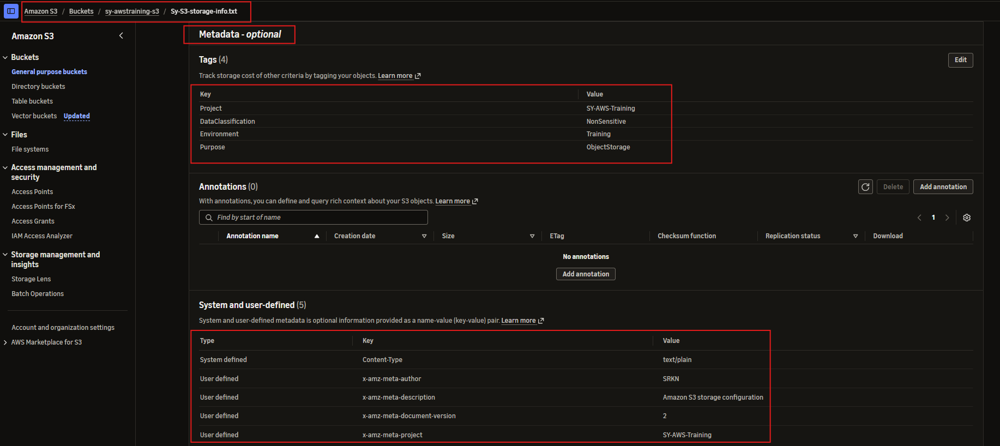</a></td></tr></table>

<p><sub><strong>Screenshot 44:</strong> Saved four tags and five metadata entries.</sub></p>

<p align="center">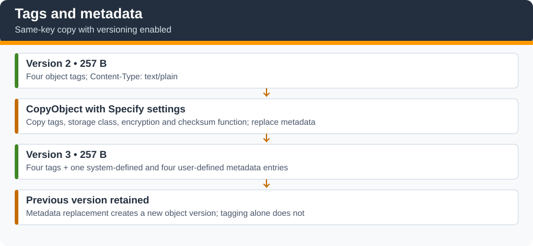</p>

| Attribute type | Typical purpose | Update behavior |
|---|---|---|
| Bucket tags | Resource organization and activated cost allocation | Bucket configuration |
| Object tags | Classification, filtering, policy conditions | Independent of object data |
| User-defined metadata | Application attributes returned in HTTP headers | Copy or replace object |
| Annotations | Additional object context | Not used in this implementation |

Document version 2 is an application-level label; the new S3 version ID is independently assigned. User-defined metadata is limited to 2 KB in the PUT request.

> [!IMPORTANT]
> **SAA-C03 exam connection:** Modifying tags can be independent of object data. Changing user-defined metadata requires a copy or replacement, so in a versioned bucket it can create another billable full object version even if the payload is unchanged.

## 12 Final Security Review and Resource State

The final review focused on bucket-level public access and ownership. The full bucket policy and CORS settings were not independently established.

### 12.1 Checking public-access protections

I returned to the bucket **Permissions** tab and confirmed **Block all public access: On**. The bucket policy panel also displayed the public-access-block notice. This is a configuration review complementary to the earlier unsigned-request test; it is not a complete policy or external-access audit.

<table><tr><td align="center"><a href="images/screenshot-45.png"></a></td></tr></table>

<p><sub><strong>Screenshot 45:</strong> Final Permissions overview and Block Public Access on.</sub></p>

### 12.2 Checking ownership and ACL behavior

Object Ownership still showed **Bucket owner enforced** and the ACL section was disabled. The displayed entries for Everyone, Authenticated users and S3 log delivery had no grants. With ACLs disabled, the displayed owner ACL entries do not function as independent access grants.

<table><tr><td align="center"><a href="images/screenshot-46.png">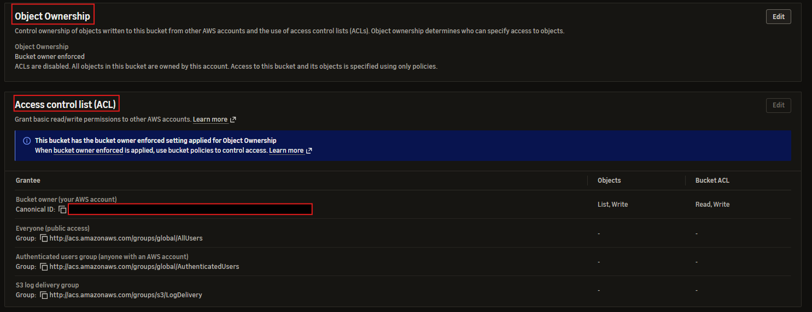</a></td></tr></table>

<p><sub><strong>Screenshot 46:</strong> Bucket owner enforced and ACLs disabled.</sub></p>

| Control | Role |
|---|---|
| IAM and bucket policies | Authorize requests |
| Block Public Access | Restrict public grants |
| Object Ownership | Disable ACL-based authorization and enforce bucket ownership |
| SSE-S3 | Encrypt data at rest |
| HTTPS | Encrypt data in transit |
| Versioning | Preserve recoverable versions |
| Lifecycle | Manage retention and cleanup |

### 12.3 Final inventory

| Object | Version | Status | Payload |
|---|---|---|---:|
| `Sy-S3-info.json` | null | Current | 146 B |
| `Sy-S3-storage-info.txt` | Metadata copy | Current | 257 B |
| `Sy-S3-storage-info.txt` | Content update | Noncurrent | 257 B |
| `Sy-S3-storage-info.txt` | null | Noncurrent | 137 B |
| **Total** | | | **797 B** |

<p align="center">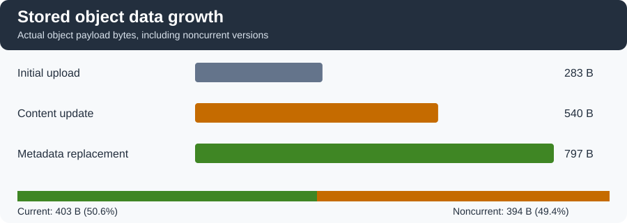</p>

### 12.4 Resource retention and teardown

I retained the bucket, four stored data versions and enabled lifecycle rule for the following KMS and CloudTrail implementation. No teardown was performed at this checkpoint.

When that dependent work is finished, stop any log delivery or other writes to this bucket, confirm that no required data remains, then use **S3 → General purpose buckets → select `sy-awstraining-s3` → Empty** to remove all versions and delete markers. Verify the empty inventory before deleting the bucket. The lifecycle rule is not a substitute for explicitly emptying a versioned bucket during teardown.

## 13 SAA-C03 Review and Production Design

### 13.1 Architectural decisions

| Exam concept | Architectural decision |
|---|---|
| Object versus block/file storage | Choose S3 for API-accessed objects, EBS for disks and EFS for shared files |
| Access authorization | Prefer least privilege and private buckets; use signed requests for temporary sharing |
| Encryption | SSE-S3 for simple managed encryption; SSE-KMS for additional key policy and audit controls |
| Storage tiering | Compare access frequency, size, resilience and retrieval costs |
| Versioning | Recover ordinary deletions by removing the current delete marker |
| Lifecycle | Expire obsolete versions and abort incomplete multipart uploads |
| Immutable retention | Evaluate Object Lock for regulated retention and deletion protection |

### 13.2 Knowledge check

> [!TIP]
> **Q1. Does an S3 object URL grant access?** No. The request must be authorized; the unsigned request in this exercise was denied.
>
> **Q2. Why did the metadata-only change increase storage?** A same-key copy created a complete new version in the versioned bucket.
>
> **Q3. Why was Standard preferred to Standard-IA?** Small frequently accessed objects would face minimum billable size and retrieval considerations in IA.
>
> **Q4. How can a logically deleted object be restored?** Remove its current delete marker by version ID, preserving the underlying data versions.
>
> **Q5. Does enabling SSE-S3 make data private?** No. Encryption at rest and request authorization are different mechanisms.

### 13.3 Production considerations

For production, scope IAM permissions narrowly, enforce TLS where appropriate, review access findings, monitor object-level activity with explicitly configured CloudTrail data events when needed, and establish retention based on recovery and compliance requirements. Cross-Region replication or backups may be appropriate for additional recovery objectives; neither was implemented here.

## 14 AWS Cost Estimate — Monthly Usage Scenario

S3 has no EC2-style hourly bucket charge. The following 730-hour month scenario assumes the final 797-byte payload and eight tags across the two tagged TXT versions remain stored throughout the month, 100 PUT/COPY/LIST-class requests and 100 GET-class requests. The eight tags are a modeled full-month inventory: four were verified on the current version and four on the preceding version before the copy. These are illustrative request counts, not measured usage. Rates are for US East (N. Virginia), before credits or request free-tier allowances.

| Component | Calculation | Estimated monthly cost |
|---|---|---:|
| General purpose bucket | No separate bucket fee | $0 |
| S3 Standard payload | 797 / 1,073,741,824 × $0.023 per GB-month | $0.000000017 |
| PUT/COPY/LIST | 100 × $0.005 / 1,000 | $0.000500 |
| GET | 100 × $0.0004 / 1,000 | $0.000040 |
| Object tags | 8 × $0.0065 / 10,000 | $0.0000052 |
| Versioning and lifecycle configuration | No separate configuration fee | $0 |
| SSE-S3 | No separate encryption charge | $0 |
| DELETE | No request charge | $0 |
| Internet transfer | Assumed within applicable free transfer allowance | $0 |
| **Total** | | **$0.000545 (less than $0.01)** |

The full-month storage and tag assumption is a simplified upper inventory scenario; the configured lifecycle rule may remove older versions. Other request classes, metadata overhead, monitoring, data transfer beyond allowances and optional services are not quantified. No customer-managed KMS key was created in this activity. Actual charges should be checked in Cost Explorer.

**Cost controls:** Standard for tiny objects, noncurrent version expiration, incomplete multipart cleanup and avoiding unnecessary storage transitions. Pricing: [Amazon S3 pricing](https://aws.amazon.com/s3/pricing/) and [object tag pricing update](https://aws.amazon.com/about-aws/whats-new/2025/03/amazon-s3-reduces-pricing-object-tagging/).

## 15 Results and Conclusion

| Validation | Observed outcome |
|---|---|
| Bucket creation and uploads | Private general purpose bucket; two successful initial uploads |
| Object properties | Standard, SSE-S3 and full-object checksum verified |
| Access | Unsigned request denied; signed access succeeded; expired request denied |
| Rename | New key present; original key absent |
| Versioning | Original and updated versions retained |
| Deletion and recovery | Delete marker created and removed; previous version restored |
| Lifecycle | Enabled 30-day noncurrent expiration and seven-day multipart cleanup |
| Tagging and metadata | Four tags and five metadata entries verified |
| Final inventory | Two current objects, two noncurrent versions; 797 B |

I implemented and verified a secure, versioned object storage environment with controlled access, recoverable data and automated retention configuration. The exercise demonstrated the relationship between security controls, object versions, metadata changes and storage costs. The retained bucket provides the foundation for the next encryption and auditing implementation.

## Technical Competencies

| Skill | Demonstrated work |
|---|---|
| Amazon S3 | Created and configured a general purpose bucket and managed objects |
| Storage architecture | Compared classes and selected Standard for the workload |
| Security | Verified private access, signed retrieval and expiration |
| Data protection | Enabled versioning and recovered an object using its delete marker |
| Lifecycle governance | Configured retention and multipart cleanup |
| Metadata management | Applied tags and custom metadata through a same-key copy |
| Cost optimization | Accounted for retained versions, requests and tags |
| Verification | Inspected actual console outcomes and final inventory |

## AWS Documentation

- [Amazon S3 User Guide](https://docs.aws.amazon.com/AmazonS3/latest/userguide/Welcome.html)
- [Storage classes](https://docs.aws.amazon.com/AmazonS3/latest/userguide/storage-class-intro.html)
- [Block Public Access](https://docs.aws.amazon.com/AmazonS3/latest/userguide/access-control-block-public-access.html)
- [Presigned URLs](https://docs.aws.amazon.com/AmazonS3/latest/userguide/using-presigned-url.html)
- [Copying and renaming objects](https://docs.aws.amazon.com/AmazonS3/latest/userguide/copy-object.html)
- [Versioning](https://docs.aws.amazon.com/AmazonS3/latest/userguide/Versioning.html)
- [Delete markers](https://docs.aws.amazon.com/AmazonS3/latest/userguide/ManagingDelMarkers.html)
- [Lifecycle configuration](https://docs.aws.amazon.com/AmazonS3/latest/userguide/intro-lifecycle-rules.html)
- [Lifecycle transition considerations](https://docs.aws.amazon.com/AmazonS3/latest/userguide/lifecycle-transition-general-considerations.html)
- [Editing object metadata](https://docs.aws.amazon.com/AmazonS3/latest/userguide/add-object-metadata.html)
- [Object metadata](https://docs.aws.amazon.com/AmazonS3/latest/userguide/UsingMetadata.html)
- [S3 pricing](https://aws.amazon.com/s3/pricing/)

---

**AWS Training by SRKN** · Hands-on AWS Cloud Engineering · AWS Solutions Architect Associate (SAA-C03)
