<p align="center">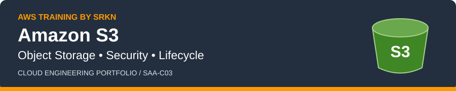</p>

# Amazon S3 — Object Storage, Security & Lifecycle Management
**AMAZON S3 / OBJECT STORAGE / IAM / SSE-S3 / VERSIONING / LIFECYCLE / METADATA**

Amazon Simple Storage Service (Amazon S3) provides scalable object storage for applications, backups, analytics, media and long-term archives. It combines API-based access with configurable storage classes, authorization, encryption, versioning and lifecycle management.

I implemented a private general purpose S3 bucket in US East (N. Virginia), verified object access and encryption, demonstrated version recovery, and configured automated retention. I also applied object tags and custom metadata and examined how versioning affects storage consumption.

---

## Contents

- [01 Purpose and Learning Objectives](#01-purpose-and-learning-objectives)
- [02 Core Concepts and Architecture](#02-core-concepts-and-architecture)
- [03 Creating the Secure S3 Bucket](#03-creating-the-secure-s3-bucket)
- [04 Uploading Objects and Selecting Storage Classes](#04-uploading-objects-and-selecting-storage-classes)
- [05 Inspecting Object Properties and Security](#05-inspecting-object-properties-and-security)
- [06 Verifying Private and Signed Access](#06-verifying-private-and-signed-access)
- [07 Renaming an Object](#07-renaming-an-object)
- [08 Enabling Versioning and Updating Data](#08-enabling-versioning-and-updating-data)
- [09 Deletion and Object Recovery](#09-deletion-and-object-recovery)
- [10 Configuring Lifecycle Management](#10-configuring-lifecycle-management)
- [11 Applying Object Tags and Metadata](#11-applying-object-tags-and-metadata)
- [12 Final Security Review and Resource State](#12-final-security-review-and-resource-state)
- [13 SAA-C03 Review and Production Design](#13-saa-c03-review-and-production-design)
- [14 AWS Cost Estimate — Monthly Usage Scenario](#14-aws-cost-estimate--monthly-usage-scenario)
- [15 Results and Conclusion](#15-results-and-conclusion)
- [Technical Competencies](#technical-competencies)
- [AWS Documentation](#aws-documentation)

## 01 Purpose and Learning Objectives

S3 Standard is designed for 99.999999999% annual object durability and stores data redundantly across at least three Availability Zones. Durability describes the likelihood of retaining data; availability describes whether data can be accessed when needed. These are different design requirements: versioning, replication and retention policies address recovery needs beyond the durability of the storage class.

### 1.1 What Amazon S3 provides

S3 separates storage from compute. Applications send requests to a regional service endpoint rather than mount a disk or manage a storage server. The bucket establishes a namespace and shared configuration; the object key identifies the data inside it. A key can contain slash-delimited prefixes such as `reports/2026/summary.json`, which applications use to organize and retrieve objects.

An architecture typically combines four decisions: where to store data (Region and storage class), who may access it (IAM and resource policies), how it is protected (encryption and recovery), and how long it should remain (lifecycle and retention). These decisions address different requirements and can be configured independently.

### 1.2 Industry use cases

| Use case | Architectural purpose |
|---|---|
| Backup and recovery | Store backup objects and retain recoverable versions |
| Data lakes | Store raw and processed analytics datasets |
| Application assets | Deliver documents, images and media through authorized requests or CloudFront |
| Security and auditing | Retain CloudTrail logs and other audit records |
| Archival | Transition eligible cold data to lower-cost classes under a retention policy |

### 1.3 Implementation objectives

The implementation focused on three architectural requirements: restrict access without preventing authorized retrieval, preserve recoverable versions during object updates and deletion, and manage the cost of retaining historical data. Object classification and application metadata completed the storage configuration.

## 02 Core Concepts and Architecture

| Storage service | Storage model | Typical use |
|---|---|---|
| Amazon S3 | Object storage accessed by API | Documents, backups, data lakes |
| Amazon EBS | Block storage | EC2 disks and databases |
| Amazon EFS | Shared NFS file storage | Linux workloads requiring shared filesystem access |

General purpose buckets use a flat key namespace. For example, `reports/2026/summary.json` is one case-sensitive key, not a file stored in two physical directories. IAM and bucket policies can grant access to a specific object or a set of keys sharing a prefix. This makes prefixes useful for organizing datasets and defining authorization scope.

### 2.1 Implemented architecture

<p align="center"></p>

| Resource | Configuration |
|---|---|
| Region | `us-east-1` (N. Virginia) |
| Bucket | `sy-awstraining-s3` |
| Namespace | Global |
| Bucket type | General purpose |
| Storage class | Standard |
| Ownership | Bucket owner enforced |
| Public access | Block all public access |
| Encryption | SSE-S3 |
| Final versioning | Enabled |
| Object Lock | Disabled |

The AWS Console provided the management interface for this implementation; S3 handled object storage independently of compute. Applications can access the same service using an SDK or the AWS CLI with appropriate IAM permissions. No EC2 instance, VPC or new IAM policy was required for this activity.

The architecture shows the final object inventory and protection settings, including the retained historical versions.

## 03 Creating the Secure S3 Bucket

I established the bucket with managed encryption and policy-based access before introducing data. Versioning was deferred to demonstrate the difference between unversioned and versioned operations.

### 3.1 Selecting the bucket type and Region

In **Amazon S3 → General purpose buckets → Create bucket**, I used the general purpose bucket type. It supports the versioning and storage-class choices needed here; directory buckets are optimized for different access and performance requirements.

<table><tr><td align="center"><a href="images/screenshot-01.png">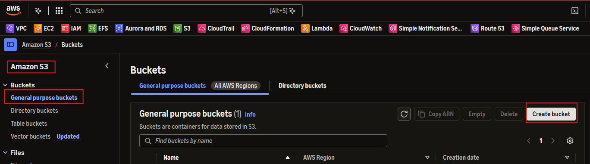</a></td></tr></table>

<p><sub><strong>Screenshot 01:</strong> General purpose buckets dashboard and Create bucket action.</sub></p>

I selected `us-east-1`, **General purpose**, and **Global namespace**, and created the bucket with the final lowercase name `sy-awstraining-s3`. A globally unique name within an AWS partition is a naming constraint, not a public-access permission. The selected Region determines the bucket’s data location and is an important consideration for latency, residency and pricing.

<table><tr><td align="center"><a href="images/screenshot-02.png">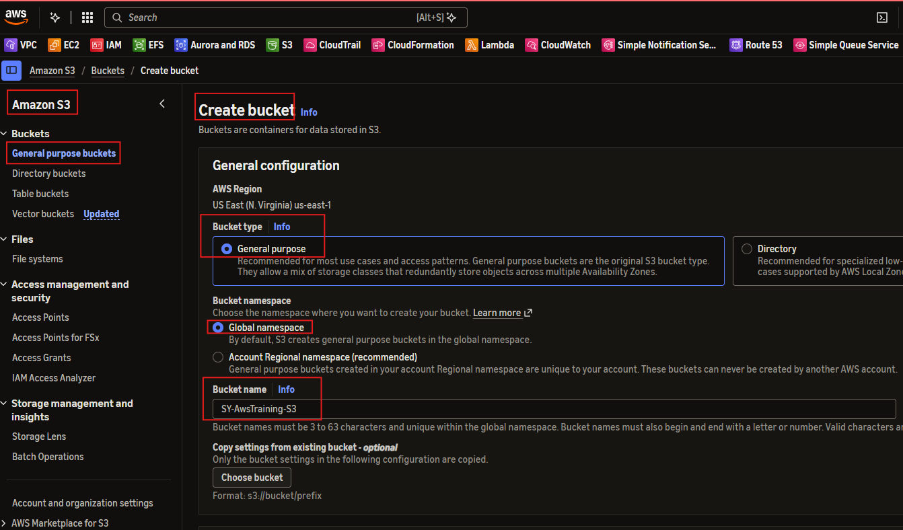</a></td></tr></table>

<p><sub><strong>Screenshot 02:</strong> Creation wizard with N. Virginia, general purpose type, global namespace and initial bucket name.</sub></p>

### 3.2 Configuring ownership and public access

I chose **ACLs disabled (Bucket owner enforced)** and kept **Block all public access** selected. Bucket owner enforced removes ACLs from authorization and gives the bucket owner ownership of objects. Block Public Access complements policy-based authorization by blocking or restricting public grants through ACLs and public policies. It does not grant private access or replace IAM permissions.

<table><tr><td align="center"><a href="images/screenshot-03.png">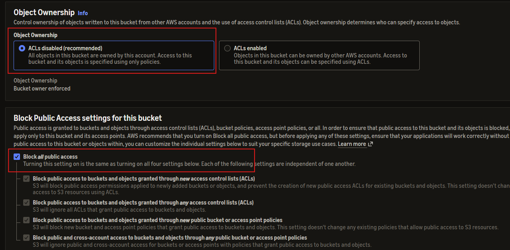</a></td></tr></table>

<p><sub><strong>Screenshot 03:</strong> Bucket owner enforced and all four public access blocks selected.</sub></p>

### 3.3 Choosing the initial protection settings

For the initial storage baseline, I used the following protection settings. SSE-S3 uses Amazon S3 managed keys, so encryption did not require a KMS key policy or customer-managed key. Bucket Keys are relevant to SSE-KMS, not SSE-S3.

| Initial setting | Selected value | Reason |
|---|---|---|
| Versioning | Disabled | Establish an unversioned baseline |
| Bucket tags | None | No bucket-level classification was needed |
| Default encryption | SSE-S3 | Encrypt new uploads without a customer-managed KMS key |
| Bucket Key | Enabled in form | Relevant to SSE-KMS, not SSE-S3 |

<table><tr><td align="center"><a href="images/screenshot-04.png"></a></td></tr></table>

<p><sub><strong>Screenshot 04:</strong> Initial versioning disabled and SSE-S3 selected.</sub></p>

### 3.4 Verifying the bucket

After creating the bucket, I confirmed that it was empty before introducing the sample objects.

<table><tr><td align="center"><a href="images/screenshot-05.png">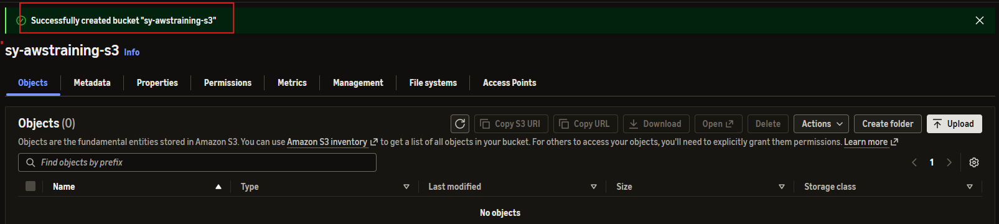</a></td></tr></table>

<p><sub><strong>Screenshot 05:</strong> Successful creation of the empty sy-awstraining-s3 bucket.</sub></p>

> [!IMPORTANT]
> **SAA-C03 exam connection:** Disabling ACLs does not disable authorized policy-based access. A private bucket can still be accessed by permitted IAM identities.

## 04 Uploading Objects and Selecting Storage Classes

### 4.1 Preparing local test data

I used a plain-text configuration document and a JSON document to compare object types. The TXT file recorded the bucket name and storage purpose; the JSON file represented structured project information. Both contained nonsensitive sample data.

The initial TXT content was:

```text
AWS Training by SRKN

Amazon S3 Object Storage
Bucket: sy-awstraining-s3
Purpose: Object storage, security, and lifecycle management.
```

The JSON document represented structured project attributes such as `project`, `service`, `environment`, and `status`. S3 stores both formats as object data; applications interpret their contents.

<table><tr><td align="center"><a href="images/screenshot-06.png">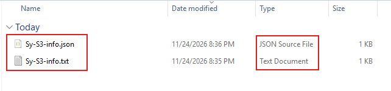</a></td></tr></table>

<p><sub><strong>Screenshot 06:</strong> Local TXT and JSON files prepared for upload.</sub></p>

### 4.2 Staging the upload

From **Objects → Upload → Add files**, I selected both files without a destination prefix. The filenames therefore became the complete object keys. Uploading to a different prefix would give an object a different key even if the local filename were unchanged.

<table><tr><td align="center"><a href="images/screenshot-07.png">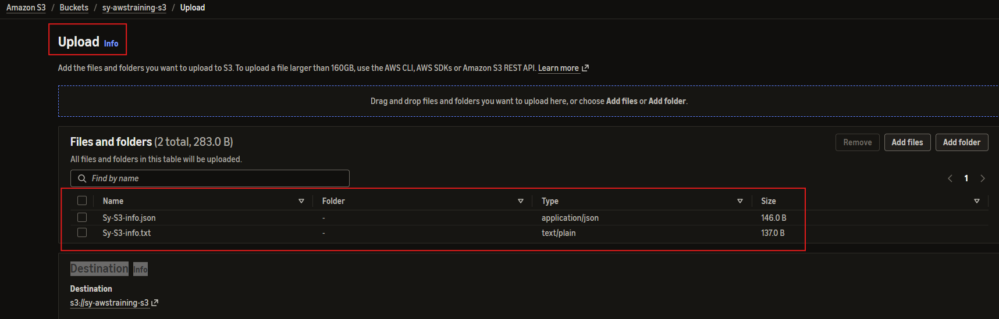</a></td></tr></table>

<p><sub><strong>Screenshot 07:</strong> Two files staged for upload to the bucket.</sub></p>

| Object | Content type | Size |
|---|---|---:|
| `Sy-S3-info.json` | application/json | 146 B |
| `Sy-S3-info.txt` | text/plain | 137 B |
| Total | | 283 B |

### 4.3 Choosing a storage class

| Storage class | AZs | Minimum duration | Minimum billable object size | Access pattern |
|---|---:|---|---|---|
| Standard | 3+ | None | None | Frequent |
| Intelligent-Tiering | 3+ | None | None | Changing access; objects under 128 KB stay in frequent tier without monitoring fee |
| Standard-IA | 3+ | 30 days | 128 KB | Infrequent, immediate access |
| One Zone-IA | 1 | 30 days | 128 KB | Re-creatable, infrequent data |
| Glacier Instant Retrieval | 3+ | 90 days | 128 KB | Archive with immediate access |
| Glacier Flexible Retrieval | 3+ | 90 days | None; archival metadata overhead | Minutes to hours |
| Glacier Deep Archive | 3+ | 180 days | None; archival metadata overhead | Long-term archive, hours |
| Reduced Redundancy | 3+ | None | None | Legacy, not recommended |

Retrieval charges apply to IA and archive classes as applicable. S3 Express One Zone is a separate single-AZ, low-latency class for directory buckets and was not part of this general purpose upload selection.

Under **Properties → Storage class**, I selected **Standard** for the two small, frequently accessed documents. Standard-IA would bill each of these sub-128 KB objects at its minimum billable size and introduce retrieval charges. Glacier classes would add archival access or retention considerations that did not suit repeated reads and updates.

<table><tr><td align="center"><a href="images/screenshot-08.png"></a></td></tr></table>

<p><sub><strong>Screenshot 08:</strong> Storage class comparison with Standard selected.</sub></p>

### 4.4 Verifying the upload

I submitted the upload and confirmed that both requests succeeded. The combined 283-byte payload established the initial storage baseline for the versioning exercise.

<table><tr><td align="center"><a href="images/screenshot-09.png">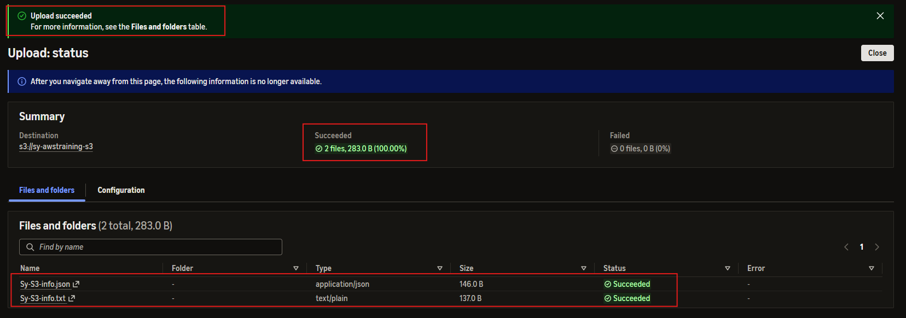</a></td></tr></table>

<p><sub><strong>Screenshot 09:</strong> Both uploads succeeded, totaling 283 bytes.</sub></p>

## 05 Inspecting Object Properties and Security

After uploading, I inspected the TXT object to establish its actual storage properties and security attributes. Bucket configuration defines defaults; the object properties show what was applied to the selected object.

| Attribute | Observed value |
|---|---|
| Key | `Sy-S3-info.txt` |
| Size | 137 B |
| S3 URI | `s3://sy-awstraining-s3/Sy-S3-info.txt` |
| ARN | `arn:aws:s3:::sy-awstraining-s3/Sy-S3-info.txt` |
| Object URL | `https://sy-awstraining-s3.s3.us-east-1.amazonaws.com/Sy-S3-info.txt` |
| ETag | `6a0e5e2caad8e5d48b2d726f8bf79f51` |
| Storage | Standard |
| Encryption | SSE-S3 |
| Checksum | CRC64NVME, full object |
| Content-Type | `text/plain` |
| Tags / annotations | 0 / 0 |

### 5.1 Understanding object identifiers

I opened the TXT object by its key. Its S3 URI identifies the location for AWS tools, the ARN identifies the resource in policies, and the HTTPS URL addresses the object over the network. These identifiers have different roles but none independently authorizes access.

<table><tr><td align="center"><a href="images/screenshot-10.png"></a></td></tr></table>

<p><sub><strong>Screenshot 10:</strong> TXT object overview with key, URI, ARN, ETag and URL.</sub></p>

### 5.2 Checking encryption and data integrity

An ETag may be an MD5 digest for particular uploads but is not universally an MD5 checksum. For multipart or other encryption configurations, use the documented checksum mechanism rather than treating the ETag as a universal integrity proof.

I inspected the stored object to verify that the bucket’s SSE-S3 default had been applied. Encryption protects confidentiality at rest; the CRC64NVME checksum represents data integrity. These mechanisms do not establish who is allowed to retrieve an object. The checksum was inspected, not independently recomputed after downloading.

<table><tr><td align="center"><a href="images/screenshot-11.png"></a></td></tr></table>

<p><sub><strong>Screenshot 11:</strong> Standard storage, SSE-S3, CRC64NVME and no tags.</sub></p>

### 5.3 Inspecting metadata

The initial object used the system-defined `Content-Type: text/plain`. This HTTP metadata tells consuming applications how to interpret the bytes without changing the stored document.

<table><tr><td align="center"><a href="images/screenshot-12.png">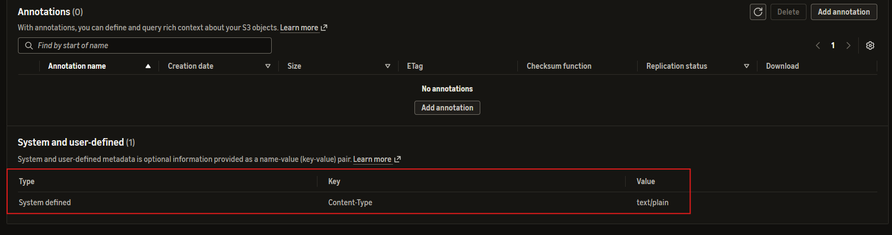</a></td></tr></table>

<p><sub><strong>Screenshot 12:</strong> System-defined Content-Type and no annotations.</sub></p>

## 06 Verifying Private and Signed Access

The access tests compared an unsigned request, an authorized signed request and an expired signed request against the same private object. This models a common application requirement: temporary document delivery without public bucket access.

### 6.1 Testing an unsigned request

I copied the Object URL into a browser without a signature and received `AccessDenied`. Without valid authorization, an unsigned request cannot retrieve a private object merely by knowing its URL.

<table><tr><td align="center"><a href="images/screenshot-13.png">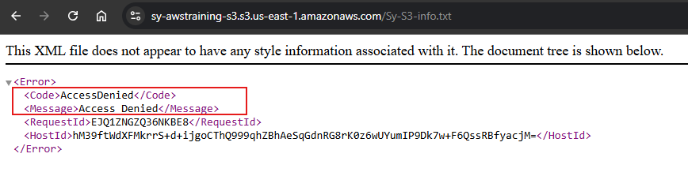</a></td></tr></table>

<p><sub><strong>Screenshot 13:</strong> Unsigned object URL returned AccessDenied.</sub></p>

### 6.2 Retrieving the private object

I returned to the authenticated Console and chose **Open**. The Console issued a signed request and the document was displayed. This is useful for private application assets: authorization can be provided for retrieval without changing the bucket’s public-access settings.

<table><tr><td align="center"><a href="images/screenshot-14.png"></a></td></tr></table>

<p><sub><strong>Screenshot 14:</strong> Successful signed retrieval of the TXT object.</sub></p>

### 6.3 Checking signed-request expiration

A later request using a signed URL was rejected after the 300-second validity period. Expiration limits the time during which a recipient can initiate an authorized request; it does not retract a copy already retrieved.

<table><tr><td align="center"><a href="images/screenshot-15.png">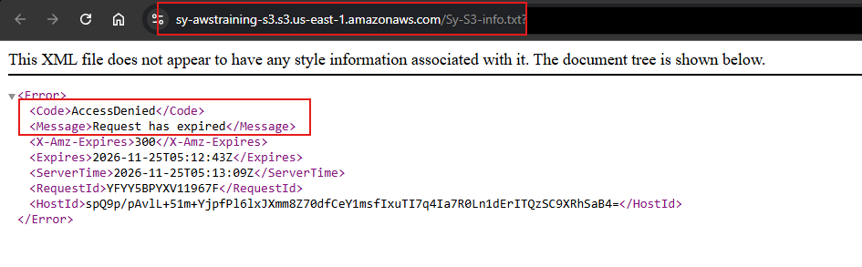</a></td></tr></table>

<p><sub><strong>Screenshot 15:</strong> Expired signed request rejected after its 300-second validity.</sub></p>

<p align="center"></p>

Presigned URLs provide temporary access to a specific operation using the signer's authorization. They can be used by anyone holding the valid URL and may expire sooner if the signing credentials expire. They are useful for temporary private document delivery; they should be treated as bearer credentials.

> [!IMPORTANT]
> Block Public Access does not prevent authorized signed requests. Public exposure is not required for controlled object sharing.

## 07 Renaming an Object

An S3 object is identified by its key. Renaming an object in a general purpose bucket requires a copy to the new key and deletion of the old key, rather than an atomic filesystem rename.

### 7.1 Starting the rename

I opened `Sy-S3-info.txt`, selected **Object actions → Rename object**, and configured the new key as `Sy-S3-storage-info.txt`.

<table><tr><td align="center"><a href="images/screenshot-16.png">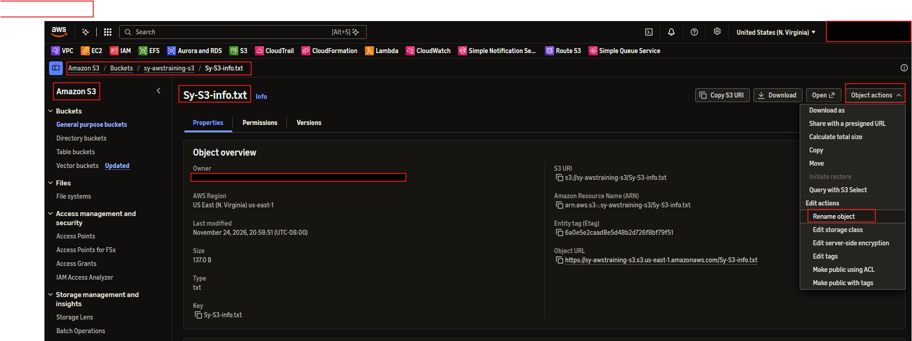</a></td></tr></table>

<p><sub><strong>Screenshot 16:</strong> Object actions menu with Rename object.</sub></p>

### 7.2 Preserving object settings

I selected **Copy source settings** to preserve the intended storage class, encryption and metadata. Renaming should not inadvertently change the object’s protection or how applications interpret it.

<table><tr><td align="center"><a href="images/screenshot-17.png"></a></td></tr></table>

<p><sub><strong>Screenshot 17:</strong> New object name and Copy source settings.</sub></p>

### 7.3 Verifying the new key

After saving, I confirmed that the new key held the 137-byte TXT object and the JSON object was unchanged. Any application referencing the old key would now need to use the new identifier.

<table><tr><td align="center"><a href="images/screenshot-18.png">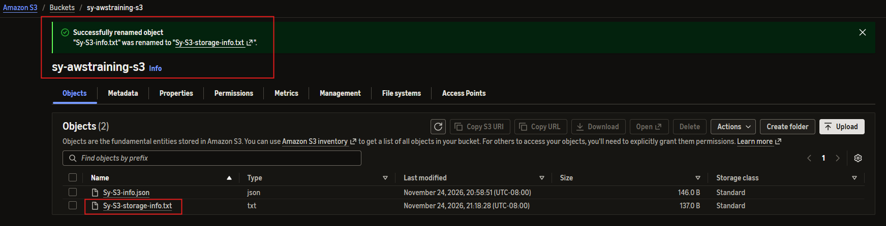</a></td></tr></table>

<p><sub><strong>Screenshot 18:</strong> Successful rename and two-object inventory.</sub></p>

<p align="center"></p>

Because the bucket was still unversioned, the old key was removed rather than hidden by a delete marker. In a versioned bucket, the delete step would ordinarily create a marker and leave earlier data versions stored.

## 08 Enabling Versioning and Updating Data

Versioning is useful for configuration repositories and frequently updated documents because previous contents remain recoverable after an overwrite.

### 8.1 Establishing the original versioning state

In **Properties → Bucket Versioning**, I began with the unversioned state. This established a `null` version ID for objects already stored in the bucket.

<table><tr><td align="center"><a href="images/screenshot-19.png">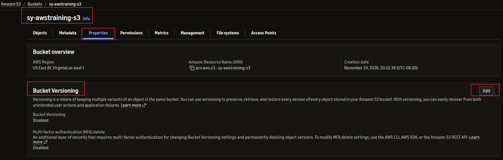</a></td></tr></table>

<p><sub><strong>Screenshot 19:</strong> Bucket Versioning initially disabled.</sub></p>

### 8.2 Enabling versioning

I selected **Edit → Enable → Save changes**, leaving MFA Delete disabled. Versioning is bucket-wide; it preserves full object versions but does not make them immutable.

<table><tr><td align="center"><a href="images/screenshot-20.png"></a></td></tr></table>

<p><sub><strong>Screenshot 20:</strong> Enable selected in the versioning editor.</sub></p>

AWS recommends allowing 15 minutes for propagation when versioning is first enabled before issuing object PUT or DELETE requests. Existing versions keep their `null` IDs; subsequent writes receive unique version IDs.

<table><tr><td align="center"><a href="images/screenshot-21.png"></a></td></tr></table>

<p><sub><strong>Screenshot 21:</strong> Bucket Versioning enabled.</sub></p>

### 8.3 Updating the document under the existing key

I added a document version and the storage configuration to the original text:

```text
AWS Training by SRKN

Amazon S3 Object Storage
Bucket: sy-awstraining-s3
Purpose: Object storage, security, and lifecycle management.

Document Version: 2
Bucket Versioning: Enabled
Encryption: SSE-S3
Storage Class: Standard
Public Access: Blocked
```

I uploaded the updated document as `Sy-S3-storage-info.txt`, exactly matching the existing key. A changed filename or prefix would have created an independent object instead of a version of the same key.

<table><tr><td align="center"><a href="images/screenshot-22.png"></a></td></tr></table>

<p><sub><strong>Screenshot 22:</strong> Updated 257-byte document staged under the same key.</sub></p>

<table><tr><td align="center"><a href="images/screenshot-23.png">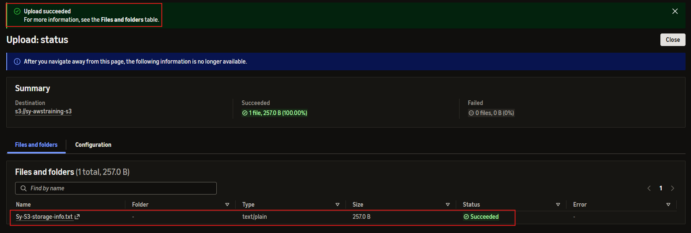</a></td></tr></table>

<p><sub><strong>Screenshot 23:</strong> Updated document upload succeeded.</sub></p>

### 8.4 Verifying the version inventory

On the Objects tab I enabled **Show versions**. The current 257-byte TXT entry had a unique S3 version ID, while the original 137-byte entry had `null`. The unchanged 146-byte JSON object also had `null`. The resulting 540 bytes included the earlier version, not just the latest contents.

<table><tr><td align="center"><a href="images/screenshot-24.png"></a></td></tr></table>

<p><sub><strong>Screenshot 24:</strong> Current and original TXT versions visible in inventory.</sub></p>

> [!IMPORTANT]
> S3 stores full versions, not differences. A versioning-enabled bucket can be suspended but cannot return to its initial unversioned state.

## 09 Deletion and Object Recovery

To test recovery from accidental deletion, I used the versioned TXT document. This recovery mechanism operates within the same bucket rather than restoring a separate backup.

### 9.1 Creating a delete marker

I turned **Show versions** off before selecting the TXT key. This ensured that the deletion targeted the ordinary current-key view rather than an explicitly selected data version.

<table><tr><td align="center"><a href="images/screenshot-25.png"></a></td></tr></table>

<p><sub><strong>Screenshot 25:</strong> TXT selected for ordinary deletion with Show versions off.</sub></p>

I confirmed the ordinary deletion by typing `delete`. Omitting the version ID causes a versioned bucket to add a delete marker instead of permanently removing a specific data version.

<table><tr><td align="center"><a href="images/screenshot-26.png"></a></td></tr></table>

<p><sub><strong>Screenshot 26:</strong> Deletion confirmation explaining delete marker creation.</sub></p>

<table><tr><td align="center"><a href="images/screenshot-27.png"></a></td></tr></table>

<p><sub><strong>Screenshot 27:</strong> Successful logical deletion with previous versions retained.</sub></p>

I enabled **Show versions** again to distinguish logical deletion from permanent removal of stored data.

<table><tr><td align="center"><a href="images/screenshot-28.png"></a></td></tr></table>

<p><sub><strong>Screenshot 28:</strong> Current delete marker and two preserved TXT versions.</sub></p>

The marker became the current version, hiding the object from ordinary key-based retrieval. Both TXT payloads remained stored, so total object data stayed at 540 bytes. A delete marker also incurs storage overhead based on its key length, even when displayed as 0 B.

### 9.2 Recovering the current version

To reverse the logical deletion, I kept **Show versions** enabled and selected only the delete marker. Removing this specific marker makes the most recent surviving data version current again.

<table><tr><td align="center"><a href="images/screenshot-29.png">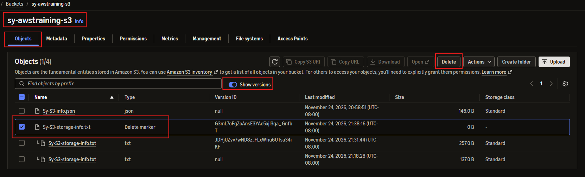</a></td></tr></table>

<p><sub><strong>Screenshot 29:</strong> Only the delete marker selected for removal.</sub></p>

I entered `permanently delete` for the selected marker version ID. This confirmation is destructive when applied to a data version, so identifying the marker rather than either payload was essential.

<table><tr><td align="center"><a href="images/screenshot-30.png"></a></td></tr></table>

<p><sub><strong>Screenshot 30:</strong> Permanent deletion confirmation for the marker.</sub></p>

<table><tr><td align="center"><a href="images/screenshot-31.png"></a></td></tr></table>

<p><sub><strong>Screenshot 31:</strong> Delete marker removal succeeded.</sub></p>

After the marker was removed, the 257-byte version became current again and the 137-byte original remained available. Recovery required no additional upload or storage copy.

<table><tr><td align="center"><a href="images/screenshot-32.png">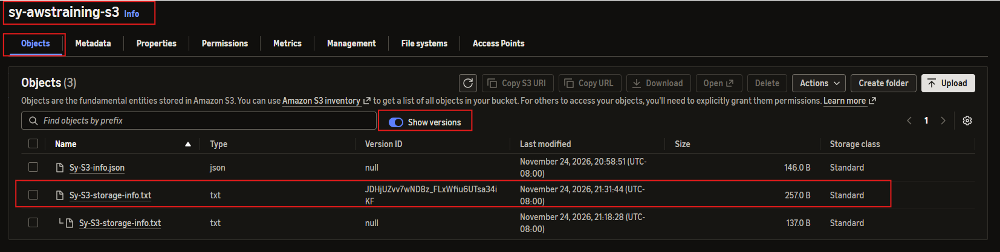</a></td></tr></table>

<p><sub><strong>Screenshot 32:</strong> Restored current version and retained original version.</sub></p>

<p align="center">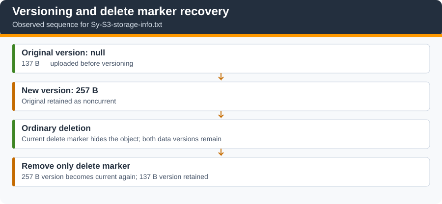</p>

The restored version was verified in the inventory, without a separate content retrieval test. An authorized permanent deletion of a data version cannot be reversed through versioning alone. S3 Object Lock can provide additional retention protection where immutability is required.

## 10 Configuring Lifecycle Management

Lifecycle rules automate storage transitions, expiration and cleanup. For this small-object workload, I configured retention of previous versions rather than archival transitions.

### 10.1 Opening lifecycle configuration

I opened **Management → Create lifecycle rule** and configured a bucket-wide policy to manage historical versions and unfinished uploads.

<table><tr><td align="center"><a href="images/screenshot-33.png"></a></td></tr></table>

<p><sub><strong>Screenshot 33:</strong> Management tab before lifecycle rule creation.</sub></p>

| Rule setting | Configured value |
|---|---|
| Name | `S3-Object-Retention-Policy` |
| Scope | Entire bucket |
| Current version actions | None |
| Noncurrent version expiration | 30 days after becoming noncurrent |
| Number of newer versions to retain | Not specified |
| Expired delete marker removal | Enabled |
| Abort incomplete multipart uploads | After 7 days |
| Storage transitions | None |

### 10.2 Defining scope and actions

I applied the rule to all objects rather than a prefix or tag filter. Current-version expiration and transitions were left disabled so the active training documents would remain accessible for the subsequent encryption activity.

<table><tr><td align="center"><a href="images/screenshot-34.png">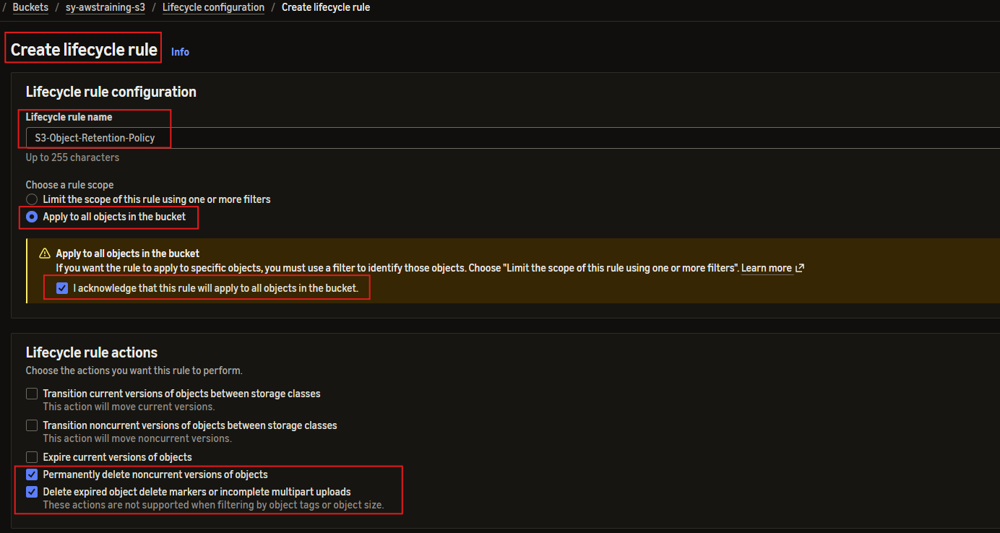</a></td></tr></table>

<p><sub><strong>Screenshot 34:</strong> Lifecycle rule name, scope and selected actions.</sub></p>

### 10.3 Defining retention periods

The 30-day retention period begins when a version becomes noncurrent, not when it was first uploaded. Leaving the newer-version count empty means the rule does not reserve a minimum number of newer noncurrent versions. Incomplete multipart upload cleanup uses a separate seven-day timer measured from upload initiation. Expired delete markers are eligible for removal when no underlying data versions remain.

<table><tr><td align="center"><a href="images/screenshot-35.png">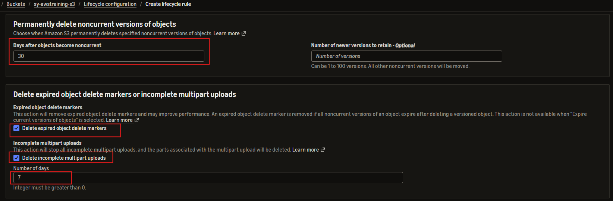</a></td></tr></table>

<p><sub><strong>Screenshot 35:</strong> 30-day noncurrent retention and seven-day multipart cleanup.</sub></p>

### 10.4 Verifying the lifecycle rule

I created and enabled the rule. The default 128 KB minimum displayed in the console governs storage-class transitions, not expiration of small objects.

<table><tr><td align="center"><a href="images/screenshot-36.png">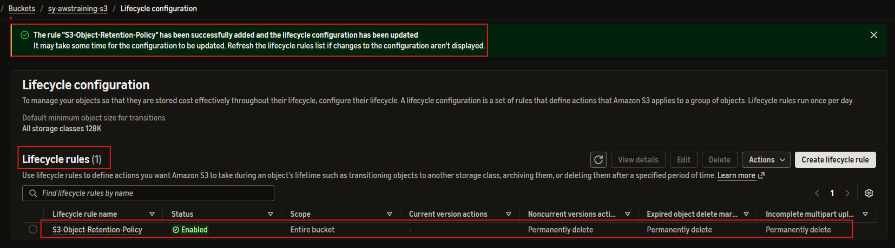</a></td></tr></table>

<p><sub><strong>Screenshot 36:</strong> Enabled lifecycle rule successfully created.</sub></p>

<p align="center"></p>

Lifecycle execution is asynchronous; the configured retention periods establish eligibility rather than a precise deletion time. The enabled rule was verified, but its automatic expiration actions were not observed.

### 10.5 Example production tiering

<p align="center">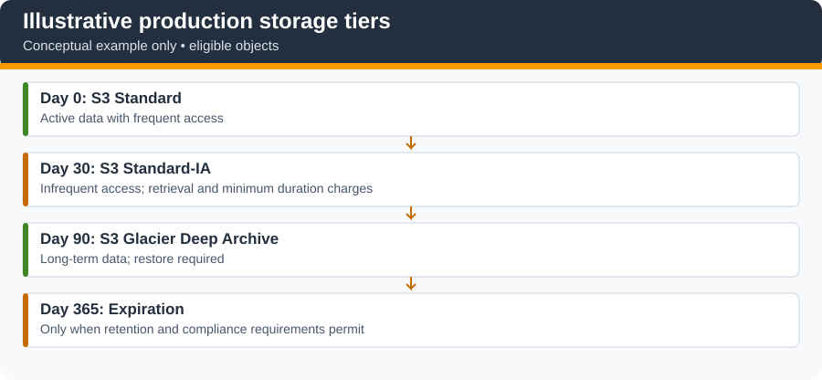</p>

A production lifecycle could start in Standard, transition eligible data to infrequent-access storage as demand falls, then archive records until their business-approved expiration date. The illustrated policy was not deployed. Evaluate minimum duration, object size, retrieval fees and retention requirements before using such a schedule.

> [!IMPORTANT]
> **SAA-C03 exam connection:** Expiring a current object in a versioned bucket generally creates a delete marker; noncurrent version expiration is needed to remove historical data. A lifecycle rule that deletes noncurrent versions is destructive once the retention window ends.

## 11 Applying Object Tags and Metadata

Object tags and metadata are both key-value attributes, but they have different update mechanisms. I used the current TXT version to demonstrate both.

### 11.1 Object tagging

| Key | Value |
|---|---|
| Project | SY-AWS-Training |
| Environment | Training |
| DataClassification | NonSensitive |
| Purpose | ObjectStorage |

From the current TXT object, I selected **Metadata → Tags → Edit** and saved the four key-value pairs. The tags classify the resource for potential filtering and policy conditions without altering the document payload.

<table><tr><td align="center"><a href="images/screenshot-37.png">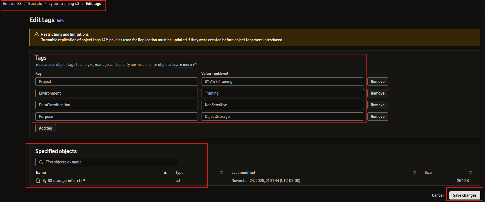</a></td></tr></table>

<p><sub><strong>Screenshot 37:</strong> Four object tags configured for the current TXT.</sub></p>

The tagging operation retained the existing Content-Type and did not create a new data version.

<table><tr><td align="center"><a href="images/screenshot-38.png"></a></td></tr></table>

<p><sub><strong>Screenshot 38:</strong> Saved tags and existing Content-Type metadata.</sub></p>

Object tags belong to individual versions, with up to ten tags per object. A classification tag such as `DataClassification=NonSensitive` is descriptive unless a policy or application uses it to enforce a decision. Our lifecycle rule was bucket-wide and did not depend on these tags.

### 11.2 Replacing metadata with a same-key copy

I opened **Object actions → Copy**, supplied `s3://sy-awstraining-s3/` without a prefix, and chose **Specify settings**. S3 does not support editing user-defined object metadata in place. Copying to the same key replaces the metadata while retaining the logical object name.

<table><tr><td align="center"><a href="images/screenshot-39.png">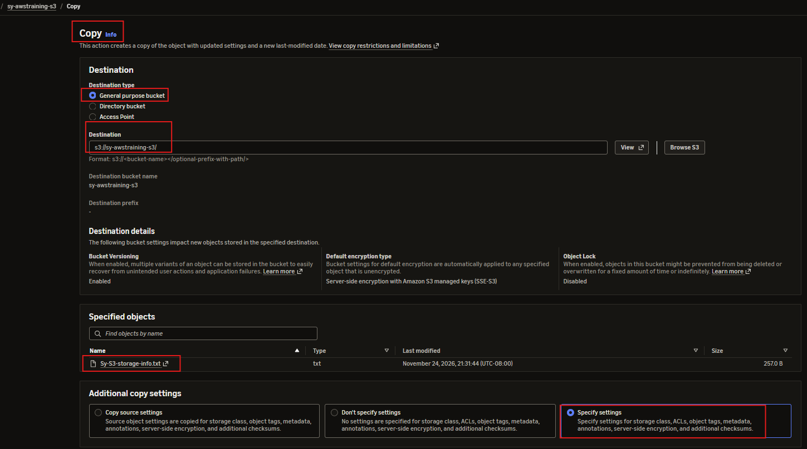</a></td></tr></table>

<p><sub><strong>Screenshot 39:</strong> Same-bucket copy destination and Specify settings.</sub></p>

I selected **Copy existing storage class**, **Copy existing encryption settings**, and **Copy existing checksum functions** to isolate the change to metadata.

<table><tr><td align="center"><a href="images/screenshot-40.png"></a></td></tr></table>

<p><sub><strong>Screenshot 40:</strong> Existing storage class, encryption and checksum function selected for copying.</sub></p>

| Type | Key | Value |
|---|---|---|
| System defined | Content-Type | text/plain |
| User defined | x-amz-meta-author | SRKN |
| User defined | x-amz-meta-project | SY-AWS-Training |
| User defined | x-amz-meta-document-version | 2 |
| User defined | x-amz-meta-description | Amazon S3 storage configuration |

I chose **Copy existing tags** and **Replace all metadata**. Replacement does not merge the old and new metadata sets, so I explicitly included `Content-Type: text/plain` alongside the custom attributes.

<table><tr><td align="center"><a href="images/screenshot-41.png"></a></td></tr></table>

<p><sub><strong>Screenshot 41:</strong> Existing tags copied and five metadata entries configured.</sub></p>

### 11.3 Verifying the copy and resulting version

I completed the same-key copy, preserving the previous data versions.

<table><tr><td align="center"><a href="images/screenshot-42.png"></a></td></tr></table>

<p><sub><strong>Screenshot 42:</strong> Successful 257-byte copy with no failures.</sub></p>

With **Show versions** enabled, I verified the additional version. A metadata-only change still produced a complete 257-byte stored version, increasing the payload from 540 to 797 bytes.

<table><tr><td align="center"><a href="images/screenshot-43.png"></a></td></tr></table>

<p><sub><strong>Screenshot 43:</strong> Three TXT versions and one JSON version in inventory.</sub></p>

I inspected the current version to confirm that the four tags and the five metadata entries were present together.

<table><tr><td align="center"><a href="images/screenshot-44.png"></a></td></tr></table>

<p><sub><strong>Screenshot 44:</strong> Saved four tags and five metadata entries.</sub></p>

<p align="center"></p>

| Attribute type | Typical purpose | Update behavior |
|---|---|---|
| Bucket tags | Resource organization and activated cost allocation | Bucket configuration |
| Object tags | Classification, filtering, policy conditions | Independent of object data |
| User-defined metadata | Application attributes returned in HTTP headers | Copy or replace object |
| Annotations | Additional object context | Not used in this implementation |

The custom document version remained `2` because the document bytes were unchanged; the S3-managed version ID identifies the new stored version independently. User-defined metadata is limited to 2 KB in the PUT request.

> [!IMPORTANT]
> **SAA-C03 exam connection:** Modifying tags can be independent of object data. Changing user-defined metadata requires a copy or replacement, so in a versioned bucket it can create another billable full object version even if the payload is unchanged.

## 12 Final Security Review and Resource State

I reviewed the final bucket-level public access and ownership settings. The review did not include a complete bucket policy or CORS audit.

### 12.1 Checking public-access protections

In **Permissions**, I confirmed that Block Public Access remained enabled. This protection complements the earlier access test: it restricts public grants while IAM and applicable resource policies determine authorized private access.

<table><tr><td align="center"><a href="images/screenshot-45.png">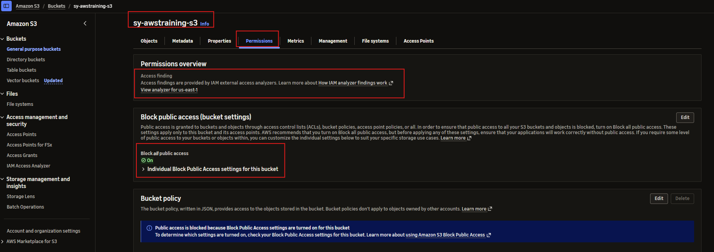</a></td></tr></table>

<p><sub><strong>Screenshot 45:</strong> Final Permissions overview and Block Public Access on.</sub></p>

### 12.2 Checking ownership and ACL behavior

Bucket owner enforced remained active. With ACLs disabled, ACL entries do not independently authorize requests. The S3 ACL group named Authenticated users represents AWS-account holders generally, not just IAM identities in the bucket owner’s account.

<table><tr><td align="center"><a href="images/screenshot-46.png"></a></td></tr></table>

<p><sub><strong>Screenshot 46:</strong> Bucket owner enforced and ACLs disabled.</sub></p>

| Control | Role |
|---|---|
| IAM and bucket policies | Authorize requests |
| Block Public Access | Restrict public grants |
| Object Ownership | Disable ACL-based authorization and enforce bucket ownership |
| SSE-S3 | Encrypt data at rest |
| HTTPS | Encrypt data in transit |
| Versioning | Preserve recoverable versions |
| Lifecycle | Manage retention and cleanup |

### 12.3 Final inventory

| Object | Version | Status | Payload |
|---|---|---|---:|
| `Sy-S3-info.json` | null | Current | 146 B |
| `Sy-S3-storage-info.txt` | Metadata copy | Current | 257 B |
| `Sy-S3-storage-info.txt` | Content update | Noncurrent | 257 B |
| `Sy-S3-storage-info.txt` | null | Noncurrent | 137 B |
| **Total** | | | **797 B** |

<p align="center"></p>

### 12.4 Resource retention and teardown

I retained the bucket, four stored data versions and enabled lifecycle rule for the following KMS and CloudTrail implementation. No teardown was performed at this checkpoint.

When that dependent work is finished, stop any log delivery or other writes to this bucket, confirm that no required data remains, then use **S3 → General purpose buckets → select `sy-awstraining-s3` → Empty** to remove all versions and delete markers. Verify the empty inventory before deleting the bucket. The lifecycle rule is not a substitute for explicitly emptying a versioned bucket during teardown.

## 13 SAA-C03 Review and Production Design

### 13.1 Architectural decisions

| Exam concept | Architectural decision |
|---|---|
| Object versus block/file storage | Choose S3 for API-accessed objects, EBS for disks and EFS for shared files |
| Access authorization | Prefer least privilege and private buckets; use signed requests for temporary sharing |
| Encryption | SSE-S3 for simple managed encryption; SSE-KMS for additional key policy and audit controls |
| Storage tiering | Compare access frequency, size, resilience and retrieval costs |
| Versioning | Recover ordinary deletions by removing the current delete marker |
| Lifecycle | Expire obsolete versions and abort incomplete multipart uploads |
| Immutable retention | Evaluate Object Lock for regulated retention and deletion protection |

### 13.2 Knowledge check

> [!TIP]
> **Q1. Does an S3 object URL grant access?** No. The request must be authorized; the unsigned request in this exercise was denied.
>
> **Q2. Why did the metadata-only change increase storage?** A same-key copy created a complete new version in the versioned bucket.
>
> **Q3. Why was Standard preferred to Standard-IA?** Small frequently accessed objects would face minimum billable size and retrieval considerations in IA.
>
> **Q4. How can a logically deleted object be restored?** Remove its current delete marker by version ID, preserving the underlying data versions.
>
> **Q5. Does enabling SSE-S3 make data private?** No. Encryption at rest and request authorization are different mechanisms.

### 13.3 Production considerations

For production, scope IAM permissions narrowly, enforce TLS where appropriate, review access findings, monitor object-level activity with explicitly configured CloudTrail data events when needed, and establish retention based on recovery and compliance requirements. Cross-Region replication or backups may be appropriate for additional recovery objectives; neither was implemented here.

## 14 AWS Cost Estimate — Monthly Usage Scenario

S3 has no EC2-style hourly bucket charge. The following 730-hour month scenario assumes the final 797-byte payload and eight tags across the two tagged TXT versions remain stored throughout the month, 100 PUT/COPY/LIST-class requests and 100 GET-class requests. The eight tags are a modeled full-month inventory: four were verified on the current version and four on the preceding version before the copy. These are illustrative request counts, not measured usage. Rates are for US East (N. Virginia), before credits or request free-tier allowances.

| Component | Calculation | Estimated monthly cost |
|---|---|---:|
| General purpose bucket | No separate bucket fee | $0 |
| S3 Standard payload | 797 / 1,073,741,824 × $0.023 per GB-month | $0.000000017 |
| PUT/COPY/LIST | 100 × $0.005 / 1,000 | $0.000500 |
| GET | 100 × $0.0004 / 1,000 | $0.000040 |
| Object tags | 8 × $0.0065 / 10,000 | $0.0000052 |
| Versioning and lifecycle configuration | No separate configuration fee | $0 |
| SSE-S3 | No separate encryption charge | $0 |
| DELETE | No request charge | $0 |
| Internet transfer | Assumed within applicable free transfer allowance | $0 |
| **Total** | | **$0.000545 (less than $0.01)** |

The full-month storage and tag assumption is a simplified upper inventory scenario; the configured lifecycle rule may remove older versions. Other request classes, metadata overhead, monitoring, data transfer beyond allowances and optional services are not quantified. No customer-managed KMS key was created in this activity. Actual charges should be checked in Cost Explorer.

**Cost controls:** Standard for tiny objects, noncurrent version expiration, incomplete multipart cleanup and avoiding unnecessary storage transitions. Pricing: [Amazon S3 pricing](https://aws.amazon.com/s3/pricing/) and [object tag pricing update](https://aws.amazon.com/about-aws/whats-new/2025/03/amazon-s3-reduces-pricing-object-tagging/).

## 15 Results and Conclusion

| Validation | Observed outcome |
|---|---|
| Bucket creation and uploads | Private general purpose bucket; two successful initial uploads |
| Object properties | Standard, SSE-S3 and full-object checksum verified |
| Access | Unsigned request denied; signed access succeeded; expired request denied |
| Rename | New key present; original key absent |
| Versioning | Original and updated versions retained |
| Deletion and recovery | Delete marker created and removed; previous version restored |
| Lifecycle | Enabled 30-day noncurrent expiration and seven-day multipart cleanup |
| Tagging and metadata | Four tags and five metadata entries verified |
| Final inventory | Two current objects, two noncurrent versions; 797 B |

I implemented and verified a secure, versioned object storage environment with controlled access, recoverable data and automated retention configuration. The exercise demonstrated the relationship between security controls, object versions, metadata changes and storage costs. The retained bucket provides the foundation for the next encryption and auditing implementation.

## Technical Competencies

| Skill | Demonstrated work |
|---|---|
| Amazon S3 | Created and configured a general purpose bucket and managed objects |
| Storage architecture | Compared classes and selected Standard for the workload |
| Security | Verified private access, signed retrieval and expiration |
| Data protection | Enabled versioning and recovered an object using its delete marker |
| Lifecycle governance | Configured retention and multipart cleanup |
| Metadata management | Applied tags and custom metadata through a same-key copy |
| Cost optimization | Accounted for retained versions, requests and tags |
| Verification | Inspected actual console outcomes and final inventory |

## AWS Documentation

- [Amazon S3 User Guide](https://docs.aws.amazon.com/AmazonS3/latest/userguide/Welcome.html)
- [Storage classes](https://docs.aws.amazon.com/AmazonS3/latest/userguide/storage-class-intro.html)
- [Block Public Access](https://docs.aws.amazon.com/AmazonS3/latest/userguide/access-control-block-public-access.html)
- [Presigned URLs](https://docs.aws.amazon.com/AmazonS3/latest/userguide/using-presigned-url.html)
- [Copying and renaming objects](https://docs.aws.amazon.com/AmazonS3/latest/userguide/copy-object.html)
- [Versioning](https://docs.aws.amazon.com/AmazonS3/latest/userguide/Versioning.html)
- [Delete markers](https://docs.aws.amazon.com/AmazonS3/latest/userguide/ManagingDelMarkers.html)
- [Lifecycle configuration](https://docs.aws.amazon.com/AmazonS3/latest/userguide/intro-lifecycle-rules.html)
- [Lifecycle transition considerations](https://docs.aws.amazon.com/AmazonS3/latest/userguide/lifecycle-transition-general-considerations.html)
- [Editing object metadata](https://docs.aws.amazon.com/AmazonS3/latest/userguide/add-object-metadata.html)
- [Object metadata](https://docs.aws.amazon.com/AmazonS3/latest/userguide/UsingMetadata.html)
- [S3 pricing](https://aws.amazon.com/s3/pricing/)

---

**AWS Training by SRKN** · Hands-on AWS Cloud Engineering · AWS Solutions Architect Associate (SAA-C03)
