<p align="center"></p>

# AWS KMS, CloudTrail & S3 Encryption
**SECURITY / AWS KMS / AMAZON S3 / IAM / CLOUDTRAIL / ENVELOPE ENCRYPTION**

AWS Key Management Service (AWS KMS) is a managed service that enables organizations to create, manage, and control cryptographic keys used to protect sensitive data. Its integration with Amazon S3 and AWS CloudTrail provides a security architecture that combines encryption at rest, granular access control, and API-level auditing without requiring applications to manage raw encryption keys.

For this implementation, I reused the [Amazon S3 bucket established in my previous activity](../Lab17-Amazon-S3/Amazon-S3-Object-Storage.md). I extended the existing storage architecture by introducing customer managed encryption thorough AWS KMS and security auditing through AWS CloudTrail.

I uploaded an object using SSE-KMS, verified authorized and unauthorized access behavior, and analyzed the corresponding CloudTrail event records. To demonstrate the relationship between S3 permissions and KMS authorization, I implemented an object-specific explicit denial, verified the resulting decryption failure, and subsequently restored access.

Finally, I removed the temporary encrypted object and scheduled the KMS key for deletion while preserving the original S3 infrastructure and its security configuration.

---

## Contents

- [01 Purpose and Core Concepts](#01-purpose-and-core-concepts)
- [02 Creating a Customer-Managed KMS Key](#02-creating-a-customer-managed-kms-key)
- [03 Configuring CloudTrail Auditing](#03-configuring-cloudtrail-auditing)
- [04 Encrypting an S3 Object](#04-encrypting-an-s3-object)
- [05 Testing Object Access](#05-testing-object-access)
- [06 Investigating CloudTrail Records](#06-investigating-cloudtrail-records)
- [07 Testing and Restoring KMS Permissions](#07-testing-and-restoring-kms-permissions)
- [08 Verifying S3 Data Events](#08-verifying-s3-data-events)
- [09 Resource Cleanup](#09-resource-cleanup)
- [10 AWS Cost Estimate](#10-aws-cost-estimate)
- [11 SAA-C03 Review and Production Considerations](#11-saa-c03-review-and-production-considerations)
- [Technical Competencies](#technical-competencies)
- [AWS Documentation](#aws-documentation)

## 01 Purpose and Core Concepts

### 1.1 Objectives and real-world applications

The objective was to integrate three independent but complementary security services: S3 for durable object storage, KMS for key management and cryptographic authorization, and CloudTrail for audit records. A private bucket alone does not provide granular control over cryptographic access; encryption alone does not provide an audit trail of who used a key. Combining them makes it possible to investigate both resource access and key usage.

| Workload | Application of the services |
| --- | --- |
| Financial records | Separate encryption key administration from application access; investigate key usage. |
| Healthcare data | Encrypt sensitive files and retain attributable access records. |
| Enterprise data lakes | Give workloads access to only the datasets and keys they need. |
| Backup and disaster recovery | Protect backups and ensure authorized recovery identities can decrypt them. |
| Security operations | Investigate suspicious downloads, failed decryptions and key policy changes. |
| Compliance | Support evidence collection, retention and cryptographic control requirements. |

Encryption and auditing are components of compliance architecture, not guarantees of compliance on their own. Production requirements also include identity governance, retention, monitoring and documented recovery procedures.

### 1.2 KMS key types and ownership

AWS KMS protects key material using hardware security modules. A symmetric encryption key supports encryption and decryption with the same underlying secret; asymmetric keys use a public/private pair and serve different workloads such as signing. Amazon S3 SSE-KMS requires a symmetric encryption KMS key.

| Key category | Ownership and control | Example |
| --- | --- | --- |
| AWS owned key | AWS service owns the key; it is not visible or directly configurable in my account. | Service-managed encryption in applicable AWS services |
| AWS managed key | AWS manages its policy and lifecycle; visible within my account. | `alias/aws/s3` |
| Customer-managed key | Customer controls policy, grants, rotation, enablement and deletion. | `alias/SY-S3-Encryption-Key` |

SSE-S3 uses Amazon S3-managed encryption keys and does not expose a customer-configurable KMS key policy. SSE-KMS uses a KMS key to protect the data key and introduces separate cryptographic authorization. DSSE-KMS applies two server-side encryption layers. SSE-C uses customer-provided key material supplied with supported requests; client-side encryption takes place before data is uploaded.

### 1.3 Envelope encryption

KMS does not directly encrypt the entire S3 object. With S3 Bucket Key disabled, S3 requests a data key from KMS through `GenerateDataKey`. KMS supplies a plaintext data key and an encrypted copy protected by the selected KMS key. S3 encrypts the payload with the plaintext data key, stores the encrypted data key with the encrypted object, then discards the plaintext key. On authorized retrieval S3 asks KMS to decrypt the encrypted data key, uses it to decrypt the payload and returns the original content over HTTPS.

<p align="center">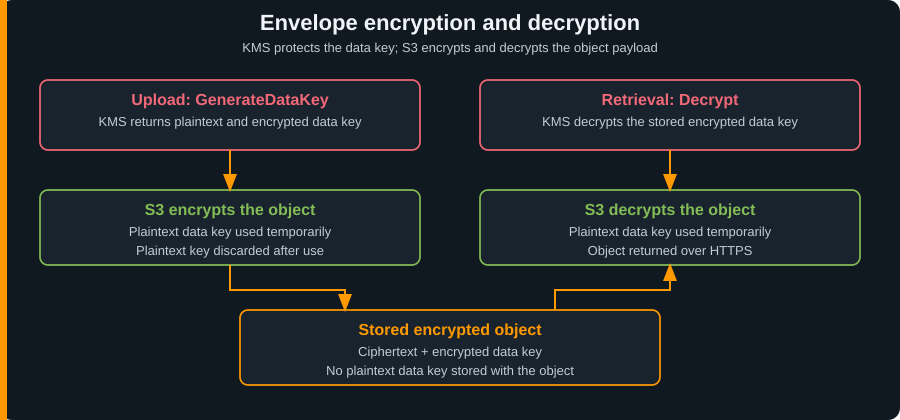</p>

<p><sub><em>Envelope encryption and authorized decryption without S3 Bucket Key optimization.</em></sub></p>


The KMS key material stays protected by KMS. The data key is separate from the logical KMS key. This architecture scales to large objects while keeping key usage controllable and auditable.

### 1.4 Architecture Highlight

I used one regional customer-managed key and a separate private log destination. The new trail was multi-Region, although the S3 object and KMS operations demonstrated here took place in `us-east-1`. Application storage and the audit bucket were intentionally independent so that disabling the application encryption key would not disable access to the audit logs.

<p align="center">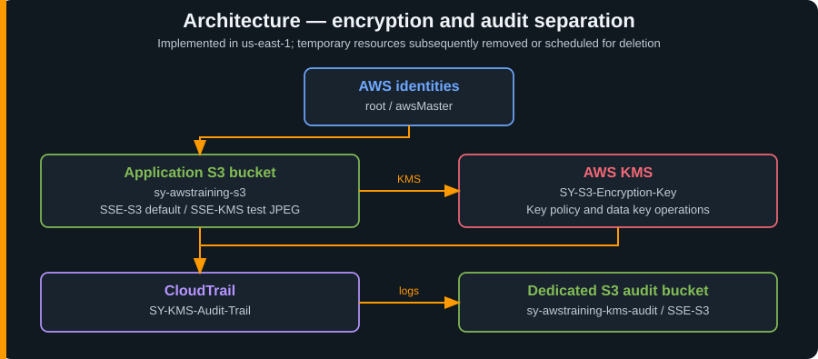</p>

<p><sub><em>Architecture integrating Amazon S3, AWS KMS, and AWS CloudTrail for data encryption, access control, and security auditing..</em></sub></p>


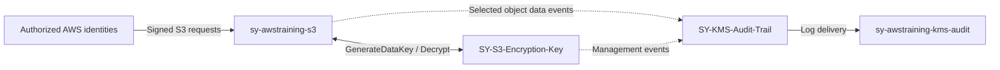

I retained the existing 'SYcloudtrail' trail and its associated S3 bucket, 'sy-aws-cloudtrailer', without making any changes to their configuration.
---

## 02 Creating a Customer-Managed KMS Key

### 2.1 Selecting the cryptographic configuration

I opened KMS in US East (N. Virginia), selected **Customer managed keys**, and opened **Create key**. The inventory initially contained no customer-managed keys.

<table><tr><td align="center"><a href="images/screenshot-01.png">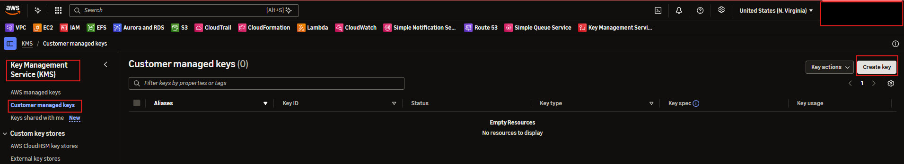</a></td></tr></table>

<p><sub><strong>Screenshot 01:</strong> Initial customer-managed key inventory.</sub></p>


| Setting | Configuration | Reason |
| --- | --- | --- |
| Key type | Symmetric | Compatible with S3 SSE-KMS. |
| Key usage | Encrypt and decrypt | Supports envelope encryption and data retrieval. |
| Key specification | `SYMMETRIC_DEFAULT` | General-purpose symmetric encryption (AES-256 outside special Regions). |
| Key material origin | AWS KMS | KMS generates and protects key material. |
| Regionality | Single-Region | The application bucket and key are in the same Region. |

Key type, usage, origin and regionality cannot simply be changed after creation. A multi-Region key would require a deliberate replication design; it is not necessary for this regional S3 workload.

<table><tr><td align="center"><a href="images/screenshot-02.png">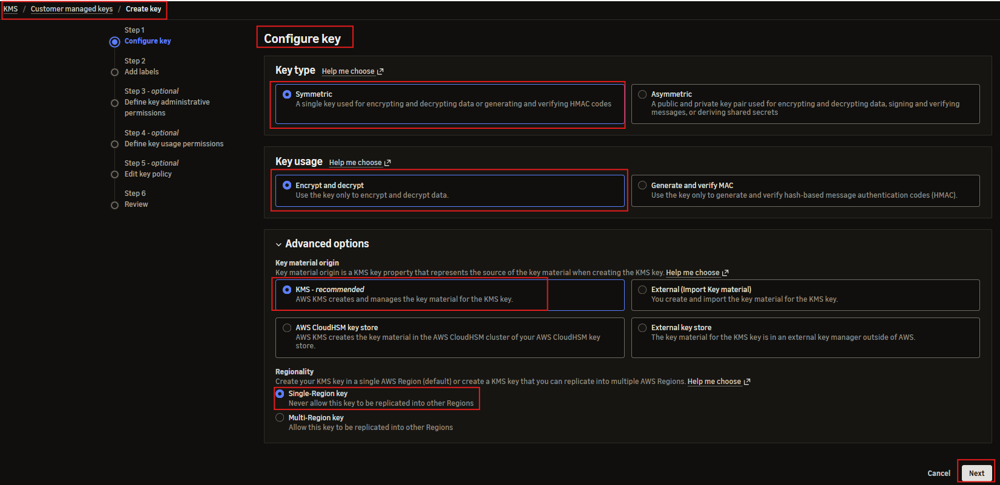</a></td></tr></table>

<p><sub><strong>Screenshot 02:</strong> Symmetric key configuration and advanced options.</sub></p>


### 2.2 Alias and resource identification

I used a descriptive alias to distinguish the application key from AWS-managed keys. Aliases are independently managed references; changing an alias does not re-encrypt data or rotate underlying key material. A key ARN identifies the specific KMS key, whereas an alias ARN identifies the alias resource.

| Label | Value |
| --- | --- |
| Alias | `SY-S3-Encryption-Key` |
| Description | Customer-managed KMS key for Amazon S3 encryption and CloudTrail auditing. |
| Project | `SY-AWS-Training` |
| Environment | `Training` |
| Purpose | `S3Encryption` |
| ManagedBy | `Manual` |

<table><tr><td align="center"><a href="images/screenshot-03.png">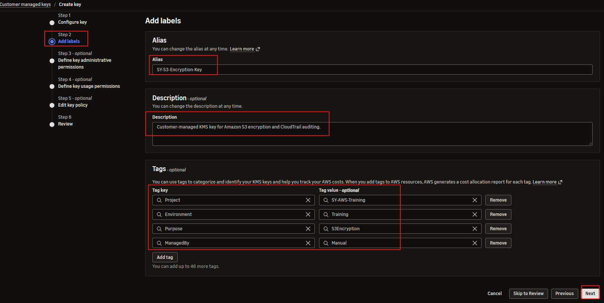</a></td></tr></table>

<p><sub><strong>Screenshot 03:</strong> Key alias, description and resource tags.</sub></p>


### 2.3 Key administrators and key users

I selected IAM user `awsMaster` in both administrative and usage configuration. These are distinct responsibilities: administration includes policy and lifecycle operations, while key usage permits cryptographic operations. An administrator may be able to modify the policy to grant usage, but administrative permissions by themselves are not the same as direct decryption permission.

<table><tr><td align="center"><a href="images/screenshot-04.png">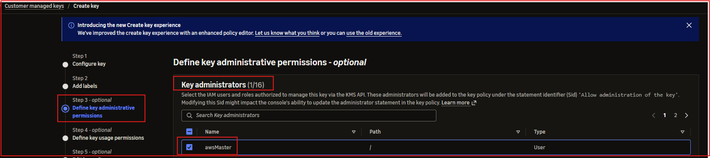</a></td></tr></table>

<p><sub><strong>Screenshot 04:</strong> Key administrator selection.</sub></p>

<table><tr><td align="center"><a href="images/screenshot-05.png">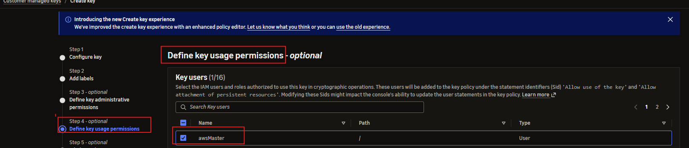</a></td></tr></table>

<p><sub><strong>Screenshot 05:</strong> Key user selection.</sub></p>


In a production deployment I would use separate administrative and application roles, rather than combining the responsibilities in a single IAM user. The account's root user should be reserved for tasks that require root credentials, not routine key management.

### 2.4 Reviewing the generated key policy

The KMS console generated a resource-based policy with an account delegation statement and direct permissions for `awsMaster`. I retained the generated statements during key creation.

| Statement ID | Responsibility |
| --- | --- |
| `Enable IAM User Permissions` | Allows the account to delegate permissions through IAM policies. |
| `Allow access for Key Administrators` | Administrative actions including policy changes, tagging, rotation and scheduled deletion. |
| `Allow use of the key` | `Encrypt`, `Decrypt`, `ReEncrypt*`, `GenerateDataKey*`, `DescribeKey`. |
| `Allow attachment of persistent resources` | `CreateGrant`, `ListGrants`, `RevokeGrant` under an AWS-resource condition. |

The account principal uses a root ARN to represent the account. This does not grant every IAM user unrestricted key access; authorization still depends on the applicable policy. In a key policy, `Resource: "*"` refers to the key to which the policy is attached.

The conditional grant statement uses `kms:GrantIsForAWSResource` with the Boolean value `true`. It restricts the grant-related permissions in that statement to qualifying requests by integrated AWS services on behalf of an authorized principal. Grants can delegate specific cryptographic operations without a permanent broad change to key policy.

<p align="center">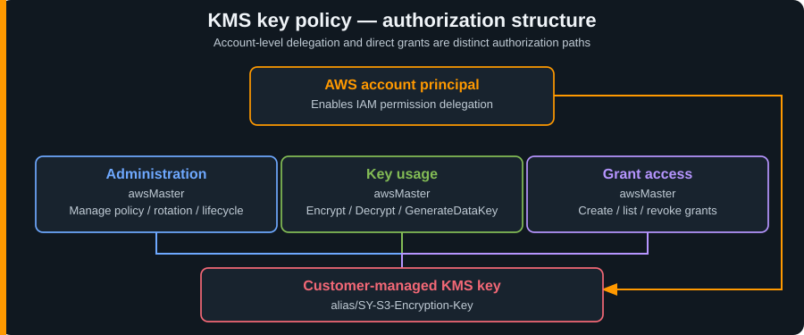</p>

<p><sub><em>Independent account delegation, administrator, user and conditional grant paths in the generated policy.</em></sub></p>

<table><tr><td align="center"><a href="images/screenshot-06.png">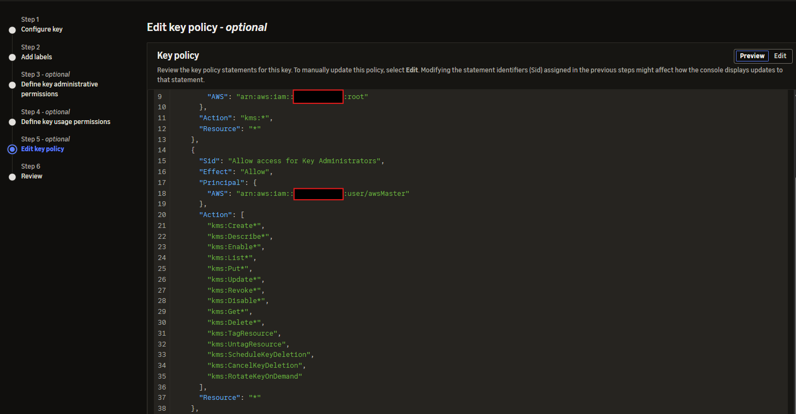</a></td></tr></table>

<p><sub><strong>Screenshot 06:</strong> Account and administrative policy permissions.</sub></p>

<table><tr><td align="center"><a href="images/screenshot-07.png">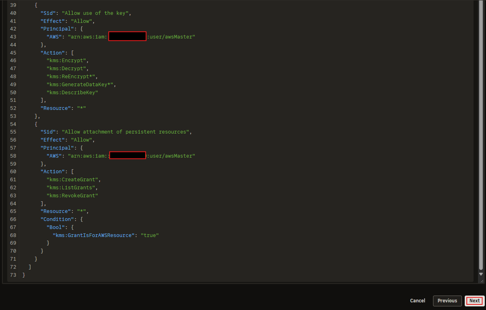</a></td></tr></table>

<p><sub><strong>Screenshot 07:</strong> Cryptographic usage and conditional grant statements.</sub></p>


### 2.5 Creating and verifying the key

I reviewed the key configuration and the IAM principals, then completed creation. KMS assigned a unique key ID and the inventory showed an Enabled state.

<table><tr><td align="center"><a href="images/screenshot-08.png">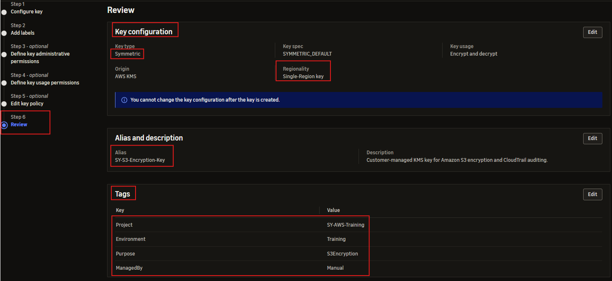</a></td></tr></table>

<p><sub><strong>Screenshot 08:</strong> Final key configuration and tags.</sub></p>

<table><tr><td align="center"><a href="images/screenshot-09.png">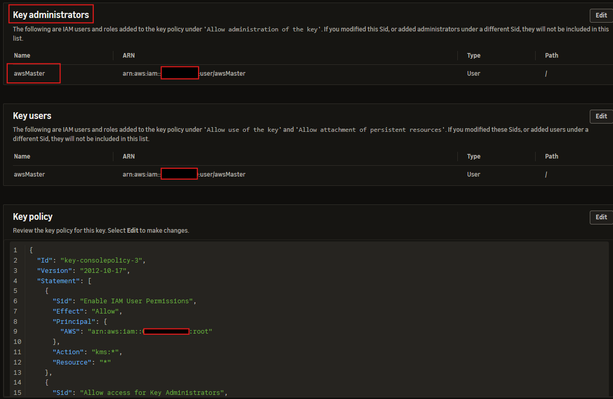</a></td></tr></table>

<p><sub><strong>Screenshot 09:</strong> Administrative and usage principals and the account-level statement.</sub></p>

<table><tr><td align="center"><a href="images/screenshot-10.png">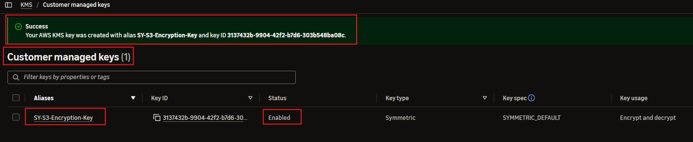</a></td></tr></table>

<p><sub><strong>Screenshot 10:</strong> Successful key creation and Enabled status.</sub></p>


| Resource property | Observed value |
| --- | --- |
| Key ID | `3137432b-9904-42f2-b7d6-303b548ba08c` |
| Alias | `alias/SY-S3-Encryption-Key` |
| Region | `us-east-1` |
| Key status | Enabled |
| Creation date | November 26, 2026, 22:25 PST (console precision: minute) |

### 2.6 Automatic key rotation

I opened **Key material and rotations → Automatic key rotation → Edit**, enabled rotation and set the rotation period to 365 days. Rotation introduces new key material without changing the logical key ID, ARN, alias or policy. KMS retains earlier material to decrypt ciphertext protected by earlier versions of the key. Existing S3 object payloads and their data keys are not automatically re-encrypted by this feature.

<p align="center">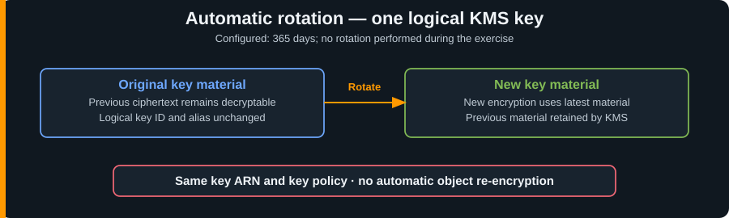</p>

<p><sub><em>Logical KMS key identity remains stable as its material rotates.</em></sub></p>

<table><tr><td align="center"><a href="images/screenshot-11.png">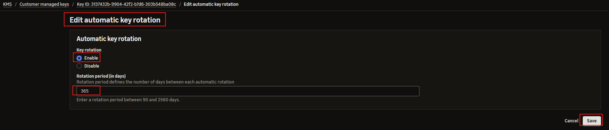</a></td></tr></table>

<p><sub><strong>Screenshot 11:</strong> Automatic rotation configuration with a 365-day interval.</sub></p>

<table><tr><td align="center"><a href="images/screenshot-12.png">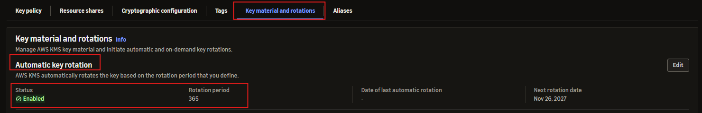</a></td></tr></table>

<p><sub><strong>Screenshot 12:</strong> Saved rotation configuration and scheduled date of November 26, 2027.</sub></p>


No rotation actually occurred during the exercise. Automatic rotation was configured as a lifecycle control, not demonstrated by an on-demand rotation.

> [!TIP]
> **Knowledge check:** Does replacing an alias or enabling automatic rotation re-encrypt existing objects? **Answer:** No. An alias is a pointer, and KMS rotation changes material behind the existing logical key while preserving decryption of earlier ciphertext.

---

## 03 Configuring CloudTrail Auditing

### 3.1 Management, data and other event categories

CloudTrail records AWS API activity, including service calls made on behalf of an identity. Unlike CloudWatch metrics and operational monitoring, CloudTrail provides an API audit record that can answer who performed an operation, which resource was targeted, when it occurred and whether it failed.

| Event type | Purpose | Examples |
| --- | --- | --- |
| Management | Control-plane operations and KMS cryptographic API activity | `CreateKey`, `PutKeyPolicy`, `GenerateDataKey`, `Decrypt` |
| Data | Operations against individual resources | S3 `PutObject`, `GetObject`, `DeleteObject` |
| Insights | Analysis of unusual API call or error rates | API activity anomalies |
| Network activity | Supported API requests through VPC endpoints | Endpoint policy violations |

The CloudTrail Event history view provides 90 days of management events in the selected Region without requiring a trail. S3 object-level data events require a trail or another configured collection mechanism and are not displayed in Event history.

### 3.2 Creating the dedicated trail

I opened CloudTrail and observed that `SYcloudtrail` was already logging. I did not modify it. I created a new trail with its own S3 destination so the KMS investigation could be isolated from the existing log storage. A second management-event copy can incur charges, so the new trail was temporary.

<table><tr><td align="center"><a href="images/screenshot-13.png">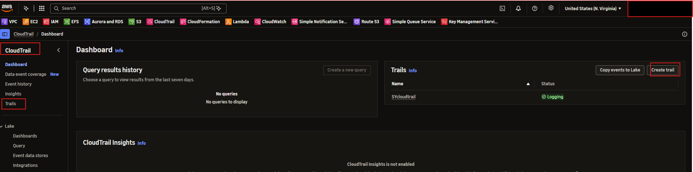</a></td></tr></table>

<p><sub><strong>Screenshot 13:</strong> CloudTrail dashboard showing the existing logging trail.</sub></p>


| Setting | Configuration |
| --- | --- |
| Trail name | `SY-KMS-Audit-Trail` |
| Home Region | `us-east-1` |
| Scope | Multi-Region, account trail |
| Destination | New S3 bucket `sy-awstraining-kms-audit` |
| Log file prefix | No custom prefix |
| Log file SSE-KMS | Disabled; SSE-S3 used for CloudTrail logs |
| Log file validation | Enabled |
| Recursive logging | Disabled |
| SNS delivery | Disabled |
| CloudWatch Logs | Not configured |

Disabling SSE-KMS for log files does not leave the logs unencrypted. It keeps the logs independent of the test key and avoids introducing an additional cryptographic dependency. Log file validation delivers signed digest records that support detection of modified or missing logs; it does not itself prevent their deletion. I did not configure unnecessary notifications or CloudWatch log ingestion.

<table><tr><td align="center"><a href="images/screenshot-14.png">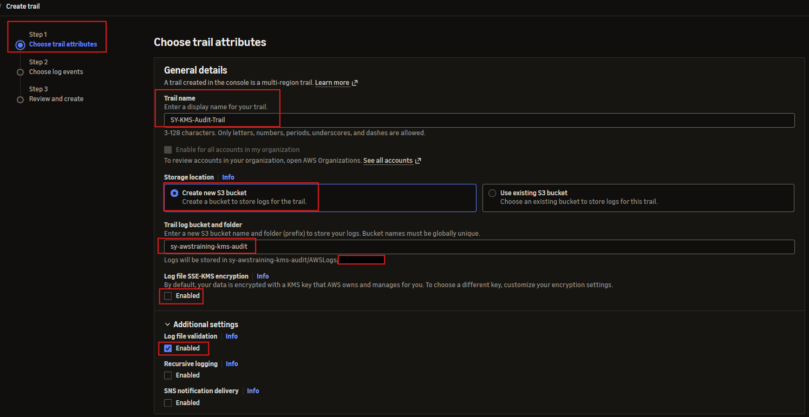</a></td></tr></table>

<p><sub><strong>Screenshot 14:</strong> Trail attributes, separate S3 destination and validation settings.</sub></p>


I tagged the trail with `Project=SY-AWS-Training`, `Environment=Training`, `Purpose=SecurityAuditing` and `ManagedBy=Manual` to identify its ownership and purpose.

<table><tr><td align="center"><a href="images/screenshot-15.png">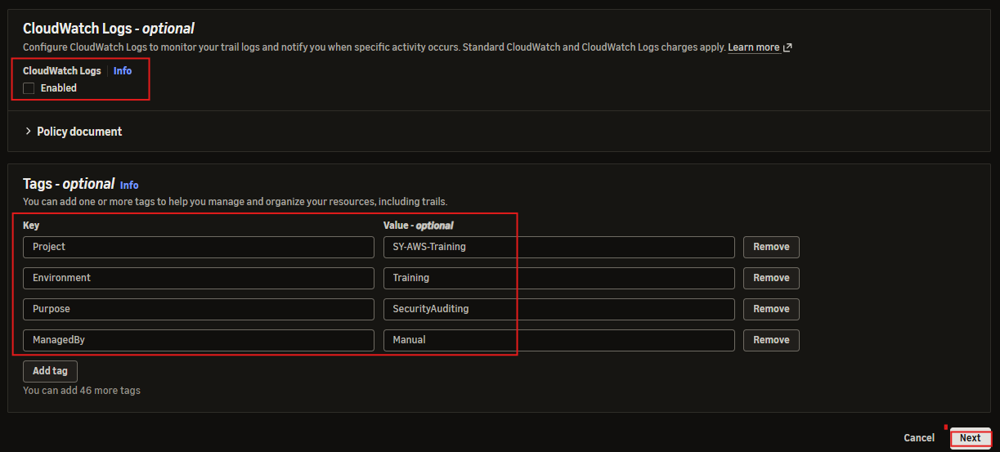</a></td></tr></table>

<p><sub><strong>Screenshot 15:</strong> CloudWatch Logs and resource tags.</sub></p>


### 3.3 Event selection and scope

I enabled both read and write management events and left the KMS and RDS Data API exclusions unchecked. KMS `GenerateDataKey` and `Decrypt` are recorded as read management operations despite their cryptographic purpose. Insights and network activity events were not enabled.

<table><tr><td align="center"><a href="images/screenshot-16.png">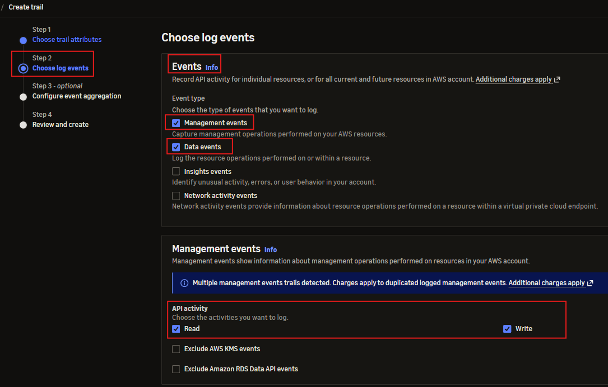</a></td></tr></table>

<p><sub><strong>Screenshot 16:</strong> Management and data event selection.</sub></p>


I used an advanced S3 data selector with an exact bucket-object ARN prefix. Selecting every bucket would produce unnecessary logs and could include the audit destination itself. The trailing slash distinguishes the object prefix from other bucket names. With no `readOnly` filter the selector includes matching read and write events.

| Selector | Configuration |
| --- | --- |
| Resource type | S3 object (`AWS::S3::Object`) |
| Template | Custom |
| Selector name | `SY-S3-Object-Events` |
| Field | `resources.ARN` |
| Operator | Starts with |
| Value | `arn:aws:s3:::sy-awstraining-s3/` |

Equivalent advanced data event selector for reference (not a CLI command executed during this implementation):

```json
{
  "Name": "SY-S3-Object-Events",
  "FieldSelectors": [
    {"Field": "eventCategory", "Equals": ["Data"]},
    {"Field": "resources.type", "Equals": ["AWS::S3::Object"]},
    {"Field": "resources.ARN", "StartsWith": ["arn:aws:s3:::sy-awstraining-s3/"]}
  ]
}
```

<p align="center">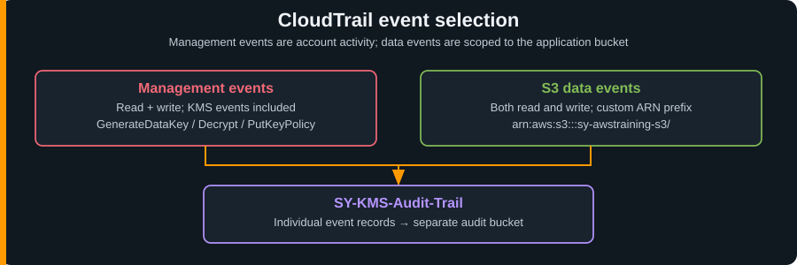</p>

<p><sub><em>Account management events and bucket-scoped S3 data events collected by the temporary trail.</em></sub></p>

<table><tr><td align="center"><a href="images/screenshot-17.png">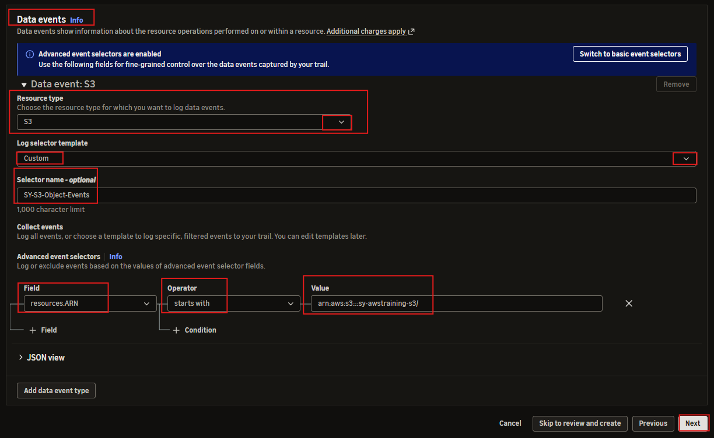</a></td></tr></table>

<p><sub><strong>Screenshot 17:</strong> Custom advanced S3 event selector.</sub></p>


### 3.4 Review and creation

I reviewed the trail settings and event selector before creating the trail. I used individual event records for forensic analysis; the optional event aggregation page was not captured. The success notification showed the new trail in Logging state. This established the audit destination and active collection configuration; delivered records were verified separately.

<table><tr><td align="center"><a href="images/screenshot-18.png">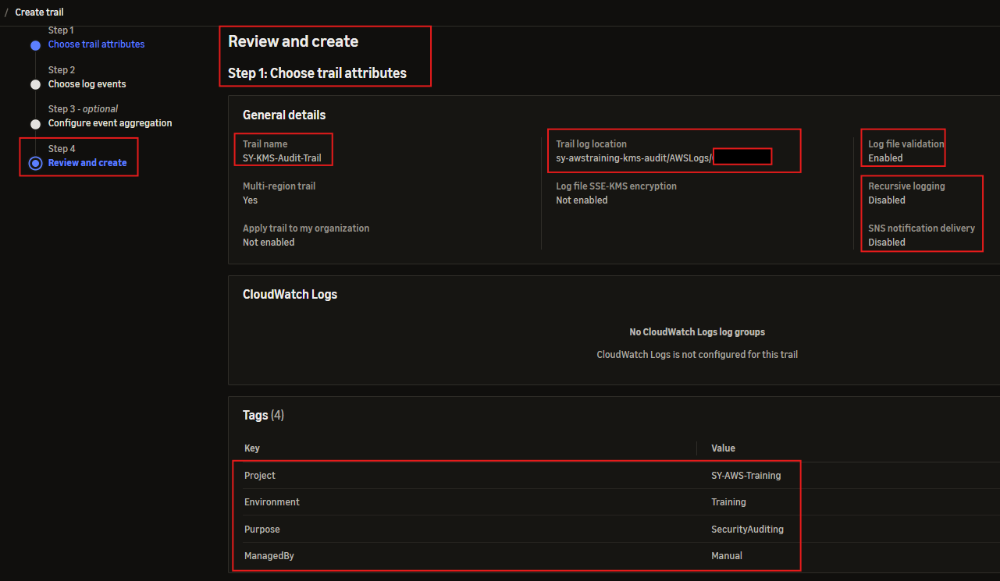</a></td></tr></table>

<p><sub><strong>Screenshot 18:</strong> Final review of trail attributes.</sub></p>

<table><tr><td align="center"><a href="images/screenshot-19.png">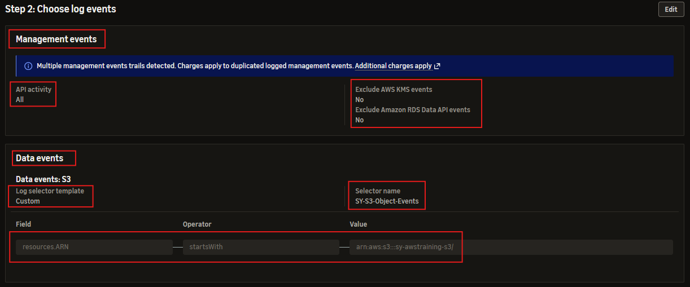</a></td></tr></table>

<p><sub><strong>Screenshot 19:</strong> Final review of management and S3 data events.</sub></p>

<table><tr><td align="center"><a href="images/screenshot-20.png">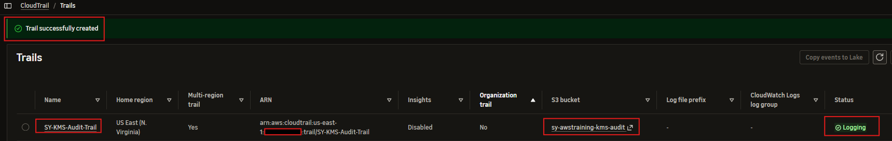</a></td></tr></table>

<p><sub><strong>Screenshot 20:</strong> Successfully created trail with Logging status.</sub></p>


> [!IMPORTANT]
> **SAA-C03 exam connection:** CloudTrail records API calls. CloudWatch provides metrics, alarms and operational log monitoring. Object-level S3 data events are opt-in and may incur additional charges; management-event history alone does not provide a complete object access audit.

---

## 04 Encrypting an S3 Object

### 4.1 Object-level encryption override

I returned to the private versioned `sy-awstraining-s3` bucket. Its existing JSON and TXT objects were created under SSE-S3. I did not change the bucket default encryption, public access or Object Ownership settings. Instead, I staged a JPEG and selected an encryption override for that object alone.

<table><tr><td align="center"><a href="images/screenshot-21.png">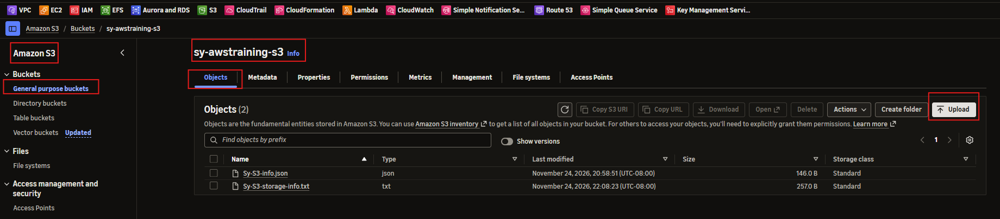</a></td></tr></table>

<p><sub><strong>Screenshot 21:</strong> Existing application bucket inventory.</sub></p>

<table><tr><td align="center"><a href="images/screenshot-22.png">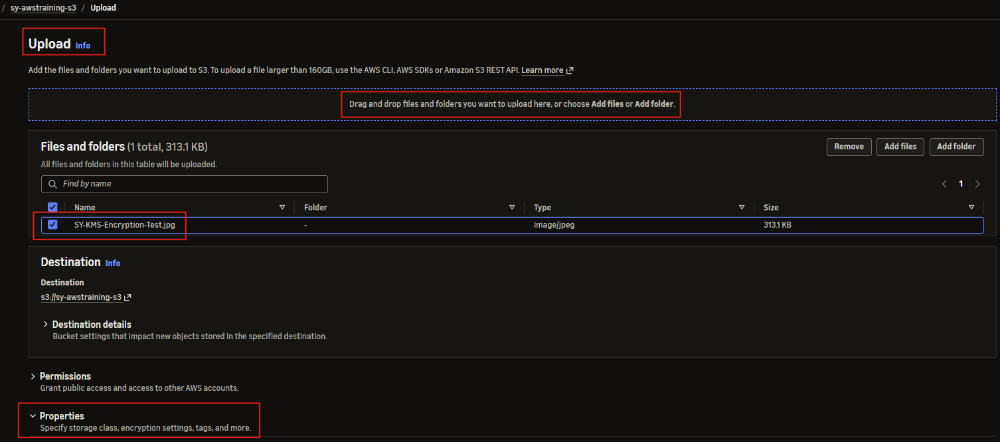</a></td></tr></table>

<p><sub><strong>Screenshot 22:</strong> Staged JPEG upload and destination bucket.</sub></p>


| Setting | Actual configuration |
| --- | --- |
| Object key | `SY-KMS-Encryption-Test.jpg` |
| Size | 313.1 KB (console display) |
| Content type | `image/jpeg` |
| Storage class | Standard |
| Encryption | SSE-KMS, override bucket settings |
| Key | `SY-S3-Encryption-Key` |
| Bucket Key | Disabled (verified in saved properties) |

S3 Standard is suitable for immediate repeated retrieval. Storage class controls storage economics and availability characteristics; it does not determine whether SSE-S3 or SSE-KMS is used. The key selected must be compatible and in the same Region as the bucket.

<table><tr><td align="center"><a href="images/screenshot-23.png">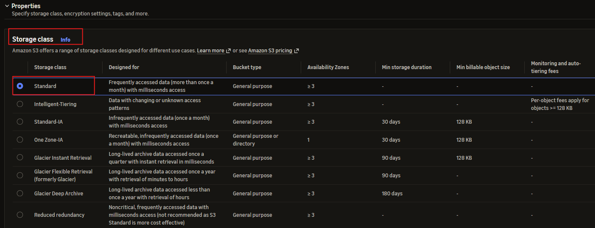</a></td></tr></table>

<p><sub><strong>Screenshot 23:</strong> S3 Standard storage class.</sub></p>

<table><tr><td align="center"><a href="images/screenshot-24.png">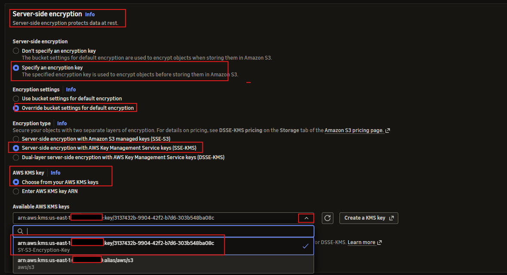</a></td></tr></table>

<p><sub><strong>Screenshot 24:</strong> SSE-KMS override and customer-managed key selection.</sub></p>


### 4.2 S3 Bucket Keys

S3 Bucket Keys reduce calls to KMS by using a short-lived bucket-level key to derive unique data keys for objects. In high-volume production workloads this can reduce KMS request costs by up to 99%, depending on the workload. Bucket Keys also change the typical KMS encryption context from the object ARN to the bucket ARN. This matters when writing context-based KMS policy conditions and when expecting per-object KMS audit events.

<p align="center">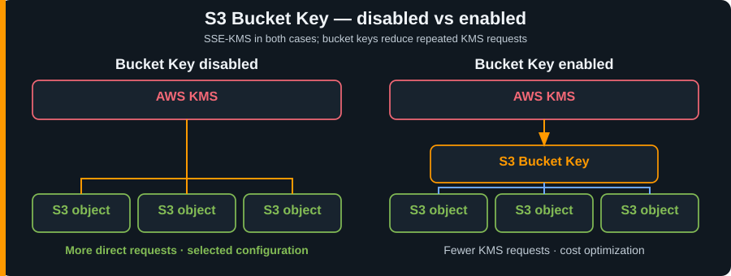</p>

<p><sub><em>Bucket Key disabled versus enabled; both configurations retain SSE-KMS encryption.</em></sub></p>


I used Bucket Key disabled to make cryptographic activity easier to correlate with the individual JPEG and to support an object-specific decryption denial. This was an intentional observability choice rather than a general production recommendation.

### 4.3 Verifying applied encryption

The upload succeeded with zero failures. I inspected the saved object properties to distinguish selected encryption settings from the actual applied configuration. The last-modified timestamp established an investigation reference of November 27, 2026, 06:55:30 UTC (November 26, 22:55:30 PST). The saved encryption settings confirmed the customer-managed key ARN and disabled Bucket Key.

<table><tr><td align="center"><a href="images/screenshot-25.png">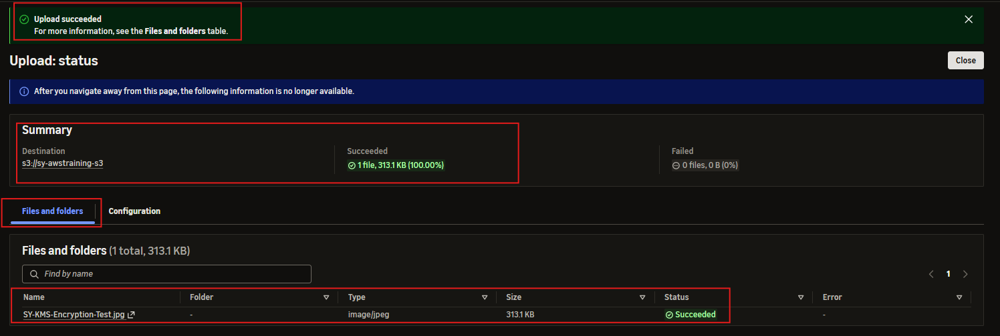</a></td></tr></table>

<p><sub><strong>Screenshot 25:</strong> Successful upload of the JPEG.</sub></p>

<table><tr><td align="center"><a href="images/screenshot-26.png">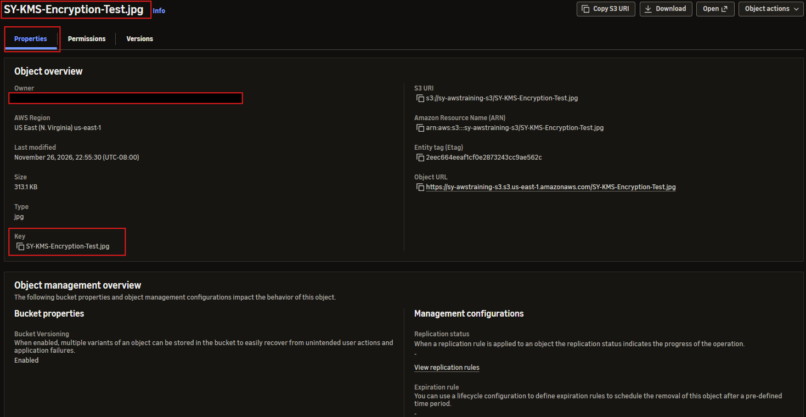</a></td></tr></table>

<p><sub><strong>Screenshot 26:</strong> Object overview, S3 identifiers and last-modified timestamp.</sub></p>

<table><tr><td align="center"><a href="images/screenshot-27.png">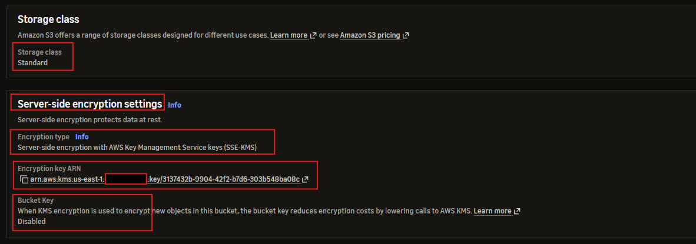</a></td></tr></table>

<p><sub><strong>Screenshot 27:</strong> Applied SSE-KMS encryption and disabled Bucket Key.</sub></p>


> [!NOTE]
> Changing the bucket's default encryption does not retroactively re-encrypt existing objects. A write or copy with the desired encryption settings is required to replace the stored encryption configuration of existing data.

---

## 05 Testing Object Access

### 5.1 Signed retrieval

I opened the JPEG through the S3 console. The resulting signed URL allowed the browser to display the original image. S3 authorized the retrieval and KMS supplied the necessary decryption authorization. The delivered plaintext image was not an indication that the stored object had become unencrypted; server-side decryption occurs during retrieval.

<table><tr><td align="center"><a href="images/screenshot-28.png">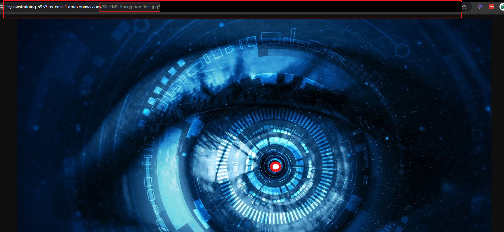</a></td></tr></table>

<p><sub><strong>Screenshot 28:</strong> Successful signed retrieval of the SSE-KMS object.</sub></p>


The signature parameters authenticate the request; they are not a permanent public-access grant. Signed URLs should be treated as sensitive bearer URLs while valid. The original operations in this section were performed using the root session, with `awsMaster` tested separately in Section 07.

### 5.2 Anonymous access rejection

I opened the object's direct URL without its query parameters:

```text
https://sy-awstraining-s3.s3.us-east-1.amazonaws.com/SY-KMS-Encryption-Test.jpg
```

The request returned `AccessDenied`. I did not enable ACLs or disable Block Public Access. The anonymous test confirms that unsigned access did not retrieve the object but does not isolate the specific contribution of KMS permissions, since S3 authorization also applies. The controlled IAM test later isolates the cryptographic denial.

<p align="center">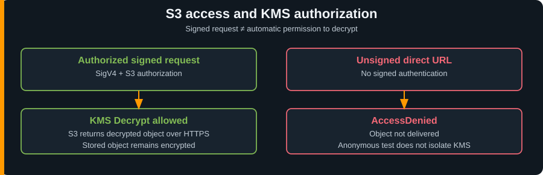</p>

<p><sub><em>Signed and unsigned object access paths.</em></sub></p>

<table><tr><td align="center"><a href="images/screenshot-29.png">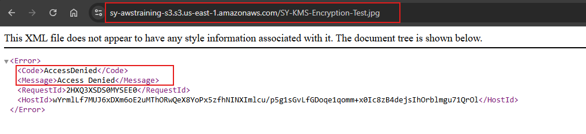</a></td></tr></table>

<p><sub><strong>Screenshot 29:</strong> Unsigned object URL returning AccessDenied.</sub></p>


> [!IMPORTANT]
> A principal retrieving an SSE-KMS object generally needs both `s3:GetObject` and applicable `kms:Decrypt` authorization. Upload with SSE-KMS requires `kms:GenerateDataKey` authorization; multipart workflows may additionally require `kms:Decrypt`.

---

## 06 Investigating CloudTrail Records

### 6.1 Locating compressed audit logs

I navigated to the dedicated log destination in S3. CloudTrail groups log objects by account, service, Region and UTC date. The object was uploaded late in the evening local time, so its corresponding UTC records belonged to the following calendar date.

```text
sy-awstraining-kms-audit/
└── AWSLogs/<ACCOUNT-ID>/CloudTrail/us-east-1/2026/11/27/
    └── <ACCOUNT-ID>_CloudTrail_us-east-1_20261127T0700Z_<unique-suffix>.json.gz
```

The first inventory contained nine log objects: two with `T0650Z`, one with `T0655Z`, four with `T0700Z`, and two with `T0705Z`. The timestamp in a filename describes log delivery-related time, not the exact occurrence time of every event within it. Multiple files can share a timestamp because their unique suffixes differ.

<table><tr><td align="center"><a href="images/screenshot-30.png">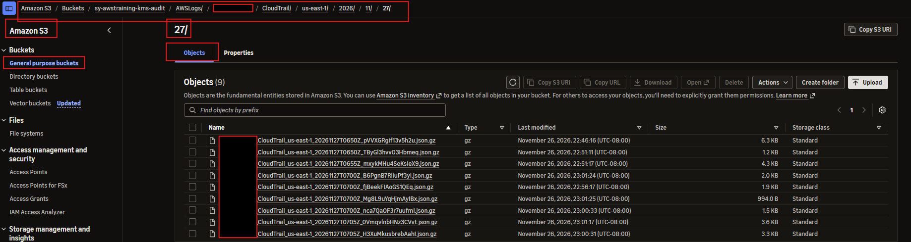</a></td></tr></table>

<p><sub><strong>Screenshot 30:</strong> Delivered CloudTrail compressed logs in the November 27 UTC prefix.</sub></p>


I downloaded candidate `.json.gz` files, extracted their JSON contents and formatted the single-line JSON in VS Code. The original compressed files can be preserved for integrity verification; formatting extracted copies does not validate log integrity. I searched for the KMS Key ID, event name and object key. A key ID can appear several times within one event, so raw search-match counts do not equal API operation counts.

### 6.2 GenerateDataKey evidence

The located KMS record linked the customer-managed key directly to the JPEG through its encryption context. Its event time preceded the S3 last-modified timestamp by one second. This is consistent with the data key being generated before the object was stored.

| Field | Observed value |
| --- | --- |
| `eventTime` | `2026-11-27T06:55:29Z` |
| `eventSource` | `kms.amazonaws.com` |
| `eventName` | `GenerateDataKey` |
| `awsRegion` | `us-east-1` |
| `sourceIPAddress` / `userAgent` | `fas.s3.amazonaws.com` |
| `keySpec` | `AES_256` |
| `keyId` | ARN containing `3137432b-9904-42f2-b7d6-303b548ba08c` |
| `responseElements` | `null` |

<table><tr><td align="center"><a href="images/screenshot-31.png">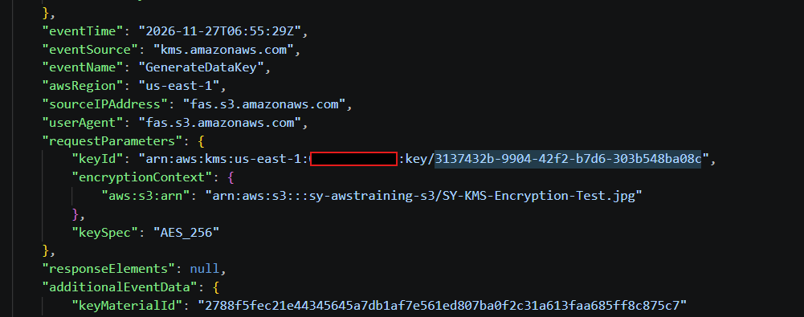</a></td></tr></table>

<p><sub><strong>Screenshot 31:</strong> GenerateDataKey operation showing the KMS key and exact S3 object encryption context.</sub></p>


The `fas.s3.amazonaws.com` values indicate a service-mediated request through a Forward Access Session (FAS). S3 used the requesting identity's authorization to make the downstream KMS request. `responseElements: null` is expected for this record: CloudTrail does not disclose the returned data key. The key material identifier is not raw cryptographic material.

The encryption context is additional authenticated data for symmetric KMS operations. It binds the cryptographic operation to a nonsecret context, and KMS can use it in authorization conditions. Here, the context contains:

```json
{"aws:s3:arn": "arn:aws:s3:::sy-awstraining-s3/SY-KMS-Encryption-Test.jpg"}
```

### 6.3 Decrypt evidence

I searched a later `T0705Z` log and found `Decrypt`. Its object ARN, KMS key ID and key material ID matched the encryption event. The event timestamp itself was outside the screenshot; I did not substitute the filename timestamp as the event time.

| Field | Observed value |
| --- | --- |
| `eventName` | `Decrypt` |
| `eventSource` | `kms.amazonaws.com` |
| `awsRegion` | `us-east-1` |
| `encryptionAlgorithm` | `SYMMETRIC_DEFAULT` |
| `readOnly` | `true` |
| Resource type | `AWS::KMS::Key` |
| Encryption context | Exact JPEG object ARN |
| `responseElements` | `null` |

<table><tr><td align="center"><a href="images/screenshot-32.png">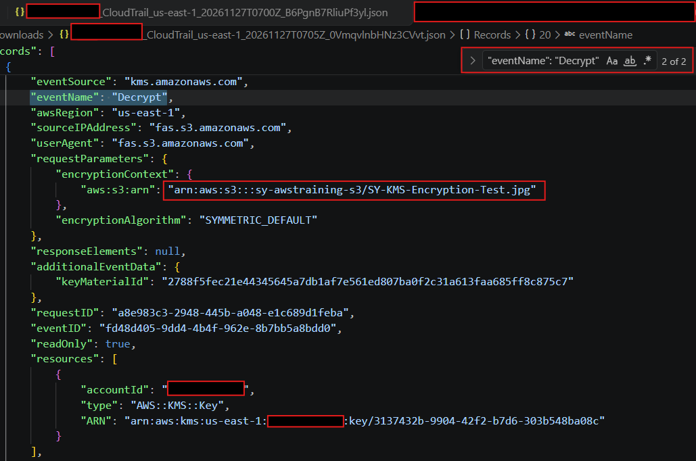</a></td></tr></table>

<p><sub><strong>Screenshot 32:</strong> Decrypt record with matching encryption context and KMS resource ARN.</sub></p>


### 6.4 Troubleshooting the initial data event search

The first three downloaded files contained the KMS records but did not yield the `PutObject` or `GetObject` records. A `PreflightRequest` match was not evidence of a completed upload: CORS preflight checks are a separate operation. I checked the active trail's selector and confirmed the correct bucket ARN prefix without modifying it.

<table><tr><td align="center"><a href="images/screenshot-33.png">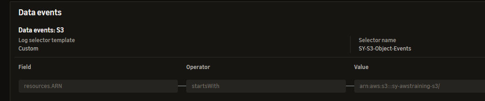</a></td></tr></table>

<p><sub><strong>Screenshot 33:</strong> Active custom S3 advanced event selector.</sub></p>


Rather than repeatedly searching historical files, I initiated a fresh object download at approximately 23:36 PST (07:36 UTC). This provided a precise search window and an identifiable attachment request. I inspected the resulting data event later, while the permission experiment proceeded.

---

## 07 Testing and Restoring KMS Permissions

### 7.1 Establishing the IAM baseline

I signed in as `awsMaster` in a separate browser session and successfully opened the image before restricting permissions. The baseline success was observed and reported, but no separate baseline screenshot was captured. I retained the existing authorized session for recovery.

Simply removing `awsMaster` from the key users statement might not revoke access if the account delegation statement and broad IAM permissions still authorize KMS operations. An existing grant might also authorize usage. I therefore chose an explicit Deny, limited to `kms:Decrypt` for the single object and the single IAM principal. This provides an attributable authorization test while preserving key policy administration.

<table><tr><td align="center"><a href="images/screenshot-34.png">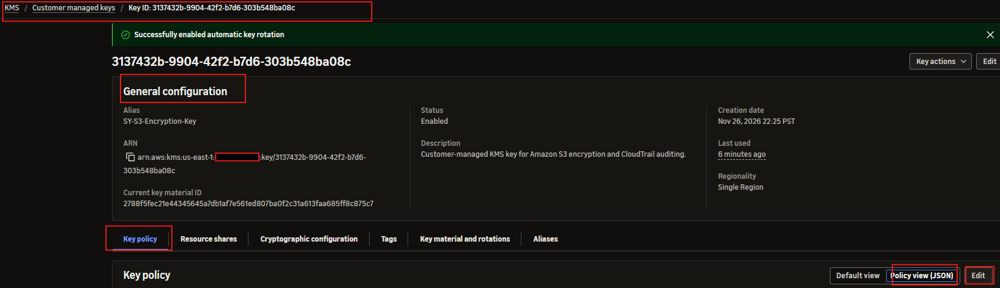</a></td></tr></table>

<p><sub><strong>Screenshot 34:</strong> KMS general configuration and JSON policy view.</sub></p>


### 7.2 Appending an explicit Deny

I appended the following statement to the existing `Statement` array of the key policy. The actual account ID is replaced with a syntactically valid example account ID; substitute your own ID when reproducing the example. Preserve the preceding policy statements and include a comma between array elements. Before editing a production policy, export a backup and verify a separate recovery principal can administer it.

```json
{
  "Sid": "TemporaryDenyS3ObjectDecryption",
  "Effect": "Deny",
  "Principal": {
    "AWS": "arn:aws:iam::111122223333:user/awsMaster"
  },
  "Action": "kms:Decrypt",
  "Resource": "*",
  "Condition": {
    "StringEquals": {
      "kms:EncryptionContext:aws:s3:arn": "arn:aws:s3:::sy-awstraining-s3/SY-KMS-Encryption-Test.jpg"
    }
  }
}
```

| Element | Why it matters |
| --- | --- |
| `Effect: Deny` | Overrides an applicable Allow. |
| `Principal` | Targets only the named IAM user. |
| `kms:Decrypt` | Restricts decryption, not policy administration. |
| `Resource: "*"` | Refers to the current KMS key in this resource policy. |
| `StringEquals` | Requires an exact encryption context match. |

The earlier `GenerateDataKey` and `Decrypt` records establish the actual object-level encryption context. Bucket Key disabled made that condition appropriate for this test; it would need to be reconsidered for bucket-level encryption context.

<table><tr><td align="center"><a href="images/screenshot-35.png">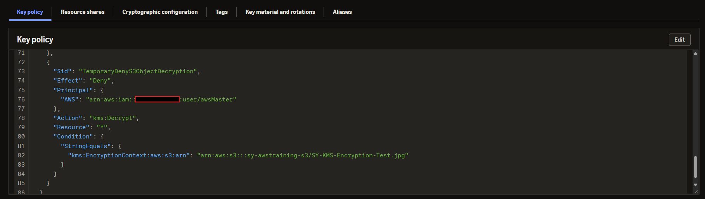</a></td></tr></table>

<p><sub><strong>Screenshot 35:</strong> Appended object-specific KMS Deny statement.</sub></p>


### 7.3 Verifying the denial

I made a new signed request as `awsMaster`. The returned XML specifically stated that the principal was not authorized to perform `kms:Decrypt` because of an explicit deny in a resource-based policy. The root session could still retrieve the JPEG, as observed during the comparison. The root principal was not targeted by the statement; this does not mean root universally bypasses KMS policies.

<table><tr><td align="center"><a href="images/screenshot-36.png">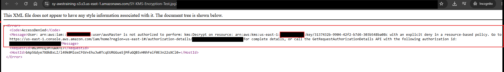</a></td></tr></table>

<p><sub><strong>Screenshot 36:</strong> Explicit KMS decryption denial for the IAM user.</sub></p>


### 7.4 Restoring access

I reversed the temporary restriction and successfully opened the JPEG again as `awsMaster`. This verified recovery of effective access. The complete restored JSON was not captured separately, so a byte-for-byte comparison with the initial policy was not performed. To reproduce the restoration, remove the temporary statement and its preceding comma (or restore the saved original policy if no other changes were made), save, and issue a fresh signed request.

<table><tr><td align="center"><a href="images/screenshot-37.png">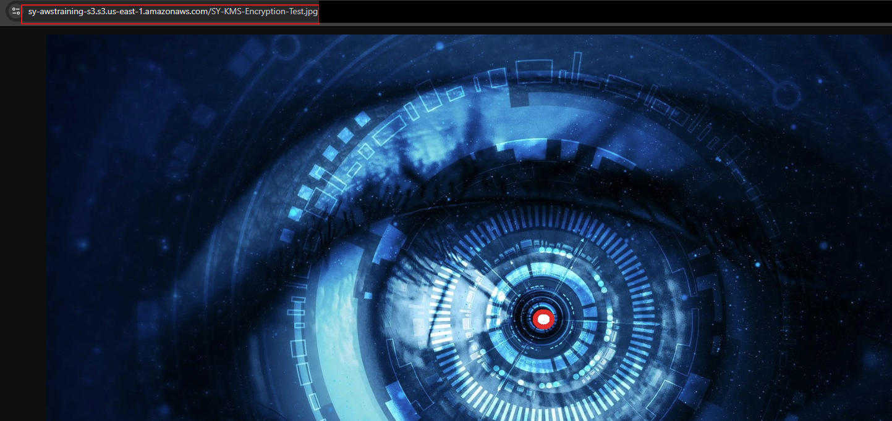</a></td></tr></table>

<p><sub><strong>Screenshot 37:</strong> Successful signed retrieval after reversing the restriction.</sub></p>

<p align="center">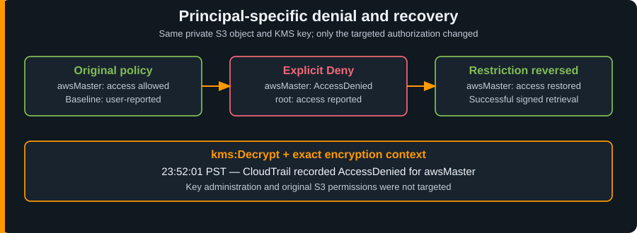</p>

<p><sub><em>Principal-specific decryption restriction and recovery.</em></sub></p>


### 7.5 Auditing the failed cryptographic request

I opened **CloudTrail → Event history**, removed the default read-only filter and looked up `Decrypt`. Unlike S3 data events, KMS management events can be inspected directly in this view. The event detail confirmed the denied operation.

| Field | Observed value |
| --- | --- |
| User | `awsMaster` |
| Event source / name | `kms.amazonaws.com` / `Decrypt` |
| Local time | Nov 26, 2026, 23:52:01 PST |
| UTC time | Nov 27, 2026, 07:52:01 UTC |
| Error code | `AccessDenied` |
| Read-only | `true` |
| Source IP | `fas.s3.amazonaws.com` |
| Event ID | `5119e327-8a16-4b55-b8d3-9751c826bb2f` |

<table><tr><td align="center"><a href="images/screenshot-38.png">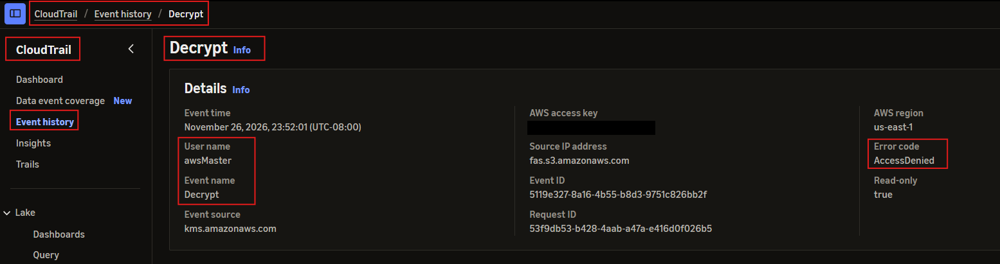</a></td></tr></table>

<p><sub><strong>Screenshot 38:</strong> CloudTrail detail for the denied Decrypt operation.</sub></p>

<table><tr><td align="center"><a href="images/screenshot-39.png">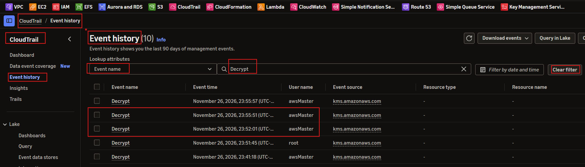</a></td></tr></table>

<p><sub><strong>Screenshot 39:</strong> Decrypt event history across the two identities.</sub></p>


| Local event time | Identity | Interpretation |
| --- | --- | --- |
| 23:41:18 | `awsMaster` | Baseline retrieval period. |
| 23:51:45 | root | Comparison retrieval period. |
| 23:52:01 | `awsMaster` | AccessDenied individually verified. |
| 23:55:51–23:55:57 | `awsMaster` | Restoration retrieval period. |

Only the denied event's detailed status was inspected in this Event history view. The other outcomes are correlated with the observed access tests, not independently inferred solely from the event list.

> [!IMPORTANT]
> **SAA-C03 exam connection:** Explicit Deny overrides Allow. S3 access and KMS key access are separate requirements. Restricting the use of a key can prevent access to encrypted data even when the object still exists and S3 permissions are unchanged.

---

## 08 Verifying S3 Data Events

### 8.1 Fresh retrieval evidence

I returned to the audit destination and selected seven candidate log files across the `T0740Z` and `T0745Z` filename groups. The exact retrieval appeared in a `T0740Z` JSON file. It was recorded at 07:36:02 UTC, matching the fresh download initiated at about 23:36 PST.

<table><tr><td align="center"><a href="images/screenshot-40.png">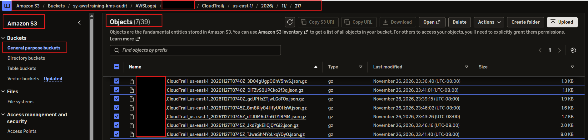</a></td></tr></table>

<p><sub><strong>Screenshot 40:</strong> Candidate log files for the fresh download.</sub></p>

<table><tr><td align="center"><a href="images/screenshot-41.png">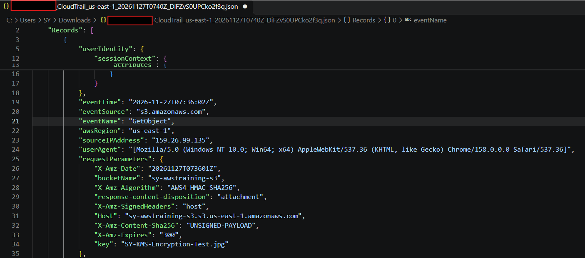</a></td></tr></table>

<p><sub><strong>Screenshot 41:</strong> GetObject event and signed request parameters.</sub></p>


| JSON field | Observed value |
| --- | --- |
| `eventName` | `GetObject` |
| `eventSource` | `s3.amazonaws.com` |
| `eventTime` | `2026-11-27T07:36:02Z` |
| `awsRegion` | `us-east-1` |
| `bucketName` | `sy-awstraining-s3` |
| `key` | `SY-KMS-Encryption-Test.jpg` |
| `X-Amz-Date` | `20261127T073601Z` |
| `X-Amz-Algorithm` | `AWS4-HMAC-SHA256` |
| `X-Amz-Expires` | `300` seconds |
| `response-content-disposition` | `attachment` |
| `X-Amz-Content-Sha256` | `UNSIGNED-PAYLOAD` |
| `X-Amz-SignedHeaders` | `host` |

The `attachment` disposition is consistent with the Download action rather than inline display. `UNSIGNED-PAYLOAD` describes the payload-hash treatment, not an unsigned request: SigV4 still authenticates the request. The `X-Amz-Date` and expiration interval define the five-minute signed URL window, subject also to validity of its underlying credentials.

### 8.2 Correlating service-level records

<p align="center"></p>

<p><sub><em>Observed event and object timestamps; the Decrypt filename group is not an exact event timestamp.</em></sub></p>


| Operation | Audit category | Evidence |
| --- | --- | --- |
| KMS GenerateDataKey | Management | Key ID, object context, AES-256, timestamp. |
| KMS Decrypt | Management | Matching key ID, context and material identifier. |
| KMS Decrypt denied | Management | IAM identity, error code and event time. |
| S3 GetObject | Data | Exact object key, bucket, event time and signed parameters. |
| S3 PutObject | Data | Not located in the inspected files; upload independently verified through S3. |

The GetObject record verifies that the scoped data event selector collected the requested resource-level activity. It does not establish that every configured write event was observed. I did not continue searching additional logs after locating sufficient data event evidence.

---

## 09 Resource Cleanup

### 9.1 Stopping and deleting the temporary trail

I stopped logging on `SY-KMS-Audit-Trail` after completing the investigations to avoid continued duplicate management-event charges. The console showed the last log delivery at November 27, 00:06:52 PST and last validation delivery at November 26, 23:13:31 PST. Digest delivery was observed, but I did not independently validate the delivered logs.

<table><tr><td align="center"><a href="images/screenshot-42.png"></a></td></tr></table>

<p><sub><strong>Screenshot 42:</strong> Temporary trail before logging was stopped.</sub></p>

<table><tr><td align="center"><a href="images/screenshot-43.png"></a></td></tr></table>

<p><sub><strong>Screenshot 43:</strong> Temporary trail status Off.</sub></p>

<table><tr><td align="center"><a href="images/screenshot-44.png"></a></td></tr></table>

<p><sub><strong>Screenshot 44:</strong> Both trails: temporary trail Off, existing SYcloudtrail Logging.</sub></p>


I then deleted the temporary trail (deletion reported; no separate final deletion screenshot). I left `SYcloudtrail` and `sy-aws-cloudtrailer` unchanged. Removing a trail does not automatically remove its log bucket or previously delivered objects.

### 9.2 Removing the audit bucket

I selected only `sy-awstraining-kms-audit` for emptying and deletion. Required evidence was captured from downloaded logs before the cleanup. Deleting audit records is appropriate only for this temporary training destination; production logs must follow approved retention and investigation requirements.

<table><tr><td align="center"><a href="images/screenshot-45.png"></a></td></tr></table>

<p><sub><strong>Screenshot 45:</strong> Dedicated audit bucket selected for emptying.</sub></p>

<table><tr><td align="center"><a href="images/screenshot-46.png"></a></td></tr></table>

<p><sub><strong>Screenshot 46:</strong> Dedicated audit bucket selected for deletion.</sub></p>

<table><tr><td align="center"><a href="images/screenshot-47.png"></a></td></tr></table>

<p><sub><strong>Screenshot 47:</strong> Bucket deletion confirmation with the exact bucket name entered.</sub></p>


The deletion workflow was captured through the confirmation page; the final bucket deletion result was not independently verified.

### 9.3 Permanently deleting the encrypted JPEG

I opened the application bucket with **Show versions** enabled and selected only the JPEG version. An ordinary delete in a versioned bucket creates a delete marker and leaves the prior encrypted payload recoverable. To eliminate the known KMS dependency, I permanently deleted the specific version rather than simply hiding the current key. The remaining inventory confirmed the JPEG was no longer present.

<table><tr><td align="center"><a href="images/screenshot-48.png"></a></td></tr></table>

<p><sub><strong>Screenshot 48:</strong> Only the SSE-KMS JPEG version selected for deletion.</sub></p>

<table><tr><td align="center"><a href="images/screenshot-49.png"></a></td></tr></table>

<p><sub><strong>Screenshot 49:</strong> Retained original JSON and TXT object versions after cleanup.</sub></p>


| Retained object | Version | Size |
| --- | --- | ---: |
| `Sy-S3-info.json` | Current, null | 146 B |
| `Sy-S3-storage-info.txt` | Current | 257 B |
| `Sy-S3-storage-info.txt` | Noncurrent | 257 B |
| `Sy-S3-storage-info.txt` | Original, null | 137 B |
| **Total** | **Four stored versions** | **797 B** |

### 9.4 Scheduling KMS key deletion

The JPEG was the only known object encrypted under the new KMS key; I had not changed the default bucket encryption, and the audit logs used SSE-S3. KMS does not maintain a complete inventory of all encrypted dependencies, so a production deletion requires broader inventory and usage review. I selected the specific key, chose **Schedule key deletion**, and entered the minimum seven-day waiting period.

<p align="center"></p>

<p><sub><em>Dependency-aware teardown and the key deletion waiting period.</em></sub></p>

<table><tr><td align="center"><a href="images/screenshot-50.png"></a></td></tr></table>

<p><sub><strong>Screenshot 50:</strong> Customer-managed key selected for scheduled deletion.</sub></p>

<table><tr><td align="center"><a href="images/screenshot-51.png"></a></td></tr></table>

<p><sub><strong>Screenshot 51:</strong> Seven-day waiting period and acknowledgment of irreversible deletion.</sub></p>

<table><tr><td align="center"><a href="images/screenshot-52.png"></a></td></tr></table>

<p><sub><strong>Screenshot 52:</strong> Successful scheduling and Pending deletion status.</sub></p>


The key became unavailable for cryptographic operations immediately. During the waiting period deletion can be canceled, after which the key is Disabled and must be re-enabled if needed. Once permanent deletion occurs, KMS cannot recover the original key material, and any remaining dependent ciphertext becomes unrecoverable. The anticipated deletion date was December 4, 2026, subject to AWS processing; actual permanent deletion was not observed.

### 9.5 Final resource state

| Resource | Final state |
| --- | --- |
| `SY-S3-Encryption-Key` | Pending deletion, 7-day window verified. |
| `SY-KMS-Audit-Trail` | Deletion reported; logging Off verified beforehand. |
| `sy-awstraining-kms-audit` | Deletion initiated; final result not independently verified. |
| `SY-KMS-Encryption-Test.jpg` | Permanently deleted; absent from version inventory. |
| `sy-awstraining-s3` | Retained with original four object versions. |
| `SYcloudtrail` | Retained; Logging at last inspection. |
| `sy-aws-cloudtrailer` | Retained. |
| `awsMaster` | Retained. |

---

## 10 AWS Cost Estimate

### 10.1 Illustrative monthly workload

The following on-demand estimate models a hypothetical 730-hour month in `us-east-1` if the temporary architecture were retained. Usage quantities are assumptions, not measured billing or event counts. Duplicate management event charges apply to additional delivered copies of management events. The calculation excludes credits and eligible free allowances, data transfer charges (assumed within available allowance), and the existing resources' baseline costs.

| Component | Monthly assumption | Unit rate | Estimated cost |
| --- | ---: | ---: | ---: |
| Customer-managed KMS key | 1 | $1/key-month | $1.00000 |
| Symmetric KMS requests | 1,000 | $0.03/10,000 | $0.00300 |
| Duplicate management events | 10,000 | $2/100,000 | $0.20000 |
| S3 data events | 1,000 | $0.10/100,000 | $0.00100 |
| S3 Standard storage | 0.01 GB | $0.023/GB-month | $0.00023 |
| S3 PUT/LIST requests | 1,000 | $0.005/1,000 | $0.00500 |
| S3 GET requests | 1,000 | $0.0004/1,000 | $0.00040 |
| **Total** | | | **$1.20963** |

<p align="center"></p>

<p><sub><em>Illustrative monthly cost allocation if the architecture remained active.</em></sub></p>


AWS KMS provides 20,000 eligible requests per month across Regions; if the allowance remained available, these assumed symmetric requests would incur no usage fee. Automatic rotation configuration does not itself add a rotation charge before a rotation occurs; the first two actual rotations each add a prorated monthly key-material charge under current pricing.

### 10.2 Actual duration and cost controls

The key was created at approximately 22:25 PST on November 26 and entered Pending deletion at approximately 00:23 PST on November 27, about two hours later. At $1 per 730 hours, the illustrative prorated key-storage cost is approximately $0.003 for that interval. AWS does not charge for a key while it is pending deletion unless the deletion is canceled, in which case the pending period is billed. Actual billed charges and request volumes were not measured.

I limited the S3 data selector to one application bucket, disabled Insights and CloudWatch Logs delivery, avoided a separate audit KMS key, stopped the temporary trail and scheduled deletion of the no-longer-needed key. A production workload with frequent SSE-KMS operations could benefit from enabling S3 Bucket Keys, after evaluating the resulting policy and audit implications.

---

## 11 SAA-C03 Review and Production Considerations

### 11.1 Knowledge checks

| Question | Answer and reason |
| --- | --- |
| A user has `s3:GetObject` but lacks `kms:Decrypt`. Can they retrieve an SSE-KMS object? | No, applicable cryptographic authorization is also required. |
| Does automatic KMS rotation change the key ARN? | No. The logical key remains the same and earlier material is retained for decryption. |
| Can an IAM Allow override the explicit Deny in a key policy? | No. Applicable explicit Deny takes precedence. |
| Why use separate log and application buckets? | Separation of access, retention and encryption dependencies helps preserve audit availability. |
| Does CloudTrail Event history display S3 GetObject data events? | No. Configure data event collection and inspect delivered logs or an appropriate query facility. |
| Why is `GenerateDataKey` recorded as a management event? | KMS categorizes its API activity as management events; read-only classification is separate from data encryption semantics. |
| Does a delete marker remove the KMS dependency? | No. It hides the key from ordinary retrieval while encrypted versions can remain stored. |
| Can a deleted KMS key be recovered? | Only scheduled deletion can be canceled. Permanent deletion cannot be reversed. |
| Why can S3 Bucket Keys affect a KMS policy? | The encryption context changes to the bucket ARN and fewer requests go directly to KMS. |
| Is a signed URL proof of permission to decrypt? | No. Signature validity and S3 authorization do not override a KMS denial. |

### 11.2 Production design considerations

Use federated access and short-lived role credentials for administrative and application tasks. Avoid routine root use. Separate key administrators from users and grant the smallest necessary cryptographic permissions, taking IAM delegation, grants, conditions and service integration into account. Do not remove the account delegation or recovery authorization casually; preserve a controlled recovery path.

Use a dedicated log account or centrally managed audit destination for organizational workloads. Restrict audit bucket access to approved security identities and log delivery, validate digest chains where required, and define retention before any deletion. Consider a separate encryption key for audit logs where compliance requires customer-managed encryption. Enable S3 data events selectively and balance audit coverage against costs.

Enforce required encryption through bucket policies where appropriate; default encryption alone can be overridden by supported requests. Use key policies, S3 access controls, encryption context and service-specific conditions together. Before adopting Bucket Keys, update any policies that assume object-level encryption context. When deleting keys, verify every dependent dataset and service, preserve recovery procedures and use CloudTrail/CloudWatch monitoring during the waiting period.

### 11.3 Results and technical reflection

I implemented envelope encryption with a customer-managed key, configured automatic rotation, established an independent audit destination, and correlated a data-key generation event and a decryption event with a specific S3 object. I demonstrated the difference between anonymous denial and cryptographic authorization failure by explicitly denying decryption to one IAM identity. CloudTrail recorded the failed operation and the separately scoped S3 data selector recorded a fresh object retrieval. I then restored access, removed the encrypted test version and scheduled key deletion.

The most significant result was the distinction between storing encrypted data and controlling who may decrypt it. The object did not need to be modified to deny access: a targeted change to KMS authorization was sufficient. This is a useful design pattern for least privilege, security investigations and data protection.

## Technical Competencies

| Skill area | Demonstrated implementation |
| --- | --- |
| Cryptographic key management | Customer-managed symmetric key, alias, tagging and automatic rotation configuration. |
| Policy design | Generated key policy review, conditional grants, object-specific explicit Deny and recovery. |
| S3 data protection | Object-level SSE-KMS override, Bucket Key decision and signed access verification. |
| Audit architecture | Multi-Region trail, independent S3 destination, log validation enabled and scoped data selectors. |
| Forensic analysis | Compressed JSON inspection, UTC correlation, encryption context and denied-event investigation. |
| Troubleshooting | Verified selector and generated a fresh attributable object data event. |
| Lifecycle and cost control | Dependency-aware permanent object deletion, stopped trail and scheduled KMS deletion. |

## AWS Documentation

- [AWS KMS concepts](https://docs.aws.amazon.com/kms/latest/developerguide/concepts.html)
- [KMS key policies](https://docs.aws.amazon.com/kms/latest/developerguide/key-policies.html)
- [Default KMS key policy](https://docs.aws.amazon.com/kms/latest/developerguide/key-policy-default.html)
- [KMS key rotation](https://docs.aws.amazon.com/kms/latest/developerguide/rotate-keys.html)
- [SSE-KMS with Amazon S3](https://docs.aws.amazon.com/AmazonS3/latest/userguide/UsingKMSEncryption.html)
- [Amazon S3 Bucket Keys](https://docs.aws.amazon.com/AmazonS3/latest/userguide/bucket-key.html)
- [S3 presigned URLs](https://docs.aws.amazon.com/AmazonS3/latest/userguide/using-presigned-url.html)
- [KMS encryption context](https://docs.aws.amazon.com/kms/latest/developerguide/encrypt_context.html)
- [Logging KMS API calls with CloudTrail](https://docs.aws.amazon.com/kms/latest/developerguide/logging-using-cloudtrail.html)
- [Logging CloudTrail data events](https://docs.aws.amazon.com/awscloudtrail/latest/userguide/logging-data-events-with-cloudtrail.html)
- [CloudTrail Event history](https://docs.aws.amazon.com/awscloudtrail/latest/userguide/view-cloudtrail-events.html)
- [CloudTrail log integrity validation](https://docs.aws.amazon.com/awscloudtrail/latest/userguide/cloudtrail-log-file-validation-intro.html)
- [Deleting KMS keys](https://docs.aws.amazon.com/kms/latest/developerguide/deleting-keys.html)
- [AWS KMS pricing](https://aws.amazon.com/kms/pricing/)
- [AWS CloudTrail pricing](https://aws.amazon.com/cloudtrail/pricing/)
- [Amazon S3 pricing](https://aws.amazon.com/s3/pricing/)
