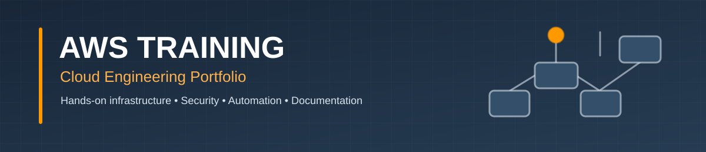

  

# AWS Training | Cloud Engineering Portfolio

A collection of **hands-on Amazon Web Services labs** documenting infrastructure configuration, cloud networking, identity and access management, Linux administration, command-line operations, troubleshooting, and responsible cleanup.

This repository serves as a technical portfolio of my practical work. Each completed lab explains 

* What I built.
* How I configured it. 
* Why the settings matter. 
* How I verified the results, and 
* What I would consider for a production environment. 

The documentation is designed to be useful both as engineering evidence and as a reproducible learning reference.

## AWS Hands-On Labs

These labs covers the core AWS services, infrastructure configuration, security, automation, and architecture. 

To open hands-on guides for each lab click the lab name within the table.

### IAM, EC2 & AWS CLI

| Lab Title | Focus | Technical work |
| --- | --- | --- |
| [AWS CLI Lab](Labs/Lab01-AWS-CLI/AWS-CLI-LAB.md) | Amazon VPC, IAM, EC2, Linux, AWS CLI, Amazon S3 | Configure a multi-AZ VPC and EC2 CLI workstation, manage IAM and S3 through CLI, verify outputs, and clean up resources. |
| [Identity and Access Management (IAM)](Labs/Lab03-AWS-IAM/AWS-IAM-Lab.md) | IAM users, groups, permissions, MFA | Create IAM identities, assign permission policies, and examine administrative access and authentication. |
| EC2 Key Pairs | Amazon EC2, SSH, key pairs | Create an EC2 key pair and use key-based authentication to connect to a Linux instance. |
| Amazon EC2 | EC2, AMIs, security groups, EBS | Launch and configure virtual servers with appropriate compute, network, security, and storage settings. |
| Elastic IP Addresses | EC2, Elastic IPs, public IPv4 | Allocate and associate a static public IPv4 address with an EC2 instance. |
| Windows EC2 and RDP | Windows Server on EC2, RDP, networking | Deploy a Windows EC2 instance and connect to it using Remote Desktop Protocol. |

### VPC Networking & Security

| Lab Title | Focus | Technical work |
| --- | --- | --- |
| Network Access Control Lists | VPC, NACLs, subnet associations | Create and configure subnet-level network ACL rules and explore stateless filtering. |
| NAT Gateway | NAT gateways, public/private subnets, route tables | Configure routing that allows private-subnet instances to initiate outbound internet connections. |
| VPC Flow Logs | VPC networking, flow logs, CloudWatch Logs, S3 | Capture and inspect IP traffic metadata for VPC network interfaces. |

### Storage

| Lab Title | Focus | Technical work |
| --- | --- | --- |
| Amazon S3 Buckets | Amazon S3, buckets, objects, access settings | Create buckets and work with object storage and bucket configuration. |
| [S3 Static Website Hosting & CloudFront Distribution](Labs/Lab04-S3-Static-Website-and-CloudFront/S3-Static-Website-and-CloudFront-Lab.md) | Amazon S3, CloudFront, EC2, AWS WAF, IAM, AWS CLI | Deploy an Apache website on EC2, publish static content to S3, configure public-read website hosting, deliver the website globally over HTTPS using CloudFront, and monitor requests with AWS WAF. |
| Amazon EBS | EBS volumes, EC2, block storage | Provision and manage block storage attached to EC2 instances. |
| Amazon EFS | Amazon EFS, shared file systems, EC2 | Configure a shared file system that can be accessed from EC2 workloads. |

### Automation & Application Integration

| Lab Title | Focus | Technical work |
| --- | --- | --- |
| [EC2 User Data Bootstrapping](Labs/Lab02-EC2-Bootstrapping/EC2-Bootstrapping-Lab.md) | EC2 user data, Linux, Apache, S3 | Automate instance initialization, install a web server, and explore instance metadata and S3 integration. |
| [CloudFormation Automated Multi-Region Web Infrastructure](Labs/Lab09-CloudFormation-Multi-Region-Web/CloudFormation-Multi-Region-Web-Lab.md)
AWS CloudFormation | CloudFormation, templates, stacks | Create AWS infrastructure from a CloudFormation template and examine the resulting stack. |
| Amazon SQS and SNS | SQS queues, SNS topics, subscriptions | Send and receive SQS messages and connect SNS notifications to subscribers. |
| AWS Lambda for EBS Cleanup | AWS Lambda, EBS, IAM roles | Build an automated workflow to identify and remove unused EBS volumes. |

### Databases & Machine Learning

| Lab Title | Focus | Technical work |
| --- | --- | --- |
| [Amazon RDS — MySQL Database Lab](Labs/Lab05-Amazon-RDS-MySQL/RDS-MySQL-Lab.md) | Amazon RDS, MySQL, EC2, VPC, IAM, Security Groups | Deploy a managed MySQL database in private subnets, configure secure EC2-to-RDS connectivity, and verify database access using the MySQL CLI. |
| Amazon DynamoDB | DynamoDB tables, queries, filters | Create a NoSQL table and practice querying and filtering its items. |
| Amazon SageMaker Canvas | SageMaker Canvas, no-code ML | Explore a no-code machine-learning workflow and interpret prediction limitations. |

### Monitoring, Auditing & Encryption

| Lab Title | Focus | Technical work |
| --- | --- | --- |
| [AWS CloudTrail — Auditing & Event Monitoring](Labs/Lab06-AWS-CloudTrail/AWS-CloudTrail-Lab.md) | AWS CloudTrail, S3, IAM, auditing | Configure a multi-Region trail, verify S3 log delivery, analyze Read/Write API events, and audit IAM user sign-in, password changes, and S3 tagging activity. |
| [CloudWatch Custom Metrics](Labs/Lab07-CloudWatch-Custom-Metrics/CloudWatch-Custom-Metrics-Lab.md) | Amazon CloudWatch, Amazon EC2, IAM, VPC, CloudWatch Agent, Amazon SNS | Build VPC networking, publish and graph custom EC2 memory metrics, and verify an SNS alarm email triggered by a real threshold breach. |
| AWS KMS, CloudTrail & S3 Encryption | AWS KMS, CloudTrail, S3, encryption | Explore key management, encryption, and auditing in an S3 workflow. |

### Load Balancing, DNS & Global Routing

| Lab Title | Focus | Technical work |
|---|---|---|
| Elastic Load Balancing | Elastic Load Balancing, EC2, targets | Distribute incoming application traffic across compute targets and examine load-balancer configuration. |
| [Amazon Route 53 — Complete Multi-Region DNS Project](Labs/Lab08-Route53-Multi-Region-DNS/Route53-Multi-Region-DNS-Lab.md) | **Route 53, Cloudflare, EC2, Apache, DNS, health checks** | **Complete hands-on project covering DNS delegation, multi-Region infrastructure, failover, latency-based routing, geolocation, and verified browser/VPN tests.** |
| [Route 53 Failover Routing](Labs/Lab08-Route53-Multi-Region-DNS/Route53-Multi-Region-DNS-Lab.md#05-active-passive-failover-routing) | Amazon Route 53, DNS, health checks | Configure active-passive DNS routing and verify automatic failover and recovery. |
| [Route 53 Latency-Based Routing](Labs/Lab08-Route53-Multi-Region-DNS/Route53-Multi-Region-DNS-Lab.md#06-latency-based-routing) | Amazon Route 53, latency routing, Regions | Use latency-based DNS policies to select among application endpoints in different AWS Regions. |
| [Route 53 Geolocation Routing](Labs/Lab08-Route53-Multi-Region-DNS/Route53-Multi-Region-DNS-Lab.md#07-geolocation-and-default-routing) | Amazon Route 53, geolocation DNS | Apply country- and state-based geographic rules, configure a default record, and verify regional website selection. |
| AWS Global Accelerator | Global Accelerator, EC2, global traffic | Explore global traffic routing through AWS Global Accelerator endpoints. |

## Capstone Projects

Capstone projects will bring several AWS services together in end-to-end architectures, with emphasis on secure design, implementation, testing, and operational decisions.

The labs also reinforce concepts relevant to the **AWS Certified Solutions Architect – Associate (SAA-C03)** exam.

## Disclaimer & Responsible Use

This repository is intended for educational purposes. Users are responsible for their own AWS configurations, security, and costs.

Please credit the original sources when sharing or adapting these materials.

[Read the full Disclaimer, Responsible Use & Attribution](DISCLAIMER.md)