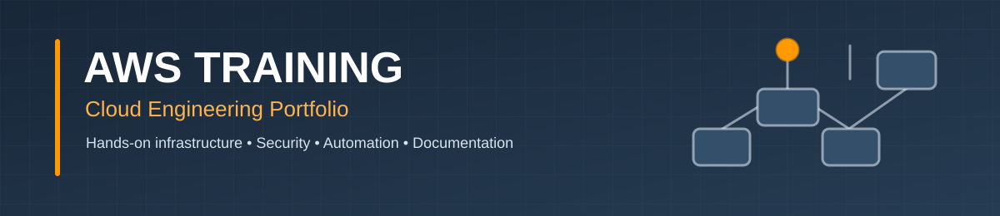

  

# AWS Training | Cloud Engineering Portfolio

A collection of **hands-on Amazon Web Services labs** documenting infrastructure configuration, cloud networking, identity and access management, Linux administration, command-line operations, troubleshooting, and responsible cleanup.

This repository serves as a technical portfolio of practical work. Each completed lab explains **what I built, how I configured it, why the settings matter, how I verified the results, and what I would consider for a production environment**. The documentation is designed to be useful both as engineering evidence and as a reproducible learning reference.

## AWS Hands-On Labs

The labs cover core AWS services, infrastructure configuration, security, automation, and architecture. Select a linked lab name to open its hands-on guide.

### IAM, EC2 & AWS CLI

| Lab | Focus | Technical work |
| --- | --- | --- |
| [AWS CLI Lab](Labs/Lab01-AWS-CLI/AWS-CLI-LAB.md) | Amazon VPC, IAM, EC2, Linux, AWS CLI, Amazon S3 | Configure a multi-AZ VPC and EC2 CLI workstation, manage IAM and S3 through CLI, verify outputs, and clean up resources. |
| Identity and Access Management (IAM) | IAM users, groups, permissions, MFA | Create IAM identities, assign permission policies, and examine administrative access and authentication. |
| EC2 Key Pairs | Amazon EC2, SSH, key pairs | Create an EC2 key pair and use key-based authentication to connect to a Linux instance. |
| Amazon EC2 | EC2, AMIs, security groups, EBS | Launch and configure virtual servers with appropriate compute, network, security, and storage settings. |
| Elastic IP Addresses | EC2, Elastic IPs, public IPv4 | Allocate and associate a static public IPv4 address with an EC2 instance. |
| Windows EC2 and RDP | Windows Server on EC2, RDP, networking | Deploy a Windows EC2 instance and connect to it using Remote Desktop Protocol. |

### VPC Networking & Security

| Lab | Focus | Technical work |
| --- | --- | --- |
| Network Access Control Lists | VPC, NACLs, subnet associations | Create and configure subnet-level network ACL rules and explore stateless filtering. |
| NAT Gateway | NAT gateways, public/private subnets, route tables | Configure routing that allows private-subnet instances to initiate outbound internet connections. |
| VPC Flow Logs | VPC networking, flow logs, CloudWatch Logs, S3 | Capture and inspect IP traffic metadata for VPC network interfaces. |

### Storage

| Lab | Focus | Technical work |
| --- | --- | --- |
| Amazon S3 Buckets | Amazon S3, buckets, objects, access settings | Create buckets and work with object storage and bucket configuration. |
| Amazon EBS | EBS volumes, EC2, block storage | Provision and manage block storage attached to EC2 instances. |
| Amazon EFS | Amazon EFS, shared file systems, EC2 | Configure a shared file system that can be accessed from EC2 workloads. |

### Automation & Application Integration

| Lab | Focus | Technical work |
| --- | --- | --- |
| EC2 User Data Bootstrapping | EC2 user data, Linux, Apache, S3 | Automate instance initialization, install a web server, and explore instance metadata and S3 integration. |
| AWS CloudFormation | CloudFormation, templates, stacks | Create AWS infrastructure from a CloudFormation template and examine the resulting stack. |
| Amazon SQS and SNS | SQS queues, SNS topics, subscriptions | Send and receive SQS messages and connect SNS notifications to subscribers. |
| AWS Lambda for EBS Cleanup | AWS Lambda, EBS, IAM roles | Build an automated workflow to identify and remove unused EBS volumes. |

### Databases & Machine Learning

| Lab | Focus | Technical work |
| --- | --- | --- |
| Amazon RDS | RDS, relational databases, VPC | Create and configure a managed relational database in an AWS networking environment. |
| Amazon DynamoDB | DynamoDB tables, queries, filters | Create a NoSQL table and practice querying and filtering its items. |
| Amazon SageMaker Canvas | SageMaker Canvas, no-code ML | Explore a no-code machine-learning workflow and interpret prediction limitations. |

### Monitoring, Auditing & Encryption

| Lab | Focus | Technical work |
| --- | --- | --- |
| AWS CloudTrail | CloudTrail, auditing, S3 | Create a trail and explore the collection of account activity and API event records. |
| CloudWatch Custom Metrics | Amazon CloudWatch, EC2, metrics | Configure CloudWatch access and work with custom monitoring metrics. |
| AWS KMS, CloudTrail & S3 Encryption | AWS KMS, CloudTrail, S3, encryption | Explore key management, encryption, and auditing in an S3 workflow. |

### Load Balancing, DNS & Global Routing

| Lab | Focus | Technical work |
| --- | --- | --- |
| Elastic Load Balancing | Elastic Load Balancing, EC2, targets | Distribute incoming application traffic across compute targets and examine load-balancer configuration. |
| Route 53 Failover Routing | Amazon Route 53, DNS, health checks | Configure active-passive DNS routing to direct traffic when a primary endpoint is unhealthy. |
| Route 53 Latency-Based Routing | Amazon Route 53, latency routing, Regions | Use latency-based DNS policies to select among application endpoints in different Regions. |
| Route 53 Geolocation Routing | Amazon Route 53, geolocation DNS | Apply geographic DNS routing policies according to the location of the DNS query. |
| AWS Global Accelerator | Global Accelerator, EC2, global traffic | Explore global traffic routing through AWS Global Accelerator endpoints. |

## Capstone Projects

Capstone projects bring several AWS services together in end-to-end architectures, with emphasis on secure design, implementation, testing, and operational decisions.

The labs also reinforce concepts relevant to the **AWS Certified Solutions Architect – Associate (SAA-C03)** exam.
