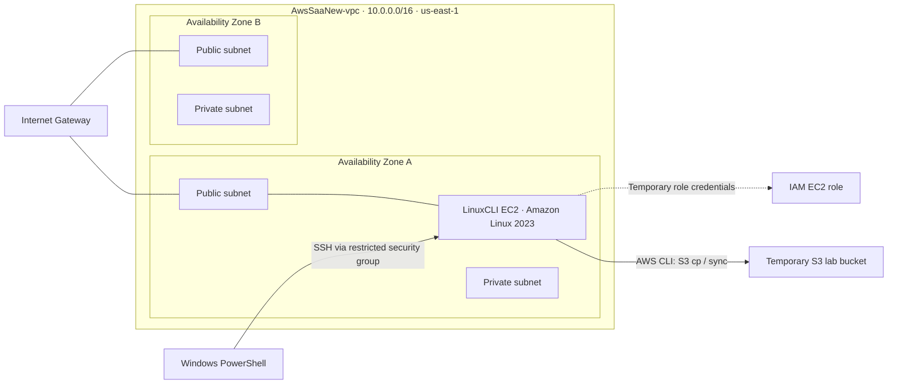

<p align="center">
  
</p>

# AWS Training | Cloud Engineering Portfolio

A collection of **hands-on Amazon Web Services labs** documenting infrastructure configuration, cloud networking, identity and access management, Linux administration, command-line operations, troubleshooting, and responsible cleanup.

This repository serves as a technical portfolio of practical work. Each completed lab explains **what I built, how I configured it, why the settings matter, how I verified the results, and what I would consider for a production environment**. The documentation is designed to be useful both as engineering evidence and as a reproducible learning reference.


## Portfolio Objectives

- **Build and configure** AWS resources using the Management Console and AWS CLI.
- **Apply foundational security principles**, including IAM permissions, instance roles, and restricted network access.
- **Validate configurations** through AWS API responses, service status checks, and CLI output.
- **Troubleshoot and document** configuration issues and the steps used to resolve them.
- **Manage resource lifecycles** by distinguishing reusable infrastructure from temporary lab resources.
- **Develop architectural judgment** around availability, cost, identity, and network design.

## Completed Hands-On Labs

| Lab | Focus | Technical work | Documentation |
| --- | --- | --- | --- |
| **01 — AWS CLI Lab** | VPC, IAM, EC2, Linux, AWS CLI, S3 | Built a multi-AZ VPC; configured an IAM admin and EC2 role; connected through SSH; executed and verified IAM/S3 commands; cleaned up temporary resources | **[Open Lab 01 →](Lab01-AWS-CLI-LAB/AWS-CLI-LAB.md)** |

*Additional labs will be listed here after they are completed and documented.*

## Technical Competencies

**Cloud networking:** VPC creation, CIDR planning, public and private subnets, availability zones, route tables, internet gateways, and network verification.

**Identity and security:** IAM users and groups, managed and inline policies, EC2 instance profiles, temporary credentials, security group ingress, and policy-evaluation concepts.

**Compute and Linux:** EC2 launch configuration, Amazon Linux 2023, SSH key-based access, Linux package management, and health checks.

**AWS CLI and automation foundations:** AWS CLI installation verification, Region/output defaults, STS identity checks, JSON/text/table responses, and repeatable resource commands.

**Storage and data operations:** S3 bucket management, object uploads, filtered synchronization, local-versus-remote persistence, and object recovery.

**Operational hygiene:** Verification-driven cleanup of IAM, S3, EC2, security groups, EBS resources, and public IPv4 allocations.

### Skills Matrix — Supported by Completed Work

| Engineering area | AWS technologies / tools | Evidence demonstrated | Lab |
| --- | --- | --- | --- |
| Networking | Amazon VPC, subnets, route tables, internet gateway | Created a `10.0.0.0/16` VPC with four subnets across two Availability Zones | [Lab 01](Lab01-AWS-CLI-LAB/AWS-CLI-LAB.md#01-building-the-aws-networking-environment) |
| Identity and access | IAM, roles, policies, instance profiles | Configured admin-group permissions, a dedicated EC2 role, and temporary IAM CLI resources | [Lab 01](Lab01-AWS-CLI-LAB/AWS-CLI-LAB.md#05-creating-iam-groups-users-and-policies-with-cli) |
| Compute and OS | EC2, Amazon Linux 2023, SSH, PowerShell | Launched a `t3.micro` CLI workstation, restricted SSH, connected, and checked system health | [Lab 01](Lab01-AWS-CLI-LAB/AWS-CLI-LAB.md#03-launching-a-secure-ec2-cli-workstation) |
| AWS CLI | AWS CLI v2, STS, EC2 APIs | Verified role-based credentials and compared JSON, text, and table output | [Lab 01](Lab01-AWS-CLI-LAB/AWS-CLI-LAB.md#04-connecting-to-linux-and-learning-aws-cli) |
| Object storage | Amazon S3, `cp`, `sync`, `rm` | Created a temporary bucket, transferred selected objects, and recovered files | [Lab 01](Lab01-AWS-CLI-LAB/AWS-CLI-LAB.md#06-working-with-amazon-s3-from-aws-cli) |
| Resource lifecycle | IAM, EC2, S3, EBS, Elastic IPs | Removed temporary resources, retained the VPC, and released unneeded Elastic IPs | [Lab 01](Lab01-AWS-CLI-LAB/AWS-CLI-LAB.md#07-cleaning-up-resources-and-verifying-the-result) |

## Architecture Highlight — Lab 01

The following shows the **environment used during the lab**, not a claim that every resource is still deployed. The VPC was retained; the temporary EC2 workstation, dedicated role, lab IAM resources, S3 test bucket, and Elastic IP allocations were subsequently removed.



## Engineering Development Roadmap

These are **planned learning areas**, not completed implementations. The roadmap will evolve as additional labs are carried out and documented.

| Area | Planned topics |
| --- | --- |
| **Networking and security** | Advanced VPC connectivity, NAT, VPC endpoints, route design, security boundaries, and IAM policy evaluation |
| **Compute and storage** | EC2 operational patterns, load balancing, Auto Scaling, EBS, S3 access controls, and lifecycle strategies |
| **Databases** | Relational and NoSQL service fundamentals, managed database availability, backup, and recovery |
| **Monitoring and operations** | Amazon CloudWatch, CloudTrail, logs, alerts, cost visibility, and operational troubleshooting |
| **Infrastructure as code** | AWS CloudFormation and repeatable, version-controlled infrastructure deployment |
| **High availability and resilience** | Multi-AZ workloads, scaling, recovery planning, and tradeoffs among availability, performance, and cost |

## Repository Structure

```text
AWS-Training/
├── README.md
├── assets/
│   └── aws-training-banner.svg
└── Lab01-AWS-CLI-LAB/
    ├── AWS-CLI-LAB.md
    └── images/
        ├── screenshot-01.png
        ├── screenshot-02.png
        ├── ...
        └── screenshot-63.png
```

Future completed labs will use the same structure: `LabNN-Descriptive-Name/Lab-Name.md`, with an `images/` folder beside the Markdown file.

## Documentation Approach

Each lab is an independent technical study guide containing its purpose, core AWS concepts, configuration choices, CLI commands, explanation of command behavior, verification steps, screenshots, troubleshooting or corrections, knowledge checks, and production considerations.

- Actual actions are documented in the **first person**; concept explanations use an instructional voice.
- Screenshots appear **beside the relevant step**, followed by brief, descriptive captions.
- Code blocks can be copied for practice, but resource names and placeholders must be adapted to the reader's account and Region.
- Temporary resources are explicitly distinguished from infrastructure deliberately retained for future labs.
- Public screenshots and examples are **redacted to omit unnecessary account-specific identifiers**. Redaction is for publication hygiene, not proof that resources or access controls are secure.

## AWS Certification Alignment

The labs also reinforce design and implementation concepts relevant to the **AWS Certified Solutions Architect – Associate (SAA-C03)** exam. The repository is primarily an engineering portfolio; it does **not** imply that the certification has been earned.

## Responsible Use

Resources in these tutorials may incur AWS charges. Before reproducing a lab, verify your Region, IAM permissions, resource names, estimated costs, and cleanup scope. Some screenshots reflect a completed and cleaned-up lab, rather than a currently running environment. Consult current AWS documentation when applying the concepts to production.
